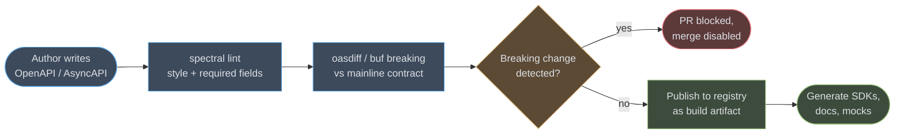
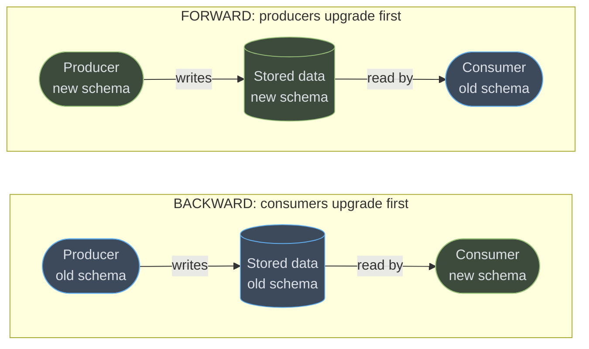
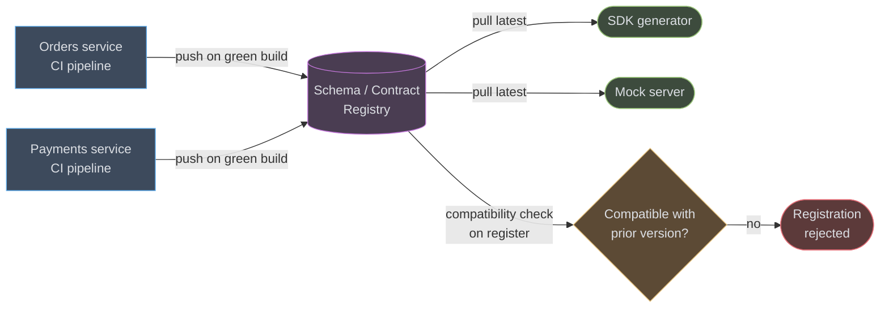
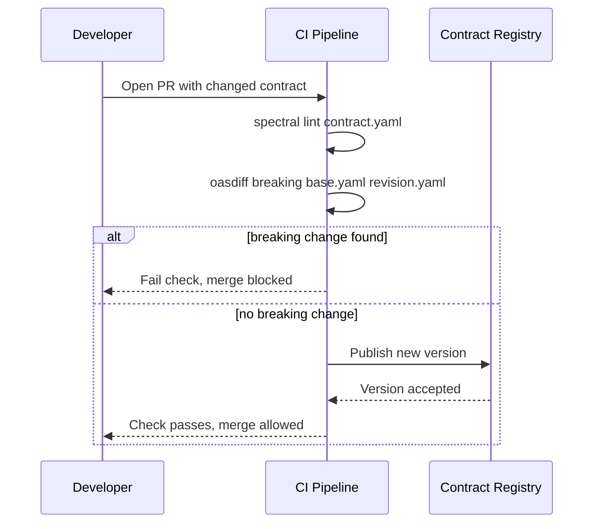
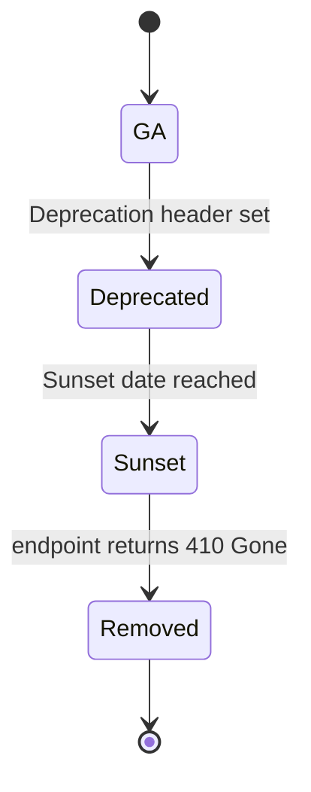

# API Contracts & Schema Governance

An API contract is only worth what enforces it. This module treats the contract — the
OpenAPI, AsyncAPI, or Protobuf document — as a deployable artifact in its own right, and
covers the machinery that keeps it honest: lint, diff, gate, publish, generate. It does
**not** cover how to design the resources, verbs, and status codes a REST contract
describes — that is [REST API Design](../rest_api_design/rest_api_design.md). This module
is about what happens after you have a contract: how you stop it from silently drifting
away from the code that is supposed to implement it.

---

## 1. Concept Overview

Every non-trivial API has two artifacts: the code that serves it, and a document that
describes it. The governance problem is simple to state and expensive to ignore — nothing
forces those two artifacts to agree. A handler can add a required field, remove a response
property, or change a status code, and the OpenAPI document sitting in the repo next to it
does not notice. If nothing machine-checks the two against each other, the contract
degrades from "the source of truth consumers can trust" to "documentation that was
accurate on the day someone last remembered to update it."

Schema governance is the discipline of treating the contract as a build artifact with its
own CI gate, not a Markdown file someone edits by hand after the fact. The contract is
linted for style and required fields, diffed against the previous published version for
breaking changes, gated in the PR pipeline before merge, published to a location
consumers can fetch, and used to generate the code (SDKs, mocks, validators) that would
otherwise be hand-written and prone to exactly the same drift. Four artifact families
cover most of what a backend team ships a contract for: OpenAPI (synchronous HTTP),
AsyncAPI (asynchronous, event-driven), Protobuf/Buf (RPC and event payload wire format),
and GraphQL SDL (a single evolving schema graph). Each is covered here as *what it
describes and what it enforces*, not as a resource-modeling guide.

---

## 2. Intuition

> **One-line analogy**: The contract is the blueprint; the running service is the building
> built from it. A blueprint nobody re-checks against the finished building is worthless
> the day the electrician reroutes a wall socket the drawing still shows somewhere else.

**Mental model**: the contract *is* the API, in the same sense that an interface is the
API and a class is one implementation of it. The Java service, the Python service, the
generated TypeScript client, and the mock server used in a downstream team's tests are all
implementations of that one contract. When people say "the API changed," what actually
changed first is either the contract (contract-first — code follows) or the code
(code-first — contract is regenerated from it, or drifts). Governance exists to make sure
whichever one happens first, the other one is machine-verified to still agree with it
before either one ships.

**Why it matters**: a wrong endpoint is a bug a human can spot in a code review. A wrong
*contract* is a bug three downstream teams discover independently, at different times, in
production, because each of them trusted the document instead of reading your source. The
cost of contract drift is not concentrated in one place — it is smeared across every
consumer, which is exactly what makes it invisible to the team that caused it.

**Key insight**: additive-only evolution plus a CI gate is cheaper than any amount of
tribal knowledge about "which fields are safe to touch." A rule a machine enforces on
every PR survives team turnover; a rule that lives in a senior engineer's head does not.

---

## 3. Core Principles

- **Contract-first, or at minimum contract-verified.** Either the contract is written
  before the handler and the handler is validated against it, or the contract is generated
  from the handler and diffed against the previous version before merge. What is never
  acceptable is a contract hand-edited independently of the code with nothing checking the
  two agree.
- **Additive-only evolution.** A new field, a new optional parameter, a new enum value (to
  a client that tolerates unknown values), and a new endpoint are safe. Removing a field,
  narrowing a type, adding a `required` constraint to an existing field, and removing an
  enum value are not — full stop, regardless of how small the change looks in a diff.
- **Machine-checked in CI, not by review.** A human reviewer misses a removed field in a
  400-line YAML diff on a Friday afternoon. A diff tool never does. Review is for whether
  the *shape* of the new contract is good API design; breaking-change detection is not a
  review job, it is a build step with an exit code.
- **Versioned and published somewhere consumers can fetch it.** A contract that lives only
  in a service's own repo, uploaded nowhere, read by nobody but the team that wrote it, is
  not governance — it is homework. Publish it to a registry (Buf Schema Registry, Confluent
  Schema Registry, an internal Backstage/Redocly catalog) as a build artifact of every
  green pipeline run, not a manual step someone remembers after the fact.

---

## 4. Types / Architectures / Strategies

### 4.1 What each format describes, and what it cannot

| Format | Describes | Cannot describe |
|---|---|---|
| **OpenAPI 3.2** | Synchronous HTTP request/response shape: paths, methods (including the new `query` method), parameters, request/response bodies, streaming media types, security schemes | Asynchronous message flows, event ordering, RPC semantics, binary wire layout |
| **AsyncAPI 3.1** | Asynchronous, event-driven message flows: channels, operations (`send`/`receive`), messages, per-protocol bindings (Kafka, AMQP, MQTT, WebSocket) — see [Event-Driven Fundamentals](../event_driven_fundamentals/event_driven_fundamentals.md) for the choreography/orchestration concepts these events implement | Synchronous request/response semantics; it documents *what* is published/consumed, not a call-and-wait contract |
| **Protobuf (via Buf)** | Exact binary wire format via field numbers and types; strong compile-time codegen for RPC (gRPC) and event payloads | Human-readable HTTP semantics like query parameters or headers, unless paired with gRPC-Gateway/Connect annotations — see [gRPC & Protobuf](../grpc_and_protobuf/grpc_and_protobuf.md) |
| **GraphQL SDL** | A single evolving type graph queried through one endpoint; fields marked `@deprecated` rather than versioned away | Multiple simultaneous API versions — GraphQL's evolution model is "add fields, deprecate old ones," not "cut a v2" — see [GraphQL](../graphql/graphql.md) |

### 4.2 Code-first vs. spec-first, and the drift each produces

**Spec-first**: the OpenAPI/AsyncAPI document is written or edited first, then the handler
is written to satisfy it (often with server-side request/response validation middleware
that rejects anything the spec didn't declare). Drift happens when someone edits the
handler under deadline pressure and "forgets to update the spec after" — which is why the
diff-in-CI gate exists: it catches exactly that omission.

**Code-first**: the contract is generated from annotations in the code itself
(`springdoc-openapi` scanning `@RestController` methods, Buf generating a `.proto`-derived
reflection descriptor). Drift here is subtler — the generated spec is *always* accurate to
the code by construction, but it can drift from what was *promised*: a handler quietly
returns a new field, the generator picks it up, the spec changes, and no human ever
decided that change was intentional. The fix is the same diff gate, run against the
*generated* spec on every PR — code-first does not remove the need for governance, it just
moves where drift can be introduced.

### 4.3 Compatibility modes (as Confluent Schema Registry defines them)

These four modes are usually explained for Avro/Kafka schemas, but the same reasoning
applies to any versioned contract — REST request bodies, event payloads, RPC messages:

- **BACKWARD** (the default): a client using the *new* schema can read data produced under
  the *previous* schema. Safe changes: remove a field, add an optional field with a
  default.
- **FORWARD**: a client using the *previous* schema can read data produced under the *new*
  schema. Safe changes: add a field, remove a field that had a default.
- **FULL**: both BACKWARD and FORWARD hold simultaneously — only changes safe in both
  directions are allowed. This is the strictest single-hop mode.
- **TRANSITIVE variants** (`BACKWARD_TRANSITIVE`, `FORWARD_TRANSITIVE`, `FULL_TRANSITIVE`):
  check the new schema against *every* previously registered version, not just the
  immediately prior one. Without transitivity, three small pairwise-compatible changes in
  a row can still leave version 4 incompatible with version 1 — a consumer pinned on an
  old version silently breaks even though no single step looked breaking.

[Kafka Deep Dive](../kafka_deep_dive/kafka_deep_dive.md) covers Confluent Schema Registry
mechanics — schema IDs, subject naming, the REST compatibility check — in full; this
module is about the governance *pipeline* these modes plug into, not the registry's wire
protocol.

---

## 5. Architecture Diagrams

### The governance pipeline



Six stages, and the load-bearing one is the fourth: nothing downstream of `gate` runs
until the diff step returns a clean result, which is what turns "someone is supposed to
check this" into "the pipeline physically cannot proceed otherwise."

### Breaking vs. additive — the change matrix

```
  Change to an existing field or operation      Backward-safe?   Forward-safe?
  ----------------------------------------      --------------   --------------
  add an optional field                              yes              yes
  add a new endpoint / operation                     yes              yes
  add a new enum value (tolerant client)              yes              yes
  add a new enum value (strict client)                 no              yes
  add a `required` constraint to a field               no              yes
  remove a field                                      yes               no
  remove an enum value                                 no               no
  widen a type   (integer -> number)                  yes               no
  narrow a type  (number -> integer)                   no              yes
  rename a field (add+remove, same meaning)            no               no
  change a field's meaning without renaming it          -   silently wrong, no tool sees it
```

Backward-safe means a consumer built against the *new* shape can still read data produced
under the *old* one; forward-safe means the reverse. The last row is the one no linter
catches: a same-named, same-typed field whose semantics quietly changed is invisible to
every tool in this module, which is why code review still matters for meaning, even though
it should never be the thing catching a removed field.

### Producer/consumer compatibility direction



BACKWARD compatibility is the one that lets you deploy new *consumers* first — they must
already tolerate data still written under the old schema. FORWARD is the mirror case:
deploy new *producers* first, and old consumers must still tolerate what they emit. Picking
the wrong mode for your rollout order is a common source of the "safe" deploy that wasn't.

### Registry topology



Every service pushes its own contract to one shared registry on every green build; the
registry itself is what rejects an incompatible registration, which is what makes the
registry — not the individual service's CI — the actual enforcement point once more than
one team is publishing against it.

### The gate as a PR check



The `alt` branch is the whole point of this diagram: lint and diff both run unconditionally
on every PR, but only a clean diff reaches the publish step — a linted-but-breaking contract
never makes it to the registry.

### Deprecation lifecycle



`Deprecated` and `Sunset` are not the same event — RFC 9745's `Deprecation` header marks
"this will go away," RFC 8594's `Sunset` header marks the concrete date it does, and the
gap between them is the migration window you are giving consumers. See §6.5 for the
headers themselves.

---

## 6. How It Works — Detailed Mechanics

### 6.1 An OpenAPI 3.2 document using features that do not exist in 3.1

OpenAPI 3.2.0 (released September 19, 2025) added the `query` HTTP method for safely
querying resource state with a request body, first-class streaming media types with an
`itemSchema` describing one item in the stream, and hierarchical tags with `summary`,
`parent`, and `kind`. None of the three below can be expressed in 3.1 without an
`x-` extension:

```yaml
openapi: 3.2.0
info:
  title: Orders Contract
  version: 4.2.0

tags:
  - name: orders
    summary: Order lifecycle operations
    kind: nav
  - name: orders.search
    summary: Complex order search
    parent: orders

paths:
  /orders/search:
    query:                        # new in 3.2 — GET-like semantics, POST-sized body
      tags: [orders.search]
      operationId: searchOrders
      requestBody:
        required: true
        content:
          application/json:
            schema:
              type: object
              properties:
                status: { type: string, enum: [PENDING, SHIPPED, CANCELLED] }
                minTotalCents: { type: integer, minimum: 0 }
      responses:
        "200":
          description: Matching orders
          content:
            application/json:
              schema:
                type: array
                items: { $ref: "#/components/schemas/Order" }

  /orders/{id}/events:
    get:
      tags: [orders]
      operationId: streamOrderEvents
      parameters:
        - name: id
          in: path
          required: true
          schema: { type: string }
      responses:
        "200":
          description: Live order status stream
          content:
            text/event-stream:               # new in 3.2 — first-class streaming type
              itemSchema:                    # new in 3.2 — shape of one streamed event
                $ref: "#/components/schemas/OrderEvent"

components:
  schemas:
    Order:
      type: object
      required: [id, status]
      properties:
        id: { type: string }
        status: { type: string, enum: [PENDING, SHIPPED, CANCELLED] }
        totalCents: { type: integer }
    OrderEvent:
      type: object
      required: [orderId, status, occurredAt]
      properties:
        orderId: { type: string }
        status: { type: string, enum: [PENDING, SHIPPED, CANCELLED] }
        occurredAt: { type: string, format: date-time }
```

`query` matters because `GET` has no body in practice (many proxies and clients drop it),
so a complex, idempotent search either abuses `POST` — which strict tooling then flags as
non-idempotent — or grows an unwieldy query-string encoding. `itemSchema` matters because
before 3.2 there was no standard way to say "this SSE/JSON-Lines stream emits values
shaped like X" — consumers had to infer it from prose.

### 6.2 An AsyncAPI channel document for a Kafka topic

AsyncAPI 3.0.0 (December 2023) is the current major version — a from-scratch redesign of
the 2.x object model that detached channels from operations so a channel purely describes
a topic and its message shape, while a separate `operations` block says who sends or
receives it. AsyncAPI 3.1.0 is the current minor release and added no breaking changes
over 3.0.0.

```yaml
asyncapi: 3.0.0
info:
  title: Order Events
  version: 2.1.0

channels:
  orderEvents:
    address: orders.events.v2
    messages:
      orderShipped:
        payload:
          type: object
          required: [orderId, shippedAt]
          properties:
            orderId: { type: string }
            shippedAt: { type: string, format: date-time }
    bindings:
      kafka:
        topic: orders.events.v2
        partitions: 12
        replicas: 3

operations:
  publishOrderShipped:
    action: send
    channel:
      $ref: "#/channels/orderEvents"
    messages:
      - $ref: "#/channels/orderEvents/messages/orderShipped"

  consumeOrderShipped:
    action: receive
    channel:
      $ref: "#/channels/orderEvents"
    messages:
      - $ref: "#/channels/orderEvents/messages/orderShipped"
```

The `action: send` / `action: receive` split is the piece that changed most from AsyncAPI
2.x — a single channel now supports both directions without redefining it twice, which is
what makes request/reply and fan-out patterns representable without duplicated schemas.

### 6.3 Linting with a custom Spectral ruleset

```yaml
# .spectral.yaml
extends: ["spectral:oas"]

rules:
  operation-operationid-required:
    description: Every operation must declare an operationId (SDK generators key off it)
    severity: error
    given: "$.paths[*][get,post,put,patch,delete,query]"
    then:
      field: operationId
      function: truthy

  deprecated-operations-need-sunset:
    description: A deprecated operation must document its sunset extension
    severity: error
    given: "$.paths[*][*][?(@.deprecated==true)]"
    then:
      field: "x-sunset"
      function: truthy

  no-nullable-required-field:
    description: A field cannot be both required and nullable — pick one
    severity: warn
    given: "$.components.schemas[*]"
    then:
      function: schema
      functionOptions:
        schema:
          type: object
          not:
            required: ["nullable"]
```

```bash
npx @stoplight/spectral-cli lint contracts/orders-api.yaml \
  --ruleset .spectral.yaml \
  --fail-severity=warn
```

`--fail-severity=warn` is the flag that turns style guidance into a build gate — without
it, Spectral prints warnings and still exits 0, and a ruleset nobody enforces is a ruleset
nobody follows six months in.

### 6.4 Wiring the diff gate into a GitHub Actions PR check

```yaml
name: contract-gate
on:
  pull_request:
    paths:
      - "contracts/**"
      - "proto/**"

jobs:
  openapi-breaking-check:
    runs-on: ubuntu-latest
    steps:
      - uses: actions/checkout@v4
        with:
          fetch-depth: 0

      - name: Lint with Spectral
        run: |
          npx @stoplight/spectral-cli lint contracts/orders-api.yaml \
            --ruleset .spectral.yaml --fail-severity=warn

      - name: Fetch mainline contract
        run: git show origin/main:contracts/orders-api.yaml > /tmp/base.yaml

      - name: Check for breaking changes
        run: |
          curl -sSfL https://raw.githubusercontent.com/oasdiff/oasdiff/main/install.sh | sh
          ./oasdiff breaking /tmp/base.yaml contracts/orders-api.yaml

  protobuf-breaking-check:
    runs-on: ubuntu-latest
    steps:
      - uses: actions/checkout@v4
      - uses: bufbuild/buf-action@v1
        with:
          breaking_against: ".git#branch=main"
```

`oasdiff breaking` takes the base and revision specs as positional arguments and exits `1`
the moment it finds a breaking change — no flag needed to fail the step, the process exit
code does it. `buf-action@v1` is the current unified action (it replaced the older,
separate `buf-breaking-action` and `buf-lint-action`, which still work but take no new
development); on a PR it runs build, lint, format, and breaking checks together and posts
one summary comment.

### 6.5 Emitting `Deprecation` and `Sunset` headers (RFC 9745 / RFC 8594)

`Deprecation` (RFC 9745, Proposed Standard) carries an RFC 9651 structured-field Date —
seconds since the Unix epoch, prefixed with `@`. `Sunset` (RFC 8594, Informational) carries
a traditional IMF-fixdate HTTP-date, the same format `Expires` uses — a different format
from `Deprecation` for historical reasons, not a typo. RFC 9745 requires the `Sunset`
timestamp to never be earlier than the `Deprecation` one.

```java
@RestController
@RequestMapping("/v1/legacy-orders")
public class LegacyOrderController {

    // 2025-12-01T00:00:00Z as a structured-field Unix timestamp
    private static final String DEPRECATION_TIMESTAMP = "@1764547200";
    // IMF-fixdate — six months later, giving consumers a fixed migration window
    private static final String SUNSET_DATE = "Mon, 01 Jun 2026 00:00:00 GMT";
    private static final String DEPRECATION_LINK =
        "<https://developer.example.com/changelog/2025-12-legacy-orders>; rel=\"deprecation\"";

    private final LegacyOrderService orderService;

    public LegacyOrderController(LegacyOrderService orderService) {
        this.orderService = orderService;
    }

    @GetMapping("/{id}")
    public ResponseEntity<OrderResponse> get(@PathVariable String id) {
        return ResponseEntity.ok()
            .header("Deprecation", DEPRECATION_TIMESTAMP)
            .header("Sunset", SUNSET_DATE)
            .header("Link", DEPRECATION_LINK)
            .body(orderService.find(id));
    }
}
```

The `Link` header with `rel="deprecation"` is what RFC 9745 defines for pointing a client
at human-readable migration docs — without it, a client's tooling can detect *that*
something is deprecated but has nowhere machine-readable to send an engineer to find out
*why* or *what to do about it*.

### 6.6 Generating an SDK from the published contract

```bash
# TypeScript client from the OpenAPI contract
openapi-generator-cli generate \
  -i https://contracts.example.com/orders-api/v4.2.0/openapi.yaml \
  -g typescript-fetch \
  -o ./generated/orders-client \
  --additional-properties=supportsES6=true

# Go client and server stubs from the Protobuf contract, via Buf
buf generate --template buf.gen.yaml buf.build/example/orders-api
```

Both commands read from the *published, versioned* contract, not a local file someone
might have edited without running the lint/diff gate — generating from the registry is
what keeps a hand-maintained SDK from becoming its own, third, silently-drifting copy of
the contract.

---

## 7. Real-World Examples

**Stripe** — date-based API versioning. Every account is pinned to whichever version was
current when the account was created (e.g. `2026-07-29`), and a request can override it
per-call with a `Stripe-Version` header to test against a newer version before switching
the account default. New major versions with breaking changes ship roughly twice a year;
old ones keep working indefinitely for accounts still pinned to them, which is what lets
Stripe evolve request/response shapes without ever forcing a synchronized migration across
every integration.

**GitHub REST API** — header-based calendar versioning via `X-GitHub-Api-Version`, naming
each version by its release date (e.g. `2026-03-10`). A request with no header defaults to
the `2022-11-28` baseline version. Each version is supported for at least 24 months after
its successor ships, and requesting a version past its support window returns `410 Gone` —
not a silent fallback, a hard failure that forces the client to notice.

**Buf Schema Registry (BSR)** — a hosted registry for Protobuf schemas that runs `buf
breaking` on every push, blocks incompatible registrations, and serves as the source
`buf generate` and downstream consumers pull from — the Protobuf-world equivalent of a
package registry, except the artifact is the contract, not the compiled library.

**Confluent Schema Registry** — the Kafka-world equivalent, enforcing a per-subject
compatibility mode (BACKWARD by default) on every schema registration and rejecting an
incompatible one at register time, before any producer using it can write a single
message. See [Kafka Deep Dive](../kafka_deep_dive/kafka_deep_dive.md) §11 for the full
mode list and REST API.

---

## 8. Tradeoffs

| Choice | Favors A when | Favors B when |
|---|---|---|
| **Spec-first (A) vs. code-first (B)** | Multiple teams build against a not-yet-implemented API; the spec is the design artifact | One team owns both sides and wants the spec to always match running code exactly |
| **Registry (A) vs. spec-in-repo only (B)** | More than one consumer needs to discover and generate against the contract | A single internal service with one, in-repo consumer — a registry is pure overhead |
| **Strict lint gate (A) vs. advisory-only (B)** | The team has capacity to fix violations promptly; style consistency matters across many contracts | An early-stage contract still churning weekly — a hard gate just gets bypassed with `--no-verify` habits |
| **URL versioning `/v2/orders` (A) vs. header/date versioning (B)** | Consumers need to see the version in the URL for caching, routing, or debugging | You want to evolve without forcing every client to change a URL — Stripe and GitHub both chose B |
| **JSON Schema / OpenAPI as source of truth (A) vs. Protobuf (B)** | The API is REST/HTTP-first and consumed mostly by browsers and scripting clients | The API is RPC-first, binary-efficient, and cross-language codegen fidelity matters more than human readability |

Header-based versioning (Stripe, GitHub) pushes the version-selection decision to whatever
sits in front of the service — often an [API Gateway](../api_gateway_patterns/api_gateway_patterns.md)
routing or rewriting on the version header rather than the service parsing it itself.

---

## 9. When to Use / When NOT to Use

**Adopt full governance — lint, diff-gated CI, a published registry — from the moment the
API has its first external consumer**, meaning any consumer your team does not deploy in
lockstep with the provider. That is the point where "we'll just tell people on Slack"
stops being a viable change-management strategy, because you no longer know who all the
consumers are.

**Do NOT gate an internal, single-consumer API on a full pipeline.** If one team owns both
the provider and the only consumer, and they deploy together, a diff gate against a
registry is pure ceremony — the two sides can never actually drift apart because the same
PR changes both. A lightweight lint step is still cheap insurance; a registry, a
compatibility mode, and a generated-SDK step are not worth the maintenance cost until a
second, independently-deployed consumer shows up. Add the pipeline when that consumer
appears, not preemptively "for when we scale."

---

## 10. Common Pitfalls

**A generated spec silently diverged from the handlers for 14 months.** A team adopted
code-first generation (`springdoc-openapi` scanning controllers) and treated the generated
YAML as documentation, publishing it once and never regenerating it in CI. Over 14 months,
six fields were added to responses and two required-request-body fields were relaxed to
optional directly in the handlers — none of it reflected in the published spec, because
nothing regenerated and republished it on merge. A partner integration built against the
stale spec started getting fields it had no model for and silently dropped them, losing
data downstream for weeks before anyone noticed the mismatch. Fix: regenerate and publish
the spec as a CI step on every merge to main, not as a manual "documentation update" task.

**A "non-breaking" enum value addition broke every strict client.** Adding a new value to
an existing enum passes every backward-compatible-schema check that only looks at field
presence and type — and it is genuinely safe for a tolerant client that ignores unknown
enum values. It is not safe for a client using strict schema validation (many generated
Java/TypeScript clients default to this), which throws on any value outside the set it was
compiled against. The fix is not "never add enum values" — it is documenting, at the
governance level, whether your consumers are contractually required to tolerate unknown
enum values, and treating an enum addition as breaking in the diff gate if any are not.

**The REST URL was versioned but the Kafka event payloads for the same domain were never
touched.** A team meticulously versioned `/v1/orders` to `/v2/orders` on every breaking
REST change, then discovered eighteen months later that the `OrderShipped` Kafka event
those same endpoints triggered had accumulated four incompatible field changes with zero
compatibility mode set on its Schema Registry subject — it had been left on `NONE` since
the topic's creation. Every REST-facing breaking change gets attention because a client
error shows up immediately; an event-payload breaking change surfaces as a downstream
consumer failing quietly, sometimes days later, correlated to nothing recent in that
consumer's own deploy history. Governance has to cover every contract a domain emits, not
just the one facing the browser.

**A `required` field was added to a request body and shipped as a patch release.** Someone
reasoned "the field will always be present in practice, this is just tightening the
schema" and bumped the patch version. Every existing client that omitted the field — which
had been legal under the old schema — started failing validation on the next deploy.
Adding a `required` constraint to a previously-optional field is a breaking change by
definition (a request that was valid before is now rejected), regardless of how confident
anyone is that the field is "basically always sent." The diff-gate rule that catches this
does not have an exception for "but it's obviously fine."

**A Schema Registry subject was set to `NONE` compatibility to unblock a deploy.** Under
deadline pressure, an engineer facing a registration rejection set the subject's
compatibility mode to `NONE` rather than fix the incompatible schema, shipped the deploy,
and never set it back. Six weeks later an unrelated, genuinely breaking schema change
sailed through the same subject with zero warning, because the safety mechanism had been
off since the earlier incident. Treat a compatibility-mode change as itself a reviewed,
audited action — never a routine unblock step — and alert on any subject that drifts away
from your organization's default mode.

---

## 11. Technologies & Tools

| Tool | Role |
|---|---|
| Spectral | JSON/YAML linter for OpenAPI, AsyncAPI, and Arazzo; style and required-field rules, custom rulesets |
| Redocly CLI | Lint, bundle, and generate docs for OpenAPI/AsyncAPI/Arazzo descriptions; `redocly lint` |
| oasdiff | OpenAPI diff and breaking-change detector; `oasdiff breaking` returns a CI-friendly exit code |
| Buf + BSR | Protobuf build, lint, breaking-change detection, and a hosted schema registry; `buf breaking`, `buf generate` |
| Arazzo | OpenAPI Initiative spec (current: 1.1.0) for describing multi-step API *workflows* across operations — not a replacement for OpenAPI, a layer on top of it |
| springdoc-openapi | Generates an OpenAPI 3.1 document from Spring Boot 4.x controller annotations at runtime or build time |
| Confluent Schema Registry | Kafka schema storage and compatibility enforcement (Avro, Protobuf, JSON Schema); see [Kafka Deep Dive](../kafka_deep_dive/kafka_deep_dive.md) |
| AsyncAPI Generator | Generates docs, code, and HTML from AsyncAPI documents |
| Pact | Consumer-driven contract testing — see below for how it complements schema governance |
| openapi-generator-cli | Generates SDKs and server stubs in 50+ languages from an OpenAPI document |

**Contract testing complements, not replaces, schema/diff checks.** A lint or diff gate
verifies the contract document is well-formed and hasn't broken its own previous version —
it never runs the provider's actual code. Pact verifies the opposite thing: that the
*running provider* really produces what a *specific consumer* actually expects, by
replaying consumer-recorded interactions against the live provider in CI. A schema diff
can pass while the handler still returns something the schema doesn't quite match (rare,
but possible with loose codegen); a Pact verification catches that because it exercises
real code, not just the document. Run both — see
[Backend Testing Strategies](../backend_testing_strategies/backend_testing_strategies.md)
for where contract tests sit in the wider testing pyramid.

---

## 12. Interview Questions with Answers

**Q: What is the actual failure mode that schema governance exists to prevent?**
**Short:** A contract nobody machine-checks drifts silently away from the code, and every consumer discovers it separately.

A hand-maintained OpenAPI or AsyncAPI document has no mechanism forcing it to stay accurate to the code that implements it — a handler can add a required field or drop a response property and the document simply does not notice. The cost is not concentrated where the mistake happened; it is smeared across every downstream consumer who trusted the document, each of whom discovers the mismatch independently, often in production, often weeks apart. Governance replaces "someone remembers to update the doc" with a CI step that cannot merge a PR where the two disagree.

**Q: Why is adding a `required` constraint to a previously optional field breaking, even if "the field is basically always sent in practice"?**
**Short:** Any request that was valid under the old schema and now gets rejected is breaking by definition, regardless of frequency.

Backward compatibility is about what the schema *permits*, not what producers *typically* send. A request omitting that field was legal before the change and is rejected after it — that is the definition of a backward-incompatible change, independent of how rare an omitted field actually was in production traffic. This is one of the most common "obviously safe" changes that still needs to go through the diff gate rather than being waved through in review, because the person making the change is reasoning about typical traffic, not about the contract's actual guarantees.

**Q: Why does removing a value from an enum break both backward and forward compatibility, while adding one only sometimes breaks anything?**
**Short:** Removing a value can orphan already-produced data; adding one only breaks clients that reject unknown values.

Removing an enum value means data already written with that value can no longer be validated by the new schema (backward-unsafe) and a new producer can never again emit something an old consumer expecting that value could still see (forward-unsafe) — there is no direction in which removal is safe. Adding a value is safe for a tolerant client that ignores values outside what it recognizes, but unsafe for a strict client — often a generated Java or TypeScript client compiled against a closed enum — that throws on anything outside its known set. The practical fix is deciding, at the governance level, whether your consumers are contractually obligated to tolerate unknown enum values, and gating enum additions as breaking if any are not.

**Q: What does BACKWARD compatibility mean in Confluent Schema Registry, concretely?**
**Short:** A client on the new schema can still read data that was written under the previous schema version.

BACKWARD is the Schema Registry default: a consumer that upgrades to the new schema must be able to deserialize data a producer wrote before the upgrade happened. Practically, this is what lets you deploy new *consumers* first and roll producers forward later, because consumers are the side required to tolerate the old shape. It is the opposite guarantee of FORWARD, which is what lets you deploy new *producers* first instead — picking the wrong mode for your intended rollout order is what causes a deploy that everyone believed was "compatible" to still break something.

**Q: What is the difference between OpenAPI and AsyncAPI, and when do you need both for the same domain?**
**Short:** OpenAPI describes synchronous request/response HTTP; AsyncAPI describes asynchronous, event-driven message flows.

OpenAPI documents paths, methods, and the request/response shapes a client calls and waits on. AsyncAPI documents channels, operations (`send`/`receive`), and message payloads that flow with no caller waiting on an immediate response — a Kafka topic, an AMQP queue, a WebSocket stream. A single domain frequently needs both: an Orders service might expose a REST API for placing an order (OpenAPI) and publish an `OrderShipped` event to Kafka when it does (AsyncAPI) — versioning and gating only the REST contract while leaving the event payload ungoverned is a common, expensive gap (see §10).

**Q: What is genuinely new in OpenAPI 3.2 that did not exist in 3.1?**
**Short:** The `query` HTTP method, first-class streaming media types with `itemSchema`, and hierarchical tags.

OpenAPI 3.2.0 (released September 19, 2025) added `query` as a path-item-level operation — GET-like idempotent semantics with a request body, for searches too complex for a query string. It added `itemSchema` on streaming-friendly media types (`text/event-stream`, `application/jsonl`, `application/json-seq`, `multipart/mixed`) to describe the shape of one streamed item, which previously had no standard representation. It also added hierarchical tags (`summary`, `parent`, `kind`) for building a tag taxonomy, and an OAuth 2.0 Device Authorization Flow for limited-input devices. All of it is additive — a 3.1 document remains a valid 3.2 document.

**Q: How does Protobuf's approach to compatibility differ fundamentally from OpenAPI/JSON Schema's?**
**Short:** Protobuf ties compatibility to immutable field numbers on the wire; JSON Schema ties it to field names and types.

A Protobuf message's wire format is keyed by field *number*, not name — renaming a field is free as long as the number and wire type don't change, but reusing a retired field number for something new is catastrophically breaking because old binary data on the wire is reinterpreted under the new meaning. JSON Schema-based formats have no numbered-field concept at all; compatibility is entirely about field presence, type, and `required` status. This is why `buf breaking` and `oasdiff breaking` check almost entirely different rule sets even though both call themselves "breaking change detectors" — they are protecting different invariants.

**Q: Why must a diff/breaking-change check run in CI rather than rely on code review?**
**Short:** A removed field in a 400-line spec diff is easy for a human to miss and trivial for a diff tool to catch.

Code review is well suited to judging whether a new contract's *shape* is good API design — naming, resource modeling, whether an endpoint belongs where it's placed. It is poorly suited to reliably catching a single removed field or newly-required parameter buried in a large generated diff, especially under time pressure on a Friday afternoon. A diff tool never gets tired and never has an incentive to approve quickly; making the check a build step with an exit code turns "we're supposed to catch this in review" into "the pipeline cannot proceed if this is wrong."

**Q: What is the difference between the `Deprecation` and `Sunset` HTTP response headers?**
**Short:** Deprecation (RFC 9745) marks when a resource became deprecated; Sunset (RFC 8594) marks when it stops working.

`Deprecation` carries a structured-field Unix timestamp (`@1764547200`) marking the point a resource is or will be deprecated, while `Sunset` carries a traditional HTTP-date marking when it will stop responding entirely — RFC 9745 requires the Sunset timestamp never be earlier than the Deprecation one. Together they define a two-phase lifecycle: deprecation announces the migration window opening, sunset announces when it closes. RFC 9745 also defines a `Link` header with `rel="deprecation"` pointing at human-readable migration docs, which is the piece that turns a machine-detectable flag into an actionable one for the engineer who has to act on it.

**Q: Why should you never gate a single-team, single-consumer internal API on a full contract-governance pipeline?**
**Short:** When the same PR can change both provider and consumer, drift between them is structurally impossible.

A diff gate, a published registry, and generated SDKs exist to protect consumers who are not deployed in lockstep with the provider — teams who cannot see the provider's PR before it merges. If one team owns both sides of an API and always deploys them together, there is no gap in time for the two to drift apart, so the entire pipeline is solving a problem that cannot occur yet. A lightweight lint step is still cheap and worth keeping; the registry and compatibility-mode machinery should be added the moment a second, independently-deployed consumer actually appears — not before, on the theory that it "will be needed eventually."

**Q: What does the `x-github-api-version` header default to if a client sends no version at all?**
**Short:** GitHub's REST API silently falls back to the 2022-11-28 baseline version when the header is omitted.

GitHub versions its REST API by release date via the `X-GitHub-Api-Version` header (for example `2026-03-10`); a request without the header is treated as targeting the `2022-11-28` version rather than failing. Each version stays supported for at least 24 months after a newer one ships, and requesting a version past its support window returns a hard `410 Gone` rather than silently serving an unexpected shape — the failure is loud specifically so a client can't drift onto behavior it never opted into.

**Q: How does Stripe's date-based versioning let it evolve the API without breaking every integration at once?**
**Short:** Each account is pinned to the API version active when it was created, and can test newer ones via a header.

Every Stripe account is "pinned" to whichever dated API version (e.g. `2026-07-29`) was current at account creation, and every request implicitly targets that pinned version unless a `Stripe-Version` header overrides it for that one call. This means Stripe can ship a new major version with genuinely breaking changes roughly twice a year without forcing every existing integration to migrate on the same day — old accounts keep receiving the old shape indefinitely, and a team migrates deliberately, one account or one request at a time, by bumping the header.

**Q: What is the actual difference between contract testing (Pact) and a schema diff/lint gate?**
**Short:** A schema diff checks the document against itself; Pact verifies the running provider against real consumer expectations.

`oasdiff` or `buf breaking` only ever compares two versions of a contract document — they never invoke the provider's actual running code, so they cannot catch a handler that quietly returns something subtly different from what its own generated spec claims. Pact is consumer-driven: the consumer's tests record the exact interactions it depends on, and CI replays those recorded interactions against the live provider, verifying the real implementation — not just its documentation — still satisfies them. The two are complementary layers, not substitutes: a passing diff means the contract didn't break itself; a passing Pact verification means the code still honors what a specific real consumer needs.

**Q: What is Arazzo, and how does it relate to OpenAPI rather than replace it?**
**Short:** Arazzo describes multi-step API workflows across operations that OpenAPI alone can only document individually.

OpenAPI documents each operation in isolation — what one endpoint does. Arazzo (current version 1.1.0) is a separate OpenAPI Initiative specification layered on top, describing a *workflow* that chains multiple operations together with explicit inputs, outputs, and success criteria — for example "create account, then verify email, then create subscription" — referencing each step by its OpenAPI `operationId` and passing runtime values (like a token from one response) into the next step. It does not replace per-operation documentation; it adds a machine-readable layer that can drive integration tests, automation, and production monitoring across a sequence your OpenAPI document alone has no way to express.

**Q: What happened to Optic, and what replaced it for OpenAPI diff-gate tooling?**
**Short:** Optic's GitHub repository was archived in January 2026 after Atlassian's acquisition; oasdiff is the direct replacement.

Optic was a widely used open-source OpenAPI diffing and linting tool that combined breaking-change detection with style rules in a single tool. Its repository was archived in January 2026, following Atlassian's 2024 acquisition of the company behind it, and it is no longer maintained. Teams that relied on it for spec-to-spec diffing in CI have migrated to `oasdiff` for breaking-change detection paired with Spectral or Redocly CLI for linting — the same two-tool split this module's pipeline uses, rather than one tool doing both jobs.

**Q: How does GraphQL evolve its schema without ever cutting a "v2," and what does that mean for governance?**
**Short:** GraphQL fields are marked `@deprecated` and left in place rather than removed at a version boundary.

A GraphQL service exposes one continuously evolving schema graph rather than parallel versioned endpoints — a field a client no longer should use is annotated `@deprecated(reason: "...")` and kept resolvable, not deleted, until usage genuinely drops to zero and an operator makes the deliberate call to remove it. This means "breaking change" in GraphQL governance is almost entirely about actual field/type removal or a type change, not about anything resembling a version bump — the governance question is "is anything still querying this deprecated field," which requires usage telemetry on the resolver, not just a document diff. See [GraphQL](../graphql/graphql.md) for schema design and the `@deprecated` directive itself.

**Q: What's an example of a change that passes every automated compatibility check yet is still wrong?**
**Short:** A same-named, same-typed field whose real-world meaning silently changes passes every structural check.

Every tool in this module — Spectral, oasdiff, buf breaking, Schema Registry compatibility modes — checks structure: field presence, type, required-ness, enum membership. None of them understand semantics. A field named `amount` that quietly changes from "dollars" to "cents" without a type or name change passes a breaking-change check cleanly and corrupts every consumer that doesn't happen to notice the values got 100x larger. This is the argument for keeping human review in the pipeline even after a full lint/diff/gate setup exists — it is the only stage capable of catching a meaning change a machine cannot see.

**Q: When comparing schemas transitively (`FULL_TRANSITIVE`, `BACKWARD_TRANSITIVE`) versus against only the immediately prior version, what failure does transitivity prevent?**
**Short:** Transitive checks catch a chain of individually-safe changes that together break a consumer pinned to an old version.

A non-transitive check only compares version N to version N-1, so three consecutive, individually pairwise-compatible changes can still leave version 4 incompatible with version 1 — nobody ever compared them directly. A consumer that hasn't upgraded in a while, still reading against version 1, breaks the moment a producer starts emitting version 4, even though every single step in between looked "safe" in isolation. `FULL_TRANSITIVE` checks the new version against every previously registered version, not just the latest, which is the stronger — and slower to satisfy — guarantee most production Kafka topics with long-lived consumers should default to.

---

## 13. Best Practices

- **Lint every contract in CI**, with `--fail-severity` (or the equivalent) set high enough to actually block a merge — an advisory-only linter degrades into noise within a quarter.
- **Diff against the mainline contract on every PR**, using `oasdiff breaking` for OpenAPI and `buf breaking` for Protobuf, both wired to fail the build on a nonzero exit code.
- **Never hand-edit a generated spec.** If it's code-first, regenerate it as a CI step and diff the regenerated output — editing the YAML directly guarantees the next regeneration silently reverts your fix.
- **Publish the contract as a build artifact of every green pipeline run**, not a manual step — a registry or artifact store that only gets updated "when someone remembers" is not governance, it's a stale cache with extra steps.
- **Make the registry, not the repository, the deploy gate** once more than one team consumes the contract — a compatibility check that runs locally in one team's CI cannot protect a consumer in a different repository that never ran it.
- **Treat a Schema Registry compatibility-mode change as a reviewed, audited action**, never a routine unblock — a subject left on `NONE` after an incident is a silent policy regression waiting for the next breaking change to sail through unchecked.
- **Cover every contract a domain emits**, not just the REST-facing one — an event payload governed less strictly than its sibling REST API is exactly how the 14-month drift and the ungoverned-Kafka-topic pitfalls above happen.
- **Run contract testing (Pact) alongside schema diffing, not instead of it** — a diff protects the document against itself; contract tests protect the real running code against a real consumer's actual expectations.

---

## 14. Case Study

**The problem.** A payments platform's `orders-api` OpenAPI document had been hand-maintained
since launch, published once to an internal developer portal, and never regenerated or
diffed against the running service afterward. The handlers evolved normally over 14 months
— six response fields were added, two request-body fields that were originally required
were relaxed to optional, and one endpoint's error response shape changed from a flat
object to RFC 9457 Problem Details. None of it touched the published spec.

**How it was found.** A new partner integration, built entirely against the stale
document, began silently dropping the two newly-optional-but-documented-as-required
fields it had never learned to omit gracefully, and separately failed to parse the new
Problem Details error shape because its generated client expected the old flat structure.
Neither failure raised an alert on the provider's side — the provider's own tests exercised
its own code, which was correct; nothing exercised the document. The partner's integration
team spent three weeks assuming their own client had a bug before a support escalation
traced it back to the spec itself being fourteen months stale.

**What it cost.** Three weeks of a partner engineering team's time misattributing the
failure to their own code, a delayed go-live for the partner integration, and a rebuilt
trust cost with that partner that outlasted the technical fix by several sprints — the
partner's leadership asked, reasonably, what else in the documented contract could not be
trusted.

**The pipeline that fixed it.** The team moved to code-first generation via
`springdoc-openapi`, added a CI step that regenerated the spec on every merge to main and
diffed it against the previously published version with `oasdiff breaking`, and — critically
— made a breaking diff fail the build rather than only warn. They published the regenerated
spec to an internal registry as a build artifact of every green pipeline run, and pointed
the partner's SDK generation at that registry URL instead of a manually-shared file. Six
months later, a genuinely breaking change (removing a field the partner's client depended
on) was caught by the same gate before merge, on the PR that introduced it — the exact
failure mode the 14-month drift had made invisible, this time surfaced in code review
instead of a support ticket.

**The lesson.** A spec that is merely *published* is not governed; a spec is governed only
when something automated re-derives or re-checks it against the running code on every
change, and refuses to let the two disagree silently. Publishing once and trusting it
afterward is the same failure whether the spec is hand-written or generated — generation
only guarantees the spec matches the code at generation time, not that anyone ever
re-generates it.
