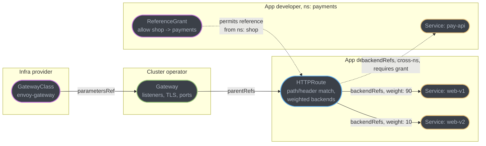
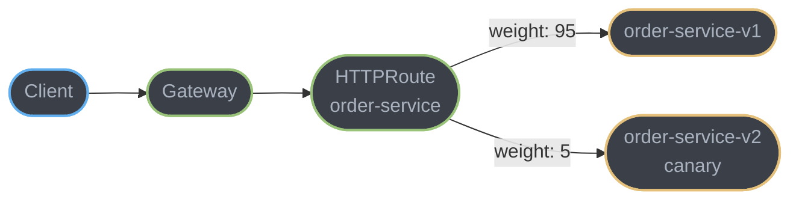
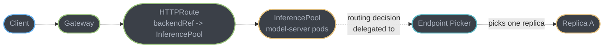

# Gateway API and Modern Proxies

`Ingress` shipped in Kubernetes 1.1 as the smallest resource that could plausibly route HTTP traffic into a cluster: a host, a path, a backend Service. It never grew role separation, traffic splitting, or portable header matching into its core spec, so every controller filled the gap with its own annotation dialect — and a decade later, "portable Ingress YAML" is a contradiction in terms. The Kubernetes Gateway API is the resource model built to replace that dialect with a typed, role-oriented, extensible one, and its adoption has reshaped which proxy a team reaches for. This sub-file covers the Gateway API resource model itself, the field of proxies now built to speak it, and the Inference Extension that lets the same resource model route LLM traffic.

---

## 1. Concept Overview

The Gateway API splits one Ingress resource's job across three resource kinds, each owned by a different persona: `GatewayClass` (an infrastructure provider names an implementation), `Gateway` (a cluster operator instantiates listeners on it), and `HTTPRoute`/`GRPCRoute`/`TLSRoute`/`TCPRoute`/`UDPRoute` (an application developer attaches routing rules to a `Gateway`, without touching infrastructure they don't own). A `ReferenceGrant` is the explicit opt-in a target namespace must create before a route in another namespace may reference something inside it — cross-namespace references are deny-by-default, not implicit. The API ships as two channels, Standard (GA, versioned as `v1`) and Experimental (versioned `v1alpha2` or, as of Gateway API v1.6, under a separate `gateway.networking.x-k8s.io` group for genuinely new proposals) — so "is this field stable" is a channel question, not a guess. Around this resource model sits a field of proxy implementations — Envoy Gateway, kgateway, Traefik, Apache APISIX, Kong, and others — that all compile the same `HTTPRoute` down to their own dataplane, the same way Istio and Envoy Gateway both compile down to xDS.

---

## 2. Intuition

Ingress is one shared whiteboard: every team writes routing rules on it in whatever notation their favorite controller understands, and a rule written for one controller's marker means nothing to another's. The Gateway API replaces the whiteboard with three separate documents, each with a named owner: the platform team writes the building's floor plan once (`GatewayClass`/`Gateway`), and every application team fills in only their own row on a shared form (`HTTPRoute`) using one notation everyone reads the same way — no annotation dialect, no controller-specific incantations, and a lock on any other team's row unless that team explicitly hands over the key (`ReferenceGrant`).

---

## 3. Core Principles

- **Role separation is structural, not conventional.** `GatewayClass` (infra provider), `Gateway` (cluster operator), and routes (app developer) are different resource kinds with different RBAC surfaces — a platform team can grant `HTTPRoute` write access without ever granting `Gateway` access.
- **Cross-namespace references are deny-by-default.** A route may not point at a Service or backend in another namespace without a `ReferenceGrant` created in the target namespace naming exactly what may reference it.
- **Portability by typed fields, not annotations.** Weighted traffic splitting, header/method/query matching, request mirroring, and header modification are core-spec fields with one meaning across every conformant implementation — nothing is a controller-specific string a human has to memorize.
- **Two channels, one clear stability signal.** Standard-channel fields are GA and safe to build on; Experimental-channel fields may still change shape — check the channel before treating a field as load-bearing.
- **Ingress is frozen, not gone.** No new capability lands in the core Ingress spec, and the ecosystem's own controllers are retiring, but the `Ingress` API itself keeps working and Kubernetes has stated no plan to remove it.

---

## 4. Types / Architectures / Strategies

**Gateway API resource kinds** (Standard channel, GA, as of Gateway API v1.6):
- `GatewayClass` — names an implementation (`envoy-gateway`, `istio`, `cilium`, `kong`) the way `StorageClass` names a storage provisioner.
- `Gateway` — one or more listeners (protocol, port, TLS config) bound to a `GatewayClass`; the thing that actually gets an IP or hostname.
- `HTTPRoute` — path/header/method/query matching, weighted `backendRefs`, filters (header modification, redirect, request mirroring), attached to a `Gateway` (north-south) or, under GAMMA, to a `Service` (east-west mesh traffic — see the ambient mesh sub-file, §6.9).
- `GRPCRoute` — the gRPC-native equivalent, matching on service/method rather than HTTP path; Standard channel since Gateway API v1.1.
- `TLSRoute`, `TCPRoute`, `UDPRoute` — non-HTTP routing by SNI or by protocol/port alone; all three reached Standard channel by Gateway API v1.6 (`TLSRoute` in v1.5, `TCPRoute`/`UDPRoute` in v1.6).
- `ReferenceGrant` — the cross-namespace allow-list; Standard channel since v1.5.
- `ListenerSet` — lets a `Gateway`'s listeners be defined and attached independently of the `Gateway` resource itself; Standard channel since v1.5.

**Experimental channel** (shape may still change): `BackendTLSPolicy` (TLS from gateway to backend), a `Mesh` resource for GAMMA service-mesh configuration, and newer proposals now grouped under the separate `gateway.networking.x-k8s.io` API group so the experimental/stable boundary is visible at the group level, not just the version suffix.

**The modern proxy field** (implementations of the same Gateway API spec):
- **Envoy Gateway** — a CNCF project built specifically as a Gateway API control plane over Envoy's xDS; see [`technologies/envoy_proxy`](../../technologies/envoy_proxy/envoy_proxy.md) for what it compiles `HTTPRoute` down to.
- **kgateway** (formerly Gloo Gateway, donated to the CNCF as a sandbox project in 2025) — another Envoy-based control plane, with Gloo OSS scheduled to reach end-of-life on 31 December 2026 as the project consolidates on the kgateway name.
- **Traefik** (v3.7, mid-2026) — Go-native, its own dataplane rather than Envoy, full Gateway API v1.5 support with newer patch releases tracking v1.6.
- **Apache APISIX** — built on NGINX's core with etcd for distributed configuration, Gateway API support layered on top of its native Admin API model.
- **Kong Gateway** — originated as an NGINX/Lua API gateway (Kong Gateway 3.x also ships a Go-based dataplane option), with the deepest third-party plugin ecosystem of the group.
- **Istio** — implements Gateway API both for ingress (a `Gateway`/`HTTPRoute` pair) and, via GAMMA, for east-west mesh traffic; covered from the mesh side in the [ambient mesh sub-file](../service_mesh_and_service_discovery/ambient_mesh_and_workload_identity.md).

**Extension mechanisms across the field**: Lua (Kong, APISIX), Wasm (Envoy-based gateways), out-of-process `ext_proc`/`ext_authz` callouts (Envoy-based gateways). The tradeoffs between these — latency, portability, blast radius on failure — are covered in depth in [`technologies/envoy_proxy`](../../technologies/envoy_proxy/envoy_proxy.md) §6.11 and are not repeated here; §6.9 below only covers the one thing that page does not: how an extension point becomes reachable from a `Gateway`/`HTTPRoute` at all.

---

## 5. Architecture Diagrams

**Gateway API resource graph — who owns what**



Ownership flows top to bottom: the infra provider never touches routing rules, the app team never touches listener or TLS config, and a cross-namespace `backendRef` (dashed) is inert until the target namespace's `ReferenceGrant` explicitly permits it.

**Canary via weighted backendRefs**



Raising the canary weight is one field edit to the `HTTPRoute` object; the implementation's control plane reconciles it into the dataplane's routing table without a pod restart or a new deployment, the same config-only mechanic as the mesh-layer canary in [`service_mesh_and_service_discovery`](../service_mesh_and_service_discovery/service_mesh_and_service_discovery.md).

**Inference-gateway routing decision, at the resource level**



An `InferencePool` stands in for a plain Service as an `HTTPRoute`'s `backendRef`, but the actual per-request endpoint choice is delegated to the Endpoint Picker rather than decided by the gateway's own load-balancing algorithm — the mechanics of that delegation (an `ext_proc` callout reading live per-replica signals) belong to [`technologies/envoy_proxy`](../../technologies/envoy_proxy/envoy_proxy.md) §4.8 and [`serving_ai_workloads`](../serving_ai_workloads/serving_ai_workloads.md) §5.3, and are not repeated here.

---

## 6. How It Works — Detailed Mechanics

### 6.1 GatewayClass, Gateway, HTTPRoute together

```yaml
apiVersion: gateway.networking.k8s.io/v1
kind: GatewayClass
metadata:
  name: envoy-gateway
spec:
  controllerName: gateway.envoyproxy.io/gatewayclass-controller
---
apiVersion: gateway.networking.k8s.io/v1
kind: Gateway
metadata:
  name: shop-gateway
  namespace: infra
spec:
  gatewayClassName: envoy-gateway
  listeners:
  - name: https
    protocol: HTTPS
    port: 443
    tls:
      certificateRefs:
      - name: shop-tls-cert
    allowedRoutes:
      namespaces:
        from: All
---
apiVersion: gateway.networking.k8s.io/v1
kind: HTTPRoute
metadata:
  name: order-service-route
  namespace: shop
spec:
  parentRefs:
  - name: shop-gateway
    namespace: infra
  hostnames:
  - "shop.example.com"
  rules:
  - matches:
    - path:
        type: PathPrefix
        value: /orders
      headers:
      - name: x-canary
        value: "true"
    backendRefs:
    - name: order-service-v2
      port: 8080
  - matches:
    - path:
        type: PathPrefix
        value: /orders
    backendRefs:
    - name: order-service-v1
      port: 8080
      weight: 95
    - name: order-service-v2
      port: 8080
      weight: 5
```

The `GatewayClass` is cluster-scoped and owned by whoever installed the controller; `Gateway` and `HTTPRoute` are namespaced, and `allowedRoutes.namespaces.from: All` is the operator's explicit decision to let any namespace attach routes — narrowing it to `Selector` is how a platform team restricts which teams may use a shared `Gateway` at all, before `ReferenceGrant` ever enters the picture for backend references.

### 6.2 ReferenceGrant: cross-namespace references are deny-by-default

```yaml
apiVersion: gateway.networking.k8s.io/v1beta1
kind: ReferenceGrant
metadata:
  name: allow-shop-to-payments
  namespace: payments
spec:
  from:
  - group: gateway.networking.k8s.io
    kind: HTTPRoute
    namespace: shop
  to:
  - group: ""
    kind: Service
    name: pay-api
```

The grant lives in the *target* namespace (`payments`), not the source — the team that owns the backend is the one who must opt in, which is the opposite trust direction from Ingress, where any controller-wide configuration could point anywhere with no receiving-side consent at all. Omitting `to.name` would broaden the grant to any Service in `payments`, scoped only by kind; naming `pay-api` explicitly narrows it to one Service.

### 6.3 The broken → fixed pair: nginx-ingress annotations vs HTTPRoute

**Broken — not actually broken, just non-portable:**

```yaml
apiVersion: networking.k8s.io/v1
kind: Ingress
metadata:
  name: order-service-ingress
  annotations:
    nginx.ingress.kubernetes.io/canary: "true"
    nginx.ingress.kubernetes.io/canary-weight: "5"
    nginx.ingress.kubernetes.io/canary-by-header: "x-canary"
    nginx.ingress.kubernetes.io/canary-by-header-value: "true"
    nginx.ingress.kubernetes.io/rewrite-target: /$2
spec:
  ingressClassName: nginx
  rules:
  - host: shop.example.com
    http:
      paths:
      - path: /orders(/|$)(.*)
        pathType: ImplementationSpecific
        backend:
          service:
            name: order-service-v1
            port:
              number: 8080
```

Every one of those five annotations is `nginx.ingress.kubernetes.io`-specific: the same intent on Traefik, APISIX, or Kong is a completely different annotation vocabulary, and the regex-based rewrite path is genuinely NGINX's own dialect, not a portable Kubernetes concept. This is not a bug in the YAML — it works fine on the NGINX Ingress controller — it is the exact problem the Gateway API's typed fields exist to remove.

**Fixed — the `HTTPRoute` from §6.1, restated as the direct replacement:**

```yaml
apiVersion: gateway.networking.k8s.io/v1
kind: HTTPRoute
metadata:
  name: order-service-route
  namespace: shop
spec:
  parentRefs:
  - name: shop-gateway
  hostnames:
  - "shop.example.com"
  rules:
  - matches:
    - path: { type: PathPrefix, value: /orders }
      headers:
      - { name: x-canary, value: "true" }
    backendRefs:
    - { name: order-service-v2, port: 8080 }
  - matches:
    - path: { type: PathPrefix, value: /orders }
    backendRefs:
    - { name: order-service-v1, port: 8080, weight: 95 }
    - { name: order-service-v2, port: 8080, weight: 5 }
```

Weight, header matching, and path matching are now core-spec fields with one meaning on every conformant Gateway API implementation — the same YAML works unmodified after swapping `envoy-gateway` for a different `GatewayClass`, which was never true of the annotation blob above.

### 6.4 InferencePool: the LLM-aware backend

```yaml
apiVersion: inference.networking.k8s.io/v1
kind: InferencePool
metadata:
  name: llama-3-pool
  namespace: inference
spec:
  selector:
    matchLabels:
      app: llama-3-server
  targetPorts:
  - number: 8000
  endpointPickerRef:
    name: llama-3-epp
    port:
      number: 9002
---
apiVersion: gateway.networking.k8s.io/v1
kind: HTTPRoute
metadata:
  name: llm-inference-route
  namespace: inference
spec:
  parentRefs:
  - name: shop-gateway
  rules:
  - matches:
    - path: { type: PathPrefix, value: "/v1/chat/completions" }
    backendRefs:
    - group: inference.networking.k8s.io
      kind: InferencePool
      name: llama-3-pool
```

An `HTTPRoute`'s `backendRefs` can point at an `InferencePool` exactly the way it points at a `Service` — the resource is a drop-in backend kind, `inference.networking.k8s.io/v1`, GA since the extension's v1.0. `endpointPickerRef` names the Endpoint Picker (EPP) service that makes the actual per-request routing decision (§7); it became optional as of the extension's v1.5, for implementations that ship their own picker without requiring the user to deploy one. Why this backend kind exists at all — round-robin's failure mode against LLM traffic — is covered in §7 and §12, not repeated at length here since [`serving_ai_workloads`](../serving_ai_workloads/serving_ai_workloads.md) already owns the admission-control and queue-depth mechanics the picker reads from.

### 6.5 Wasm and ext_proc, reachable from a Gateway API filter

```yaml
apiVersion: gateway.envoyproxy.io/v1alpha1
kind: EnvoyExtensionPolicy
metadata:
  name: token-budget-check
  namespace: inference
spec:
  targetRefs:
  - group: gateway.networking.k8s.io
    kind: HTTPRoute
    name: llm-inference-route
  extProc:
  - backendRefs:
    - name: token-budget-service
      port: 9000
    processingMode:
      request:
        body: Buffered
```

This is the piece [`technologies/envoy_proxy`](../../technologies/envoy_proxy/envoy_proxy.md) does not cover: how an `ext_proc` callout — or, on other implementations, a Wasm filter — gets wired to a specific `HTTPRoute` through a Gateway-API-shaped policy resource, rather than through raw Envoy configuration. The processing contract itself (streaming modes, fail-open vs fail-closed, per-worker Wasm cost) is that module's material; targeting it at one route via `targetRefs` is the Gateway API's contribution.

---

## 7. Real-World Examples

- **Kubernetes SIG Network's own migration path.** The `ingress2gateway` tool, which reached 1.0 in March 2026, converts existing NGINX and other Ingress resources into their Gateway API equivalents — the project's own admission that annotation-based Ingress needed a scripted escape hatch, not just documentation, to move teams off it.
- **The Ingress NGINX Controller retirement.** Kubernetes leadership retired the community-maintained Ingress NGINX Controller on 31 March 2026, citing both maintenance burden and security risk in its annotation-driven surface — the controller retired, not the `Ingress` API it implements, which is precisely the deprecated-vs-frozen-vs-removed distinction in §9.
- **Solo.io donating Gloo Gateway to the CNCF as kgateway** (2025) turned a single-vendor Envoy-based gateway into a CNCF sandbox project built natively for the Gateway API, with the vendor's own Gloo OSS line scheduled for end-of-life at the close of 2026 — a concrete case of a company betting its gateway product's future entirely on the Gateway API rather than a proprietary CRD surface.
- **Bloomberg, Tetrate, and Nutanix — the Envoy AI Gateway coalition.** Their joint work, released as Envoy AI Gateway v1.0 in mid-2026, exists specifically because ordinary Gateway API traffic management (rate limits on request count, routing on headers) does not fit LLM traffic, where cost varies per request by orders of magnitude and the routing signal is inside a streaming body — the same problem the Inference Extension in §6.4 solves at the resource-model layer.

---

## 8. Tradeoffs

| Dimension | Ingress + annotations | Gateway API |
|---|---|---|
| Portability across controllers | None — every controller has its own annotation dialect | Core fields (weight, header match, filters) mean the same thing everywhere |
| Role separation | None — one resource, whoever has RBAC on Ingress can do everything | `GatewayClass`/`Gateway`/`HTTPRoute` map to distinct personas and RBAC scopes |
| Traffic splitting / canary | Controller-specific annotation, or no support at all | Core-spec `weight` field on `backendRefs` |
| Cross-namespace backend reference | Implicit — whatever the controller lets you configure | Deny-by-default, requires `ReferenceGrant` from the target namespace |
| Non-HTTP protocols | Not modeled at all | `GRPCRoute`, `TLSRoute`, `TCPRoute`, `UDPRoute` as first-class kinds |
| Maturity / ecosystem breadth | Every controller ever written implements it | Standard channel is GA; some fields (`BackendTLSPolicy`, `Mesh`) still Experimental |
| Migration cost from existing YAML | None — already running | `ingress2gateway` automates the common cases, not every annotation |

---

## 9. When to Use / When NOT to Use

**Use the Gateway API when**: more than one team shares a cluster and needs RBAC-enforced separation between infra config and routing rules, when traffic needs portable canary/header-based splitting, or when a non-HTTP protocol (gRPC, raw TCP) needs first-class routing rather than an Ingress workaround.

**Ingress remains a reasonable choice when**: a single small cluster with one team and one controller has no role-separation need, existing Ingress YAML already works, and there is no near-term reason to change controllers or add traffic-splitting requirements Ingress's annotations already satisfy for that one controller.

**Do NOT** read "the community Ingress NGINX Controller is retired" as "the `Ingress` API is removed" — see §9's core principle and the pitfall in §10; conflating the two produces migration urgency that is not actually there for teams on other controllers.

**Use `InferencePool`/EPP-based routing when**: multiple replicas of one model sit behind one gateway and per-request cost or KV-cache locality makes plain round-robin measurably worse than state-aware routing — not for every backend a gateway serves, only ones with the request-cost variance described in §12.

---

## 10. Common Pitfalls

**A cross-namespace `backendRef` with no `ReferenceGrant` fails silently from the client's point of view.** The `HTTPRoute` applies without error — Kubernetes accepts the object — but the implementation refuses to wire the route to a backend it has no grant to reference, and the client sees a `500` or a connection failure with nothing in the `HTTPRoute`'s own YAML to explain why. The actual signal is in the route's `status.parents[].conditions`, where a conformant implementation reports a `ResolvedRefs` condition of `False` with a reason like `RefNotPermitted` — check status conditions, not just whether the object was accepted, before assuming a routing rule that "looks right" is actually live.

**Treating "Ingress NGINX Controller retired" as "the Ingress API is gone" produces the wrong migration urgency.** The Kubernetes project retired the community-maintained *controller* implementation on 31 March 2026 over maintenance and security concerns; the `Ingress` API resource itself is feature-frozen — no new capability lands in its core spec — but Kubernetes has stated no plan to remove it, and other controllers (and NGINX's own commercial successor products) continue to implement it. A team on a different, actively maintained Ingress controller does not have an emergency; a team specifically on the retired community controller does, and the two situations get conflated constantly.

**An `HTTPRoute` referencing a `Gateway` in the wrong namespace, or a `Gateway` whose `allowedRoutes` excludes the route's namespace, produces the same silent-looking failure as a missing `ReferenceGrant`.** Both are visible only in `status` — a `HTTPRoute` that "did nothing" almost always has an explanatory condition sitting in its status block that a `kubectl apply` success message will never surface.

**Assuming every Gateway API field is GA because the API itself reached GA in 2023.** Channel matters per field, not per API: `GatewayClass`, `Gateway`, `HTTPRoute`, `GRPCRoute`, `ReferenceGrant`, `TLSRoute`, `TCPRoute`, and `UDPRoute` are Standard/GA as of Gateway API v1.6, but `BackendTLSPolicy` and the `Mesh` resource remain Experimental — building production automation against an Experimental-channel field's exact shape is a bet on it not changing before it graduates.

**Pointing `HTTPRoute` at a plain `Service` for a model server and expecting cache-aware routing.** Without an `InferencePool` and an Endpoint Picker in the path, a gateway load-balances model-server replicas the same way it load-balances any other backend — evenly by connection count or round-robin — which is exactly the mismatch §12 explains; the fix is the `InferencePool` backend kind from §6.4, not a tuning flag on the plain `Service` path.

---

## 11. Technologies & Tools

| Technology | Role |
|---|---|
| **Kubernetes Gateway API** | The resource model: `GatewayClass`, `Gateway`, `HTTPRoute`, `GRPCRoute`, `TLSRoute`, `TCPRoute`, `UDPRoute`, `ReferenceGrant`, `ListenerSet` |
| **Envoy Gateway** | CNCF Gateway API control plane over Envoy's xDS; see [`technologies/envoy_proxy`](../../technologies/envoy_proxy/envoy_proxy.md) for the dataplane it compiles to |
| **kgateway** | CNCF sandbox Gateway API implementation, formerly Gloo Gateway; the successor Solo.io is consolidating its Envoy-based gateway product line onto |
| **Traefik** | Go-native proxy with its own dataplane; full Gateway API v1.5/v1.6 support as of its 3.7 line |
| **Apache APISIX** | NGINX-core, etcd-backed configuration store, Gateway API support layered over its native Admin API |
| **Kong Gateway** | NGINX/Lua-based with a Go dataplane option; the deepest third-party plugin ecosystem in the field |
| **Istio** | Implements Gateway API for both ingress and, via GAMMA, east-west mesh routing — see the [ambient mesh sub-file](../service_mesh_and_service_discovery/ambient_mesh_and_workload_identity.md) |
| **Gateway API Inference Extension** | The `InferencePool` CRD (GA, `inference.networking.k8s.io/v1`) plus the Endpoint Picker (EPP) extension point for KV-cache- and queue-aware LLM routing |
| **ingress2gateway** | SIG Network's own tool for converting existing Ingress resources to Gateway API equivalents |

---

## 12. Interview Questions with Answers

**Q: A cross-namespace backendRef has no ReferenceGrant. What does the client actually experience, and where do you look?**
**Short:** The route applies without error but silently fails to route; the reason is in the HTTPRoute's status conditions, not the YAML.

Kubernetes accepts the `HTTPRoute` object regardless of whether the cross-namespace reference is permitted, because object admission and reference resolution are separate steps — so `kubectl apply` reporting success proves nothing about whether the route is actually live. The implementation resolves references at reconcile time, and without a matching `ReferenceGrant` in the target namespace it refuses to wire the route to that backend, reporting a `ResolvedRefs` condition of `False` (commonly with a `RefNotPermitted` reason) in `status.parents[].conditions` on the `HTTPRoute` itself. The client-facing symptom is a `500` or a connection failure with no obvious cause in the route's spec, which is why checking `kubectl describe httproute` for its status conditions has to be the first diagnostic step, not an afterthought after ruling out the backend Service itself.

**Q: Is the Kubernetes Ingress API deprecated now that the Gateway API is GA?**
**Short:** No — Ingress is feature-frozen but not removed; what retired was one community controller implementing it.

The Kubernetes project has stated no plan to remove the `Ingress` API resource: existing `Ingress` objects keep working, and any controller that implements the API can keep serving them. What changed is that `Ingress` is feature-frozen — no new capability is being added to its core spec, with all forward development happening in the Gateway API — and that the specific community-maintained Ingress NGINX Controller was retired on 31 March 2026 over maintenance and security concerns. Conflating "our Ingress controller was retired" with "the Ingress API is gone" is the exact trap: a team on a different, still-maintained controller has a product decision to make about migrating, not an emergency forced by API removal.

**Q: Why did nginx-ingress annotations become the wrong long-term answer for traffic splitting and canary rollouts?**
**Short:** Every controller invented its own annotation vocabulary, so nothing written for one was portable to another.

`Ingress`'s core spec only ever modeled a host, a path, and a backend Service — canary weighting, header-based routing, and request mirroring were never in scope, so every controller author who wanted to offer them invented their own annotation keys and values to express it. `nginx.ingress.kubernetes.io/canary-weight` means nothing to Traefik or APISIX; a team that wrote automation or documentation against one controller's annotations had to rewrite it from scratch to run on another. The Gateway API's `backendRefs[].weight`, `matches[].headers`, and the `RequestMirror` filter put exactly those capabilities into typed core-spec fields with one meaning across every conformant implementation, which is the portability annotations structurally could not provide no matter how well-documented any one controller's dialect was.

**Q: What is the role split between GatewayClass, Gateway, and HTTPRoute, and why does it matter for RBAC?**
**Short:** GatewayClass names an implementation, Gateway configures listeners, HTTPRoute attaches app routing rules — three RBAC surfaces instead of one.

`GatewayClass` is cluster-scoped and owned by whoever installs the controller (an infra provider persona); `Gateway` is namespaced and owned by whoever configures listeners, ports, and TLS for a cluster or a team (a cluster-operator persona); `HTTPRoute` and its siblings are namespaced and owned by the application team attaching matching and backend rules to a `Gateway` they don't otherwise control. Because these are three distinct Kubernetes resource kinds, RBAC can grant an application team write access to `HTTPRoute` in their own namespace without ever granting them the ability to touch a `Gateway`'s listener or TLS configuration — a separation `Ingress` cannot express, since one resource kind and one set of RBAC verbs covered everything.

**Q: How does a weighted canary in the Gateway API actually propagate, and does it require redeploying anything?**
**Short:** It's a field edit on the HTTPRoute's backendRefs weight; the controller pushes it to the dataplane with no pod restart.

`backendRefs` on an `HTTPRoute` rule can list two or more backends, each with an integer `weight`, and the implementation's control plane splits traffic across them in that proportion. Raising a canary from 5% to 25% is a single-field edit to the `HTTPRoute` object; the controller watching that object reconciles the new weight into its dataplane's routing configuration, and for an Envoy-based implementation that means an xDS push, not a new deployment or a pod restart on either the gateway or the backends. This is the same config-only mechanic that makes a mesh-layer canary via `VirtualService` traffic weights fast in [`service_mesh_and_service_discovery`](../service_mesh_and_service_discovery/service_mesh_and_service_discovery.md) — the Gateway API version of the same idea, applied at the ingress or GAMMA-mesh layer instead.

**Q: Why does a plain round-robin or least-connections load balancer perform badly against an LLM backend?**
**Short:** Requests to a model server vary in cost by orders of magnitude and hold state a plain balancer can't see.

A conventional load balancer's algorithms assume requests are roughly interchangeable in cost and stateless with respect to which replica handled the previous one — reasonable for a typical REST endpoint. An LLM inference request breaks both assumptions: one request can hold a GPU for a fraction of a second and the next for tens of seconds depending on output length, so round-robin sends an even share of requests to each replica while leaving GPU load wildly uneven, and a replica that already has a given prompt's prefix cached in its KV cache serves a follow-up request far cheaper than a replica starting cold — a signal a plain balancer has no way to see or act on. This is exactly the gap `InferencePool` and its Endpoint Picker exist to close, reading per-replica queue depth and cache state rather than treating every backend as identical.

**Q: Which CRDs does the Gateway API Inference Extension actually ship today, and what happened to InferenceModel?**
**Short:** Only InferencePool ships in the extension now; InferenceModel became InferenceObjective and was then removed to the llm-d project.

`InferencePool` is the extension's one GA CRD, at `inference.networking.k8s.io/v1`: it groups the pods of a single model deployment behind a shared routing policy, its spec being a pod selector, target ports, and an optional reference to an Endpoint Picker service. The history behind the second resource is the part people get wrong. The extension originally paired the pool with `InferenceModel`, an alpha resource that attached a request priority so the picker knew what to shed under saturation; that was renamed `InferenceObjective`, and then in the extension's v1.6.0 release (17 August 2026) `InferenceObjective` was **removed from the project entirely** — along with `InferenceModelRewrite` and `EndpointPickerConfig` — and migrated into the `llm-d` ecosystem. So an answer naming either `InferenceModel` or `InferenceObjective` as a current sibling of `InferencePool` is describing an API that this project no longer ships. The practical consequence is that `InferencePool` plus an Endpoint Picker is the whole surface you build against here, and request-priority semantics now come from `llm-d` rather than from the Gateway API extension. Verify against the extension's own release notes before an architecture depends on a second CRD — this API has renamed and relocated resources twice inside a year.

**Q: What is the Endpoint Picker, and how does a Gateway API resource wire an HTTPRoute to it?**
**Short:** The EPP is a routing service the InferencePool references; deep mechanics belong to the Envoy and serving-workload modules, not here.

The Endpoint Picker (EPP) is the component that makes the actual per-request replica choice for an `InferencePool`, reading live signals like queue depth and KV-cache state — `InferencePool.spec.endpointPickerRef` is what names it, and it became optional as of the extension's v1.5 for implementations shipping a built-in picker. At the resource level, that is the entire story: a `backendRef` points at the pool, the pool points at the picker. What actually happens inside that delegation — an `ext_proc` bidirectional streaming callout that can see and mutate the request — is Envoy's own extension mechanism, covered in [`technologies/envoy_proxy`](../../technologies/envoy_proxy/envoy_proxy.md) §4.8, and the signals the picker reads (admission queue depth, TTFT budget) are [`serving_ai_workloads`](../serving_ai_workloads/serving_ai_workloads.md) §5.3 material — this module owns only how the CRD wiring makes that extension point reachable from ordinary Gateway API routing.

**Q: What is the GA status difference between GRPCRoute and TLSRoute, and why does it matter when choosing what to build on?**
**Short:** GRPCRoute reached Standard channel earlier (v1.1) than TLSRoute (v1.5) — check the channel per field, not per API version.

`GRPCRoute` graduated to the Standard channel as part of Gateway API v1.1, giving it several releases of GA stability behind it; `TLSRoute` did not reach Standard until v1.5. Both are GA today, but a team that built gRPC routing automation two years ago was building on stable ground earlier than a team doing the same with SNI-based TLS passthrough — the practical lesson is to check a specific resource kind's channel and the release it graduated in, rather than assuming "Gateway API is GA" answers the question for every kind inside it uniformly.

**Q: What does header, method, and query matching in an HTTPRoute give you that Ingress annotations structurally could not?**
**Short:** One typed match syntax that means the same thing on every implementation, instead of a controller-specific annotation string.

`HTTPRoute.spec.rules[].matches` accepts path, header, method, and query-parameter conditions as typed fields with a single defined semantics in the Gateway API spec itself — every conformant implementation interprets `headers: [{name: x-canary, value: "true"}]` identically. An Ingress controller offering the same capability had to invent its own annotation key and its own parsing rules for the value, so the same routing intent required different YAML per controller and offered no compile-time or admission-time validation that the annotation string was even well-formed. Typed fields also let tooling — linters, policy engines, `kubectl explain` — reason about routing rules structurally, something a free-form annotation string never supported.

**Q: What is the request-mirroring filter for, and why is it safer than actually splitting live traffic?**
**Short:** It sends a copy of traffic to a shadow backend while the real response still comes from the primary — the mirror's response is discarded.

The `RequestMirror` filter on an `HTTPRoute` sends a duplicate of matching requests to a second backend without waiting for or returning its response to the client — the caller only ever sees the primary backend's answer, and the mirrored copy's response is simply discarded. This is the standard way to validate a new service version against real production traffic shape and volume before it serves a single real response: unlike a weighted canary, where a bug in the new version genuinely affects some fraction of real users, a mirror's failures are invisible to callers by construction, which is exactly why it is the safer first step before promoting a version to even a 1% weighted split.

**Q: What does Solo.io's Gloo Gateway → kgateway transition mean for a team currently running Gloo OSS?**
**Short:** Gloo OSS reaches end-of-life on 31 December 2026 — the open-source line is consolidating onto the CNCF-hosted kgateway project.

Solo.io donated Gloo Gateway to the CNCF, which relaunched it as kgateway, a CNCF sandbox project built natively around the Gateway API rather than Gloo's own earlier CRD surface; Gloo OSS itself is scheduled to stop receiving releases, bug fixes, and security patches after 31 December 2026. A team running Gloo OSS in production has a genuine forcing function here, distinct from the Ingress-controller retirement in §9 and §10 — this is a specific product's open-source line ending, not a broader API deprecation — and the practical response is planning a move to kgateway (or another Gateway API implementation) before that date rather than after.

**Q: What actually differentiates Envoy Gateway, Traefik, APISIX, and Kong as Gateway API implementations, given they all speak the same HTTPRoute spec?**
**Short:** The shared resource model is identical; the dataplane, extension mechanism, and configuration-delivery model underneath it are not.

All four accept the same `HTTPRoute`/`Gateway` YAML and route traffic accordingly, but the dataplane compiling it differs: Envoy Gateway and kgateway both compile to Envoy's xDS, Traefik runs its own Go-native proxy core, APISIX runs on NGINX's core with etcd-backed distributed config, and Kong runs on NGINX/Lua with an optional Go-based dataplane. The extension story differs too — Envoy-based gateways get Wasm, `ext_proc`, and `ext_authz` as covered in [`technologies/envoy_proxy`](../../technologies/envoy_proxy/envoy_proxy.md), while Kong's Lua plugin authoring is famously fast to iterate on and APISIX leans on its own plugin runtime. Choosing between them in practice comes down to which extension model a team's use case fits, and whether the team already operates Envoy (making Envoy Gateway or kgateway the path of least new operational surface) or wants to avoid it entirely.

**Q: What is the actual migration sequence from an existing Ingress deployment to the Gateway API, and what does ingress2gateway automate versus leave for a human?**
**Short:** Install a GatewayClass/controller, run ingress2gateway to draft routes, then hand-verify anything annotation-driven it can't translate.

The mechanical sequence is: install a Gateway API implementation and its `GatewayClass`, define one or more `Gateway` resources for the listeners the old Ingress controller handled, then generate `HTTPRoute`s from the existing `Ingress` objects. `ingress2gateway`, which reached 1.0 in March 2026, automates that last step for common patterns — plain host/path rules, and a growing set of controller-specific annotations it understands how to translate — but any annotation encoding logic outside its supported set (a bespoke rewrite regex, a vendor-specific auth integration) needs a human to translate by hand, since there is no general algorithm for inferring intent from an arbitrary annotation string. Running both `Ingress` and the new `Gateway`/`HTTPRoute` in parallel against the same backends, then cutting DNS over once the Gateway API path is verified, is the safer rollout than a single atomic switch.

**Q: How do you decide between Wasm, ext_proc, and a plain HTTP filter for custom logic on a Gateway API-fronted route, without re-deriving the whole tradeoff from scratch?**
**Short:** It's the same choice Envoy's own extension model offers — pick by network-call need, portability, and latency budget, not by which is newest.

Gateway API does not add a new extension mechanism of its own; on an Envoy-based implementation, custom logic on a route is the same Wasm/Lua/`ext_authz`/`ext_proc` decision covered in full in [`technologies/envoy_proxy`](../../technologies/envoy_proxy/envoy_proxy.md) §6.11 — network call needed, latency tolerance, sandboxing requirements. What the Gateway API layer contributes is only the targeting mechanism: an `EnvoyExtensionPolicy` (or the equivalent policy resource on another implementation) with a `targetRefs` pointing at one specific `HTTPRoute`, so the extension applies to exactly the route it should rather than every route a gateway serves. Re-deriving the Wasm-vs-ext_proc tradeoff itself from first principles here would just be restating that module; the Gateway-API-specific fact worth knowing is the `targetRefs` scoping pattern in §6.5.

**Q: Why can the same HTTPRoute kind have its parentRefs point at either a Gateway or a Service, and what determines which applies?**
**Short:** parentRefs is polymorphic by design — a Gateway target means ingress, a Service target means GAMMA east-west mesh routing.

`HTTPRoute.spec.parentRefs` is typed to accept a reference to any resource kind that implements the appropriate contract, and the Gateway API spec defines two meaningfully different consumers of it: a `Gateway` parent means north-south, edge-facing routing, reconciled by whatever controller owns that `Gateway`; a `Service` parent is the GAMMA extension's mesh-traffic case, reconciled by a service mesh controller for east-west traffic between services in the cluster with no edge gateway involved at all. Nothing about the `HTTPRoute`'s matching or filtering fields changes between the two cases — the same weighted `backendRefs`, header matches, and filters apply identically — only which controller watches for that particular `parentRefs` kind and what "north-south" versus "east-west" means for where the traffic actually flows; the mesh side of this, including how Istio implements it in both sidecar and ambient mode, is covered in the [ambient mesh sub-file](../service_mesh_and_service_discovery/ambient_mesh_and_workload_identity.md) §6.9.

---

## 13. Best Practices

- Check `status.parents[].conditions` on every `HTTPRoute`, not just whether `kubectl apply` succeeded — a missing `ReferenceGrant` or an `allowedRoutes` mismatch fails silently in the object's spec and loudly only in its status.
- Treat channel (Standard vs Experimental) as a per-field question, not a per-API-version one, before building automation against a Gateway API resource.
- Put `ReferenceGrant`s in the target namespace as narrowly scoped as possible (name the specific Service, not the whole kind) — broad grants recreate the implicit-trust problem Ingress had.
- Use `RequestMirror` to validate a new backend against real traffic shape before any real percentage of traffic is weighted onto it.
- Reach for `InferencePool` and an Endpoint Picker only once request-cost variance and cache locality actually matter for a backend — not as a default for every Service a gateway serves.
- Run `ingress2gateway` as a first draft, then verify every translated route's behavior against the original Ingress controller's actual runtime behavior, not just the annotation's documented intent.

---

## 14. Case Study

**Scenario.** A mid-size retailer runs roughly 60 services behind a single NGINX Ingress controller, split across three teams sharing one cluster, and decides to migrate to Envoy Gateway ahead of the community NGINX controller's 31 March 2026 retirement. This is an illustrative composite built from the documented Gateway API resource-resolution model, not a specific reported incident.

**What happened.** The platform team stood up Envoy Gateway, defined one shared `Gateway` for the cluster, and ran `ingress2gateway` against all 60 `Ingress` objects, producing `HTTPRoute`s for each team's namespace. Two of the three teams' routes worked immediately. The third team's checkout service returned `503`s for every request the moment its `HTTPRoute` was applied — the original Ingress had pointed at a `payment-api` Service living in a separate `payments` namespace, a pattern the old NGINX Ingress controller allowed with no special configuration at all, since Ingress has no concept of cross-namespace reference restriction.

**Diagnosis.** `kubectl apply` had reported success for the `HTTPRoute`, and the object's `spec` looked identical to the working ones from the other two teams — nothing in the YAML itself explained the failure. The fix was found in `kubectl describe httproute checkout-route`, where `status.parents[].conditions` showed a `ResolvedRefs` condition of `False` with reason `RefNotPermitted`: the Gateway API's deny-by-default cross-namespace model had rejected the reference to `payment-api` in the `payments` namespace, something Ingress never modeled and therefore never blocked.

**Fix and follow-up.** The `payments` team created a `ReferenceGrant` in their own namespace explicitly permitting `HTTPRoute`s from `checkout` to reference the `payment-api` Service, and the route resolved on the next reconcile with no other change required. The durable fix was procedural: the platform team added a pre-migration audit step that flags every `Ingress` object whose backend Service lives in a namespace different from the `Ingress` itself, generating the matching `ReferenceGrant` alongside the translated `HTTPRoute` in the same migration commit — folding a check for what Ingress never surfaced directly into the tooling doing the translation, rather than discovering each missing grant in production one team at a time.
