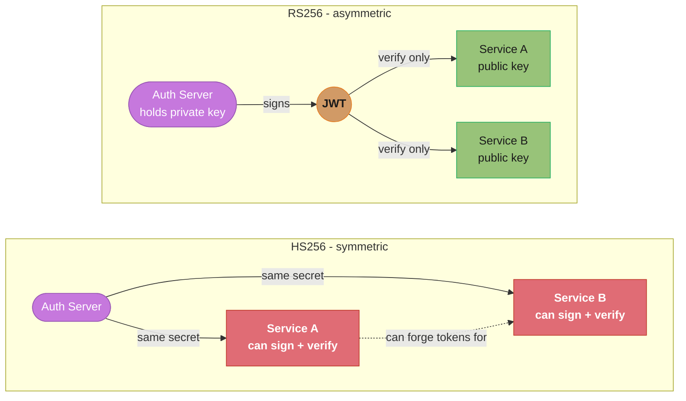
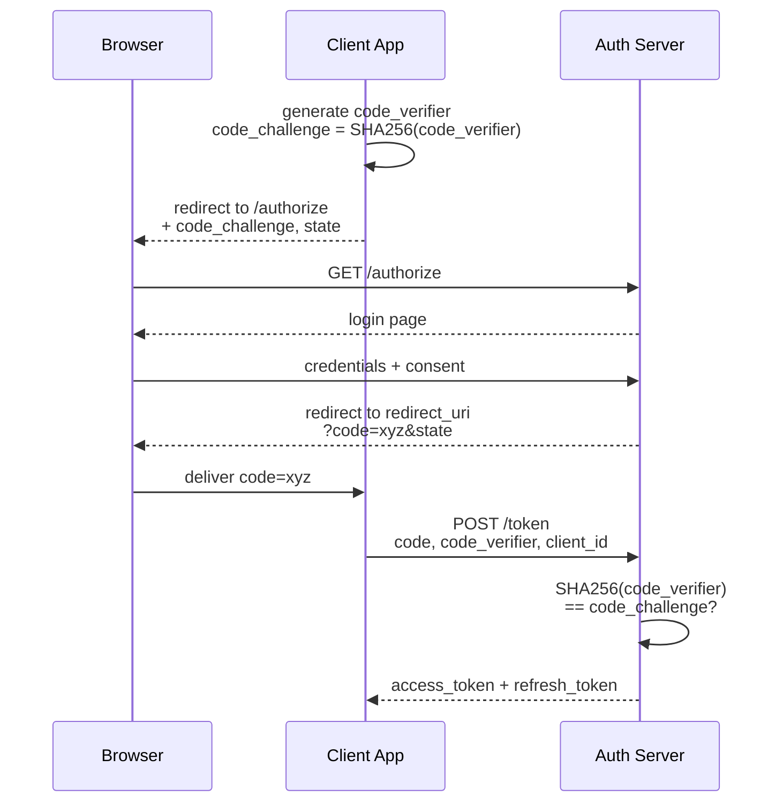
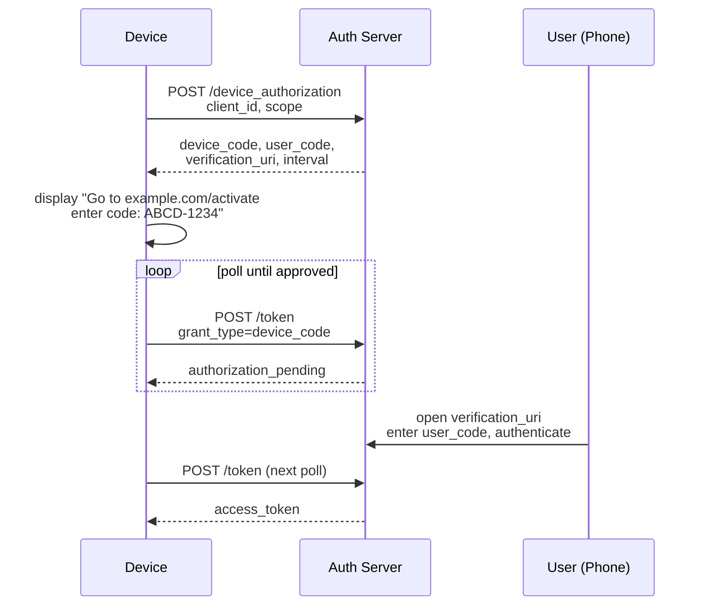
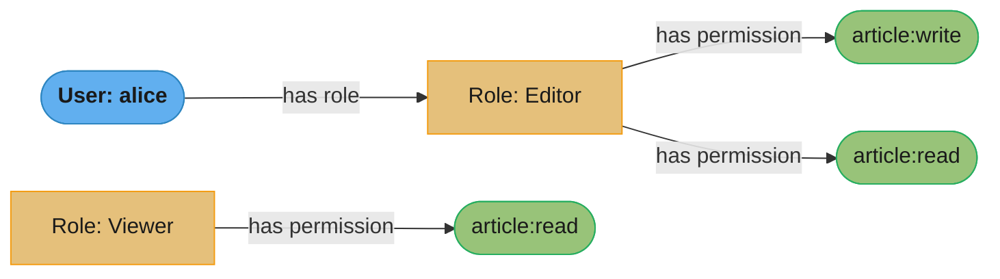
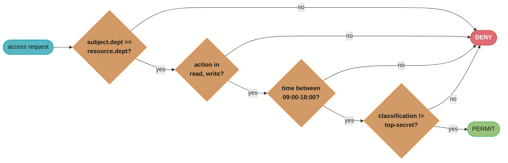
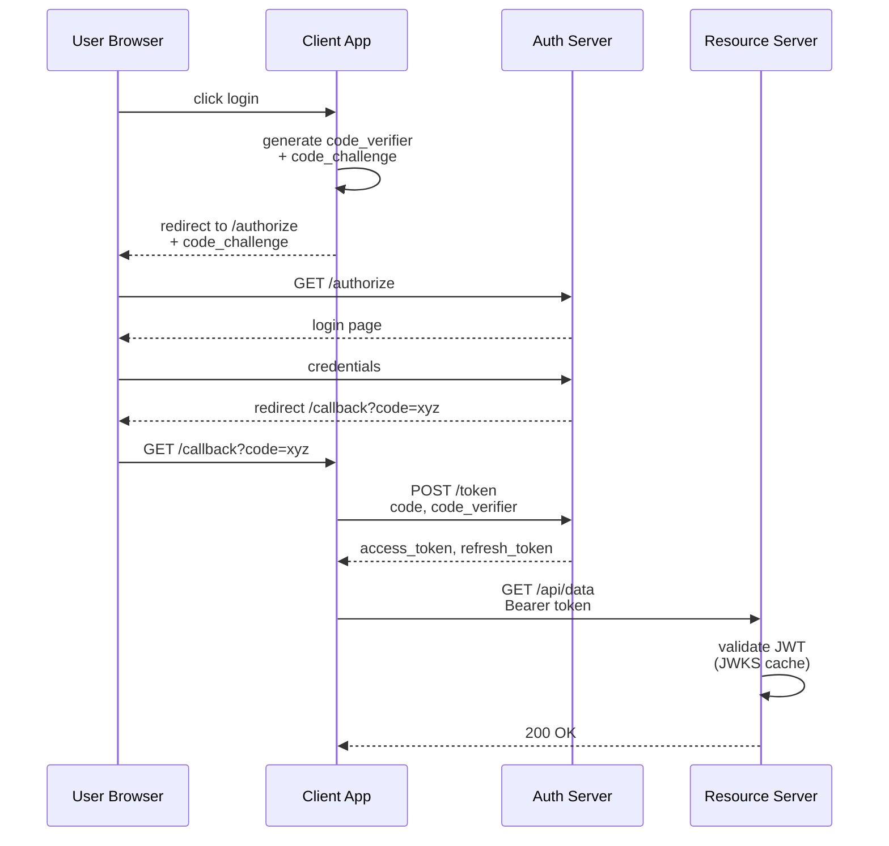
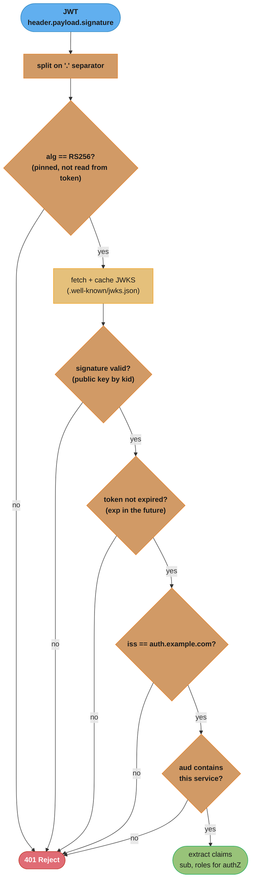
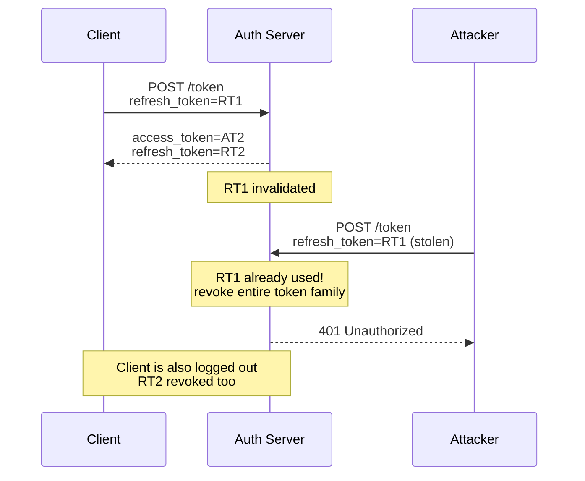
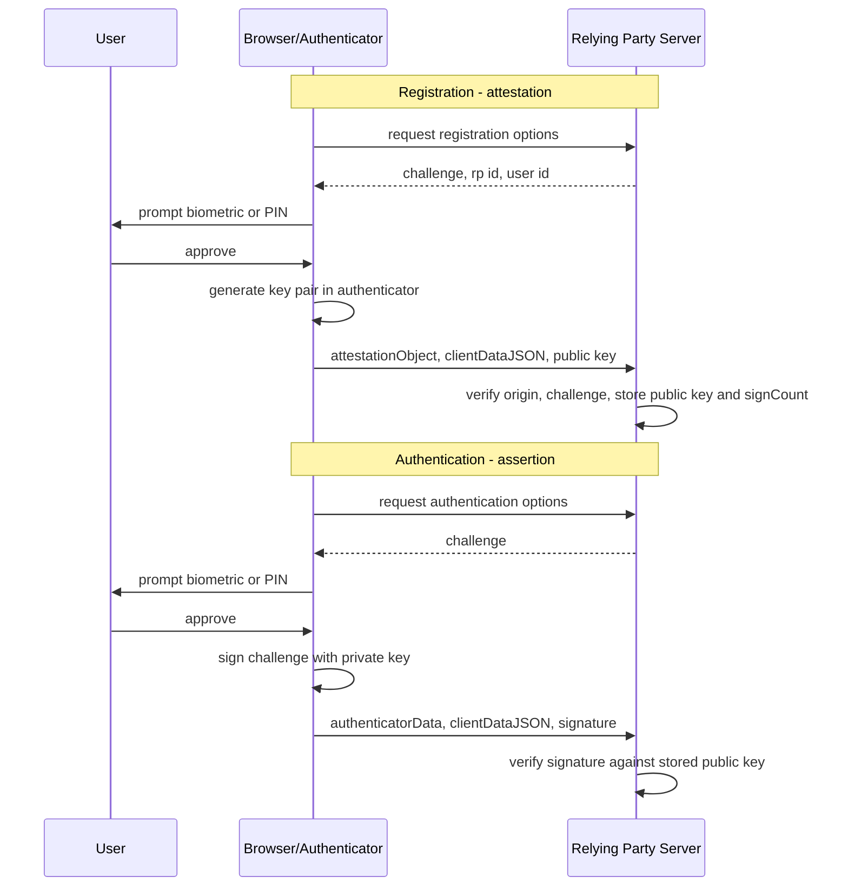
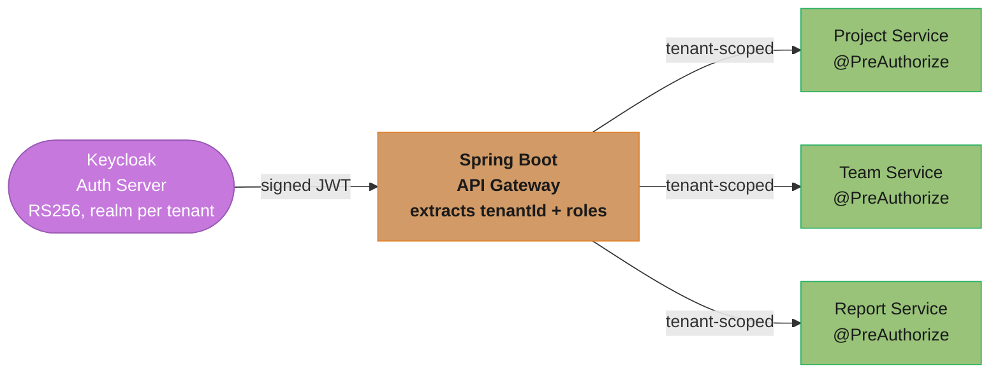

# Authentication and Authorization Systems

---

## 1. Concept Overview

Authentication answers the question "who are you?" — it verifies the identity of a caller. Authorization answers the question "what are you allowed to do?" — it verifies that the verified identity has permission to perform a requested action on a specific resource. These are distinct concerns that are often conflated, with significant security consequences when they are.

Modern backend systems rely on two dominant standards: OAuth 2.0 (RFC 6749) for delegated authorization and OpenID Connect (OIDC, built on top of OAuth 2.0) for federated authentication. JSON Web Tokens (JWT, RFC 7519) are the dominant format for access tokens and ID tokens in these flows. Role-Based Access Control (RBAC) and Attribute-Based Access Control (ABAC) are the primary models for making authorization decisions once identity is established.

---

## 2. Intuition

One-line analogy: OAuth 2.0 is like a hotel key card system. The front desk (authorization server) issues you a card (access token) that opens specific doors (resources) for a limited time — without handing you the master key (your credentials).

Mental model: separate the identity plane (who is this caller?) from the permission plane (what can this caller do?). JWT is a self-contained bearer credential — whoever holds it is treated as the identity it describes, until it expires. Opaque tokens are a reference — the server must call home to find out what they mean.

Why it matters: incorrect implementation of auth is one of the most common causes of serious security incidents. The blast radius ranges from account takeover to full system compromise. The subtle bugs — alg:none attack, missing signature validation, improper token storage, no token revocation — are not obvious to developers unfamiliar with the specifications.

Key insight: JWTs are not encrypted by default. The payload is Base64URL-encoded, not encrypted. Anyone who captures a JWT can read its claims. Use HTTPS everywhere, and do not put sensitive data (PAN, SSN) in JWT claims.

---

## 3. Core Principles

Stateless vs stateful tokens: JWT access tokens are stateless (server needs no DB lookup to validate, but cannot be revoked before expiry). Opaque tokens are stateful (server must call an introspection endpoint, but can be revoked instantly).

Short-lived access tokens: access tokens should expire in 5–60 minutes. A stolen token that expires in 15 minutes limits the attacker's window to 15 minutes.

Refresh token rotation: each use of a refresh token issues a new refresh token and invalidates the old one. If an old (already-used) refresh token is presented, revoke the entire token family — this indicates the refresh token was stolen. RFC 9700 requires authorization servers to detect refresh token replay for public clients by **one of two** methods: refresh token rotation, or sender-constrained refresh tokens.

Sender-constrained (proof-of-possession) tokens: a bearer token is usable by whoever holds it, so binding the token to a key the client must prove it controls removes the value of a stolen token. The two standardized bindings are DPoP (RFC 9449, application-level proof JWT) and mutual-TLS client certificate binding (RFC 8705). The OAuth 2.1 draft says authorization and resource servers SHOULD use one of them for access tokens.

Algorithm pinning: never accept a JWT whose algorithm you did not expect. Specify `RS256` explicitly; never accept `HS256` when you configured `RS256`, and never accept `none`.

Scope-limited tokens: access tokens should carry the minimum scopes needed. An API key for read-only analytics should not grant write access.

---

## 4. Types / Architectures / Strategies

### JWT (JSON Web Token)

A JWT consists of three Base64URL-encoded parts separated by dots:

```
header.payload.signature
```

Header: `{"alg":"RS256","typ":"JWT"}`
Payload: `{"sub":"user-123","email":"alice@example.com","roles":["reader"],"iat":1700000000,"exp":1700003600}`
Signature: RSA-SHA256(base64url(header) + "." + base64url(payload), privateKey)

The receiver verifies the signature using the public key. If valid, the claims are trusted. No DB call needed.

### Algorithms

| Algorithm | Type        | Key                         | Use Case                                     |
|-----------|-------------|---------------------------  |----------------------------------------------|
| HS256     | Symmetric   | Shared secret               | Internal service-to-service (same trust domain) |
| RS256     | Asymmetric  | RSA private/public key pair | Authorization server signs; resource servers verify with public key |
| ES256     | Asymmetric  | EC private/public key pair  | Same as RS256 but smaller key and signature  |
| RS512     | Asymmetric  | RSA private/public key pair | RSASSA-PKCS1-v1_5 with SHA-512 — longer digest, same key |

The number in an `alg` name is the SHA-2 digest size, not the RSA key size: RFC 7518 defines RS256/RS384/RS512 as RSASSA-PKCS1-v1_5 with SHA-256/384/512 and requires a key of **at least 2048 bits for all three**. Choosing RS512 does not imply a 4096-bit key, and does not by itself raise the key strength.

RS256 and ES256 are preferred for OAuth2 systems. The authorization server holds the private key and publishes the public key at a JWKS (JSON Web Key Set) endpoint (`/.well-known/jwks.json`). Resource servers fetch and cache the JWKS to validate tokens without calling the authorization server on every request.



*HS256's shared secret lets any verifier also forge tokens for any other service; RS256 keeps signing power solely with the Auth Server, so a compromised service can only verify, never mint.*

### OAuth 2.0 Grant Types

**Authorization Code + PKCE (most secure, use for web and mobile apps with a user):**



*Six steps, one secret: only the client that generated `code_verifier` can pass step 6's hash check, so an intercepted authorization code alone is worthless to an attacker.*

PKCE (Proof Key for Code Exchange) prevents authorization code interception. Even if the `code` is intercepted (e.g., from the redirect URI in a native app), the attacker cannot exchange it without the `code_verifier` that only the original client knows.

**Client Credentials (service-to-service, no user):**

```
POST /token
grant_type=client_credentials
client_id=service-a
client_secret=<secret>
scope=payments:write

Response: { "access_token": "...", "token_type": "Bearer", "expires_in": 3600 }
```

Used when a backend service needs to call another backend service. No user context. The client_secret must be stored securely (Vault), not in source code.

**Device Authorization Flow (TV / headless devices):**



*The device never sees the user's credentials — it just polls `/token` in a loop while the user completes authorization on a separate, trusted device.*

**Grants you should no longer use:** RFC 9700 (*Best Current Practice for OAuth 2.0 Security*, BCP 240, January 2025) states that the **resource owner password credentials grant MUST NOT be used**, and that clients **SHOULD NOT use the implicit grant** (`response_type=token`) or any other response type that returns an access token in the authorization response. The in-progress OAuth 2.1 draft (`draft-ietf-oauth-v2-1`, still an Internet-Draft as of 2026) simply omits both grants. Replace implicit with Authorization Code + PKCE, and replace password credentials with a redirect-based flow.

### OpenID Connect (OIDC)

OIDC is a thin identity layer on top of OAuth 2.0. The authorization server issues an ID token (a JWT) in addition to the access token. The ID token contains standard claims: `sub` (subject identifier), `iss` (issuer), `aud` (audience), `exp`, `iat`, `email`, `name`.

The ID token is for the client application (to know who logged in). The access token is for the resource server (to authorize API calls). Do not use the ID token as an API bearer token.

### Opaque Tokens vs JWT

| Dimension               | JWT (Self-Contained)                          | Opaque Token (Reference)                     |
|-------------------------|-----------------------------------------------|----------------------------------------------|
| Validation              | Local — verify signature + expiry             | Requires introspection endpoint call         |
| Revocation              | Cannot revoke before expiry (unless blocklist) | Revocable instantly                          |
| Payload inspection      | Claims readable by anyone who has the token   | Nothing revealed without introspection       |
| Scalability             | No introspection service needed               | Introspection service is a potential bottleneck |
| Token size              | Larger (claims + signature)                   | Smaller (random identifier only)             |

For access tokens: use JWT for stateless microservices where each service validates independently. Use opaque tokens for high-security scenarios requiring immediate revocation (financial, healthcare) or when token size matters.

### RBAC vs ABAC

RBAC (Role-Based Access Control): permissions are assigned to roles, roles are assigned to users.



*Permissions flow through roles, never directly to users — alice inherits `article:write`/`article:read` solely because she holds the Editor role.*

Simple, well-understood, scales to hundreds of roles. Does not handle context-sensitive rules easily.

ABAC (Attribute-Based Access Control): access decisions are based on attributes of the subject, the resource, the action, and the environment.

```
PERMIT IF:
  subject.department == resource.department
  AND action IN {read, write}
  AND environment.time BETWEEN 09:00 AND 18:00
  AND resource.classification != "top-secret"
```



*ABAC evaluation is a chain of AND-gates — a single failing attribute (department mismatch, disallowed action, off-hours, top-secret classification) short-circuits straight to DENY.*

Powerful for complex enterprise scenarios. Evaluated against a policy engine (OPA — Open Policy Agent). More complex to implement and audit.

### Passkeys and WebAuthn

A passkey is a discoverable (resident) WebAuthn credential — a public/private key pair created by an authenticator, where the relying party stores only the public key and the private key never leaves the device that created it (or the credential provider it was synced into). WebAuthn defines two ceremonies: attestation (registration, `navigator.credentials.create()`) and assertion (authentication, `navigator.credentials.get()`). WebAuthn is maintained by the W3C in collaboration with the FIDO Alliance; the current spec generation, WebAuthn Level 3, reached Proposed Recommendation status on 20 July 2026 (Advisory Committee review in progress — not yet a full W3C Recommendation), having been a Candidate Recommendation Snapshot from 26 May 2026.

Passkeys come in two forms:

- **Synced passkeys** — stored in a credential provider (iCloud Keychain, Google Password Manager, 1Password) and roam across a user's devices. Convenient, but the credential's blast radius on device loss is bounded by the provider account, not the device.
- **Device-bound passkeys** — never leave the authenticator that created them (typically a hardware security key). Stronger isolation, but each new device needs its own enrollment.

WebAuthn Level 3 adds several capabilities already in production use: the **PRF extension**, which derives a stable symmetric encryption key from a passkey (used by Bitwarden, 1Password, Yubico-backed flows, and WhatsApp encrypted-backup login); **Related Origin Requests**, letting one passkey work across a family of related domains instead of being pinned to a single origin; the **Signal API**, which lets a relying party tell a credential provider that a stored credential is stale, so the provider's picker stays in sync with the server; `getClientCapabilities()` for feature detection; JSON serialization helpers (`parseCreationOptionsFromJSON`/`parseRequestOptionsFromJSON`); and **conditional create**, which offers passkey enrollment inline during a password-autofill prompt.

Server-side verification of a passkey ceremony checks three things: the `clientDataJSON` (the ceremony `type`, the `challenge` matches what the server issued, and the `origin` matches the relying party); the `authenticatorData` (the RP ID hash, the user-present/user-verified flags, and `signCount`); and the signature, verified against the public key stored at registration. The honest hard problem is **account recovery**: a passkey removes the phishable password, but not the recovery path behind it — a weak recovery flow (an email magic link, an SMS code) reintroduces exactly the phishable factor the passkey was meant to remove. See §10 for a concrete failure of this kind.

### Authorization Models: RBAC, ABAC, ReBAC, and Policy-as-Code

RBAC and ABAC (above) are not the whole picture once permissions vary **per object** rather than per role or per static attribute — "anne can view this specific document because someone shared it with her" is neither a role nor an attribute, it is a relationship. **Zanzibar-style ReBAC** (relationship-based access control, named for Google's internal Zanzibar system) models exactly this: every permission is a **relation tuple** `object#relation@subject` — for example `document:roadmap#viewer@user:anne` — and a **namespace / authorization model** defines how relations compose, e.g. "a viewer of a folder is also a viewer of every document inside it." A permission check is then a graph traversal over the tuple store rather than a row lookup. **OpenFGA** (CNCF Incubating since October 2025, Apache-2.0, originated at Auth0/Okta), **SpiceDB** (Authzed's gRPC-first implementation, used by OpenAI for ChatGPT Enterprise), and **Permify** are the three notable open-source Zanzibar implementations. **AWS Cedar** — the policy language behind the managed **AWS Verified Permissions** service — is policy-based and ABAC-flavoured, not relation-tuple ReBAC; it belongs in the policy-as-code column below, not alongside OpenFGA/SpiceDB/Permify.

| Model | Unit of decision | Example | Pick this when |
|-------|-------------------|---------|-----------------|
| RBAC | Role membership | `hasRole('MANAGER')` | A small, fixed set of roles whose meaning does not vary per object |
| ABAC | Attribute predicate over subject/resource/action/environment | `subject.dept == resource.dept AND time BETWEEN 09:00-18:00` | Context-sensitive rules (time, classification, tenant) not tied to per-object relationships |
| ReBAC (Zanzibar-style: OpenFGA, SpiceDB, Permify) | Relation-tuple graph reachability | `document:roadmap#viewer@user:anne` | Per-object, per-user permissions at scale — sharing, nested folders, team/group inheritance |
| Policy-as-code (OPA/Rego, AWS Cedar) | Declarative policy evaluated by an engine | Rego rule; Cedar `permit(principal, action, resource) when {...}` | Centrally authored, versioned, auditable policy logic; Cedar adds a managed evaluation service (Verified Permissions) |

The central operational tradeoff in a Zanzibar-style system is that **`Check` (is this specific access allowed?) is cheap and cacheable, while `ListObjects` (what may this user see, across all objects?) is expensive** — it is a graph walk that cannot be pushed into a SQL `WHERE` clause, because the permission may be derived through arbitrary relation composition rather than stored as a flat row. See §6 for both calls side by side. The consistency knob follows from the same graph model: a **new-enemy problem** arises when a `Check` reads a replica that has not caught up with a very recent revocation, letting a just-removed user through for a short window; Zanzibar's paper calls the consistency token that pins a read to at-least-this-recent state a **zookie**, and OpenFGA and SpiceDB both expose the same idea (SpiceDB calls it a **ZedToken**), trading latency for recency on a per-call basis.

---

## 5. Architecture Diagrams

### OAuth2 Authorization Code + PKCE Flow



*Four actors, one bearer token: the Client never sees the user's credentials, and the Resource Server never calls the Auth Server directly — it validates locally against the cached JWKS.*

### JWT Structure and Validation



*Each check is a hard gate — any failure returns 401 without revealing which check failed; the algorithm is pinned by the resource server and never trusted from the token's own header.*

### Refresh Token Rotation with Token Family



*Reuse of an already-rotated refresh token is itself the breach signal — the server cannot tell attacker from legitimate client, so it revokes the whole token family and logs both out.*

### WebAuthn Registration and Authentication Ceremonies



*The private key never crosses the wire in either ceremony — the server only ever receives a public key at registration and a signature at each subsequent login, which is what makes a captured network trace or a phished lookalike origin useless to an attacker.*

---

## 6. How It Works — Detailed Mechanics

### JWT Validation in Java

```java
// Using Nimbus JOSE + JWT library
// Dependency: com.nimbusds:nimbus-jose-jwt:10.9.1

@Component
public class JwtValidator {

    private final JWSVerifier verifier;
    private final String expectedIssuer = "https://auth.example.com";
    private final String expectedAudience = "payments-service";

    public JwtValidator() throws Exception {
        // Load public key from JWKS endpoint. Simplified for illustration: production code
        // must select the key by the token's `kid` and refresh the set on rotation —
        // use JWKSourceBuilder/RemoteJWKSet + DefaultJWTProcessor rather than index 0.
        JWKSet jwkSet = JWKSet.load(URI.create("https://auth.example.com/.well-known/jwks.json").toURL());
        RSAKey rsaKey = (RSAKey) jwkSet.getKeys().get(0);
        this.verifier = new RSASSAVerifier(rsaKey.toRSAPublicKey());
    }

    public JWTClaimsSet validate(String rawToken) throws Exception {
        // NEVER use JWTParser.parse() alone — it does not verify the signature
        SignedJWT jwt = SignedJWT.parse(rawToken);

        // Step 1: verify algorithm is what we expect — never read it from the token's alg header blindly
        JWSHeader header = jwt.getHeader();
        if (!JWSAlgorithm.RS256.equals(header.getAlgorithm())) {
            throw new SecurityException("Unexpected algorithm: " + header.getAlgorithm());
        }

        // Step 2: verify signature
        if (!jwt.verify(verifier)) {
            throw new SecurityException("JWT signature verification failed");
        }

        JWTClaimsSet claims = jwt.getJWTClaimsSet();

        // Step 3: verify expiry
        if (claims.getExpirationTime().before(new Date())) {
            throw new SecurityException("JWT has expired");
        }

        // Step 4: verify issuer
        if (!expectedIssuer.equals(claims.getIssuer())) {
            throw new SecurityException("Unexpected issuer: " + claims.getIssuer());
        }

        // Step 5: verify audience
        if (!claims.getAudience().contains(expectedAudience)) {
            throw new SecurityException("JWT not intended for this audience");
        }

        return claims;
    }
}
```

### alg:none Attack — Broken vs Fixed

```java
// BROKEN: reading algorithm from the token header
// An attacker crafts: header={"alg":"none"}, removes signature
// parser sees alg=none, skips signature verification
JWT parsed = JWTParser.parse(token); // DO NOT USE — no signature verification
// If the library honors alg:none, the attacker's modified claims are trusted

// FIXED: always specify expected algorithms explicitly
JWSVerifier verifier = new RSASSAVerifier(publicKey); // RS256 verifier only
SignedJWT jwt = SignedJWT.parse(token);
// If the token has alg=none, SignedJWT.parse() throws ParseException("Not a JWS header"):
// Nimbus maps "none" to Algorithm.NONE, which is not a JWSAlgorithm, so JWSHeader.parse
// rejects it before any signature check. (JWTParser.parse() would instead hand back a
// PlainJWT, which is exactly the object an unwary cast or `instanceof` miss lets through.)
// Belt and braces — explicitly reject anything that is not the pinned algorithm:
if (!JWSAlgorithm.RS256.equals(jwt.getHeader().getAlgorithm())) {
    throw new SecurityException("Algorithm not permitted");
}
boolean valid = jwt.verify(verifier); // checks actual cryptographic signature
```

### Refresh Token Rotation with Redis Blocklist

```java
@Service
public class RefreshTokenService {

    private final RedisTemplate<String, String> redis;
    private final JwtTokenFactory tokenFactory;

    // Token family: all refresh tokens for a session share a familyId
    // Key: "refresh:{familyId}:{tokenId}" -> "valid"
    // When a new refresh token is issued, old key is deleted

    public TokenPair rotate(String rawRefreshToken) {
        RefreshTokenClaims claims = parseRefreshToken(rawRefreshToken);
        String familyId = claims.getFamilyId();
        String tokenId = claims.getTokenId();

        String redisKey = "refresh:" + familyId + ":" + tokenId;
        String status = redis.opsForValue().get(redisKey);

        if (status == null) {
            // Token not found — either never issued or already used
            // This could be a replay attack — revoke entire family
            revokeFamily(familyId);
            throw new SecurityException("Refresh token reuse detected — session revoked");
        }

        // Atomically delete old token and issue new one
        redis.delete(redisKey);

        String newTokenId = UUID.randomUUID().toString();
        String newRedisKey = "refresh:" + familyId + ":" + newTokenId;
        redis.opsForValue().set(newRedisKey, "valid", 30, TimeUnit.DAYS);

        String newAccessToken = tokenFactory.createAccessToken(claims.getUserId(), claims.getScopes());
        String newRefreshToken = tokenFactory.createRefreshToken(familyId, newTokenId, claims.getUserId());

        return new TokenPair(newAccessToken, newRefreshToken);
    }

    private void revokeFamily(String familyId) {
        // NOTE: RedisTemplate.keys() issues KEYS, which is O(N) over the whole keyspace and
        // blocks the single-threaded server. Shown for brevity only — in production use
        // SCAN (redis.scan(...)) or, better, keep the family's token IDs in a Redis SET
        // so revocation is one SMEMBERS + DEL.
        Set<String> keys = redis.keys("refresh:" + familyId + ":*");
        if (keys != null) redis.delete(keys);
    }
}
```

### RBAC with Spring Security

```java
// Role hierarchy: ADMIN > MANAGER > USER
// Defined as a Spring Bean

@Bean
public RoleHierarchy roleHierarchy() {
    // Build with the static factory. RoleHierarchyImpl.withDefaultRolePrefix() /
    // withRolePrefix(...) return a Builder if you prefer to add roles programmatically.
    return RoleHierarchyImpl.fromHierarchy("ROLE_ADMIN > ROLE_MANAGER > ROLE_USER");
}

// Method-level authorization
@Service
public class ArticleService {

    @PreAuthorize("hasRole('USER')")
    public Article getArticle(Long id) { ... }

    @PreAuthorize("hasRole('MANAGER') or @articleOwnerCheck.isOwner(authentication, #id)")
    public void updateArticle(Long id, ArticleUpdateRequest req) { ... }

    @PreAuthorize("hasRole('ADMIN')")
    public void deleteArticle(Long id) { ... }
}

// Custom SpEL bean for ABAC-style ownership check
@Component("articleOwnerCheck")
public class ArticleOwnerCheck {
    private final ArticleRepository repo;

    public boolean isOwner(Authentication auth, Long articleId) {
        return repo.findById(articleId)
                   .map(a -> a.getAuthorId().equals(getUserId(auth)))
                   .orElse(false);
    }
}
```

### API Key Management

```java
// API keys: generated once, hashed with SHA-256 before storage
// Raw key is shown to the user once (like a password) — never stored

@Service
public class ApiKeyService {

    private static final String PREFIX = "sk_live_";

    public ApiKeyCreationResult createKey(Long userId, String name, Set<String> scopes) {
        // Generate a cryptographically random 32-byte key
        byte[] rawBytes = new byte[32];
        new SecureRandom().nextBytes(rawBytes);
        String rawKey = PREFIX + Base64.getUrlEncoder().withoutPadding().encodeToString(rawBytes);

        // Hash with SHA-256 — this is what goes in the DB
        String hashedKey = hashKey(rawKey);

        ApiKey entity = ApiKey.builder()
            .userId(userId)
            .name(name)
            .keyHash(hashedKey)
            .prefix(rawKey.substring(0, 10)) // store first 10 chars for lookup/display
            .scopes(scopes)
            .createdAt(Instant.now())
            .lastUsedAt(null)
            .build();

        apiKeyRepository.save(entity);

        // Return rawKey ONCE — never again accessible after this point
        return new ApiKeyCreationResult(rawKey, entity.getId());
    }

    public Optional<ApiKey> validate(String rawKey) {
        // Hash the incoming key and look it up
        String hash = hashKey(rawKey);
        Optional<ApiKey> key = apiKeyRepository.findByKeyHash(hash);

        // Update last-used for audit/expiry enforcement
        key.ifPresent(k -> {
            k.setLastUsedAt(Instant.now());
            apiKeyRepository.save(k);
        });

        return key;
    }

    private String hashKey(String rawKey) {
        try {
            MessageDigest digest = MessageDigest.getInstance("SHA-256");
            byte[] hash = digest.digest(rawKey.getBytes(StandardCharsets.UTF_8));
            return Base64.getEncoder().encodeToString(hash);
        } catch (NoSuchAlgorithmException e) {
            throw new IllegalStateException("SHA-256 not available", e);
        }
    }
}
```

**In plain terms.** "Thirty-two random bytes is 256 bits of entropy, which puts the key permanently out of reach of guessing — so the only way to lose it is to leak it."

That conclusion is what justifies the rest of the design. Because brute force is off the table by an absurd margin, every remaining control in this class — hashing before storage, showing the raw key once, prefixing for secret scanning — targets *disclosure*, not guessing.

| Symbol | What it is |
|--------|------------|
| `new byte[32]` | 32 bytes = 256 bits of key material |
| `SecureRandom` | CSPRNG. `java.util.Random` here would be the actual vulnerability — 48 bits of seed, predictable |
| Keyspace | `2^256` possible keys |
| Base64url of 32 bytes | `ceil(32 × 4/3)` = 43 characters, unpadded |
| `PREFIX` (`sk_live_`) | 8 identifying characters. Adds zero entropy — it is a label, not a secret |
| SHA-256 before storage | One-way. A dumped `api_keys` table yields hashes, not usable credentials |

A *fast* hash is the right choice here only because the secret is 256 uniformly random bits — there is nothing for an offline attacker to guess. Do not carry this over to passwords: a human-chosen password has perhaps 20–40 bits of entropy and needs a deliberately slow, salted KDF (OWASP's current minimums: Argon2id `m=19456, t=2, p=1`; bcrypt work factor 10 or more; PBKDF2-HMAC-SHA256 600,000 iterations).

**Walk one example.** What 256 bits actually buys, against an attacker guessing a billion keys per second:

```
  keyspace          = 2^256  ~=  1.16 x 10^77
  expected guesses  = 2^255      (half the space, on average)

  at 1,000,000,000 guesses/second:
    2^255 / 1e9 / 31,557,600 s-per-year  ~=  1.8 x 10^60 years

  Total key length: 8 (prefix) + 43 (base64url) = 51 characters
```

For contrast, an 8-character alphanumeric key — the kind hand-rolled key generators tend to
produce — has a keyspace of `62^8 ≈ 2.18 × 10^14`. On the same expected-guesses basis used
above (half the space), the attacker lands on a key after about 109,000 seconds, roughly
**30 hours**; exhausting the whole space takes about 61 hours. The gap between 30 hours and 10^60 years is entirely a
function of the byte count, which is why "32 bytes from `SecureRandom`" is the whole
recommendation and no amount of clever formatting substitutes for it.

**Why the prefix is stored separately.** `prefix(rawKey.substring(0, 10))` looks like it weakens
the key by persisting part of it in plaintext, and it would if the prefix carried entropy. It
does not: `sk_live_` is a constant plus two characters, so the searchable prefix narrows
`2^256` to roughly `2^244` — an irrelevant reduction. What it buys is real: operators can
identify a key in a UI without ever storing the secret, and GitHub's secret scanner can
recognize a leaked key on sight (Section 7). Never extend that prefix far enough to matter —
storing the first 30 characters would reveal 22 base64 characters (132 bits) and leave only 124
bits unknown.

### Token Revocation with Blocklist

```java
// For JWT: maintain a Redis set of revoked token JTIs (JWT IDs)
// Check this set on every request — adds one Redis lookup per request

@Component
public class JwtRevocationFilter extends OncePerRequestFilter {

    private final RedisTemplate<String, String> redis;
    private final JwtValidator jwtValidator;

    @Override
    protected void doFilterInternal(HttpServletRequest request,
                                    HttpServletResponse response,
                                    FilterChain chain) throws IOException, ServletException {
        String authHeader = request.getHeader("Authorization");
        if (authHeader != null && authHeader.startsWith("Bearer ")) {
            String token = authHeader.substring(7);
            try {
                JWTClaimsSet claims = jwtValidator.validate(token);
                String jti = claims.getJWTID();

                // Check revocation blocklist
                if (jti != null && Boolean.TRUE.equals(redis.hasKey("revoked:" + jti))) {
                    response.sendError(HttpServletResponse.SC_UNAUTHORIZED, "Token has been revoked");
                    return;
                }

                // Set authentication in SecurityContext
                SecurityContextHolder.getContext().setAuthentication(
                    buildAuthentication(claims)
                );
            } catch (SecurityException e) {
                response.sendError(HttpServletResponse.SC_UNAUTHORIZED, "Invalid token");
                return;
            }
        }
        chain.doFilter(request, response);
    }

    public void revokeToken(String jti, Instant expiry) {
        long ttlSeconds = expiry.getEpochSecond() - Instant.now().getEpochSecond();
        if (ttlSeconds > 0) {
            redis.opsForValue().set("revoked:" + jti, "1", ttlSeconds, TimeUnit.SECONDS);
        }
        // TTL = remaining token lifetime; after that, the token is expired anyway — no need to keep in blocklist
    }
}
```

**What this actually says.** "A revoked token only needs to be remembered until the moment it would have expired on its own — so the blocklist's size is set by your access-token lifetime, not by how many tokens you have ever revoked."

This is why short access tokens make revocation *cheap* rather than merely *safer*. The two properties are the same lever pulled once, which is the point interviewers are usually driving at when they ask "how do you revoke a JWT?"

| Symbol | What it is |
|--------|------------|
| `jti` | JWT ID — the unique per-token claim used as the blocklist key |
| `exp − now` | Remaining lifetime. The exact TTL to set on the Redis key |
| Access-token TTL | 5–60 minutes per Section 3. Simultaneously the revocation lag and the blocklist retention |
| Blocklist size | `revocation rate × TTL` — a steady-state count, not a growing set |
| Refresh calls per session | `session length ÷ TTL` — the cost side of shortening the TTL |

**Walk one example.** Both sides of the TTL choice, for an 8-hour working session:

```
  TTL     stolen-token window     refresh calls per 8h session
   5 min        5 min                    480/5   =  96
  15 min       15 min                    480/15  =  32
  30 min       30 min                    480/30  =  16
  60 min       60 min                    480/60  =   8

  Refresh load at 1,000,000 active users:
    TTL 15 min ->  32,000,000 refreshes/day  =  370 req/s
    TTL 60 min ->   8,000,000 refreshes/day  =   93 req/s
```

Halving the TTL halves the attacker's window and doubles the traffic to your token endpoint —
a clean linear trade with no free lunch, which is exactly why 15 minutes is the common landing
spot rather than 1 minute. Note that 370 req/s of refresh traffic against a single authorization
server is not trivial; it is a real capacity line item that the "just use short tokens" advice
tends to skip.

The blocklist itself stays small because of the TTL rule above. At 5,000 revocations per hour
with a 15-minute token lifetime, the steady-state resident key count is `5000/60 × 15 = 1,250`
keys — bounded, regardless of how long the system has been running. Set the TTL to a fixed
large value instead of `exp − now` and that same workload grows without limit, which is the
usual reason a "revocation is easy, just use Redis" design eventually runs the auth cache out
of memory.

### Passkey Registration and Verification with WebAuthn4J

```java
// Server-side passkey verification. Dependency: com.webauthn4j:webauthn4j-core
// The browser-side navigator.credentials.create()/get() calls are JavaScript and out of scope here.

@Service
public class PasskeyService {

    private final WebAuthnManager webAuthnManager = WebAuthnManager.createNonStrictWebAuthnManager();
    private final ChallengeRepository challengeRepository;       // Redis: challenge keyed by session id, 5-min TTL
    private final PasskeyCredentialRepository credentialRepository;

    private static final String RP_ID = "example.com";
    private static final Set<Origin> EXPECTED_ORIGINS = Set.of(Origin.create("https://example.com"));

    // --- Registration (attestation) ---

    public String startRegistration(String userId) {
        Challenge challenge = new DefaultChallenge();
        challengeRepository.save(userId, challenge, Duration.ofMinutes(5));
        return Base64UrlUtil.encodeToString(challenge.getValue());
    }

    public void finishRegistration(String userId, String attestationObjectB64, String clientDataJsonB64) {
        Challenge expectedChallenge = challengeRepository.get(userId)
            .orElseThrow(() -> new SecurityException("No pending registration challenge"));

        RegistrationRequest request = new RegistrationRequest(
            Base64UrlUtil.decode(attestationObjectB64),
            Base64UrlUtil.decode(clientDataJsonB64));
        RegistrationParameters parameters = new RegistrationParameters(
            new ServerProperty(RP_ID, EXPECTED_ORIGINS, expectedChallenge),
            /* pubKeyCredParams */ null,
            /* userVerificationRequired */ true,
            /* userPresenceRequired */ true);

        RegistrationData registrationData;
        try {
            registrationData = webAuthnManager.verify(request, parameters);
        } catch (VerificationException e) {
            // Covers: origin mismatch, challenge mismatch, invalid attestation signature
            throw new SecurityException("Passkey registration failed", e);
        }

        AttestedCredentialData credentialData = registrationData.getAttestationObject()
            .getAuthenticatorData().getAttestedCredentialData();

        credentialRepository.save(PasskeyCredential.builder()
            .userId(userId)
            .credentialId(credentialData.getCredentialId())
            .publicKey(credentialData.getCOSEKey())
            .signCount(registrationData.getAttestationObject().getAuthenticatorData().getSignCount())
            .build());

        challengeRepository.delete(userId);
    }

    // --- Authentication (assertion) ---

    public void finishAuthentication(String userId, byte[] credentialId, String authenticatorDataB64,
                                      String clientDataJsonB64, String signatureB64) {
        Challenge expectedChallenge = challengeRepository.get(userId)
            .orElseThrow(() -> new SecurityException("No pending authentication challenge"));
        PasskeyCredential stored = credentialRepository.findByCredentialId(credentialId)
            .orElseThrow(() -> new SecurityException("Unknown credential"));

        AuthenticationRequest request = new AuthenticationRequest(
            credentialId,
            Base64UrlUtil.decode(authenticatorDataB64),
            Base64UrlUtil.decode(clientDataJsonB64),
            Base64UrlUtil.decode(signatureB64));
        AuthenticationParameters parameters = new AuthenticationParameters(
            new ServerProperty(RP_ID, EXPECTED_ORIGINS, expectedChallenge),
            stored.toCredentialRecord(),
            /* userVerificationRequired */ true,
            /* userPresenceRequired */ true);

        AuthenticationData authenticationData;
        try {
            authenticationData = webAuthnManager.verify(request, parameters);
        } catch (VerificationException e) {
            throw new SecurityException("Passkey authentication failed", e);
        }

        // signCount clone detection: a rising counter proves the private key lives in one
        // physical authenticator. A synced passkey (iCloud Keychain, Google Password Manager)
        // is deliberately copied across devices, so its signCount is 0 on every assertion —
        // a naive "reject if newCount <= storedCount" check locks out most real users in 2026.
        // Apply the strict comparison only to authenticators known to be device-bound; for
        // synced credentials, skip counter comparison and rely on origin + challenge + signature.
        long newSignCount = authenticationData.getAuthenticatorData().getSignCount();
        if (stored.isDeviceBound() && newSignCount != 0 && newSignCount <= stored.getSignCount()) {
            throw new SecurityException("Possible cloned authenticator — signCount did not advance");
        }
        credentialRepository.updateSignCount(credentialId, newSignCount);

        challengeRepository.delete(userId);
    }
}
```

### ReBAC with OpenFGA: Authorization Model, Check, and ListObjects

```
# OpenFGA authorization model: a document inherits "viewer" from its parent folder
model
  schema 1.1

type user

type folder
  relations
    define owner: [user]
    define viewer: [user] or owner

type document
  relations
    define parent: [folder]
    define owner: [user]
    define viewer: [user] or owner or viewer from parent
```

```
# Relation tuples written to the store
document:roadmap#parent@folder:product
folder:product#viewer@user:anne
```

```java
// Check: cheap and cacheable. One graph traversal that stops at the first satisfying path —
// here "anne" resolves to "viewer" via document:roadmap -> parent -> folder:product -> viewer.
CheckRequest checkRequest = new CheckRequest().tupleKey(
    new CheckRequestTupleKey().user("user:anne").relation("viewer")._object("document:roadmap"));
CheckResponse checkResponse = fgaClient.check(checkRequest).get();
boolean allowed = checkResponse.getAllowed(); // true

// ListObjects: expensive. Answers "which documents can anne view" — this cannot become a
// SQL WHERE clause, because "viewer" is derived (direct grant OR owner OR inherited from a
// parent folder), so the authorization server must walk the relation graph for every candidate.
ListObjectsRequest listRequest = new ListObjectsRequest()
    .user("user:anne").relation("viewer").type("document");
ListObjectsResponse listResponse = fgaClient.listObjects(listRequest).get();
List<String> visibleDocuments = listResponse.getObjects(); // e.g. ["document:roadmap", ...]
```

Use `Check` on the hot path for a single access decision (rendering one page, gating one API call). Reserve `ListObjects` for building "what can this user see" views, and never approximate it with a loop of per-object `Check` calls — see §10 for what that costs at scale.

---

## 7. Real-World Examples

**Spotify OAuth2 PKCE (Authorization Code):** Spotify's developer documentation names Authorization Code with PKCE "the recommended authorization flow if you're implementing authorization in a mobile app, single page web apps, or any other type of application where the client secret can't be safely stored", and marks its implicit grant flow deprecated. No client secret is involved — the app is public. PKCE replaces the secret by proving that the same client that requested the code is the one exchanging it. The same pattern is mandated for public native app clients by RFC 8252 (BCP 212) and for public clients generally by RFC 9700 (BCP 240).

**AWS Cognito (OIDC Identity Provider):** Cognito acts as an OIDC provider issuing JWTs. Resource servers (API Gateway, Spring Boot services) validate JWTs against Cognito's JWKS endpoint. The token contains `cognito:groups` claims used for RBAC decisions. Cognito supports user pools (for end users) and identity pools (for federated access to AWS resources).

**GitHub Personal Access Tokens:** GitHub API keys are prefixed (`ghp_`, `ghs_`, `gho_`) to enable automated secret scanning. Secret scanning runs automatically and free on public repositories, across the full git history on every branch, and raises an alert on the repository's Security tab. What happens next depends on who issued the token: for a *partner's* pattern GitHub notifies the issuing provider, who can auto-revoke; for GitHub's own tokens a publicly leaked token is revoked and the owner is emailed that the revocation happened. The prefix approach is what makes that routing possible — it lets GitHub distinguish token types and apply the right policy. This is why prefix-based API keys (`sk_live_`, `pk_test_`) are a best practice.

**Google Sign-In (OIDC):** Google issues ID tokens as RS256-signed JWTs. Client applications validate these tokens against Google's JWKS endpoint at `https://www.googleapis.com/oauth2/v3/certs`. The `sub` claim is the stable Google user ID. The `hd` claim restricts to a specific hosted domain (for Google Workspace SSO). `aud` must match the application's client_id — failing to check `aud` is a common security flaw.

---

## 8. Tradeoffs

| Dimension                      | JWT (Stateless)                    | Opaque Token (Stateful)               |
|--------------------------------|------------------------------------|---------------------------------------|
| Revocation speed               | Up to token expiry (unless blocklist) | Immediate                          |
| Resource server dependency     | None (JWKS cached)                 | Introspection endpoint per request   |
| Token size                     | ~500-2000 bytes                    | ~20-40 bytes (random ID)             |
| Claims visibility              | Claims visible to anyone with token | Opaque without introspection         |
| Suitable for                   | Microservices, stateless APIs      | Financial, healthcare, sessions      |
| Rotation support               | Implicit via expiry                | Explicit via revocation              |

| Model | RBAC                               | ABAC                                       |
|-------|------------------------------------|--------------------------------------------|
| Complexity | Low — roles map to permissions | High — attribute policies, policy engine   |
| Flexibility | Medium — coarse-grained         | High — fine-grained, context-aware         |
| Auditability | Simple — role assignments       | Complex — policy evaluation trail          |
| Performance | Fast — role check in token claims | Slower — policy engine evaluation         |
| Use case | Most SaaS, API access control   | Healthcare, finance, multi-tenant platforms |

| Factor                        | Password                          | Passkey (WebAuthn)                        | TOTP (authenticator app)               | SMS OTP                                |
|--------------------------------|------------------------------------|--------------------------------------------|-------------------------------------------|-------------------------------------------|
| Phishing resistance            | None — can be typed into a fake site | High — origin-bound, a lookalike site cannot obtain a valid assertion | Medium — a code can be relayed to a fake site in real time | Low — a code can be relayed; SIM swap bypasses possession entirely |
| Recovery cost                  | Low — reset via email link        | Medium-high — must re-enroll a new authenticator; strength depends on the recovery flow (§10) | Low — re-scan a backup QR code            | Low — carrier reissues a SIM              |
| Device-loss blast radius       | None — independent of device      | Low for synced passkeys (roams via credential provider); moderate for device-bound (re-enroll per relying party) | Moderate — backup codes or manual re-enrollment per service | Low — number ports to a new device        |
| Server-side secret stored      | Salted hash (bcrypt/Argon2id)     | Public key only — no shared secret to steal | Shared TOTP seed — a DB breach lets an attacker generate all future codes | None stored — phone number only           |

| Dimension                | RBAC                        | ABAC                                  | ReBAC (Zanzibar-style)                       | Policy-as-code (Cedar/OPA)              |
|---------------------------|------------------------------|------------------------------------------|--------------------------------------------------|--------------------------------------------|
| Unit of decision          | Role membership             | Attribute predicate                       | Relation-tuple graph reachability                 | Declarative policy evaluated per request   |
| Per-object permissions    | No — same role, same access everywhere | Possible, but modeled as attributes, not relationships | Native — the whole point of the model             | Cedar: yes, via resource attributes; OPA: however you write it |
| Cheap operation           | Role check (in-token)       | Single attribute lookup                   | `Check` (is X allowed on Y?)                      | Single policy evaluation                   |
| Expensive operation       | N/A                          | Cross-cutting audit of all policies       | `ListObjects` (what can X see?) — a graph walk, not a SQL `WHERE` | Enumerating every resource a policy would permit |
| Consistency concern       | None — role assignment is simple state | None beyond normal DB consistency | New-enemy problem — a stale check lets a just-revoked user through; solved with a zookie/ZedToken | None beyond policy store consistency       |

---

## 9. When to Use / When NOT to Use

**JWT access tokens:** use for stateless microservices that need to validate tokens independently without calling a central service. Use when tokens carry scopes/roles needed locally. Set expiry to 5–15 minutes for high-security, 30–60 minutes for standard APIs.

**Opaque tokens with introspection:** use when immediate revocation is mandatory (financial transactions, healthcare, government). Use when you cannot afford to have a stolen token valid for any duration.

**Authorization Code + PKCE:** use for any flow involving a human user and a web or mobile client. RFC 9700 makes PKCE a MUST for public clients (no client secret) and RECOMMENDED for confidential clients; RFC 8252 makes it a MUST for public native app clients. The OAuth 2.1 draft goes further: clients MUST use `code_challenge`/`code_verifier` on the authorization code grant and authorization servers MUST enforce it, with one narrow carve-out in Section 7.5.1.1 — the client is confidential *and* the authorization server has reasonable assurance that this specific deployment and request implements the OpenID Connect `nonce` mechanism properly. Even then the draft still says PKCE is RECOMMENDED. It remains an Internet-Draft (`draft-ietf-oauth-v2-1-15`, March 2026), not yet an RFC.

**Client Credentials:** use for machine-to-machine flows. Never use for flows where a human user is involved.

**RBAC:** use as the default authorization model. Simple, auditable, well-understood. Sufficient for most SaaS products.

**ABAC / OPA:** use when role-based checks are insufficient — multi-tenant systems where users from tenant A cannot access tenant B's data even if they have the same role, time-based access restrictions, data classification policies.

**When NOT to use JWT for sessions:** long-lived JWT sessions (days/weeks) are dangerous. If a token is stolen, it is valid until expiry. Use short-lived JWTs with refresh tokens, or use opaque session tokens with server-side state for web sessions.

---

## 10. Common Pitfalls

**Pitfall 1 — Missing audience validation:** A service validated JWT signature and expiry but did not validate the `aud` claim. An attacker obtained a valid JWT issued for service A, then used it to call service B. Both services share the same authorization server. Service B accepted the token because the signature was valid. Fix: always validate `aud` equals the expected service identifier. Each service should have a unique audience.

**Pitfall 2 — HS256 shared secret across services:** A team used HS256 with the same shared secret for all microservices. Any service that knew the secret could forge tokens for any other service. In a microservices architecture, a compromised service can mint tokens. Fix: use RS256 or ES256 — only the authorization server holds the private key; services only hold public keys.

**Pitfall 3 — Storing JWTs in localStorage:** A single-page application stored the access token in `localStorage`. A stored XSS vulnerability in the app allowed an attacker to inject a script that read `localStorage` and exfiltrated the token. Fix: store access tokens in memory (JavaScript variable). For refresh tokens requiring persistence across page loads, use `HttpOnly; Secure; SameSite=Strict` cookies — not accessible to JavaScript.

**Pitfall 4 — Infinite-lived refresh tokens:** A team issued refresh tokens with no expiry. A single phished refresh token gave the attacker permanent access until manually discovered and revoked. Fix: give refresh tokens both an absolute lifetime and an idle timeout — 30 days is a common choice for each, but no RFC fixes the number, so pick it from your session policy. Separately, RFC 9700 requires the authorization server to detect refresh token replay for public clients, via either rotation or sender-constrained refresh tokens (DPoP / mTLS); rotation is the replay control, not the expiry mechanism.

**Pitfall 5 — PKCE code_challenge with plain method:** Using `code_challenge_method=plain` makes PKCE trivial to bypass — `code_challenge == code_verifier`, so an intercepted `code_challenge` from the authorization request gives the attacker the `code_verifier` needed to exchange the code. Always use `code_challenge_method=S256`.

**Pitfall 6 — Not validating state parameter in OAuth2 callback:** The `state` parameter in OAuth2 is a CSRF token for the authorization flow itself. If the callback handler does not verify that the `state` returned from the authorization server matches the one the client generated, an attacker can trick a user into completing an OAuth2 flow with the attacker's `code` — binding the victim's app session to the attacker's identity (account takeover).

**Pitfall 7 — API keys stored in plaintext in DB:** A startup stored API keys in plaintext in the `api_keys` table. A SQL injection vulnerability exposed the table, giving the attacker every active API key. Fix: hash API keys with SHA-256 before storage. The raw key is shown once at creation. Hash-before-store is non-negotiable, exactly as for passwords — but the *algorithm* differs: a random 256-bit key only needs a fast hash, while a password needs a slow KDF (Argon2id, bcrypt, PBKDF2).

**Pitfall 8 — Passkey account recovery reintroduces phishing:** A consumer app rolled out passkeys for every login and watched phishing-driven takeover on the login path drop to nearly zero. Its recovery path did not get the same scrutiny: "lost every device" fell back to a plain email magic link with a 10-minute TTL and no secondary check, and that link's only job was to let the user enroll a brand-new passkey. In the first quarter after launch, roughly 340 of about 4,800 recovery requests were attacker-initiated — phish the email account first, then use the recovery link to enroll an attacker-controlled passkey, at which point the phishing-resistant login the team had just shipped was gone. Fix: treat recovery as at least as strong as the primary factor — a second independent verification step plus a mandatory cooldown before a freshly enrolled passkey can touch high-privilege actions, even though that makes recovery slower.

**Pitfall 9 — `ListObjects` approximated with a `Check` loop:** A team building a "documents shared with me" page implemented it by calling the authorization server's `Check` once per candidate document in the workspace. At 100 documents the page returned in 40 ms and nobody noticed the design. Once a large customer's workspace grew to 100,000 documents nested across a dozen folder levels, the same page fired 100,000 sequential `Check` calls, took upward of 90 seconds, and blew past the API gateway's 30-second timeout on every load. The fix was to replace the loop with a single `ListObjects` call, which the authorization server answers as one bounded graph traversal instead of N independent ones; the same page returned in roughly 280 ms at 100,000 documents after the change. The lesson: reach for `ListObjects` for "what can this user see" from day one — a `Check` loop does not degrade gracefully, it works fine until the object count crosses exactly the threshold where per-object permissions start to matter.

---

## 11. Technologies and Tools

| Tool / Library                    | Purpose                                               |
|-----------------------------------|-------------------------------------------------------|
| Spring Security OAuth2 Resource Server | JWT validation, OIDC, Bearer token filter      |
| Keycloak                          | Self-hosted authorization server, OIDC/SAML           |
| Auth0                             | Managed authorization server, OIDC/SAML/social login |
| AWS Cognito                       | Managed OIDC/OAuth2 user pools for AWS apps           |
| Okta                              | Enterprise OIDC/SAML, workforce identity              |
| nimbus-jose-jwt                   | Java JWT library (used internally by Spring Security) |
| java-jwt (Auth0)                  | Alternative JWT library for Java                      |
| OPA (Open Policy Agent)           | ABAC policy engine, Rego policy language              |
| Casbin                            | Multi-model access control library (RBAC/ABAC)        |
| Redis                             | Token blocklist, refresh token family storage         |
| HashiCorp Vault                   | Secrets management, JWT issuing via JWT auth method   |
| WebAuthn4J                        | Java library for server-side FIDO2/WebAuthn registration and assertion verification |
| SimpleWebAuthn                    | Node.js/TypeScript library for a WebAuthn relying-party server and browser helpers |
| FIDO Alliance conformance tools   | Test suite for validating authenticator and relying-party WebAuthn/FIDO2 conformance |
| OpenFGA                           | CNCF Incubating open-source Zanzibar-style ReBAC engine — relation tuples, `Check`, `ListObjects` |
| SpiceDB (Authzed)                 | gRPC-first open-source Zanzibar implementation; ZedToken consistency; used by OpenAI for ChatGPT Enterprise |
| Permify                           | Open-source Zanzibar-style relationship-based authorization service |
| AWS Cedar + Verified Permissions  | Policy language (ABAC-flavoured, not relation-tuple ReBAC) and its managed AWS evaluation service |

---

## 12. Interview Questions with Answers

**Q: What is the difference between OAuth 2.0 and OpenID Connect?**
**Short:** OAuth 2.0 delegates authorization to access resources, while OpenID Connect adds an identity layer with a verified ID token.

OAuth 2.0 is an authorization framework — it allows an application to obtain delegated access to resources on behalf of a user. It does not define how to authenticate the user or what the user's identity is. OpenID Connect (OIDC) is an identity layer built on top of OAuth 2.0. It adds an ID token (a JWT) that contains verified identity claims (sub, email, name) and standardizes the UserInfo endpoint. In practice: use OAuth 2.0 for API access delegation, use OIDC when you need to know who the user is (login/SSO).

**Q: What is PKCE and why is it required for public clients?**
**Short:** PKCE replaces a client secret with a per-request proof, preventing authorization code interception for public clients.

PKCE (Proof Key for Code Exchange) prevents authorization code interception attacks. A public client (browser app, mobile app) cannot hold a client secret securely — the secret would be visible in source code or the app bundle. Without a client secret, anyone who intercepts the authorization code can exchange it for tokens. PKCE replaces the secret with a per-request proof: the client generates a random `code_verifier`, sends `SHA256(code_verifier)` as `code_challenge` in the authorization request, then sends the raw `code_verifier` in the token exchange. Only the original client knows the `code_verifier`.

**Q: Explain the alg:none attack on JWT.**
**Short:** The alg:none attack strips a JWT's signature and sets alg to none, tricking a library into skipping verification entirely.

JWT headers contain an `alg` field. Some early implementations read the algorithm from the token header and then performed signature verification accordingly. If a library accepted `alg: none`, an attacker could remove the signature, set `alg` to `none`, and modify any claim (e.g., change `role` from `user` to `admin`). The library would see `alg: none`, skip signature verification, and accept the modified token. Prevention: always specify the exact expected algorithm when parsing — never derive it from the token header. Use libraries that require an explicit algorithm parameter and reject `none`.

**Q: What is the difference between access tokens and refresh tokens?**
**Short:** Access tokens are short-lived API credentials, while refresh tokens are long-lived and used only to mint new access tokens.

Access tokens are short-lived credentials (5–60 minutes) used to call protected APIs. They should be validated on every API call. Because they are short-lived, if stolen they are only valid briefly. Refresh tokens are long-lived credentials (days to weeks) used only to obtain new access tokens when the current one expires. They are exchanged directly with the authorization server's token endpoint, not sent to resource servers. Refresh tokens must be stored more securely than access tokens and support revocation.

**Q: How does refresh token rotation work and what does it protect against?**
**Short:** Refresh token rotation issues a new token on each use and revokes the whole family if a stolen token's reuse is detected.

In refresh token rotation, each successful use of a refresh token issues a new refresh token and immediately invalidates the old one. If an attacker steals a refresh token and uses it, two events occur: the attacker receives a new token pair, and when the legitimate client's old token is presented, the server detects a token reuse (the old token is no longer valid). At this point, the server revokes the entire token family (all refresh tokens for that session), forcing the user to re-authenticate. This limits the damage of a stolen refresh token to the window between theft and the legitimate client's next use.

**Q: What is the difference between RBAC and ABAC?**
**Short:** RBAC grants permissions by role membership, while ABAC decides access from subject, resource, action, and environment attributes.

RBAC assigns permissions to roles, and users are assigned roles. Authorization decisions are based solely on which roles the user holds — `hasRole('MANAGER')`. RBAC is simple, performant, and easy to audit. ABAC makes decisions based on attributes: the subject's attributes (department, clearance level), the resource's attributes (classification, owner, data sensitivity), the action, and the environment (time, location). ABAC is more flexible and can enforce fine-grained, context-aware policies, but requires a policy engine and is more complex to manage.

**Q: How do you revoke a JWT before it expires?**
**Short:** A JWT can't be revoked directly since it's stateless; revocation needs a Redis blocklist, short expiry, or opaque tokens.

JWTs are stateless by design and cannot be revoked by changing a flag in a database — the resource server does not look anything up. Revocation requires either: (1) maintaining a blocklist in Redis of revoked JWT IDs (`jti` claim); the resource server checks this on every request — one Redis lookup per request; (2) short expiry windows (5–15 minutes) so stolen tokens are naturally short-lived; (3) using opaque tokens instead of JWT for high-security contexts where instant revocation is required. The Redis blocklist approach is the most common for JWTs requiring revocation, with TTLs set to the remaining token lifetime to avoid unbounded growth.

**Q: How would you secure API keys?**
**Short:** Secure API keys by generating them with a CSPRNG, hashing with SHA-256 before storage, and showing the raw key only once.

Generate keys using a cryptographically secure random number generator (SecureRandom in Java). Hash the key with SHA-256 before storing in the database. Return the raw key to the user exactly once (at creation); it is never retrievable again. Store only the hash in the DB. A fast hash is adequate here precisely because the key is 256 random bits; a user-chosen password would instead need a slow KDF (Argon2id, bcrypt work factor 10+, or PBKDF2-HMAC-SHA256 at 600,000 iterations per OWASP). Add a human-readable prefix (e.g., `sk_live_`) for easy identification in logs and for automated secret scanning tools (GitHub's secret scanning hooks on known prefixes). Scope each key to minimum required permissions. Track last-used timestamp. Allow users to delete/rotate keys. Rate limit by API key. Notify users of unusual geographic or volume patterns.

**Q: What is the difference between symmetric and asymmetric JWT signing?**
**Short:** HS256 shares one secret for signing and verifying, while RS256/ES256 let the issuer sign privately and services verify publicly.

HS256 is symmetric: the same secret key is used to sign and to verify. Any party that can verify can also forge tokens. This works for a single service but fails in microservices — sharing the secret means any service can forge tokens for any other service. RS256 and ES256 are asymmetric: the authorization server signs with its private key; resource servers verify with the public key. Resource servers never have signing capability. The public key is published at a JWKS endpoint. This is the correct approach for distributed systems.

**Q: Explain the OAuth2 client credentials flow and when to use it.**
**Short:** The client credentials flow issues a scoped access token for machine-to-machine calls with no human user involved.

The client credentials flow is used for machine-to-machine API calls where no user is involved. A backend service authenticates using its `client_id` and `client_secret` (or a signed JWT assertion) and receives an access token scoped to what that service is allowed to do. Use it for: cron jobs calling an internal API, service A calling service B in a microservices architecture, a data pipeline accessing a storage API. Never use it when a human user's identity or delegated permissions are needed.

**Q: How does OIDC differ from SAML for SSO?**
**Short:** OIDC uses lightweight JSON/JWT over OAuth2, while SAML uses heavier XML assertions still common in enterprise SSO.

Both enable federated SSO, but use different protocols and token formats. SAML uses XML-based assertions over HTTP POST redirects — heavy, but mature and widely supported by enterprise identity providers (Okta, ADFS, Ping). OIDC uses JSON/JWT over OAuth2 flows — lighter, REST-friendly, designed for modern web and mobile apps. SAML requires specific libraries for XML signature validation; OIDC uses standard HTTP and JWT libraries. For new systems integrating with enterprise SSO, SAML is still commonly required; for consumer or cloud-native apps, OIDC is preferred.

**Q: What is a JWT claim and which claims should you always validate?**
**Short:** Always validate a JWT's exp, iat, iss, and aud claims, and pin the alg header rather than reading it from the token.

A JWT claim is a key-value pair in the token payload making a statement about the subject or the token itself. Always validate: `exp` (expiration time — reject expired tokens), `iat` (issued at — reject tokens with `iat` far in the past if clock skew is a concern), `iss` (issuer — must match the expected authorization server URL), `aud` (audience — must include this service's identifier). Additionally validate `nbf` (not before) if present. One check people list here is not a claim at all: `alg` is a JOSE header parameter, and it must be pinned to the algorithm you expect before the signature check rather than read from the token. Never use a JWT that fails any of these checks.

**Q: How would you implement tenant isolation in a multi-tenant API using JWT?**
**Short:** Enforce tenant isolation by deriving tenantId only from the validated JWT and filtering every data query by it.

Include a `tenantId` claim in the JWT when the user authenticates. In the resource server filter, extract `tenantId` from the validated token and store it in a request-scoped context (e.g., ThreadLocal or Spring `RequestAttributes`). Every data access layer method reads `tenantId` from context and adds it as a WHERE clause condition. Use Spring Data JPA's `@Filter` or row-level security in PostgreSQL to enforce this automatically. Never accept `tenantId` as a request parameter from the client — always derive it from the token. Validate that the requested resource's `tenantId` matches the token's `tenantId` at the service layer.

**Q: What are the security implications of storing a JWT in a cookie vs localStorage?**
**Short:** localStorage is readable by any XSS payload, while HttpOnly cookies block JavaScript access but need explicit SameSite settings.

`localStorage` is accessible by JavaScript on the same origin. An XSS vulnerability on any page of the application can read and exfiltrate the token. Cookies with `HttpOnly` flag are not accessible to JavaScript, which prevents XSS-based token theft. The classic tradeoff is that cookies are attached automatically, which historically made them susceptible to CSRF; that is now partly closed in Chromium-based browsers (Chrome 80+, Edge), which treat a cookie with no `SameSite` attribute as `Lax` — blocking cross-site sends except top-level navigations using a safe method (GET/HEAD/OPTIONS). Never rely on that default: it is per-browser behaviour, not a spec guarantee (Firefox still treats an unset attribute as `None` and relies on cookie partitioning instead), and Chromium's Lax-by-default has a two-minute grace window that still permits cross-site POST. Set `SameSite` explicitly (`Strict`, or `Lax` plus a CSRF token for state-changing requests). Best practice: store access tokens in memory (JavaScript variable) for the shortest lived; use `HttpOnly; Secure; SameSite=Strict` cookies for refresh tokens that need to survive page refresh.

**Q: How do you handle token clock skew between services?**
**Short:** Handle clock skew by accepting a small 30-60 second tolerance on exp while keeping server clocks NTP-synced.

JWT expiry (`exp`) is an absolute Unix timestamp. If the issuing server and the validating server have different system clocks, a token that is technically valid may be rejected due to a small time difference. Standard practice: accept a configurable clock skew tolerance of 30–60 seconds in the validator — in Nimbus that is `DefaultJWTClaimsVerifier.setMaxClockSkew(60)`, and 60 seconds is already the library default (`DEFAULT_MAX_CLOCK_SKEW_SECONDS`). Use NTP (Network Time Protocol) to keep server clocks synchronized within a few milliseconds — the clock skew tolerance is a fallback, not the primary mechanism. Kubernetes node clocks are typically synchronized via NTP automatically.

**Q: What is token introspection (RFC 7662) and when is it used?**
**Short:** Token introspection lets a resource server ask the authorization server whether an opaque token is still active.

Token introspection is an endpoint on the authorization server that resource servers call to validate an opaque token: `POST /introspect, token=<opaque_token>`. The authorization server returns whether the token is active and its associated metadata (scope, sub, exp). It is used when: (1) tokens are opaque (not JWTs) and cannot be validated locally; (2) immediate revocation is required and maintaining a blocklist is impractical; (3) token metadata is too large for a JWT and must be fetched on demand. Downside: every API request requires a call to the introspection endpoint, adding latency and creating a central bottleneck. Cache introspection results with a TTL shorter than the token's expiry to reduce load.

**Q: What is a passkey, and how is it different from a traditional password?**
**Short:** A passkey is a discoverable WebAuthn credential using public-key cryptography instead of a shared secret.

A passkey is a discoverable (resident) WebAuthn credential: a public/private key pair where the private key never leaves the authenticator (a device secure enclave, a synced credential provider, or a hardware security key) and the relying party stores only the public key. Unlike a password, there is no shared secret transmitted or stored on the server that an attacker can phish or a breach can leak. Registration is the attestation ceremony (`navigator.credentials.create()`); login is the assertion ceremony (`navigator.credentials.get()`), where the authenticator signs a server-issued challenge with the private key. Passkeys come in two flavors: synced passkeys live in a credential provider (iCloud Keychain, Google Password Manager, 1Password) and roam across a user's devices; device-bound passkeys never leave the authenticator that created them. Because the assertion is bound to the origin that requested it, a phishing site presenting a lookalike domain cannot obtain a usable signature — this is what makes passkeys phishing-resistant in a way passwords and OTP codes are not.

**Q: What does the signCount field do in WebAuthn, and why does it break for synced passkeys?**
**Short:** signCount detects cloned authenticators via a rising counter, but synced passkeys report 0 by design.

signCount is a counter the authenticator increments on every assertion and returns in `authenticatorData`; the relying party is expected to reject an assertion whose signCount does not exceed the last stored value, since a cloned physical authenticator would produce a diverging count. This works for device-bound authenticators like hardware security keys, where the private key genuinely lives in one physical device. It breaks for synced passkeys: because the private key is deliberately replicated across a user's devices via a credential provider, there is no single incrementing counter to track, and providers such as iCloud Keychain and Google Password Manager report signCount as 0 on every assertion. A naive "reject if newCount <= storedCount" check then locks out real users on every login. The fix is to apply strict signCount comparison only to authenticators known to be device-bound, and to treat a signCount of 0 as "not tracked" for synced credentials rather than as a rollback attack, relying on origin, challenge, and signature checks for that class of credential.

**Q: What new capabilities does WebAuthn Level 3 add, and what is its standardization status?**
**Short:** WebAuthn Level 3 adds PRF, related origin requests, and the Signal API; it is a Proposed Recommendation, not final.

WebAuthn Level 3 was a W3C Candidate Recommendation Snapshot from 26 May 2026 and reached Proposed Recommendation status on 20 July 2026, with Advisory Committee review still in progress — it is not yet a full W3C Recommendation. It adds the PRF extension, which lets an authenticator derive a stable symmetric key from a passkey for client-side encryption (already used in production by Bitwarden, 1Password, and WhatsApp encrypted-backup login); Related Origin Requests, which let one passkey be used across a set of related domains instead of being pinned to a single origin; the Signal API, which lets a relying party tell a credential provider that a stored credential is stale or deleted so the provider's UI stays in sync with the server; `getClientCapabilities()`, for feature-detecting what an authenticator supports before starting a ceremony; JSON serialization helpers (`parseCreationOptionsFromJSON`/`parseRequestOptionsFromJSON`); and conditional create, which lets a site offer passkey enrollment inline during a password-autofill prompt rather than as a separate step. WebAuthn is maintained by the W3C in collaboration with the FIDO Alliance.

**Q: What is the biggest practical weakness in most passkey deployments, and how do you fix it?**
**Short:** Account recovery, because a weak recovery flow reintroduces the phishing risk passkeys removed.

A passkey removes the password as a phishable factor, but it does not remove the need for account recovery when a user loses every device holding their passkeys. If recovery falls back to a plain email magic link or an SMS code, an attacker who only needs to phish or SIM-swap the recovery channel can enroll a new attacker-controlled passkey and inherit full account access — the exact attack passkeys were meant to close, just moved one step sideways. The fix is to make recovery at least as strong as the primary factor: require a second independent verification step (a live identity check, a mandatory cooldown before a newly enrolled passkey can perform high-privilege actions, or notification plus a delay window on the user's other channels) rather than a single-message reset link. Treat "how do we recover a passkey account" as a first-class design question before rollout, not an afterthought bolted on after support tickets start arriving.

**Q: What is Zanzibar-style ReBAC, and how does OpenFGA implement it?**
**Short:** ReBAC expresses permissions as relation tuples in a graph; OpenFGA is an open-source Zanzibar implementation.

Zanzibar-style relationship-based access control (ReBAC) expresses every permission as a relation tuple of the form `object#relation@subject` — for example `document:roadmap#viewer@user:anne` — and an authorization model defines how relations compose, such as "a viewer of a folder is a viewer of every document inside it." A permission check becomes a graph traversal: is there a path from the subject to the object through the relations the model allows. OpenFGA is a CNCF Incubating (as of October 2025) open-source implementation of this model, originated at Auth0/Okta and licensed Apache-2.0; SpiceDB (from Authzed) and Permify are the other two notable open-source implementations, with SpiceDB being gRPC-first and used in production by OpenAI for ChatGPT Enterprise. ReBAC is the right fit when permissions are inherently per-object and relationship-driven — nested folders, team membership, document sharing — a shape that RBAC's fixed roles and ABAC's attribute predicates both handle awkwardly.

**Q: Why is ListObjects expensive in a Zanzibar-style system while Check is cheap?**
**Short:** Check tests one reachability path and is cacheable; ListObjects walks the whole graph per user.

`Check` answers a single yes/no question — does this specific path from subject to object exist in the relation graph — so it can stop at the first satisfying path and is trivially cacheable per subject/object/relation triple. `ListObjects` answers a fundamentally different question — of all objects of this type, which ones is this subject related to — which requires walking the graph outward from the subject because the relation may be derived through arbitrary composition, such as folder inheritance or group membership, and cannot be expressed as a SQL `WHERE` clause against a flat permissions table. This is the tradeoff that breaks naive "just filter in the application layer" designs: a loop that calls `Check` once per candidate object degrades linearly with the object count and collapses at scale, while `ListObjects` is answered as one bounded traversal by the authorization server. Use `Check` on the hot path for a single access decision, and `ListObjects` for building "what can this user see" views.

**Q: What is the new-enemy problem in Zanzibar-style authorization, and how is it addressed?**
**Short:** A stale check can let a just-revoked user through; a zookie or ZedToken pins the read to recent state.

The new-enemy problem occurs when an authorization check reads from a replica that has not yet caught up with a very recent write — most dangerously, a permission revocation — so a user who was just removed from access is still permitted for a short window after the revocation should have taken effect. Google's original Zanzibar paper solves this with a consistency token called a zookie, which a client can pass on a `Check` call to require the read be at least as recent as the write that produced the zookie; OpenFGA and SpiceDB both implement the same idea, with SpiceDB calling its token a ZedToken. The tradeoff is latency: requiring strong, pinned consistency on every check costs more than reading from the nearest replica, so both systems expose tunable consistency levels and leave the choice — accept a small staleness window for speed, or pin recency for correctness — to the application, made per call rather than globally.

**Q: When should you choose RBAC over ReBAC, and when does that choice break down?**
**Short:** Choose RBAC for a small fixed set of roles that do not vary per object; ReBAC once access is per-object.

RBAC is the right default when the number of distinct permission levels is small and fixed and does not vary from one resource instance to the next — an admin/manager/viewer split on a SaaS product, where "manager" means the same thing everywhere in the system. It breaks down the moment access needs to vary per object: a document-sharing feature where any user can grant any other user viewer or editor access to any specific document, or a folder hierarchy where permission should flow to everything nested inside it. Modeling that in RBAC means minting a new role per document or per folder, which explodes the role count and becomes unmanageable to audit. That per-object, relationship-driven shape is exactly what Zanzibar-style ReBAC (OpenFGA, SpiceDB, Permify) was built for — do not deploy a full ReBAC system to model five fixed roles, and do not keep bolting per-object hacks onto RBAC once the object-level sharing requirement shows up.

---

## 13. Best Practices

- Always use a well-maintained JWT library. Do not implement JWT parsing from scratch. Specify the expected algorithm explicitly — never derive it from the token header.
- Issue access tokens with short expiry (15 minutes for high-security, 60 minutes for standard). Use refresh tokens with rotation for session continuity.
- Publish public keys at a JWKS endpoint. Resource services cache JWKS with a 1-hour TTL and refresh on key rotation. Support multiple simultaneous public keys to allow zero-downtime key rotation.
- Include a `jti` (JWT ID) claim in every access token to support revocation via blocklist.
- Pin the `alg` header parameter and verify the signature first, then validate the `exp`, `iss` and `aud` claims (`alg` is a JOSE header parameter, not a claim; `sig` is the third compact-serialization part). Log and return 401 on any validation failure — do not return details about which check failed to the caller.
- Use PKCE for all public clients (RFC 9700: MUST). Use it for confidential clients too — RFC 9700 rates that RECOMMENDED, and the OAuth 2.1 draft requires it for every authorization code flow. Always `code_challenge_method=S256`; RFC 7636 says a client capable of S256 MUST use it.
- Store API keys hashed (SHA-256) in the database. Never store plaintext. Display the raw key once, at creation.
- Implement refresh token rotation with token families. On detecting token reuse, revoke the entire family.
- For multi-tenant systems, always derive `tenantId` from the JWT — never from request parameters.
- Audit log all authentication events: login (success/failure), token issuance, token revocation, failed authorization checks, API key creation/deletion. Include userId, IP, User-Agent, and timestamp in every audit event.

---

## 14. Case Study

### Implementing OAuth2 + RBAC for a Multi-Tenant SaaS Platform

**Scenario:** a project management SaaS has three user roles (Admin, Manager, Viewer), three tenants (organizations), and an API consumed by web, mobile, and partner integrations.

**Requirements:** (1) human users authenticate via OIDC (Google, Okta, email/password); (2) partner integrations use client credentials; (3) access tokens expire in 15 minutes with refresh token rotation; (4) admins can access all resources within their tenant; managers can access their team's resources; viewers are read-only; (5) cross-tenant access is impossible regardless of role.

**Architecture:**



*Every downstream service re-checks `tenantId` independently via `@TenantFilter` even though the gateway already rejects cross-tenant requests — defense in depth, not a single trust boundary.*

**Token Claims:**

```json
{
  "sub": "user-abc123",
  "iss": "https://auth.example.com/realms/example",
  "aud": ["project-service", "team-service"],
  "tenantId": "tenant-xyz",
  "roles": ["TEAM_MANAGER"],
  "exp": 1700003600,
  "jti": "token-unique-id-001"
}
```

**Tenant Isolation at Service Layer:**

```java
@Component
public class TenantContext {
    private static final ThreadLocal<String> CURRENT_TENANT = new ThreadLocal<>();

    public static void set(String tenantId) { CURRENT_TENANT.set(tenantId); }
    public static String get() { return CURRENT_TENANT.get(); }
    public static void clear() { CURRENT_TENANT.remove(); }
}

@Component
public class TenantExtractionFilter extends OncePerRequestFilter {
    @Override
    protected void doFilterInternal(HttpServletRequest req, HttpServletResponse res, FilterChain chain)
            throws IOException, ServletException {
        Authentication auth = SecurityContextHolder.getContext().getAuthentication();
        if (auth instanceof JwtAuthenticationToken jwt) {
            String tenantId = (String) jwt.getTokenAttributes().get("tenantId");
            if (tenantId == null) {
                res.sendError(403, "No tenant context");
                return;
            }
            TenantContext.set(tenantId);
        }
        try {
            chain.doFilter(req, res);
        } finally {
            TenantContext.clear(); // must clear to avoid thread pool leakage
        }
    }
}

// Repository automatically scopes queries to current tenant
@Repository
public interface ProjectRepository extends JpaRepository<Project, Long> {
    @Query("SELECT p FROM Project p WHERE p.id = :id AND p.tenantId = :tenantId")
    Optional<Project> findByIdAndTenant(@Param("id") Long id,
                                        @Param("tenantId") String tenantId);
}
```

**Outcome:** partners use client credentials flow with a service account scoped to `projects:read` only. Human users authenticate via OIDC with 15-minute access tokens and 30-day rotating refresh tokens. Cross-tenant access is impossible by construction — the `tenantId` in the token never matches another tenant's data. A Keycloak admin policy prevents issuing tokens with a `tenantId` the user does not belong to. The `jti` is stored in Redis on logout to immediately invalidate the access token before its 15-minute expiry.
