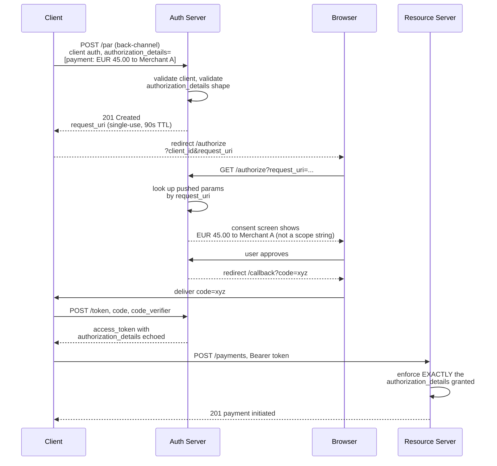
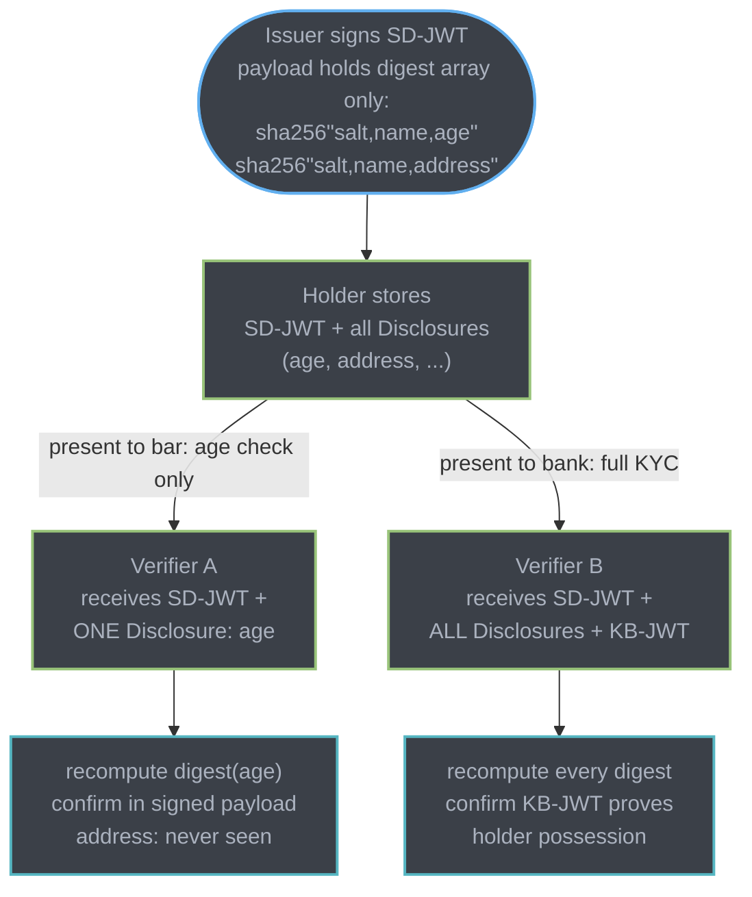

# The Authorization Frontier: PAR, RAR, Token Exchange, CIBA, SD-JWT, SCIM, and Agent Auth

The parent module ([Authentication and Authorization Systems](auth_and_authorization_systems.md)) covers OAuth 2.0's core grants, JWT/JWS mechanics, RBAC/ABAC/ReBAC, and passkeys/WebAuthn in depth — see its §4 "Passkeys and WebAuthn" and §12 for that ground. This file picks up where OAuth's original 2012 design stops holding: transaction-level authorization, service-to-service delegation, decoupled authentication, minimal-disclosure credentials, identity lifecycle automation, and the newest consumer of all of it — AI agents holding a user's token.

---

## 1. Concept Overview

Seven extension specifications, all published or finalized between 2015 and late 2025, close gaps the original OAuth 2.0 / OIDC core left open: **PAR** (RFC 9126) hardens the authorization *request* itself; **RAR** (RFC 9396) replaces coarse scope strings with structured, transaction-level authorization data; **Token Exchange** (RFC 8693) standardizes how one party trades a token for another, distinguishing delegation from impersonation; **CIBA** decouples authentication from the device making the request; **SD-JWT** (RFC 9901) lets a credential holder disclose only some of its claims; **SCIM 2.0** (RFC 7643/7644) automates the identity lifecycle — provisioning and, more importantly, deprovisioning; and the **MCP authorization specification** applies OAuth 2.1 to the newest class of client: an AI agent acting with a user's delegated authority. All seven are in production use today, not speculative drafts — this file states each one's actual standardization status because getting that wrong is worse than not mentioning it.

---

## 2. Intuition

**PAR** — a sealed envelope handed directly to the authorization server versus a postcard whose contents pass through the browser, the referrer header, and server logs along the way.

**RAR** — an itemized purchase order ("transfer €45.00 to Merchant A, IBAN DE02...") versus a blank check labeled `payments:write` that authorizes any amount, to anyone, indefinitely.

**Token Exchange** — a notarized power of attorney: the agent's token carries both who it's acting *as* and who it's acting *for*, so downstream systems can tell the difference between "the user did this" and "the service did this on the user's behalf."

**CIBA** — the bank calls the number on file instead of asking you to walk up to the counter with a code; authentication happens on a device the requesting device never touches.

**SD-JWT** — a redacted document: the issuer signs the whole page, but the holder chooses which paragraphs to black out before handing it to any particular reader.

**SCIM** — HR's offboarding checklist, automated: the moment a system of record marks someone terminated, every downstream app that trusted a manual "please deactivate this account" email loses that excuse.

Key insight: every one of these exists because the *original* OAuth 2.0 core (2012) modeled one shape — a human, a browser, a single hop, coarse scopes — and every one of these problems (a tampered request, an over-broad grant, a multi-hop call chain, a non-browser device, over-disclosure, lifecycle drift, a non-human client) is what happens when that shape doesn't match reality.

---

## 3. Core Principles

**The front channel is a weak integrity boundary.** Every parameter in a plain `GET /authorize?...` redirect passes through the user's browser: URL length limits, browser history, `Referer` headers, and any proxy or extension sitting in the request path. None of those parties needs write access to break the request — a middlebox that silently drops an unrecognized query parameter is enough to downgrade a `code_challenge_method=S256` request to something weaker. PAR removes the entire request body from that path.

**Scope strings cannot express a transaction.** `scope=payments:write` says nothing about amount, currency, recipient, or how many times the token may be used to pay. RAR's `authorization_details` is structured JSON, so the resource owner consents to (and the resource server can enforce) the *specific* transaction, not a standing blank-check capability.

**Delegation and impersonation are different security postures, and OAuth conflated them for a decade.** Token Exchange gives them distinct wire representations: a token with only a `subject_token` claims *to be* the subject (impersonation); a token that also carries an `actor_token`, surfaced in the issued token's `act` claim, claims to be acting *for* the subject while remaining visibly itself (delegation). An audit log that only sees `sub` cannot tell these apart; one that reads `act.sub` can.

**Authentication doesn't require a synchronous redirect.** Every grant in the parent module's §4 assumes the requesting device is also the device the user authenticates on. CIBA breaks that assumption deliberately — the requesting device (a call-center agent's terminal, a point-of-sale unit, a smart speaker) has no browser and no keyboard the user should type a password into, so authentication happens elsewhere, asynchronously, and the requesting device polls or waits for a signal.

**Minimal disclosure is not the same as encryption.** A plain JWT is base64url, not encrypted (parent module §2) — every claim is visible to every verifier the token is ever shown to, whether that verifier needed all of them or not. SD-JWT's answer isn't to hide claims from everyone; it's to let the *holder* decide, per presentation, which subset of an issuer-signed credential a given verifier gets to see.

**Deprovisioning is the security-critical half of provisioning, and it's the half that breaks silently.** SCIM's `PATCH /Users/{id}` with `active: false` is one HTTP call, but the failure mode isn't "the call errors" — it's "the call never fires," because the HR system's leaver event and the app's SCIM connector are two systems that can drift out of sync with no visible symptom until an audit or an incident finds the gap.

**An agent holding a user's token is a confused-deputy risk by construction.** The agent has legitimate authority to act, delegated by the user, but it is not the user — if a downstream system can't distinguish "the user asked for this" from "the agent inferred this from an untrusted tool response," a malicious MCP tool result can walk the agent into using the user's own delegated authority against the user.

**Sender-constraining trades verification cost for stolen-token uselessness — the decision is where, not whether.** Binding a token to a key the client must prove possession of (DPoP or mTLS — mechanics in the parent module's §3) removes the value of a bare token capture; which binding to pick depends on what the deployment already has: mTLS if the client already terminates mutual TLS to the resource server (service mesh, financial-grade APIs); DPoP if it doesn't and the client is a browser or mobile app that can sign a proof JWT per request.

---

## 4. Types / Architectures / Strategies

### 4.1 PAR — Pushed Authorization Requests (RFC 9126, September 2021)

The client makes a direct, authenticated back-channel `POST` to a new `pushed_authorization_request_endpoint`, carrying every parameter that would otherwise go in the `/authorize` redirect (`response_type`, `client_id`, `redirect_uri`, `scope`, `code_challenge`, `code_challenge_method`, `state`, and — combined with RAR — `authorization_details`). The authorization server validates it, stores it server-side, and returns a `request_uri` — a single-use, short-lived (RFC 9126 recommends 60 seconds; implementations commonly use 60–600s) opaque reference in a defined URN-like format. The client's browser redirect then carries only `client_id` and `request_uri`, nothing else. FAPI 2.0 Security Profile makes PAR **mandatory** for every participant (an increase from FAPI 1.0 Advanced, where it was optional), enforced via a `require_pushed_authorization_requests` server setting.

### 4.2 RAR — Rich Authorization Requests (RFC 9396, May 2023)

`authorization_details` is a JSON array sent as a request parameter (typically inside a PAR push, since it can be large). Each object has a mandatory `type` field the resource server understands, plus type-specific fields — `locations`, `actions`, `datatypes`, `identifier`, `privileges` are the generic ones RFC 9396 defines, and everything else is domain-specific. A payment-initiation `type` might carry `instructedAmount`, `creditorAccount`; a document-access `type` might carry a specific `identifier` and `actions: ["read"]`. The authorization server doesn't need to understand every `type` to relay it faithfully — but the resource server that receives the resulting access token **does** need to understand the type it's enforcing, or RAR degrades into an unenforced label. RAR's `authorization_details` and RFC 8707's `resource` parameter are complementary, not competing: `resource` says *which* resource server a token is for; `authorization_details` says *what* the caller may do once there.

### 4.3 Token Exchange (RFC 8693, January 2020)

A generic OAuth grant (`grant_type=urn:ietf:params:oauth:grant-type:token-exchange`) for trading one security token for another, most commonly a service converting a user's token into a scoped-down, audience-restricted token to call a downstream service. Two inputs distinguish the two postures: `subject_token` (mandatory — whose authority this is about) and `actor_token` (optional — who is doing the acting). Impersonation is `subject_token` alone: the issued token claims to be the subject, full stop. Delegation adds `actor_token`: the issued token's `act` claim records the actor's identity nested under the subject, so a chain of hops (gateway → order-service → payment-service) can be reconstructed as `act.act.sub → act.sub → sub`. `may_act`, when present in an input token, is the subject's own opt-in list of parties allowed to act for it — an authorization server can refuse to mint a delegated token for an actor the subject never named.

### 4.4 CIBA — Client-Initiated Backchannel Authentication (OpenID Foundation, Final Specification)

An OIDC extension for authenticating a user on a device other than the one making the request. The client calls a `backchannel_authentication_endpoint` with a way to identify the user (`login_hint`, `login_hint_token`, or `id_token_hint` — exactly one required) and gets back an `auth_req_id` plus an `interval`. Three delivery modes decide how the client learns the outcome: **poll** — the client repeatedly `POST`s the `auth_req_id` to the token endpoint until it stops getting `authorization_pending`; **ping** — the authorization server calls a client-registered callback URL when the result is ready, and the client then makes one token request; **push** — the authorization server delivers the token directly to a client-registered endpoint, no token-endpoint round trip needed. Canonical use cases: a call-center agent triggering an authentication prompt on the caller's registered phone, a point-of-sale terminal triggering an approval push during checkout, a smart-speaker skill that can't render a QR code or accept a password.

### 4.5 SD-JWT and SD-JWT VC

SD-JWT (RFC 9901, published November 2025 — no longer a draft) replaces plaintext claim values with **salted digests**: for each selectively-disclosable claim, the issuer computes `digest = hash(base64url(salt, claim_name, claim_value))`, puts the digest array in the signed JWT payload, and ships the salt+name+value triples separately as **Disclosures**. The holder decides, per presentation, which Disclosures to forward alongside the signed JWT; a verifier recomputes each forwarded Disclosure's digest and checks it appears in the signed payload — anything not disclosed is simply absent, not merely hidden. An optional **Key Binding JWT (KB-JWT)**, signed by a key the holder proved possession of at issuance, is appended to stop replay of a captured SD-JWT+Disclosures by anyone other than the original holder. **SD-JWT VC** (`draft-ietf-oauth-sd-jwt-vc`, still an IETF Internet-Draft as of August 2026, not yet an RFC) layers a verifiable-credential data model on top of the base SD-JWT mechanism and is the format the **EU Digital Identity Wallet (EUDI Wallet)** program has adopted as one of its two credential formats, alongside ISO/IEC 18013-5 `mdoc`/`mDL`. Do not present SD-JWT VC as finalized — the base mechanism it depends on is now an RFC, the credential-format profile on top of it is not.

### 4.6 SCIM 2.0 (RFC 7643 — Core Schema, RFC 7644 — Protocol, both 2015)

A REST protocol for provisioning and deprovisioning identities across systems: `POST /Users`, `PATCH /Users/{id}`, `DELETE /Users/{id}`, plus `/Groups`, all over `application/scim+json`. `PATCH` (RFC 7644 §3.5.2) takes an array of `Operations`, each an `op` (`add`, `remove`, `replace`), a `path` using SCIM's own filter-capable path grammar (e.g. `emails[type eq "work"].value`), and a `value` — the whole request is atomic. **JIT (just-in-time) provisioning** — creating a local account on first successful SSO login — solves onboarding cheaply but has no equivalent trigger for offboarding: nothing about a user *failing* to log in tells the app they've left. SCIM's deprovisioning `PATCH` (`active: false`) is the piece JIT structurally cannot provide, which is why SCIM and JIT are usually deployed together rather than as alternatives — JIT for the cheap path in, SCIM for the mandatory path out.

### 4.7 Agent / MCP Authorization

The Model Context Protocol's authorization specification (verified against `modelcontextprotocol.io/specification/draft/basic/authorization`) builds on the **OAuth 2.1 Internet-Draft** (`draft-ietf-oauth-v2-1`, still not an RFC), not a bespoke scheme. An MCP server is classified as an **OAuth 2.1 resource server**; it **MUST** publish **OAuth 2.0 Protected Resource Metadata (RFC 9728)** so a client can discover which authorization server(s) protect it, typically surfaced via a `WWW-Authenticate: Bearer resource_metadata="..."` header on a 401. MCP clients **MUST** send the **RFC 8707 `resource` parameter** on both the authorization and token requests, naming the exact canonical MCP server URI the token is for — this is what stops a token minted for one MCP server being replayed against another. **Dynamic Client Registration (RFC 7591)** is supported but explicitly **deprecated** in the current spec in favor of **OAuth Client ID Metadata Documents**, where the client's HTTPS URL itself serves as its `client_id` and the authorization server fetches client metadata from that URL. The **confused-deputy problem** is named directly in the spec's security considerations: an MCP client holding a user-delegated token, driven by content from an untrusted tool result, can be steered into calling a downstream MCP server or action the user never actually authorized — the RFC 8707 audience binding, strict token-passthrough prohibitions ("MCP servers MUST NOT accept or transit any other tokens"), and per-operation scope challenges (`insufficient_scope` triggering a step-up re-authorization rather than a silent broader grant) are the spec's controls against it, not a substitute for the agent framework's own tool-output distrust.

### 4.8 The Sender-Constraining Decision

The parent module explains DPoP (RFC 9449) and mTLS-bound tokens (RFC 8705) mechanically; the decision that actually matters in a design review is **which one, or neither**:

| Situation | Pick |
|---|---|
| Client is a browser SPA or mobile app; no existing mTLS infrastructure to the resource server | **DPoP** — application-level proof JWT, no PKI operational burden |
| Financial-grade API (FAPI 2.0) deployment, or a service mesh that already terminates mTLS between hops | **mTLS-bound tokens** — reuses certificate infrastructure already present; FAPI 2.0 accepts either, but mTLS is the more common financial-sector choice |
| Public API with low-value, short-lived tokens (5–15 min) and no PKI budget | **Bearer, unconstrained** — the short expiry is already doing most of the work; sender-constraining adds real operational cost (client key management, or certificate issuance/rotation) for tokens that are stolen-and-useless in minutes anyway |
| Service-to-service call chain crossing a token-exchange hop | **DPoP or mTLS carried through the exchange** — an unconstrained bearer token minted mid-chain reintroduces exactly the theft risk sender-constraining removed at the edge |

---

## 5. Architecture Diagrams

### PAR + RAR Combined Flow



*Nothing sensitive ever appears in the browser-visible redirect — the front channel carries only an opaque `request_uri`, and the resource server enforces the exact transaction the user consented to, not a coarse scope.*

### Token Exchange Delegation Chain

```mermaid
flowchart LR
    classDef src fill:#3b4048,stroke:#61afef,stroke-width:2px,color:#abb2bf
    classDef proc fill:#3b4048,stroke:#98c379,stroke-width:2px,color:#abb2bf
    classDef store fill:#3b4048,stroke:#e5c07b,stroke-width:2px,color:#abb2bf
    classDef bad fill:#3b4048,stroke:#e06c75,stroke-width:2px,color:#abb2bf
    classDef ext fill:#3b4048,stroke:#c678dd,stroke-width:2px,color:#abb2bf

    user(["User<br/>token: sub=alice"]) --> gw["API Gateway<br/>subject_token=alice's token<br/>actor_token=gateway's own token"]
    gw -->|"exchanges for"| t1(["Downscoped token<br/>sub=alice, act.sub=gateway<br/>scope: orders:read only"])
    t1 --> os["Order Service<br/>subject_token=t1<br/>actor_token=order-service token"]
    os -->|"exchanges for"| t2(["Further-downscoped token<br/>sub=alice<br/>act.sub=order-service, act.act.sub=gateway<br/>scope: inventory:read only"])
    t2 --> inv["Inventory Service"]

    class user src
    class gw,os proc
    class t1,t2 store
    class inv ext
```



*Every hop narrows scope and adds itself to the `act` chain — `inventory-service` can prove not just that alice authorized this, but the exact path (gateway → order-service) the authority traveled through, and enforce that neither hop exceeded what it was given.*

### SD-JWT Disclosure Structure



*The same signed credential serves two verifiers two different truths — the bar never learns the address, because the holder never forwarded the Disclosure that would let it recompute that digest, not because of a permissions check the verifier trusted.*

---

## 6. How It Works — Detailed Mechanics

### PAR request/response pair (RFC 9126)

```http
POST /as/par HTTP/1.1
Host: auth.example.com
Content-Type: application/x-www-form-urlencoded
Authorization: Basic base64(client_id:client_secret)

response_type=code
&client_id=payment-initiator
&redirect_uri=https%3A%2F%2Fclient.example.com%2Fcallback
&code_challenge=E9Melhoa2OwvFrEMTJguCHaoeK1t8URWbuGJSstw-cM
&code_challenge_method=S256
&state=af0ifjsldkj
&authorization_details=%5B%7B%22type%22%3A%22payment_initiation%22%2C...%7D%5D
```

```http
HTTP/1.1 201 Created
Content-Type: application/json
Cache-Control: no-store

{
  "request_uri": "urn:ietf:params:oauth:request_uri:6esc_11ACC5bwc014ltc14eY22c",
  "expires_in": 90
}
```

Then the browser redirect carries only:

```
GET /as/authorize?client_id=payment-initiator&request_uri=urn:ietf:params:oauth:request_uri:6esc_11ACC5bwc014ltc14eY22c
```

### RAR `authorization_details` — a payment-initiation transaction

```json
[
  {
    "type": "payment_initiation",
    "actions": ["initiate", "status"],
    "locations": ["https://api.example.com/payments"],
    "instructedAmount": {
      "currency": "EUR",
      "amount": "45.00"
    },
    "creditorName": "Merchant A",
    "creditorAccount": {
      "iban": "DE02100100109307118603"
    },
    "remittanceInformationUnstructured": "Invoice 2026-08-1123"
  }
]
```

Contrast with the RAR-less equivalent — `scope=payments:write` — which authorizes *every* amount, to *any* creditor, for as long as the token is valid.

### Token Exchange request (RFC 8693) — delegation, not impersonation

```http
POST /token HTTP/1.1
Host: auth.example.com
Content-Type: application/x-www-form-urlencoded
Authorization: Basic base64(order-service-client-id:secret)

grant_type=urn%3Aietf%3Aparams%3Aoauth%3Agrant-type%3Atoken-exchange
&resource=https%3A%2F%2Finventory.example.com
&requested_token_type=urn%3Aietf%3Aparams%3Aoauth%3Atoken-type%3Aaccess_token
&subject_token=eyJhbGciOiJSUzI1NiIs...(alice's token, sub=alice)
&subject_token_type=urn%3Aietf%3Aparams%3Aoauth%3Atoken-type%3Aaccess_token
&actor_token=eyJhbGciOiJSUzI1NiIs...(order-service's own token)
&actor_token_type=urn%3Aietf%3Aparams%3Aoauth%3Atoken-type%3Aaccess_token
&scope=inventory%3Aread
```

Response — note `sub` stays alice, and the delegation is recorded in `act`, not merged away:

```json
{
  "access_token": "eyJhbGciOiJSUzI1NiIs...",
  "issued_token_type": "urn:ietf:params:oauth:token-type:access_token",
  "token_type": "Bearer",
  "expires_in": 300,
  "scope": "inventory:read"
}
```

Decoded payload of the issued token (illustrative):

```json
{
  "sub": "alice",
  "act": { "sub": "order-service" },
  "scope": "inventory:read",
  "aud": "https://inventory.example.com",
  "exp": 1756300000
}
```

### SCIM PATCH — the deprovisioning call every HR-to-app integration depends on

```http
PATCH /scim/v2/Users/2819c223-7f76-453a-919d-413861904646 HTTP/1.1
Host: app.example.com
Content-Type: application/scim+json
Authorization: Bearer <scim-provisioning-token>

{
  "schemas": ["urn:ietf:params:scim:api:messages:2.0:PatchOp"],
  "Operations": [
    { "op": "replace", "path": "active", "value": false }
  ]
}
```

This single, atomic (RFC 7644 §3.5.2) call is the entirety of what stands between a terminated employee and continued access — see §10 for what happens when it never fires.

### Spring Authorization Server — enabling PAR and validating `authorization_details`

Spring Authorization Server added native RFC 9126 PAR support in the 1.5.x line (verified: `spring-authorization-server` PR #1925, merged into the 1.5.0 milestone).

```java
// Dependency: org.springframework.security:spring-security-oauth2-authorization-server:1.5.x
@Bean
public SecurityFilterChain authorizationServerSecurityFilterChain(HttpSecurity http) throws Exception {
    OAuth2AuthorizationServerConfigurer authorizationServerConfigurer =
        OAuth2AuthorizationServerConfigurer.authorizationServer();

    http
        .securityMatcher(authorizationServerConfigurer.getEndpointsMatcher())
        .with(authorizationServerConfigurer, (authorizationServer) -> authorizationServer
            .pushedAuthorizationRequestEndpoint(par -> par
                // custom authentication provider validates authorization_details
                // shape before the pushed request is persisted
                .authenticationProvider(new RarValidatingParAuthenticationProvider()))
            .oidc(Customizer.withDefaults())
        );

    return http.build();
}

// authorization_details is not a Spring Authorization Server built-in concept —
// it must be validated and persisted as a custom OAuth2AuthorizationConsent
// attribute. This is the shape of that validation step, not the full provider.
public final class RarValidatingParAuthenticationProvider implements AuthenticationProvider {

    private static final Set<String> SUPPORTED_TYPES = Set.of("payment_initiation");

    @Override
    public Authentication authenticate(Authentication authentication) throws AuthenticationException {
        OAuth2PushedAuthorizationRequestAuthenticationToken par =
            (OAuth2PushedAuthorizationRequestAuthenticationToken) authentication;

        String rawDetails = par.getAdditionalParameters().get("authorization_details");
        if (rawDetails != null) {
            JsonArray details = JsonParser.parseString(rawDetails).getAsJsonArray();
            for (JsonElement el : details) {
                String type = el.getAsJsonObject().get("type").getAsString();
                if (!SUPPORTED_TYPES.contains(type)) {
                    // reject unknown authorization_details types rather than
                    // silently relaying a grant the resource server cannot enforce
                    throw new OAuth2AuthenticationException(
                        new OAuth2Error("invalid_authorization_details", "Unsupported type: " + type, null));
                }
            }
        }
        return null; // delegate to the default provider for the remaining OAuth2 checks
    }

    @Override
    public boolean supports(Class<?> authentication) {
        return OAuth2PushedAuthorizationRequestAuthenticationToken.class.isAssignableFrom(authentication);
    }
}
```

**Why validate `type` at the PAR endpoint, not later.** An authorization server that relays an `authorization_details` array without checking it understands every `type` degrades RAR into an unenforceable label — the resource server that later reads the token has no earlier opportunity to reject a malformed or unsupported authorization shape, and by then the user has already granted consent to it.

---

## 7. Real-World Examples

**UK Open Banking / Berlin Group (EU PSD2)** — payment-initiation APIs are the origin use case RFC 9396's editors drew their `authorization_details` examples from; a payment consent flow states the exact amount and creditor rather than a `payments:write` scope.

**EU Digital Identity Wallet (EUDI Wallet)** — the EU's eIDAS 2.0 wallet program has adopted SD-JWT VC as one of its two mandated credential formats (the other being ISO mdoc), so a citizen's digital driving licence or age-attestation can disclose "over 18: true" to a verifier without disclosing date of birth or address.

**Okta and Auth0 CIBA support** — both ship CIBA as a first-class grant for call-center and unattended-device authentication scenarios (verified against each vendor's own CIBA documentation), the canonical production use being a support agent triggering a push-authentication prompt on the caller's phone mid-call rather than reading a password aloud.

**Slack, Google Workspace, and Okta as SCIM sources** — enterprise SaaS deprovisioning at scale runs on SCIM: Okta (or the customer's IdP) pushes a `PATCH active:false` to every downstream SCIM-enabled app the instant HR marks an employee terminated, which is the automated version of the manual offboarding checklist §10's pitfall shows failing.

**MCP servers requiring OAuth 2.1** — GitHub's and Sentry's remote MCP servers are both documented as requiring the MCP authorization flow (OAuth 2.1 + Protected Resource Metadata) rather than a static API key, reflecting the spec's classification of every remote MCP server as a resource server.

---

## 8. Tradeoffs

| Dimension | Without the extension | With the extension | Cost |
|---|---|---|---|
| PAR | Authorization params travel through the browser redirect | Params pushed back-channel; browser carries only an opaque `request_uri` | One extra back-channel round trip before the redirect |
| RAR | `scope` strings — coarse, all-or-nothing per grant | `authorization_details` — structured, transaction-scoped | Resource server must understand every `type` it enforces; unrecognized types must be rejected, not ignored |
| Token Exchange | Services share a static credential, or forward the user's own token unmodified everywhere | Each hop mints its own downscoped, audience-bound token, chain visible in `act` | An extra token endpoint round trip per hop; more tokens to key-rotate |
| CIBA | User must be present at the requesting device with a browser | Authentication happens on a separate, trusted device | Requires a way to reach the user out-of-band (registered device/push); polling has latency, ping/push need a reachable callback |
| SD-JWT vs plain JWT | Every verifier sees every claim | Holder discloses only what a given verifier needs | Larger artifact (digests + salts); issuer and holder both need SD-JWT-aware tooling |
| SCIM vs manual/JIT-only provisioning | Deprovisioning depends on someone remembering to email IT | Deprovisioning is automatic and auditable | Requires every downstream app to implement a SCIM server; SCIM connector itself becomes a thing that can silently break |
| DPoP / mTLS vs bearer | Any party holding the token can use it | Only the party holding the bound key can use it | Client-side key management (DPoP) or certificate issuance and rotation (mTLS) |

---

## 9. When to Use / When NOT to Use

**PAR:** use whenever FAPI 2.0 compliance is in scope (mandatory there) or when authorization requests carry sensitive parameters (RAR's `authorization_details`, long `claims` requests). Skip it for a low-stakes internal tool where the added back-channel round trip buys nothing over standard Authorization Code + PKCE.

**RAR:** use when a single scope string cannot express what's being authorized — payment amounts, specific document identifiers, time-boxed access. Do not reach for RAR to replace a small, static set of scopes (`read`, `write`, `admin`) — that's what RBAC-style scopes already do well, and RAR adds a schema-design and resource-server-validation burden for no benefit there.

**Token Exchange:** use for any multi-hop service call chain acting on a user's behalf, or for converting a long-lived credential (a session, an ID token) into a short-lived, audience-scoped access token. Do not use it to route around building proper service-to-service auth — a fixed internal API that never needs to know *which* user triggered a call is better served by plain client-credentials.

**CIBA:** use when the device initiating the request cannot render a redirect-based login UI, or when authentication must happen on a device the user already trusts more than the requesting device (call center, POS, IoT). Do not use CIBA as a way to avoid building a browser flow when the requesting device *does* have a browser — Authorization Code + PKCE is simpler and better understood for that case.

**SD-JWT:** use for identity credentials that get shown to many different verifiers with different legitimate needs — age checks, KYC tiers, professional licenses. Skip it for a plain API access token, where every verifier is the same resource server and there's nothing to selectively disclose.

**SCIM:** deploy it the moment more than one downstream app needs to be deprovisioned in step with the identity source of record — the ROI is entirely in the deprovisioning side. JIT alone is adequate only for low-privilege, self-service apps where an orphaned account carries negligible risk.

**MCP / agent OAuth:** apply the full spec (PRM, RFC 8707 audience binding, no token passthrough) to any remote MCP server that touches user data or performs actions with side effects. A purely local, STDIO-transport MCP server explicitly falls outside the spec's scope — it's expected to read credentials from the environment instead.

---

## 10. Common Pitfalls

**Pitfall 1 — SCIM deprovisioning wired up but never actually firing.** A mid-size SaaS company connected its HR system to Okta and Okta to a dozen downstream SCIM-enabled apps, and the integration passed its go-live test — a synthetic test user deactivated cleanly across every app. What the test never exercised was the failure path: one app's SCIM connector silently stopped accepting `PATCH` requests after a token rotation on that app's side (the SCIM provisioning token itself had expired, unnoticed because nothing alerted on SCIM call failures — only on total connector outage). For eleven months, every *new* hire and every *departure* synced everywhere except that one app; new employees onboarded to it fine (a separate JIT path), but departures left the account active. An internal audit eventually found 17 terminated employees with still-active accounts in that one app, one of them a former contractor whose account had unrestricted read access to a customer database. Fix: alert on SCIM call failure rate per downstream app, not just connector reachability, and periodically reconcile the SCIM-managed user list against the HR source of truth rather than trusting that "provisioning worked" implies "deprovisioning works."

**Pitfall 2 — an MCP agent minted a token with far broader scope than the task needed.** A team wired an internal coding-assistant agent to an MCP server fronting their issue tracker, and for convenience issued the agent's OAuth client a token scoped to `issues:read issues:write issues:admin` — the union of every scope any tool the agent might call could need, requested once at setup rather than per-operation. A prompt-injection payload embedded in a fetched web page (the agent had a separate, unrelated browsing tool) steered the agent into calling the issue-tracker MCP server to close and relabel dozens of unrelated tickets, using `issues:admin` privilege the actual task never justified. Because the token was long-lived and broad rather than requested incrementally, there was no `insufficient_scope` step-up challenge to catch the mismatch — the token already had everything. Fix: request the narrowest scope for the immediate operation, let a genuinely broader operation trigger the MCP spec's step-up re-authorization flow (§4.7) rather than pre-provisioning for every tool the agent might ever call, and treat any tool-triggered write action as needing the same scrutiny a user-initiated one would get.

**Pitfall 3 — treating RAR's `authorization_details` as advisory metadata instead of an enforcement contract.** A resource server logged `authorization_details` for audit purposes but authorized requests based on the token's coarse `scope` claim as before, on the reasoning that the fine-grained data was "nice to have." An attacker who obtained a token issued for a €10 authorization_details grant discovered the resource server would honor any amount, because the enforcement point never actually read the structured field. Fix: if you issue RAR-shaped tokens, the resource server must be the thing enforcing them — logging `authorization_details` without checking it against the actual request is worse than not implementing RAR at all, because it looks compliant in an audit while providing zero additional protection.

---

## 11. Technologies & Tools

| Tool / Library | Purpose |
|---|---|
| Keycloak | Supports PAR and RAR (`authorization_details` validation via policy); widely used FAPI-adjacent AS |
| Authlete | Commercial AS backend with first-class PAR, RAR, CIBA, and Token Exchange support; frequently cited in RFC 9126/9396 implementer guidance |
| Curity Identity Server | FAPI 2.0-certified AS with PAR, RAR, CIBA support, aimed at financial-grade deployments |
| Auth0 / Okta | Both document and support CIBA as a production grant type; Okta is a common SCIM 2.0 identity source for downstream provisioning |
| Spring Authorization Server 1.5.x | Native RFC 9126 PAR support (`pushedAuthorizationRequestEndpoint`); RAR and RFC 8693 Token Exchange require custom `AuthenticationProvider`s — not built in |
| openid4vc / sd-jwt libraries (e.g. `sd-jwt-js`, `authlete` SD-JWT libraries) | SD-JWT issuance, disclosure selection, and verification |
| OpenID Foundation FAPI conformance suite | Certification test suite for FAPI 2.0 Security Profile compliance, including mandatory-PAR enforcement |
| SCIM client/server libraries (e.g. `pingidentity/scim2-sdk-java`) | RFC 7643/7644-compliant SCIM implementations for both provisioning sources and downstream apps |
| MCP SDKs (TypeScript, Python) | Reference implementations of the MCP authorization flow — Protected Resource Metadata discovery, Client ID Metadata Documents, RFC 8707 resource binding |

---

## 12. Interview Questions with Answers

**Q: If OAuth authorization requests already go over HTTPS, what does PAR actually protect against?**
**Short:** PAR protects request integrity in the browser redirect path, which HTTPS to the AS alone doesn't cover.
HTTPS protects the connection to the authorization server, but a plain `/authorize` redirect still passes every parameter through the user's browser — URL length limits, browser history, `Referer` leakage to third-party resources on the consent page, and any extension or middlebox sitting in the request path. None of those require breaking TLS to tamper with or truncate a query parameter. PAR moves the entire request to a direct, authenticated back-channel POST, so the browser redirect carries only an opaque `request_uri` with nothing left to tamper with or leak.

**Q: What is the practical difference between RAR's authorization_details and a well-designed set of OAuth scopes?**
**Short:** Scopes are coarse capability labels; authorization_details is structured, transaction-specific data like an exact amount.
A scope like `payments:write` authorizes an unbounded capability — any amount, any recipient, for the token's whole lifetime. `authorization_details` is a JSON array carrying the specifics of one transaction — amount, currency, creditor account, allowed actions — so both the user's consent screen and the resource server's enforcement are tied to that exact transaction rather than a standing blank-check grant. The two aren't mutually exclusive: `scope` can still gate broad API access while `authorization_details` narrows a specific operation within it.

**Q: In RFC 8693 Token Exchange, what distinguishes delegation from impersonation, and why does it matter for audit logs?**
**Short:** Delegation includes an actor_token and act claim; impersonation uses only subject_token and looks identical to the subject.
Impersonation supplies only a `subject_token`: the issued token claims to be the subject, and nothing in the token distinguishes it from a token the subject obtained directly. Delegation adds an `actor_token`, and the issued token carries an `act` claim naming the actor nested under the unchanged `sub` — so a multi-hop chain (gateway acting for the user, calling a service that acts for the gateway) is fully reconstructable from the token alone. An audit log built only on `sub` cannot tell "the user did this" from "a service did this on the user's behalf" — that distinction is exactly what `act` exists to preserve.

**Q: CIBA is described as "decoupled" authentication — decoupled from what, and what problem does that solve?**
**Short:** CIBA decouples authentication from the device making the request, letting a separate trusted device authenticate the user.
It decouples the device initiating the authorization request from the device the user actually authenticates on. A call-center terminal, a point-of-sale unit, or a smart speaker has no safe way to collect a password or render a redirect-based login page, but the user likely has a phone already enrolled for push authentication. CIBA lets the requesting device hand off entirely — it posts a `login_hint` to a backchannel endpoint, gets an `auth_req_id`, and either polls, waits for a ping callback, or waits for a pushed token, while the actual authentication happens on the user's own trusted device.

**Q: How does SD-JWT let a holder disclose only some claims when the issuer signed the whole thing at once?**
**Short:** The issuer signs only salted digests of claims; the holder forwards cleartext Disclosures only for what it reveals.
The issuer never puts plaintext claim values in the signed JWT payload — it computes a salted digest for each selectively-disclosable claim and puts the digest array in the payload instead, while shipping the salt+name+value as a separate Disclosure per claim. The holder decides per presentation which Disclosures to forward alongside the signed JWT; a verifier recomputes the digest of each forwarded Disclosure and checks it's present in the signed payload. A claim the holder never forwards is not merely hidden from that verifier — the verifier has no way to even know it exists, let alone what value it holds.

**Q: What is a Key Binding JWT in SD-JWT, and what attack does it prevent?**
**Short:** A KB-JWT, signed by the holder's own key, proves the presenter is the original holder and stops replay by a thief.
It's an additional JWT the holder appends when presenting an SD-JWT, signed with a key the holder proved possession of at issuance time and typically bound to the specific verifier and a fresh nonce/timestamp. Without it, anyone who captures a presented SD-JWT plus its Disclosures — over an insecure channel, from a compromised log, from a careless verifier — could replay that exact presentation elsewhere. The KB-JWT ties the presentation to proof that whoever is presenting it currently controls the original holder's private key, the same proof-of-possession principle DPoP applies to bearer access tokens.

**Q: Why does JIT provisioning alone create an offboarding gap that SCIM is specifically built to close?**
**Short:** JIT triggers on login, so it has no event for a user who stops logging in — SCIM's PATCH is the missing trigger.
Just-in-time provisioning creates a local account automatically the first time a user successfully authenticates via SSO — a real event exists to trigger it. There is no symmetric event for departure: a terminated employee simply stops logging in, and "absence of a login" is not something the app can distinguish from a vacation or a password problem. SCIM closes that gap by giving the identity source of record (usually the IdP, fed by HR) a direct, push-based `PATCH .../active=false` call the moment termination is recorded — independent of whether the user ever attempts to log in again.

**Q: Walk through a SCIM PATCH request that deactivates a user, and explain why it must be atomic.**
**Short:** A SCIM PATCH sends an Operations array with op/path/value; RFC 7644 requires the whole request succeed or fail together.
`PATCH /Users/{id}` carries a `schemas` array identifying it as a `PatchOp` request and an `Operations` array, each entry an `op` (`add`/`remove`/`replace`), a `path` (which can include a SCIM filter expression for multi-valued attributes), and a `value` — deactivation is typically `{"op":"replace","path":"active","value":false}`. RFC 7644 §3.5.2 requires the request be treated as atomic regardless of how many operations it contains, because a partially-applied PATCH — say, an attribute update succeeding while a deactivation in the same request silently fails — would leave a downstream system in an inconsistent, unaudited state that's far worse than the whole call simply failing and being retried.

**Q: How does the MCP authorization spec address the confused-deputy problem when an agent holds a user's token?**
**Short:** MCP binds tokens to one resource via RFC 8707, forbids passthrough to other servers, and requires step-up scope challenges.
The spec names the confused-deputy risk directly: an agent driven partly by untrusted tool output could be steered into using the user's delegated authority somewhere the user never intended. Its controls are structural rather than behavioral — every token request must carry the RFC 8707 `resource` parameter naming the exact canonical MCP server URI, so a token minted for one server is meaningless against another; MCP servers "MUST NOT accept or transit any other tokens," closing the passthrough path where a compromised server relays a user's token elsewhere; and an operation needing more privilege than the current token holds triggers an `insufficient_scope` step-up re-authorization rather than being silently granted from an already-broad token. None of that substitutes for the agent framework distrusting tool output in the first place — it limits the blast radius once an agent is steered, it doesn't prevent the steering.

**Q: Is SD-JWT VC a finished standard you can build a production credential wallet against today?**
**Short:** No — the base SD-JWT mechanism is RFC 9901, but SD-JWT VC on top of it is still an IETF Internet-Draft.
The underlying selective-disclosure mechanism, SD-JWT itself, was published as RFC 9901 in November 2025 and is a finished IETF standard. SD-JWT VC — the verifiable-credential data model layered on top, which is the format actually used by wallet implementations like the EU's EUDI Wallet — is still `draft-ietf-oauth-sd-jwt-vc` and has not reached RFC status as of mid-2026. Building against it today means tracking an evolving draft, not a stable RFC; treat any claim that SD-JWT VC itself is "finalized" as conflating it with the base mechanism it depends on.

**Q: Does FAPI 2.0 make Pushed Authorization Requests optional, the way FAPI 1.0 Advanced did?**
**Short:** No — FAPI 2.0 Security Profile makes PAR mandatory for every participant, unlike FAPI 1.0 where it was optional.
FAPI 1.0 Advanced allowed PAR as one option among a few ways to protect the authorization request. FAPI 2.0 Security Profile, approved as a Final Specification by the OpenID Foundation in February 2025, requires PAR for every participant — deployments commonly enforce this via a `require_pushed_authorization_requests` setting, and some compliance profiles require it regardless of that setting's value. A client attempting a plain front-channel `/authorize` request against a FAPI 2.0-compliant authorization server should expect it to be rejected outright.

**Q: What does the `may_act` claim do in RFC 8693 Token Exchange, and who sets it?**
**Short:** may_act lets a subject pre-authorize specific actors, and the AS checks a requested delegation against that list.
`may_act` is a claim the subject's own token (or a claim maintained by the authorization server about that subject) can carry, naming which parties are permitted to act on the subject's behalf. When a token-exchange request presents an `actor_token` requesting delegation, the authorization server can check the requested actor against the subject's `may_act` list before minting a delegated token — refusing to create a delegation the subject never opted into, rather than trusting the mere possession of a valid actor token as sufficient authorization to act for anyone.

**Q: When would you pick mTLS-bound tokens over DPoP for sender-constraining, and vice versa?**
**Short:** Pick mTLS where mutual-TLS infrastructure already exists (financial APIs, service mesh); pick DPoP otherwise.
mTLS-bound tokens (RFC 8705) make sense when the deployment already terminates mutual TLS between the client and resource server — a financial-grade API ecosystem or an internal service mesh where certificate issuance and rotation are already solved problems, so binding the token to the TLS client certificate adds no new operational surface. DPoP (RFC 9449) fits better when the client is a browser SPA or mobile app with no existing PKI relationship to the resource server — it only requires the client to hold a key pair and sign a per-request proof JWT, no certificate authority or mutual-TLS termination needed. Neither is free: mTLS costs certificate lifecycle management, DPoP costs client-side key management and per-request proof generation.

**Q: A resource server logs authorization_details for audit but still authorizes based on the coarse scope claim. What's wrong with that design?**
**Short:** Logging authorization_details without enforcing it looks compliant but provides no actual transaction-level protection.
It creates the appearance of fine-grained authorization without the substance: an audit trail shows the specific transaction the user consented to, but the enforcement decision never reads that field, so any request within the coarser scope succeeds regardless of whether it matches the granted `authorization_details`. This is worse than not implementing RAR at all in one specific way — it passes a compliance review that checks for RAR's presence in the token, while providing none of the protection RAR is meant to provide, because the resource server that must be the actual enforcement point never was.

**Q: What's the difference between MCP's Dynamic Client Registration support and Client ID Metadata Documents, and which does the spec prefer?**
**Short:** DCR self-registers a new client per AS; Client ID Metadata Documents use a fetchable HTTPS URL as the client_id instead.
Dynamic Client Registration (RFC 7591) lets a client `POST /register` to get a `client_id` issued per authorization server it talks to — supported by the MCP spec but explicitly marked deprecated, retained only for backward compatibility. The preferred mechanism is OAuth Client ID Metadata Documents: the client's own HTTPS URL serves directly as its `client_id`, and the authorization server fetches a JSON metadata document from that URL to learn the client's registered redirect URIs and other properties, removing the need for a separate per-AS registration call and the state that comes with it.

**Q: An SD-JWT holder discloses two of eight claims. What can the verifier still infer about the six it never sees?**
**Short:** It can count them — the _sd digest array reveals how many claims exist, which is why the spec allows issuers to insert decoy digests.

It can infer the *number* of undisclosed claims, and often what they are. Selective disclosure hides claim values, not the shape of the credential: the signed payload carries one salted digest per selectively-disclosable claim in the `_sd` array, so an eight-claim credential presents eight digests whether the holder reveals two of them or all eight. A verifier that receives two Disclosures alongside eight digests learns immediately that six claims were withheld. That leaks more than it looks: if every credential of a given type from a given issuer has a fixed claim set, the verifier can map position and count onto specific claim names, and "this holder chose not to reveal their address" is itself information. The mitigation in the specification is **decoy digests** — the issuer adds digests to `_sd` that correspond to no real claim at all, and because a digest is indistinguishable from a hash of anything else, a verifier cannot tell a decoy from a withheld claim. The cost is credential size, so issuers pad to a plausible fixed width rather than at random. The practical guidance is to treat claim *count* as metadata you must deliberately protect, not as something selective disclosure gives you for free, and to standardise the padded width across every credential of a type so the padding itself does not become a fingerprint.

---

## 13. Best Practices

- Make PAR mandatory for any deployment handling financial-grade or otherwise sensitive authorization requests — do not wait for a FAPI 2.0 certification requirement to force it; the front-channel exposure it closes exists regardless of certification.
- Define `authorization_details` `type`s narrowly and version them — a resource server must reject a `type` it doesn't recognize outright, never silently ignore it and fall back to coarse scope enforcement.
- In Token Exchange, always populate `actor_token` for genuine delegation and read `act.sub` in downstream audit logs — never rely on `sub` alone to reconstruct who actually initiated a multi-hop call chain.
- Set CIBA `interval` and `expires_in` conservatively, and treat a still-pending `auth_req_id` past its expiry as a hard failure requiring a fresh backchannel request, not an indefinitely retryable one.
- Author `**Short:**`-style, self-contained SD-JWT Disclosures per claim — do not bundle unrelated claims into a single Disclosure just because they're usually revealed together; that removes the holder's ability to disclose one without the other later.
- Alert on SCIM call failure rate per downstream application, not just on total connector outages, and periodically reconcile the SCIM-managed user list against the identity source of truth — see Pitfall 1.
- Grant MCP agent tokens the narrowest scope the immediate task needs and let genuinely broader operations trigger the spec's step-up re-authorization — never pre-provision the union of every scope a tool might someday need.
- Pick DPoP or mTLS binding based on what PKI infrastructure the deployment already has, not by default — an unbound bearer token with a short expiry is a legitimate choice for low-value APIs, and sender-constraining has real operational cost.

---

## 14. Case Study

**Illustrative composite** — a mid-size UK open-banking payment-initiation provider moving from a plain OAuth `payments:write` scope to RAR + PAR to reach FAPI 2.0 Security Profile compliance.

The provider's original design, built against FAPI 1.0 Advanced, issued access tokens scoped `payments:write` after a standard Authorization Code + PKCE flow — the authorization request (including `scope`, `redirect_uri`, and a `claims` parameter carrying identity-verification requirements) traveled as a front-channel query string, and the resulting token authorized any payment amount to any creditor for its full lifetime, with per-transaction limits enforced only by an internal risk-scoring service downstream — not by the token itself. This passed FAPI 1.0 Advanced conformance, where PAR was optional, but blocked FAPI 2.0 certification outright: FAPI 2.0 requires PAR for every participant, and its threat model explicitly targets exactly the front-channel exposure the old design carried.

The migration had two independent halves. First, every authorization request moved behind PAR: the client's back-end now `POST`s the full request — including a new `authorization_details` array replacing the old flat `scope` and `claims` parameters — directly to the authorization server, receiving a `request_uri` that's the only thing the browser redirect ever sees. Second, `authorization_details` replaced the blanket `payments:write` scope with the exact transaction: amount, currency, creditor account, and the specific action being authorized (`initiate`, `status`, or `cancel`), mirroring the RAR example in §6. The resource server's payment-initiation endpoint was rewritten to read `authorization_details` from the validated token and reject any request whose amount or creditor didn't match what the array specified — closing the gap the old design left to an out-of-band risk service, which now serves as an additional layer rather than the sole enforcement point.

The rollout surfaced one of the pitfalls in §10 directly: an early version of the resource server change logged the incoming `authorization_details` for audit purposes but left the amount-matching enforcement commented out pending a later release, on the assumption the risk-scoring service downstream still caught anything wrong. A conformance test caught this before production — the FAPI 2.0 test suite specifically probes for a token's `authorization_details` being present but unenforced, submitting a payment request that matched the token's `scope` but not its `authorization_details` amount and confirming it was rejected. Fixing this before go-live avoided shipping a system that would have passed a superficial "does the response contain authorization_details" check while providing none of RAR's actual protection.

Post-migration, every authorization request the provider now issues carries a specific, auditable transaction description rather than a standing capability grant, and the front-channel browser redirect no longer carries any sensitive parameter for a network observer, browser extension, or referrer leak to capture. The FAPI 2.0 certification, run against the OpenID Foundation's conformance suite, confirmed both the mandatory-PAR enforcement and the `authorization_details` amount/creditor matching before the provider could advertise FAPI 2.0 compliance to its banking partners.
