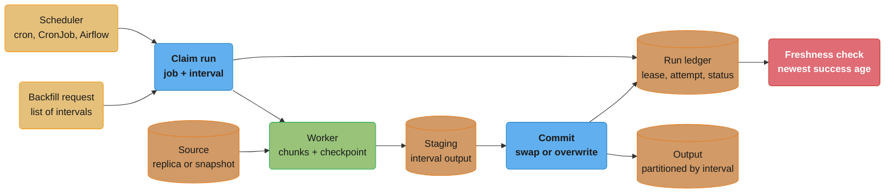
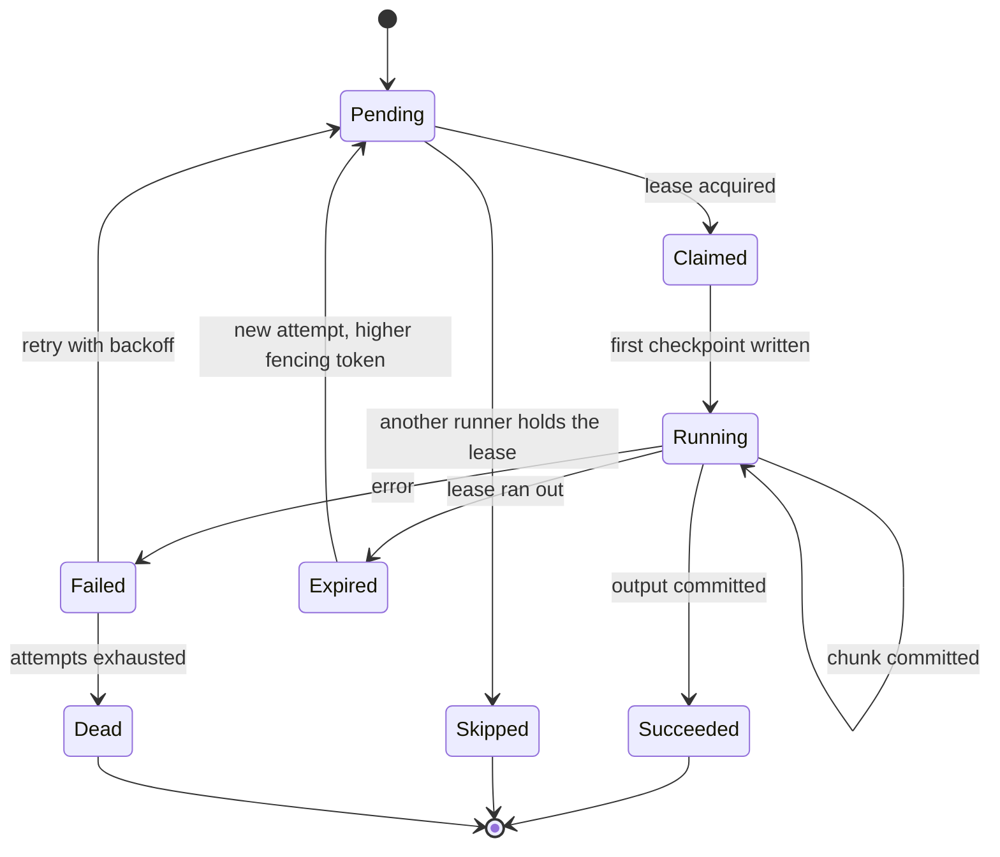
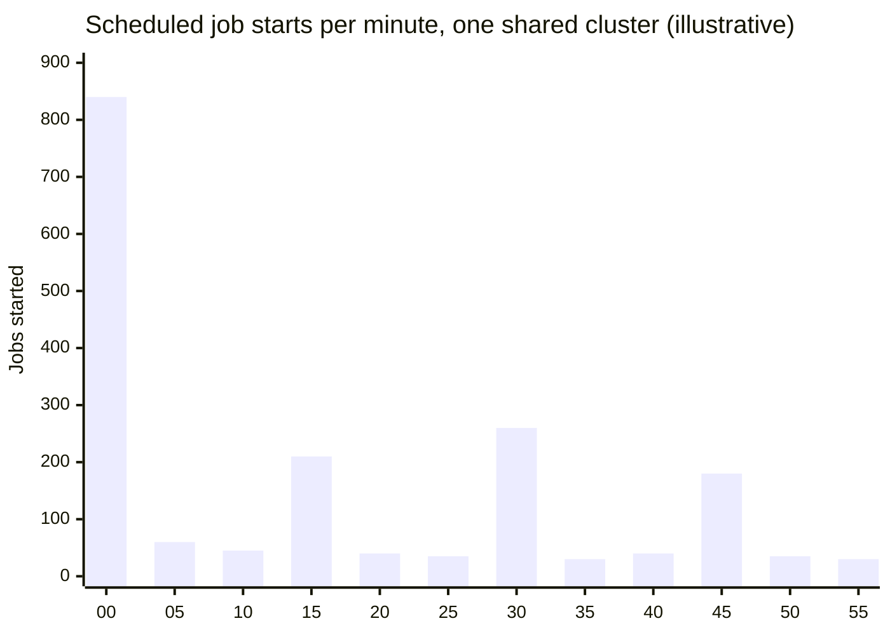
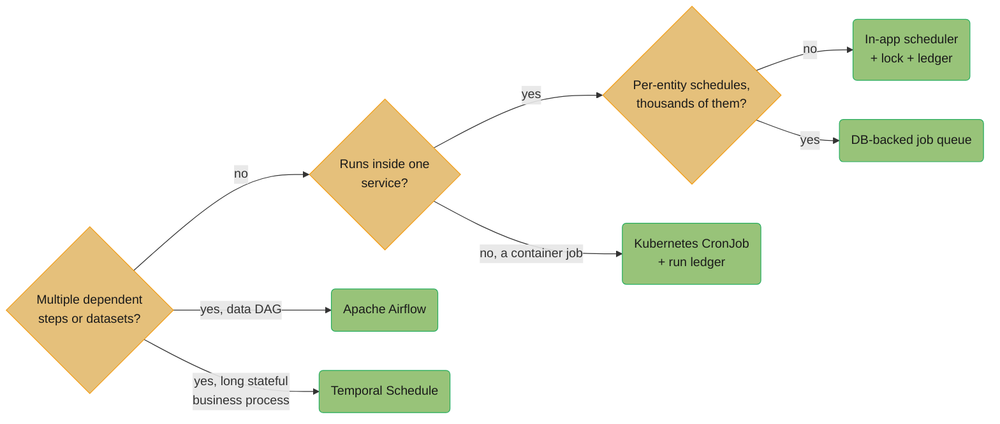

# Batch Processing and Scheduling

---

## 1. Concept Overview

A **batch job** processes a bounded set of input as one unit of work and produces an output that is either complete or absent: yesterday's usage rolled up into invoices, last hour's orders exported to the warehouse, every expired session deleted, a search index rebuilt. **Scheduling** decides when each unit of work runs and makes sure it runs once in effect, even though the machinery underneath can start it twice or not at all.

Most backend teams run dozens of these jobs, and most of them start life as one line in a crontab or one `@Scheduled` method. The failures are the same everywhere: two instances run the job at once, a deploy at 02:00 skips a night, a retry appends the same rows twice, daylight saving time runs a job twice or never, and nobody notices for a week because the job "did not fail", it simply did not run. This module is about the engineering that removes those failure modes:

- **Triggers and schedulers:** cron and its traps, single-runner guarantees, clustered schedulers, Kubernetes CronJobs, managed schedulers.
- **Run identity:** a run is "the job for interval X", not "whatever ran at 02:00", which is what makes retries and backfills safe.
- **Idempotent output:** overwrite a partition, upsert on a business key, or stage and swap; never blind append.
- **Large inputs:** chunking, keyset pagination, checkpoints, and not hurting the OLTP database you read from.
- **Late data and backfills:** watermarks, allowed lateness, reprocessing windows.
- **Choosing a tool:** when cron with a lock is enough, and when you need Airflow, Temporal or a job queue.

**Not here.** The workflow-engine model (deterministic replay, event history, versioning running workflows) is in [Durable Execution and Workflows](../durable_execution_and_workflows/durable_execution_and_workflows.md). Product depth lives in [Apache Airflow](../../technologies/apache_airflow/apache_airflow.md) and [Temporal](../../technologies/temporal_durable_execution/temporal_durable_execution.md). Spring Batch's job, step and chunk model is in [Spring Batch](../../spring/spring_batch/spring_batch.md), and `@Scheduled` with ShedLock in [Spring Events and Scheduling](../../spring/spring_events_and_scheduling/spring_events_and_scheduling.md). A job queue built on `SELECT ... FOR UPDATE SKIP LOCKED` is designed end to end in [Design a Job Queue on Postgres](../../database/case_studies/design_job_queue_on_postgres/design_job_queue_on_postgres.md). Continuous, unbounded processing (watermarks in depth, windows, state backends) is in [Stream Processing](../../hld/stream_processing/stream_processing.md).

---

## 2. Intuition

**One-line analogy:** a batch job is a night-shift accountant who closes yesterday's books. The shift starting at 02:00 is not the point; "yesterday's books are closed exactly once and correctly" is the point. If the accountant is sick, someone closes them tomorrow morning. If two accountants show up, the second sees the books are closed and goes home. If a late receipt arrives after closing, there is a rule for reopening that day.

**Mental model:** separate three clocks that naive jobs treat as one.

| Clock | Example | Who owns it |
|---|---|---|
| **Schedule time** | "run at 02:00 UTC" | the scheduler |
| **Data interval** | "events with `event_time` in [2026-11-24 00:00, 2026-11-25 00:00)" | the job's logic |
| **Wall-clock time of execution** | "it actually started at 02:07 and finished at 02:41" | the infrastructure |

A correct job reads only the data interval it was given, writes output keyed by that interval, and does not care about the other two clocks. Then a retry at 03:00, a rerun next week and a backfill of last March all produce the same output.

**Why it matters:** batch jobs move money (billing, payouts), feed decisions (reports, fraud features) and delete data (retention, GDPR erasure). Their failures are silent by default: a job that did not run emits no error.

**Key insight:** schedulers deliver **at-least-once triggering at best, and sometimes zero**. Kubernetes says so in its CronJob documentation: in certain circumstances two Jobs might be created, or none, so Jobs should be idempotent. Design every job as if it will run twice for the same interval and occasionally not at all, then add the run ledger and the freshness alert that make both cases harmless.

---

## 3. Core Principles

**A run is identified by its data interval.**
The unit of work is `(job_name, interval_start, interval_end)`. That tuple is the primary key of the run ledger, the partition key of the output, and the argument a backfill passes. Never derive the interval from `now()` inside the job.

**Idempotent effect, not exactly-once execution.**
You cannot guarantee a job runs exactly once. You can guarantee that running it twice for the same interval produces the same output: overwrite the interval's partition, upsert on a business key, or stage and atomically swap.

**One active runner per interval.**
Use a lease (a database row, a lock service) with an expiry and a fencing token, so a second runner either skips or is rejected when it tries to commit.

**Checkpoint large work.**
A job that processes 50 million rows should commit in chunks and record its position, so a crash at 80% resumes at 80%, not at 0%.

**Protect the source.**
Read from a replica or a snapshot, paginate by key, throttle, and keep transactions short. A batch job that slows the checkout database at 02:00 is an outage for the night-shift region.

**Late data is normal.**
Decide, per job, how late an event may arrive and still count, and when a closed interval is reprocessed.

**Silence is a failure.**
Alert on the absence of success (the newest successful interval is too old), not only on errors.

**UTC for schedules and intervals.**
Local-time schedules meet daylight saving time twice a year; UTC does not.

---

## 4. Types / Architectures / Strategies

### 4.1 Triggers

| Trigger | Example | Good for | Watch out for |
|---|---|---|---|
| Time-based (cron expression) | `0 2 * * *` | daily rollups, reports | DST, top-of-hour congestion, missed runs while down |
| Fixed interval | every 15 minutes from a phase | polling, cleanup | drift if measured from completion rather than from an anchor |
| Data-driven | "when yesterday's partition lands" | pipelines with upstream dependencies | upstream never lands; needs a timeout and an alert |
| Event-driven | a file upload, a message | per-item work | this is a queue, not a batch; see [Messaging Patterns](../messaging_patterns/messaging_patterns.md) |
| Manual / backfill | "run 2026-03-01 to 2026-03-31" | repairs, new jobs on old data | starving live runs of capacity |

### 4.2 Scheduler families

| Family | Example | Single-runner guarantee | Missed-run behaviour | Typical fit |
|---|---|---|---|---|
| Host cron | Vixie cron, cronie, systemd timers | none across hosts | cron: none; systemd timer with `Persistent=true` catches up one run | one box, non-critical |
| In-app scheduler + lock | Spring `@Scheduled` + ShedLock | lock skips concurrent runs | none (missed is missed) | small periodic jobs inside a service |
| Clustered scheduler | Quartz with JDBC JobStore | row lock in `QRTZ_LOCKS` | misfire instructions after `misfireThreshold` (default 60,000 ms) | many in-app triggers, JVM |
| Container scheduler | Kubernetes CronJob | `concurrencyPolicy: Forbid` (per CronJob, best effort) | one Job for the most recent missed time, bounded by `startingDeadlineSeconds` | containerised jobs |
| Managed cloud scheduler | Amazon EventBridge Scheduler | at-least-once delivery to the target | retries and a flexible time window | serverless targets, many schedules |
| DB-backed job queue | db-scheduler, JobRunr, `SKIP LOCKED` table | row claim | rows stay until claimed | dynamic per-entity schedules (one per customer) |
| Workflow orchestrator | Apache Airflow | one DAG run per logical interval | `catchup` (default `False` in current Airflow) and explicit backfill | DAGs of dependent data tasks |
| Durable execution | Temporal Schedules | overlap policy (default `Skip`) | catchup window (default one year) | long, stateful, multi-step jobs with retries |

### 4.3 Processing shapes

| Shape | What it does | Cost per run | Correctness risk |
|---|---|---|---|
| Full refresh | recompute everything, replace the table | grows with total data | low; slow and expensive at scale |
| Incremental by interval | process only `[start, end)` and replace that partition | grows with interval size | late data outside the interval |
| Incremental by high-water mark | process rows with `updated_at > last_mark` | small | clock skew, same-timestamp ties, deletes are invisible |
| CDC-driven | consume the database change log | small, continuous | operating the CDC pipeline; see [Debezium](../../technologies/debezium_change_data_capture/debezium_change_data_capture.md) |
| Chunked / partitioned fan-out | split input by key range, process ranges in parallel | parallel | uneven partitions, a hot range |

### 4.4 Output commit patterns

| Pattern | How | Idempotent | Notes |
|---|---|---|---|
| Blind append | `INSERT` new rows | no | a retry duplicates; never use for derived data |
| Delete-then-insert the interval | `DELETE WHERE day = :d; INSERT ...` in one transaction | yes | simplest; readers see old or new, never half (one transaction) |
| Upsert on business key | `INSERT ... ON CONFLICT (key) DO UPDATE` | yes | good when keys are stable; stale rows that should disappear stay |
| Stage and swap | write to `table_staging`, then rename or swap a partition | yes | best for big tables and file outputs; readers never see partial data |
| Write files with deterministic names | `s3://bucket/dt=2026-11-24/part-0000.parquet` | yes if overwritten as a set | object stores need a manifest or table format for atomic sets |

### 4.5 ETL and ELT for backend engineers

**ETL** (extract, transform, load) transforms in application code before loading. **ELT** loads raw data into the warehouse first and transforms there with SQL (often with dbt incremental models). For a backend engineer the practical split is:

- Your service owns **extract**: produce a clean, complete, replayable feed of your data (a CDC stream, an outbox-fed topic, or an interval export with a contract).
- The data platform owns most **transform** in ELT setups; your job is to keep the feed's schema stable and versioned.
- Transform in your service only what needs your domain logic or must never leave your boundary (PII minimisation before export).

The warehouse side (columnar engines, partitioning) is in [Analytical Databases and OLAP](../../database/analytical_databases_and_olap/analytical_databases_and_olap.md).

---

## 5. Architecture Diagrams

### 5.1 Anatomy of a reliable batch job


*The scheduler only proposes "run interval X". The claim against the run ledger decides whether this worker may run it. The commit is the single point where output becomes visible, and it also marks the ledger row, so success and output appear together. The freshness check reads the ledger, which is how a job that never started gets noticed.*

### 5.2 The three clocks (visual intuition)

```
Daily job, data interval = one UTC day, allowed lateness = 2 h, schedule = 02:00 UTC

event_time    |---------- 2026-11-24 ----------|---------- 2026-11-25 -----------|
              00:00                          24:00                             24:00
data interval [==============================)
lateness                                     [==)  events for 11-24 still arriving
schedule                                        ^ 02:00  run for interval 11-24 starts
wall clock                                         ^ 02:07 actually started, 02:41 done
retry                                                      ^ 03:15 same interval, same output
backfill (in March 2027)                 run(interval=11-24) -> identical output again

A job keyed on now() - 1 day would read [01:07 on 11-24, 02:07 on 11-25) at 02:07, and a
different window at 03:15. A job keyed on its interval reads [11-24 00:00, 11-25 00:00)
every time.
```
*The schedule fires after the interval closes plus the allowed lateness. The wall-clock start time varies from run to run, and an interval-keyed job ignores it, which is why the retry and the backfill produce identical output.*

### 5.3 Lifecycle of one run


*`Expired` is the dangerous state: the old worker may still be running. The new attempt gets a higher fencing token, and the commit checks it, so the old worker's late commit is rejected instead of overwriting the new output.*

### 5.4 Everyone schedules at :00


*Humans pick round numbers, so job starts pile onto :00, :15, :30 and :45. GitHub's documentation warns that scheduled workflows can be delayed during high load, that the start of every hour is a high-load time, and that some queued jobs may be dropped. Spreading start minutes or adding jitter flattens the spike.*

### 5.5 Choosing a scheduler


*Most backend jobs land on the two cheap boxes: an in-app scheduler with a lock, or a CronJob, each with a run ledger. Reach for Airflow when jobs depend on each other's datasets, and for Temporal when one run is a long, multi-step process with external calls that must survive restarts.*

---

## 6. How It Works — Detailed Mechanics

### 6.1 Cron syntax and its traps

Five fields: minute, hour, day of month, month, day of week.

```bash
# m   h   dom mon dow   command
  0   2   *   *   *     /opt/jobs/rollup --interval=yesterday
 */15 *   *   *   *     /opt/jobs/cleanup
  7   2   *   *   *     /opt/jobs/report            # off the :00 spike
```

Four traps, each documented in the Debian `crontab(5)` and `cron(8)` manual pages for Vixie cron:

| Trap | What happens | Fix |
|---|---|---|
| Day-of-month **and** day-of-week both set | if both fields are restricted, the job runs when **either** matches; `30 4 1,15 * 5` runs on the 1st, the 15th **and** every Friday | restrict one field and test the other inside the script |
| `%` in the command | an unescaped `%` becomes a newline and the rest goes to stdin; `date +%F` breaks | escape as `\%`, or call a script |
| Daylight saving time | when the clock moves forward less than 3 hours, jobs in the skipped time run soon after the change; when it moves back, jobs in the repeated time do not re-run; jobs with `*` in the hour or minute field run on the new time immediately | run the host and the schedule in UTC |
| One time zone per daemon | cron handles tasks in a single time zone | do not rely on per-line time zones; use UTC and convert in the job |

Other schedulers make different DST choices. GitHub Actions, for schedules with a DST-observing `timezone`, advances a run in a skipped hour to the next valid time (a 02:30 schedule runs at 03:00). Kubernetes CronJob interprets the schedule in `.spec.timeZone`, or in the kube-controller-manager's local time zone if unset. Know which rule your scheduler uses, or avoid the question with UTC.

### 6.2 The run ledger

The ledger is a table. It turns "something fired at 02:00" into "interval X is claimed, running, done":

```sql
CREATE TABLE job_run (
    job_name        text        NOT NULL,
    interval_start  timestamptz NOT NULL,
    interval_end    timestamptz NOT NULL,
    status          text        NOT NULL CHECK (status IN
                        ('PENDING','RUNNING','SUCCEEDED','FAILED','DEAD')),
    attempt         int         NOT NULL DEFAULT 0,      -- also the fencing token
    lease_owner     text,
    lease_until     timestamptz,
    checkpoint      jsonb,                               -- e.g. {"last_id": 18273645}
    rows_out        bigint,
    started_at      timestamptz,
    finished_at     timestamptz,
    error           text,
    PRIMARY KEY (job_name, interval_start)
);

-- Create the run if it does not exist; a second trigger for the same interval is a no-op.
INSERT INTO job_run (job_name, interval_start, interval_end, status)
VALUES ('usage_rollup', '2026-11-24T00:00Z', '2026-11-25T00:00Z', 'PENDING')
ON CONFLICT (job_name, interval_start) DO NOTHING;

-- Claim: succeeds only if nobody holds a live lease and the run is not finished.
UPDATE job_run
SET    status = 'RUNNING',
       attempt = attempt + 1,
       lease_owner = :worker_id,
       lease_until = now() + interval '30 minutes',
       started_at = coalesce(started_at, now())
WHERE  job_name = 'usage_rollup'
  AND  interval_start = '2026-11-24T00:00Z'
  AND  status IN ('PENDING', 'FAILED', 'RUNNING')
  AND  (lease_until IS NULL OR lease_until < now())
RETURNING attempt;          -- 0 rows returned = someone else has it, or it is done
```

The returned `attempt` is the **fencing token**. The worker renews its lease while it runs (every few minutes, extending `lease_until`), passes the token into every checkpoint update and into the final commit, and each of those statements includes `AND attempt = :token`. If the worker paused for longer than the lease (a long GC pause, a network partition) and another worker took over, the stale worker's next write matches zero rows and it stops. The lease-and-fencing pattern itself is covered in [Coordination and Contention](../../hld/coordination_and_contention/coordination_and_contention.md).

ShedLock implements a simpler version of the claim for in-app `@Scheduled` methods: a lock row with `lock_until`. Its README states the trade-offs plainly: a concurrent execution on another node is skipped, not queued; `lockAtMostFor` must be much longer than the normal execution time, because a task that outlives it may run on more than one node; and it assumes clocks are synchronized. ShedLock prevents overlap; it does not record which interval ran, so pair it with a ledger for jobs whose output matters.

### 6.3 An idempotent, checkpointed job in Java

```java
import java.sql.Connection;
import java.sql.PreparedStatement;
import java.sql.ResultSet;
import java.sql.SQLException;
import java.sql.Timestamp;
import java.time.Instant;
import javax.sql.DataSource;

public final class UsageRollupJob {

    private static final int CHUNK = 10_000;
    private final DataSource source;      // read replica
    private final DataSource target;      // primary of the billing schema
    private final RunLedger ledger;

    public UsageRollupJob(DataSource source, DataSource target, RunLedger ledger) {
        this.source = source;
        this.target = target;
        this.ledger = ledger;
    }

    /** Runs one interval. Safe to call twice: the output partition is replaced, not appended. */
    public void run(Instant start, Instant end, String workerId) throws SQLException {
        var claim = ledger.claim("usage_rollup", start, end, workerId);
        if (claim.isEmpty()) return;                          // someone else has it, or done
        int token = claim.get().attempt();
        long lastId = claim.get().checkpointLastId();         // 0 on first attempt

        try (Connection out = target.getConnection()) {
            out.setAutoCommit(false);
            if (lastId == 0) {                                 // fresh start: clear the interval
                try (var del = out.prepareStatement(
                        "DELETE FROM billing.usage_daily_staging WHERE day = ?")) {
                    del.setTimestamp(1, Timestamp.from(start));
                    del.executeUpdate();
                }
                out.commit();
            }
            while (true) {
                int n = 0;
                try (Connection in = source.getConnection();
                     PreparedStatement q = in.prepareStatement("""
                         SELECT id, account_id, units FROM usage_event
                         WHERE event_time >= ? AND event_time < ? AND id > ?
                         ORDER BY id LIMIT ?""")) {                 // keyset, not OFFSET
                    q.setTimestamp(1, Timestamp.from(start));
                    q.setTimestamp(2, Timestamp.from(end));
                    q.setLong(3, lastId);
                    q.setInt(4, CHUNK);
                    try (ResultSet rs = q.executeQuery();
                         PreparedStatement up = out.prepareStatement("""
                             INSERT INTO billing.usage_daily_staging (day, account_id, units)
                             VALUES (?, ?, ?)
                             ON CONFLICT (day, account_id)
                             DO UPDATE SET units = billing.usage_daily_staging.units + EXCLUDED.units""")) {
                        while (rs.next()) {
                            lastId = rs.getLong("id");
                            up.setTimestamp(1, Timestamp.from(start));
                            up.setLong(2, rs.getLong("account_id"));
                            up.setLong(3, rs.getLong("units"));
                            up.addBatch();
                            n++;
                        }
                        up.executeBatch();
                    }
                }
                // Checkpoint in the SAME transaction as the chunk's output, fenced by token.
                if (!ledger.checkpoint(out, "usage_rollup", start, token, lastId)) {
                    out.rollback();
                    throw new IllegalStateException("lost lease; another attempt owns this run");
                }
                out.commit();
                if (n < CHUNK) break;
            }
            ledger.publishAndSucceed(out, "usage_rollup", start, token);  // swap + mark, one tx
            out.commit();
        } catch (SQLException | RuntimeException e) {
            ledger.fail("usage_rollup", start, token, e);
            throw e;
        }
    }
}
```

Three details carry the correctness:

1. **Chunk output and checkpoint commit together.** If the process dies after a chunk, both the chunk's rows and the new `lastId` are either committed or not. A resumed attempt continues from `lastId` with no double-count. Splitting them into two transactions is the classic double-count bug. The `checkpoint` call also extends `lease_until`, so a job that keeps committing chunks keeps its lease; a job that stalls loses it.
2. **A fresh start clears the interval.** The `DELETE` runs only when no checkpoint exists, so a full rerun (or a backfill) starts from an empty staging partition.
3. **Publication is one transaction.** `publishAndSucceed` replaces the live partition from staging (`DELETE` the interval from `usage_daily`, `INSERT ... SELECT` from staging) and marks the ledger `SUCCEEDED` with `AND attempt = :token`. Readers see the old day or the new day, never a half-written one.

Sizing (illustrative): 40 million events a day at `CHUNK = 10_000` is 4,000 chunks. At about 250 ms per chunk (read 10,000 rows from a replica, write a batch, commit) the run takes 4,000 x 0.25 s = 1,000 s, about 17 minutes, well inside a 30-minute lease renewed every 5 minutes. Doubling the chunk halves commit overhead but doubles the work lost on a crash and lengthens each transaction; 1,000 to 10,000 rows per chunk is the usual range.

### 6.4 Keyset pagination, not OFFSET

```sql
-- BROKEN for batch: each page rescans all skipped rows, and concurrent inserts or
-- deletes shift the window, so rows are skipped or processed twice.
SELECT * FROM usage_event WHERE event_time >= :s AND event_time < :e
ORDER BY id LIMIT 10000 OFFSET 3990000;      -- reads 4,000,000 rows to return 10,000

-- FIX: continue after the last key seen; one index range scan per page.
SELECT * FROM usage_event
WHERE event_time >= :s AND event_time < :e AND id > :last_id
ORDER BY id LIMIT 10000;
-- Supporting index: (event_time, id) or, for an id-ordered scan with a time filter, (id)
-- plus a partition per day so the time filter prunes partitions.
```

The arithmetic: with `OFFSET`, page k reads about k x 10,000 rows, so 4,000 pages read about 10,000 x (1 + 2 + ... + 4,000), roughly 80 billion row visits. Keyset reads each row once: 40 million. The pagination mechanics are covered further in [Query Optimization](../query_optimization/query_optimization.md).

### 6.5 Reading from the OLTP database without hurting it

| Risk | Mechanism | Mitigation |
|---|---|---|
| CPU and I/O contention on the primary | a scan competes with user queries | read from a replica; throttle chunks (sleep between chunks if replica lag rises) |
| Long transaction holds back cleanup | in PostgreSQL an open snapshot keeps the `xmin` horizon old, so VACUUM cannot remove dead rows and tables bloat | keep each chunk's read transaction short; do not hold one snapshot for an hour |
| Replica query cancelled | on a hot standby, a long query can conflict with replayed changes and be cancelled; `hot_standby_feedback = on` avoids that by holding back VACUUM on the primary instead | short chunked reads; a dedicated analytics replica if you need long snapshots |
| Inconsistent export across tables | each chunk sees a different moment | export by immutable interval (events that will not change), or use a consistent snapshot for a small export, or move to CDC |
| Connection storm | 50 parallel workers open 50 connections | size the pool (see [Connection Pooling](../connection_pooling_deep_dive/connection_pooling_deep_dive.md)); cap job concurrency |

If a job needs a consistent, low-latency copy of most of a database, it is no longer a batch job: use change data capture into the target store.

### 6.6 Late data, watermarks and reprocessing

An interval is **closed** when you decide no more events for it will arrive. That decision is a **watermark**: "I believe I have seen all events with `event_time` before W." Batch systems usually implement it as a fixed allowed lateness:

- Schedule the run for interval `[d, d+1)` at `d+1 + lateness` (02:00 UTC for a 2-hour lateness on a daily job).
- Events with `event_time` in a closed interval that arrive later are **late**. Choose a policy per job:

| Policy | How | When |
|---|---|---|
| Drop and count | discard, increment a `late_events_total` metric | metrics, dashboards |
| Reprocess window | each run also recomputes the previous N intervals (for example, today's run recomputes the last 3 days) | reports where late data matters for a few days |
| Correction intervals | late events trigger a rerun of their interval via the ledger | billing before invoices are issued |
| Adjustment records | after an interval is final (an invoice was sent), late events produce a separate adjustment in the next period | money: never silently change a sent invoice |

Measure the lateness distribution before picking the number: if p99.9 of events arrive within 40 minutes of `event_time`, a 2-hour lateness covers them with margin, and the reprocess window catches the rest. Watermarks in streaming systems, which track this continuously per partition, are covered in [Stream Processing](../../hld/stream_processing/stream_processing.md).

### 6.7 Backfills

Because a run is keyed by its interval and its output is idempotent, a backfill is just "create ledger rows for these intervals and let workers claim them":

```java
// Enqueue a backfill as ledger rows; workers process them like any other run.
static void enqueueBackfill(Connection c, String job, LocalDate from, LocalDate toExclusive)
        throws SQLException {
    try (var ps = c.prepareStatement("""
            INSERT INTO job_run (job_name, interval_start, interval_end, status)
            VALUES (?, ?, ?, 'PENDING')
            ON CONFLICT (job_name, interval_start)
            DO UPDATE SET status = 'PENDING', checkpoint = NULL
            WHERE job_run.status IN ('SUCCEEDED', 'FAILED', 'DEAD')""")) {
        for (LocalDate d = from; d.isBefore(toExclusive); d = d.plusDays(1)) {
            ps.setString(1, job);
            ps.setObject(2, d.atStartOfDay(ZoneOffset.UTC).toOffsetDateTime());
            ps.setObject(3, d.plusDays(1).atStartOfDay(ZoneOffset.UTC).toOffsetDateTime());
            ps.addBatch();
        }
        ps.executeBatch();
    }
}
```

Operational rules for backfills:

- **Same code path as live runs.** A separate "backfill script" drifts from the real job and produces different output.
- **Capped concurrency and lower priority.** A backfill of 365 days must not take the workers the 02:00 live run needs. Give backfills their own worker pool or a concurrency limit (for example, 4 intervals at a time).
- **Read the data as it was, when you can.** If the job joins reference data (prices, plans) that changed since, a naive backfill applies today's prices to last March. Read effective-dated reference data (`valid_from`, `valid_to`) for the interval.
- **Know the scheduler's own behaviour.** Current Airflow defaults `catchup_by_default` to `False`, so a new DAG does not automatically run every past interval since `start_date`; backfills are explicit. Temporal Schedules can be backfilled over a time range, run sequentially with `BufferAll` or in parallel with `AllowAll`, and backfills ignore the catchup window.

Backfilling a new column on a large table is a schema-migration task with its own rules; see [Database Migrations](../database_migrations/database_migrations.md).

### 6.8 Kubernetes CronJob, annotated

```yaml
apiVersion: batch/v1
kind: CronJob
metadata:
  name: usage-rollup              # 52 characters maximum; the controller appends 11
spec:
  schedule: "7 2 * * *"           # 02:07, off the :00 spike
  timeZone: "Etc/UTC"             # stable since Kubernetes 1.27; otherwise the controller's local zone
  concurrencyPolicy: Forbid       # skip a new run while the previous one is still running
  startingDeadlineSeconds: 3600   # a start more than 1 h late is skipped; also bounds catch-up counting
  successfulJobsHistoryLimit: 3   # default 3
  failedJobsHistoryLimit: 5       # default 1; keep more for debugging
  jobTemplate:
    spec:
      backoffLimit: 3             # pod retries within one Job
      activeDeadlineSeconds: 5400 # kill a run that exceeds 90 min
      template:
        spec:
          restartPolicy: Never
          containers:
            - name: rollup
              image: registry.example.com/billing-jobs:2026.11.25
              args: ["usage-rollup", "--interval=previous-day-utc"]
              resources:
                requests: { cpu: "1", memory: "1Gi" }
                limits:   { memory: "1Gi" }
```

What the Kubernetes documentation says about the edges:

- A CronJob creates a Job **approximately** once per schedule time; in certain circumstances two Jobs or none may be created, so Jobs should be idempotent. `concurrencyPolicy` applies only within one CronJob.
- The controller checks every 10 seconds, so `startingDeadlineSeconds` under 10 may prevent scheduling.
- If more than 100 schedules were missed, the controller records a `TooManyMissedTimes` warning and starts a Job only for the most recent missed time; earlier missed runs never start.
- Since Kubernetes 1.32 each Job carries the annotation `batch.kubernetes.io/cronjob-scheduled-timestamp` with the originally scheduled time. Use it, not the pod's start time, to compute the data interval.

So `--interval=previous-day-utc` should be computed from that annotation (passed in through the downward API), and the job still checks the run ledger before doing anything.

### 6.9 Observability: make silence loud

Export per job:

| Metric | Type | Alert |
|---|---|---|
| `job_last_success_interval_end_seconds` | gauge (Unix time of the newest succeeded interval's end) | freshness: `time() - metric > 26 * 3600` for a daily job |
| `job_run_duration_seconds` | histogram | p95 above 2x the 30-day median |
| `job_rows_out` | gauge per interval | change of more than 50% from the trailing 7-day median |
| `job_runs_total{status}` | counter | any `DEAD` |
| `job_late_events_total` | counter | above the agreed lateness budget |

```yaml
# Prometheus alerting rule: a daily job whose newest finished interval is too old.
- alert: BatchJobStale
  expr: time() - job_last_success_interval_end_seconds{job_name="usage_rollup"} > 26 * 3600
  for: 15m
  labels: { severity: page }
  annotations:
    summary: "usage_rollup has not completed an interval in over 26 hours"
```

The freshness rule fires whether the job failed, hung, was never scheduled, or its CronJob was deleted, which no error-based alert can do. The row-count rule catches the job that "succeeded" on an empty input because an upstream export did not land. Wider observability practice is in [Observability and Monitoring](../observability_and_monitoring/observability_and_monitoring.md).

### 6.10 When to move a job into Airflow or Temporal

| Signal | Stay with cron or CronJob + ledger | Move to Airflow | Move to Temporal |
|---|---|---|---|
| Steps | 1-2 | many, forming a DAG of datasets | many, forming a business process |
| Dependencies | none or one upstream file | "run when tables A and B for day d exist" | "wait for a webhook, then call 3 APIs" |
| Duration | minutes | minutes to hours per task | minutes to months |
| Retries | whole run | per task | per activity, with durable state between steps |
| Backfill | ledger rows | built-in, interval-aware | Schedule backfill over a range |
| Who operates it | the service team | a data platform team usually | a platform team usually |

Temporal Schedules default to the `Skip` overlap policy and a one-year catchup window; the documentation recommends UTC for calendar specs. Airflow's interval semantics and executor choices are in its own page. The cost of either is an extra stateful platform; do not adopt one for three independent nightly jobs.

---

## 7. Real-World Examples

**Kubernetes CronJob semantics.** The Kubernetes documentation is unusually explicit about scheduling imprecision: a CronJob may create two Jobs or none for a schedule time, Jobs should be idempotent, and after more than 100 missed schedules only the most recent one runs. Its own worked example: a once-a-minute CronJob whose controller is down from 08:29 to 10:21 starts exactly one Job on recovery and never runs the earlier missed times. A job that needs every interval must get them from a ledger, not from the CronJob.

**GitHub Actions scheduled workflows.** GitHub documents that the shortest schedule interval is every 5 minutes, that scheduled runs use the latest commit on the default branch, and that scheduled events can be delayed during high load (the start of every hour is a high-load time) and some queued jobs may be dropped. Its advice is to schedule at a different time of the hour. The same top-of-hour effect appears on any shared scheduler.

**Vixie cron and daylight saving time.** The Debian `cron(8)` page describes how the daemon treats clock changes of less than 3 hours: jobs in skipped time run soon after a forward change, jobs in repeated time do not run again after a backward change, and wildcard-hour or wildcard-minute jobs simply follow the new time. Clock changes of more than 3 hours are treated as corrections. A nightly job scheduled at 02:30 local time therefore runs slightly late once a year and is protected from a double run once a year, but only on that daemon; other schedulers choose differently.

**Temporal Schedules.** Temporal's Schedule documents six overlap policies (`Skip` by default, `BufferOne`, `BufferAll`, `CancelOther`, `TerminateOther`, `AllowAll`), a catchup window that defaults to one year with a ten-second minimum, an optional pause-on-failure policy, and backfill over a time range that ignores the catchup window. These are the same decisions this page asks you to make for any scheduler, made explicit as configuration.

**Amazon EventBridge Scheduler.** AWS documents at-least-once delivery to targets with configurable retries, and an optional flexible time window that invokes the target at any time within the window after the scheduled time (for example, within 15 minutes of each hourly run) to spread load. Both properties restate the principles in section 3: triggers can repeat, and exact start time should not matter to a correct job.

---

## 8. Tradeoffs

### 8.1 Scheduler choice

| Dimension | Host cron | In-app + ShedLock | Quartz cluster | Kubernetes CronJob | Airflow | Temporal |
|---|---|---|---|---|---|---|
| Extra infrastructure | none | lock table | Quartz tables | the cluster you have | scheduler, metadata DB, workers | Temporal service, DB |
| Single runner | no | yes (skip) | yes | best effort | per DAG run | per Schedule policy |
| Missed-run handling | none | none | misfire policy | most recent only (bounded) | catchup or explicit backfill | catchup window, backfill |
| Multi-step dependencies | scripts | code | job chaining | separate CronJobs | native DAG | native workflow |
| Visibility | logs | logs + metrics | tables | Job objects, events | UI per task | UI per workflow |
| Best for | one box, low stakes | periodic tasks in a service | many JVM triggers | containerised jobs | data pipelines | long multi-step processes |

### 8.2 Output commit patterns

| Pattern | Retry-safe | Reader sees partial data | Removes stale rows | Cost |
|---|---|---|---|---|
| Blind append | no | yes | no | lowest |
| Delete-then-insert in one transaction | yes | no | yes | moderate; big deletes bloat |
| Upsert | yes | during the run | no | moderate |
| Stage and swap | yes | no | yes | extra space for staging |

### 8.3 Freshness vs cost

| Cadence | Freshness | Runs per day | Overhead per run | Late-data exposure |
|---|---|---|---|---|
| Daily | up to ~26 h | 1 | amortised | small (one closing) |
| Hourly | up to ~2 h | 24 | 24x startup cost | 24 closings to manage |
| Every 5 min | minutes | 288 | startup dominates | constant; consider streaming |
| Streaming | seconds | continuous | always-on cluster | handled by watermarks |

---

## 9. When to Use / When NOT to Use

**Use batch processing when:**
- The consumer tolerates staleness measured in hours (reports, invoices, payouts, retention deletes, warehouse exports).
- The computation needs a complete set (a daily total, a monthly invoice, a full reindex).
- Processing in bulk is much cheaper than per event (sequential scans, columnar writes, fewer commits).
- You need easy reprocessing: rerun an interval after a bug fix.

**Do not use batch processing when:**
- The consumer needs results in seconds (fraud scoring, notifications, inventory). Use events or streaming.
- The "job" is really per-item work triggered by an event; a queue with workers is simpler and has natural backpressure.
- A run must take longer than its own schedule period on average; you will build an ever-growing backlog. Shorten the work, parallelise by partition, or move to streaming.

**Do not add a workflow orchestrator when:**
- You have a few independent periodic jobs. A CronJob or an in-app scheduler with a run ledger and a freshness alert is cheaper to run and easier to debug.

---

## 10. Common Pitfalls

### 10.1 The window computed from now()

```java
// BROKEN: the data window depends on when the job happens to run.
void dailyRollup() {
    var to = Instant.now();
    var from = to.minus(Duration.ofDays(1));
    rollup(from, to);                 // run at 02:07 and retried at 03:15:
    appendToUsageDaily(from, to);     // two overlapping windows, both appended,
}                                     // 01:07-02:07 of the next day is counted twice
```

```java
// FIX: the scheduler passes the interval; output for it is replaced, not appended.
void dailyRollup(LocalDate day) {     // from the run ledger or the scheduled-time annotation
    var from = day.atStartOfDay(ZoneOffset.UTC).toInstant();
    var to = day.plusDays(1).atStartOfDay(ZoneOffset.UTC).toInstant();
    replaceUsageDailyPartition(day, rollup(from, to));   // same output on every rerun
}
```

### 10.2 Two pods, one cron

A service with `@Scheduled(cron = "0 0 2 * * *")` scales from 1 to 6 pods. The nightly job now runs six times. With blind appends the report shows six times the revenue; with emails, customers get six. **Fix:** a lock (ShedLock) for overlap plus a ledger keyed on the interval for exactly-once effect, or move the job out of the web deployment into a CronJob.

### 10.3 Lock lease shorter than the job

The lock is set to 10 minutes; after a data growth spurt the job takes 14. At minute 10 a second node acquires the lock and starts the same work. **Fix:** set the lease well above the worst-case duration, renew it while running, and fence commits with the attempt token so a stale runner's commit fails.

### 10.4 Checkpoint and output in separate transactions

The job writes a chunk, commits, then updates the checkpoint in another transaction. A crash between the two replays the chunk on resume and double-counts 10,000 rows. **Fix:** write output and checkpoint in one transaction (section 6.3).

### 10.5 The job that silently stopped

A CronJob is deleted during a namespace cleanup. No job, no failure, no alert. Three weeks later finance notices missing invoices. **Fix:** the freshness alert on the newest successful interval (section 6.9). It is the only alert that fires on absence.

### 10.6 The backfill that took the cluster

Someone backfills 18 months with `AllowAll`-style parallelism: 540 runs start at once, each opens 4 connections to the replica, the replica falls 40 minutes behind, and the live nightly run misses its window. **Fix:** a separate backfill pool with a concurrency cap, throttling on replica lag, and backfills scheduled outside the live window.

### 10.7 Everyone at 02:00

Forty teams pick `0 2 * * *`. At 02:00 the shared database sees 40 full scans start in the same second. **Fix:** stagger start minutes (`7 2 * * *`, `23 2 * * *`), add jitter where the scheduler supports it, and give each job a concurrency budget.

### 10.8 DST double run on a local-time schedule

A job is scheduled at 01:30 America/New_York on a scheduler that fires again during the repeated hour. Payouts go out twice. **Fix:** UTC schedules, interval-keyed idempotent payouts, and a ledger check before any money moves.

---

## 11. Technologies & Tools

| Tool | Purpose |
|---|---|
| cron | Unix time-based scheduler; Vixie cron and cronie are the common implementations |
| systemd | timers with `OnCalendar=` schedules and `Persistent=true` to run once after missed activations |
| Kubernetes CronJob | creates Jobs on a cron schedule with concurrency policy, starting deadline and time zone |
| Quartz Scheduler | Java scheduler with clustered JDBC JobStore, triggers and misfire handling |
| ShedLock | lock for scheduled tasks so only one node runs a task at a time; skips rather than queues |
| db-scheduler | persistent, cluster-friendly task scheduler for Java backed by one database table |
| JobRunr | Java background-job library with recurring jobs and a dashboard, backed by a database |
| Spring Batch | job, step and chunk framework with restartable job repository |
| Apache Airflow | DAG orchestrator with interval-aware scheduling, catchup and backfill |
| Temporal | durable execution platform; Schedules start workflows with overlap and catchup policies |
| Amazon EventBridge Scheduler | managed scheduler with at-least-once delivery, retries and flexible time windows |
| dbt | SQL transformation framework for ELT, including incremental models with a unique key |
| Apache Spark | distributed engine for large batch transforms over files and tables |
| Debezium | change data capture from database logs, the usual replacement for heavy extract jobs |
| Prometheus | metrics and alerting for freshness, duration and row-count anomalies |

---

## 12. Interview Questions with Answers

**Q: Why must a scheduled batch job be idempotent even when the scheduler forbids concurrent runs?**
**Short:** Schedulers trigger at-least-once at best; retries, failovers and manual reruns can execute the same interval again.

A concurrency setting prevents two runs at the same moment, not two runs of the same interval. Kubernetes documents that a CronJob may create two Jobs, or none, for one schedule time; pods are retried after a crash; operators rerun failed jobs; and backfills rerun old intervals on purpose. If the output is appended, every one of those cases corrupts data. Key the run by its data interval and replace that interval's output, so any number of runs leaves the same result.

**Q: What is wrong with computing a job's window as `now() minus one day`?**
**Short:** The window then depends on when the job happens to run, so retries, delays and backfills read different data.

A run that starts at 02:07 and a retry at 03:15 read two overlapping windows, and both differ from the calendar day the report claims to cover. A backfill cannot express "last March" at all. Pass the data interval in explicitly (from the run ledger, the scheduler's logical date, or the CronJob's scheduled-timestamp annotation), read exactly `[start, end)`, and key the output on it. Then the start time of the process stops mattering.

**Q: How does daylight saving time break cron jobs, and what is the fix?**
**Short:** Local-time schedules hit skipped or repeated hours, and schedulers differ on whether those runs happen late, twice or not at all.

On Vixie cron, the Debian manual says jobs in a skipped hour run soon after a forward change and jobs in a repeated hour are not re-run after a backward change. GitHub Actions advances runs in a skipped hour to the next valid time. Other schedulers behave differently, and a job written assuming one behaviour breaks on another. Schedule and compute intervals in UTC, convert to local time only for business rules, and keep the job idempotent so a double run is harmless anyway.

**Q: Your `@Scheduled` job started running six times a night after the service scaled out. How do you fix it?**
**Short:** Add a distributed lock so only one node runs it, and a run ledger keyed on the interval so a duplicate cannot repeat the effect.

Every replica has its own in-process scheduler, so every replica fires. A lock such as ShedLock makes the other nodes skip while one runs, but it does not record which interval completed, and it assumes synchronized clocks and a `lockAtMostFor` well above the real duration. A ledger row per `(job, interval)` with a claim-and-fence protocol gives exactly-once effect. For heavy jobs, moving them out of the web deployment into a CronJob also stops them stealing request capacity.

**Q: A job's lock expired while it was still running and a second worker took over. How do you stop the first one corrupting output?**
**Short:** Use a fencing token: each claim increments an attempt number, and every write checks it, so the stale worker's commit matches nothing.

A lease cannot stop a process that is paused (a long GC, a partition) from waking up and continuing. Give each claim a monotonically increasing token (the attempt column), and include `AND attempt = :token` in every checkpoint and the final commit. The stale worker's next write updates zero rows, it detects the lost lease and stops. Also renew the lease while running and set it well above the worst-case run time, so takeovers are rare.

**Q: How do you design a backfill so it is safe and does not hurt production?**
**Short:** Reuse the live job with interval-keyed idempotent output, enqueue intervals in the ledger, and run them in a capped, lower-priority pool.

A backfill should be nothing more than "these intervals are pending again" in the run ledger, processed by the same code as live runs, so output matches. Cap its concurrency (for example, 4 intervals at a time) and give it its own worker pool or a lower priority, throttle on replica lag, and avoid the live job's window. Read effective-dated reference data for each interval, or the backfill silently applies today's prices to last year.

**Q: Why separate the logical date (data interval) from the time a job actually runs?**
**Short:** The logical date defines which data a run covers; the run time varies with delays and retries and must not change the output.

Orchestrators such as Airflow pass each run its data interval explicitly because the run for a day happens after that day closes, and may happen again later. Keeping the two apart makes retries reproducible, lets a backfill target any past interval, and gives monitoring a clear question to ask ("is the newest completed interval recent enough?"). Code that reads the wall clock to decide what to process loses all three.

**Q: How should a batch job handle late-arriving events?**
**Short:** Choose an allowed lateness before closing an interval, then a policy for events that miss it: drop and count, reprocess a window, rerun the interval, or emit adjustments.

Measure how late events actually arrive and schedule the run after the interval end plus that lateness (for example, 2 hours). Events that still arrive late are handled per job: dashboards can drop and count them; reports can recompute the last 3 days on every run; billing can rerun an interval until invoices are issued and afterwards create adjustment records in the next period. Never silently change output that has already been sent to a customer.

**Q: Why is OFFSET pagination a problem for batch jobs over large tables?**
**Short:** Each page rescans every skipped row, and concurrent writes shift the window so rows are skipped or processed twice.

With `LIMIT 10000 OFFSET k`, page k reads about k times 10,000 rows, so the total work grows quadratically; 4,000 pages visit tens of billions of rows to return 40 million. Inserts and deletes during the run move rows across page boundaries. Keyset pagination (`WHERE id > :last_id ORDER BY id LIMIT 10000`) reads each row once with an index range scan, and the last key seen doubles as the checkpoint.

**Q: How big should a batch chunk be, and what does the choice trade off?**
**Short:** Typically 1,000 to 10,000 rows: larger chunks cut commit overhead, smaller ones lose less work on a crash and keep transactions short.

Each chunk is one transaction that writes output and the checkpoint together. Bigger chunks amortise commit and round-trip cost but hold locks and snapshots longer, increase replica conflicts and redo more work after a failure. Smaller chunks spend more time on commits. Start around a few thousand rows, measure time per chunk, and keep each chunk's transaction to well under a few seconds so the database's cleanup and replication are not held back.

**Q: What makes "overwrite the partition" safer than appending results?**
**Short:** Replacing an interval's output in one transaction gives the same result on every rerun and never exposes a half-written interval.

Appending makes correctness depend on running exactly once, which no scheduler guarantees. Deleting and inserting the interval inside one transaction, or writing to staging and swapping, makes reruns converge to the same state, removes rows that should no longer exist, and lets readers see either the old or the new interval. Upserts are retry-safe too but leave stale rows behind, so they fit stable keys rather than recomputed sets.

**Q: When would you choose Airflow, when Temporal, and when plain cron with a ledger?**
**Short:** Cron or a CronJob with a ledger for independent jobs, Airflow for DAGs of dataset dependencies, Temporal for long multi-step processes with external calls.

A handful of independent nightly jobs need a trigger, a ledger, idempotent output and a freshness alert; a platform adds cost without benefit. Airflow fits data pipelines where tasks depend on other tasks' outputs for the same interval and you want interval-aware catchup and backfill. Temporal fits processes that run for minutes to months, call external systems, wait for signals and must keep state across restarts; its Schedules add overlap and catchup policies. Choose by the shape of the work, not by the number of jobs.

**Q: What does `startingDeadlineSeconds` do on a Kubernetes CronJob, and what happens after a long outage?**
**Short:** It skips a run that cannot start within the deadline; after more than 100 missed times only the most recent missed run starts.

If a Job cannot be created within `startingDeadlineSeconds` of its schedule time, that run is skipped and counted as failed. When the field is set, the controller also counts missed schedules only within that deadline window instead of since the last scheduled time. Without it, an outage that misses more than 100 schedules produces a `TooManyMissedTimes` warning and one Job for the most recent time; the earlier runs never happen. If every interval matters, track them in a run ledger and let a catch-up process fill the gaps.

**Q: Why do scheduled jobs get delayed at the top of the hour, and what do you do about it?**
**Short:** Most people schedule on round minutes, so shared schedulers and databases see a spike at :00; stagger start minutes or add jitter.

GitHub documents that scheduled workflows can be delayed during high load, that the start of every hour is a high-load time, and that some queued jobs may be dropped. The same thing happens on your own cluster when forty teams choose `0 2 * * *`. Pick off-peak minutes, use scheduler jitter or flexible windows (EventBridge Scheduler and Temporal both offer them), and make the job independent of its exact start time so a delay changes nothing but latency.

**Q: How do you detect a batch job that has silently stopped running?**
**Short:** Alert on freshness: the age of the newest successfully completed interval, which fires whether the job failed, hung or never started.

Error alerts fire only when the job runs and fails. A deleted CronJob, a paused schedule, a broken trigger or a hung worker produce no error at all. Export the end time of the newest succeeded interval as a gauge and alert when `now` minus that value exceeds the period plus slack (26 hours for a daily job). Add a row-count anomaly alert to catch the job that succeeds on empty input because its upstream never arrived.

**Q: What is the difference between ETL and ELT, and what does a backend team own in each?**
**Short:** ETL transforms before loading; ELT loads raw data and transforms in the warehouse; the backend team owns a clean, stable, replayable extract either way.

In ETL, application code reshapes data before it reaches the target; in ELT, raw data lands first and SQL transforms (often dbt incremental models) run in the warehouse. A backend team should own the extract contract: complete, versioned, replayable feeds through CDC, an outbox-fed topic or interval exports, with PII removed when it must not leave the boundary. Domain logic that only your service can apply stays in your service; general reshaping belongs to the data platform.

**Q: How do you read a large OLTP table for a batch job without hurting production?**
**Short:** Read from a replica in short keyset chunks, throttle on replica lag, avoid long snapshots, and cap concurrency and connections.

Long scans on the primary compete with user traffic. In PostgreSQL a long-open snapshot holds back the cleanup horizon so VACUUM cannot remove dead rows, and on a hot standby a long query may be cancelled or, with `hot_standby_feedback`, push the same problem back onto the primary. Short chunked transactions on a replica avoid both. If the job really needs a continuous, consistent copy of most of the data, replace it with change data capture.

**Q: When should a batch job become a streaming job instead?**
**Short:** When consumers need results in seconds or minutes, or when runs are so frequent that startup cost and late-data handling dominate.

Batch is cheapest when staleness of hours is acceptable and bulk work is efficient. As the cadence shrinks to every few minutes, per-run overhead, overlapping runs and repeated closing of intervals start to cost more than an always-on stream processor with continuous watermarks. Fraud signals, inventory and user-facing counters usually belong in streaming; invoices, payouts, reconciliations and warehouse loads usually stay batch, sometimes fed by the stream's output.

---

## 13. Best Practices

- Give every job an explicit data interval argument; never derive it from the wall clock inside the job.
- Keep a run ledger keyed on `(job_name, interval_start)` with status, attempt (fencing token), lease and checkpoint.
- Make output idempotent: replace the interval's partition or stage and swap; reserve upserts for stable keys; never blind-append derived data.
- Commit each chunk's output and its checkpoint in the same transaction.
- Paginate with keysets, read from replicas, keep transactions short and throttle on replica lag.
- Schedule in UTC, off the :00 minute, with jitter where available.
- Set lock and lease times well above worst-case duration, renew them while running, and fence every write.
- Decide allowed lateness and a late-data policy per job from measured lateness, not guesses.
- Run backfills through the same code path in a capped, lower-priority pool, with effective-dated reference data.
- Alert on freshness and on row-count anomalies, not only on errors.
- Keep each job inside the module that owns its data; a job that reads many modules' tables is a boundary violation (see [Modular Monolith and Service Boundaries](../modular_monolith_and_service_boundaries/modular_monolith_and_service_boundaries.md)).
- Treat retention and erasure jobs as correctness-critical batch jobs with the same ledger and alerts (see [Privacy Engineering and Data Lifecycle](../privacy_engineering_and_data_lifecycle/privacy_engineering_and_data_lifecycle.md)); a full search reindex follows the same stage-and-swap rules (see [Search Integration Patterns](../search_integration_patterns/search_integration_patterns.md)).

---

## 14. Case Study

### The usage rollup that billed customers twice

**Context (illustrative).** A usage-based SaaS product records about 40 million metering events a day in PostgreSQL (`usage_event`, partitioned by day). A nightly job rolls them up per account into `usage_daily`, and on the 1st of each month the invoicing job sums `usage_daily` into invoices. The rollup was a Spring `@Scheduled(cron = "0 0 2 * * *")` method inside the API service, which ran 4 replicas behind a ShedLock lock with `lockAtMostFor = "15m"`.

**The incident.** Over one quarter, event volume grew 3x and the rollup's runtime grew from 9 to 21 minutes. On the night of the 30th:

1. Replica A took the lock at 02:00 and started rolling up.
2. At 02:15 the lock expired while A was still running. Replica B took it and started the same work.
3. Both appended into `usage_daily` with `INSERT`, each covering `now() - 1 day`, slightly different windows.
4. A also crashed at 02:19 during a deploy; Kubernetes restarted it, and the scheduler did not rerun the missed job, so part of A's window was written and part was not.

The next morning, `usage_daily` for the 29th had 1.8x the true units for most accounts. The monthly invoice run used it 36 hours later. About 6,300 of 11,000 accounts were overbilled by an average of 34%, and the company issued credit notes and spent two weeks on refunds and support.

**The broken code.**

```java
// BROKEN: wall-clock window, blind append, lock shorter than the job, no ledger.
@Scheduled(cron = "0 0 2 * * *")
@SchedulerLock(name = "usageRollup", lockAtMostFor = "15m")
public void rollup() {
    Instant to = Instant.now();
    Instant from = to.minus(Duration.ofDays(1));
    jdbc.update("""
        INSERT INTO usage_daily (day, account_id, units)
        SELECT date_trunc('day', ?::timestamptz), account_id, sum(units)
        FROM usage_event WHERE event_time >= ? AND event_time < ?
        GROUP BY account_id""", from, from, to);     // a second run doubles the totals
}
```

**The fix.**

```java
// FIX: interval-keyed run, ledger claim with fencing, chunked staging, atomic swap.
@Scheduled(cron = "0 7 2 * * *", zone = "UTC")        // off :00, explicit UTC
public void scheduleYesterday() {
    LocalDate day = LocalDate.now(ZoneOffset.UTC).minusDays(1);
    ledger.ensurePending("usage_rollup", day);         // INSERT ... ON CONFLICT DO NOTHING
}

@Scheduled(fixedDelay = 60_000)                        // workers poll the ledger
public void work() throws SQLException {
    for (LocalDate day : ledger.pendingIntervals("usage_rollup", 4)) {   // cap concurrency
        job.run(day.atStartOfDay(ZoneOffset.UTC).toInstant(),
                day.plusDays(1).atStartOfDay(ZoneOffset.UTC).toInstant(),
                workerId);                             // UsageRollupJob from section 6.3
    }
}
```

`UsageRollupJob.run` claims the interval and receives an attempt token, renews a 60-minute lease every 5 minutes, processes `usage_event` in keyset chunks of 10,000 from a read replica, writes each chunk and its checkpoint to `usage_daily_staging` in one transaction fenced by the token, and finally replaces the day's rows in `usage_daily` and marks the run `SUCCEEDED` in one transaction. The invoicing job refuses to run for a month unless the ledger shows every day of that month `SUCCEEDED`.

**Late data.** Measurement showed p99.9 of events arriving within 50 minutes of `event_time`. The rollup runs at 02:07 UTC (2 hours of lateness), and each night it also re-enqueues the previous 2 days, so stragglers are picked up. After invoices are issued, late events for a closed month produce adjustment lines on the next invoice instead of changing the sent one.

**Monitoring added.**

- `BatchJobStale`: newest succeeded rollup interval older than 26 hours pages the owning team.
- Row and unit anomaly: total units for a day more than 40% above the trailing 7-day median blocks invoicing and alerts.
- `job_runs_total{status="DEAD"}` above zero alerts.

**Results (illustrative, first quarter after the change).**

| Metric | Before | After |
|---|---|---|
| Duplicate or missing rollup intervals | 1 incident, 6,300 accounts affected | 0 |
| Rollup runtime for 40 M events | 21 min, single pass on the primary | 17 min, 4,000 chunks on a replica |
| Primary database CPU at 02:00 | +35% spike | under +5% |
| Time to rerun a day after a bug fix | ad hoc SQL, 1 day of review | one ledger update, 17 min |
| Time to detect a stopped job | 36 h (via customer complaints) | 26 h worst case by alert, usually minutes via `DEAD` |

**The lesson.** The lock was not the bug; the design assumed exactly-once execution, and the lock was the only thing standing between that assumption and reality. Once the run was keyed by its interval, its output replaced rather than appended, and its commits were fenced, duplicates and crashes stopped mattering. The freshness alert made the remaining failure mode, the job that silently does not run, visible within a day.
