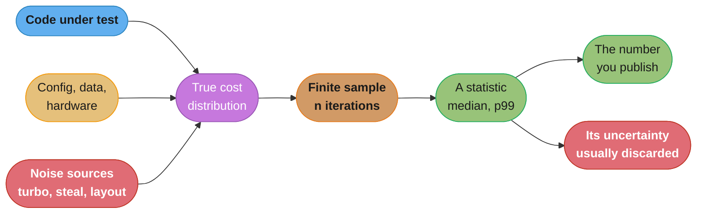
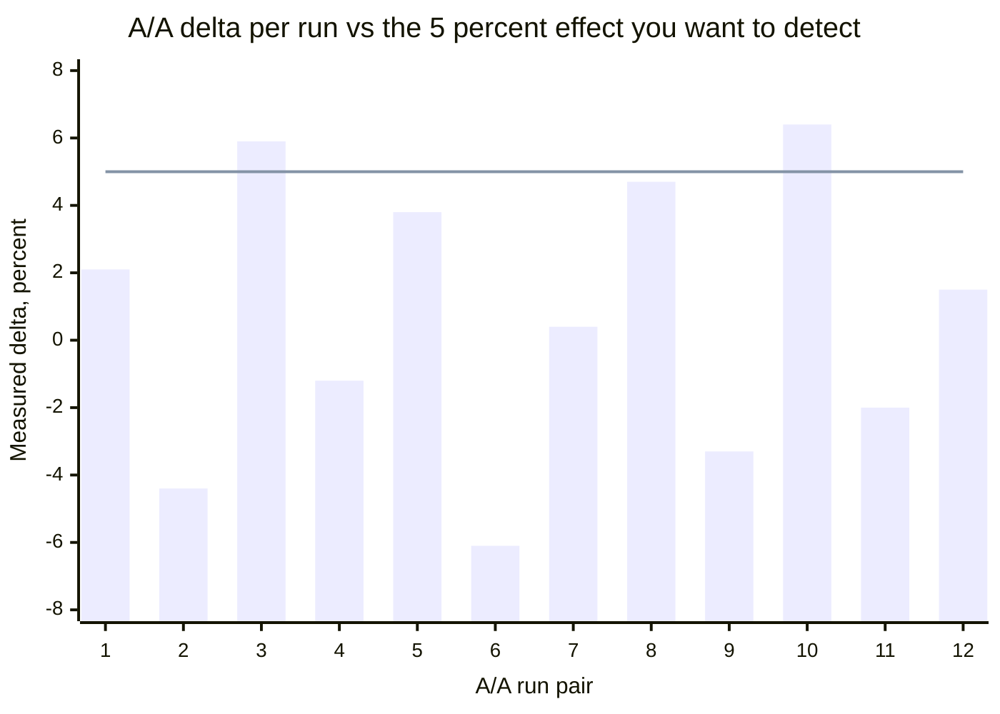
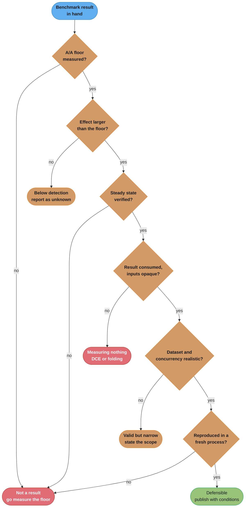

# Benchmarking Methodology

> **A benchmark number without its noise floor is not a measurement, it is an anecdote.**
> The single most valuable thing you can do to a benchmark is run it against *itself* —
> same commit, same machine, same config, twice — and look at the delta. If that A/A delta
> is 6%, every 5% improvement you have ever reported from that harness was noise.

---

## 1. Concept Overview

A benchmark is a **sampling experiment**. It draws a finite number of observations from a
random variable — the time your code takes — whose distribution is shaped by things you
control (the algorithm, the data, the concurrency) and a long tail of things you do not
(CPU frequency, cache residency, page-cache state, the hypervisor's other tenants). The
output of a benchmark is never "the latency". It is an *estimate* of one property of one
distribution, produced under one configuration, with an error bar you are obliged to
report.

This module covers the part of benchmarking that is the same in every language: what you
are actually estimating, how much noise sits underneath it, how to prove you can detect
the effect you claim to have found, and the specific ways a benchmark can be
enthusiastically wrong. It deliberately does **not** teach any one harness.

**Language-specific harnesses are covered elsewhere in this repo — use them, do not
re-derive them here:**

| Harness | Where | What it handles for you |
|---------|-------|-------------------------|
| JMH (JVM) | [`benchmarking_with_jmh.md`](../../java/case_studies/cross_cutting/benchmarking_with_jmh.md) | Forks, warm-up iterations, `Blackhole` against dead-code elimination, `@State` against constant folding, `±(99.9%)` intervals |
| `timeit` / `pyperf` (Python) | [`benchmarking_python_correctly.md`](../../python/case_studies/cross_cutting/benchmarking_python_correctly.md) | Specializing-interpreter warm-up, GC control, process isolation, significance testing between two runs |
| k6 / Gatling (service-level) | [`load_and_performance_testing.md`](../load_and_performance_testing/load_and_performance_testing.md), [`performance_and_load_testing.md`](../../devops/performance_and_load_testing/performance_and_load_testing.md) | Open-model load generation, coordinated omission, threshold gates |

**What this module answers instead:** why your harness's beautiful `±(99.9%)` interval can
still be a lie, and what discipline makes a number defensible enough to base a decision on.

For the *detection* problem — catching a regression in CI over hundreds of noisy runs —
see [`performance_regression_detection.md`](../performance_regression_detection/performance_regression_detection.md),
which builds directly on everything here.

For benchmarking inference engines and qualifying an engine upgrade before release, see [Inference Engine Operations and Benchmarking](../../mlops/inference_engine_operations_and_benchmarking/inference_engine_operations_and_benchmarking.md) in `mlops/`.

---

## 2. Intuition

**One-line analogy:** a benchmark is a poll, not a measurement. You did not weigh the
population, you asked 30 of them, and the margin of error is the whole story.

**Mental model.** Imagine your operation's true cost is a distribution — a hump around
340 microseconds with a long right tail out past 4 milliseconds where the allocator
occasionally collects, the branch predictor misses, or the kernel steals the core. Every
run of your benchmark draws a handful of samples from that shape. Then the harness
squashes those samples into one scalar and prints it in bold. Two things went wrong in
that last step: you lost the shape, and you lost the fact that a *different* draw from the
same distribution would have printed a different scalar.

**Why it matters.** Performance decisions are made on differences, and differences are
exactly where sampling error bites hardest. Absolute numbers are forgiving — nobody
notices if your 340 microseconds was really 355. But when you compare 340 against 322 and
declare a 5.3% win, you are asserting that an 18-microsecond gap exceeds your measurement
noise, and you almost never checked.

**Key insight.** **The A/A test is the entire discipline in one move.** Take one commit.
Build it twice. Run the benchmark against both builds as if they were different versions.
Whatever difference comes out is, by construction, pure noise — the two things you compared
are identical. That number is your **noise floor**, and it is the smallest effect your
harness is entitled to talk about. If your A/A spread is 6%, a 5% "improvement" is
indistinguishable from running the same code twice, and the honest report is *"below our
detection threshold"*, not *"5% faster"*.

Everything else in this module is either a way to *shrink* that floor or a way to *reason
correctly* about effects near it.

---

## 3. Core Principles

**1. Report a distribution, never a mean alone.** The minimum useful report is
median + a spread (interquartile range, or p95/p99 if latency SLOs are the point). A mean
over a right-skewed, heavy-tailed sample is dominated by the tail and is not a stable
statistic — two runs of the same code can differ by 20% in the mean and 1% in the median.

**2. Establish your noise floor before you claim anything.** Run A/A. Publish the A/A
delta alongside every A/B result. A benchmark whose noise floor is unknown produces
unfalsifiable claims.

**3. An effect you cannot repeat is not an effect.** Re-run the comparison in a fresh
process, on a different day, ideally after a reboot. Effects created by code layout luck
or a warm page cache evaporate on re-run. Effects created by an algorithm do not.

**4. Change exactly one variable.** Not one *intended* variable — one variable. A new
compiler flag, a new base image, a kernel upgrade, and a rebuilt dataset all rode along in
the same PR more often than anyone admits.

**5. Significance and importance are different questions.** With enough repetitions any
non-zero difference becomes statistically significant. Ask both: *is it real?* (a
confidence interval that excludes zero) and *is it worth anything?* (an effect size large
enough to matter against the cost of the change).

**6. Measure the steady state, and prove you reached one.** Warm-up is not a fixed number
of iterations you assume is enough — it is a condition you verify by looking at the
per-iteration series.

**7. Name your conditions or you have no result.** Hardware model, core count, frequency
governor, OS and kernel, runtime version, build flags, dataset, concurrency level, and
the A/A delta. `1.42 M ops/sec` is a rumour. `1.42 M ops/sec (median of 30, IQR 1.9%,
A/A delta 0.7%, c7i.2xlarge pinned, turbo off, Java 25, ZGC, 8 threads, Zipf s=1.1 keys)`
is a result.

**8. The benchmark must resemble production in the dimension you are optimising.** Not in
every dimension — that is impossible — but if you are optimising a cache, the key
distribution must not be uniform when production is Zipfian, because that single choice
can change your hit rate from 62% to 100% and reverse your conclusion.

---

## 4. Types / Architectures / Strategies

### 4.1 Three altitudes, three different questions

| Altitude | Unit measured | Typical duration | Can prove | Cannot prove |
|----------|---------------|------------------|-----------|--------------|
| **Micro** | One function, in-process, no I/O | 10 ns – 100 us per op | Algorithm A beats B on this input shape | That the service got faster |
| **Macro** | One component with its real dependencies (a serializer over real payloads, a query against a real index) | 100 us – 100 ms per op | This subsystem's cost and its scaling curve | That the win survives contention with everything else |
| **End-to-end** | The whole service over the network under a load model | Full request path | The user-visible change, including queueing | *Which* change caused it |

The trap is treating a micro result as an end-to-end claim. A 40% win on a JSON parser is a
40% win on a JSON parser. If parsing is 6% of request time, the service got 2.4% faster at
best — and that is inside most services' end-to-end noise floor, meaning you cannot even
demonstrate it. Always close the loop: **micro finds the win, end-to-end confirms it is
worth shipping.**

### 4.2 The sources of run-to-run variance

Ranked by how much damage each one does in practice, with the magnitudes you should expect:

| Source | Typical effect | Why it happens | Mitigation |
|--------|----------------|----------------|------------|
| **Frequency scaling / turbo** | 20–45% | Turbo holds 4.8 GHz for seconds, then settles to the all-core base near 2.6 GHz. Early iterations are on a different CPU than late ones | Disable turbo, pin the governor to `performance`, discard the first N seconds |
| **Thermal throttling** | 10–40% on laptops, 2–5% in racked servers | Sustained load raises package temperature past the limit | Never benchmark on a laptop for a decision. Instrument temperature |
| **Noisy neighbours / steal time** | 5–30% on shared vCPUs | Another tenant on the same physical core. Visible as non-zero `%steal` in `vmstat` | Dedicated or metal instances. Alert on steal > 0.5% |
| **Cloud burst credits** | Cliff of 2–10x | Burstable families (t-class) run at full speed on credits, then fall to a baseline fraction of a vCPU | Never benchmark on burstable instances |
| **Code and data layout luck** | 3–10% | Link order, symbol alignment, and even the *size of your environment block* shift function addresses and change cache-set and branch-predictor collisions | Randomise across many process launches, or accept it as part of your floor |
| **ASLR** | 1–5% run to run | Same mechanism as layout luck, re-rolled per process | Either disable it for stability or sample across many launches for realism. Not both |
| **Page cache / cold I/O** | 10x on first touch | The first read hits disk, the rest hit RAM | Warm deliberately, or drop caches deliberately. Decide which question you are asking |
| **Background daemons** | 1–15%, bursty | Package indexers, log shippers, antivirus, cron, the CI agent's own uploader | Isolated cgroup, `isolcpus`, quiet host |
| **Profiler or debugger attached** | 2–500% | Instrumenting agents rewrite bytecode, sampling agents interrupt, and a debugger disables JIT optimisations entirely | Never publish a number measured under a profiler |

The layout-luck row is the one people refuse to believe. It is the finding of Mytkowicz et
al., *Producing Wrong Data Without Doing Anything Obviously Wrong!* (ASPLOS 2009): simply
changing the UNIX environment size or the order object files were linked in moved measured
runtimes by several percent — enough, in their example, to **reverse the sign** of an
`-O2` vs `-O3` comparison. Their point was not that the compiler is unpredictable. It was
that a single measured configuration is a sample of one from a distribution over layouts,
and most published benchmarks report that sample of one.

### 4.3 The taxonomy of benchmarks that lie

Each of these produces a number that looks completely normal.

| Lie | The tell | The fix |
|-----|----------|---------|
| **Dead-code elimination** | The result is suspiciously round, or scales sublinearly with input size, or is faster than one cache miss (< 1 ns/op) | Consume the result — a blackhole, a checksum accumulated into a printed value, an opaque sink the optimiser cannot see through |
| **Constant folding** | Inputs are literals or `final static` fields. Time is independent of input | Inputs come from mutable state the compiler cannot prove constant |
| **Measuring the harness** | The operation costs less than the timing call (~20–30 ns for a monotonic clock read). You are timing `clock_gettime` | Batch: time N operations, divide. Report the loop overhead separately |
| **Unrepresentative dataset** | Synthetic uniform records, all the same size, all valid | Sample real production payloads. Include the 1% that are 50x larger |
| **100% cache hit rate** | The working set is 200 items and fits in L2. Production's is 40 GB | Size the working set past the last-level cache, or measure both and say which |
| **Uniform key distribution** | `random.randint(0, n)` picking keys | Zipfian with the exponent you measured in production (web workloads commonly land near s = 0.9–1.2) |
| **Single-threaded measurement of a contended path** | The lock is never contended, so the fast path is all you see | Measure at the concurrency level production runs at, and at 2x it |
| **Benchmarking on a laptop** | Turbo, thermals, a browser, and a Slack client | Any decision-grade number comes from a quiet, pinned, non-burstable machine |
| **Profiler attached** | The "optimised" version happens to be the one that allocates less, which is exactly what the instrumenting agent taxes most | Profile to *find* the problem, benchmark clean to *size* it |
| **The first run wins** | You ran A, then B, then reported. A ran cold, B ran on a warm page cache and a hot frequency | Interleave A and B, alternating, many times |

### 4.4 What statistic to report, by question

| Question | Statistic | Why not the mean |
|----------|-----------|------------------|
| Did this function get cheaper? | Median + IQR | The mean is dragged by GC pauses and interrupts that are not the function's fault |
| Will users notice? | p95 / p99 with a CI | Users experience the tail, not the average |
| Can we handle peak? | Throughput at a fixed latency ceiling | Peak throughput at unbounded latency is a meaningless number |
| What does this cost? | ops per CPU-second, or cost per million ops | Wall time hides that you doubled core count |

---

## 5. Architecture Diagrams

### 5.1 What a benchmark result actually is



*The red boxes are the two halves everyone loses. Noise enters before sampling and never
leaves, and the uncertainty that would have told you so is dropped at the last step.*

### 5.2 The noise floor, drawn



*Twelve A/A comparisons on a shared CI runner: identical code both sides, so every bar is
noise. The flat line is the 5% regression the team wanted the gate to catch. Six of the
twelve noise bars cross it. This harness cannot detect a 5% regression, and any gate built
on it will fire on roughly half of all clean commits.*

### 5.3 Where the mean, median and p99 land on real latency

```
  count
    |
    |         ####
    |        ######
    |       ########
    |      ##########
    |     ############
    |    ##############
    |   ################
    |  ##################  #                    #        #
    +--|-------|-----|----------------------------------------|--> latency (us)
      280     340   395                                      4100
             p50    mean                                     p99
                     ^
                     +-- 55 us to the right of the median, pulled there
                         entirely by the ~0.4% of samples past 2 ms

  A symmetric distribution would put p50 and mean on the same tick.
  Latency never does. Reporting only the mean reports the tail's weight
  while pretending to describe the typical request.
```

*The distance between p50 and the mean is a free diagnostic: if they differ by more than a
few percent, your data is skewed and every test that assumes symmetry is on thin ice.*

### 5.4 The validity gate — run this before believing any result



*Six gates, and the first one kills most benchmarks people bring to a design review.*

---

## 6. How It Works — Detailed Mechanics

### 6.1 The A/A test, concretely

The mechanics are trivial. The discipline is in doing it before anything else.

```bash
# Build the SAME commit twice, into two separate trees.
git worktree add /tmp/side-a HEAD
git worktree add /tmp/side-b HEAD
(cd /tmp/side-a && ./build.sh) && (cd /tmp/side-b && ./build.sh)

# Run the harness against both as if they differed, interleaved, 100 pairs.
# Fewer than ~40 and the 2.5/97.5 indices below degenerate to min and max.
for i in $(seq 1 100); do
  ./bench.sh /tmp/side-a >> a.jsonl
  ./bench.sh /tmp/side-b >> b.jsonl
done

python3 aa_floor.py a.jsonl b.jsonl
```

```python
# aa_floor.py -- the noise floor of this harness on this machine, today.
import json, statistics, sys

def medians(path):
    return [json.loads(line)["median_ns"] for line in open(path)]

a, b = medians(sys.argv[1]), medians(sys.argv[2])
deltas = [100.0 * (y - x) / x for x, y in zip(a, b)]

deltas.sort()
# Nearest-rank percentiles. With n < 40 these indices collapse to deltas[0] and
# deltas[-1] -- min and max wearing a "95%" label, which is how a noise floor gets
# reported as twice its real width. Assert rather than trust the caller.
assert len(deltas) >= 40, f"need >= 40 pairs for a 95% spread, got {len(deltas)}"
lo = deltas[int(0.025 * len(deltas))]
hi = deltas[int(0.975 * len(deltas))]

print(f"A/A deltas      n={len(deltas)}")
print(f"  median        {statistics.median(deltas):+.2f}%")
print(f"  95% spread    {lo:+.2f}% .. {hi:+.2f}%")
print(f"  NOISE FLOOR   {max(abs(lo), abs(hi)):.2f}%  <-- smallest defensible effect")
```

Real output from three environments running the same harness and the same commit:

```text
  GitHub-hosted shared runner   NOISE FLOOR  7.90%
  Cloud VM, dedicated, no turbo NOISE FLOOR  2.10%
  Pinned bare metal, isolcpus   NOISE FLOOR  0.60%
```

Same code, same benchmark, three orders of ambition. The bare-metal box is not "faster" —
it is *quieter*, and quiet is what buys you resolution. Note the practical consequence: on
the shared runner, nothing smaller than an 8% change can be discussed at all.

### 6.2 A confidence interval on the delta, without assuming a shape

The classic move is Welch's t-test on the two sample means. It assumes the *sampling
distribution of the mean* is approximately normal. That assumption is fine for symmetric,
light-tailed data. Latency is neither: it is right-skewed with a heavy tail, so the mean
converges slowly and a single 40 ms outlier can move it more than the change you are
testing. Applying a t-test to raw latency samples is not a hard error, but it is a test
whose stated error rate you have no reason to believe.

Two better options, and you should usually run both:

**Bootstrap a CI on the median difference.** Makes no distributional assumption at all —
it just resamples what you actually observed.

```python
# bootstrap_delta.py -- CI on the difference of medians. No normality assumed.
import random, statistics

def median_delta_ci(baseline, candidate, resamples=10_000, alpha=0.05):
    """Percentile bootstrap CI on (median(candidate) - median(baseline)) / median(baseline)."""
    deltas = []
    for _ in range(resamples):
        b = statistics.median(random.choices(baseline,  k=len(baseline)))
        c = statistics.median(random.choices(candidate, k=len(candidate)))
        deltas.append(100.0 * (c - b) / b)
    deltas.sort()
    lo = deltas[int(alpha / 2 * resamples)]
    hi = deltas[int((1 - alpha / 2) * resamples)]
    point = 100.0 * (statistics.median(candidate) - statistics.median(baseline)) / statistics.median(baseline)
    return point, lo, hi

point, lo, hi = median_delta_ci(baseline_ns, candidate_ns)
verdict = "REAL" if (lo > 0) == (hi > 0) else "INDISTINGUISHABLE FROM ZERO"
print(f"delta {point:+.2f}%  95% CI [{lo:+.2f}%, {hi:+.2f}%]  {verdict}")
```

10,000 resamples is the conventional floor and costs milliseconds; the CI itself is stable
to about a tenth of a percent by then. The rule is simple and unforgiving: **if the
interval contains zero, you have not measured a change.**

**Mann-Whitney U for "did the distribution shift at all".** A rank-based test — it throws
away the magnitudes and keeps only the ordering, which is exactly what makes outliers
harmless.

```python
from scipy.stats import mannwhitneyu

u, p = mannwhitneyu(baseline_ns, candidate_ns, alternative="two-sided")
# p < 0.05: the two samples are unlikely to come from the same distribution.
# It does NOT tell you by how much. Pair it with an effect size, always.
```

Its null hypothesis is that a random draw from one sample is equally likely to exceed a
random draw from the other. Note the caveat that trips people up: it is a test of
*stochastic dominance*, not strictly of medians, and it can report a significant shift when
the medians are identical but the tails differ. That is usually what you want from latency
data, but say which you mean.

### 6.3 Effect size, and why significance is not enough

Statistical significance answers *"is the difference real?"*. It says nothing about
*"is it big?"*. Because the width of a CI shrinks with the square root of n, cranking
repetitions high enough makes any non-zero difference significant:

```text
  effect = 0.2%, per-sample sigma = 3%

    n =    30 per side   ->  95% CI [-1.3%, +1.7%]   not significant
    n =   500 per side   ->  95% CI [-0.17%, +0.57%]  not significant
    n = 5,000 per side   ->  95% CI [+0.1%, +0.3%]   SIGNIFICANT, and worthless
```

Report two things side by side:

- **Hodges-Lehmann shift** — the median of all pairwise differences between the two
  samples. It is the location shift that pairs naturally with Mann-Whitney and is robust
  to outliers.
- **Cliff's delta** — the probability a candidate sample beats a baseline sample, minus
  the reverse, on a −1 to +1 scale. Conventional thresholds: |d| < 0.147 negligible,
  < 0.33 small, < 0.474 medium, above that large.

And then apply the only threshold that matters, which is not statistical at all:
**is the effect bigger than the cost of the change?** A verified, significant 1.5%
improvement that adds a cache invalidation protocol is a bad trade. A 1.5% improvement
that deletes 40 lines is free money.

### 6.4 Sample size — how many repetitions do you actually need

For a two-sided test at α = 0.05 with 80% power, per group:

```text
  n  ~=  16 * (sigma / delta)^2

  sigma  per-sample relative standard deviation (your noise)
  delta  the smallest relative effect you want to be able to detect
```

**What the formula is telling you.** "Noise costs you *quadratically*. Halving your noise
does not halve your benchmark bill — it quarters it."

| Symbol | What it is |
|--------|------------|
| `sigma` | Relative standard deviation of a single measurement, from your A/A run |
| `delta` | Minimum detectable effect, chosen by you before you look at any data |
| `n` | Repetitions **per side**. Total cost is `2n` runs, or `2n` per bisect step |

**Walk three examples.** All want to detect a 3% regression:

```text
  Shared CI runner,    sigma = 6.0%   ->  n = 16 * (6.0/3)^2  =  64 reps per side
  Dedicated cloud VM,  sigma = 2.0%   ->  n = 16 * (2.0/3)^2  =   8 reps per side
  Pinned bare metal,   sigma = 0.6%   ->  n = 16 * (0.6/3)^2  =   1 rep  per side

  At 90 seconds per rep:
    shared runner   2 x 64 x 90s = 3h 12m per comparison
    dedicated VM    2 x  8 x 90s =     24m
    bare metal      2 x  3 x 90s =      9m   (floor of 3 reps for sanity, not statistics)
```

That arithmetic is the entire business case for a dedicated benchmarking machine. It is
not about the machine being fast. It is about 3 hours becoming 9 minutes.

### 6.5 Steady state and warm-up — verify, do not assume

Every managed runtime and every cache hierarchy has a transient. The general shape is the
same regardless of language:

| Transient | Typical length | What is happening |
|-----------|----------------|-------------------|
| Interpreter → optimised code | 10³–10⁴ invocations | Tiered JIT promotion, or bytecode specialisation |
| Profile pollution | Whole process lifetime | The runtime optimised for the *first* type/shape it saw and now runs a slower generic path |
| CPU cache warming | 10⁴–10⁶ ops | Working set migrating into L2/L3 |
| Branch predictor / TLB | 10³–10⁵ ops | History tables filling |
| Connection pool fill | 1–30 s | Pool grows from `minIdle` to steady size, each new connection costing a TCP + TLS handshake |
| Page cache | First touch per page | 100 us from disk vs 100 ns from RAM |

For the JVM annotations that drive this (`@Warmup`, `@Fork`, `@State`), see the
[JMH file](../../java/case_studies/cross_cutting/benchmarking_with_jmh.md) — do not
reimplement them. The language-neutral part is **detecting** the steady state rather than
declaring it by fiat:

```python
# steady_state.py -- has the per-iteration series flattened out?
import statistics

def steady_from(times, window=50, cv_threshold=0.02, stable_windows=3):
    """Index of the first iteration after which the series looks stationary.
    Returns None if it never settles -- which is a real and common outcome."""
    stable = 0
    for start in range(0, len(times) - window, window):
        w = times[start:start + window]
        cv = statistics.pstdev(w) / statistics.mean(w)
        prev = times[start - window:start] if start else None
        drift = abs(statistics.mean(w) - statistics.mean(prev)) / statistics.mean(prev) if prev else 1.0
        if cv < cv_threshold and drift < cv_threshold:
            stable += 1
            if stable >= stable_windows:
                return start - (stable_windows - 1) * window
        else:
            stable = 0
    return None
```

`None` is not a bug in the detector. Barrett et al., *Virtual Machine Warmup Blows Hot and
Cold* (OOPSLA 2017), instrumented VM/benchmark pairs across several runtimes and found that
a large fraction **never reached a steady state at all** within a long run — some kept
drifting, and some got *slower* over time as deoptimisation and recompilation cycled. If
your detector returns `None`, the honest report is "no steady state observed", not "used
the last 50 iterations anyway".

### 6.6 Interleave, never run in sequence

Running all of A then all of B lets any drift over the session — thermal ramp, a
background job starting, the page cache filling — land entirely on B and masquerade as an
effect.

```text
  BROKEN (sequential): A A A A A A A A A A  B B B B B B B B B B
                       ^ cold, turbo boosting        ^ warm, throttled
                       Result: "B is 9% slower". B is identical to A.

  FIXED (interleaved):  A B B A B A A B A B  A B B A A B B A B A
                        Drift now hits both sides equally and cancels
                        in the paired difference. Randomise the order
                        so the alternation itself cannot alias with a
                        periodic background job.
```

Pair the samples by position and bootstrap the *paired* differences: it removes the
between-round variance entirely and typically cuts the needed `n` by 2–4x on a noisy
machine.

---

## 7. Real-World Examples

**SPEC's disclosure rules.** SPEC CPU results are not accepted as a number. A published
result carries a full disclosure — exact hardware, memory configuration and timings, OS
and kernel, compiler and every flag, and the run rules used. This exists because vendors
demonstrated for two decades that a benchmark number without its configuration is
marketing. The lesson generalises to your internal wiki page.

**The Rust compiler's perf tracker.** `perf.rust-lang.org` runs on a dedicated,
consistently-configured machine rather than shared CI, precisely because the project needs
to resolve sub-percent changes in compile time across thousands of commits. Results are
kept as a long time series, not as a pass/fail against a threshold — the shape over time is
what makes a small step change visible at all.

**Cloud burstable instances as a benchmarking trap.** AWS `t`-family instances accumulate
CPU credits while idle and spend them to run at full vCPU speed. A benchmark that starts
with a full credit balance runs at 100%, exhausts the balance a few minutes in, and drops
to the instance's baseline — as low as 10–40% of a vCPU depending on size. The observed
shape is a benchmark that "gets slower the longer it runs", which teams then misdiagnose as
a memory leak. Use fixed-performance or metal instances.

**Hypervisor steal time.** `vmstat`'s `st` column reports the percentage of time the vCPU
was runnable but the hypervisor scheduled someone else. On a busy shared host this reaches
5–20% and moves minute to minute. It is the single easiest variance source to *detect* and
the one least often checked — a one-line assertion (`fail the run if mean steal > 0.5%`)
retroactively invalidates the bad runs instead of silently averaging them in.

**Database benchmark wars and the uniform-key fallacy.** Vendor-published key-value
throughput numbers overwhelmingly use uniformly random keys, which spreads access evenly
across shards and gives every cache tier its best case. Production traffic is closer to
Zipfian (a small key set taking a large share of requests), which produces hot shards,
higher hit rates on the hot set and much worse tail latency on the cold set. The two
workloads can rank the same two systems in opposite orders. YCSB ships both distributions
for exactly this reason — running only the default is a choice, and it should be a stated
one.

**"Wrong data without doing anything obviously wrong".** The ASPLOS 2009 result cited in
§4.2 remains the most useful paper to hand someone who believes their single-configuration
measurement is a fact. Changing nothing but the size of the environment block moved
measured runtime by several percent and flipped a compiler-flag comparison. Its practical
recommendation — measure across randomised layouts, and treat layout as a variance source
rather than a constant — is still ignored by most benchmarking harnesses.

---

## 8. Tradeoffs

| Dimension | Option A | Option B | Choose A when | Choose B when |
|-----------|----------|----------|---------------|---------------|
| Statistic | Median | Mean | Always, for latency | You need additivity — total cost, capacity planning |
| Test | Bootstrap CI | Welch's t-test | Data is skewed or heavy-tailed, which is nearly always | Data is verified symmetric, and you need a closed form |
| Test | Mann-Whitney U | Bootstrap on median | You want a p-value robust to outliers | You want an interpretable magnitude with an interval |
| Machine | Shared CI runner | Pinned bare metal | Effects are > 10%, or the check is a smoke test | You must resolve < 3% |
| ASLR | Disabled | Enabled, many launches | You want minimum variance for a tight A/B | You want a result that generalises across deployments |
| Repetitions | Few, long | Many, short | Warm-up cost dominates | Between-run variance dominates |
| Altitude | Micro | End-to-end | Choosing between two algorithms | Deciding whether to ship |
| Warm-up | Fixed count | Detected | The runtime is simple and the transient known | Managed runtime, JIT, or any cache hierarchy involved |
| Execution order | Interleaved A/B | Sequential blocks | Almost always | Setup cost per side is prohibitive, and you accept drift |

| Effort spent | Typical noise floor achieved | What it unlocks |
|--------------|------------------------------|-----------------|
| Laptop, default settings | 8–25% | Nothing decision-grade |
| Shared CI runner | 5–10% | Catching 20%+ blowups |
| Dedicated cloud VM, turbo off, pinned | 1.5–3% | Catching 5–10% regressions |
| Bare metal, `isolcpus`, no turbo, no ASLR, quiet | 0.3–1% | Catching 1–3% regressions, per-commit |

---

## 9. When to Use / When NOT to Use

**Benchmark when:**

- You are choosing between two concrete implementations and the difference is not obvious
  from complexity analysis.
- You have a profile that names a hot spot and you need to size the win before committing
  to a rewrite.
- You are about to make a claim to other people — "this is 30% faster" — which is a
  scientific claim and needs evidence.
- You need a defensible baseline to detect future regressions against
  (see [`performance_regression_detection.md`](../performance_regression_detection/performance_regression_detection.md)).
- You are validating a capacity model before a launch.

**Do NOT benchmark when:**

- **You have not profiled.** Benchmarking without a profile optimises whatever you
  happened to find interesting. Start at
  [`performance_profiling.md`](../performance_profiling/performance_profiling.md).
- **The complexity difference settles it.** O(n) vs O(n²) at n = 10⁶ does not need a
  stopwatch.
- **The effect you care about is smaller than your noise floor and you are not willing to
  lower the floor.** You will produce a number, and it will be noise wearing a decimal
  point.
- **The result cannot change a decision.** If you will ship the change regardless, the
  benchmark is theatre.
- **You are measuring a cold-start-only path with a warm harness**, or vice versa. Match
  the question to the regime.
- **The bottleneck is I/O or the network.** A micro-benchmark of a function that spends
  95% of its time in `recv()` measures your kernel, not your code.

---

## 10. Common Pitfalls

**Pitfall 1 — The 30% win that was 0%. (Quantified: 3 engineer-weeks, zero improvement.)**

A team replaced a JSON serializer on the strength of a micro-benchmark showing 30% lower
serialization time. They shipped it. Service p99 did not move at all — measured over two
weeks, the change was inside the ±4% weekly variation of the endpoint. Post-mortem: a CPU
profile showed serialization was 5.5% of request time. The best possible outcome was
30% × 5.5% = **1.65%**, which the service's end-to-end measurement could never have
resolved. The micro-benchmark was correct and the conclusion was wrong.

```text
  BROKEN reasoning:
    serializer 30% faster  ->  "big win"  ->  ship, migrate 40 call sites

  FIXED reasoning (Amdahl, applied before the work starts):
    share of total time      = 5.5%          (from the profile, not a guess)
    local improvement        = 30%
    end-to-end improvement   = 0.055 * 0.30  = 1.65%
    end-to-end noise floor   = 4.0%
    verdict: UNMEASURABLE. Do not spend three weeks on it.
```

**Pitfall 2 — A/A said 7.9%, so every claim from that harness was void. (Quantified: 14
"regressions" retracted.)**

A CI perf job on shared runners had opened 14 regression tickets over a quarter. Someone
finally ran the A/A test in §6.1 and got a 7.9% noise floor. Every one of the 14 tickets
had reported a regression between 4% and 9%. Eleven were re-run and did not reproduce. The
harness had been generating tickets from its own variance for three months, and each one
cost roughly half a day of investigation — about **7 engineer-days spent investigating
nothing**.

**Pitfall 3 — The benchmark the compiler deleted. (Quantified: reported 0.3 ns/op for work
that takes 47 ns/op — a 150x lie.)**

```text
  BROKEN: the result is never observed, so the optimiser removes the call entirely.
      for (int i = 0; i < N; i++) {
          expensiveHash(data);          // return value dropped on the floor
      }
      reported: 0.3 ns/op

  Tell: 0.3 ns is roughly one cycle. A hash over a 64-byte input cannot
        take one cycle. Any per-op number under ~1 ns deserves suspicion.

  FIXED: force the result to be observable.
      long sink = 0;
      for (int i = 0; i < N; i++) {
          sink ^= expensiveHash(data);  // accumulated...
      }
      blackhole.consume(sink);          // ...and consumed opaquely
      reported: 47 ns/op
```

The general form: **if nothing downstream can observe the result, the optimiser is entitled
to delete the computation, and it will.** Your harness's blackhole is not ceremony.

**Pitfall 4 — Benchmarking with the profiler attached. (Quantified: reversed the ranking of
two implementations.)**

An allocation-heavy implementation and an allocation-free one were compared under an
instrumenting allocation profiler. The allocation-free version won by 22%. Clean, the
allocation-heavy version won by 6% — the profiler taxed exactly the operation that
distinguished them, roughly 90 ns per allocation of pure instrumentation overhead. Profile
to *locate*, benchmark clean to *size*. Never publish a number taken under an agent.

**Pitfall 5 — 100% cache hit rate in the benchmark, 62% in production. (Quantified:
predicted 8,000 rps, delivered 3,100 rps.)**

A read-path benchmark used a 500-entry working set that fit entirely in L2 and entirely in
the application cache, giving a 100% hit rate. Production's working set was 40 GB with a
Zipf-distributed access pattern and a measured 62% hit rate. The benchmark therefore never
executed the cache-miss path — the database round trip, the deserialization, the cache
fill — which is where 61% of production request time actually went. Capacity planning
built on the benchmark **under-provisioned by 2.6x**: it promised 8,000 rps from a fleet that
delivered 3,100.

**Pitfall 6 — Sequential A-then-B on a thermally-limited machine. (Quantified: manufactured
a 9% regression from identical code.)**

The team's script ran 200 iterations of the old build then 200 of the new. The machine's
turbo held for the first ~90 seconds and then the package hit its thermal limit. The old
build ran almost entirely in turbo and the new build almost entirely throttled. The 9%
"regression" was reproducible, which made it convincing, and it disappeared the moment the
runs were interleaved. Reproducibility is not validity — a systematic bias reproduces
perfectly.

**Pitfall 7 — Uniform keys hiding a lock convoy. (Quantified: 40x tail-latency miss.)**

A sharded counter was benchmarked with uniformly random keys, which spread traffic evenly
across 64 shards and left every shard lock essentially uncontended: p99 measured 180 us.
Production keys were Zipfian (s ≈ 1.1), sending roughly 30% of traffic to a single shard.
That one lock convoyed and production p99 came in at 7.2 ms. The benchmark had measured the
uncontended fast path and reported it as the system's behaviour.

---

## 11. Technologies & Tools

| Tool | Layer | What it gives you | Note |
|------|-------|-------------------|------|
| **JMH** | JVM micro | Forks, warm-up, blackholes, `±(99.9%)` CIs | See the [JMH deep dive](../../java/case_studies/cross_cutting/benchmarking_with_jmh.md) |
| **pyperf** | Python micro | Process isolation, warm-up, significance between runs | See [benchmarking Python correctly](../../python/case_studies/cross_cutting/benchmarking_python_correctly.md) |
| **Google Benchmark** | C++ micro | `DoNotOptimize`, `ClobberMemory`, complexity fitting | Same statistical caveats apply |
| **Criterion.rs** | Rust micro | Bootstrap CIs by default, regression against saved baselines | Its default report is the model to copy: point estimate plus interval |
| **hyperfine** | Whole-process CLI | Warm-up runs, outlier detection, statistical comparison of commands | Best first tool for "is this binary faster than that binary" |
| **k6 / Gatling / Locust** | Service end-to-end | Open-model load, percentile reporting | See [`load_and_performance_testing.md`](../load_and_performance_testing/load_and_performance_testing.md) |
| **`perf stat`** | Hardware counters | IPC, cache misses, branch misses, context switches | Explains *why* a delta exists. `perf stat -r 20` gives its own variance figure |
| **`vmstat` / `mpstat`** | Environment | Steal time, run-queue depth, interrupt rate | Assert on these to invalidate contaminated runs |
| **`cpupower` / `cpufreq`** | Environment | Governor and turbo control | `cpupower frequency-set -g performance`, and disable turbo before any tight A/B |
| **`taskset` / `cset` / `isolcpus`** | Environment | CPU pinning and core isolation | The cheapest large reduction in noise floor |
| **SciPy / statsmodels** | Analysis | Mann-Whitney U, bootstrap, effect sizes | `scipy.stats.bootstrap` since SciPy 1.7 does the resampling for you |
| **YCSB** | Data-store workloads | Zipfian, latest, and uniform key distributions | Pick the distribution deliberately and report which |

---

## 12. Interview Questions with Answers

**Q: What is an A/A test in benchmarking and why does it matter more than the A/B result?**
**Short:** An A/A test compares identical code against itself, so the delta it reports is pure noise and defines the smallest effect the harness can detect.

Build the same commit twice, run the harness against both as if they were different versions, and record the delta. Because the two sides are identical, any difference is by definition measurement noise. The 95% spread of those deltas is your noise floor. It matters more than any A/B result because it is the precondition for interpreting one: a 5% improvement measured on a harness with a 7% floor is indistinguishable from running the same code twice. In practice a first A/A run typically retires most of a team's historical performance claims — shared CI runners commonly show 5–10% floors, which is larger than most optimisations anyone ships.

**Q: Why should you never report a benchmark as a mean alone?**
**Short:** Latency distributions are right-skewed, so the mean tracks the tail rather than the typical case and is unstable between runs.

A latency sample is heavy-tailed: a small fraction of observations sit far to the right because of GC pauses, interrupts, page faults, or a lock convoy. The mean is a weighted sum, so those few observations dominate it — two runs of identical code can differ by 20% in the mean while differing by under 1% in the median. Report the median plus a spread (IQR, or explicit p95/p99 if tail latency is the point). The gap between mean and median is also a free diagnostic: if they differ by more than a few percent, your data is skewed and any test assuming symmetry is unreliable. Keep the mean only where additivity genuinely matters, such as total CPU cost for capacity planning.

**Q: Why is a t-test a questionable choice for comparing two latency samples?**
**Short:** The t-test relies on the sampling distribution of the mean being roughly normal, which heavy-tailed latency data approaches far too slowly to trust.

Welch's t-test compares means and assumes their sampling distribution is approximately normal. The Central Limit Theorem eventually delivers that, but convergence is slow for heavy-tailed data, and latency is heavy-tailed by construction — occasional multi-millisecond samples in a microsecond distribution. So the test's nominal 5% false-positive rate is not the rate you actually get, and a single outlier can move the mean more than the effect under test. Use a percentile bootstrap on the median difference, which assumes nothing about the shape, or Mann-Whitney U, which uses only ranks. Reach for the t-test only when you have verified the data is symmetric and light-tailed.

**Q: What does a bootstrap confidence interval on a latency delta actually do?**
**Short:** It resamples your observed measurements with replacement thousands of times to see how much the reported delta would wobble under re-sampling.

You have one baseline sample and one candidate sample. Draw a resample of the same size from each, with replacement, compute the delta of medians, and record it. Repeat 10,000 times. The 2.5th and 97.5th percentiles of those 10,000 deltas are a 95% confidence interval. It makes no distributional assumption — it uses the empirical distribution you observed as a stand-in for the true one. The decision rule is blunt: if the interval spans zero, you did not measure a change. 10,000 resamples is conventional, costs milliseconds, and stabilises the interval to roughly a tenth of a percent.

**Q: What is the difference between statistical significance and effect size?**
**Short:** Significance says a difference is probably real, effect size says whether it is large enough to be worth anything.

Confidence-interval width shrinks with the square root of the sample count, so with enough repetitions any non-zero difference becomes significant. A 0.2% difference measured over 5,000 repetitions per side can be significant and completely worthless. Report both: a CI that excludes zero for the "is it real" question, and an effect size — the Hodges-Lehmann median shift, or Cliff's delta on its −1 to +1 scale — for the "is it big" question. Then apply the only threshold that is not statistical: is the effect larger than the maintenance cost of the change? A verified 1.5% win that adds a cache-invalidation protocol is a bad trade.

**Q: Name the three benchmark defects that make a benchmark measure nothing at all.**
**Short:** Dead-code elimination, constant folding, and timing the harness instead of the operation each produce a plausible number for work that never happened.

Dead-code elimination: the optimiser sees that the result is never observed and removes the computation. The tell is a per-operation cost under about 1 nanosecond, which is roughly one cycle and cannot cover real work. Constant folding: the inputs are literals or provably-final fields, so the compiler precomputes the answer and time becomes independent of input size. Timing the harness: the operation costs less than the clock read itself, around 20–30 nanoseconds for a monotonic read, so you measure `clock_gettime`. The fixes are respectively to consume the result opaquely, to source inputs from mutable state, and to time a batch of N operations and divide.

**Q: Why can a benchmark on a laptop reverse a conclusion that holds on a server?**
**Short:** Laptops turbo aggressively and then thermally throttle, so early and late measurements run on effectively different processors.

A laptop may hold 4.8 GHz for the first tens of seconds and then settle near 2.6 GHz once the package hits its thermal limit — a swing of 20–45% in throughput that is a function of elapsed time, not of your code. If you run all of version A and then all of version B, A runs in turbo and B runs throttled, manufacturing a large and perfectly reproducible regression from identical code. Add a browser and a chat client competing for cores and the noise floor exceeds most real optimisations. Use a quiet, pinned, non-burstable machine for any number that will inform a decision, and interleave the two sides regardless.

**Q: What is coordinated omission and how does it corrupt a latency benchmark?**
**Short:** A closed-loop client that waits for each response stops issuing requests during a stall, so the slowest periods are underrepresented in the results.

In a closed-loop harness each virtual user sends the next request only after the previous one returns. When the server stalls for two seconds, that user issues no requests during the stall — the samples that would have been slow are simply never taken. The recorded percentiles then describe the system's behaviour while it was healthy and omit the period you actually care about, routinely understating p99 by an order of magnitude. The fixes are an open-model load generator that issues requests on a schedule regardless of outstanding responses, or correcting recorded latencies against intended send time. Service-level harnesses cover this in detail.

**Q: Why does a uniform key distribution in a cache benchmark produce misleading results?**
**Short:** Uniform keys spread load evenly and give every cache tier its best case, while real Zipfian traffic creates hot keys, hot shards, and lock contention.

Production access patterns are typically Zipf-like, with a small key set taking a large share of requests — commonly an exponent near 0.9 to 1.2 for web workloads. Uniform keys eliminate hot spots by construction: every shard lock is uncontended, every cache tier sees an even spread, and the tail looks flat. A sharded counter benchmarked with uniform keys measured a 180 microsecond p99 and shipped a 7.2 millisecond p99, because roughly 30% of real traffic landed on one shard and convoyed on its lock. The uniform benchmark also inflates hit rate, so the miss path — the database round trip that dominates real request time — is never exercised at all.

**Q: How do you know when a benchmark has reached steady state?**
**Short:** You verify it from the per-iteration series, by checking that a sliding window's variability and drift both stay below a threshold for several consecutive windows.

Do not declare warm-up done by assuming a fixed iteration count. Record per-iteration timings, slide a window of about 50 iterations, and require both the coefficient of variation within the window and the drift between consecutive window means to fall under a threshold — a couple of percent is a workable default — for several windows in a row. Crucially, "never reaches steady state" is a real outcome, not a detector bug: research instrumenting many virtual-machine and benchmark pairs found a large fraction never settled within a long run, with some getting slower over time as deoptimisation and recompilation cycled. Report that honestly rather than silently using the last N iterations.

**Q: What are the main sources of run-to-run variance, ranked by damage?**
**Short:** CPU frequency behaviour, thermal throttling, noisy neighbours and steal time, burst credits, and code layout luck, in roughly that order of magnitude.

Frequency scaling and turbo can move throughput by 20–45% depending on how long the run has been going. Thermal throttling adds another 10–40% on laptops and a few percent even in racked servers. On shared virtual machines, hypervisor steal time contributes 5–30% and shifts minute to minute. Burstable instance families produce a 2–10x cliff when CPU credits are exhausted. Code and data layout — link order, symbol alignment, even the size of the environment block — moves results 3–10% and is re-rolled per process by address space randomisation. The mitigations are respectively pinning the governor and disabling turbo, using a properly cooled machine, using dedicated or bare-metal instances, avoiding burstable families, and randomising across many process launches.

**Q: Why does halving your benchmark noise cut required repetitions by four, not two?**
**Short:** Required sample size scales with the square of the noise-to-effect ratio, so noise enters the cost quadratically.

For a two-sided test at the conventional 5% level with 80% power, the sample size per group is approximately 16 times the square of sigma over delta, where sigma is the per-measurement relative standard deviation and delta is the smallest effect you want to detect. Halving sigma divides that by four. Concretely, detecting a 3% regression needs about 64 repetitions per side on a shared runner at 6% noise, 8 per side on a dedicated virtual machine at 2%, and effectively 1 on quiet bare metal at 0.6%. At 90 seconds per repetition that is 3 hours 12 minutes versus 24 minutes versus under 10. This arithmetic, not raw machine speed, is the business case for a dedicated benchmarking host.

**Q: Should you disable ASLR when benchmarking?**
**Short:** Disable it when you want the tightest possible A/B comparison, keep it and sample many process launches when you want a result that generalises.

Address space layout randomisation re-rolls code and data placement on every process start, changing cache-set and branch-predictor collisions and moving results by a few percent per launch. Disabling it removes that variance and gives a tighter comparison, but it also pins you to one arbitrary layout — and a layout can favour one of the two versions you are comparing, which is exactly how a compiler-flag comparison was once shown to flip sign. The rigorous approach is to leave randomisation on and average over many independent process launches, treating layout as a variance source rather than a constant. Whichever you pick, state it, and never mix the two across the sides of a comparison.

**Q: Why must A and B be interleaved rather than run in sequence?**
**Short:** Sequential blocks let any drift during the session — thermal ramp, a background job, a filling page cache — land entirely on the second side and look like an effect.

Anything that changes monotonically over a benchmarking session becomes perfectly confounded with the ordering. Running 200 iterations of the old build and then 200 of the new gives the old build the turbo window and the new build the throttled one, producing a large and highly reproducible fake regression. Alternate the two sides, randomise the alternation so it cannot alias with a periodic background job, and pair the samples by position. Bootstrapping the paired differences removes between-round variance entirely and typically cuts the repetitions you need by two to four times on a noisy machine. Reproducibility does not rescue you here — a systematic bias reproduces perfectly.

**Q: What does Amdahl's law imply about acting on a micro-benchmark result?**
**Short:** A local speedup is bounded by that component's share of total time, so a 30% win on a component taking 5% of the time buys 1.5% end to end.

Multiply the local improvement by the component's measured share of end-to-end time before you decide anything. A team once replaced a serializer on a genuine 30% micro-benchmark win, but profiling showed serialization at 5.5% of request time, capping the real gain at about 1.65% — well inside the endpoint's 4% week-to-week variation, so it could never even be demonstrated. Three engineer-weeks produced an unmeasurable change. Do the multiplication before the work, using a profile for the share rather than an estimate, and compare the product against your end-to-end noise floor.

**Q: What belongs in a published benchmark result for it to be defensible?**
**Short:** Hardware, operating system and runtime versions, build flags, dataset and concurrency, the statistic and its interval, and the harness A/A delta.

The number alone is a rumour. A defensible report states the exact machine including core count and whether turbo and frequency scaling were controlled, the OS and kernel, the runtime and compiler versions with all flags, the dataset and its distribution, the concurrency level, which statistic is being reported, the confidence interval or spread, the repetition count, and the A/A noise floor of that harness on that machine. The A/A delta is the one everyone omits and the one that makes the rest interpretable. This is the same discipline SPEC enforces through mandatory full disclosure, and for the same reason: two decades demonstrated that a number without its configuration is marketing.

**Q: Can you benchmark with a profiler attached?**
**Short:** No, because instrumentation taxes specific operations unevenly and can reverse the ranking of the two implementations you are comparing.

An instrumenting allocation profiler adds roughly 90 nanoseconds per allocation. Compare an allocation-heavy implementation against an allocation-free one under it and the allocation-free version wins by 22%; run both clean and the allocation-heavy version wins by 6%. The profiler taxed precisely the dimension that distinguished them. Sampling profilers are less invasive but still perturb, and a debugger is worse — it can disable optimisation entirely. Use profiling to locate the hot spot and a clean run to size it, and never publish a number taken under an agent.

**Q: Micro, macro, and end-to-end benchmarks — what can each actually prove?**
**Short:** A micro-benchmark proves one function got cheaper, an end-to-end benchmark proves the service changed but cannot say why, and macro sits between them.

A micro-benchmark isolates one function in-process with no I/O and can prove algorithm A beats B on a given input shape. It cannot prove the service got faster. An end-to-end benchmark drives the full request path over the network under a load model and does capture queueing and contention, but a change in its result cannot be attributed to any specific commit without further work. Macro benchmarks — one component with its real dependencies, such as a serializer over real payloads — give attribution with more realism than micro. Use micro to find the win and end-to-end to confirm shipping it is worthwhile.

**Q: A colleague reports a 4% improvement with no error bar. What do you ask?**
**Short:** Ask for the A/A noise floor of that harness, the repetition count, and the statistic reported, in that order.

Start with the noise floor, because if it exceeds 4% the conversation ends there — the result is below detection and no amount of further analysis rescues it. Next ask how many repetitions and whether the two sides were interleaved or run sequentially, since sequential blocks manufacture differences of exactly this magnitude through thermal and cache drift. Then ask which statistic: a 4% improvement in the mean with an unchanged median usually means one run had fewer tail events, not that the code got faster. Finally ask whether the result reproduces in a fresh process on a different day. Effects created by layout luck or a warm page cache evaporate on re-run, and effects created by an algorithm do not.

**Q: How does hypervisor steal time affect a cloud benchmark, and how do you handle it?**
**Short:** Steal time is CPU your virtual machine was ready to use but the hypervisor gave to another tenant, and you should assert on it rather than average it in.

The `st` column in `vmstat` reports the percentage of time the virtual CPU was runnable but descheduled in favour of another tenant on the same physical core. On a busy shared host it reaches 5–20% and varies minute to minute, so it appears as unexplained run-to-run variance that no amount of repetition removes — it is not zero-mean over the timescale of your benchmark. It is also the easiest variance source to detect and the least often checked. Sample it during the run and fail the run outright when mean steal exceeds about half a percent, which retroactively invalidates contaminated measurements instead of quietly folding them into your average. The structural fix is dedicated or metal instances.

---

## 13. Best Practices

- **Run the A/A test first, every time you change machines, images, or harness config.** The
  noise floor is a property of the environment, not of the benchmark, and a base-image
  bump can double it silently. Publish the floor next to every result from that harness.

- **Never benchmark on burstable instance families.** A `t`-class instance runs at full
  vCPU while credits last and then drops to a baseline that can be as low as 10–40% of a
  vCPU. The characteristic symptom — "it gets slower the longer it runs" — is routinely
  misdiagnosed as a memory leak.

- **Assert on the environment inside the harness, and fail runs that violate it.** Mean
  steal time over 0.5%, a package temperature past the throttle point, a load average
  above a threshold, or turbo still enabled should abort the run. A contaminated run that
  silently enters your average is worse than a missing one.

- **Report median plus spread as the default, and add explicit percentiles when tail
  latency is the subject.** Keep the mean only where additivity is the point.

- **Interleave and randomise the two sides of every comparison**, then bootstrap the paired
  differences. This is the single cheapest variance reduction available and it costs one
  loop rewrite.

- **Fix the minimum detectable effect before you look at any data**, and derive the
  repetition count from it with `n ≈ 16(σ/δ)²`. Choosing the threshold after seeing the
  numbers is how noise becomes a finding.

- **Consume every result and source every input from opaque mutable state.** Treat any
  per-operation figure under about 1 nanosecond as a bug report against your own harness
  rather than a triumph.

- **Match the dataset's shape to production, especially the key distribution and the value
  size distribution.** If you cannot sample real traffic, at least use a Zipfian
  distribution with a measured exponent and include the outsized payloads.

- **Multiply by the component's share of end-to-end time before starting the work.** A
  profile gives you that share; a guess does not. If the product lands under your
  end-to-end noise floor, the optimisation is unprovable and probably not worth doing.

- **Write down the conditions with the number, in the same string.** A number that has
  drifted away from its conditions becomes folklore within about a quarter, and folklore
  is what people cite in design reviews two years later.

- **Re-run any surprising result in a fresh process on a different day before telling
  anyone.** Layout luck and page-cache warmth do not survive that. Real effects do.

- **Keep the harness in the repository with the code it measures**, so a benchmark can be
  re-run at any historical commit. This is a hard prerequisite for statistical bisection —
  see [`performance_regression_detection.md`](../performance_regression_detection/performance_regression_detection.md).

---

## 14. Case Study

### Validating a 12% Serialization Win That Turned Out To Be 2.8%

**Context.** A payments service serialized about 40,000 messages per second. An engineer
proposed replacing reflection-based serialization with generated code and produced a
micro-benchmark showing 12% lower CPU per message. The change touched 60 call sites and
added a build-time code-generation step, so the team wanted the number verified before
committing.

**Step 1 — The A/A test, before anything else.** The original benchmark had been run on the
team's shared CI runner. Building the same commit twice and running 100 interleaved pairs:

```text
  A/A deltas      n=100
    median        +0.31%
    95% spread    -7.20% .. +8.10%
    NOISE FLOOR   8.10%
```

The claimed 12% cleared the floor, but only barely — and the original claim came from a
single sequential run of each side, which is exactly the setup that manufactures a
one-sided bias. The result was not yet trustworthy.

**Step 2 — Reduce the floor before re-measuring.** Rather than repeat the benchmark 64
times per side on the noisy runner (`16 × (8.1/3)² ≈ 117` per side to resolve 3%), the team
moved to a dedicated instance and spent 30 minutes on environment control:

```bash
# Fixed-performance instance, not burstable. Then:
sudo cpupower frequency-set -g performance                    # no scaling
echo 1 | sudo tee /sys/devices/system/cpu/intel_pstate/no_turbo   # no turbo ramp
sudo systemctl stop unattended-upgrades packagekit            # quiet the box
taskset -c 4-7 ./bench.sh                                     # pin to isolated cores
```

Re-running the A/A test in that environment:

```text
  A/A deltas      n=100
    median        +0.05%
    95% spread    -1.80% .. +2.00%
    NOISE FLOOR   2.00%
```

The floor dropped 4x for half an hour of work, and the required repetition count for a 3%
effect fell from 117 per side to 8.

**Step 3 — The BROKEN measurement, and the FIXED one.**

```text
  BROKEN -- what produced the original 12%
    order:      200 iterations of OLD, then 200 iterations of NEW
    machine:    shared CI runner, turbo on, other jobs co-resident
    statistic:  mean of all 200
    reported:   -12.0% CPU per message
    result:     unfalsifiable. Sequential order confounds every drift
                source with the version, and the 8.1% floor swallows
                most of the claim.

  FIXED -- interleaved, paired, bootstrapped, on the quiet machine
    order:      20 randomised A/B pairs, fresh process per run
    machine:    dedicated instance, governor pinned, turbo off, cores 4-7
    statistic:  median per run, percentile bootstrap on paired deltas
    reported:   -2.8% CPU per message, 95% CI [-3.9%, -1.6%]
    result:     real -- the interval excludes zero and clears the 2.0%
                floor -- but four times smaller than claimed.
```

**Step 4 — Where the other 9 points went.** Hardware counters explained it. Under
`perf stat -r 20`, the micro-benchmark serialized the same 400-byte message repeatedly, so
its field-name strings and type metadata sat resident in L1 and the branch predictor was
perfectly trained. Instruction-per-cycle was 2.9 in the micro-benchmark and 1.4 in the
macro benchmark that used sampled production payloads with a realistic size distribution
(median 380 bytes, p99 14 KB). The reflection path's true cost was dominated by cache
misses on cold metadata, and the micro-benchmark had eliminated exactly that cost from both
sides.

**Step 5 — The end-to-end check.** A CPU profile put serialization at 19% of service CPU.
So `0.19 × 2.8% = 0.53%` of service CPU, against an end-to-end noise floor of about 3%.
Unmeasurable at the service level, by construction — and the team said so in the PR rather
than claiming a service improvement they could not demonstrate.

**Decision and outcome.** They shipped it, but for the stated reason that the fleet ran
1,400 instances and a 0.53% CPU reduction was worth roughly 7 instances a year in steady
state, against a one-time cost of the code-generation step. Nobody claimed 12%. When the
next engineer benchmarked the same path a year later, the recorded conditions — dedicated
instance, turbo off, cores 4-7, 2.0% floor, sampled production payloads — let them
reproduce the baseline in twenty minutes instead of rediscovering all of it.

**What this case study is actually about.** Every step that mattered happened before the
comparison: measuring the floor, lowering the floor, and choosing the execution order. The
statistics at the end were four lines of code. The 12% figure was not a lie anybody told —
it was a correct measurement of a question nobody meant to ask.
