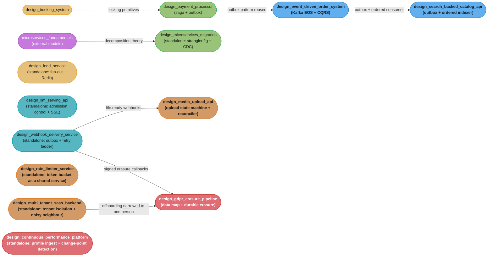

# Backend Engineering — Case Studies

Thirteen end-to-end backend design case studies, each covering a real-world scenario with production-grade architecture, implementation tradeoffs, and interview discussion points.

---

## Quick Start

If you only have time for three case studies, read these first:

| File | Why |
|------|-----|
| [Design a Payment Processor](design_payment_processor/design_payment_processor.md) | Covers the hardest backend problem — distributed saga with compensating transactions (a semantic undo, not a rollback: a saga step is already committed and can only be counteracted by a new transaction), outbox pattern, and idempotency. These three patterns appear together in nearly every payment/order system interview. |
| [Design a Feed Service](design_feed_service/design_feed_service.md) | Teaches the canonical fan-out tradeoff (write vs read) and Redis sorted-set patterns that recur in every social/recommendation system. |
| [Design a Booking System](design_booking_system/design_booking_system.md) | Introduces the optimistic vs pessimistic locking decision under high concurrency — the core tension in any reservation or inventory system. |

---

## Full Learning Path

Grouped by primary engineering concern, not product category:

### Concurrency & Consistency

| Case Study | Primary Concern | What It Teaches |
|------------|----------------|----------------|
| [Design a Booking System](design_booking_system/design_booking_system.md) | Distributed locking, optimistic vs pessimistic concurrency | How to prevent double-booking: SELECT FOR UPDATE vs optimistic locking with version columns; when to escalate to a distributed lock (Redis Redlock); idempotency key design for retry safety. |

### Event-Driven Architecture & CQRS

| Case Study | Primary Concern | What It Teaches |
|------------|----------------|----------------|
| [Design an Event-Driven Order System](design_event_driven_order_system/design_event_driven_order_system.md) | Kafka EOS, CQRS, transactional outbox | How to get effectively-once order processing: the outbox gives at-least-once publication with no lost or fabricated events, and a consumer-side idempotency table absorbs the duplicates; CQRS read-model projection; DLQ handling and dead-letter replay. |

### Distributed Transactions & Saga

| Case Study | Primary Concern | What It Teaches |
|------------|----------------|----------------|
| [Design a Payment Processor](design_payment_processor/design_payment_processor.md) | Saga orchestration, outbox pattern, idempotency | How to coordinate multi-service money movement without 2PC: saga orchestrator with compensating transactions; transactional outbox for reliable Kafka publish; idempotency keys scoped to request lifetime. |

### Read Scalability & Caching

| Case Study | Primary Concern | What It Teaches |
|------------|----------------|----------------|
| [Design a Feed Service](design_feed_service/design_feed_service.md) | Fan-out strategy, Redis sorted sets, cursor pagination | Fan-out-on-write vs fan-out-on-read: how follower count determines the crossover point; Redis ZADD for ranked feeds; cursor-based pagination that avoids COUNT(*) and OFFSET. |

### Derived Data & Search

| Case Study | Primary Concern | What It Teaches |
|------------|----------------|----------------|
| [Design a Search-Backed Catalog API](design_search_backed_catalog_api/design_search_backed_catalog_api.md) | Keeping a search index a correct, eventually consistent projection of the catalogue database | The index as derived data: an outbox feeding one ordered indexer per lane, version-gated writes that stop late events resurrecting delisted listings, zero-downtime reindex by alias swap plus replay, read-your-writes for sellers, degrade-not-fail query paths, and the click-log feedback loop into ranking. |

### Uploads & Media

| Case Study | Primary Concern | What It Teaches |
|------------|----------------|----------------|
| [Design a Media Upload API](design_media_upload_api/design_media_upload_api.md) | Two systems of record (metadata DB and object store) for one fact: "file F exists and is safe" | Upload sessions with direct-to-store multipart grants, a server-driven file state machine (never trust the client's "done"), resume by asking the store, sniff-then-scan before promotion, quota reserve/adjust/release, downloads from a separate user-content origin, and orphan cleanup with lifecycle rules plus a reconciler. |

### Privacy & Data Lifecycle

| Case Study | Primary Concern | What It Teaches |
|------------|----------------|----------------|
| [Design a GDPR Erasure Pipeline](design_gdpr_erasure_pipeline/design_gdpr_erasure_pipeline.md) | Erasing one person from 12 stores with no rollback and a legal deadline | A data map enforced in CI, identity resolution before any deletion, a durable orchestrator that drives every store to a verified receipt, per-store strategies (hard delete, pseudonymisation, crypto-shredding, bounded expiry), suppression so restores and replays cannot bring data back, legal holds, and an evidence record that is not itself a copy of the data. |

### Service Decomposition & Migration

| Case Study | Primary Concern | What It Teaches |
|------------|----------------|----------------|
| [Design a Microservices Migration](design_microservices_migration/design_microservices_migration.md) | Strangler fig, traffic cutover, shared database migration | How to decompose a Java monolith without a big-bang rewrite: bounded context identification, branch-by-abstraction, feature flags for traffic routing, shared DB anti-pattern and the escape pattern. |

### AI Workload Serving

| Case Study | Primary Concern | What It Teaches |
|------------|----------------|----------------|
| [Design an LLM Serving API](design_llm_serving_api/design_llm_serving_api.md) | Admission control and streaming under GPU scarcity | The HTTP boundary in front of a GPU fleet: a bounded admission queue that sheds with 429 rather than queueing unboundedly, SSE streaming with heartbeats and resume, cancellation propagated to the model backend, and per-tenant token budgets reserved on admission. |

### Outbound Integration

| Case Study | Primary Concern | What It Teaches |
|------------|----------------|----------------|
| [Design a Webhook Delivery Service](design_webhook_delivery_service/design_webhook_delivery_service.md) | At-least-once delivery to endpoints you do not control | Transactional outbox to per-endpoint queues, HMAC signing with a dual-secret rotation window, an exponential retry ladder with circuit breaking and auto-disable, a customer-visible delivery log, and an SSRF-safe egress path. |

### Shared Platform Services

| Case Study | Primary Concern | What It Teaches |
|------------|----------------|----------------|
| [Design a Rate Limiter Service](design_rate_limiter_service/design_rate_limiter_service.md) | Central enforcement without a shared store on every request | Rate limiting as a shared service: local decisions against a locally held budget that each pod syncs with the shared store on a schedule, hot-key handling, policy propagation, and fail-open or fail-closed chosen per caller class. |
| [Design a Multi-Tenant SaaS Backend](design_multi_tenant_saas_backend/design_multi_tenant_saas_backend.md) | Tenant isolation and noisy-neighbour control | Cell-based architecture: a router that resolves tenant to isolation tier to cell, pooled, bridge, and silo tiers built from one application image, per-tenant quotas, data residency, and live migration of a tenant between tiers. |

### Performance Engineering

| Case Study | Primary Concern | What It Teaches |
|------------|----------------|----------------|
| [Design a Continuous Performance Platform](design_continuous_performance_platform/design_continuous_performance_platform.md) | Making performance regressions visible across a few hundred services | The internal platform that produces the data every Performance Engineering module consumes: always-on pprof ingest with symbolize-at-write and columnar service-hour segments (a 92 s query becomes 1.4 s), a benchmark result store that keeps sample arrays and an environment fingerprint, change-point detection with fleet-wide false-discovery control, and cost-estimated automated bisect feeding a differential profile. Also the two things that actually decide whether such a platform survives: the sampling-overhead budget as a dollar figure, and default-on adoption. |

---

## Cross-Cutting / Shared Primitives

No `cross_cutting/` directory here — the shared primitives live as deep-dive modules in the section itself. The same primitives recur across these case studies; read the deep dive once, then recognize it everywhere:

| Primitive | Used By | Deep Dive | Phase |
|---|---|---|---|
| Idempotency keys | Booking, Payment, Event-Driven Order, Webhook Delivery | `../distributed_transactions_and_consistency/distributed_transactions_and_consistency.md` | 4 — Database Engineering |
| Transactional outbox | Payment, Event-Driven Order, Webhook Delivery, Search-Backed Catalog | `../messaging_patterns/messaging_patterns.md` | 8 — Event-Driven |
| Saga + compensation | Payment (orchestrated), Event-Driven Order | `../distributed_transactions_and_consistency/distributed_transactions_and_consistency.md` | 4 |
| Optimistic vs pessimistic locking, distributed locks | Booking | `../database_internals_and_indexing/database_internals_and_indexing.md`, `../../database/concurrency_control_and_locking/concurrency_control_and_locking.md` | 4 |
| Kafka EOS / DLQ / consumer idempotency | Event-Driven Order | `../kafka_deep_dive/kafka_deep_dive.md`, `../messaging_patterns/messaging_patterns.md` | 8 |
| CQRS read-model projection | Event-Driven Order | `../event_sourcing_and_cqrs/event_sourcing_and_cqrs.md` | 8 |
| Redis sorted sets + fan-out strategy | Feed Service | `../caching_strategies_deep_dive/caching_strategies_deep_dive.md` | 3 — Performance |
| Cursor pagination | Feed Service | `../rest_api_design/rest_api_design.md`, `../query_optimization/query_optimization.md` | 2 / 4 |
| Strangler fig, branch-by-abstraction, feature flags | Microservices Migration | `../microservices_fundamentals/microservices_fundamentals.md`, `../distributed_system_operational_patterns/distributed_system_operational_patterns.md` | 9 — Microservices |
| Continuous profiling, flame graphs, sampling-overhead budget | Continuous Performance Platform | `../performance_profiling/performance_profiling.md`, `../../hld/observability/continuous_profiling.md` | 3 — Performance |
| Benchmark noise floor, A/A validation, sample sizing | Continuous Performance Platform | `../benchmarking_methodology/benchmarking_methodology.md` | 3 |
| Change-point detection, statistical bisect, the ratchet | Continuous Performance Platform | `../performance_regression_detection/performance_regression_detection.md` | 3 |
| Off-CPU and eBPF stack capture | Continuous Performance Platform | `../off_cpu_and_ebpf_analysis/off_cpu_and_ebpf_analysis.md` | 3 |
| Presigned and multipart grants, resumable upload, sniff-then-scan quarantine | Media Upload API | `../file_upload_and_media_handling/file_upload_and_media_handling.md` | 2 — API Design |
| Index sync via outbox or CDC, version-gated indexing, alias-swap reindex, freshness UX | Search-Backed Catalog | `../search_integration_patterns/search_integration_patterns.md` | 4 — Database Engineering |
| PII data map, crypto-shredding, retention as code, pseudonymisation | GDPR Erasure Pipeline | `../privacy_engineering_and_data_lifecycle/privacy_engineering_and_data_lifecycle.md` | 6 — Security |
| Durable workflow orchestration with per-step receipts | GDPR Erasure Pipeline | `../durable_execution_and_workflows/durable_execution_and_workflows.md` | 8 — Event-Driven |

---

## Dependency Map

Arrows point from the case study that originates a pattern to the one that reuses it — `design_booking_system` → `design_payment_processor` → `design_event_driven_order_system` → `design_search_backed_catalog_api` is the longest chain: the catalogue reuses the outbox and the ordered, idempotent consumer to keep a search index in step with Postgres. `design_webhook_delivery_service` feeds two later designs: `design_media_upload_api` emits `file.ready` / `file.quarantined` webhooks, and `design_gdpr_erasure_pipeline` propagates erasure to processors through signed, deadline-bound callbacks. `design_gdpr_erasure_pipeline` also narrows `design_multi_tenant_saas_backend`'s tenant offboarding to a single data subject. Everything else is standalone: `design_feed_service`, `design_microservices_migration`, `design_llm_serving_api`, `design_rate_limiter_service` and `design_continuous_performance_platform` share no patterns with the others and can each be read on their own. `design_continuous_performance_platform` is the odd one out in a second way as well: it is not a product design at all but an internal platform, and it reads best alongside the section's Performance Engineering modules rather than alongside the other case studies.

---

## Interview Prep Shortcuts

| "Design X" Interview Question | Best Case Study |
|-------------------------------|----------------|
| Design a ticket reservation system | [design_booking_system](design_booking_system/design_booking_system.md) |
| Design a hotel / flight booking platform | [design_booking_system](design_booking_system/design_booking_system.md) |
| Design a payment processing system | [design_payment_processor](design_payment_processor/design_payment_processor.md) |
| Design a wallet / ledger service | [design_payment_processor](design_payment_processor/design_payment_processor.md) — combine with database/design_banking_ledger |
| Design a social media feed | [design_feed_service](design_feed_service/design_feed_service.md) |
| Design a notification service | [design_feed_service](design_feed_service/design_feed_service.md) — fan-out patterns apply |
| Design an order management system | [design_event_driven_order_system](design_event_driven_order_system/design_event_driven_order_system.md) |
| Design an e-commerce checkout | [design_payment_processor](design_payment_processor/design_payment_processor.md) + [design_event_driven_order_system](design_event_driven_order_system/design_event_driven_order_system.md) |
| Design a monolith-to-microservices migration | [design_microservices_migration](design_microservices_migration/design_microservices_migration.md) |
| Design a strangler fig pattern | [design_microservices_migration](design_microservices_migration/design_microservices_migration.md) |
| Design an LLM inference / completions API | [design_llm_serving_api](design_llm_serving_api/design_llm_serving_api.md) |
| Design an inference batching system for a single GPU | [design_llm_serving_api](design_llm_serving_api/design_llm_serving_api.md) |
| Design a webhook / event delivery system | [design_webhook_delivery_service](design_webhook_delivery_service/design_webhook_delivery_service.md) |
| Design a notification delivery service | [design_webhook_delivery_service](design_webhook_delivery_service/design_webhook_delivery_service.md) |
| Design a distributed rate limiter / API quota service | [design_rate_limiter_service](design_rate_limiter_service/design_rate_limiter_service.md) |
| Design a multi-tenant SaaS backend / noisy-neighbour isolation | [design_multi_tenant_saas_backend](design_multi_tenant_saas_backend/design_multi_tenant_saas_backend.md) |
| Design a performance / profiling platform | [design_continuous_performance_platform](design_continuous_performance_platform/design_continuous_performance_platform.md) |
| Design a continuous profiling system (Google-Wide Profiling style) | [design_continuous_performance_platform](design_continuous_performance_platform/design_continuous_performance_platform.md) |
| Design a CI performance-regression detection system | [design_continuous_performance_platform](design_continuous_performance_platform/design_continuous_performance_platform.md) |
| Design a file upload / media attachment API | [design_media_upload_api](design_media_upload_api/design_media_upload_api.md) |
| Design resumable large-file upload (Dropbox / Drive ingestion) | [design_media_upload_api](design_media_upload_api/design_media_upload_api.md) — combine with hld/design_google_drive |
| Design product / marketplace catalogue search | [design_search_backed_catalog_api](design_search_backed_catalog_api/design_search_backed_catalog_api.md) |
| Keep a search index in sync with the database | [design_search_backed_catalog_api](design_search_backed_catalog_api/design_search_backed_catalog_api.md) |
| Design a GDPR right-to-erasure / account-deletion pipeline | [design_gdpr_erasure_pipeline](design_gdpr_erasure_pipeline/design_gdpr_erasure_pipeline.md) |
| Delete a user's data across every service and backup | [design_gdpr_erasure_pipeline](design_gdpr_erasure_pipeline/design_gdpr_erasure_pipeline.md) |

---

## Back to Backend Section

[Backend Engineering Master Index](../README.md)
