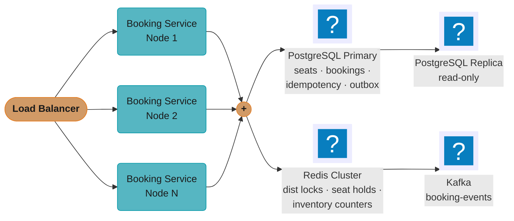
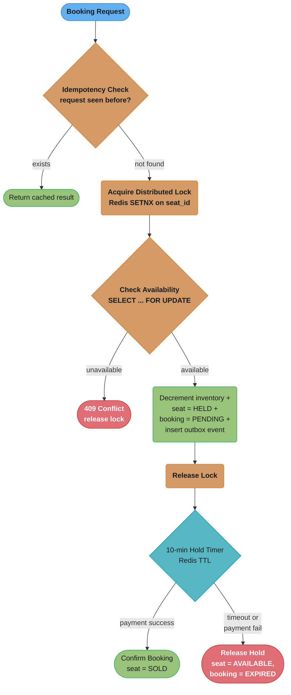
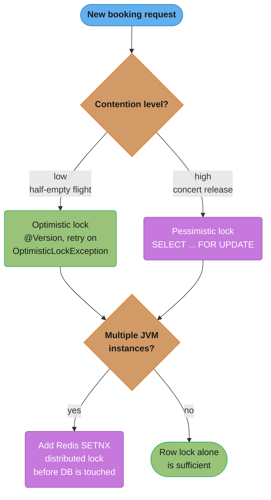
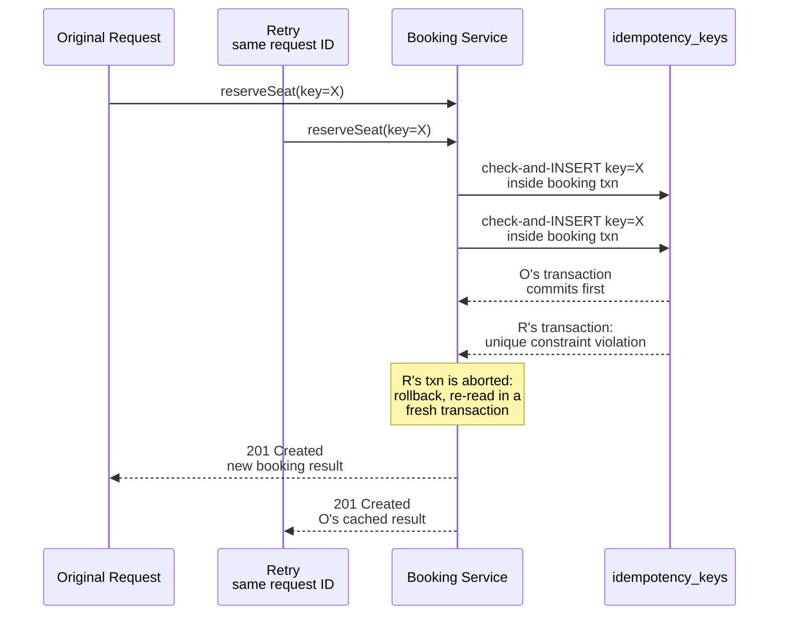

# Case Study: Seat Reservation System Under Concurrency

## Intuition

> **Design intuition**: A booking system does not sell seats — it sells *the right to be the one true answer* to the question "who owns seat 12A?" Every seat has exactly one legitimate history, and the entire architecture exists to make sure two clients asking "can I have it?" at the same millisecond cannot both hear "yes." Everything else — the two-phase hold, the idempotency key, the outbox — is plumbing built around that single guarantee.

**Key insight for this design**: contention is not constant, it is a spike with a shape. A half-empty flight has near-zero contention per seat; a stadium on-sale has extreme contention on exactly the seats everyone wants, for exactly the first sixty seconds. A design tuned for the average case (optimistic locking, no admission control) is *correct* under low contention and *catastrophically slow* under a thundering herd, because the same code path that resolves gracefully at low volume degrades into a retry storm at high volume. So the real design question is never "optimistic or pessimistic" in the abstract — it is "what is the contention shape of this workload, right now, on this seat," and the answer changes the locking strategy, the admission policy, and the failure mode all at once.

The second insight follows from the first: **the lock is cheap; the queue behind the lock is not.** A single `SELECT ... FOR UPDATE` costs microseconds. Ten thousand of them stacked behind one popular seat cost minutes, and a system that lets requests queue on a database row instead of failing fast at the edge turns a seat-allocation problem into a connection-pool-exhaustion problem. The admission gate in front of the lock is not a nicety for the on-sale spike — it is the difference between "409 in 5 ms" and "the whole booking service falls over."

---

## 1. Requirements Clarification

### Functional Requirements

- Represent finite seat inventory per event; each seat is exactly one of `AVAILABLE`, `HELD`, or `SOLD` at any instant.
- **No overselling**: at most one `CONFIRMED` booking may ever exist for a given physical seat, even when thousands of clients request it within the same millisecond.
- **Race safety**: two users click "Book Seat 12A" simultaneously — exactly one succeeds, the other gets a clean, fast rejection, never a silent double-write.
- **Idempotency**: a client retry after a network timeout (the client never learned whether the first attempt succeeded) must not create a second booking for the same logical request.
- **Two-phase flow**: `RESERVE` holds the seat while the user completes payment, `CONFIRM` finalizes on payment success, `RELEASE` restores the seat on hold expiry or payment failure — a seat is never permanently lost to an abandoned checkout.
- **Cancellation and refund** return a `CONFIRMED` seat to `AVAILABLE` and restore the inventory counter.
- Support both a **low-contention** flow (browse-and-pick seat selection on a half-empty flight, contention near zero) and a **high-contention** flow (a stadium concert on-sale, extreme contention on a handful of seats in the first minute) through the same booking API.
- Admission control for extreme-demand events: a virtual waiting room that throttles how many shoppers reach the booking API at once, independent of how many seats exist.

### Non-Functional Requirements

| Requirement | Target | Why this number |
|---|---|---|
| Sustained booking throughput | 10,000 booking requests/sec at on-sale peak | Sized to the admission gate's throttle rate, not to raw demand — see §2 |
| Confirmation latency | p99 < 2 s from RESERVE request to response | Users abandon a checkout that feels stuck; this is the number that keeps a hot seat's lock queue from becoming visible |
| Double-booking rate | 0 tolerated; measured continuously, not assumed | Every duplicate costs a comped seat, a support ticket, and — at a live event — a customer standing at a gate with no seat |
| Availability | 99.9% for the booking API | A momentary outage during an on-sale is a headline; degrade to a waiting-room "try again" page, never a 5xx |
| Hold expiry accuracy | Expired holds released within 60 s of `heldUntil` | Beyond that, seats are provably sellable but invisible to the counter — direct lost revenue |
| Idempotency window | 24 h key retention | Matches the client-retry window a mobile app or flaky venue Wi-Fi realistically needs |
| Seat-hold TTL | 10 minutes, configurable per event | Long enough to enter payment details, short enough that abandoned checkouts don't starve a sold-out event |
| Concurrent shoppers, peak event | 400,000 admitted-or-queued for a 60,000-seat on-sale | The scale this design must survive without falling over — see §2 |

### Clarifying Questions to Ask in the Interview

| Question | Why it changes the design |
|---|---|
| Is this ticketing (fixed seat map, extreme spike demand) or general reservations (restaurant tables, hotel rooms, near-continuous low-contention demand)? | Ticketing needs an admission gate and pessimistic locking by default; general reservations can lean optimistic and skip the waiting room entirely |
| Do seats have identity (assigned seating) or is it capacity-only (general admission, "200 tickets left")? | Capacity-only collapses to a single atomic counter decrement with no per-row locking at all |
| Is payment synchronous with the booking call, or a separate step after a hold? | A separate payment step is what makes the two-phase RESERVE/CONFIRM model necessary in the first place |
| What happens to a booking if the venue changes seat maps or cancels the event? | Forces a bulk-invalidation path that the per-seat lock design does not otherwise need |
| Single region or global? | A single popular on-sale drawing a global audience needs either a single strongly-consistent region for that event or a partitioned-by-event architecture — cross-region consensus on one seat is not worth the latency |
| Can a user hold more than one seat per booking (a party of 4)? | Multi-seat bookings need all-or-nothing atomicity across several row locks, which raises the deadlock question directly |

### Out of Scope

- Payment capture and card processing internals — delegated to a payment service; see [`../design_payment_processor/design_payment_processor.md`](../design_payment_processor/design_payment_processor.md) for that half of the checkout.
- Bot detection and fraud scoring beyond the admission gate's coarse rate limiting.
- Seat-map rendering, venue chart UI, accessibility-seat filtering.
- Dynamic/surge pricing — assumed to be a pricing-service concern that hands this system a price at RESERVE time.
- Secondary-market resale and transfer.

---

## 2. Scale Estimation

### The Thundering-Herd On-Sale Spike

This is the workload the design must survive, stated explicitly because it is qualitatively different from steady-state traffic: **an arena on-sale releasing 60,000 seats to 400,000 concurrent shoppers** the instant tickets go live.

```
Total seats on sale:                        60,000
Concurrent shoppers at gate-open:          400,000
Theoretical success rate (seats / shoppers): 60,000 / 400,000 = 15%
  -> 85% of everyone who shows up is mathematically guaranteed to fail,
     no matter how well the system is built. The job is not to make
     everyone win; it is to fail the 85% cheaply and fast.
Admission throttle (the stated NFR):        10,000 req/sec
Time to admit all 400,000 through the gate: 400,000 / 10,000 = 40 s
Contention window (first popular seats gone): well under those 40 s —
  the front-row seats are gone in the first few hundred requests
```

The waiting room does not make the math better; it makes the *failure mode* better. Without it, all 400,000 clients hit the booking API in the same second, and the system fails by falling over. With it, the same 400,000 clients arrive at a controlled 10,000/sec, and the system fails the 85% one clean `409` at a time.

### Redis Lock Throughput

```
Peak SETNX attempts/sec:              10,000/sec (one per admitted booking attempt)
Critical section held per lock:       ~15 ms  (steps 4-11 of the reservation transaction)
Concurrent locks held at any instant: 10,000 x 0.015 s = 150
Single Redis instance ceiling:        ~100,000 simple ops/sec (illustrative; benchmark
                                       your own hardware)
Utilization at peak:                  150 / 100,000 concurrent-equivalent = well under 1%
```

Redis is never the bottleneck for this workload — its job is to fail fast, not to carry load.

### The One Seat Everyone Wants

Aggregate throughput is easy; the number that actually threatens the SLO is contention on a *single row* — front-row-center, the seat every one of those 400,000 shoppers tries first.

```
Illustrative demand on ONE seat:      5,000 of the 400,000 shoppers try for it
Postgres row-lock hold time per attempt (uncontended): ~20 ms
Attempts that one row can serialize:  1,000 ms / 20 ms = 50/sec
Time to work through all 5,000 attempts if they all reached Postgres: 5,000 / 50 = 100 s
Why the Redis SETNX in front of it matters: after the first winner, the Redis lock for
that seat_id is held (or the seat is already HELD in a cached fast-fail check), so the
other 4,999 get a sub-millisecond 429 instead of queueing on the Postgres row lock for
up to 100 seconds. The fast-fail path is what keeps that single hot row from becoming a
100-second-long convoy that starves the connection pool for every OTHER seat too.
```

### Storage Growth

Sized for a platform running roughly 5,000 events/year at an average 8,000 seats sold per event — not one on-sale, the whole catalog.

```
Bookings/year:                                5,000 x 8,000  = 40,000,000
Idempotency rows, steady state (24 h TTL):
  a single on-sale day: 400,000 (that event) + ~500,000 (normal daily traffic)
  ~900,000 rows/day x ~300 bytes/row                          = 270 MB   <- fits in RAM
Outbox churn (2 events per successful booking: RESERVED, then CONFIRMED or EXPIRED):
  40,000,000 x 2 / 365                                        = 219,000 rows/day
  inserted AND deleted — the same bloat failure mode as any high-churn outbox table
  (smaller than a payments-scale outbox, but the fix in §10 is identical: don't let it
  become a sequential scan)
```

### Latency Budget

```
Stated NFR: RESERVE p99 < 2 s
Redis SETNX round trip:                          ~1 ms
Postgres SELECT ... FOR UPDATE + writes (steps 4-11, uncontended): ~15-20 ms
Idempotency + outbox insert (same transaction):  ~2 ms
Network + serialization:                         ~10-30 ms
                                                  -----------
Uncontended total:                                ~40-60 ms  (comfortably inside budget)
At p99 during the hot-seat pileup, the number is dominated by lock-queue wait time —
which is exactly why the contract at that point is fail-fast 409, not "wait in the
queue until your turn." A design that lets that p99 be a queue wait instead of an
immediate rejection blows the 2 s budget on the very seats it most needs to protect.
```

---

## 3. High-Level Architecture



Stateless booking-service nodes scale horizontally behind the load balancer to absorb the 10,000 req/s peak, then converge on the same two stores — PostgreSQL for durable seat/booking/outbox rows and Redis for the distributed lock and hold TTLs — before PostgreSQL replicates to a read replica and the outbox flow lands on Kafka's `booking-events` topic.

**Two-Phase Booking State Machine**



Every request passes through the idempotency check and the distributed lock before it ever reaches the pessimistic row lock in Postgres, and the 10-minute Redis-TTL hold resolves to exactly one of two terminal states — confirmed sale or a fully released, re-bookable seat.

**Shared primitives.** Backend's `case_studies/` has no `cross_cutting/` directory; by the convention documented in [`../case_studies.md`](../case_studies.md), the shared primitives live as deep-dive modules in the section itself. This case study leans on eight of them:

| Primitive used here | Deep dive |
|---|---|
| Idempotency keys, 2PC problems, saga alternatives | [`../../distributed_transactions_and_consistency/distributed_transactions_and_consistency.md`](../../distributed_transactions_and_consistency/distributed_transactions_and_consistency.md) |
| Row locks, MVCC, `SELECT ... FOR UPDATE`, `SKIP LOCKED` | [`../../database_internals_and_indexing/database_internals_and_indexing.md`](../../database_internals_and_indexing/database_internals_and_indexing.md) |
| Cache-aside, Redis structures, stampede mitigation | [`../../caching_strategies_deep_dive/caching_strategies_deep_dive.md`](../../caching_strategies_deep_dive/caching_strategies_deep_dive.md) |
| Token bucket / sliding window for the on-sale admission gate | [`../../rate_limiting_in_depth/rate_limiting_in_depth.md`](../../rate_limiting_in_depth/rate_limiting_in_depth.md) |
| Circuit breaker, retry with jitter, bulkhead around the payment call | [`../../fault_tolerance_patterns/fault_tolerance_patterns.md`](../../fault_tolerance_patterns/fault_tolerance_patterns.md) |
| Pool sizing, leak detection, PgBouncer | [`../../connection_pooling_deep_dive/connection_pooling_deep_dive.md`](../../connection_pooling_deep_dive/connection_pooling_deep_dive.md) |
| SLO/SLI, correlation IDs, Micrometer | [`../../observability_and_monitoring/observability_and_monitoring.md`](../../observability_and_monitoring/observability_and_monitoring.md) |
| Two-phase capture, saga compensation for the payment leg; 2PL/MVCC locking theory | [`../design_payment_processor/design_payment_processor.md`](../design_payment_processor/design_payment_processor.md), [`../../../database/concurrency_control_and_locking/concurrency_control_and_locking.md`](../../../database/concurrency_control_and_locking/concurrency_control_and_locking.md) |

---

## 4. Component Deep Dives

### 4.1 Locking Strategy Selection

Two valid strategies exist; the choice depends on contention level.

Optimistic locking with `@Version` is appropriate when contention is low: general seat selection on a half-empty flight. The JPA `@Version` field increments on every update. A concurrent update fails with `OptimisticLockException`, which is caught and retried. No database lock is held between read and write, so throughput is high. Under high contention, repeated retries degrade to near-zero throughput — the "thundering herd" effect makes optimistic locking impractical for concert releases.

Pessimistic locking with `SELECT ... FOR UPDATE` is appropriate for high-contention scenarios. The database row is locked the moment it is read. Other transactions attempting to lock the same row block until the holder commits or rolls back. This serializes access at the cost of reduced concurrency. PostgreSQL's row-level locks mean only the specific seat row is locked, not the entire table, so other seats are unaffected.

Distributed Redis lock is required when multiple JVM instances are running. Even with pessimistic locking in Postgres, two application nodes could both reach the database and contend at the DB level. A Redis SETNX (SET if Not eXists) with expiry acquires a named lock before the database is touched, ensuring only one node proceeds for a given seat at a time. This reduces database lock contention and provides a fast-fail path — see §2 for why that fast-fail path is what keeps a single hot seat from becoming a 100-second convoy.



Contention level and node count are independent axes: contention alone picks `@Version` optimistic locking for the half-empty-flight case or `SELECT ... FOR UPDATE` pessimistic locking for the concert-release case, while a separate question — is more than one JVM instance running? — decides whether a Redis SETNX pre-check sits in front of either strategy.

### 4.2 The Idempotency-Key Lifecycle

Every booking request carries a client-generated `bookingRequestId` (UUID). Before any business logic, the service checks the `idempotency_keys` table for this ID. If found, the previous result is returned directly. If not found, the request is processed and the result is persisted with the idempotency key. The check-and-insert is inside the same transaction as the booking, so concurrent retries with the same key race to insert — only one wins; the loser blocks on the uncommitted duplicate key, then gets a unique constraint violation once the winner commits. Note the mechanic that trips people up: in PostgreSQL that error puts the whole transaction into an aborted state, and `ROLLBACK` (or `ROLLBACK TO SAVEPOINT`) is the only way to regain control. The loser therefore cannot read the winning row in the failed transaction — it must roll back and re-read in a fresh one, which is exactly what the outer retry does.



The unique index on `booking_request_id` is the actual arbiter: whichever transaction commits first wins the insert, and the loser's unique-constraint violation is the signal to roll back and re-read that same row in a new transaction instead of treating the retry as sold-out or duplicate.

### 4.3 BROKEN -> FIXED: The Race That Double-Books a Seat

This is the failure the whole locking discipline exists to prevent. The broken code is not a strawman — it is what `bookSeat()` looks like the first time anyone writes it, and it passes every single-threaded test.

**BROKEN** — a plain read, a status check, then a write, with nothing serializing the two:

```java
@Service
@RequiredArgsConstructor
public class NaiveBookingService {

    private final SeatRepository seatRepository;
    private final BookingRepository bookingRepository;
    // BROKEN. Under PostgreSQL's default READ_COMMITTED isolation, a plain
    // findById() is a snapshot read that takes NO row lock. Nothing prevents
    // a second transaction from performing the exact same read before the
    // first transaction's write is visible.
    @Transactional
    public Booking bookSeat(String seatId, Long eventId, String userId) {
        Seat seat = seatRepository.findById(seatId, eventId)
                .orElseThrow(() -> new SeatNotFoundException(seatId));

        if (seat.getStatus() != SeatStatus.AVAILABLE) {
            throw new SeatUnavailableException(seatId + " is " + seat.getStatus());
        }

        seat.setStatus(SeatStatus.HELD);           // <-- write happens after the read,
        seatRepository.save(seat);                 //     with no lock held in between

        Booking booking = new Booking();
        booking.setSeatId(seatId);
        booking.setEventId(eventId);
        booking.setUserId(userId);
        booking.setStatus(BookingStatus.PENDING);
        return bookingRepository.save(booking);     // succeeds unconditionally
    }
}
```

The failure sequence, for two ordinary users clicking "Book" 3 milliseconds apart:

```
t=0.000s  User A: SELECT seat 12A -> status=AVAILABLE   (no lock acquired)
t=0.003s  User B: SELECT seat 12A -> status=AVAILABLE   (same snapshot, no lock)
t=0.041s  User A: UPDATE seat 12A SET status=HELD; INSERT booking A; COMMIT
t=0.044s  User B: UPDATE seat 12A SET status=HELD; INSERT booking B; COMMIT
t=0.044s  Two PENDING-then-CONFIRMED bookings now exist for one physical seat
```

Both writes succeed because nothing serializes them — the `UPDATE` has no `WHERE` clause guarding the row's *current* status, so it always succeeds no matter what the row holds by the time it runs. At 10,000 req/sec against the single most popular seat in an on-sale, this is not a one-in-a-million race; per §2's arithmetic it is the modal outcome for the first few hundred requests.

**FIXED** — two layers, from lightest to heaviest:

The minimal correct fix needs no separate read step at all — a single atomic conditional `UPDATE`:

```sql
UPDATE seats
   SET status = 'HELD', held_by_user = :userId, held_until = :heldUntil
 WHERE seat_id = :seatId AND event_id = :eventId AND status = 'AVAILABLE';
-- affected rows == 1  -> this caller won the race
-- affected rows == 0  -> someone else won it; return 409, no further work
```

Postgres takes the row lock internally for the duration of this one statement and evaluates the `WHERE` clause under that lock, so the check-then-write race is structurally impossible — there is no window between "check" and "write" because they are the same statement. This is cheaper than an explicit `SELECT ... FOR UPDATE` followed by a separate `UPDATE` (one round trip instead of two) and it needs **no distributed lock at all for correctness** — Redis becomes a pure throughput optimization (fail fast before touching Postgres at all), never a safety mechanism.

The design actually used in this case study (§4.4 below) instead does the equivalent work as an explicit `SELECT ... FOR UPDATE` followed by validation and a write, because the extra round trip buys something the one-liner doesn't: the status check, the inventory decrement, the booking insert, and the outbox insert are all validated and performed together, with domain logic (idempotency, outbox events) attached in between the lock and the commit. Either form is correct; the one-liner is the *simplest* correct fix and the right answer if your interviewer asks "what is the least code that fixes this."

Belt-and-suspenders: even if every line of application logic above were somehow bypassed, a partial unique index is the last line of defense, exactly the role `ledger_transfers`' `UNIQUE (transfer_type, external_ref)` plays in the payment-processor design:

```sql
CREATE UNIQUE INDEX ux_one_active_booking_per_seat
    ON bookings (event_id, seat_id)
 WHERE status IN ('PENDING', 'CONFIRMED');
```

Two `PENDING`-or-`CONFIRMED` bookings for the same seat cannot both exist in the table, full stop — no application code path, however buggy, can violate it, because the database itself refuses the second `INSERT`.

### 4.4 Two-Phase Booking

Collecting payment inline (charge card -> book seat atomically) is not possible because payment involves an external system. The two-phase model separates concerns:

- Phase 1 RESERVE: decrement inventory, mark seat as HELD, create booking in PENDING state, set a Redis TTL of 600 seconds on the seat hold key. The user proceeds to the payment page.
- Phase 2 CONFIRM: on payment success callback, transition booking to CONFIRMED and seat to SOLD.
- RELEASE: a scheduled job (or Redis keyspace notification) finds expired holds and restores inventory. This prevents permanently lost seats from abandoned sessions.

#### Domain Entities

```java
@Entity
@Table(name = "seats")
public class Seat {
    @Id
    private String seatId;                  // "12A", "12B", etc.
    private Long eventId;
    @Enumerated(EnumType.STRING)
    private SeatStatus status;              // AVAILABLE, HELD, SOLD
    @Version
    private Long version;                   // optimistic locking (low-contention flows)
    private String heldByUserId;
    private Instant heldUntil;
    // getters/setters omitted
}

public enum SeatStatus { AVAILABLE, HELD, SOLD }

@Entity
@Table(name = "bookings")
public class Booking {
    @Id
    @GeneratedValue(strategy = GenerationType.UUID)
    private String bookingId;
    private String bookingRequestId;        // client idempotency key
    private Long eventId;
    private String seatId;
    private String userId;
    @Enumerated(EnumType.STRING)
    private BookingStatus status;           // PENDING, CONFIRMED, EXPIRED, CANCELLED
    private Instant createdAt;
    private Instant expiresAt;
    private Instant confirmedAt;
    private String paymentTransactionId;
}

public enum BookingStatus { PENDING, CONFIRMED, EXPIRED, CANCELLED }
```

`IdempotencyKey` and `OutboxEvent` map directly to the `idempotency_keys` and `outbox_events` tables in the schema at the end of §4.5 — one field per column, no logic beyond persistence, so the SQL there is the complete definition and the Java classes are omitted here to avoid repeating it twice.

#### Repository Layer

```java
@Repository
public interface SeatRepository extends JpaRepository<Seat, String> {

    // Pessimistic lock: used for high-contention concert releases
    @Lock(LockModeType.PESSIMISTIC_WRITE)
    @Query("SELECT s FROM Seat s WHERE s.seatId = :seatId AND s.eventId = :eventId")
    Optional<Seat> findByIdWithPessimisticLock(
            @Param("seatId") String seatId,
            @Param("eventId") Long eventId);

    // Optimistic lock: used for low-contention flight seat selection
    @Lock(LockModeType.OPTIMISTIC)
    @Query("SELECT s FROM Seat s WHERE s.seatId = :seatId AND s.eventId = :eventId")
    Optional<Seat> findByIdWithOptimisticLock(
            @Param("seatId") String seatId,
            @Param("eventId") Long eventId);
}

@Repository
public interface EventInventoryRepository extends JpaRepository<EventInventory, Long> {

    @Modifying
    @Query("UPDATE EventInventory e SET e.availableSeats = e.availableSeats - 1 " +
           "WHERE e.eventId = :eventId AND e.availableSeats > 0")
    int decrementAvailableSeats(@Param("eventId") Long eventId);

    // Used by releaseExpiredHolds() below — a hold that expires must give the
    // seat back to the counter, or available_seats permanently undercounts.
    @Modifying
    @Query("UPDATE EventInventory e SET e.availableSeats = e.availableSeats + 1 " +
           "WHERE e.eventId = :eventId")
    int incrementAvailableSeats(@Param("eventId") Long eventId);
}

@Repository
public interface IdempotencyKeyRepository extends JpaRepository<IdempotencyKey, String> {
    Optional<IdempotencyKey> findByRequestId(String requestId);
}
```

#### Redis Distributed Lock

```java
@Component
public class RedisDistributedLock {

    private static final String LOCK_PREFIX = "seat_lock:";
    private static final long LOCK_TTL_SECONDS = 30;
    private final StringRedisTemplate redisTemplate;

    public RedisDistributedLock(StringRedisTemplate redisTemplate) {
        this.redisTemplate = redisTemplate;
    }

    // SET NX EX is atomic in Redis, so acquire is a single round trip.
    public boolean tryAcquire(String seatId, String lockValue) {
        String key = LOCK_PREFIX + seatId;
        Boolean result = redisTemplate.opsForValue()
                .setIfAbsent(key, lockValue, Duration.ofSeconds(LOCK_TTL_SECONDS));
        return Boolean.TRUE.equals(result);
    }

    // Releases only if this caller still holds it. The Lua script makes the
    // GET + DEL atomic — a plain GET-then-DEL from application code has the
    // exact same read-then-write race as the BROKEN booking code in §4.3.
    public void release(String seatId, String lockValue) {
        String key = LOCK_PREFIX + seatId;
        String script =
            "if redis.call('get', KEYS[1]) == ARGV[1] then " +
            "  return redis.call('del', KEYS[1]) " +
            "else " +
            "  return 0 " +
            "end";
        redisTemplate.execute(
                new DefaultRedisScript<>(script, Long.class),
                Collections.singletonList(key),
                lockValue);
    }

    // Hold key with a 10-minute TTL, tracked separately for expiry.
    public void setSeatHold(String bookingId, String seatId, Long eventId) {
        String key = "seat_hold:" + bookingId;
        String value = eventId + ":" + seatId;
        redisTemplate.opsForValue().set(key, value, Duration.ofMinutes(10));
    }
}
```

#### Booking Service

```java
@Service
@Slf4j
public class BookingService {

    private final SeatRepository seatRepository;
    private final BookingRepository bookingRepository;
    private final EventInventoryRepository inventoryRepository;
    private final IdempotencyKeyRepository idempotencyKeyRepository;
    private final OutboxEventRepository outboxEventRepository;
    private final RedisDistributedLock distributedLock;
    private final ObjectMapper objectMapper;
    // The transactional body lives in a SEPARATE bean. Calling an @Transactional
    // method on `this` is self-invocation: it does not go through the Spring proxy,
    // so no transaction is started and steps 4-11 would each commit independently.
    private final ReservationTransactionService reservationTxService;
    // constructor injection omitted for brevity

    // Idempotency check -> acquire distributed lock -> delegate to the
    // transactional reservation -> always release the lock.
    public BookingResponse reserveSeat(BookingRequest request) {
        // Step 1: Idempotency check
        Optional<IdempotencyKey> existing =
                idempotencyKeyRepository.findByRequestId(request.getBookingRequestId());
        if (existing.isPresent()) {
            log.info("Idempotent request detected: {}", request.getBookingRequestId());
            return deserializeResponse(existing.get().getResultJson());
        }

        // Step 2: Fast-fail inventory check (no lock needed, approximate is fine here)
        EventInventory inventory = inventoryRepository.findByEventId(request.getEventId())
                .orElseThrow(() -> new EventNotFoundException(request.getEventId()));
        if (inventory.getAvailableSeats() <= 0) {
            throw new SoldOutException("Event " + request.getEventId() + " is sold out");
        }

        // Step 3: Acquire distributed lock before touching the DB
        String lockValue = UUID.randomUUID().toString();
        boolean lockAcquired = distributedLock.tryAcquire(request.getSeatId(), lockValue);
        if (!lockAcquired) {
            throw new SeatLockConflictException(
                    "Seat " + request.getSeatId() + " is currently being processed. Retry.");
        }

        try {
            // Cross-bean call — goes through the proxy, so @Transactional applies
            return reservationTxService.executeReservation(request, lockValue);
        } finally {
            distributedLock.release(request.getSeatId(), lockValue);
        }
    }

    private BookingResponse deserializeResponse(String json) {
        try {
            return objectMapper.readValue(json, BookingResponse.class);
        } catch (JsonProcessingException e) {
            throw new RuntimeException("Deserialization failed", e);
        }
    }
}

@Service
@Slf4j
public class ReservationTransactionService {

    // repositories + distributedLock + objectMapper injected here as well

    @Transactional(isolation = Isolation.READ_COMMITTED)
    public BookingResponse executeReservation(
            BookingRequest request, String lockValue) {

        // Step 4: Pessimistic lock on seat row
        Seat seat = seatRepository.findByIdWithPessimisticLock(
                request.getSeatId(), request.getEventId())
                .orElseThrow(() -> new SeatNotFoundException(request.getSeatId()));

        // Step 5: Validate seat is still available
        if (seat.getStatus() != SeatStatus.AVAILABLE) {
            throw new SeatUnavailableException(
                    "Seat " + request.getSeatId() + " is " + seat.getStatus());
        }

        // Step 6: Atomically decrement inventory counter
        int updated = inventoryRepository.decrementAvailableSeats(request.getEventId());
        if (updated == 0) {
            // Race condition: someone took the last seat between our fast-fail check and now
            throw new SoldOutException("Event " + request.getEventId() + " just sold out");
        }

        // Step 7: Mark seat as HELD
        seat.setStatus(SeatStatus.HELD);
        seat.setHeldByUserId(request.getUserId());
        seat.setHeldUntil(Instant.now().plus(Duration.ofMinutes(10)));
        seatRepository.save(seat);

        // Step 8: Create booking in PENDING state
        Booking booking = new Booking();
        booking.setBookingRequestId(request.getBookingRequestId());
        booking.setEventId(request.getEventId());
        booking.setSeatId(request.getSeatId());
        booking.setUserId(request.getUserId());
        booking.setStatus(BookingStatus.PENDING);
        booking.setCreatedAt(Instant.now());
        booking.setExpiresAt(Instant.now().plus(Duration.ofMinutes(10)));
        bookingRepository.save(booking);

        // Step 9: Write outbox event (same transaction — no dual-write problem)
        publishEvent(booking.getBookingId(), "BookingReserved", Map.of(
                "bookingId", booking.getBookingId(),
                "eventId", request.getEventId(),
                "seatId", request.getSeatId(),
                "userId", request.getUserId(),
                "expiresAt", booking.getExpiresAt().toString()));

        // Step 10: Persist idempotency key with result
        BookingResponse response = new BookingResponse(
                booking.getBookingId(), BookingStatus.PENDING, booking.getExpiresAt());
        IdempotencyKey idempotencyKey = new IdempotencyKey();
        idempotencyKey.setRequestId(request.getBookingRequestId());
        idempotencyKey.setResultJson(toJson(response));
        idempotencyKey.setCreatedAt(Instant.now());
        idempotencyKey.setExpiresAt(Instant.now().plus(Duration.ofHours(24)));
        idempotencyKeyRepository.save(idempotencyKey);

        // Step 11: Set Redis hold key for expiry tracking
        distributedLock.setSeatHold(booking.getBookingId(), request.getSeatId(), request.getEventId());

        return response;
    }

    /**
     * Called by payment service webhook on successful payment.
     */
    @Transactional
    public void confirmBooking(String bookingId, String paymentTransactionId) {
        Booking booking = bookingRepository.findById(bookingId)
                .orElseThrow(() -> new BookingNotFoundException(bookingId));

        if (booking.getStatus() != BookingStatus.PENDING) {
            throw new InvalidBookingStateException(
                    "Cannot confirm booking in state: " + booking.getStatus());
        }
        if (Instant.now().isAfter(booking.getExpiresAt())) {
            throw new BookingExpiredException("Booking " + bookingId + " has expired");
        }

        Seat seat = seatRepository.findByIdWithPessimisticLock(
                booking.getSeatId(), booking.getEventId())
                .orElseThrow(() -> new SeatNotFoundException(booking.getSeatId()));
        seat.setStatus(SeatStatus.SOLD);
        seatRepository.save(seat);

        booking.setStatus(BookingStatus.CONFIRMED);
        booking.setConfirmedAt(Instant.now());
        booking.setPaymentTransactionId(paymentTransactionId);
        bookingRepository.save(booking);

        publishEvent(bookingId, "BookingConfirmed", Map.of(
                "bookingId", bookingId,
                "seatId", booking.getSeatId(),
                "userId", booking.getUserId(),
                "paymentTransactionId", paymentTransactionId));
    }

    /**
     * Scheduled job: release expired holds every minute.
     * In production, use Redis keyspace notifications for lower latency.
     */
    @Scheduled(fixedDelay = 60_000)
    @Transactional
    public void releaseExpiredHolds() {
        List<Booking> expired = bookingRepository
                .findByStatusAndExpiresAtBefore(BookingStatus.PENDING, Instant.now());

        for (Booking booking : expired) {
            seatRepository.findByIdWithPessimisticLock(
                    booking.getSeatId(), booking.getEventId())
                    .ifPresent(seat -> {
                        seat.setStatus(SeatStatus.AVAILABLE);
                        seat.setHeldByUserId(null);
                        seat.setHeldUntil(null);
                        seatRepository.save(seat);
                    });

            inventoryRepository.incrementAvailableSeats(booking.getEventId());

            booking.setStatus(BookingStatus.EXPIRED);
            bookingRepository.save(booking);

            publishEvent(booking.getBookingId(), "BookingExpired", Map.of(
                    "bookingId", booking.getBookingId(),
                    "seatId", booking.getSeatId()));
        }

        log.info("Released {} expired seat holds", expired.size());
    }

    // Shared by all three call sites above — DRY, and it is the one place that
    // has to change if the outbox schema ever does.
    private void publishEvent(String aggregateId, String eventType, Map<String, Object> payload) {
        OutboxEvent event = new OutboxEvent();
        event.setAggregateType("Booking");
        event.setAggregateId(aggregateId);
        event.setEventType(eventType);
        event.setPayload(toJson(payload));
        event.setProcessed(false);
        event.setCreatedAt(Instant.now());
        outboxEventRepository.save(event);
    }

    private String toJson(Object obj) {
        try {
            return objectMapper.writeValueAsString(obj);
        } catch (JsonProcessingException e) {
            throw new RuntimeException("Serialization failed", e);
        }
    }
}
```

### 4.5 Outbox Pattern, Poller, REST Surface and Schema

The booking service must emit a `BookingConfirmed` event to downstream services (email notification, analytics, loyalty points). Writing to the database and publishing to Kafka in two separate operations creates a dual-write problem: the DB write succeeds but Kafka publish fails (or vice versa). The outbox pattern writes an event record to an `outbox` table in the same transaction as the booking. A separate outbox poller reads unprocessed events and publishes them to Kafka, then marks them processed. This guarantees at-least-once event delivery with no data loss.

Rather than counting available seats with `SELECT COUNT(*)` on every request (a full table scan under load), a pre-computed `available_seats` counter is maintained on the event row. Decrementing this counter in the same transaction as seat reservation ensures atomicity. The counter also acts as a fast-fail guard: if `available_seats = 0`, the request is rejected before acquiring any lock — this is what turns 85% of the on-sale spike's requests (§2) into a sub-millisecond rejection instead of a database round trip.

```java
@Component
@Slf4j
public class OutboxEventPoller {

    private final OutboxEventRepository outboxEventRepository;
    private final KafkaTemplate<String, String> kafkaTemplate;

    @Scheduled(fixedDelay = 1000)
    @Transactional
    public void pollAndPublish() {
        List<OutboxEvent> events = outboxEventRepository
                .findTop100ByProcessedFalseOrderByCreatedAtAsc();

        for (OutboxEvent event : events) {
            try {
                kafkaTemplate.send("booking-events", event.getAggregateId(), event.getPayload())
                        .get(5, TimeUnit.SECONDS);        // synchronous send for reliability
                event.setProcessed(true);
                outboxEventRepository.save(event);
            } catch (Exception e) {
                log.error("Failed to publish outbox event {}: {}", event.getEventId(), e.getMessage());
                // Leave processed=false; will retry on next poll cycle
            }
        }
    }
}
```

A thin `@RestController` wraps these two calls (`POST /api/v1/bookings/reserve`, `POST /api/v1/bookings/{id}/confirm`) and maps exceptions to HTTP status: `SeatUnavailableException` -> `409 Conflict`, `SeatLockConflictException` -> `429 Too Many Requests` with `Retry-After: 1`, `SoldOutException` -> `409 Conflict`. None of that mapping affects the concurrency story above — it exists only to give the client a clean, retryable signal for each failure mode already discussed.

```sql
CREATE TABLE events (
    event_id      BIGSERIAL PRIMARY KEY,
    name          TEXT NOT NULL,
    venue         TEXT NOT NULL,
    event_date    TIMESTAMPTZ NOT NULL
);

CREATE TABLE event_inventory (
    event_id         BIGINT PRIMARY KEY REFERENCES events(event_id),
    total_seats      INT NOT NULL,
    available_seats  INT NOT NULL CHECK (available_seats >= 0)
);

CREATE TABLE seats (
    seat_id       TEXT NOT NULL,
    event_id      BIGINT NOT NULL REFERENCES events(event_id),
    status        TEXT NOT NULL DEFAULT 'AVAILABLE',  -- AVAILABLE | HELD | SOLD
    held_by_user  TEXT,
    held_until    TIMESTAMPTZ,
    version       BIGINT NOT NULL DEFAULT 0,
    PRIMARY KEY (seat_id, event_id)
);

CREATE TABLE bookings (
    booking_id              UUID PRIMARY KEY DEFAULT gen_random_uuid(),
    booking_request_id      UUID NOT NULL,
    event_id                BIGINT NOT NULL REFERENCES events(event_id),
    seat_id                 TEXT NOT NULL,
    user_id                 TEXT NOT NULL,
    status                  TEXT NOT NULL,  -- PENDING | CONFIRMED | EXPIRED | CANCELLED
    created_at              TIMESTAMPTZ NOT NULL DEFAULT now(),
    expires_at              TIMESTAMPTZ NOT NULL,
    confirmed_at            TIMESTAMPTZ,
    payment_transaction_id  TEXT
);

-- Unique constraint enforces idempotency at DB level
CREATE UNIQUE INDEX ux_booking_request_id ON bookings(booking_request_id);

-- Belt-and-suspenders safety net discussed in §4.3: no application code path,
-- however buggy, can create two live bookings for one seat.
CREATE UNIQUE INDEX ux_one_active_booking_per_seat
    ON bookings (event_id, seat_id)
 WHERE status IN ('PENDING', 'CONFIRMED');

CREATE TABLE idempotency_keys (
    request_id   UUID PRIMARY KEY,
    result_json  TEXT NOT NULL,
    created_at   TIMESTAMPTZ NOT NULL DEFAULT now(),
    expires_at   TIMESTAMPTZ NOT NULL
);

CREATE TABLE outbox_events (
    event_id        UUID PRIMARY KEY DEFAULT gen_random_uuid(),
    aggregate_type  TEXT NOT NULL,
    aggregate_id    TEXT NOT NULL,
    event_type      TEXT NOT NULL,
    payload         JSONB NOT NULL,
    processed       BOOLEAN NOT NULL DEFAULT FALSE,
    created_at      TIMESTAMPTZ NOT NULL DEFAULT now()
);

CREATE INDEX ix_outbox_unprocessed ON outbox_events(created_at) WHERE processed = FALSE;
CREATE INDEX ix_seat_status ON seats(event_id, status);
CREATE INDEX ix_bookings_expiry ON bookings(expires_at) WHERE status = 'PENDING';
```

---

## 5. Design Decisions & Tradeoffs

| Decision | Chosen | Alternative | Rationale |
|---|---|---|---|
| Concurrency control, high contention | Pessimistic `SELECT ... FOR UPDATE` | Optimistic `@Version` | Optimistic locking degrades to a retry storm exactly when it matters most — an on-sale spike; a row lock instead serializes cleanly at the cost of queueing |
| Concurrency control, low contention | Optimistic `@Version` | Pessimistic locking everywhere | Holding a DB row lock for a half-empty flight's browse-and-pick flow wastes concurrency the workload never needed |
| Multi-node coordination | Redis SETNX fast-fail in front of the DB lock | Rely on Postgres locks alone | Two app nodes can both reach Postgres for the same seat; Redis reduces that contention and, per §2, is what turns a 100-second row-lock queue into a sub-millisecond 429 |
| Race-window fix | Atomic conditional `UPDATE ... WHERE status = 'AVAILABLE'`, plus a partial unique index as a backstop | `SELECT` then separate `UPDATE` with no guard | The unguarded two-step form is exactly the §4.3 bug; the guarded single statement removes the window entirely and needs no external lock to be correct |
| Idempotency | Client-supplied key, `PRIMARY KEY`-enforced insert inside the booking transaction | Server-generated dedup by request contents | A content hash cannot distinguish "the same seat booked twice on purpose" from "a retry of the same request" — the client must say which one it means |
| Command/event publication | Transactional outbox | Publish to Kafka inside the request | A `kafka.send()` inside the transaction can succeed while the transaction rolls back, fabricating an event for a booking that never happened |
| Inventory read | Pre-computed `available_seats` counter | `SELECT COUNT(*) WHERE status='AVAILABLE'` | A full scan under on-sale load is the difference between a sub-millisecond fast-fail and a query that itself becomes the bottleneck |
| Extreme-demand admission | Virtual waiting room throttling arrivals to 10,000/sec | No admission control | Per §2, the fix is not making 400,000 concurrent requests succeed faster — it is never letting more than 10,000/sec reach the lock at all |

### Optimistic vs Pessimistic Locking

| Dimension | Optimistic (@Version) | Pessimistic (SELECT FOR UPDATE) |
|---|---|---|
| Contention model | Low contention (flights) | High contention (concerts) |
| Throughput | High — no DB lock held | Lower — row locked during transaction |
| Failure mode | Retry storm under contention | Queue at the DB row |
| Implementation | Spring Data @Lock(OPTIMISTIC) | Spring Data @Lock(PESSIMISTIC_WRITE) |
| Retry logic needed | Yes — catch OptimisticLockException | No |

### Distributed Lock Alternatives

Redis SETNX is simple and fast (sub-millisecond) but a single Redis master is a single point of failure. Redlock is the documented alternative: it is a majority-quorum algorithm, not a consensus protocol — the client races `SET key value NX PX` against N independent masters (the reference value is N=5) and considers the lock held only if it acquires N/2+1 of them within the validity time. Redis' own documentation carries a consistency disclaimer: implement fencing tokens, and note that Redis does not use a monotonic clock for TTL expiry, so a wall-clock shift can hand the same lock to two processes. Martin Kleppmann's 2016 analysis disputes Redlock's safety and antirez published a rebuttal; read both before relying on it. This design does not: replication-based failover (Sentinel or Cluster) explicitly cannot guarantee mutual exclusion because Redis replication is asynchronous, which is precisely why the Postgres row lock (or the guarded `UPDATE` in §4.3) remains the authoritative guard — the Redis lock is a throughput optimization the design would still be correct without.

The fencing-token gap deserves naming, because it is the sharp edge of the whole approach: if a client's `tryAcquire()` succeeds, then a long GC pause or a scheduling stall makes it miss its own lock's TTL, and a second client acquires the *same* lock name while the first client is still (unknowingly) executing — Redis alone cannot tell the two apart. A fencing token (a monotonically increasing number attached to each lock grant, written alongside every guarded update and checked with `WHERE fencing_token >= :token`) closes that gap; this design accepts the smaller residual risk instead, because the Postgres `SELECT ... FOR UPDATE` underneath is itself immune to the same failure — a stale application thread holding an expired Redis lock still cannot get PostgreSQL to hand it a row another transaction is legitimately holding.

Zookeeper-based distributed locks (Apache Curator) provide stronger consistency guarantees but add operational complexity and higher latency — order of milliseconds versus sub-millisecond for Redis (illustrative magnitudes; benchmark on your own hardware). Database-level advisory locks (Postgres `pg_advisory_lock`) avoid an extra Redis dependency but tie lock lifetime to the DB connection, which is expensive and can exhaust the connection pool.

### Seat Hold Duration

10 minutes is a common starting point for concert tickets, but treat that as a design default you will tune, not an industry figure. Ticketmaster deliberately publishes no number at all: its help centre says only that a timer runs "at the top of every page in the checkout process" and that "we set the time length according to ticket demand, so it can differ depending on time of day or for different events." Every specific duration you will read about their checkout is third-party observation, so do not anchor your own design on one. Too short (under 5 minutes) frustrates users entering payment details. Too long (over 15 minutes) reduces effective inventory for other buyers during high-demand windows. The duration should be configurable per event type and tunable in production.

### Alternative: Queue-Based Booking

Under extreme load (400,000 users for 60,000 seats, per §2), a virtual waiting room (Akamai, Queue-it) admits users in controlled batches. This converts a spike into a manageable flow and removes the need for ultra-high-concurrency locking. The trade-off is user experience (users see a queue position) versus the risk of overselling without throttling.

---

## 6. Real-World Implementations

**Ticketmaster** operates queueing technology that admits shoppers into the transaction system in controlled batches rather than letting an on-sale's full concurrent audience hit the booking API at once — the same admission-gate idea modeled in §2 and §5, at a scale of millions of fans across thousands of events a year. Their help documentation is explicit that the checkout hold timer is demand-adaptive rather than fixed, which is the same tuning knob discussed under "Seat Hold Duration" above.

**OpenTable** manages real-time table availability across tens of thousands of restaurants simultaneously, and the architecturally interesting property is that contention is *naturally partitioned*: one restaurant's table inventory never contends with another's, so the system never needs a single global lock — it needs many small, cheap, independent locks, one scope per restaurant. That is the same lesson as this design's per-seat row lock: keep the lock scope as narrow as the real contention boundary, never broader.

**Booking.com** and other large OTAs are widely documented in industry engineering discussions as tolerating brief windows of inconsistency between their own inventory cache and a property's live availability, because property-management-system syncs lag by design. Rather than paying the latency cost of a strongly consistent global lock across every partner hotel, the accepted trade is: occasionally oversell at the margin, detect it fast, and resolve it with a guaranteed rebooking or compensation policy. It is the same trade-off table this case study makes explicitly in §5 — strict consistency has a cost, and at sufficient scale that cost is sometimes worse than a well-insured rare failure.

**Airbnb** distinguishes **Instant Book** (immediate confirmation, effectively the optimistic low-contention path) from **Request to Book** (a host-approval window that is structurally a hold with a TTL, functionally identical to this design's PENDING-booking expiry). Airbnb's payments engineering team also published the best-known public write-up on idempotency-key design for exactly this class of system (cited in full in [`../design_payment_processor/design_payment_processor.md`](../design_payment_processor/design_payment_processor.md) §6) — the same idempotency-key discipline in §4.2 here traces to that lineage.

**Resy** handles its highest-demand restaurant reservation drops — a fixed number of tables released at a fixed time for a small number of extremely sought-after restaurants — with a queue-based release model, the restaurant-reservation analogue of a concert on-sale's virtual waiting room: admit shoppers in a controlled stream rather than letting all of them hit the booking endpoint in the same second.

**Amtrak's** seat and roomette inventory sits on reservation infrastructure with decades of history, and it is a commonly cited industry example of a separate axis from locking correctness: a booking system can get every lock and every hold-expiry rule right and still buckle under peak load if the substrate underneath — connection limits, hardware, deployment topology — was never sized for a holiday-travel demand spike. Locking discipline is necessary; it is not sufficient without the capacity planning in §10.

---

## 7. Technologies & Tools

| Technology | Role |
|---|---|
| Spring Boot 4.1 | Application framework |
| Spring Data JPA | ORM with optimistic/pessimistic locking annotations |
| PostgreSQL 18 | Primary data store; row-level locking, CHECK constraints, partial unique indexes |
| Redis 8 | Distributed lock (SET NX EX), seat hold TTL tracking, admission-gate token buckets |
| Kafka 4.x (KRaft) | Event streaming for booking lifecycle events |
| Spring Kafka | @KafkaListener, KafkaTemplate |
| Spring Scheduler | Outbox poller, expired hold cleanup |
| HikariCP | Connection pooling (default pool size 10, tune per §10) |
| PgBouncer | Transaction-mode pooling in front of the Postgres primary at on-sale peak |
| Resilience4j | Circuit breaker + bulkhead around the downstream payment-service call |
| Micrometer + Prometheus | Metrics: booking rate, lock contention, hold expiry rate, waiting-room admission rate |

---

## 8. Operational Playbook

### SLOs and the Alerts That Matter

| SLI | SLO | Alert threshold | Page? |
|---|---|---|---|
| Booking API availability | 99.9%/month | error budget burn > 2%/hour | yes |
| RESERVE p99 latency | < 2 s | > 3 s for 5 min | no |
| Double-booking count | 0 | any non-zero | yes, immediately |
| Expired holds not released within 60 s | < 0.1% of expiring holds | > 1% for 10 min | yes |
| Outbox lag (oldest unpublished row) | < 2 s | > 30 s | yes |
| Redis lock acquisition p99 | < 5 ms | > 50 ms for 5 min | no (Postgres lock is the safety net) |
| Waiting-room admission rate vs configured throttle | within 5% | drift > 20% for 2 min | yes |

Note which alert pages at a count of one: a double-booking means two customers hold the same physical seat, and one of them will discover that in person, at the venue.

### Runbook 1 — Hold-Expiry Sweeper Stalled

Symptoms: `available_seats` for an active event trending flat or down when holds should be expiring and returning seats to inventory; `ix_bookings_expiry` scan time climbing in slow-query logs.

1. Confirm the sweeper is actually running: check the last successful `releaseExpiredHolds()` execution timestamp in logs/metrics, and check for index health on `bookings(expires_at) WHERE status = 'PENDING'` — a migration that drops and fails to recreate this partial index turns the sweeper's query into a sequential scan, which under load can silently exceed the 60-second `fixedDelay` and never complete a cycle. See §9 for the incident this produces.
2. Check for lock contention: the sweeper takes `PESSIMISTIC_WRITE` on each expired seat's row; if a stuck application transaction is holding one of those rows, the sweeper blocks on it.
3. Mitigation: run a one-off manual sweep with a tighter `LIMIT` and more frequent scheduling until root cause is fixed; verify `available_seats` recovers to the expected count.

### Runbook 2 — On-Sale Thundering-Herd Activation

Triggered proactively, ahead of a known high-demand on-sale (per the §2 model: 60,000 seats, 400,000 expected concurrent shoppers).

1. Enable the virtual waiting room at least 30 minutes before gate-open; verify the admission throttle is configured to the tested throughput (10,000 req/sec), not left at the default. Pre-warm connection pools and Redis Cluster nodes for the event's seat-lock keyspace at the same time — a cold pool adds connection-establishment latency to the very first wave of admitted traffic.
2. Confirm the circuit breaker and rate limiter in front of the payment-service call are configured for the expected CONFIRM-phase burst, not just the RESERVE-phase burst — the two peaks are offset by the ~10-minute hold window.
3. During the event: watch the 409-conflict rate on the single most-requested seat IDs (available from real-time metrics) as the leading indicator that the fast-fail path — not the row-lock queue — is absorbing the spike, per the arithmetic in §2. After gate-open settles (typically under 5 minutes per §2's math), disable the waiting room once admission demand drops below the throttle rate.

### Runbook 3 — Redis Unavailable

Symptoms: `tryAcquire()` calls timing out or erroring; `SeatLockConflictException` rate spikes to near 100%.

1. Fail open, not closed, at the lock layer: if Redis is unreachable, the booking service should skip the Redis pre-check and fall through directly to the Postgres `SELECT ... FOR UPDATE` (or the guarded `UPDATE`) rather than rejecting every request. Correctness is preserved because Redis was never the safety mechanism — see §4.3 and §5.
2. Accept the throughput cost: without the fast-fail layer, contention on hot seats now queues directly on Postgres row locks, reproducing the "100-second convoy" arithmetic from §2. Watch connection-pool saturation closely during this window.
3. Once Redis recovers, resume normal fast-fail behavior; no data reconciliation is needed, because Redis never held authoritative state — only Postgres and the outbox do.

### Runbook 4 — Oversold Seat Detected

This is the booking-system analogue of the payment processor's "ledger and PSP disagree" runbook: two `CONFIRMED` bookings exist for one seat, which the `ux_one_active_booking_per_seat` index in §4.3 should make structurally impossible — so its existence means the index is missing, was dropped in a migration, or predates its introduction.

1. Do not cancel either booking automatically. Pull both bookings' full history from `payment_audit_log`-equivalent event history: which one committed first by `created_at`, and which one's payment actually captured funds.
2. The later-committing booking is the one to compensate: offer the affected customer an equivalent or better seat if inventory allows, or a full refund plus a goodwill credit if it does not — this is a business decision, not an engineering one, but engineering must present the facts (timestamps, payment status) clearly enough to make it fast. Restore the invariant immediately afterward by adding or repairing the missing unique index so a second occurrence is structurally prevented, not just alerted on.
3. Treat any occurrence as a P1 incident regardless of the dollar value — a double-booked seat is a customer standing at a gate with nowhere to sit, which is a reputational cost far larger than one ticket's price.

---

## 9. Common Pitfalls & War Stories

**1. The thundering herd that cancelled a public on-sale — Ticketmaster / Live Nation, Taylor Swift "Eras Tour" presale, November 2022.** Joe Berchtold, president and CFO of Live Nation Entertainment, testifying before the U.S. Senate Judiciary Committee on 24 January 2023, stated the site was hit with roughly **3.5 billion total system requests** during the Verified Fan presale — about **four times** the platform's previous peak, against a tour with roughly 2.6 million seats to sell — with a significant share attributed to bot traffic beyond the registered fan pool. The general public on-sale, originally planned for the following days, was cancelled outright rather than run against a system already saturated. A Department of Justice and multi-state antitrust lawsuit against Live Nation/Ticketmaster followed in May 2024, citing this event among its examples of platform strain.

The lesson for this design is exactly the §2 arithmetic made real at a scale an order of magnitude past what most systems are ever asked to plan for: an admission gate sized for "four times the previous peak" would still have been short, because the actual multiplier was unknowable in advance. The architectural answer is not "predict the number correctly" — it is "make the admission gate itself cheap enough to reject load at the edge, so that even a wildly underestimated throttle fails safely instead of taking the booking service down with it." A gate that queues excess demand behind it (rather than shedding it) just relocates the overload from the seat lock to the queue infrastructure, which is functionally what happened here.

**2. The hold-expiry sweeper that silently stopped — composite scenario, illustrative, not a specific reported incident.** A routine migration drops and fails to recreate the partial index `ix_bookings_expiry ON bookings(expires_at) WHERE status = 'PENDING'`. The `@Scheduled(fixedDelay = 60_000)` sweeper's query, now a sequential scan over a growing `bookings` table, starts taking longer than its own 60-second interval and effectively stops making forward progress — each invocation is still "running" when the next one would have started, so Spring's `fixedDelay` semantics simply push the next run later and later. Nobody notices immediately, because `available_seats` for a *quiet* event just looks flat, which is unremarkable.

Forty minutes later, an on-call engineer investigating a customer complaint ("the event says sold out but I never got a confirmation") finds **12,000 `PENDING` bookings past their `expiresAt`**, all still holding seats that should have returned to `AVAILABLE`. At an average $85/seat, that is `12,000 x $85 = $1,020,000` of temporarily unsellable inventory during the incident window — not a permanent loss, since the seats are recoverable, but real lost sales for however long the event stayed technically "sold out" while it wasn't. The fix is a manual, set-based `UPDATE` to force-expire the stuck bookings and restore the counter, and the permanent fix is the one in Runbook 1: alert on sweeper cycle time, not just on sweeper aliveness.

**3. Reverting the fast-fail counter to a live COUNT — composite scenario.** A well-intentioned refactor replaces the pre-computed `available_seats` counter with a `SELECT COUNT(*) FROM seats WHERE event_id = ? AND status = 'AVAILABLE'`, reasoning that a live count can never drift from reality. Under normal traffic this is invisible. During the next on-sale spike, that query — now running for every one of 10,000 requests/sec against a 60,000-row table — adds roughly 340 ms to the p99 of a request path budgeted for under 2 s total, and the added query load itself begins exhausting the connection pool, cascading into request timeouts for seats that were never contended in the first place. The lesson: a counter that is "possibly stale by milliseconds" but O(1) beats a counter that is "always exactly correct" but O(n) under exactly the load pattern that matters most.

### Pitfalls Without a War Story

- **Trusting a fresh `UUID.randomUUID()` as the idempotency key on every retry.** A key must be the same across retries of the *same* logical request; a freshly generated one deduplicates nothing.
- **Relying on the Redis lock alone for correctness.** Per §5's fencing-token discussion, a GC pause or scheduling stall can let a second client acquire the same Redis lock name while the first is still running — the Postgres row lock (or guarded `UPDATE`) must remain the authoritative guard, always. **Using `@Version` optimistic locking for a concert on-sale** is the same class of mistake in the other direction — correct, but it retries itself into near-zero effective throughput exactly when contention is highest.
- **Forgetting the increment on hold release.** A `decrementAvailableSeats` with no matching `incrementAvailableSeats` in the expiry path means every abandoned checkout permanently shrinks the visible inventory, even though the seat is physically free.
- **Assuming the payment webhook always arrives.** A `CONFIRM` step that only ever runs from an inbound webhook, with no reconciliation sweep against the payment provider's own record, leaves a `PENDING` booking stranded forever if the webhook is lost — see [`../design_payment_processor/design_payment_processor.md`](../design_payment_processor/design_payment_processor.md) §8 for the sweeper pattern that fixes this.
- **Skipping the partial unique index because "the application logic already prevents it."** Application logic has bugs; a database constraint does not care whose code called it.

---

## 10. Capacity Planning

### PostgreSQL

```
Booking transactions at on-sale peak:
  admitted requests/sec (§2 NFR):           10,000/sec
  of which reach the reservation txn
  (85% fail at the fast-fail counter check
   or the Redis lock before touching a row): 10,000 x 0.15 = 1,500/sec actually
                                              executing the full reservation
                                              transaction (steps 4-11)
Transaction duration (uncontended):          ~15-20 ms
Little's Law: L = lambda x W
  L = 1,500 x 0.018                          = 27 concurrent reservation transactions
  x3 for p99 skew and lock-queue waits       = 81 server-side connections needed

HikariCP formula sanity check, 16-vCPU node:
  connections = (core_count x 2) + effective_spindle_count
              = (16 x 2) + 1                 = 33
```

81 needed against a useful ceiling of 33 is the same gap the payment-processor design hits, and the same fix applies: **PgBouncer in transaction-pooling mode** in front of the primary, sized to `default_pool_size = 40-50` server connections shared across every booking-service instance's client pool. Per-instance HikariCP: `maximumPoolSize = 15`, `connectionTimeout = 2000` (fail fast — a slow pool wait during an on-sale converts a fast 409 into a slow one), `leakDetectionThreshold = 20000`.

### Redis

Per §2, peak concurrent locks held is ~150 against a single instance's ~100,000 ops/sec ceiling — comfortably one small Redis Cluster (3 primaries, 3 replicas) even across several simultaneous on-sales platform-wide, since lock keys are naturally sharded by `seat_id` hash.

### Outbox and Kafka

```
Peak successful reservations/sec:            1,500/sec (from the Postgres section above)
Outbox events per booking (RESERVED then
  CONFIRMED-or-EXPIRED):                      ~2
Peak outbox write rate:                       1,500 x 2 = 3,000 events/sec (upper bound;
                                               CONFIRMED/EXPIRED are spread over the
                                               10-minute hold window, not concurrent
                                               with RESERVE)
Consumer throughput per thread (same assumption class as the payment-processor design):
  ~150 msg/sec per thread at realistic efficiency
Threads required: 3,000 / 150                 = 20
Partitions, with headroom:                    24 (keyed by bookingId for per-booking
                                               ordering across RESERVED -> CONFIRMED)
```

### Cost Summary at Steady State

```
Postgres primary + replica (db.r6g.2xlarge class)          ~ $1,400/month
PgBouncer (small dedicated instance)                        ~   $100/month
Redis Cluster (3 primary + 3 replica, small nodes)          ~   $450/month
Kafka (3 brokers, modest retention)                          ~   $700/month
Booking-service instances (baseline 5, autoscaled to 40+
  during announced on-sales rather than always-on)          ~   $400/month baseline
                                                              --------------
                                                              ~ $3,050/month baseline

Against 40,000,000 bookings/year at an average $85 ticket
(§2): $3.4B annual GMV. Infrastructure cost per booking is
a rounding error; the number that actually matters at this
scale is the double-booking rate, held at zero by the
constraints in §4.3 and §5, not the compute bill.
```

The autoscale-for-announced-events strategy mirrors the payment-processor design's core cost lesson: sizing steady-state hardware for a once-a-quarter spike wastes money every other day, while sizing for baseline and admitting the spike through a throttled gate is the cheaper architecture — and it is exactly the same reasoning that puts the waiting room in front of the booking API in the first place.

---

## 11. Interview Discussion Points

**Q: Two users click "Book" simultaneously. Walk through exactly what happens in your system.**

User A and User B both arrive at `reserveSeat()`. Both see `available_seats > 0` in the fast-fail check. Both attempt `distributedLock.tryAcquire("12A", ...)`. Redis SET NX is atomic — exactly one succeeds, say User A. User B gets `false` and receives a 429 with `Retry-After: 1`. User A proceeds to the Postgres `SELECT FOR UPDATE`, which locks row 12A. User A validates status=AVAILABLE, decrements inventory, marks seat HELD, creates booking, saves outbox event, saves idempotency key — all in one transaction. User A's transaction commits, distributed lock is released. User B retries after 1 second; the distributed lock is now free, but `SELECT FOR UPDATE` returns seat status=HELD, so User B gets a 409 SEAT_UNAVAILABLE.

**Q: Why do you need both a Redis distributed lock AND a Postgres pessimistic lock?**

They guard different failure modes. The Redis lock prevents multiple application nodes from even reaching the database concurrently for the same seat, reducing DB contention by serializing at the application tier, and per §2's arithmetic is what keeps a hot seat's contention from becoming a 100-second Postgres queue. The Postgres pessimistic lock is the authoritative guard — it handles the case where the Redis lock expires (e.g., the JVM pauses for GC longer than the lock TTL) and two nodes reach the DB simultaneously. Defense in depth: Redis reduces load on Postgres; Postgres is the safety net, and the design would still be correct — just slower under contention — with Redis removed entirely.

**Q: What is the simplest possible correct fix for the double-booking bug, and when would you choose it over the two-lock design?**

A single atomic `UPDATE seats SET status = 'HELD' WHERE seat_id = ? AND status = 'AVAILABLE'`, checking the affected-row count. Because the check and the write are one statement, there is no window for a second transaction to interleave — the race is structurally impossible, and it needs no Redis lock at all to be correct. Choose it when the booking has no other domain logic riding along with the status change; the fuller `SELECT ... FOR UPDATE` design in this case study earns its extra round trip because it also has to validate, decrement a separate inventory counter, insert a booking row, and write an outbox event as one atomic unit — work the one-line `UPDATE` cannot carry by itself. In an interview, leading with the one-liner and then explaining why production needs more is a stronger answer than jumping straight to the full design.

**Q: What happens if the service crashes after decrementing inventory but before committing the booking row?**

The transaction rolls back. PostgreSQL's transactional semantics ensure that if the connection is lost before `COMMIT`, the entire transaction is rolled back. The inventory decrement, seat status change, booking insert, and outbox event insert all roll back atomically. The seat remains AVAILABLE and the inventory count is restored. The client receives a connection error and retries using the same `bookingRequestId`. Since no idempotency key was persisted (the transaction rolled back), the retry is treated as a fresh request.

**Q: How does the outbox pattern solve the dual-write problem?**

Without the outbox, the service would do: (1) commit to Postgres, (2) publish to Kafka. If the service crashes between steps 1 and 2, the booking exists in the DB but no event was published — downstream services (email, analytics) never know about the booking. With the outbox, the Kafka payload is written to the `outbox_events` table in the same transaction as the booking. If the transaction commits, the event is guaranteed to exist. The outbox poller then publishes it to Kafka. Even if the poller crashes, it resumes from unpublished events on restart.

**Q: How would you design the admission gate for a 400,000-shopper on-sale spike?**

A token-bucket or sliding-window rate limiter (see [`../../rate_limiting_in_depth/rate_limiting_in_depth.md`](../../rate_limiting_in_depth/rate_limiting_in_depth.md)) sits in front of the booking API and admits requests at a fixed, tested throughput — 10,000/sec in this design — regardless of how many clients are waiting. Everyone else sees a queue-position page and polls or holds a WebSocket for their turn. The critical property is that the gate itself must be cheap to evaluate — a Redis-backed counter check, not a database round trip — so that even a demand spike an order of magnitude beyond what was provisioned for still fails safely at the edge instead of propagating load into the booking service and its locks. Per the §9 Ticketmaster incident, sizing the gate correctly in advance is less important than making sure it degrades by shedding load rather than by queueing it indefinitely.

**Q: What happens if Redis is completely down during an on-sale?**

The booking service should fail open at the lock layer: skip the Redis pre-check and fall straight through to the Postgres `SELECT ... FOR UPDATE` (or the guarded `UPDATE`). Correctness holds, because Redis was never the safety mechanism — only a throughput optimization. What is lost is the fast-fail behavior: contention on hot seats now queues directly on Postgres row locks, reproducing the "100-second convoy" arithmetic from §2, so watch connection-pool saturation closely and consider temporarily lowering the admission-gate throttle to compensate. No data reconciliation is needed on Redis recovery, because Redis never held state Postgres and the outbox didn't already have.

**Q: How do you detect and recover from an oversold seat — two CONFIRMED bookings for the same physical seat?**

First, this should be structurally impossible given the partial unique index `ux_one_active_booking_per_seat`, so its occurrence means that constraint is missing or was dropped — fix that immediately so a second occurrence can't happen. Then do not auto-cancel either booking: pull both bookings' timestamps and payment-capture status, treat the later-committing one as the one to compensate (an equivalent seat if inventory allows, otherwise a refund plus a goodwill credit), and treat the incident as P1 regardless of ticket price — a customer standing at a gate with no seat is a reputational cost, not just a financial one.

**Q: Why choose pessimistic locking for concerts but optimistic for flights — what actually differs under contention?**

Under low contention, optimistic locking's read-no-lock-write-check-version cycle almost never collides, so its retry cost is near zero and its lack of a held lock means higher overall throughput — ideal for a half-empty flight where any given seat is requested by roughly one person. Under high contention, the same cycle collides constantly: every failed `OptimisticLockException` triggers a retry, which re-reads, re-checks, and re-attempts the write, and under enough concurrent retries the *retry traffic itself* becomes the bottleneck — a thundering herd of retries chasing a single row. Pessimistic locking trades that away: the first transaction to reach the row blocks everyone else until it finishes, so total throughput is bounded by "row-lock hold time" rather than by "how many retries pile up," which is the more predictable and more debuggable failure mode at extreme contention.

**Q: How is this system's idempotency different from the payment processor's, and why?**

Structurally identical — a client-supplied key, a unique constraint enforcing first-writer-wins, a cached response replayed on retry — but the failure cost differs, which is why the payment processor adds a third layer (a deterministic PSP-facing key) that this design does not need. A duplicated booking attempt here is caught entirely inside one system's own database via the idempotency table and the partial unique index; a duplicated *payment* attempt crosses a trust boundary to an external processor that has its own money-moving side effect, so the payment processor also needs a key that survives to the PSP call itself. This design's two-phase RESERVE/CONFIRM split exists in part to keep the seat-locking problem — solvable entirely inside this system's own transaction boundary — decoupled from the payment problem, which is not.

**Q: How would you scale this to a 60,000-seat on-sale with 400,000 concurrent shoppers?**

- Virtual waiting room to throttle admission to what the system is tested to handle (10,000 req/sec per §2), sized to shed excess load cheaply rather than queue it, per the §9 Ticketmaster lesson
- Horizontal scaling of stateless booking-service nodes, autoscaled ahead of the announced on-sale rather than run at that capacity year-round (§10)
- Redis Cluster for distributed locking, sharded naturally by `seat_id` hash
- Postgres read replicas for inventory reads; primary only for writes, behind PgBouncer in transaction-pooling mode
- The atomic conditional `UPDATE` (§4.3) or `SELECT ... FOR UPDATE` plus the partial unique index as a structural backstop against any bug in between
- Circuit breaker around the payment service call in the CONFIRM phase, offset roughly 10 minutes behind the RESERVE-phase spike, so it must be provisioned for its own peak separately from the initial gate-open surge
