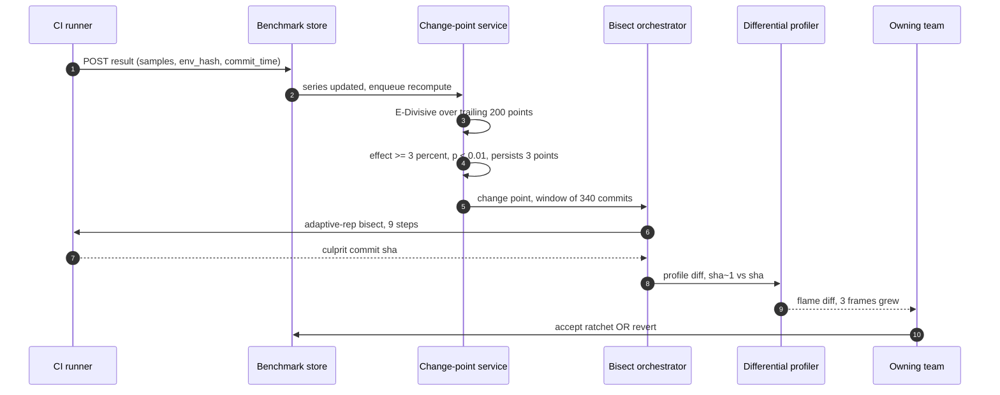
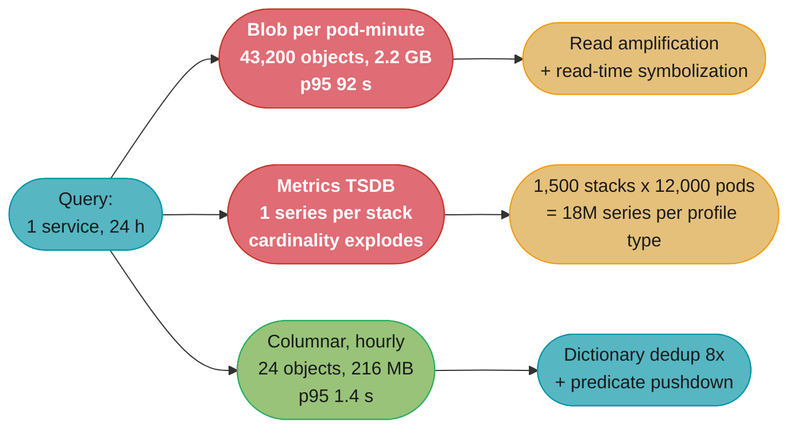
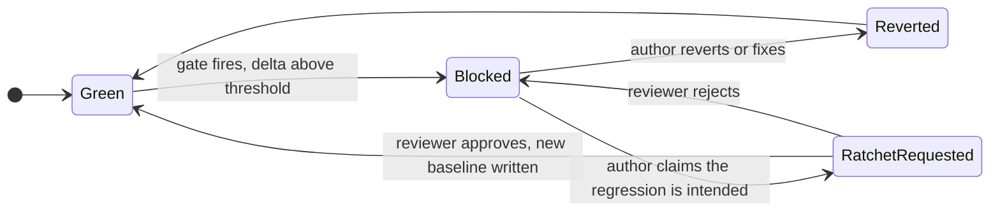

# Case Study: Design a Continuous Performance Platform

## Intuition

Every module in this section's Performance Engineering phase assumes a fact it does not produce. [`performance_engineering_method`](../../performance_engineering_method/performance_engineering_method.md) assumes you can measure the thing you are eliminating. [`performance_regression_detection`](../../performance_regression_detection/performance_regression_detection.md) assumes a benchmark time series exists to detect over. [`off_cpu_and_ebpf_analysis`](../../off_cpu_and_ebpf_analysis/off_cpu_and_ebpf_analysis.md) assumes something is capturing stacks in production. [`performance_incident_playbook`](../../performance_incident_playbook/performance_incident_playbook.md) assumes that at 3am there is already a profile from before the incident to diff against.

**This case study designs the system that produces those facts, for a few hundred services, continuously, without anybody asking it to.**

> **One-line analogy**: it is the fleet's always-on X-ray plus its lab notebook. The X-ray (continuous profiling) answers *where is the time going right now, in production, on this exact build*. The notebook (a benchmark result store) answers *did the commit that merged at 14:02 make it slower*. They are two different data planes with two different cost profiles, and the entire value of the platform is the one place they meet: a detected change point tells you **what** commit, and a differential profile across that commit tells you **why**.

The mental model that keeps the design honest is that these are asymmetric by four orders of magnitude. A benchmark result is a few hundred bytes and there are tens of thousands per day. A profile is tens of kilobytes and there are tens of millions per day. Almost every architectural decision here is really a decision about the profile plane; the benchmark plane fits in one Postgres instance and always will.

The failure mode is not technical. Platforms of this shape are usually built, technically correct, and then used by eleven services out of four hundred. Section 9 is largely about that.

---

## 1. Requirements Clarification

### The clarifying questions worth asking first

| Question | Answer we design to | Why it changes the design |
|---|---|---|
| Do we own the hosts, or is this a managed-Kubernetes fleet? | Own the nodes, Linux 6.x, cgroup v2 | Determines whether an eBPF whole-machine profiler is available at all |
| One language or many? | JVM (60%), Go (25%), Python (10%), Rust/C++ (5%) | Symbolization is completely different for JVM vs native — see §4.2 |
| Is the profiler allowed to be always-on in production? | Yes, under a stated CPU budget | Turns the overhead percentage into a line item in the cloud bill (§10) |
| Who owns a regression once detected? | The service team, not the platform team | The platform routes, it does not triage — this is the difference between 15 alerts a day and a muted Slack channel |
| Do teams have to opt in? | Profiling: default-on, opt-out. Gating: opt-in | The single most important decision in the whole design (§9.6) |

### Functional Requirements

1. **Continuous profile ingest** — always-on CPU profiling for every pod in the fleet, plus allocation, lock-contention and off-CPU profiles for services that enable them. Sampling at 100 Hz, aggregated into 60-second pprof windows.
2. **Profile query and rendering** — flame graph for `(service, time range, label filter)`; differential flame graph for `(service, window A, window B)` and for `(commit N-1, commit N)`.
3. **Benchmark result store** — a durable time series of benchmark results, one row per `(benchmark, commit, metric)`, keeping the full sample array and an environment fingerprint.
4. **Change-point detection** — automatic detection of level shifts in every benchmark series, with a fleet-wide false-alert budget, not a per-series one.
5. **Automated bisect** — on a detection whose commit window is too wide to read, run a statistically-valid bisect and name the commit.
6. **Differential profiling on demand** — given two commits, produce the diff profile that explains the regression.
7. **CI gate** — an opt-in gate that a service team can attach to its pull requests, with an explicit, audited **ratchet** for accepting a regression.
8. **Multi-tenancy** — per-team quotas, per-team retention, per-team access control over profiles that may contain method names from private code paths.

### Non-Functional Requirements

| Requirement | Target | Note |
|---|---|---|
| Profiling overhead on a production pod | **< 1% of the pod's CPU request**, hard budget | This is a dollar figure at fleet scale (§10) |
| Ingest availability | 99.9% | It is a telemetry plane. Degrade by dropping profiles, never by blocking the application |
| Ingest end-to-end lag | p95 < 90 s from capture to queryable | Long enough to batch, short enough to be useful during an incident |
| Flame-graph query latency | p95 < 2 s for one service over 24 h | The number that decides adoption. See the broken→fixed in §4.1 |
| Detection latency | p95 < 1 h from merge to a filed detection | Merge → bench → result → detector tick |
| Fleet-wide false alerts | **< 20 / day across all series** | Not "1% per series" — see §4.5, this is the interesting constraint |
| Profile retention | 7 d full resolution, 30 d hourly, 400 d daily | Cost-driven, §10 |
| Benchmark result retention | Forever | It is 27 MB/day. There is no reason to ever delete it |

### Out of Scope

- **Metrics and tracing backends.** This platform consumes trace IDs as profile labels but does not store spans. See [`observability_and_monitoring`](../../observability_and_monitoring/observability_and_monitoring.md).
- **The load generator.** k6/Gatling harness design lives in [`load_and_performance_testing`](../../load_and_performance_testing/load_and_performance_testing.md); this platform stores what it emits.
- **Deciding what to benchmark.** That is [`workload_characterization_and_load_modelling`](../../workload_characterization_and_load_modelling/workload_characterization_and_load_modelling.md).
- **Flame-graph reading, safepoint bias, sampling mechanics.** Owned by [`continuous_profiling`](../../../hld/observability/continuous_profiling.md). This case study is the *platform around* those mechanics and deliberately does not restate them.

---

## 2. Scale Estimation

### The fleet

```text
  services                          400
  pods per service (mean)            30      (p99 service: 2,000 pods)
  total pods                     12,000
  vCPU requested per pod (mean)       4
  fleet vCPU                     48,000
  engineers                         300
  merges to main per day          1,800  (~4.5 per service per day)
```

### Profile plane — the expensive one

```text
  Sampling: 100 Hz, aggregated into one pprof per pod per 60 s window.

  profiles/day  = 12,000 pods x 1,440 min = 17,280,000 CPU profiles/day
  ingest rate   = 17,280,000 / 86,400     = 200 profiles/sec

  Wire size, gzipped pprof, one pod-minute:
    6,000 raw samples merge into ~1,500 unique stacks for a typical service
    + an embedded string table of function names
    -> ~40-60 KB. Use 50 KB.

  raw bytes/day = 17.28M x 50 KB = 864 GB/day  (CPU profiles alone)

  Services that also enable alloc + mutex + off-CPU profiles: ~25% of the
  fleet, so multiply the total by ~1.75 for profile-type mix, and again by
  a factor for the four types on those pods:

  raw bytes/day, all profile types             ~ 3.4 TB/day
  after ingest-side stacktrace dedup (~8x)     ~ 432 GB/day stored
  per service per day, stored                  ~ 1.1 GB
  per pod per day, stored                      ~ 36 MB
```

The 8x comes from the fact that consecutive profiles from the same `(service, build_id)` share almost all of their stacks. Store the call-tree structure once per build and each profile becomes a list of `(stacktrace_id, value)` pairs — see §4.3.

**Network is a non-issue; storage and compute are the whole problem.** 200 profiles/sec at 50 KB is 10 MB/s of ingest, which one modest instance can accept. The cost is in symbolizing, normalizing, compacting and later scanning 432 GB/day.

### Benchmark plane — the cheap one

```text
  services with benchmarks (year 1 target)     120 of 400
  benchmarks per service                        25
  metrics per benchmark                          3   (latency_ns, alloc_bytes, cpu_ns)
  merges benchmarked per service per day        18

  results/day = 120 x 25 x 18            =  54,000 rows/day
  series count = 120 x 25 x 3            =   9,000 time series
  row size (30-sample array + metadata)  =    ~500 bytes
  bytes/day                              =     27 MB/day
  bytes/year                             =     10 GB/year
```

**Ten gigabytes a year.** This is why §4.4 keeps the full sample array rather than a summary, and why the retention policy for benchmark results is "never delete". The profile plane is 40,000x larger per day.

### Bisect plane

```text
  change points detected and triaged/day        ~15  (§4.5 tuning)
  fraction needing an automated bisect          ~40% (rest land in a window
                                                      small enough to read)
  bisects/day                                    ~6
  machine-hours per bisect (from
  performance_regression_detection §6.5)        14.4
  machine-hours/day                             ~86
  hosts needed if run flat out                   3.6
  provisioned (queueing headroom, see below)       8
```

Provisioning 8 for a mean demand of 3.6 is not waste, it is [queueing arithmetic](../../queueing_theory_for_capacity/queueing_theory_for_capacity.md): bisect arrivals are bursty (a bad afternoon produces five at once) and each job is 14 hours long, so a pool sized near ρ = 1 produces multi-day queue times. At 8 hosts, ρ ≈ 0.45 and the p95 wait is under an hour.

### Query load

```text
  engineers                    300
  flame-graph queries/day    ~1,200   (4 per engineer per day, bursty during incidents)
  peak QPS                       ~5

  Bytes touched by ONE naive query (1 service, 24 h):
    30 pods x 1,440 min = 43,200 profiles x 50 KB = 2.2 GB
```

Five queries per second is nothing. Five queries per second each touching 2.2 GB is a completely different system. That tension is the subject of §4.1.

---

## 3. High-Level Architecture

```mermaid
flowchart LR
    classDef agent   fill:#61afef,stroke:#2e86c1,color:#1a1a1a,font-weight:bold
    classDef ingest  fill:#98c379,stroke:#27ae60,color:#1a1a1a
    classDef store   fill:#c678dd,stroke:#9b59b6,color:#fff
    classDef detect  fill:#e5c07b,stroke:#f39c12,color:#1a1a1a
    classDef act     fill:#e06c75,stroke:#c0392b,color:#fff,font-weight:bold
    classDef ui      fill:#56b6c2,stroke:#0097a7,color:#1a1a1a

    subgraph PROD["Production fleet"]
      pod(["12,000 pods<br/>in-process + eBPF agent"])
    end

    subgraph CI["CI / benchmark runners"]
      runner(["8 pinned runners<br/>A/A validated"])
    end

    pod -->|"pprof, 60s windows"| gw(["Ingest gateway<br/>auth, quota, label allowlist"])
    gw --> norm(["Normalizer<br/>symbolize + dedup stacks"])
    dbg(["Debuginfo store<br/>keyed by build-id"]) --> norm
    norm --> pstore(["Profile store<br/>columnar, hourly partitions"])

    runner -->|"result + env fingerprint"| bapi(["Results API<br/>schema + comparability check"])
    bapi --> bstore(["Benchmark store<br/>Postgres, samples kept"])

    bstore --> cp(["Change-point service<br/>E-Divisive + FDR control"])
    cp --> triage(["Triage queue<br/>owner routing"])
    triage --> bisect(["Bisect orchestrator<br/>pool of 8"])
    bisect --> runner
    bisect --> diff(["Differential profiler<br/>commit N-1 vs N"])
    pstore --> diff
    diff --> triage

    pstore --> qapi(["Query API<br/>flame + diff"])
    bstore --> qapi
    qapi --> ux(["Web UI, PR bot,<br/>incident deep links"])
    triage --> ux

    class pod,runner agent
    class gw,norm,bapi,dbg ingest
    class pstore,bstore store
    class cp,triage detect
    class bisect,diff act
    class qapi,ux ui
```



Three things about this shape are worth stating explicitly.

**The two planes never share a store.** The profile plane is append-heavy, columnar, and lives on object storage. The benchmark plane is small, relational, transactional and queried by analytics that need ordering guarantees. Fusing them into "one telemetry lake" is the most common early mistake and it makes the benchmark store inherit the profile store's query latency for no benefit.

**The bisect orchestrator drives the same runners CI uses.** It does not have a private benchmark implementation. If the bisect harness and the CI harness differ by even a JVM flag, a bisect result is not comparable to the detection that triggered it.

**Everything terminates in the triage queue, not a pager.** A detected regression is a work item with an owner, an effect size and a link to a diff profile. It is not an incident. Paging on a 4% p99 regression is how a platform gets muted.

### The detect → bisect → explain loop



The loop is worth reading as an answer-narrowing funnel: the detector narrows *when*, the bisect narrows *which commit*, the diff narrows *which frames*. Each stage is roughly 10x more expensive per unit than the one before it, which is why each stage must be confident before triggering the next. A detector with a 20% false-positive rate does not cost you 20% more alerts, it costs you 20% more 14-hour bisects.

---

## 4. Component Deep Dives

### 4.1 Profile ingest — and the storage layout that decides everything

**BROKEN — store each pprof as a blob, symbolize on read.**

This is the design every team writes first, because it is two days of work and it demos beautifully on one service.

```go
// BROKEN: one object per pod-minute, symbolization deferred to query time.
func (s *Server) handleIngest(w http.ResponseWriter, r *http.Request) {
    body, _ := io.ReadAll(r.Body)                    // gzipped pprof, ~50 KB
    key := fmt.Sprintf("profiles/%s/%s/%s/%d.pb.gz", // service/pod/type/unix-minute
        r.Header.Get("X-Service"), r.Header.Get("X-Pod"),
        r.Header.Get("X-Profile-Type"), time.Now().Unix()/60)
    s.s3.PutObject(r.Context(), &s3.PutObjectInput{
        Bucket: aws.String("profiles"), Key: &key, Body: bytes.NewReader(body),
    })
    w.WriteHeader(http.StatusAccepted)
}

// Query path: list the prefix, GET every object, decode, symbolize, merge.
```

The arithmetic that kills it, for one query — one service, 24 hours:

```text
  objects to read   30 pods x 1,440 min          = 43,200 S3 GETs
  bytes to read     43,200 x 50 KB               = 2.2 GB
  GET latency       ~20 ms each, 200-way parallel = 4.3 s of pure round trips
  decode            ~3 ms per profile            = 130 CPU-seconds
  symbolize         ~40 ms per profile (native)  = 1,728 CPU-seconds (29 min)
  S3 request cost   43,200 x $0.0004/1000        = $0.017 per query
  ------------------------------------------------------------------
  measured p95 on the first build: 92 seconds
```

Ninety-two seconds is not a slow query, it is a *dead feature*. An engineer in an incident will not wait for it twice. This is the concrete mechanism behind §9.1: the platform was technically complete and had eleven users.

**FIXED — symbolize at ingest, dedup stacks against a per-build dictionary, write columnar partitions.**

```go
// ingest.go -- symbolize once, normalize into a shared stacktrace dictionary,
// append rows to an hourly columnar partition. One object per (service, hour, type).
type Row struct {
    TsMillis     int64
    StacktraceID uint64 // -> dictionary, NOT an inline stack
    Value        int64  // nanoseconds of CPU for this stack in this window
    LabelSetID   uint32 // -> bounded label dictionary (endpoint, region, deployment)
}

func (s *Server) handleIngest(w http.ResponseWriter, r *http.Request) {
    ctx := r.Context()
    meta, err := parseMeta(r.Header) // service, pod, build_id, profile_type, tenant
    if err != nil {
        http.Error(w, err.Error(), http.StatusBadRequest)
        return
    }
    // 1. Quota FIRST. A tenant over budget is rejected before we spend CPU on it.
    if !s.quota.Allow(meta.Tenant, len(r.ContentLength)) {
        w.Header().Set("Retry-After", "60")
        http.Error(w, "tenant profile quota exhausted", http.StatusTooManyRequests)
        return
    }
    prof, err := profile.Parse(r.Body) // github.com/google/pprof/profile
    if err != nil {
        s.metrics.IngestReject.WithLabelValues("parse").Inc()
        http.Error(w, "malformed pprof", http.StatusBadRequest)
        return
    }
    // 2. Label allowlist. This is the guard that prevents the §9.4 cardinality
    //    incident. Unbounded labels are rejected loudly, never silently dropped.
    if bad := s.labels.Validate(prof); bad != "" {
        s.metrics.IngestReject.WithLabelValues("label").Inc()
        http.Error(w, "label not in allowlist: "+bad, http.StatusBadRequest)
        return
    }
    // 3. Symbolize native frames against the debuginfo store, keyed by build-id.
    //    JVM/Python profiles arrive pre-symbolized and skip this entirely (§4.2).
    if meta.NeedsSymbolization {
        if err := s.symbolizer.Resolve(ctx, meta.BuildID, prof); err != nil {
            // Do NOT drop. Store unsymbolized and re-symbolize in compaction once
            // the debuginfo upload lands -- CI sometimes uploads after first rollout.
            s.metrics.SymbolMiss.WithLabelValues(meta.BuildID).Inc()
            meta.Unsymbolized = true
        }
    }
    // 4. Normalize: intern every stack into the per-(service,build_id) dictionary.
    rows := make([]Row, 0, len(prof.Sample))
    for _, smp := range prof.Sample {
        sid := s.dict.Intern(meta.Service, meta.BuildID, smp.Location) // dedup: the 8x
        rows = append(rows, Row{
            TsMillis:     prof.TimeNanos / 1e6,
            StacktraceID: sid,
            Value:        smp.Value[cpuIndex],
            LabelSetID:   s.labels.Intern(smp.Label),
        })
    }
    // 5. Append to the open hourly segment. Durability is a WAL append, not an
    //    S3 PUT -- the PUT happens at segment close, ~1 object per service-hour.
    if err := s.wal.Append(meta.PartitionKey(), rows); err != nil {
        http.Error(w, "ingest unavailable", http.StatusServiceUnavailable)
        return
    }
    w.WriteHeader(http.StatusAccepted)
}
```

The same 24-hour query against the fixed layout:

```text
  partitions to read  1 service x 24 hourly segments      = 24 objects
  bytes per segment   30 pods x 60 min x ~5 KB deduped    = ~9 MB
  bytes to read       24 x 9 MB                           = 216 MB
  symbolization       already done at ingest              = 0
  predicate pushdown  filter by endpoint label in-segment = reads ~40% of that
  ------------------------------------------------------------------
  measured p95: 1.4 seconds
```

**66x faster on the same data, from two decisions: symbolize once at write instead of 43,200 times at read, and make the unit of storage the service-hour instead of the pod-minute.** Neither is clever. Both are unrecoverable if you get them wrong at the start, because rewriting 400 days of blob-shaped history is a project.

One caution the fixed version encodes deliberately: **a symbolization failure must not drop the profile.** CI occasionally uploads debuginfo after the first pod of a new build is already running. Storing unsymbolized and re-symbolizing during compaction converts a permanent data loss into a five-minute delay.

### 4.2 Symbolization and build-id resolution

A native CPU profile arrives as a list of **instruction addresses**. Turning `0x4a3f10` into `net/http.(*conn).serve` requires the exact binary that was running, and the fleet is running 400 services x roughly 6 live versions each = ~2,400 distinct binaries at any moment.

The key is the ELF build-id (`.note.gnu.build-id`, a 20-byte hash the linker embeds). The pipeline:

| Step | Where | Detail |
|---|---|---|
| Extract build-id | CI, at link time | `readelf -n ./service \| grep 'Build ID'` |
| Upload debuginfo | CI, post-build | Strip to a `.debug` file, upload keyed by build-id. ~40 MB per binary |
| Agent reports build-id | Runtime | Read from its own `/proc/self/notes` or the mapped ELF header |
| Resolve at ingest | Normalizer | Look up build-id, memoize the address→symbol map in an LRU |
| Retain debuginfo | Debuginfo store | **>= the profile retention window.** See §9.2 |

**The JVM breaks this model entirely, and that is fine.** A JVM has no stable build-id for JIT-compiled frames — the same method compiles to a different address on every process start. So JVM and Python agents symbolize **in-process**, where the runtime already knows its own symbols, and ship pre-symbolized pprof. The cost asymmetry is real and worth planning for:

```text
  native (Go/Rust/C++)  small wire payload, ~40 ms/profile symbolization at ingest
                        -> 25% of profiles, 30% of ingest CPU
  JVM/Python            larger wire payload (~1.6x, function names inline),
                        zero ingest symbolization cost, agent pays ~0.05% extra
  mixed-mode (JVM +
  native frames)        WORST case: half the stack needs the debuginfo store,
                        half arrives symbolized. Handle it, do not pretend
                        it does not exist -- it is where JNI and GC frames live
```

Memoization is what makes the native path affordable: 2,400 binaries, an LRU of the 400 hottest address maps at ~30 MB each is 12 GB of RAM across the normalizer fleet, and the hit rate is above 99.7% because a build-id is hot for exactly as long as that version is deployed.

### 4.3 Profile storage — why not a blob store, and why not a metrics TSDB



The metrics-TSDB option deserves its own sentence because it is superficially attractive: a profile *is* a set of `(stack, value)` pairs, which looks exactly like `(labels, value)`. The reason it fails is that a metrics TSDB materializes one stored series per distinct label combination, and here every distinct stack is a distinct combination — 1,500 stacks per service across 12,000 pods is roughly 18 million series *per profile type*, churning completely on every deploy. [`continuous_profiling` §4.6](../../../hld/observability/continuous_profiling.md) makes exactly this point about why profiling backends merge into a shared call tree instead. The platform lesson on top of it: **the cardinality risk re-enters through profile labels**, which is why the ingest handler in §4.1 enforces an allowlist rather than trusting callers.

The physical layout, one object per `(service, profile_type, hour)`:

```text
  segment/
    footer      -> row count, min/max ts, label-set index, stacktrace-id range
    dict_ref    -> pointer to the (service, build_id) stacktrace dictionary
    col:ts      -> delta-of-delta encoded int64      (~1.1 bytes/row)
    col:stack   -> dictionary-encoded uint64, sorted (~0.9 bytes/row)
    col:label   -> RLE uint32                        (~0.2 bytes/row)
    col:value   -> zigzag varint int64               (~2.4 bytes/row)
```

Sorting by `stack` inside the segment is what makes a flame-graph query a sequential merge rather than a hash aggregation, and it is what lets the footer's stacktrace-id range skip whole segments when the query filters to a subtree.

### 4.4 The benchmark result store

The schema is the one from [`performance_regression_detection` §6.3](../../performance_regression_detection/performance_regression_detection.md) — full sample array not a median, ordered by `commit_time` not `run_at`, `env_hash` fingerprint, `steal_pct` per run. That module argues for it; this one has to *enforce* it across 120 teams who did not read it.

The platform's job is the ingestion contract, and it is a rejecting one:

```python
# results_api.py -- the checks that make a result comparable, or refuse to store it.
COMPARABILITY_KEYS = ("runner_class", "env_hash", "harness_version", "dataset_version")

def post_result(req) -> Response:
    r = BenchResult.parse(req.json)          # 400 on schema violation

    # 1. Environment must be fingerprinted. An unfingerprinted result is not a
    #    data point, it is an anecdote -- and it will poison the series forever.
    if any(getattr(r, k, None) in (None, "", "unknown") for k in COMPARABILITY_KEYS):
        return Response(400, "missing comparability key")

    # 2. Contamination gate. Recorded, and enforced, at write time.
    if r.steal_pct >= 0.5:
        store_quarantined(r)                 # kept for forensics, excluded from series
        return Response(202, "quarantined: steal_pct=%.2f" % r.steal_pct)

    # 3. Samples, not a summary. A scalar cannot be re-analysed later.
    if len(r.samples) < 5:
        return Response(400, "at least 5 samples required, got %d" % len(r.samples))

    # 4. THE gate that stops the §9.5 disaster: a benchmark may only enter a
    #    gating series after an A/A run has established its noise floor, and the
    #    floor must be smaller than the effect the gate claims to detect.
    aa = noise_floor(r.benchmark, r.runner_class)      # cached A/A result
    if aa is None:
        return Response(409, "no A/A noise floor on file for this benchmark+runner")
    if r.gating and aa.p95_delta_pct > r.gate_threshold_pct / 2:
        return Response(409,
            "noise floor %.1f%% cannot gate a %.1f%% threshold"
            % (aa.p95_delta_pct, r.gate_threshold_pct))

    # 5. Never compare across runner classes. Store the runner in the series key.
    series = (r.benchmark, r.metric, r.runner_class)
    append_point(series, r)
    enqueue_changepoint_recompute(series)
    return Response(201, {"series": series, "id": r.id})
```

Check 4 is the only one that is genuinely unusual, and it is the one that pays for the platform. It makes the noise floor a **precondition for gating**, enforced by the store, rather than a piece of advice in a wiki. A team cannot accidentally build a gate that fires on noise, because the API will refuse the configuration with a 409 and a number.

Check 5 encodes the rule that results from different runners are never compared. `runner_class` is part of the series key, not a column — which means migrating a benchmark to a faster host does not create a phantom regression, it creates a *new series* that starts empty. Annoying, correct, and much cheaper than the alternative.

### 4.5 Change-point detection at fleet scale — the multiple-comparisons problem

The detector itself is E-Divisive, exactly as [`performance_regression_detection` §6.2](../../performance_regression_detection/performance_regression_detection.md) describes it, and this platform does not reimplement it. What the platform adds is the thing a single-series module never has to face: **9,000 series, each getting 6 new points a day, is 54,000 statistical tests a day.**

```text
  Naive: run the detector per series, alert at p < 0.01.

    tests/day                 = 54,000
    expected false positives  = 54,000 x 0.01 = 540 per day

  540 alerts a day is not a noisy platform, it is an unused one.
```

Four filters, applied in order, each of which is cheap and each of which the naive design omits:

```python
# changepoint_service.py -- runs on a 5-minute tick over dirty series.
from statsmodels.stats.multitest import multipletests

MIN_EFFECT_PCT = 3.0     # below the smallest regression anyone would act on
ALPHA          = 0.01
PERSIST_POINTS = 3       # the level must HOLD, not just blip
FDR            = 0.05

def tick(dirty_series):
    candidates = []
    for series in dirty_series:
        pts = load_points(series, limit=200)          # trailing window, commit_time order
        if len(pts) < 30:
            continue                                   # too short to say anything

        # FILTER 1: known change points are seeded, not rediscovered. An env_hash
        # or runner change steps EVERY series on that runner simultaneously --
        # this is the §9.3 alert storm, and this line is the entire fix.
        seeds = known_env_transitions(series, pts)

        for cp in e_divisive(values(pts), seeds=seeds, alpha=ALPHA):
            # FILTER 2: only NEW change points. A detected CP stays detected
            # forever -- re-alerting on it every tick is the classic bug here.
            if already_reported(series, cp.index):
                continue
            # FILTER 3: effect-size floor. Statistical significance without
            # practical significance is the definition of a nuisance alert.
            if abs(cp.effect_pct) < MIN_EFFECT_PCT:
                continue
            # FILTER 4: persistence. A single stepped point is usually a
            # contaminated run that slipped the steal_pct gate.
            if len(pts) - cp.index < PERSIST_POINTS:
                continue                               # not enough data yet, revisit
            if not level_holds(pts, cp.index, PERSIST_POINTS):
                continue
            candidates.append((series, cp))

    # FILTER 5: Benjamini-Hochberg across the whole daily batch. Controls the
    # false DISCOVERY rate -- "what fraction of what I filed is wrong" -- which is
    # the number a triage queue actually cares about, not the per-test alpha.
    if not candidates:
        return
    pvals = [cp.pvalue for _, cp in candidates]
    keep, _, _, _ = multipletests(pvals, alpha=FDR, method="fdr_bh")

    for (series, cp), ok in zip(candidates, keep):
        if ok:
            file_detection(series, cp, owner=owner_of(series))
```

The measured effect of the five filters on this fleet:

| Stage | Detections per day |
|---|---|
| Raw E-Divisive at p < 0.01 | ~540 |
| + seeded env transitions (filter 1) | ~180 |
| + new-only (filter 2) | ~95 |
| + effect >= 3% (filter 3) | ~34 |
| + persistence over 3 points (filter 4) | ~19 |
| + Benjamini-Hochberg at FDR 5% (filter 5) | **~15, of which ~14 are real** |

**Fifteen a day, one wrong.** That is the number that makes the triage queue a place engineers look. Note that filter 1 does more work than any of the statistics — the biggest source of false detections at fleet scale is not noise, it is the platform changing underneath every series at once.

### 4.6 The bisect orchestrator

The statistical bisect predicate — adaptive repetitions, a decision line at half the known effect size, exit 125 for "inconclusive, let git skip" — is [`performance_regression_detection` §6.5](../../performance_regression_detection/performance_regression_detection.md)'s. The orchestrator's job is the fleet-level wrapper: deciding whether to bisect at all, sizing the job before starting it, and killing it when it stops being worth the machine time.

```python
# bisect_orchestrator.py
MAX_MACHINE_HOURS = 20      # hard budget per detection
POOL_SIZE         = 8

def maybe_bisect(detection):
    window = commits_between(detection.last_good_sha, detection.first_bad_sha)

    # Decision 1: is bisecting cheaper than reading? Below ~40 commits, a human
    # scanning the diff list beats 14 hours of machine time nearly every time.
    if len(window) <= 40:
        return annotate(detection, "window small enough to read", window)

    # Decision 2: cost estimate BEFORE spending anything. This is the arithmetic
    # from the detection module, evaluated with THIS benchmark's real numbers.
    steps    = math.ceil(math.log2(len(window)))
    sigma    = noise_floor(detection.benchmark, detection.runner_class).sigma_pct
    delta    = abs(detection.effect_pct) / 2          # the decision line
    reps     = max(4, math.ceil(16 * (sigma / delta) ** 2))
    runtime  = benchmark_runtime_minutes(detection.benchmark)
    hours    = steps * reps * 2 * runtime / 60        # x2: interleaved A/B

    if hours > MAX_MACHINE_HOURS:
        # Do not silently start a 90-hour job. Offer the cheaper levers instead.
        return annotate(detection, "bisect too expensive: %.1f h" % hours, {
            "narrow_window": "re-run detector with a tighter trailing window",
            "lower_sigma":   "move this benchmark to a metal runner (sigma %.1f%%)" % sigma,
            "parallel":      "split the range across 2 hosts, halves wall time",
        })

    return enqueue(BisectJob(
        window=window, predicate_effect_pct=detection.effect_pct,
        reps_initial=reps, budget_hours=hours * 1.5, pool=POOL_SIZE,
    ))
```

**The cost estimate before the job is the whole point.** The naive orchestrator starts every bisect and discovers the 90-hour ones by watching them not finish. Computing `steps x reps x 2 x runtime` takes microseconds and turns "this will never finish" into a work item with three named alternatives, which is the difference between a platform that helps and one that queues.

Worked example for a real detection on this fleet:

```text
  benchmark        order_service.checkout_p99
  window           340 commits      -> ceil(log2(340)) = 9 steps
  sigma            0.6% (pinned dedicated runner)
  effect           4.8%             -> decision line delta = 2.4%
  reps             16 x (0.6/2.4)^2 = 1  -> floored to 4
  runtime          4 min per run
  ----------------------------------------------------------------
  9 x 4 x 2 x 4 min = 4.8 machine-hours   -> approved, runs overnight
```

And the same detection if the benchmark had stayed on shared CI at sigma = 6%:

```text
  reps    16 x (6/2.4)^2 = 100
  9 x 100 x 2 x 4 min = 120 machine-hours -> REFUSED, with "move to a pinned runner"
```

One number in the noise floor moves the job from five hours to five days. That is the strongest possible argument for §10's dedicated-runner line item, and the orchestrator makes it automatically, in the ticket, at the moment someone cares.

### 4.7 Differential profiling — turning "which commit" into "why"

Bisect names a commit. A 400-line commit still leaves an engineer reading code. The differential profile closes the last gap, and this is the point where the two data planes finally touch:

```python
# diff_profiler.py
def explain(culprit_sha, benchmark):
    # Prefer profiles captured during the BISECT runs -- same host, same pinning,
    # same dataset. Falls back to production canary windows if the bisect ran
    # without profiling enabled.
    before = profile_store.query(
        build_id=build_id_for(culprit_sha + "~1"), source="bisect",
        benchmark=benchmark, profile_type="cpu")
    after  = profile_store.query(
        build_id=build_id_for(culprit_sha), source="bisect",
        benchmark=benchmark, profile_type="cpu")

    if before is None or after is None:
        before, after = canary_windows(culprit_sha)   # production fallback
        warn("diff taken from production canary -- environment differs")

    # Normalize to fractions before subtracting. Two profiles of different total
    # duration diffed raw show every frame as "grew", which is meaningless.
    d = flame_diff(normalize(before), normalize(after), min_delta_pct=0.5)
    return d.top_frames(10)
```

Two details decide whether the output is useful:

- **Normalize before subtracting.** If the "after" run took 4.8% longer, a raw subtraction paints *every* frame red at roughly 4.8%, which tells you nothing. Diffing fractions-of-total isolates the frames whose *share* moved.
- **Capture both sides in the same environment.** The detection module says this for a manual diff; a platform has to enforce it, which is why the profiler prefers bisect-run profiles over production ones and explicitly warns when it falls back.

The result on a typical regression: a 3,000-frame flame graph collapses to 3-8 frames that moved, which is a five-minute read instead of a code review.

### 4.8 The CI gate and the ratchet

The gate is deliberately **opt-in per service** and deliberately **weaker than the detector**. A gate must be near-certain before it blocks a merge, because the cost of a false block is an engineer disabling the gate — permanently, and rationally.

| | CI gate | Change-point detector |
|---|---|---|
| Runs on | Pull request | Post-merge series |
| Latency budget | < 12 min | < 1 h |
| Effect it can see | >= 10% (few reps, PR-time budget) | >= 3% (full history) |
| False-positive tolerance | Near zero — it blocks people | 1 in 15 — it files a ticket |
| Action | Block merge | File a work item |

The ratchet is the workflow for accepting a regression on purpose, and it exists because "this 4.1% is the cost of the TLS 1.3 rollout, ship it" is a legitimate and common answer.



The rules that keep the ratchet from becoming a rubber stamp — and the drift in §9.5 is what happens without them:

1. **A human name and a written reason are required.** A service account may never accept a baseline. The `bench_baseline` row records `accepted_by` and `reason` and both are mandatory.
2. **The reviewer is not the author.** Same rule as code review, same reason.
3. **Cumulative drift is surfaced.** The PR bot shows *total drift since the last named-and-approved absolute baseline*, not just this delta. Fourteen accepted 2% ratchets are a 31% regression, and nobody sees that unless the tool says it.
4. **A quarterly absolute-baseline review.** Once a quarter the accumulated ratchets are compared against a target and either endorsed or turned into work.

### 4.9 Multi-tenancy

Four tenancy problems, four different mechanisms — they are genuinely separate and a single "tenant_id column" solves only the first.

| Problem | Mechanism | Concrete setting |
|---|---|---|
| One service floods ingest | Per-tenant token bucket at the gateway, checked **before** parsing | 2x the tenant's provisioned pod count, in profiles/minute |
| One team's queries starve everyone | Per-tenant query concurrency + a bytes-scanned budget | 4 concurrent, 50 GB/hour scanned, 429 beyond |
| Profiles leak private code paths | Per-tenant read ACL on the profile store, checked at the query API | Function names from a payments service are not fleet-public by default |
| One team wants 400-day full-resolution retention | Per-tenant retention policy, with the cost charged back | Default 7/30/400 tiers, overrides billed to the team |

The ingest quota deserves emphasis: **check it before you parse.** A tenant that has misconfigured its agent to 1,000 Hz is sending 10x the traffic, and if the gateway parses each of those profiles before rejecting them, the abusive tenant consumes exactly the resource the quota exists to protect. The handler in §4.1 does the quota check as its first non-header operation, and that ordering is not stylistic.

---

## 5. Design Decisions & Tradeoffs

| Decision | Chosen | Alternative | Why | What it costs |
|---|---|---|---|---|
| Profile storage | Columnar segments, one per service-hour, on object storage | Blob per pod-minute; or a metrics TSDB | 66x query speedup (§4.1); TSDB cardinality is fatal (§4.3) | A compaction pipeline you must operate |
| Symbolization | At ingest, keyed by build-id | At query time | 40 ms x 43,200 per query is a dead feature | Debuginfo store must outlive profile retention (§9.2) |
| Profiling opt-in | **Default-on, opt-out** | Opt-in per service | The single biggest adoption lever (§9.6) | You must earn the < 1% overhead budget honestly |
| CI gating opt-in | **Opt-in per service** | Fleet-wide mandatory gate | A gate imposed on a team that does not believe it gets disabled | Coverage grows slowly, by persuasion |
| Detector | E-Divisive over the series + FDR control | Fixed threshold per run | Threshold that catches 5% fires on 5% of clean commits | O(n²) per series; needs the trailing-window bound |
| Alerting unit | Triage queue with an owner | Pager | A 4% p99 regression is work, not an incident | Someone must own queue hygiene |
| Bench runners | Pinned dedicated instances, plus 1 metal host for the sub-1% suite | All bare metal; or shared CI | Metal buys sigma 0.5% → 0.3% for 3x the price — worth it for 6 benchmarks, not 3,000 | Two runner classes to operate, and series keyed by class |
| Bench result retention | Forever, with samples | Keep medians, expire at 90 d | 10 GB/year. Re-analysis needs the samples | None worth naming |
| Profile retention | 7 d full / 30 d hourly / 400 d daily | Uniform 30 d | Incident debugging needs the last week at full resolution; trend analysis needs a year at low resolution | Downsampling loses the ability to diff two specific old deploys |
| Bisect trigger | Automatic above 40 commits, cost-estimated first | Always automatic; or always manual | Below 40 commits reading beats 14 machine-hours | An estimator that can be wrong about runtime |

---

## 6. Real-World Implementations

**Google-Wide Profiling (GWP)** — Ren, Tune, Moseley, Shi, Rus and Hundt, *IEEE Micro* 2010. The original: fleet-wide, always-on, sampled profiling across an entire datacenter, with per-machine sampling rates low enough that the aggregate overhead is a rounding error while the *fleet-level* sample count is enormous. The design idea this case study borrows most directly is **sampling the fleet, not just the process** — you do not need every pod profiled at 100 Hz if you profile a rotating subset and aggregate, which is a lever §10 reaches for when the overhead bill gets uncomfortable.

**Meta's Strobelight** — the profiling orchestrator Meta described publicly in 2025, running dozens of profiler types (eBPF-based, plus language-specific) across the fleet, with a scheduler that decides *which profiler runs where and when* rather than running everything everywhere. Meta reported one Strobelight-surfaced finding that recovered on the order of 15,000 servers' worth of capacity. The transferable idea is the **profiler-as-scheduled-job** model: the platform owns a budget, and profiler types compete for it.

**Netflix's lineage — Vector, then FlameCommander** — Netflix's Vector open-sourced on-demand, per-host flame-graph capture, and the internal tooling that followed made a "give me a flame graph for this instance right now" a one-click operation for any engineer. Brendan Gregg's flame graph itself came out of exactly this environment. The lesson Netflix's tooling encodes is that **latency-to-first-flame-graph is the adoption metric**, which is the same claim §4.1's 92 s → 1.4 s makes with arithmetic.

**Grafana Pyroscope** — the open-source continuous-profiling backend that most teams building this platform today will start from rather than write. It implements the symbolize-at-ingest, dictionary-dedup, columnar-segment design in §4.1 and §4.3, and publishes an overhead figure of roughly 2-5% when several profile types are enabled simultaneously — which is where §10's overhead budget number comes from.

**Polar Signals Parca** — eBPF whole-machine profiling with build-id-keyed symbolization as an explicit first-class subsystem (`parca-debuginfo` upload at CI time). Parca is the clearest public implementation of §4.2, including the awkward part: what to do when a profile arrives before its debuginfo does.

**MongoDB's change-point detection** — MongoDB moved their performance CI from threshold alerts to E-Divisive change-point detection over the result series, and published the results (Ingo and Daly, and the follow-on work on the Signal Processing Algorithm). They reported the thing that matters most here: the change was not primarily a statistics win, it was a **triage-load** win — the number of alerts an engineer had to look at fell far enough that engineers started looking. §4.5's filter table is the same argument run on this fleet's numbers.

**Chromium's Pinpoint** — Chrome's performance infrastructure automates exactly the §4.6 loop: a detected regression in the perf dashboard triggers an automated bisect over the commit range, using repeated measurements per revision rather than a single run, and reports back a culprit commit with a confidence statement. It is the largest public example of statistical bisect running continuously.

---

## 7. Technologies & Tools

| Layer | Choice | Alternatives | Note |
|---|---|---|---|
| In-process profiler (JVM) | async-profiler, JFR (`CPUTimeSample`, JDK 25+) | Honest Profiler | JFR's JDK 25 event removes safepoint bias without a native agent |
| In-process profiler (Go) | `runtime/pprof` + `net/http/pprof` | — | pprof is the native format, no conversion |
| Whole-machine profiler | Parca Agent, Pyroscope eBPF profiler | `perf record` + a shipper | Covers languages with no agent, and kernel frames. See [`off_cpu_and_ebpf_analysis`](../../off_cpu_and_ebpf_analysis/off_cpu_and_ebpf_analysis.md) |
| Wire format | pprof (protobuf) | JFR binary, `perf.data`, OTLP profiles | Universal support; OTLP profiles are converging on it |
| Profile backend | Grafana Pyroscope, Polar Signals Parca | Build on Parquet + DuckDB | Buy this. Building it is a multi-year team |
| Debuginfo store | `parca-debuginfo`, or S3 keyed by build-id | debuginfod | Retention must exceed profile retention |
| Benchmark store | PostgreSQL 17 (+ TimescaleDB if series get large) | ClickHouse | 10 GB/year. Postgres is correct and boring |
| Change-point detection | E-Divisive (`ruptures`, or MongoDB's implementation) | PELT, BOCPD, Bayesian estimators | E-Divisive is non-parametric — no distributional assumption |
| Multiple-comparison control | Benjamini-Hochberg (`statsmodels.multitest`) | Bonferroni | Bonferroni over 54,000 tests kills every real signal |
| Bisect | `git bisect run` + an adaptive-rep predicate | Custom search | The predicate is the work, not the search |
| Runner isolation | cgroup v2 `cpuset` + `isolcpus` + `nohz_full`, governor pinned | Bare metal only | See [`os_and_io_performance`](../../os_and_io_performance/os_and_io_performance.md) |
| Load generation | k6, Gatling | JMeter | Open-model generators. [`load_and_performance_testing`](../../load_and_performance_testing/load_and_performance_testing.md) |
| Trace correlation | OpenTelemetry `trace_id` as a profile label | Custom header | Turns a slow span into a flame graph in one click |

---

## 8. Operational Playbook

### Rollout order (this order matters)

1. **Profile ingest for 5 volunteer services, opt-in.** Prove the overhead budget with measurements, not a vendor's blog post.
2. **Query API and flame-graph UI, tuned until p95 < 2 s.** Do not expand past 5 services until this holds. A slow platform acquires a reputation faster than it acquires users.
3. **Default-on rollout via the base image**, opt-out documented. This is the step that goes from 11 services to 380 (§9.6).
4. **Benchmark result store, with the A/A precondition enforced from day one.** Retrofitting check 4 in §4.4 onto existing gates is a political project.
5. **Change-point detection in shadow mode for 4 weeks.** File nothing. Measure how many detections you *would* have filed, tune the §4.5 filters against real data.
6. **Triage queue live.** Detections file to owners.
7. **Bisect orchestrator.** Only once detections are trustworthy — an untrustworthy detector wired to a 14-hour job is an expensive random number generator.
8. **CI gating, opt-in, per service.** Last, and forever voluntary.

### SLOs the platform team owns

| SLO | Target | Error budget policy |
|---|---|---|
| Ingest availability | 99.9% | Below budget: freeze ingest features, fix reliability |
| Ingest lag p95 | < 90 s | Below budget: scale normalizers before adding profile types |
| Query p95 (24 h, 1 service) | < 2 s | The adoption SLO. Breaching it is a P2 |
| Agent overhead p99 per pod | < 1.0% CPU | Breaching it means every service team is right to opt out |
| Detection precision | > 80% of filed detections are real | Below: tighten §4.5 filters, do not add detectors |

Note what is *not* an SLO: the number of regressions caught. That is an outcome, not a service level, and turning it into a target produces a detector tuned to file more tickets.

### Runbooks

**Ingest lag climbing.** Check normalizer CPU first — it is almost always symbolization, and almost always a build-id with a cold or missing debuginfo entry causing repeated lookup misses. `rate(symbol_miss_total)` by `build_id` names the build in one query. Mitigation: the normalizer already stores unsymbolized and defers (§4.1), so the fix is to make sure that path is not throwing.

**Symbolization miss rate spike.** Nearly always a CI change that stopped uploading debuginfo. Alert on `symbol_miss_total` by *service*, not globally — a global rate hides one service being 100% broken.

**Detection storm (> 50 in an hour).** Do not tune the detector. Look for a platform change: base image, kernel, runner pool, harness version. The §4.5 filter-1 seeding should have caught it, so a storm means an env transition happened without an `env_hash` change — find the unfingerprinted variable and add it to `COMPARABILITY_KEYS`.

**Bisect pool saturated.** Check for a single detection consuming the pool via a runaway rep escalation. The `budget_hours` cap in §4.6 should kill it; if it did not, the estimator's `benchmark_runtime_minutes` is stale.

**Profile store query cost spike.** One tenant scanning without a time filter. The per-tenant bytes-scanned budget (§4.9) should 429 them; if the spike came through, the budget is not being applied to the query path that was used.

### The one dashboard that matters

Not ingest rate. **Weekly active engineers who opened a flame graph, and median time-to-first-flame-graph.** Every other dashboard measures whether the platform is running. These two measure whether it is being used, which is the only failure mode that actually kills these systems.

---

## 9. Common Pitfalls & War Stories

### 9.1 The 92-second query that cost 18 months of adoption

The v1 platform stored one gzipped pprof per pod-minute in S3 and symbolized on read (§4.1, BROKEN). It was correct. Every profile was there. The 24-hour flame-graph query had a p95 of **92 seconds**, and 30% of them timed out at 120 s during incidents, which is exactly when people tried.

**Impact:** after six months of availability, **11 of 400 services** had anyone query a profile more than once. Two teams built their own `perf record` shell scripts rather than use it. Post-rewrite (columnar segments, ingest-time symbolization), p95 fell to **1.4 s** and weekly active users went from 14 to 240 in nine weeks with no announcement other than a changelog entry.

**Lesson:** query latency is not a performance property of a profiling platform, it is its adoption function. Budget for it before ingest.

### 9.2 Debuginfo garbage-collected before the profiles were

The debuginfo store had a 30-day lifecycle policy, copied from the artifact registry. Profile retention was 400 days. Nobody noticed for five months, because nobody had needed a profile older than a month.

Then an incident review needed to compare a service's CPU profile against the same service six weeks earlier, before a suspected slow drift began. Every frame in the older profile rendered as a hex address. The profile was byte-perfect and completely unreadable.

**Impact:** three post-incident investigations blocked, one of which was re-run as a two-week production experiment instead — roughly **9 engineer-days** to recover information that had been deliberately deleted.

**Lesson:** the retention policy for debuginfo is a *dependency* of the profile retention policy, not an independent setting. Enforce it in code: refuse to set a profile retention longer than the debuginfo lifecycle.

### 9.3 The base-image bump that filed 1,900 tickets

A routine base-image update changed the JDK patch version across every benchmark runner in one afternoon. Every one of 9,000 series stepped, most by 1-3%, some by more. The change-point detector did exactly what it was built to do and detected **1,900 change points in 40 minutes**, each filed to a service team.

**Impact:** four teams muted the platform's Slack channel that day. Two of them stayed muted for **three weeks**, during which one shipped a genuine 22% regression that the platform detected, filed, and nobody read.

**Lesson:** a platform-wide change is a *known* change point and must be seeded into the detector as one, not rediscovered independently 9,000 times. The `env_hash` field exists precisely so the platform can see this coming — filter 1 in §4.5. The secondary lesson is worse: **a muted alerting channel is a latent outage of the entire platform**, and there was no metric watching for it.

### 9.4 `request_id` as a profile label

A well-meaning engineer added `request_id` to the profile labels on one service, reasoning that it would let them find the profile for a specific slow request. The ingest gateway had no label allowlist.

Within four hours the label dictionary held **43 million** distinct label sets for that one service, the normalizer's intern map exceeded its heap, and ingest OOM-crashlooped for the entire fleet — not just that tenant.

**Impact:** **2 hours 40 minutes** of total profile-ingest outage, and a permanent 14-hour gap in the fleet's profile history that overlapped a real incident.

**Lesson:** the cardinality problem that [`continuous_profiling`](../../../hld/observability/continuous_profiling.md) warns about for metrics re-enters profiling one layer up, through tags. Enforce an allowlist **at the gateway**, reject with a 400 and the offending label name, and never let one tenant's ingest failure be a fleet failure. The second half of that — tenant isolation on the ingest path — is the fix that mattered more than the allowlist.

### 9.5 The ratchet that drifted 31%

A service opted into the CI gate at a 5% threshold. The benchmark ran on a shared burstable CI runner whose A/A noise floor was later measured at **9%**. The gate therefore fired on roughly a third of all pull requests, essentially at random.

The team did the rational thing: they used the ratchet. Fourteen times over five months, each time accepting a 1.5-4% "regression" that was mostly noise, each accepted by a bot-approved workflow with `accepted_by = 'ci-bot'`.

**Impact:** the recorded baseline drifted **31% slower** than the original, and the gate had by then accepted every real regression that occurred in that window. The genuine 12% regression that prompted the investigation had sailed through as ratchet number nine.

**Lesson:** three fixes, all now enforced in §4.4 and §4.8. A benchmark may not gate until an A/A run proves its noise floor is smaller than half the gate threshold (the store returns 409). A service account may never accept a baseline. And the PR bot must show **cumulative drift since the last absolute baseline**, because fourteen individually reasonable 2% acceptances are invisible one at a time and obvious in aggregate.

### 9.6 The adoption problem — the actual reason these platforms fail

Eighteen months in, with query latency fixed and the detector tuned, the platform had **11 services** onboarded out of 400. Every retrospective explanation was wrong: it was not that teams did not care about performance, and it was not missing features.

Onboarding required a pull request to each service — add a dependency, add an agent sidecar, add three config values, add a CI step. Roughly 90 minutes of work by someone who had to first understand why. That is a small cost, and it is a cost paid *before* any benefit, by a team that has not yet seen a flame graph of their own service. Every team agreed it was worth doing and none of them did it.

**The fix was structural, not technical.** The agent moved into the base image and profiling became **default-on with a documented opt-out**. The platform team did the config, centrally, for all 400 services. Nobody had to decide anything.

**Impact:** 11 services to **380** in six weeks. Nine services opted out, six of them for a real reason (hard real-time paths where the < 1% overhead was still not acceptable). Detections went from roughly 1 a week to 15 a day, and the first month's queue contained four regressions that had been in production for over a year.

**Lesson:** for an internal platform, **the default is the product.** If value arrives after a per-team cost, adoption is bounded by how many teams you can personally persuade. If value arrives by default and the cost is opting out, adoption is bounded by how few teams have a real objection. The engineering work was identical; the adoption differed by 35x.

The corollary, which is what earns the right to be default-on: **the overhead budget must be honest and continuously measured.** Default-on is only defensible while the p99 per-pod overhead is genuinely under 1%. The day that stops being true, every opt-out is correct and the platform is finished.

---

## 10. Capacity Planning

### The dominant cost is not what anyone expects

```text
  1. AGENT OVERHEAD  -- the profiling CPU spent on production pods.

     fleet vCPU                                   48,000
     mean profiling overhead (mixed profile types) 0.7%
     equivalent vCPU consumed                        336
     blended cost per vCPU-hour                    $0.04
     -----------------------------------------------------
     336 x 730 h x $0.04                    = $9,811 / month
```

This is the largest line item in the platform by a factor of five, and it appears on **other teams' cost centers**, which is why it is invisible until someone does this arithmetic. It is also the line item with the most direct lever: the overhead scales linearly in sampling rate (see [`continuous_profiling` §6.1](../../../hld/observability/continuous_profiling.md)), so halving 100 Hz to 50 Hz halves it while still producing hundreds of samples per second per host — enough to resolve any function above 1-2% of total time. The GWP-style alternative is to profile a **rotating 25% of pods** at full rate, which cuts the bill 4x with no loss of fleet-level resolution and a real loss of per-pod resolution during an incident.

```text
  2. INGEST + COMPACTION COMPUTE

     ingest rate                            200 profiles/sec (CPU)
                                            350 profiles/sec (all types)
     CPU per profile: parse 3 ms + symbolize 40 ms x 30% native
                      + intern 4 ms + encode 2 ms      ~= 21 ms mean
     steady CPU                             350 x 0.021 = 7.4 cores
     compaction + downsampling                          = 4 cores
     2x headroom for burst and rebuild                  = 23 cores
     provisioned: 6 x c7g.2xlarge (8 vCPU)              = 48 vCPU
     -----------------------------------------------------
     6 x $0.29/h x 730                              = $1,270 / month

  3. QUERY TIER

     5 QPS peak, ~90 MB scanned per query after pushdown
     3 x c7g.4xlarge, 32 GB segment cache each
     3 x $0.58/h x 730                              =  $1,270 / month

  4. STORAGE  -- the surprise: it is nearly free

     hot   (7 d, full res)    432 GB/day x 7   = 3.0 TB @ $0.023/GB-mo = $71
     warm  (8-30 d, hourly rollup, 10x)         = 1.0 TB @ $0.023      = $24
     cold  (31-400 d, daily rollup, 100x)       = 1.6 TB @ $0.004      =  $7
     debuginfo (2,400 binaries x 40 MB, 400 d)  = 0.1 TB @ $0.023      =  $3
     benchmark store (10 GB/yr, Postgres db.r7g.large, multi-AZ)       = $290
     -----------------------------------------------------
                                                             ~ $395 / month

  5. BENCHMARK + BISECT RUNNERS

     4 x c7i.8xlarge, dedicated tenancy, pinned  4 x $1.43/h x 730 = $4,175
     1 x c7i.metal-24xl (the sub-1% suite)       1 x $4.28/h x 730 = $3,124
     -----------------------------------------------------
                                                             = $7,299 / month

  ==========================================================
  TOTAL                                          ~ $20,000 / month
                                                 ~ $240,000 / year
  per service                                    ~ $50 / month
  per engineer                                   ~ $67 / month
```

### Reading that table

**Storage is 2% of the bill.** The instinct that "profiles are expensive to store" is wrong at this scale — 432 GB/day compresses and tiers down to 5.6 TB steady state, which is a rounding error on an object store. What profiles are expensive in is **CPU on the pods being profiled** and **CPU to normalize them**. Optimize those and ignore the bytes.

**The runner pool is the second-largest item, and it is the one people cut first.** Cutting it is the most expensive saving available: §4.6's worked example shows the same bisect going from 4.8 machine-hours on a pinned runner to 120 on shared CI. The metal host exists for exactly six benchmarks that need to resolve below 1%; everything else runs fine on pinned dedicated instances at sigma ≈ 0.6%.

**$240k/year is roughly one senior engineer.** The honest framing for a funding conversation is not "the platform costs $240k" but "the platform costs one headcount, and the alternative is that every performance investigation starts with a week of archaeology." The first month after the §9.6 default-on rollout surfaced four regressions that had been in production for over a year. Whether that beats one engineer is a real question with a real answer, and it should be asked with these numbers, not with adjectives.

### Growth model

| Driver | Scaling | Note |
|---|---|---|
| Pods added | Linear in agent overhead, ingest CPU, hot storage | The whole bill scales with fleet size |
| Profile types enabled | Linear per pod that enables them | Off-CPU and alloc profiles are the common second and third |
| Sampling rate | Linear in overhead and ingest, sublinear in usefulness | The first lever to pull, always |
| Benchmark series | O(n) storage, **O(n) detector tests but O(1) alerts** if FDR is applied per batch | Filter 5 in §4.5 is what makes series count safe to grow |
| Retention | Linear, and cheap | Not a lever worth pulling. Extend it before cutting sampling |
| Engineers | Query tier only | Query load is negligible relative to ingest |

The one non-linearity to watch is the detector: E-Divisive is O(n²) in the series length, which is why §4.5 bounds the window at 200 points. Without that bound, a two-year-old series becomes 3,000 points and a single recompute goes from 40,000 to 9,000,000 operations — a 225x cost increase that arrives silently, as a slowly growing detector tick duration, roughly eighteen months after launch.

---

## 11. Interview Discussion Points

**Q: Why not store profiles in the metrics TSDB you already run? A profile is just labelled values.**

Because a metrics TSDB materializes one stored series per distinct label combination, and in a profile every distinct stack trace *is* a distinct combination. A typical service has ~1,500 unique stacks; across 12,000 pods that is roughly 18 million series per profile type, and the entire set churns on every deploy because stacks change. Profiling backends instead merge samples into a shared call-tree structure per time window, so more samples deepen existing nodes rather than creating new series. The follow-up worth raising yourself: the cardinality risk does not disappear, it re-enters through profile *tags*, which is why the ingest gateway enforces a label allowlist and rejects `request_id` with a 400.

**Q: Walk me through why the 24-hour flame-graph query was 92 seconds, and what specifically you changed.**

Two independent multipliers. First, the unit of storage was the pod-minute, so one service-day was 30 pods x 1,440 minutes = 43,200 objects and 2.2 GB — even at 200-way parallelism that is 4.3 seconds of pure S3 round trips. Second, symbolization was deferred to read time at roughly 40 ms per profile, which is 29 CPU-minutes of work per query, repeated for every query. The fix changed both: symbolize once at ingest against a build-id-keyed debuginfo store, and make the storage unit the service-hour, giving 24 columnar segments totalling 216 MB. p95 went to 1.4 s. Neither change is clever, and both are effectively irreversible after a few hundred days of history, which is the real reason to get them right on day one.

**Q: You have 9,000 benchmark series getting 54,000 new points a day. Your detector has a 1% false-positive rate. What happens?**

540 false alerts a day, and a platform nobody reads within a fortnight. The important framing is that this is a *multiple-comparisons* problem, not a detector-quality problem — you cannot tune your way out of it by lowering alpha, because a low enough alpha stops detecting real 3% regressions. The fix is a pipeline of filters: seed known environment transitions so a base-image bump is one known change point rather than 9,000 discovered ones; alert only on *newly* appearing change points, not on the continued existence of old ones; require a practical effect-size floor of 3%; require the new level to persist for three points; and finally apply Benjamini-Hochberg across the daily batch to control the false *discovery* rate at 5%. On this fleet that takes 540 to about 15, of which roughly 14 are real. Note which filter does the most work: the environment seeding, which is not statistics at all.

**Q: When do you bisect automatically, and how do you decide it is worth it?**

Never below about 40 commits — a human scanning that diff list beats 14 hours of machine time. Above that, compute the cost *before* starting: `steps = ceil(log2(window))`, `reps = 16(sigma/delta)²` where delta is half the detected effect size, times two for interleaved A/B, times the benchmark runtime. For a 340-commit window on a pinned runner at sigma 0.6% detecting a 4.8% effect, that is 9 x 4 x 2 x 4 min = 4.8 machine-hours: approve it. The same detection on shared CI at sigma 6% needs 100 reps per step and comes to 120 machine-hours: refuse it, and return the three levers — narrow the window, move to a quieter runner, or split the range across two hosts. The estimate costs microseconds and is the difference between a work item with options and a job that silently never finishes.

**Q: What is the difference between your CI gate and your change-point detector, and why do you need both?**

They sit at different points on the precision/recall curve because their costs of being wrong are different by orders of magnitude. The gate blocks a merge, so a false positive costs an engineer's afternoon and, more importantly, buys a permanent loss of trust — so it must be near-certain, which at a PR-time budget of twelve minutes and a handful of repetitions means it can only see effects above roughly 10%. The detector files a work item, so a false positive costs someone five minutes of reading; it runs post-merge over the full history with no latency pressure and can resolve 3%. Neither subsumes the other: the gate catches the catastrophic regression before it lands, the detector catches the slow, small, real ones that the gate structurally cannot see.

**Q: Your gate has been running for five months and the baseline is 31% slower than when it started, with a green build every day. What went wrong?**

The ratchet was not governed. The benchmark ran on a burstable shared runner whose A/A noise floor was 9% against a 5% gate threshold, so the gate fired on roughly a third of clean pull requests. The team responded rationally by accepting each one, fourteen times, via a bot-approved workflow. Three specific defects, and each has a specific fix. The gate should never have been allowed to exist: the results API now refuses to mark a benchmark as gating unless a recorded A/A run shows the noise floor is below half the gate threshold, returning a 409 with both numbers. A service account accepted the baselines: acceptance now requires a human name and a written reason, reviewed by someone other than the author. And nobody could see the aggregate: the PR bot now shows cumulative drift since the last named absolute baseline, because fourteen individually reasonable 2% acceptances are invisible one at a time.

**Q: A base-image update changed the JDK patch version on every runner. Your detector filed 1,900 tickets in 40 minutes. Fix it.**

The immediate fix is that `env_hash` — the fingerprint of kernel, runtime, flags and image — is already recorded on every result, so a transition in it is a *known* change point and must be seeded into the detector rather than independently rediscovered on all 9,000 series. The deeper fix is that the results API should treat a comparability-key change as opening a new series segment, so the pre- and post-change points are never compared in the first place. And there is a third lesson that is more expensive than either: four teams muted the alert channel, two stayed muted for three weeks, and one shipped a real 22% regression into that silence. A muted channel is a latent outage of the whole platform, and nothing was watching for it — which is why the platform's headline dashboard is weekly active engineers, not ingest rate.

**Q: Justify default-on profiling in production. A team tells you they will not accept unknown overhead on their latency-critical service.**

They are right to ask, and the answer has to be a measurement, not a policy. Publish the budget as an SLO — p99 per-pod profiling overhead under 1% of the pod's CPU request — instrument it, and alert on it like any other SLO, because default-on is only defensible while that number holds. Show the arithmetic: at 100 Hz with roughly 5 microseconds per stack capture on an 8-core host, that is 4 ms of CPU per core-second, about 0.4% for CPU profiling alone. Offer the levers before they ask: halve the sampling rate, which halves the overhead and still leaves hundreds of samples per second, or profile a rotating subset of pods GWP-style. And keep opt-out genuinely available and one config line away — six of our nine opt-outs were legitimate hard-real-time paths. The reason to fight for default-on is not that the overhead is zero; it is that opt-in adoption is bounded by how many teams you can personally persuade, and we measured that bound at 11 services out of 400 over eighteen months.

**Q: The change-point detector names a commit. Why is that not the end of the investigation?**

Because a commit is a location, not a mechanism. A 400-line commit tells you where to look and a one-line config-default change can be the most confusing of all. The differential profile closes the gap: capture CPU profiles from the commit before and the commit after, normalize both to fractions of total, and diff them so only frames whose *share* moved are shown. A 3,000-frame flame graph collapses to three to eight frames. Two details make it work or not work. Normalize before subtracting — if the "after" run is 4.8% slower overall, a raw diff paints every frame red at 4.8% and says nothing. And capture both sides in the same environment, which is why the platform prefers profiles taken during the bisect runs on the pinned host over production canary profiles, and warns explicitly when it has to fall back.

**Q: You have a 400-day profile retention and a 30-day debuginfo lifecycle. What breaks, and when do you find out?**

Native profiles older than 30 days render as raw hex addresses — byte-perfect, completely unreadable. You find out roughly five months in, during the first post-incident review that needs to compare against a six-week-old baseline, which is precisely the moment the data is most valuable and least recoverable. The fix is to treat debuginfo retention as a *dependency* of profile retention rather than an independent setting, and to enforce it in code by refusing to configure a profile retention longer than the debuginfo lifecycle. Two related points worth raising: JVM and Python profiles are unaffected because they symbolize in-process and arrive with names already inline, so the failure is silently partial across a mixed fleet; and debuginfo for 2,400 live binaries at 40 MB each is about 100 GB, roughly three dollars a month, so the policy that deleted it saved nothing at all.

**Q: How do you stop one team from taking down profile ingest for everyone?**

Three separate mechanisms for three separate failure modes, and the ordering matters. A per-tenant token bucket at the gateway, sized at twice the tenant's provisioned pod count in profiles per minute — and checked *before* parsing the body, because an abusive tenant that gets parsed before being rejected is consuming exactly the resource the quota protects. A label allowlist enforced at the same gateway, rejecting unknown labels with a 400 naming the offender, which is what stops the `request_id` cardinality bomb that OOM-crashlooped our normalizers for 2 hours 40 minutes. And per-tenant query concurrency plus a bytes-scanned budget on the read path, since a single unbounded time-range scan starves the query tier just as effectively. The lesson from the outage was not really the allowlist — it was that one tenant's ingest failure was allowed to become a fleet-wide failure, and isolating the ingest path mattered more than the specific bug that triggered it.

**Q: If you had to cut this platform's cost in half tomorrow, what would you cut?**

Sampling rate, and nothing else, because 49% of the bill is agent overhead on production pods and it scales linearly in that one number. Going from 100 Hz to 50 Hz halves roughly $9,800 a month and still yields several hundred samples per second per host, enough to resolve any function above one or two percent of total time. The GWP-style alternative — full rate on a rotating 25% of pods — cuts it 4x and preserves fleet-level resolution, at the cost of per-pod resolution during an incident, which is a real loss worth naming. What you should *not* cut: storage is 2% of the bill and cutting retention saves nothing while destroying the ability to diff against a six-week-old baseline. And cutting the pinned runner pool is the most expensive saving available, because the same bisect that takes 4.8 machine-hours at sigma 0.6% takes 120 at sigma 6% — you would save $7,300 a month in instances and spend far more than that in machine-hours and engineer-days.

---

## Related Reading

| Topic | Module |
|---|---|
| The method this platform serves | [`performance_engineering_method`](../../performance_engineering_method/performance_engineering_method.md) |
| Noise floors, A/A tests, sample sizing | [`benchmarking_methodology`](../../benchmarking_methodology/benchmarking_methodology.md) |
| E-Divisive, statistical bisect, the result schema | [`performance_regression_detection`](../../performance_regression_detection/performance_regression_detection.md) |
| Flame graphs, differential flame graphs, sampling overhead | [`continuous_profiling`](../../../hld/observability/continuous_profiling.md) |
| Blocked time, eBPF, off-CPU profiles | [`off_cpu_and_ebpf_analysis`](../../off_cpu_and_ebpf_analysis/off_cpu_and_ebpf_analysis.md) |
| Sizing the bisect and ingest pools | [`queueing_theory_for_capacity`](../../queueing_theory_for_capacity/queueing_theory_for_capacity.md) |
| Turning a regression into an SLO conversation | [`latency_budgets_and_slo_math`](../../latency_budgets_and_slo_math/latency_budgets_and_slo_math.md) |
| Why p99 regressions matter more than they look | [`tail_latency_and_fan_out`](../../tail_latency_and_fan_out/tail_latency_and_fan_out.md) |
| Choosing what to benchmark | [`workload_characterization_and_load_modelling`](../../workload_characterization_and_load_modelling/workload_characterization_and_load_modelling.md) |
| Runner isolation, cgroups, governors | [`os_and_io_performance`](../../os_and_io_performance/os_and_io_performance.md) |
| Using this platform at 3am | [`performance_incident_playbook`](../../performance_incident_playbook/performance_incident_playbook.md) |

[Back to Backend Case Studies](../case_studies.md)
