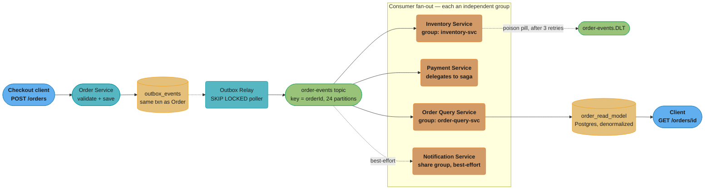
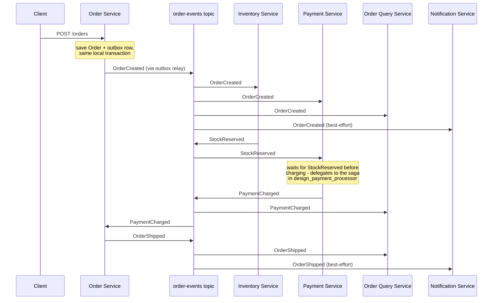
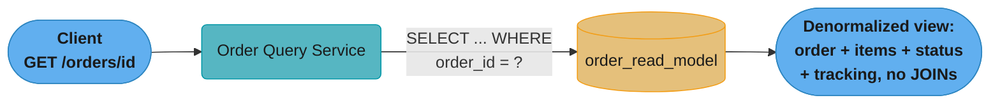
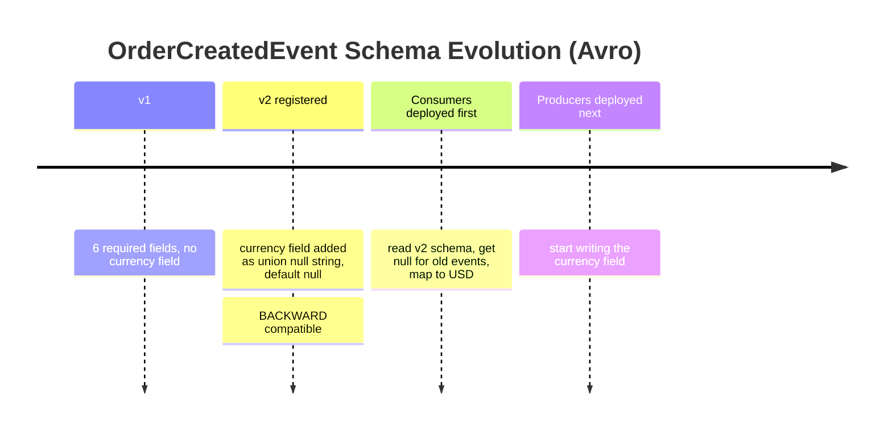
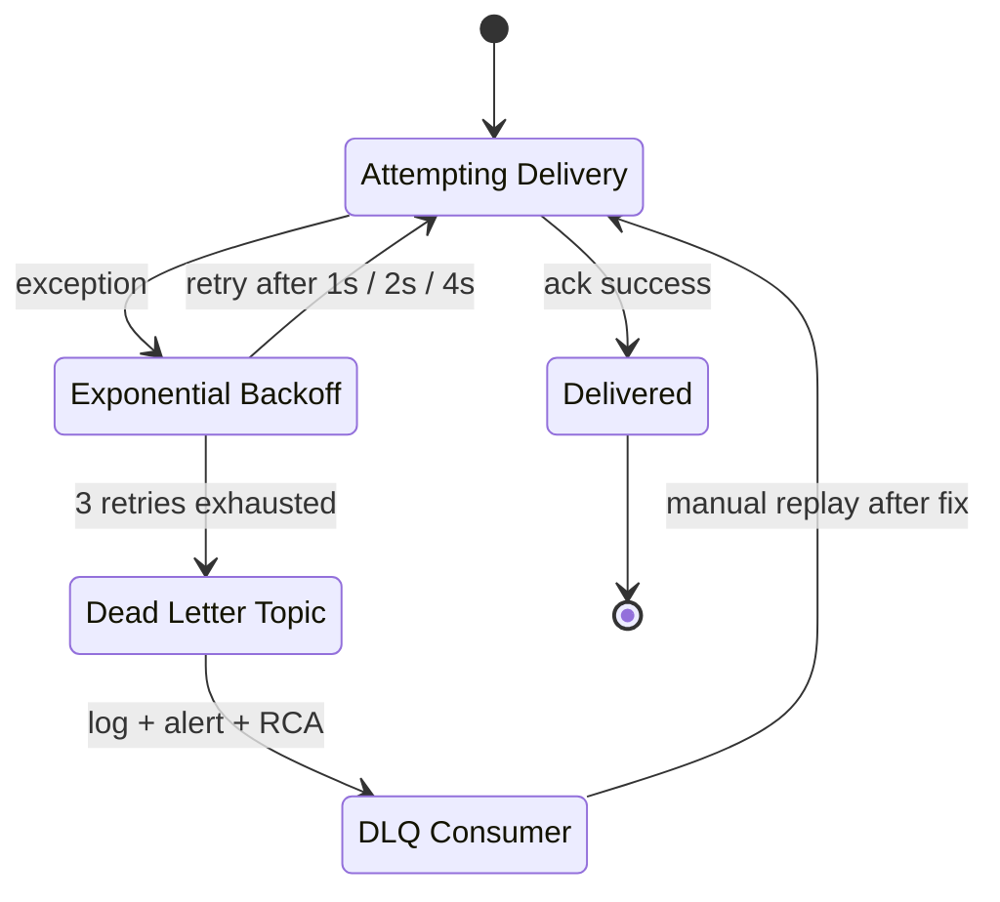

# Case Study: Event-Driven Order System
## Intuition

> **Design intuition**: An order is not one record updated in place five times. It is a **sequence of facts** — Created, InventoryReserved, PaymentCharged, Shipped, Delivered — and every service that cares about an order should learn those facts by *subscribing to the sequence*, never by polling another service's database or calling back over HTTP to ask "what's the status now?" The event log is the product; every read model, every downstream service's local view, and every dashboard is a projection built by replaying it.

**Key insight for this design**: the payment processor's whole architecture answers one question — for every side effect that touches money, what is the key that makes a repeat a no-op? This case study answers a different but related question: **for every fact about an order, what is the one topic-and-key pair that makes every consumer see it exactly once, in the right order, forever replayable?** The partition key (`orderId`) answers "right order." The transactional outbox answers "no fact is lost or fabricated between the database and Kafka." A consumer-side inbox table answers "no fact is applied twice." And Avro plus Schema Registry answers "the shape of a fact can change without every subscriber redeploying on the same day."

The second insight follows from the first: **choreography is what makes this scale past the payment processor's four hard-coded services.** A saga orchestrator is the right tool when you must guarantee a specific business-critical rollback (charge, then refund). An order's lifecycle has a dozen potential subscribers — inventory, payment, fulfillment, tax, loyalty points, fraud scoring, analytics, search indexing, notification — and none of them should require a change to a central orchestrator to add a thirteenth. This design is choreography by default, with orchestration held in reserve for the one sub-flow (payment) that genuinely needs it, and that sub-flow is deliberately delegated rather than re-implemented here.

---

## 1. Requirements Clarification

### Functional Requirements

- Drive the order lifecycle (`Created -> InventoryReserved -> PaymentCharged -> Shipped -> Delivered`, with `Cancelled` reachable from every non-terminal state) through Kafka events rather than synchronous service-to-service calls.
- Every consumer processes every event's *effect* exactly once, even though delivery itself is at-least-once — no double-reservation of stock, no duplicate shipment, no duplicate notification email on consumer restart or rebalance.
- Serve `GET /orders/{id}` and `GET /orders?userId=` from a denormalized **CQRS read model** with zero cross-service joins and zero calls to Inventory or Payment at read time.
- Evolve the `OrderCreatedEvent` schema (add fields, widen enums) without a coordinated all-services deployment — old consumers and new producers, and vice versa, must both keep working during the rollout window.
- Route an unprocessable message (bad payload, a bug in one specific handler) to a dead-letter topic instead of blocking every other order behind it on the same partition.
- Guarantee no lost and no fabricated events between "the order was created" and "the event landed in Kafka" — a transactional outbox gives at-least-once publication; consumer idempotency turns that into an effectively-once *effect*.
- Support event-carried state transfer: a consumer acting on `OrderCreatedEvent` should not need to call back to the Order Service for the line items, because the event already carries them.
- Support full-history replay: rebuild the CQRS read model, or backfill a brand-new consumer (e.g., a new fraud-scoring service), by replaying `order-events` from offset zero.

### Non-Functional Requirements

| Requirement | Target | Why this number |
|---|---|---|
| Sustained order-creation throughput | 800 orders/sec at seasonal peak | 8x the 100 orders/sec daily average — the same Black-Friday-hour shape as any retail system |
| Write-path latency | p99 < 300 ms for `POST /orders` | The write commits the order row + outbox row in one local transaction; it never waits on Kafka or on any consumer |
| Read-model staleness | p99 < 500 ms from event publish to read-model visibility | Bounded by outbox poll interval (100 ms) + Kafka produce/consume round trip + one UPSERT |
| Per-order ordering | 100% — `OrderShipped` never observed before `OrderCreated` for the same order | Enforced structurally by the `orderId` partition key, not by application logic |
| Consumer processing correctness | 0 double-reservations, 0 duplicate shipments measured | Every duplicate effect is a customer-visible defect (double-shipped order, oversold SKU) |
| DLQ isolation | A single bad message never blocks its partition for more than the retry ladder (7 s) before quarantine | Beyond that, every order behind it on the partition is stuck |
| Event retention | 7 days on `order-events`, `log.retention.hours=168` | Long enough to recover a consumer group from any single-day incident by resetting to `earliest` |
| Schema compatibility | BACKWARD on every registered subject, enforced by Schema Registry | Lets consumers upgrade independently of producers |

### Clarifying Questions to Ask in the Interview

| Question | Why it changes the design |
|---|---|
| Is payment processing an internal saga step, or a call out to an existing payment platform? | If payment already owns its own saga (as in this repo's sibling case study), the order pipeline treats `PaymentCharged`/`PaymentFailed` as an *input* event, not something it orchestrates |
| Does every consumer need every event, or do some need only the terminal state? | Determines whether `order-events` stays one topic or splits by event type / consumer-relevance, and whether a work-queue-shaped consumer (share group) fits better than a partitioned consumer group |
| How many independent consumers will subscribe over the system's life? | Choreography's whole argument is "adding a consumer costs zero changes elsewhere" — if the true number is two and will stay two, an orchestrator is simpler to operate |
| Can the read model tolerate sub-second staleness, or must `GET` immediately after `POST` return the new order? | Drives whether the API response alone carries the full resource (this design's answer) or whether a synchronous read-your-writes cache is needed |
| Is a shipped order ever un-shipped (returns, chargebacks)? | Determines whether the read-model projection needs a `RETURNED`/`REFUNDED` terminal branch beyond the five states in scope here |

### Out of Scope (owned by sibling material — do not re-derive here)

- **Saga orchestration and compensating transactions for the payment leg** — that is [`design_payment_processor`](../design_payment_processor/design_payment_processor.md)'s subject in full; this case study treats `PaymentCharged` / `PaymentFailed` as events arriving on `order-events` and reacts to them.
- **Idempotency-key design at the API edge** and **double-entry ledger mechanics** — same sibling case study, plus [`../../database/case_studies/design_banking_ledger/design_banking_ledger.md`](../../../database/case_studies/design_banking_ledger/design_banking_ledger.md) for the ledger.
- Inventory allocation algorithms (reservation TTL tuning, oversell probability) — assumed a black box behind `InventoryReserved` / `InventoryReservationFailed`.
- Fraud scoring, tax calculation, loyalty-points accrual — each is "another consumer of `order-events`," which is precisely the point of choreography, but their internal logic is not this design's concern.

---

## 2. Scale Estimation

### Traffic

```
Orders created/day:              8,640,000
Average order rate:              8,640,000 / 86,400        = 100 orders/sec
Diurnal peak (3x):                                            300 orders/sec
Seasonal peak (8x average):                                   800 orders/sec   <- the stated NFR

Order outcome split:
  Shipped (happy path):          92%  -> 7,948,800/day
  Cancelled (any stage):          8%  ->   691,200/day

Monthly orders:                  8,640,000 x 30             = 259,200,000
```

The seasonal 800/sec figure is one hour a year, same shape as the payment processor's sizing argument in the sibling case study — steady-state infrastructure is sized to the 300/sec diurnal peak with headroom, and the 800/sec hour is absorbed by partition and consumer headroom rather than by permanently idle capacity.

### Event Volume Per Order

```
Events published to order-events (by Order Service, via its own outbox):
  OrderCreated                    1.00   (always)
  OrderConfirmed                  0.92   (happy path only)
  OrderShipped                    0.92
  OrderDelivered                  0.90   (a small fraction never confirms delivery)
  OrderCancelled                  0.08   (the unhappy branch)
                                 ------
  average events/order            3.82   on order-events alone

Events published to inventory-events (by Inventory Service, its own outbox):
  StockReserved / StockReservationFailed          1.00 per order

Events published to payment-adjacent topics are owned by the payment
processor's saga (see sibling case study) and are not counted here.
```

```
Average msg/sec on order-events:     100 x 3.82              =   382 msg/sec
Seasonal peak msg/sec:                800 x 3.82              = 3,056 msg/sec
Average msg/sec on inventory-events:  100 x 1.00              =   100 msg/sec
Seasonal peak:                        800 x 1.00              =   800 msg/sec
```

### Kafka Partition Count — the Arithmetic, Not the Guess

```
Per-message consumer cost: 1 DB transaction (idempotency insert + business
logic) at ~3 ms, plus deserialization and any outbound publish.

Theoretical single-thread throughput:  1000 ms / 3 ms          =  333 msg/sec
At 60% realistic efficiency (GC, network, batching overhead):   200 msg/sec/thread

Consumer threads needed at seasonal peak:
  order-events:      3,056 / 200                                =  15.3 -> 16 threads
  inventory-events:    800 / 200                                =   4.0 ->  4 threads

Partitions must be >= consumer threads (one active consumer per partition
per group), and should leave room to add threads without a repartition:
  order-events:      24 partitions   (16 needed, 50% headroom, divides evenly
                                       across 8 pods x 3 threads or 12 x 2)
  inventory-events:    8 partitions  (4 needed, 2x headroom)
```

24 was chosen over the bare-minimum 16 for the same reason the payment processor case study chooses 48 over 12: partition count is a **ceiling** that cannot be raised later without a rebalance that can split an in-flight order's events across two partitions and lose per-order ordering during the transition. Pick the number good for two years of growth, not for today's peak.

### Consumer Lag Budget

```
Capacity at 24 partitions x 200 msg/sec/thread = 4,800 msg/sec theoretical ceiling

Utilization:
  average load:   382 / 4,800   =  8.0%
  seasonal peak: 3,056 / 4,800  = 63.7%

Lag SLO: alert when a consumer group's total lag exceeds 10,000 messages,
or when the oldest un-acked message has waited more than 30 seconds.

At seasonal peak (3,056 msg/sec incoming, 4,800 msg/sec capacity), a
consumer group recovering from a 2-minute pod restart clears its backlog in:
  backlog = 3,056 x 120 = 366,720 messages
  drain rate (spare capacity) = 4,800 - 3,056 = 1,744 msg/sec
  drain time = 366,720 / 1,744 = 210 s = 3.5 minutes
```

A consumer group with less than roughly 35% spare capacity at seasonal peak cannot absorb a 2-minute restart without breaching the 30-second lag SLO for several minutes — which is the concrete argument for provisioning to 63.7% utilization rather than to 90%+.

### Storage & Retention

```
Average fat-event payload (order-carried-state, Avro-encoded): ~750 bytes
order-events daily volume:   8,640,000 x 3.82 x 750 bytes       = 24.7 GB/day
inventory-events daily volume: 8,640,000 x 1.00 x 350 bytes     =  3.0 GB/day

7-day retention, replication factor 3:
  order-events:      24.7 x 7 x 3                                = 519 GB
  inventory-events:    3.0 x 7 x 3                                =  63 GB
                                                                  --------
  broker storage for these two topics                              582 GB
```

### CQRS Read Model Storage

```
order_read_model row (denormalized: order + items JSONB + status + tracking):
  ~1.4 KB/row average (item count varies; JSONB compresses well with TOAST)

259,200,000 orders/month x 1.4 KB = ~363 GB/month of read-model writes
(UPDATEs to the same row as status advances, not 259M distinct rows/month —
 steady-state table size is bounded by how long completed orders stay
 queryable, not by monthly order volume)

12 months hot (support/dashboard queries), then archived to S3 Parquet:
  12 x 8,640,000 x 30 x 1.4 KB / (1024^3)                        ≈ 3.9 TB hot
```

---

## 3. High-Level Architecture



Solid arrows are the durable event path; dotted arrows are the asynchronous machinery around it (the outbox relay draining to Kafka, notification's best-effort fan-out, and the DLQ escape hatch). No arrow anywhere points from a consumer back to the Order Service — that absence is the entire point of event-carried state transfer.

### Choreography, End to End



No participant here is a coordinator. `Order Service` reacts to `PaymentCharged` the same way `Order Query Service` does — by consuming it off the bus — which is what lets a thirteenth consumer join tomorrow with zero changes to any box in this diagram.

### CQRS Read Path



The read path never joins across tables or calls out to Inventory or Payment: `order_read_model` already holds the complete denormalized view, at the cost of the p99 &lt; 500 ms staleness budget from §2.

**Shared primitives.** Backend's `case_studies/` has no `cross_cutting/` directory; by the convention documented in [`../case_studies.md`](../case_studies.md), the shared primitives live as deep-dive modules in the section itself.

---

## 4. Component Deep Dives

| Primitive used here | Deep dive |
|---|---|
| Saga orchestration, idempotency keys — the payment leg | [`../design_payment_processor/design_payment_processor.md`](../design_payment_processor/design_payment_processor.md) |
| Transactional outbox, inbox, DLQ, poison pill, schema evolution | [`../../messaging_patterns/messaging_patterns.md`](../../messaging_patterns/messaging_patterns.md) |
| Producer/consumer internals, EOS, partitioning, Schema Registry | [`../../kafka_deep_dive/kafka_deep_dive.md`](../../kafka_deep_dive/kafka_deep_dive.md) |
| Events vs commands, choreography vs orchestration | [`../../event_driven_fundamentals/event_driven_fundamentals.md`](../../event_driven_fundamentals/event_driven_fundamentals.md) |
| Event store, aggregates, CQRS read models, Axon | [`../../event_sourcing_and_cqrs/event_sourcing_and_cqrs.md`](../../event_sourcing_and_cqrs/event_sourcing_and_cqrs.md) |
| 2PC problems, saga theory, outbox pattern origin | [`../../distributed_transactions_and_consistency/distributed_transactions_and_consistency.md`](../../distributed_transactions_and_consistency/distributed_transactions_and_consistency.md) |
| Retry with jitter, circuit breaker, bulkhead | [`../../fault_tolerance_patterns/fault_tolerance_patterns.md`](../../fault_tolerance_patterns/fault_tolerance_patterns.md) |
| HLD-level message-queue and CQRS overview | [`../../../hld/message_queues/message_queues.md`](../../../hld/message_queues/message_queues.md), [`../../../hld/event_sourcing_cqrs/event_sourcing_cqrs.md`](../../../hld/event_sourcing_cqrs/event_sourcing_cqrs.md) |

### 4.1 Choreography vs Orchestration for Order State

The order lifecycle is driven **choreographically**: no service tells another service what to do next; every service reacts to a fact that already happened and, if relevant, publishes a new fact. The Order Service does not command Inventory to reserve stock — it publishes `OrderCreated`, and Inventory decides for itself that this event is relevant to it.

This is a deliberate contrast with the payment leg, which **is** orchestrated (see the sibling case study's saga). The distinction that matters in an interview is not "choreography is simpler" — it frequently is not, once you have to debug it — but **where the complexity belongs**:

| Sub-flow | Style | Why |
|---|---|---|
| Order lifecycle (Created -> Shipped -> Delivered) fan-out to N independent consumers | Choreography | The number and identity of consumers grows over the system's life; none of them has veto power over another; there is no compensating-transaction requirement between them |
| Payment (reserve -> charge -> confirm, with compensation on any step's failure) | Orchestration (saga) | Compensation logic is genuinely stateful and conditional (`if (paymentCharged) refund`), and it must be traceable in one place for compliance — see [`design_payment_processor`](../design_payment_processor/design_payment_processor.md) §5 |

The rule of thumb: choreography when consumers are independent and none needs to roll another back; orchestration when a step's failure requires an explicit, ordered undo of prior steps. An order pipeline is choreographic at the top level and delegates one orchestrated sub-flow inside it — most real systems are this hybrid, not purely one or the other.

### 4.2 The Transactional Outbox — One Per Publishing Service

Every service that publishes to Kafka owns its own outbox table and relay; Order Service and Inventory Service each run one independently. The order write and its outbox insert commit in one local database transaction, so a Kafka outage never loses or fabricates an event.

```sql
CREATE TABLE outbox_events (
    id           UUID PRIMARY KEY DEFAULT gen_random_uuid(),
    seq          BIGSERIAL NOT NULL,               -- insertion order; UUIDs do not sort
    aggregate_id VARCHAR(36) NOT NULL,              -- orderId; becomes the Kafka key
    event_type   VARCHAR(200) NOT NULL,
    schema_id    INTEGER NOT NULL,                  -- Schema Registry id at write time
    payload      BYTEA NOT NULL,                    -- Avro-encoded
    published_at TIMESTAMPTZ
);

CREATE INDEX idx_outbox_unpublished ON outbox_events(seq) WHERE published_at IS NULL;
```

```java
@Component
@RequiredArgsConstructor
public class OutboxRelay {

    private static final int BATCH = 1000;

    private final JdbcTemplate jdbc;
    private final KafkaTemplate<String, byte[]> kafka;

    @Scheduled(fixedDelay = 100)   // 100 ms poll: 1000 rows x 10 polls/s = 10,000 events/s/worker
    @Transactional
    public void drain() {
        List<OutboxRow> batch = jdbc.query("""
            SELECT id, seq, aggregate_id, event_type, payload
              FROM outbox_events
             WHERE published_at IS NULL
             ORDER BY seq
             LIMIT ?
               FOR UPDATE SKIP LOCKED
            """, OUTBOX_MAPPER, BATCH);

        for (OutboxRow row : batch) {
            // Kafka key = orderId keeps every event for one order on one partition,
            // which is what preserves per-order ordering downstream.
            kafka.send(topicFor(row.eventType()), row.aggregateId(), row.payload()).join();
        }

        if (!batch.isEmpty()) {
            jdbc.update("UPDATE outbox_events SET published_at = NOW() WHERE id = ANY(?)",
                        batch.stream().map(OutboxRow::id).toArray(UUID[]::new));
        }
    }
}
```

At 800 orders/sec seasonal peak and 3.82 order-events events per order, peak outbox demand is `800 x 3.82 = 3,056 events/sec`. One worker's theoretical `10,000 events/sec` covers it several times over even at 40% realistic efficiency (`4,000 events/sec`); three workers run for HA, not for throughput, exactly as in the sibling case study's outbox relay.

### 4.3 BROKEN -> FIXED: Publishing to Kafka Inside `@Transactional`

The most common first-pass mistake in an event-driven order system is publishing directly from the same method that saves the order, reasoning that "it's all in one transaction anyway."

**BROKEN** — a dual write across two systems that do not share a transaction:

```java
@Service
@RequiredArgsConstructor
public class OrderService {

    private final OrderRepository orderRepository;
    private final KafkaTemplate<String, byte[]> kafka;   // BROKEN dependency to have here

    @Transactional
    public Order createOrder(CreateOrderRequest request) {
        Order order = buildOrder(request);
        orderRepository.save(order);                      // (1) Postgres write

        OrderCreatedEvent event = toEvent(order);
        // BROKEN. kafka.send() talks to a DIFFERENT resource than the DB transaction.
        // There is no distributed transaction spanning Postgres and Kafka; this line
        // has three independent failure windows, and each produces a different lie.
        kafka.send("order-events", order.getId().toString(), serializeAvro(event));

        return order;   // (2) the @Transactional commit happens AFTER this method returns
    }
}
```

The failure sequence, and it does not require anything exotic to trigger:

```
Case A - Kafka publish succeeds, then the DB transaction rolls back
  (a later validation-style check in the same method throws, or the
  connection to Postgres drops during commit):
    -> Inventory, Payment, Notification all react to an OrderCreated
       event for an order that DOES NOT EXIST. Inventory reserves stock
       for a phantom order. This is a FABRICATED event.

Case B - the DB transaction commits, then the process crashes before
  kafka.send() returns (a pod eviction, an OOM kill mid-network-call):
    -> the order exists in Postgres, forever, with NO event ever published.
       No consumer ever learns it happened. This is a LOST event, and
       nothing retries it because nothing recorded that it was owed.

Case C - kafka.send() times out (a broker leader election in progress):
    -> the calling thread does not know whether the broker actually
       committed the record before the connection dropped. A blind
       retry from here risks a DUPLICATE with no dedup key established
       yet on the consumer side.
```

Case B is the one that is silent in production: nothing throws, nothing logs an error, the API call returns `200`, and the order simply never ships — discovered days later as a support ticket, not an alert.

**FIXED** — the transactional outbox, so the event and the order commit atomically in Postgres, and Kafka becomes an at-least-once relay from a durable, crash-safe queue:

```java
@Service
@RequiredArgsConstructor
public class OrderService {

    private final OrderRepository orderRepository;
    private final OutboxEventRepository outboxRepository;   // same DB, same transaction

    @Transactional
    public Order createOrder(CreateOrderRequest request) {
        Order order = buildOrder(request);
        orderRepository.save(order);

        OrderCreatedEvent event = toEvent(order);

        // Same local transaction, same connection, same commit/rollback boundary
        // as the order row. Either both are visible after commit or neither is.
        outboxRepository.save(OutboxEvent.builder()
            .aggregateId(order.getId().toString())
            .eventType("OrderCreatedEvent")
            .schemaId(schemaRegistry.getSchemaId("OrderCreatedEvent"))
            .payload(serializeAvro(event))
            .build());

        return order;
        // Kafka is now OUT of this method entirely. A separate OutboxRelay
        // (§4.2) polls and publishes asynchronously, after this commits.
    }
}
```

This closes Case A and Case B structurally: the outbox row can only exist if the order row does (same transaction), and if the process crashes before publishing, the unpublished row is still there for the relay to find on restart. It converts Case C from "was it published?" into an ordinary at-least-once republish, which is why the consumer-side inbox in §4.5 is not optional — the outbox alone gives at-least-once, and effectively-once only exists once both halves are in place.

### 4.4 Kafka Partitioning by `orderId`

Every topic in this design (`order-events`, `inventory-events`) uses `orderId` as the partition key. Kafka's default partitioner hashes the key with murmur2 and maps it onto one of the topic's partitions; every message with the same key lands on the same partition, and a partition is read by exactly one consumer thread per consumer group at a time. That combination — same partition, single reader — is what gives per-order ordering for free, with no distributed lock and no application-level sequencing.

```
partition = murmur2(orderId) % partitionCount
```

Two consequences worth stating precisely in an interview:

- **Ordering is per-key, not global.** `OrderShipped` for order A can be processed before `OrderCreated` for order B even though B's timestamp is earlier — and that is fine, because nothing in this design ever needs cross-order ordering, only per-order ordering.
- **`orderId` is a good key because it is high-cardinality and evenly distributed.** A key like `merchantId` or `region` would create hot partitions during a flash sale on one merchant — exactly the kind of key the payment processor's Airbnb reference in the sibling case study warns against for idempotency-store sharding, and the same logic applies to Kafka partition keys.

### 4.5 Consumer Idempotency via an Inbox Table

Every consumer maintains an `event_processed` inbox table keyed on `(event_id, consumer_group)`. The insert and the business logic execute in the same `@Transactional` boundary, so "did we already handle this" and "handle it" can never disagree.

```sql
CREATE TABLE event_processed (
    event_id       UUID NOT NULL,
    consumer_group VARCHAR(100) NOT NULL,
    processed_at   TIMESTAMPTZ NOT NULL DEFAULT NOW(),
    PRIMARY KEY (event_id, consumer_group)
);
```

```java
@Component
@RequiredArgsConstructor
public class InventoryOrderEventConsumer {

    private final EventProcessedRepository processedRepo;
    private final InventoryService inventoryService;

    @KafkaListener(topics = "order-events", groupId = "inventory-svc")
    @Transactional
    public void handleOrderCreated(ConsumerRecord<String, byte[]> record) {
        UUID eventId = extractEventId(record);

        // INSERT OR SKIP. A PRIMARY KEY violation means this (event, group) pair
        // was already committed - the retry (redelivery after a rebalance, a
        // broker resend, an outbox republish) is a safe no-op from here on.
        int inserted = processedRepo.insertIfNotExists(eventId, "inventory-svc");
        if (inserted == 0) {
            log.info("event {} already processed by inventory-svc, skipping", eventId);
            return;
        }

        OrderCreatedEvent event = deserializeAvro(record.value(), OrderCreatedEvent.class);
        inventoryService.reserveStock(event.getOrderId().toString(), event.getItems());
        publishStockReservedEvent(event.getOrderId().toString());   // via Inventory's own outbox
    }
}
```

This is a different mechanism from the payment processor's API-level `Idempotency-Key` header, though the shape rhymes: that one dedupes a *client request* at the API edge before a saga starts; this one dedupes a *message delivery* at the consumer boundary after Kafka has already redelivered it. Both exist because "the sender might repeat itself" is true at every hop in a distributed system, and each hop needs its own key.

### 4.6 Exactly-Once vs Effectively-Once

Kafka's own **exactly-once semantics (EOS)** — an idempotent producer (`enable.idempotence=true`, the default since Kafka 3.0) plus a transactional producer (`transactional.id` set, `read_committed` isolation on the consumer) — genuinely deliver exactly-once **within Kafka**: a producer retry after a broker ack timeout will not create a duplicate record, and a Kafka Streams topology reading from one topic and writing to another can commit both atomically. That guarantee **stops at the Kafka boundary**. The moment a consumer's job is "call `reserveStock()` against Postgres," EOS cannot make that external side effect exactly-once, because Kafka has no way to make a Postgres commit and a Kafka offset commit atomic across two different storage systems.

What this design actually delivers, end to end, is **effectively-once**: at-least-once delivery (outbox relay, Kafka's own retries, consumer rebalance redelivery) composed with an idempotent effect (the inbox table in §4.5) so that repeats are harmless. The distinction is not pedantic — an interviewer who hears "Kafka gives you exactly-once so we don't need consumer-side dedup" should treat that as a design bug, because it is one.

```
outbox (at-least-once, no loss, no fabrication)
     +
inbox / idempotency check (duplicate detection at the consumer)
     =
effectively-once EFFECT, built from an at-least-once DELIVERY
```

### 4.7 Schema Evolution with Avro + Schema Registry

```json
// OrderCreatedEvent.avsc — v1
{
  "type": "record",
  "name": "OrderCreatedEvent",
  "namespace": "com.company.events",
  "fields": [
    {"name": "eventId",    "type": "string"},
    {"name": "orderId",    "type": "string"},
    {"name": "userId",     "type": "string"},
    {"name": "items",      "type": {"type": "array", "items": {
      "type": "record", "name": "OrderItem",
      "fields": [
        {"name": "sku",      "type": "string"},
        {"name": "quantity", "type": "int"},
        {"name": "price",    "type": "double"}
      ]
    }}},
    {"name": "totalAmount", "type": "double"},
    {"name": "occurredOn",  "type": {"type": "long", "logicalType": "timestamp-millis"}}
  ]
}

// v2: added "currency" - BACKWARD compatible because the field has a default.
// A union's default must match its FIRST branch, so ["null","string"] can only
// default to null; the read-model projection substitutes "USD" for a null read.
{
  "fields": [
    ... (all v1 fields),
    {"name": "currency", "type": ["null", "string"], "default": null}
  ]
}
```



Under BACKWARD compatibility — Schema Registry's default compatibility type, and the one this design enforces on every subject — Confluent's own guidance is to upgrade all consumers before producers start writing new events. Deploying producers first would not have broken anything *here* only because the new field carries a default; adding a required field with no default is rejected outright by the registry at registration time, which is the whole point of registering schemas centrally rather than trusting each team's deploy order.

### 4.8 DLQ and Poison-Pill Handling



```java
@Configuration
public class KafkaConfig {

    @Bean
    public ConcurrentKafkaListenerContainerFactory<String, byte[]> kafkaListenerContainerFactory(
            ConsumerFactory<String, byte[]> consumerFactory,
            KafkaTemplate<String, byte[]> kafkaTemplate) {

        var factory = new ConcurrentKafkaListenerContainerFactory<String, byte[]>();
        factory.setConsumerFactory(consumerFactory);

        DefaultErrorHandler errorHandler = new DefaultErrorHandler(
            new DeadLetterPublishingRecoverer(kafkaTemplate,
                (record, ex) -> new TopicPartition(record.topic() + ".DLT", record.partition())
            ),
            new ExponentialBackOffWithMaxRetries(3) {{
                setInitialInterval(1000);   // 1s, 2s, 4s then DLT
                setMultiplier(2.0);
                setMaxInterval(10000);
            }}
        );

        // Deserialization/schema errors are never transient - retrying wastes
        // 7 s on every occurrence and delays every order behind it for nothing.
        errorHandler.addNotRetryableExceptions(SerializationException.class);

        factory.setCommonErrorHandler(errorHandler);
        return factory;
    }
}
```

The mechanism that makes DLQ isolation work is the same partitioning that gives ordering: a message stuck retrying occupies the consumer thread reading **that one partition**, so only the orders sharing that partition are delayed, not the whole topic. Once the retry ladder (1s + 2s + 4s = 7 s) is exhausted, the message is quarantined to `order-events.DLT` and the partition's consumer moves on to the next offset — the poison pill stops blocking anything further.

**Replaying a DLQ with a share group.** Kafka's **share groups** (KIP-932, "Queues for Kafka," GA in Kafka 4.2) give queue-style, per-message acknowledgment across a group of consumers that is not bound to the partition-per-consumer limit of a classic consumer group. A DLQ-replay tool is a good fit for one: replay order does not need to preserve the original partition-level ordering (each replayed message is independently retried), and a share group lets 20 replay workers cooperate on draining a DLQ topic that has far fewer than 20 partitions — something a classic consumer group cannot do, since a classic group cannot usefully run more active consumers than partitions.

### 4.9 CQRS Read-Model Projection

```java
@Component
@RequiredArgsConstructor
@ProcessingGroup("order-read-model")
public class OrderReadModelProjection {

    private final OrderReadModelRepository readModelRepo;

    @EventHandler
    @Transactional
    public void on(OrderCreatedEvent event) {
        OrderReadModel model = OrderReadModel.builder()
            .orderId(event.getOrderId().toString())
            .userId(event.getUserId().toString())
            .status("PENDING")
            .totalAmount(event.getTotalAmount())
            .currency(event.getCurrency() != null ? event.getCurrency().toString() : "USD")
            .items(toReadModelItems(event.getItems()))
            .createdAt(Instant.ofEpochMilli(event.getOccurredOn()))
            .build();
        readModelRepo.save(model);
    }

    @EventHandler
    @Transactional
    public void on(OrderShippedEvent event) {
        readModelRepo.findByOrderId(event.getOrderId().toString()).ifPresent(model -> {
            model.setStatus("SHIPPED");
            model.setTrackingNumber(event.getTrackingNumber().toString());
            model.setShippedAt(Instant.ofEpochMilli(event.getOccurredOn()));
            readModelRepo.save(model);
        });
    }
}
```

```java
@RestController
@RequiredArgsConstructor
@RequestMapping("/api/orders")
public class OrderQueryController {

    private final OrderReadModelRepository readModelRepo;

    @GetMapping("/{orderId}")
    public ResponseEntity<OrderView> getOrder(@PathVariable String orderId) {
        return readModelRepo.findByOrderId(orderId)
            .map(OrderView::from)
            .map(ResponseEntity::ok)
            .orElse(ResponseEntity.notFound().build());
    }

    @GetMapping
    public ResponseEntity<Page<OrderView>> getOrdersByUser(
            @RequestParam String userId,
            @RequestParam(defaultValue = "0") int page,
            @RequestParam(defaultValue = "20") int size) {
        return ResponseEntity.ok(
            readModelRepo.findByUserIdOrderByCreatedAtDesc(userId, PageRequest.of(page, size))
                .map(OrderView::from)
        );
    }
}
```

Rebuilding the read model from scratch — after a bug in the projection, or to onboard a new field — is `@ResetHandler` truncating `order_read_model` plus resetting the `order-query-svc` consumer group's offsets to `earliest` and replaying the full 7-day-retained (or archived, for older history) event log. This is the direct payoff of §4.6's effectively-once design: replay is safe precisely because every projection handler is itself idempotent by construction (an `UPSERT`-shaped write keyed on `orderId`).

---

## 5. Design Decisions & Tradeoffs

| Decision | Chosen | Alternative | Rationale |
|---|---|---|---|
| Order lifecycle coordination | Choreography | Central saga orchestrator for the whole pipeline | Consumer count grows over the system's life and none needs to veto another; an orchestrator would need a code change for every new consumer |
| Payment sub-flow coordination | Orchestration (delegated to the sibling case study) | Choreograph payment too | Compensation is genuinely conditional and must be traceable in one place for audit — the one place choreography's diffusion of logic is a liability |
| Event shape | Fat, event-carried state | Thin events (`orderId` only, consumer fetches details) | Removes the temporal coupling of "Order Service must be up when Inventory processes the event"; costs larger payloads (~750 B vs ~50 B) and tighter schema coupling |
| Command publication | Transactional outbox | Publish inside `@Transactional` | See §4.3's broken example — a direct `kafka.send()` can fabricate or lose events across the two independent commit boundaries |
| Consumer dedup | Inbox table, `(event_id, consumer_group)` PK | Trust Kafka's exactly-once semantics alone | EOS does not extend past the Kafka boundary to an external side effect like a Postgres write (§4.6) |
| Ordering mechanism | Partition key = `orderId` | A global sequence number + application-level reordering buffer | Kafka's partition-affinity gives ordering for free; a reordering buffer is a distributed system of its own |
| Read model | Dedicated CQRS projection, denormalized | Query the Order Service's writer DB directly | The writer schema is normalized for the write path; a read that joins order + items + status + tracking at request time does not scale past a few hundred req/sec |
| Schema format | Avro + Schema Registry, BACKWARD | JSON with no schema enforcement | Registry rejects an incompatible change at registration time, before it ever reaches a consumer; JSON's flexibility is exactly what makes an accidental breaking change silent |
| DLQ consumer shape | Kafka share group (KIP-932) for replay | Classic consumer group | Replay parallelism should not be capped at the DLQ topic's partition count, and replay order does not need partition-level ordering |
| Notification delivery | Best-effort, no compensation on failure | Compensate the whole order if notification fails | A bounced email is not a reason to cancel a shipped order |

**Choreography vs orchestration, the general comparison:**

| Dimension | Choreography (this design's default) | Orchestration (this design's payment sub-flow) |
|---|---|---|
| Adding a new consumer | Zero changes to any existing service | Edit the orchestrator, add a new step |
| Where the "business process" is documented | Nowhere in one place — inferred from event contracts | One state machine, greppable |
| Debugging "why didn't inventory reserve" | Check inventory-svc's consumer logs and lag | One `SELECT` against saga state |
| Coupling | Consumers coupled only to the event schema | Every participant coupled to the orchestrator's command contract |
| Failure of a central component | No single component to fail — no orchestrator exists | Orchestrator down means no saga progresses |

**Kafka vs RabbitMQ for this pipeline**, updated for the current landscape: Kafka is KRaft-only as of 4.0 (ZooKeeper mode was removed, not merely deprecated), and 4.2 (the reference version for this design) is where share groups reached general availability. RabbitMQ's classic mirrored queues — the queue type most older Kafka-vs-RabbitMQ benchmarks used — were removed in RabbitMQ 4.0; its current replay-capable options are quorum queues (Raft-replicated) and streams. This design still picks Kafka for the same reason the payment processor case study does: `order-events` must support full-history replay to rebuild the read model and to backfill new consumers, and that is Kafka's log-retention model, not a message broker's queue-consumption model. See [`../../messaging_patterns/messaging_patterns.md`](../../messaging_patterns/messaging_patterns.md) for the fuller RabbitMQ-vs-Kafka tradeoff table, which this case study does not re-derive.

---

## 6. Real-World Implementations

**Shopify** runs its checkout and order pipeline on Kafka at a scale that becomes publicly visible every Black Friday/Cyber Monday, when the company publishes its "how we scaled" engineering retrospective; the order and checkout paths are decoupled through an internal event bus so that a slow downstream consumer (fulfillment routing, loyalty accrual) cannot backpressure the checkout write path itself — the same separation this case study's outbox-plus-fan-out gives between "the order committed" and "everyone who cares about it has reacted."

**Uber** built **Cadence** (later reimplemented and open-sourced by former Uber engineers as **Temporal**) specifically because choreographed, ad-hoc event handling across dozens of services made a trip/order's actual state machine impossible to reconstruct during an incident — the same tension this case study resolves by keeping payment orchestrated while leaving the broader order fan-out choreographic. Uber's own Kafka operations at scale also produced **uReplicator**, built to solve partition-rebalancing and cross-datacenter replication pain that a naive Kafka MirrorMaker deployment could not handle at their consumer-group count.

**DoorDash** has published engineering accounts of moving order-state propagation from synchronous service calls to an event-driven model, explicitly citing the same failure this case study's §4.3 shows broken-then-fixed: a direct write-then-publish that could leave a consumer's view of an order permanently out of sync with the source of truth after a partial failure, fixed by adopting an outbox-style guarantee ahead of the message bus.

**Amazon's** retail order pipeline is the origin story most often cited for decoupled, queue-based order processing: after a widely recounted 2004 availability incident tied to tightly coupled order-processing components, Amazon's internal tooling moved toward asynchronous, queue-mediated processing between order stages — work that fed directly into what later shipped externally as Amazon SQS. The lesson generalizes past Amazon specifically: a synchronous call chain across N services fails at the reliability of the *weakest* link times N, and a durable queue between each stage breaks that multiplication.

**Zalando** built and open-sourced **Nakadi**, an event-broker layer on top of Kafka that enforces schema validation and event-type registration for every domain event flowing between its hundreds of microservices — effectively a company-wide Schema Registry equivalent, addressing the exact schema-evolution problem this case study's §4.7 solves per-topic, but centralized as a platform concern rather than left to each team.

**Nubank** has published on running event sourcing and CQRS at the scale of hundreds of billions of events across its ledger and account systems, using Kafka as the durable event backbone beneath services that project their own read models — the same shape as this case study's `order_read_model` projection, generalized to an entire banking core built on replayable event history rather than mutable row state.

---

## 7. Technologies & Tools

| Technology | Version | Usage |
|---|---|---|
| Apache Kafka | 4.2+ (KRaft-only; ZooKeeper mode removed in 4.0) | Event backbone; `order-events` (24 partitions), `inventory-events` (8 partitions) |
| Kafka share groups (KIP-932) | GA since 4.2 | Queue-shaped DLQ replay and any consumer that does not need partition-affinity ordering |
| Avro + Confluent Schema Registry | current | Typed event schemas, BACKWARD compatibility enforced at registration |
| Spring Kafka | 4.x | `@KafkaListener`, transactional consumer, DLQ via `DefaultErrorHandler` |
| Axon Framework | current | `@EventHandler` / `@ProcessingGroup` / `@ResetHandler` for the read-model projection |
| PostgreSQL | 18 | Outbox tables (one per publishing service), inbox table, read model |
| Spring Data JPA | — | Repository layer for all persistence |
| Spring Boot Actuator + Micrometer | current | Consumer lag metrics via the Kafka binder, outbox-lag gauge |
| KEDA | current | Kubernetes autoscaler keyed on Kafka consumer-group lag |
| Debezium | 3.x | Optional CDC alternative to outbox polling, tailing the Postgres WAL directly |
| Testcontainers | current | Kafka + Postgres + Schema Registry integration tests, including poison-pill and DLQ scenarios |

---

## 8. Operational Playbook

### SLOs and the Alerts That Matter

| SLI | SLO | Alert threshold | Page? |
|---|---|---|---|
| `POST /orders` p99 latency | < 300 ms | > 500 ms for 5 min | no |
| Consumer group lag (messages) | < 10,000 | > 10,000 for 5 min | yes |
| Oldest un-acked message age | < 30 s | > 30 s | yes |
| Read-model staleness (event publish -> row visible) | < 500 ms p99 | > 2 s p99 for 10 min | no |
| Outbox lag (oldest unpublished row) | < 2 s | > 30 s | yes |
| DLQ message rate | near 0 | > 10/min sustained | yes |
| Schema Registry availability | 99.95% | any 5xx burst > 1 min | yes |

### Runbook 1 — Consumer Lag Spike

1. Identify the group: `kafka-consumer-groups.sh --bootstrap-server <b> --describe --group inventory-svc`.
2. Check whether it is a **volume** problem (seasonal peak genuinely exceeded the 4,800 msg/sec capacity from §2 — scale consumer pods, KEDA should already be reacting) or a **stuck-partition** problem (one partition's lag is climbing while the other 23 are flat, which is almost always a poison pill retrying — jump to Runbook 2).
3. If volume: confirm partition count (24) is not itself the ceiling — if all consumer threads are saturated and lag still climbs, more pods beyond the partition count do nothing; the fix is either faster per-message processing or a partition increase (planned, off-peak, accepting the ordering caveat from §4.4).
4. Page threshold: total group lag > 10,000 for 5 minutes, or oldest-unacked age > 30 s.

### Runbook 2 — Poison Pill / DLQ Growth

1. `kafka-console-consumer.sh --topic order-events.DLT --from-beginning` to inspect what landed there.
2. Common causes, in order of likelihood: a schema the consumer's Avro reader cannot deserialize (a producer bug bypassing Schema Registry validation), a null field the handler does not null-check, or a downstream call (e.g., an inventory SKU lookup) that always 500s for one malformed order.
3. Fix the handler bug and deploy — this alone does **not** reprocess the quarantined messages.
4. Replay via the share-group DLQ tool from §4.8, at a deliberately throttled rate (not full DLQ volume at once) to avoid re-triggering the lag alert on the live topic while catching up on the backlog simultaneously.
5. Confirm the DLQ message rate returns to near zero before closing the incident — a recurring trickle after the "fix" means the root cause was not what you thought.

### Runbook 3 — Schema Registry Unavailable

1. Producers and consumers using Avro fail to resolve new schema IDs against an unreachable registry; both cache previously resolved schema IDs in memory, so an outage under a few minutes is often invisible to already-running processes.
2. A **new** process (a fresh consumer pod, a rolling deploy) cannot start without reaching the registry at least once to resolve its schema — so a registry outage during a deploy window is the dangerous case, not steady-state traffic.
3. Mitigation: pin `schema.registry.url` to a multi-node registry cluster (never a single instance in production), and avoid deploys during a registry incident.
4. If the registry is down and a deploy cannot wait, deploying with cached local schema copies as a fallback is an emergency escape hatch, not a standing configuration — it reintroduces the compatibility-checking gap the registry exists to close.

### Runbook 4 — Outbox Relay Stalled

Symptoms: `outbox_lag_seconds > 30`, orders visibly not propagating past `Created`, no Kafka producer errors logged.

1. Check for a long-running transaction holding rows: a transaction that grabbed a batch of 1,000 and then hung holds them (`FOR UPDATE SKIP LOCKED` only skips rows already locked by *another* transaction).
2. Check table bloat: at 3,056 events/sec peak insert-then-delete-adjacent churn, a dead-tuple ratio climbing past 5:1 on `outbox_events` means autovacuum is losing and the partial index (`WHERE published_at IS NULL`) has started doing sequential scans.
3. Mitigation: add relay workers (safe — `SKIP LOCKED` needs no coordination) and set an aggressive per-table autovacuum policy.
4. Permanent fix: partition `outbox_events` by hour and `DROP PARTITION` after publication instead of deleting rows, exactly as the sibling payment-processor case study's Runbook 5 recommends for the same underlying churn pattern.

### Runbook 5 — Read Model Diverges From the Event Log

1. Confirm it is really a divergence and not staleness: compare the read model's `updated_at` against the current time; anything within the 500 ms p99 budget is not a bug.
2. If genuinely diverged (a projection handler bug applied an event incorrectly and left a wrong row), do **not** patch the row directly — the event log is authoritative and a direct row edit will be silently overwritten or, worse, leave the row permanently wrong if that order never emits another event.
3. Fix the projection handler, then run `@ResetHandler`: truncate `order_read_model`, reset the `order-query-svc` consumer group offsets to `earliest`, and replay. At 259.2M orders/month and a 24-partition topic replaying in parallel, a full 7-day-retained replay clears in minutes, not hours — this is the direct payoff of keeping every projection handler idempotent.

---

## 9. Common Pitfalls & War Stories

**1. A poison pill stalls a partition for 38 minutes — composite scenario, not a specific reported incident.** *The following is an illustrative composite built from the mechanics of §4.8, not a report of any named company's outage.* A schema migration ships a new required enum value that an older consumer's generated Avro class does not recognize. Because the new value was added without a default (violating the BACKWARD-compatibility check the team had gotten used to skipping in a hurry during a deploy freeze exception), every message carrying it throws on deserialization in `inventory-svc`. The retry ladder (1s, 2s, 4s) burns 7 seconds per message before quarantining to the DLQ — but the messages *behind* the poison pill on partition 7 are not individually poisoned; they simply queue behind a consumer thread that keeps re-attempting the same offset until the retry budget for *that* offset is exhausted. Over **38 minutes**, roughly one bad message every few seconds compounds with normal traffic to back up **1.2 million events** on that single partition before an on-call engineer notices the lag alert and manually skips the offset. The fix that would have prevented it: enforcing BACKWARD compatibility with no override path, even under deploy-freeze pressure, and alerting on DLQ rate rather than only on aggregate consumer lag (aggregate lag across 24 partitions diluted the one-partition spike enough to delay the page).

**2. The rebalance storm — a well-documented industry-wide problem, not one company's incident.** Before Kafka's **Incremental Cooperative Rebalancing** (KIP-429), a consumer group rebalance was "stop the world": every consumer in the group revoked *all* of its partitions and waited for a full reassignment, even when only one pod restarted. At high consumer counts this produced multi-second-to-minutes-long full-group pauses on every routine deploy — the exact motivation Confluent and the wider Kafka community documented publicly in proposing and shipping KIP-429. In an order pipeline sized like this one, a stop-the-world rebalance during a rolling deploy of `inventory-svc`'s 16 pods would pause all 24 partitions simultaneously rather than the one or two partitions actually affected by the pod restarting — turning a routine deploy into a lag spike across the entire topic. The fix is configuration, not code: use the `CooperativeStickyAssignor` (or the equivalent in a client library's default since Kafka 2.4+), which only reassigns the specific partitions that changed hands.

**3. DoorDash's synchronous-to-event-driven order migration.** As recounted in DoorDash's own engineering writing on rebuilding real-time order-state propagation, an earlier design that wrote order state and then called downstream services synchronously left a documented gap: a downstream call failing after the state write committed meant the source of truth and a consumer's view of it could permanently disagree, with no durable record that a notification was ever owed. The fix direction they describe — decoupling the write from the propagation via a durable, replayable event mechanism — is structurally the same fix as this case study's §4.3 broken-to-fixed pair, arrived at independently because the failure mode is generic to any system that tries to do "commit, then tell everyone" as two steps without a shared transaction.

**4. Zalando's motivation for building Nakatpi's schema enforcement.** Zalando has written publicly about the operational cost of hundreds of microservices each defining event payloads ad hoc, with no central registry: a producer team renaming or retyping a field would break consumer teams with no compile-time or even deploy-time warning, discovered only when a consumer's deserialization started failing in production — the identical class of incident this case study's §4.7 and Runbook 2 are built to prevent. Their response, building Nakadi as a mandatory schema-validating layer in front of Kafka for all inter-service events, is the platform-level version of what a single Schema Registry with enforced BACKWARD compatibility does for one topic.

### Pitfalls Without a War Story

- **Trusting Kafka's exactly-once semantics to cover a database write.** EOS is real and valuable, but it stops at the Kafka boundary (§4.6) — an idempotent Postgres write still needs its own inbox check.
- **Choosing a low-cardinality partition key "for locality."** A key like `region` or `merchantTier` concentrates traffic onto a handful of partitions and creates exactly the hot-partition problem `orderId` avoids by construction.
- **Treating notification failures as saga failures.** Compensating (cancelling) a successfully shipped order because an email provider bounced is a strictly worse outcome than a missing email.
- **Skipping the inbox table because "Kafka retries are rare."** They are rare in steady state and routine during every rebalance, every consumer restart, and every network blip — which is precisely when correctness matters most, not when it is convenient.
- **Widening an enum value without a default and calling it a minor change.** Schema Registry's BACKWARD check exists to catch exactly this; bypassing it under deploy pressure is how war story #1 happens.
- **Sizing partition count for today's peak with no headroom.** Partition count is a ceiling that requires an operationally risky repartition to raise later, unlike a consumer pod count, which autoscales.

---

## 10. Capacity Planning

### Kafka Cluster

```
order-events:      24 partitions, RF 3, 3,056 msg/sec seasonal peak
inventory-events:    8 partitions, RF 3,   800 msg/sec seasonal peak

Broker-side write throughput needed (both topics, seasonal peak):
  (3,056 + 800) x 750 bytes average x 3 (replication)   ≈ 8.68 MB/s sustained

Storage (7-day retention, computed in §2):
  order-events      519 GB
  inventory-events    63 GB
                     ------
  total               582 GB across the cluster, before broker overhead

Broker count: 3 brokers (matches RF 3, one replica per broker), each sized
for 582 GB / 3 ≈ 194 GB of primary+replica storage plus page-cache headroom.
```

### Consumer Fleet

```
order-events consumer threads needed at seasonal peak: 16 (from §2)
  16 threads / 3 threads-per-pod  = 6 pods minimum, run 8 for headroom
inventory-events consumer threads needed: 4
  run 4 pods (1 thread each is simplest at this partition count)

KEDA scales inventory-svc and order-query-svc pods directly off each
consumer group's lag metric, so steady-state pod count can run below
the seasonal-peak numbers above and scale up automatically.
```

### Outbox Relay

```
Peak publish demand (Order Service's own outbox): 3,056 events/sec
One relay worker: batch 1,000 every 100 ms      = 10,000 events/sec theoretical
At 40% realistic efficiency                      =  4,000 events/sec effective
Workers needed: 3,056 / 4,000                    < 1 -> run 3 for HA, not throughput
```

### CQRS Read Model (PostgreSQL)

```
Write rate to order_read_model at seasonal peak:
  800 orders/sec x avg 2.1 status-transition writes per order (Created,
  one interim status, terminal status) ≈ 1,680 UPSERTs/sec

Row size ≈ 1.4 KB (denormalized, JSONB items). At 1,680 UPSERTs/sec,
sustained write throughput ≈ 2.35 MB/s - well inside a single
db.r7g.2xlarge's write capacity, so the read model does not need its
own sharding at this scale; it needs a read replica for the dashboard/
support query path so those queries never compete with the projection's
own write throughput.
```

### Cost Summary at Steady State (Diurnal Peak, Not Seasonal)

```
Kafka (3 brokers, ~600 GB storage class)                   ~ $1,100/month
Consumer fleet (12 pods blended, inventory + query + notif) ~ $1,300/month
Outbox relay (3 small instances)                            ~   $150/month
Read-model Postgres (primary + 1 read replica)               ~   $850/month
Schema Registry (managed, HA)                                ~   $300/month
                                                              -------------
Total                                                         ~ $3,700/month

Against 259,200,000 orders/month: $3,700 / 259,200,000 = $0.0000143/order
```

Same lesson as the payment processor's cost summary: the correctness machinery — outbox, inbox, Schema Registry, a properly sized DLQ path — is not competing with infrastructure budget for attention. It is a rounding error against order volume, and the cost of *not* having it (a 38-minute partition stall, a rebalance storm during every deploy, a schema break discovered in production) is measured in engineer-hours and customer trust, not in the infrastructure line item.

---

## 11. Interview Discussion Points

**Q: How do you guarantee `OrderShipped` is never processed before `OrderCreated` for the same order?**

Partition key = `orderId` on every topic that carries order-lifecycle events. Kafka's default partitioner hashes the key so every event for one order lands on the same partition, and a partition has exactly one active reader per consumer group at a time — so per-order ordering falls out of the partitioning scheme with no distributed lock or application-level sequencing required. The gotcha is that this only holds per key: there is no ordering guarantee between two different orders' events, which is fine here because nothing in this design needs cross-order ordering. The trap to watch for is repartitioning a live topic, which can change which partition a given `orderId` hashes to and split an in-flight order's events across two partitions during the transition.

**Q: What does the outbox pattern actually guarantee, and what does it not guarantee?**

It guarantees no event is lost and none is fabricated between "the database transaction committed" and "the event eventually reaches Kafka" — because the order row and the outbox row commit atomically in one local transaction, and the relay only marks a row published after Kafka acknowledges it. It does not guarantee exactly-once delivery: if the relay publishes successfully and then crashes before marking the row published, the next poll republishes it, so the guarantee is at-least-once. That is exactly why every consumer needs its own idempotency check (§4.5) — the outbox and the inbox are two separate mechanisms that compose into "effectively-once," and neither one alone is sufficient.

**Q: Why choreography here instead of one saga orchestrator for the whole order lifecycle, when the sibling payment case study uses orchestration?**

Because the two sub-flows have different shapes. The order lifecycle fans out to a growing, open-ended set of independent consumers — inventory, payment, query, notification today, fraud scoring or loyalty points tomorrow — none of which needs to roll another one back, so choreography lets a new consumer join with zero changes anywhere else. Payment's flow is the opposite: a small, fixed set of steps with genuinely conditional compensation logic (refund only if the charge succeeded) that must be traceable in one place for audit and support. Orchestration centralizes that complexity where it needs to be inspected as a whole; choreography avoids centralizing complexity that does not need it. Most production order systems end up as exactly this hybrid rather than purely one style.

**Q: Kafka gives you exactly-once semantics. Why do you still need a consumer-side inbox table?**

Because Kafka's EOS — the idempotent and transactional producer, `read_committed` consumption — only makes guarantees about records moving between Kafka topics and partitions; it cannot make an external side effect like a Postgres `INSERT` or an inventory-reservation call atomic with a Kafka offset commit, because those are two different storage systems with no shared transaction coordinator. A consumer can commit its offset and then crash before finishing its business logic, or vice versa, and Kafka's redelivery on restart will present the same message again regardless of how strong the producer-side guarantee was. The inbox table's `(event_id, consumer_group)` primary key is what makes that redelivery a safe no-op. Treating EOS as sufficient on its own is one of the most common event-driven-architecture interview traps.

**Q: A schema change breaks a consumer in production. Walk through how it happened and how you prevent a recurrence.**

Almost always the sequence is: a required field was added, or an existing field's type was narrowed, without a default value, and it either bypassed Schema Registry validation (a producer that serializes without checking compatibility first) or was pushed through an override during a deploy-freeze exception. The affected consumer's Avro reader throws on deserialization, the message retries through the 1s/2s/4s ladder, and it lands in the DLQ — or worse, if `SerializationException` was not marked non-retryable, it retries needlessly and stalls the partition behind it. Prevention is enforcing BACKWARD compatibility with no bypass path at the registry level, treating a rejected schema registration as a hard build failure rather than a warning, and running consumer-compatibility tests against the registry in CI before a schema change ships. The recovery playbook is: fix the schema or the handler, then replay the DLQ at a throttled rate via a share-group consumer rather than a manual one-by-one process.

**Q: How would you backfill a brand-new consumer — say, a fraud-scoring service added a year after launch — with all historical order events?**

Reset a new consumer group's offsets to `earliest` on `order-events` and let it replay the full retained history. At 7-day retention this only covers the last week; anything older needs to come from an archive (Parquet in S3, or a compacted topic if the use case only needs current state per key rather than full history) rather than from Kafka itself, since Kafka's log is not meant as infinite storage. This is the direct payoff of event-carried state transfer and idempotent projection handlers: the new consumer needs no coordination with any existing service, and replaying does not risk corrupting any other consumer's state, because each consumer group tracks its own offsets independently.

**Q: How do you prevent a poison pill from stalling an entire topic?**

Partition-level isolation plus a bounded retry ladder. Because ordering and consumption are per-partition, a message stuck retrying only blocks the one consumer thread reading that partition — the other 23 partitions on `order-events` keep flowing normally. The retry ladder (1s, 2s, 4s, three attempts) bounds how long any single bad message can occupy that thread before `DeadLetterPublishingRecoverer` quarantines it to the `.DLT` topic and the consumer advances past the offset. The failure mode to actually worry about is aggregate lag alerting diluting a single hot-partition spike across 23 healthy partitions — which is why DLQ message rate needs its own alert, separate from total consumer-group lag, exactly as war story #1 in §9 shows.

**Q: The read model shows an order as `PENDING` but the order was actually shipped hours ago. How do you debug it?**

First rule out staleness — check whether the read model's `updated_at` is within the p99 500 ms budget; if it is stale by hours, this is not a lag problem, it is a genuinely stuck or dropped projection. Check the `order-query-svc` consumer group's lag on the relevant partition; if lag is near zero, the events were consumed but the handler did not apply them correctly, which points to a projection bug (an exception swallowed somewhere, or a state-transition guard that silently no-ops on an unexpected prior state). Never patch the row directly — find and fix the handler bug, then run `@ResetHandler` to truncate and replay from `earliest`, which is safe precisely because the projection is idempotent by construction. Patching the row directly treats a symptom while leaving the event log and the read model to diverge again on the next event for that order.

**Q: Why is the event payload "fat" (carrying the full order and items) instead of "thin" (just the order id)?**

Because a thin event forces every consumer to call back to the Order Service to fetch the details it actually needs, which reintroduces the synchronous coupling this whole design exists to remove — if the Order Service is down, every consumer's event processing now blocks on it too, even though the event itself already arrived. A fat event costs more storage and network (roughly 750 bytes versus perhaps 50 for an id-only event) and couples every consumer to the producer's event schema more tightly, which is exactly why schema evolution discipline (§4.7) matters more in this design than it would with thin events. The tradeoff resolves in favor of fat events here because the whole point of choreography is consumer independence, and a thin event quietly reintroduces the dependency choreography was meant to remove.

**Q: What is the difference between the idempotency key in the sibling payment case study and the inbox table here?**

They dedupe at different layers against different failure modes. The payment processor's `Idempotency-Key` header is client-supplied and dedupes a *request* at the API edge — it exists because a client (a browser, a mobile app) might retry a `POST` after a network blip, before any saga has started. The inbox table here dedupes a *message delivery* at the consumer boundary, keyed on the event's own id and the consuming group — it exists because Kafka's at-least-once delivery model means the exact same event can be redelivered after a rebalance, a broker resend, or an outbox republish, entirely independent of whether the original client ever retried anything. Both answer the same underlying question — "what key makes a repeat a no-op" — at two different points in the pipeline, which is the throughline this whole family of case studies keeps returning to.

**Q: Your seasonal peak is 800 orders/sec and your partition count gives 4,800 msg/sec of consumer capacity. Why not size partitions exactly to the peak instead of leaving headroom?**

Because partition count is a ceiling that cannot be raised without an operationally risky repartition — one that can temporarily split an in-flight order's events across two partitions and break the per-order ordering guarantee during the transition. Sizing exactly to today's known peak also leaves no room to absorb a consumer-group restart: at 63.7% utilization, a 2-minute pod restart's backlog drains in about 3.5 minutes without breaching the lag SLO (the §2 arithmetic), but at 90%+ utilization the same restart could take far longer to drain and might never catch up before the next peak arrives. Headroom bought once, up front, at essentially the same infrastructure cost as bare-minimum sizing, is cheaper than an emergency repartition during an actual seasonal peak.

---

*Production lesson*: An order is a sequence of facts, not a row you update. Everything in this design — the outbox, the partition key, the inbox table, the Schema Registry's compatibility check — exists to answer one question at each hop: **what makes a repeat of this fact harmless, and what makes a consumer that has not seen it yet able to catch up safely?** Where both are true, choreography scales to as many consumers as the business needs. Where a step genuinely requires an ordered, conditional undo of prior steps, delegate to an orchestrated sub-flow — as this design does for payment — rather than forcing the whole pipeline into one style it does not uniformly fit.
