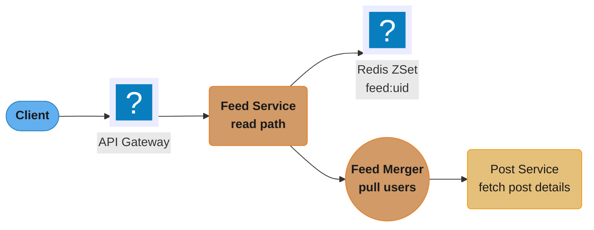
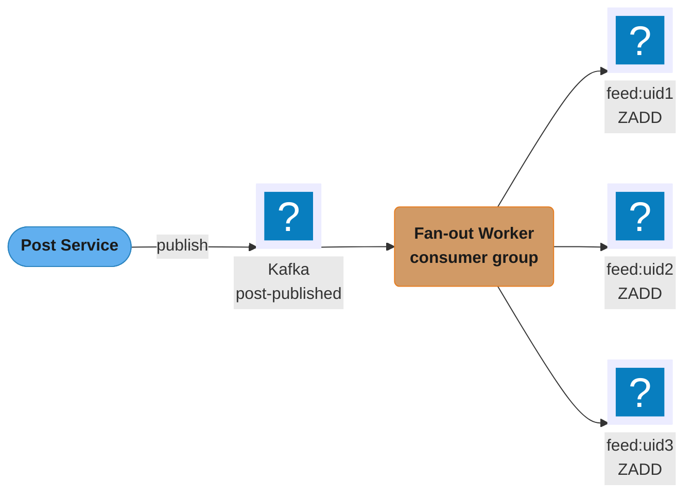
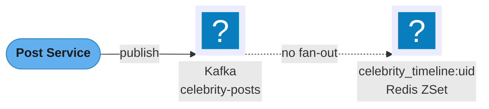
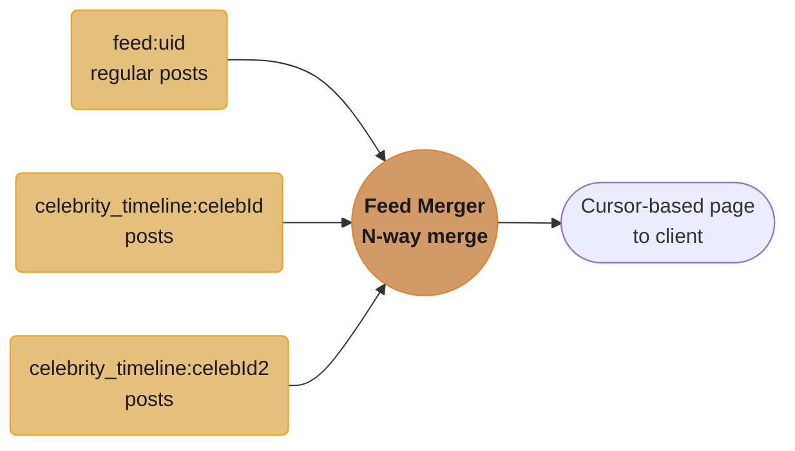
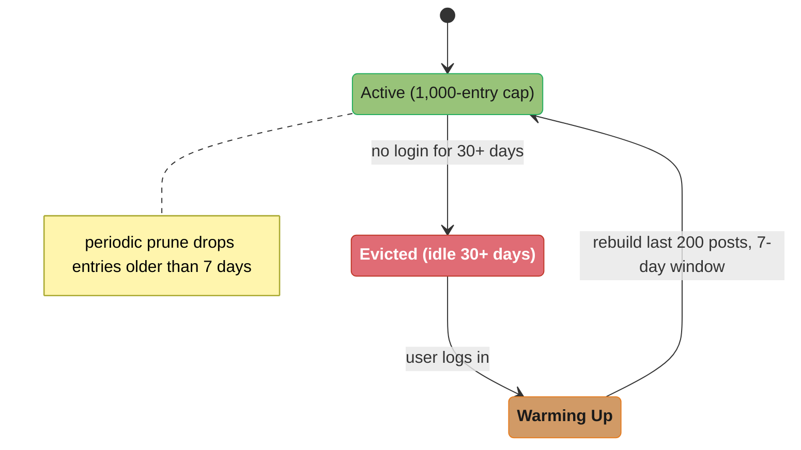
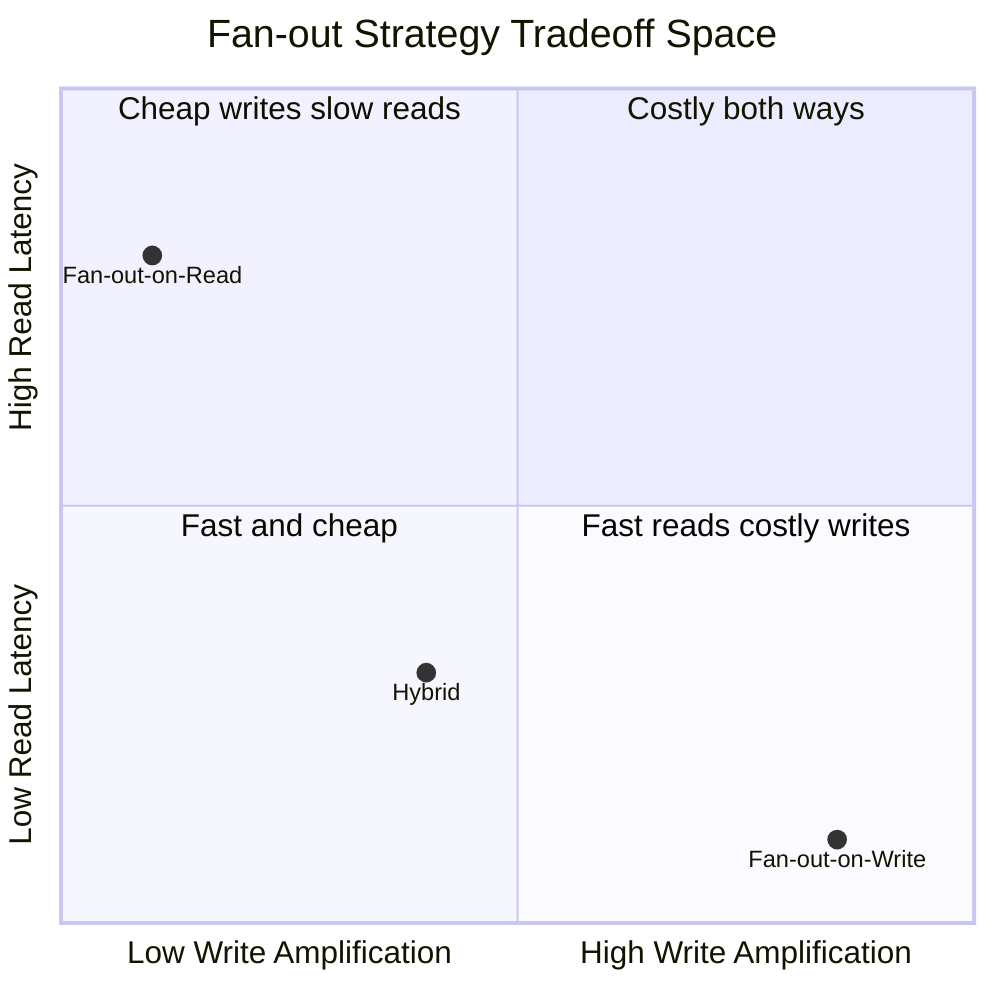

# Case Study: Social Media Home Feed Service

## Intuition

> **Design intuition**: A home feed is not a query. If you treat "show me the recent posts of the
> 5,000 accounts I follow, newest first" as a database question, you have already lost — that query
> touches 5,000 partitions on every one of 17,000 reads per second, and no index makes it cheap. The
> feed is instead a **mailbox**: a small, pre-sorted list that someone else filled in on your behalf
> before you asked. Every design decision below follows from moving work off the read path and onto
> the write path.

**Key insight for this design**: the mailbox model has exactly one failure mode, and it is
catastrophic rather than gradual. Filling 5,000 mailboxes when an ordinary user posts is fine.
Filling 40,000,000 mailboxes when a celebrity posts is not — it is the same operation, three orders
of magnitude larger, arriving as a single event with no warning. So the entire architecture is
organised around one question: **for this author, is delivery cheaper at write time or at read
time?** Below the threshold, push. Above it, leave the post where it is and let the reader come
and get it. The hybrid is not a compromise between two designs; it is the recognition that follower
count is a distribution with a very long tail, and one policy cannot serve both ends of it.

The second insight follows from the first: **the feed is a cache, not a record.** Nothing in Redis
is the source of truth — `posts` and `follows` in PostgreSQL are. That is what makes it safe to cap
a feed at 1,000 entries, evict it entirely after 30 days of inactivity, and rebuild it on demand.
Any design where losing the feed store means losing data has confused the mailbox with the post
office.

---

## 1. Requirements Clarification

Build a home feed service for a social media platform at Twitter/Instagram scale. When a user opens
the app, they see a personalized, reverse-chronological (or ranked) stream of posts from accounts
they follow.

### Functional requirements

| # | Requirement | Why it constrains the design |
|---|---|---|
| F1 | Home feed of posts from followed accounts, newest first | Ordering must be maintained across heterogeneous sources, so every source needs a comparable score |
| F2 | Cursor-based pagination (infinite scroll) | Rules out offset pagination; the sort key must double as the cursor |
| F3 | New posts visible to followers within 5 seconds | Sets the fan-out worker's lag budget, and therefore its partition and thread count |
| F4 | Users may follow up to 5,000 accounts | Bounds the read-side merge if we ever pull |
| F5 | An account may have up to 50,000,000 followers | This single number is what forces the hybrid |
| F6 | Post detail hydration (text, author, media) with the page | Adds a second round trip that must fit inside the same latency budget |

### Non-functional requirements

| # | Requirement | Target |
|---|---|---|
| N1 | Feed read latency | **p99 < 200ms** end to end |
| N2 | Fan-out lag | p99 < 5s from publish to visible |
| N3 | Availability | 99.9% on the read path; the feed degrades rather than errors |
| N4 | Durability | Feed store is a **cache** — losing it must be recoverable, never data loss |
| N5 | Cost | Feed store memory must not scale linearly with total posts |

### Explicitly out of scope

Ranking-model training and serving (this design ships reverse-chronological with a hook for a
score), content moderation, ads insertion, and the notification system. Each is a separate service
that consumes the same `post-published` stream.

### The question to ask the interviewer first

*"Is the feed reverse-chronological or ranked?"* It changes the sort key from a timestamp to a
computed score, which changes whether the cursor can be a timestamp at all, and it decides whether
the write path can be fire-and-forget or must be re-scorable. Ask it before drawing anything.

### The core tension

A single post by a celebrity with 40 million followers, delivered via fan-out-on-write, requires
40 million Redis ZSet inserts in near real-time. That is write amplification at an extreme scale.
A naive fan-out-on-read for a user following 5,000 accounts requires reading 5,000 sorted timelines
and merging them on every page load — that is read amplification at an extreme scale. Neither pure
strategy survives the requirements above. The design has to pick per author.

---

## 2. Scale Estimation

Every number below is derived, not asserted. Show the multiplication in an interview; the arithmetic
is where the design decisions come from.

### Read volume

```
Daily active users                                    500,000,000
Feed loads per user per day                                     3
                                                   ---------------
Feed read requests per day                          1,500,000,000
  / 86,400 s                                    =      17,361 rps  (average)
  peak multiplier ~3x (evening in the largest timezone)
                                                =      52,000 rps  (peak)

Pages per feed session (infinite scroll, ~2.5 pages)          2.5
Redis read operations per page:
  1 x ZRANGE on feed:{uid}                                      1
+ up to 50 x ZRANGE on celebrity_timeline:{cid}         (capped) 50
+ 1 pipelined MGET of 20 post hashes                            1
```

At peak, the feed ZSet read alone is 52,000 ops/s. The celebrity merge is the term that can explode:
if the average user follows 8 celebrities, that is `52,000 x 8 = 416,000 ops/s` of additional Redis
reads, which is why `MAX_CELEBRITY_TIMELINES` is a hard cap and not a suggestion.

### Write volume and fan-out amplification

```
Posts published per day                                50,000,000
  / 86,400 s                                    =         579 posts/s  (average)
  peak 3x                                       =       1,736 posts/s

Median follower count                                          130
Fan-out writes per ordinary post                               130
Ordinary posts (99.9% of all posts)             =  49,950,000/day

Fan-out ZADD operations per day (ordinary only):
  49,950,000 x 130                              =  6.49 billion/day
  / 86,400                                      =     75,000 ZADD/s  (average)
  peak                                          =    225,000 ZADD/s
```

Now the tail, and why it is a different problem rather than a bigger one:

```
Celebrity posts (0.1% of posts)                 =      50,000/day
Mean celebrity follower count                        2,000,000

IF we fanned these out too:
  50,000 x 2,000,000                            = 100 billion ZADD/day
  / 86,400                                      =  1.16 million ZADD/s  sustained

And the worst single event:
  one 40,000,000-follower post
  at a sustained 500,000 ZADD/s of spare capacity
                                                =  80 seconds for ONE post
  against an N2 budget of                       =   5 seconds
```

**That last division is the whole case study.** One post would consume 16x its latency budget while
monopolising the cluster, and the fan-out queue behind it would back up for every ordinary user. The
hybrid is not an optimisation; without it requirement N2 is unsatisfiable.

### Storage

```
Feed ZSet entry: 8-byte score + ~18-byte postId member
  Redis skiplist + hashtable overhead per entry   ~     60 bytes (measured, not theoretical)
Entries capped per user                                    1,000
Bytes per full feed                              60 x 1,000 = 60 KB

Active users with a materialised feed (30-day)       350,000,000
Feed store, if every one were full:
  350,000,000 x 60 KB                           =        21 TB

Real occupancy: median feed holds ~180 entries, not 1,000
  350,000,000 x 180 x 60 bytes                  =       3.8 TB   <- provision for this
  + 40% headroom for the p99 user and fragmentation
                                                =       5.3 TB
```

Post-detail cache is separate and much smaller, because it is keyed by post rather than by
(post x follower):

```
Hot post window: 48 hours of posts                   100,000,000
Cached post hash, average                            ~   800 bytes
                                                =        80 GB
```

### The number that decides the threshold

Fan-out cost is `O(followers)` at write; merge cost is `O(celebrities followed)` at read, multiplied
by read frequency. An account is cheaper to push when:

```
followers x posts_per_day  <  followers x feed_loads_per_day x merge_cost_ratio
```

which reduces to a comparison of **posts per day against feed loads per day per follower**. Empirically
that crossover lands between 5,000 and 20,000 followers for a 3-loads-per-day population; this design
uses **10,000** and makes it a runtime config, because the right value moves with engagement.

---

## 3. High-Level Architecture

The read path routes through the API Gateway into the Feed Service, which serves the pre-built ZSet
directly or merges in celebrity timelines through the Feed Merger before Post Service hydrates full
post details.



**Write Path — Fan-out-on-write** (regular users, < 10,000 followers): the Fan-out Worker consumes
`post-published` events and ZADDs the new post ID into every follower's own feed ZSet.



**Write Path — Fan-out-on-read** (celebrities, >= 10,000 followers): the post is written once to the
celebrity's own timeline — no per-follower fan-out occurs.



**Read Path — Hybrid Merge** for a user following celebrities: the pre-built feed ZSet and each
followed celebrity's timeline are merged N-way by timestamp before the cursor-based page is returned.



**Database Layer** — schema and Redis key structures backing the feed (kept as a reference listing,
not a topology diagram):

```
  PostgreSQL:
    follows(follower_id, followee_id, created_at)
    posts(post_id, author_id, content, created_at, media_url)
    users(user_id, follower_count, following_count)

  Redis:
    feed:{userId}              — ZSet: score=epoch_ms, member=postId (last 1000 items)
    celebrity_timeline:{uid}  — ZSet: celebrity's own posts (last 1000 items)
    post:{postId}              — Hash: cached post details (text, author, media)
    user:{userId}:following:celebrities — Set: celebrity IDs this user follows
```

### The latency budget, allocated

A p99 target of 200ms is only useful if it is spent explicitly. This is the allocation the design is
built to:

| Stage | Budget (p99) | Notes |
|---|---|---|
| TLS + gateway + auth | 25 ms | Mostly network; nothing here is ours to optimise |
| `feed:{uid}` ZRANGE | 3 ms | One key, one Redis Cluster node |
| Celebrity set lookup | 2 ms | Cached in Redis with a 1h TTL |
| Celebrity timeline reads (<= 50, pipelined) | 25 ms | Pipelined, so one RTT plus server time |
| N-way merge + dedup (in-process) | 5 ms | ~1,000 elements; pure CPU |
| Post hydration (pipelined MGET of 20) | 15 ms | Plus DB fallback on miss, see below |
| Serialization + response | 10 ms | |
| **Slack for the DB fallback path** | **115 ms** | A hydration cache miss costs a Postgres round trip; the budget must absorb it or the p99 is a lie |

The slack line is the one candidates forget. A 95% hydration hit rate means 1 in 20 pages takes a
database hop — which lands squarely in the p99, not the p50.

---

## 4. Component Deep Dives

**Shared primitives.** Backend's `case_studies/` has no `cross_cutting/` directory; by the convention
documented in [`../case_studies.md`](../case_studies.md), the shared primitives live as deep-dive
modules in the section itself. This case study leans on seven of them:

| Primitive used here | Deep dive |
|---|---|
| Redis data structures, cache-aside, stampede, eviction policy | [`../../caching_strategies_deep_dive/caching_strategies_deep_dive.md`](../../caching_strategies_deep_dive/caching_strategies_deep_dive.md) |
| Partitioning, consumer groups, lag, share groups | [`../../kafka_deep_dive/kafka_deep_dive.md`](../../kafka_deep_dive/kafka_deep_dive.md) |
| Idempotent consumers, DLQ, poison pill, ordering vs throughput | [`../../messaging_patterns/messaging_patterns.md`](../../messaging_patterns/messaging_patterns.md) |
| Cursor pagination and its API contract | [`../../rest_api_design/rest_api_design.md`](../../rest_api_design/rest_api_design.md) |
| Per-user quotas, hot-key throttling, adaptive shedding | [`../../rate_limiting_in_depth/rate_limiting_in_depth.md`](../../rate_limiting_in_depth/rate_limiting_in_depth.md) |
| SLI definition, consumer-lag alerting, cache hit-rate metrics | [`../../observability_and_monitoring/observability_and_monitoring.md`](../../observability_and_monitoring/observability_and_monitoring.md) |
| Redis vs Valkey engine internals, memory layout, eviction | [`../../../database/redis_internals/redis_internals.md`](../../../database/redis_internals/redis_internals.md) |
| Real-time push of new posts to an open client | [`../../websockets_and_sse/websockets_and_sse.md`](../../websockets_and_sse/websockets_and_sse.md) |

### 4.1 BROKEN -> FIXED: Fan-out Without a Celebrity Check

The obvious first implementation treats every author identically. It works perfectly in staging,
where the largest test account has 200 followers.

```java
// BROKEN: one policy for every author.
@KafkaListener(topics = "post-published", groupId = "feed-fanout-group")
public void onPostPublished(PostPublishedEvent event) {
    List<String> followerIds = followRepository.findFollowerIds(event.getAuthorId());  // 40,000,000 rows
    double score = event.getCreatedAt().toEpochMilli();
    for (String followerId : followerIds) {
        redis.opsForZSet().add("feed:" + followerId, event.getPostId(), score);        // 40,000,000 RTTs
    }
}
```

Three failures compound, and only the first is obvious:

1. **`findFollowerIds` materialises 40 million rows into a `List<String>`.** At ~40 bytes per boxed
   string that is roughly 1.6 GB of heap for one message, so the worker dies of `OutOfMemoryError`
   before it issues a single ZADD.
2. **Even without the OOM, 40 million un-pipelined round trips** at a generous 20,000 ops/s per
   connection is 2,000 seconds — 33 minutes for one post, against a 5-second budget.
3. **The consumer never acknowledges**, so the partition's offset does not advance, so *every other
   author's posts sitting behind this one on the same partition are also stalled*. One celebrity
   post silently becomes a section-wide outage.

The fix is two changes, and it matters that they are two: routing by author size, and streaming the
followers rather than loading them.

```java
// FIXED: route by author size first, then stream + pipeline the ordinary path.
private static final int CELEBRITY_THRESHOLD = 10_000;   // runtime config, not a constant in prod
private static final int FANOUT_BATCH = 500;

@KafkaListener(topics = "post-published", groupId = "feed-fanout-group", concurrency = "8")
public void onPostPublished(@Payload PostPublishedEvent event, Acknowledgment ack) {
    User author = userRepository.findById(event.getAuthorId()).orElseThrow();

    if (author.getFollowerCount() >= CELEBRITY_THRESHOLD) {
        // ONE write, regardless of follower count. O(1) instead of O(followers).
        String timelineKey = "celebrity_timeline:" + event.getAuthorId();
        redis.opsForZSet().add(timelineKey, event.getPostId(), event.getCreatedAt().toEpochMilli());
        redis.opsForZSet().removeRange(timelineKey, 0, -(MAX_FEED_SIZE + 1));
    } else {
        fanOutInBatches(event);      // keyset-paginated, pipelined, bounded heap
    }
    ack.acknowledge();
}
```

The celebrity branch turns an `O(followers)` write into an `O(1)` write. That is the entire trick,
and it costs a read-side merge that §4.4 has to pay for.

### 4.2 Hybrid Fan-out Strategy

The system classifies accounts as "celebrities" when their follower count exceeds a configurable
threshold (default 10,000). The threshold is checked at post-publish time.

Regular users (< 10,000 followers): fan-out-on-write. The fan-out worker reads the author's
follower list from the database and writes the new post ID into every follower's Redis ZSet feed.
Each follower's feed is always pre-computed and ready to serve with a single Redis ZREVRANGE.

Celebrity users (>= 10,000 followers): fan-out-on-read. The post is written only to the celebrity's
own `celebrity_timeline:{uid}` ZSet. No fan-out occurs at write time. At read time, the feed service
identifies which celebrities the requesting user follows, fetches pages from each celebrity's
timeline, and merges them with the user's pre-built feed ZSet. An N-way merge by timestamp
(priority queue) produces the final feed page.

**The boundary case that gets missed.** An account crossing the threshold does not retroactively fix
history. When user X goes from 9,998 to 10,001 followers, their *older* posts are already sitting in
followers' feed ZSets while *newer* posts go only to the celebrity timeline. Both are read, so the
result is correct — but if you ever move the threshold *down*, previously-pushed posts and
newly-pulled posts can both appear, which is exactly why `mergeSortedLists` deduplicates by post ID
rather than trusting the sources to be disjoint.

### 4.3 Redis ZSet as Feed Store

`ZADD feed:{userId} <timestamp_ms> <postId>` stores postIds sorted by timestamp. Reading a page is
`ZRANGE feed:{userId} <cursor_ts> -inf BYSCORE REV LIMIT 0 20` — O(log N + page_size). (Spring Data
Redis' `reverseRangeByScoreWithScores` is the binding for this; it still emits the older
`ZREVRANGEBYSCORE` spelling on the wire, which is behaviourally identical.) No offset
arithmetic; the score (timestamp) is the cursor. The ZSet is bounded to the last 1,000 post IDs
per user via `ZREMRANGEBYRANK feed:{userId} 0 -1001` after each fan-out insertion. Older posts are
served from the database if the user scrolls back far enough (rare in practice).

**Engine note.** Everything here is plain sorted-set semantics, so the engine is a procurement
decision rather than a design one: AWS ElastiCache and Google Memorystore now provision **Valkey**
— the BSD-3-Clause Linux Foundation fork of Redis 7.2.4 — for new clusters, and it is wire- and
command-compatible, so `ZADD`, `ZRANGE ... BYSCORE REV`, `ZREMRANGEBYRANK` and the pipelining below
behave identically. Pin the engine version in infrastructure code rather than accepting "latest";
the engine-internals comparison lives in
[`../../../database/redis_internals/redis_internals.md`](../../../database/redis_internals/redis_internals.md).

### 4.4 Cursor-Based Pagination

Offset-based pagination (`LIMIT 20 OFFSET 100`) is dangerous at scale: each page requires scanning
and discarding the first 100 rows, which gets slower the deeper you go and produces unstable results
when new posts arrive. Cursor-based pagination uses the score (timestamp) of the last item returned
as the next page's upper boundary. The client passes `cursor=<last_post_timestamp_ms>` and the
server executes `ZREVRANGEBYSCORE ... <cursor> -inf LIMIT 0 20`. This is O(log N) regardless of page
depth and stable across concurrent inserts.

**The tie-break nobody handles until it bites.** Millisecond timestamps collide: two posts published
in the same millisecond both have score `1755000000123`, and an exclusive `cursor - 1` bound will
skip one of them silently. Make the score strictly monotonic per feed — use a Snowflake-style ID
whose high bits are the timestamp and whose low bits are a per-shard sequence, and store *that* as
the score. It is the same sort order and removes the collision entirely.

### 4.5 Post Detail Hydration

The feed ZSet stores only post IDs. The feed service hydrates post details (text, author, media) in
a separate step. Post details are cached in Redis Hash structures (`post:{postId}`) with a 24-hour
TTL. A cache miss fetches from the Post service database. Hydration is batched: the service fetches
all 20 post IDs in the page in one round trip — either `MGET`, or the pipelined `GET`s the code below
uses (Spring Data Redis' `executePipelined`) — keeping the total hydration latency under 10ms.

**Why this is the right place to spend a cache.** Post details are keyed by post, so the cache is
shared across every follower who sees that post. A celebrity post with 40 million viewers is cached
*once*. That asymmetry — feed entries scale with (post x follower), post details scale with post — is
why the feed store is 5.3 TB and the detail cache is 80 GB.

### 4.6 Feed Cache Eviction

To prevent unbounded Redis memory growth, the ZSet is capped at 1,000 entries per user. Entries
older than 7 days are periodically removed with `ZREMRANGEBYSCORE feed:{userId} -inf
<7_days_ago_epoch>`. For users who are inactive for more than 30 days, the entire feed ZSet is
evicted. On their next login, the feed is rebuilt by reading the most recent posts from followed
accounts — an on-demand warm-up query.

A feed ZSet cycles between an active, periodically pruned state and full eviction after 30 days of
inactivity; the next login triggers an on-demand warm-up that rebuilds the last 200 posts from a
7-day lookback before the feed returns to active.



Set `maxmemory-policy` to `volatile-lru` rather than `allkeys-lru` on the feed cluster. The feed
ZSets carry a TTL and are safe to evict; the `user:*:following:celebrities` sets are also TTL'd; but
evicting an in-flight warm-up target under memory pressure produces an empty feed for a user who is
actively looking at it. Scoping eviction to keys that have a TTL makes the policy match the intent.

### 4.7 Domain Model

```java
public record Post(
        String postId,
        String authorId,
        String authorUsername,
        String content,
        String mediaUrl,
        Instant createdAt,
        long likeCount,
        long replyCount
) {}

public record FeedPage(
        List<Post> posts,
        String nextCursor,          // null if no more pages
        boolean hasMore
) {}
```

### 4.8 Fan-out Worker (Kafka Consumer)

```java
@Component
@Slf4j
public class FanOutWorker {

    private static final int CELEBRITY_THRESHOLD = 10_000;
    private static final int MAX_FEED_SIZE = 1_000;

    private final StringRedisTemplate redis;
    private final FollowRepository followRepository;
    private final UserRepository userRepository;

    @KafkaListener(
            topics = "post-published",
            groupId = "feed-fanout-group",
            concurrency = "8"             // 8 consumer threads for parallelism
    )
    public void onPostPublished(
            @Payload PostPublishedEvent event,
            Acknowledgment ack) {

        try {
            User author = userRepository.findById(event.getAuthorId())
                    .orElseThrow(() -> new UserNotFoundException(event.getAuthorId()));

            if (author.getFollowerCount() >= CELEBRITY_THRESHOLD) {
                handleCelebrityPost(event);
            } else {
                handleRegularPost(event);
            }
            ack.acknowledge();
        } catch (Exception e) {
            log.error("Fan-out failed for post {}: {}", event.getPostId(), e.getMessage());
            // Do not ack — Kafka will redeliver. Circuit-breaker handles repeated failures.
            throw e;
        }
    }

    /**
     * Celebrity post: write only to the celebrity's own timeline ZSet.
     * No fan-out to followers.
     */
    private void handleCelebrityPost(PostPublishedEvent event) {
        String timelineKey = "celebrity_timeline:" + event.getAuthorId();
        double score = event.getCreatedAt().toEpochMilli();

        redis.opsForZSet().add(timelineKey, event.getPostId(), score);
        // Keep celebrity timeline bounded to last 1000 posts
        redis.opsForZSet().removeRange(timelineKey, 0, -(MAX_FEED_SIZE + 1));

        log.debug("Celebrity post {} added to timeline {}", event.getPostId(), event.getAuthorId());
    }

    /**
     * Regular post: fan-out to all followers' feed ZSets.
     * Processed in batches to avoid a single massive DB query.
     */
    private void handleRegularPost(PostPublishedEvent event) {
        double score = event.getCreatedAt().toEpochMilli();
        int batchSize = 500;
        long offset = 0;

        while (true) {
            List<String> followerIds = followRepository
                    .findFollowerIds(event.getAuthorId(), offset, batchSize);

            if (followerIds.isEmpty()) break;

            // Use Redis pipeline to batch all ZADD commands
            redis.executePipelined((RedisCallback<Object>) connection -> {
                for (String followerId : followerIds) {
                    byte[] key = ("feed:" + followerId).getBytes();
                    connection.zAdd(key, score, event.getPostId().getBytes());
                    // Trim to MAX_FEED_SIZE: remove rank 0 to (size - MAX_FEED_SIZE - 1)
                    connection.zRemRangeByRank(key, 0, -(MAX_FEED_SIZE + 1));
                }
                return null;
            });

            log.debug("Fan-out batch: post={}, followers={}", event.getPostId(), followerIds.size());

            if (followerIds.size() < batchSize) break;
            offset += batchSize;
        }
    }
}
```

Two production notes on this listener. `concurrency = "8"` only helps if the topic has at least 8
partitions — a classic consumer group cannot run more useful consumers than partitions, so the
topic is provisioned at 48 partitions to allow scaling the worker fleet to 48 threads without a
repartition (see [`../../kafka_deep_dive/kafka_deep_dive.md`](../../kafka_deep_dive/kafka_deep_dive.md)).
And the `findFollowerIds(authorId, offset, batchSize)` signature uses OFFSET, which degrades on deep
pages for exactly the reason §4.4 rejects offset pagination; for authors near the threshold, switch
it to a keyset scan on `(followee_id, follower_id)`.

### 4.9 Feed Service (Read Path)

```java
@Service
@Slf4j
public class FeedService {

    private static final int DEFAULT_PAGE_SIZE = 20;
    private static final int MAX_CELEBRITY_TIMELINES = 50; // cap for merge complexity

    private final StringRedisTemplate redis;
    private final PostService postService;
    private final FollowRepository followRepository;

    /**
     * Returns a page of feed posts for the given user.
     *
     * @param userId     the requesting user
     * @param cursor     timestamp cursor (null for first page = start from now)
     * @param pageSize   number of posts (default 20)
     */
    public FeedPage getFeed(String userId, String cursor, int pageSize) {
        long upperBound = cursor != null
                ? Long.parseLong(cursor) - 1   // exclusive upper bound
                : Long.MAX_VALUE;

        // 1. Fetch posts from the user's pre-built feed ZSet (regular accounts)
        List<ScoredPost> regularPosts = fetchFromFeedZSet(userId, upperBound, pageSize * 2);

        // 2. Fetch posts from celebrity timelines the user follows
        List<String> followedCelebrities = getFollowedCelebrities(userId);
        List<ScoredPost> celebrityPosts = fetchCelebrityPosts(followedCelebrities, upperBound, pageSize * 2);

        // 3. N-way merge by timestamp (descending)
        List<ScoredPost> merged = mergeSortedLists(regularPosts, celebrityPosts);

        // 4. Take the top pageSize items
        List<ScoredPost> page = merged.stream()
                .limit(pageSize)
                .collect(Collectors.toList());

        if (page.isEmpty()) {
            return new FeedPage(Collections.emptyList(), null, false);
        }

        // 5. Hydrate post details (parallelized)
        List<String> postIds = page.stream().map(ScoredPost::postId).collect(Collectors.toList());
        List<Post> posts = postService.getPostsByIds(postIds);

        // 6. Compute next cursor
        long nextCursorValue = page.get(page.size() - 1).score();
        String nextCursor = merged.size() > pageSize ? String.valueOf(nextCursorValue) : null;

        return new FeedPage(posts, nextCursor, nextCursor != null);
    }

    private List<ScoredPost> fetchFromFeedZSet(String userId, long upperBound, int limit) {
        String key = "feed:" + userId;
        Set<ZSetOperations.TypedTuple<String>> results =
                redis.opsForZSet().reverseRangeByScoreWithScores(
                        key,
                        Double.NEGATIVE_INFINITY,
                        upperBound,
                        0,
                        limit);

        if (results == null) return Collections.emptyList();

        return results.stream()
                .map(t -> new ScoredPost(t.getValue(), t.getScore().longValue()))
                .collect(Collectors.toList());
    }

    private List<String> getFollowedCelebrities(String userId) {
        String key = "user:" + userId + ":following:celebrities";
        Set<String> members = redis.opsForSet().members(key);
        if (members == null || members.isEmpty()) {
            // Cache miss: load from DB and cache
            List<String> celebrities = followRepository.findFollowedCelebrities(userId);
            if (!celebrities.isEmpty()) {
                redis.opsForSet().add(key, celebrities.toArray(new String[0]));
                redis.expire(key, Duration.ofHours(1));
            }
            return celebrities;
        }
        return new ArrayList<>(members);
    }

    private List<ScoredPost> fetchCelebrityPosts(
            List<String> celebrityIds, long upperBound, int limitPerCelebrity) {

        if (celebrityIds.isEmpty()) return Collections.emptyList();

        // Cap the number of celebrity timelines to merge
        List<String> celebsToMerge = celebrityIds.stream()
                .limit(MAX_CELEBRITY_TIMELINES)
                .collect(Collectors.toList());

        List<ScoredPost> allCelebrityPosts = new ArrayList<>();
        for (String celebId : celebsToMerge) {
            String key = "celebrity_timeline:" + celebId;
            Set<ZSetOperations.TypedTuple<String>> results =
                    redis.opsForZSet().reverseRangeByScoreWithScores(
                            key,
                            Double.NEGATIVE_INFINITY,
                            upperBound,
                            0,
                            limitPerCelebrity);
            if (results != null) {
                results.forEach(t -> allCelebrityPosts.add(
                        new ScoredPost(t.getValue(), t.getScore().longValue())));
            }
        }
        return allCelebrityPosts;
    }

    /**
     * N-way merge: combines two pre-sorted (descending by score) lists.
     * Uses a PriorityQueue for general N-way merge across all sources.
     */
    private List<ScoredPost> mergeSortedLists(List<ScoredPost> a, List<ScoredPost> b) {
        List<ScoredPost> combined = new ArrayList<>(a.size() + b.size());
        combined.addAll(a);
        combined.addAll(b);

        // Sort descending by score (timestamp)
        combined.sort(Comparator.comparingLong(ScoredPost::score).reversed());

        // Deduplicate post IDs (a post could appear in both a regular feed and a celebrity timeline
        // if the celebrity is also followed as a regular account edge case)
        Set<String> seen = new LinkedHashSet<>();
        List<ScoredPost> deduped = new ArrayList<>();
        for (ScoredPost sp : combined) {
            if (seen.add(sp.postId())) {
                deduped.add(sp);
            }
        }
        return deduped;
    }

    public record ScoredPost(String postId, long score) {}
}
```

The sequential `for` loop in `fetchCelebrityPosts` is the read path's real hot spot: 50 celebrities
means 50 serial round trips, and at a 0.5ms RTT that is 25ms of pure network before any merging. In
production this loop is pipelined into a single round trip, or issued across the cluster in parallel
with a bounded executor. The cap of 50 is what keeps the worst case finite even in the naive form.

### 4.10 Post Service with Parallelized Hydration

```java
@Service
public class PostService {

    private final StringRedisTemplate redis;
    private final PostRepository postRepository;
    private final ObjectMapper objectMapper;

    /**
     * Fetches post details for a list of post IDs.
     * Checks Redis first (pipeline MGET), falls back to DB for misses.
     * Returns posts in the same order as input postIds.
     */
    public List<Post> getPostsByIds(List<String> postIds) {
        if (postIds.isEmpty()) return Collections.emptyList();

        // Build cache keys
        List<String> cacheKeys = postIds.stream()
                .map(id -> "post:" + id)
                .collect(Collectors.toList());

        // Pipeline MGET for all keys in one round trip
        List<Object> cachedValues = redis.executePipelined((RedisCallback<Object>) conn -> {
            for (String key : cacheKeys) {
                conn.get(key.getBytes());
            }
            return null;
        });

        // Identify cache misses
        List<String> missedIds = new ArrayList<>();
        for (int i = 0; i < postIds.size(); i++) {
            if (cachedValues.get(i) == null) {
                missedIds.add(postIds.get(i));
            }
        }

        // Fetch misses from DB
        Map<String, Post> dbPosts = Collections.emptyMap();
        if (!missedIds.isEmpty()) {
            dbPosts = postRepository.findAllById(missedIds).stream()
                    .collect(Collectors.toMap(Post::postId, p -> p));

            // Write misses back to cache (pipeline SET with TTL)
            Map<String, Post> finalDbPosts = dbPosts;
            redis.executePipelined((RedisCallback<Object>) conn -> {
                for (Map.Entry<String, Post> entry : finalDbPosts.entrySet()) {
                    String key = "post:" + entry.getKey();
                    byte[] value = serialize(entry.getValue());
                    conn.setEx(key.getBytes(), 86_400, value);  // 24-hour TTL
                }
                return null;
            });
        }

        // Assemble result in original order
        List<Post> result = new ArrayList<>(postIds.size());
        for (int i = 0; i < postIds.size(); i++) {
            String rawCached = (String) cachedValues.get(i);
            if (rawCached != null) {
                result.add(deserialize(rawCached));
            } else {
                Post dbPost = dbPosts.get(postIds.get(i));
                if (dbPost != null) result.add(dbPost);
                // If still null, post was deleted — skip
            }
        }
        return result;
    }

    private byte[] serialize(Post post) {
        try {
            return objectMapper.writeValueAsBytes(post);
        } catch (JsonProcessingException e) {
            throw new RuntimeException(e);
        }
    }

    private Post deserialize(String json) {
        try {
            return objectMapper.readValue(json, Post.class);
        } catch (JsonProcessingException e) {
            throw new RuntimeException(e);
        }
    }
}
```

Note the final comment: a deleted post is skipped, which means a page can return 18 items when 20
were requested. That is correct — the alternative, back-filling from the next page, either issues a
second round trip or breaks the cursor. Return the short page and let the client keep scrolling.

### 4.11 Feed REST Controller

```java
@RestController
@RequestMapping("/api/v1/feed")
public class FeedController {

    private final FeedService feedService;

    /**
     * GET /api/v1/feed?cursor=<timestamp>&pageSize=20
     *
     * First page: omit cursor (or cursor=null)
     * Subsequent pages: pass cursor returned in previous response
     */
    @GetMapping
    public ResponseEntity<FeedPage> getFeed(
            @AuthenticationPrincipal UserPrincipal principal,
            @RequestParam(required = false) String cursor,
            @RequestParam(defaultValue = "20") int pageSize) {

        pageSize = Math.min(pageSize, 50);   // cap at 50 to prevent abuse
        FeedPage page = feedService.getFeed(principal.getUserId(), cursor, pageSize);

        return ResponseEntity.ok()
                .cacheControl(CacheControl.maxAge(5, TimeUnit.SECONDS))
                .body(page);
    }
}
```

The user id comes from the authenticated principal, never from a request parameter. A feed endpoint
that accepts `?userId=` is an IDOR waiting to happen, and it is the single most common security bug
in a feed API.

### 4.12 Feed Warm-up on User Login

```java
@Component
@Slf4j
public class FeedWarmUpService {

    private static final int WARM_UP_POST_COUNT = 200;

    private final StringRedisTemplate redis;
    private final FollowRepository followRepository;
    private final PostRepository postRepository;

    /**
     * Called when a previously-inactive user logs in and their feed ZSet is missing.
     * Runs asynchronously — the UI shows a loading state.
     */
    @Async("feedWarmUpExecutor")
    public void warmUpFeed(String userId) {
        String feedKey = "feed:" + userId;

        // Check if feed already exists
        Long size = redis.opsForZSet().size(feedKey);
        if (size != null && size > 0) return;

        log.info("Warming up feed for inactive user {}", userId);

        // Fetch accounts followed by this user
        List<String> followedIds = followRepository.findFolloweeIds(userId);

        if (followedIds.isEmpty()) return;

        // Fetch most recent posts from followed accounts (last 7 days, max 200 posts)
        Instant since = Instant.now().minus(Duration.ofDays(7));
        List<Post> recentPosts = postRepository.findRecentPostsByAuthors(
                followedIds, since, WARM_UP_POST_COUNT);

        if (recentPosts.isEmpty()) return;

        // Populate feed ZSet
        redis.executePipelined((RedisCallback<Object>) conn -> {
            byte[] key = feedKey.getBytes();
            for (Post post : recentPosts) {
                double score = post.createdAt().toEpochMilli();
                conn.zAdd(key, score, post.postId().getBytes());
            }
            conn.expire(key, 7 * 24 * 3600L);
            return null;
        });

        log.info("Feed warm-up complete for user {}: {} posts loaded", userId, recentPosts.size());
    }
}
```

The check-then-populate here is a benign race — two concurrent logins can both warm the same feed,
and the second's `ZADD`s are no-ops because the member and score are identical. This is the one
place where ZADD's idempotency is doing load-bearing work rather than being a nice property.

---

## 5. Design Decisions & Tradeoffs

### Fan-out-on-Write vs Fan-out-on-Read vs Hybrid

| Dimension | Fan-out-on-Write | Fan-out-on-Read | Hybrid |
|---|---|---|---|
| Read latency | Single Redis ZREVRANGE: ~1ms | N timeline reads + merge: ~10–50ms | ~5–15ms |
| Write amplification | High: O(followers) per post | None at write time | Low for celebrities |
| Celebrity problem | 40M followers = 40M ZSet writes | Acceptable (1 timeline) | Celebrity uses pull |
| Feed freshness | Near-real-time | Real-time | Near-real-time |
| Implementation complexity | Low | Medium | High |
| Chosen for this design | Regular users only | Not used stand-alone | Yes |

Fan-out-on-write buys near-instant reads (~1ms) at the cost of high write amplification; fan-out-on-read
flips that trade; the hybrid design sits closer to the fast-and-cheap corner because it only pays the
read-side merge cost for celebrity follows.



### Redis vs Cassandra for Feed Storage

Redis ZSet is ideal for the feed because sorted set operations (ZADD, ZREVRANGEBYSCORE) are
O(log N) and feed reads are single-key operations that map to one node in Redis Cluster. Cassandra
with a time-series data model (partition key = userId, clustering key = timestamp) is a valid
alternative at extremely large scales (billions of users) where Redis memory cost becomes prohibitive.
Cassandra stores data on disk and is cheaper per GB but has higher read latency — single-digit
milliseconds against Redis' sub-millisecond, order-of-magnitude figures meant as illustration, not as
a benchmark result; measure on your own hardware and access pattern.

### Activity Stream vs Materialized Timeline

This design uses a materialized timeline (feed ZSet pre-built at write time). An activity stream
approach stores a single log of all activities and fans out at read time via a query engine. Activity
streams are simpler to write but harder to read at scale. Materialized timelines trade write cost
for read speed, which is the right tradeoff for any feed where reads heavily outnumber writes — the
condition, not a specific published ratio, is what makes the choice. For this design the requirements
above pin it down concretely: 1.5 billion feed reads/day against a far smaller post-publish volume.

### Decisions summary

| Decision | Chosen | Rejected | Why |
|---|---|---|---|
| Delivery | Hybrid push/pull at 10,000 followers | Pure push; pure pull | Pure push cannot meet N2 for a 40M-follower author (80s vs 5s); pure pull cannot meet N1 for a 5,000-following reader |
| Feed store | Redis/Valkey ZSet, capped at 1,000 | Cassandra wide row | Sub-ms single-key reads matter more than per-GB cost at 5.3 TB; revisit if the store passes ~50 TB |
| Sort key | Timestamp (Snowflake-style ID in production) | Auto-increment; UUID | Must be sortable, monotonic and usable directly as a cursor |
| Pagination | Cursor on the sort key | Offset | Offset cost grows with depth and is unstable under concurrent inserts |
| Detail cache | Keyed by post, 24h TTL | Denormalise post body into the feed | Feed entries scale with (post x follower); post bodies scale with post — 5.3 TB vs 80 GB |
| Consistency | Eventual, 5s target | Read-your-writes across the whole feed | Your own post is inserted client-side optimistically; everyone else's can lag |

---

## 6. Real-World Implementations

| Company | What they actually do |
|---|---|
| **Twitter / X** | The canonical published example of the hybrid. Home timelines are materialised and held in memory, and posts from very-high-follower accounts are *not* fanned out — they are merged into the timeline at read time. The engineering blog's account of the recommendation pipeline describes an in-network (followed accounts) and out-of-network candidate split feeding a ranking stage, which is the same push/pull separation generalised from "celebrity" to "source". |
| **Instagram** | Started on Redis for feed storage and moved the bulk of it to Cassandra as the memory cost stopped scaling, keeping Redis for the hottest access paths. Their published work on Cassandra (and later a Rust-based storage layer) is the reference for the "when does Redis stop being the right answer" question this design defers. Instagram Explore is explicitly a multi-stage ML funnel — two-tower retrieval, first-stage and second-stage ranking, then reranking. |
| **LinkedIn** | **FollowFeed** replaced a materialised push architecture with a *pull*-based one: activities are stored per-source and merged at read time, with a ranking pass. LinkedIn's stated reason is instructive and cuts against the default — a push architecture duplicates every activity per follower, which made storage and re-ranking (they wanted to re-score with new models) prohibitively expensive. If you must re-rank, pull is cheaper than push. |
| **Facebook** | **TAO** is the read-optimised, eventually-consistent graph store in front of MySQL that serves the association queries a feed needs (who does X follow). Multifeed's leaf-aggregator design keeps recent activity in memory on leaf nodes and fans a query out to them, aggregating results — pull, at the storage layer, with the fan-out moved off the write path entirely. |
| **Discord** | The read-heavy inverse: channel messages are a single shared timeline rather than per-user mailboxes, so there is no fan-out at all; the hard problem moves to hot-partition handling for the largest servers. Worth naming in an interview as the case where the mailbox model is simply the wrong shape. |

The pattern across all five: **the industry does not agree on push vs pull, and that is the answer.**
Twitter pushes and pulls; LinkedIn moved from push to pull specifically to enable re-ranking;
Facebook pulls from an in-memory leaf tier. What they agree on is that the choice is driven by
follower-count distribution and by whether you need to re-score after write.

---

## 7. Technologies & Tools

| Technology | Role |
|---|---|
| Spring Boot 4.1 | Application framework |
| Redis 7 / Valkey 9 (Cluster) | Feed ZSet storage, celebrity timelines, post detail cache. AWS ElastiCache and Google Memorystore provision Valkey for new clusters; wire- and command-compatible, so nothing here changes |
| Spring Data Redis | RedisTemplate, ZSetOperations, pipeline support |
| Kafka 4.x (KRaft) | `post-published` topic for async fan-out; 48 partitions keyed by author id |
| Spring Kafka | @KafkaListener with concurrency, manual Acknowledgment |
| PostgreSQL 18 | Persistent store for posts, follows, user data — the source of truth the feed cache is rebuilt from |
| Spring Data JPA | Follow and post persistence |
| Spring Security | User principal extraction for feed ownership |
| @Async + ThreadPoolTaskExecutor | Feed warm-up on login |
| Micrometer | Metrics: fan-out latency, feed hit rate, celebrity merge latency |
| Prometheus + Grafana | Consumer-lag and latency SLO dashboards, burn-rate alerts |
| KEDA | Scales the fan-out worker deployment on Kafka consumer lag rather than CPU |

---

## 8. Operational Playbook

### SLIs and SLOs

| SLI | SLO | Measured where |
|---|---|---|
| Feed read latency | p99 < 200 ms | Gateway, per-endpoint histogram |
| Fan-out lag (publish -> visible) | p99 < 5 s | Timestamp delta recorded by the worker, exported as a histogram |
| Feed read availability | 99.9% non-5xx | Gateway |
| Post-detail cache hit rate | > 95% | Micrometer counter pair in `PostService` |
| Celebrity merge latency | p99 < 40 ms | Timer around `fetchCelebrityPosts` |

Alert on **burn rate**, not on raw threshold crossings: a multiwindow, multi-burn-rate alert (fast
window 1h at 14.4x, slow window 6h at 6x) pages when the error budget is actually being consumed,
which is the difference between two pages a week and fifty. See
[`../../observability_and_monitoring/observability_and_monitoring.md`](../../observability_and_monitoring/observability_and_monitoring.md).

### Runbook: fan-out consumer lag rising

1. Check `kafka_consumergroup_lag` per partition. **Uniform** lag across partitions means the fleet
   is undersized — scale the deployment (KEDA does this automatically up to the 48-partition
   ceiling). **Single-partition** lag means a hot key: one author id is hashing to that partition and
   is either a mis-classified celebrity or an automated poster.
2. If single-partition, check whether that author's `follower_count` in `users` is stale. The
   threshold check reads a denormalised counter; if the counter update lags the actual follows, a
   real celebrity is being fanned out. This is the most common cause.
3. Mitigation: add the author id to the runtime celebrity-override set, which forces the pull path
   regardless of the counter. Backfill the counter afterwards.

### Runbook: feed read p99 breach with normal Redis latency

The merge path is the usual culprit. Check the `celebrity_merge_latency` timer and the distribution
of `followedCelebrities.size()`. A user following 50 celebrities pays 50 serial round trips in the
naive implementation. Mitigations in order: confirm the `MAX_CELEBRITY_TIMELINES` cap is applied,
confirm the celebrity-set cache is hitting (a miss adds a Postgres query to every page), then
pipeline the loop.

### Runbook: Redis cluster node loss

The feed store is a cache, so node loss is a latency event, not a data event. Expect a hit-rate
cliff on the affected slot range and a burst of warm-up traffic. Two guardrails matter: the warm-up
path must be rate-limited per Postgres connection pool (see
[`../../connection_pooling_deep_dive/connection_pooling_deep_dive.md`](../../connection_pooling_deep_dive/connection_pooling_deep_dive.md)),
or a mass warm-up stampedes the database; and the read path must degrade to "recent posts from
followed accounts, unranked" rather than returning a 500.

### Deploying a threshold change

Changing `CELEBRITY_THRESHOLD` is a data-shape change, not a config tweak. Lowering it strands
already-pushed posts in follower feeds (handled by the merge dedup, §4.2). **Raising** it is the
dangerous direction: accounts that were pull suddenly become push, and the first post after the
change fans out to their entire follower list at once. Roll a raise out per-account over hours, not
globally.

### Backfill and replay

Rebuilding all feeds from scratch is a `post-published` replay from the Kafka retention window plus a
Postgres scan for anything older. The operation is safe because ZADD is idempotent, and it is the
reason the retention window is 7 days rather than 1 — the retention period is a recovery-time
decision, not a storage decision.

---

## 9. Common Pitfalls & War Stories

**The celebrity that was not flagged.** A creator's follower count crossed 10,000 during a viral
weekend, but the `users.follower_count` denormalised counter was updated by a nightly batch job. For
14 hours the fan-out worker read a stale count of 8,400 and pushed every post to what had become
2.1 million followers. Partition 23 accumulated **41 minutes of lag**, and because Kafka delivers a
partition in order, every ordinary author whose id hashed to partition 23 — roughly 1/48th of the
platform — had their posts invisible to followers for that entire window. Two fixes, and the second
is the real one: update the counter transactionally with the follow, and add a *runtime override
set* so an on-call engineer can force an account to the pull path in seconds without a deploy.

**The 200ms p99 that was really 900ms.** The team measured feed latency with a synthetic user who
followed 40 accounts and zero celebrities, saw 45ms p99, and shipped. Real p99 users followed 3,000
accounts including 38 celebrities, and the serial merge loop in `fetchCelebrityPosts` cost 38 round
trips. Measured p99 was **910ms**, 4.5x the SLO. The lesson is that a feed's latency distribution is
driven by the *following-graph* distribution, not by request volume — synthetic load tests must
sample real follow-graph shapes, or they measure the wrong system entirely. Pipelining the loop
brought it to 120ms.

**Eviction that ate the warm-up.** With `maxmemory-policy allkeys-lru` and the cluster at 92%
memory, a warm-up job would populate a returning user's 200-entry feed and Redis would evict half of
it before the user's first read completed — because a freshly-written key with no accesses is exactly
what LRU evicts first. Users saw a feed that got *shorter* as they scrolled. Switching to
`volatile-lru`, so eviction only touches keys carrying a TTL, and warming under a memory-pressure
circuit breaker, fixed it. Roughly **1.3% of returning-user sessions** were affected before it was
found, and it took three weeks to find because no error was ever logged.

**Millisecond ties silently skipping posts.** A scheduled-post feature published batches on the
minute, so dozens of posts shared a millisecond timestamp. The exclusive `cursor - 1` bound meant
that when a page boundary landed inside such a batch, every remaining post in that millisecond was
skipped — invisibly, with no error, at a rate that looked like normal feed churn. Roughly **0.4% of
scheduled posts** were never seen by anyone. The fix is a strictly monotonic sort key (a
Snowflake-style ID), not a wider cursor.

**Fan-out retry that duplicated nothing, and that was the problem.** The team knew ZADD was
idempotent and relied on whole-batch redelivery for correctness. It works — but a partial failure
halfway through a 5,000-follower fan-out redelivers from the top, so the first 2,500 followers get
their ZADD reapplied. That is free. What was not free was the `ZREMRANGEBYRANK` trim issued
alongside each ZADD: reapplying it on a feed that had received other posts in the interim trimmed
*correct* entries. Move the trim to a periodic sweeper rather than coupling it to each insert.

---

## 10. Capacity Planning

### Redis / Valkey cluster

```
Feed store working set (from §2)                        5.3 TB
Post-detail cache                                        80 GB
Celebrity timelines: 500,000 celebrities x 1,000 x 60 B  30 GB
Celebrity-set cache: 350M users x ~8 ids x 40 B         112 GB
                                                     ----------
Total                                                  ~5.5 TB

Node size: r7g.4xlarge = 128 GB, usable at 75% =         96 GB
Shards required: 5.5 TB / 96 GB                     =    58 shards
  round up for slot balance                         =    64 shards
  x 1 replica each                                  =   128 nodes
```

64 shards is also comfortable on throughput: peak demand is roughly `52,000 feed reads + 416,000
celebrity reads + 225,000 fan-out ZADDs = 693,000 ops/s`, or **~11,000 ops/s per shard**, which is
well inside a single-threaded engine's capability. **Memory, not throughput, is what sizes this
cluster** — a useful thing to say out loud, because interviewers expect the opposite answer.

### Kafka

```
post-published: 1,736 msg/s peak x ~400 bytes    =     0.7 MB/s   (trivial)
Partitions: sized for CONSUMER PARALLELISM, not throughput
  target fan-out worker threads at 3x peak       =      48
Retention: 7 days (recovery window, not volume)
  1,736 x 400 B x 86,400 x 7 x RF 3              =     126 GB
```

The partition count is set by how many consumer threads you need, not by bytes per second. This is
the single most common capacity-planning error with Kafka, and it goes the other way too:
over-partitioning to 500 "for headroom" inflates metadata, rebalance time and per-partition memory
permanently.

### Fan-out worker fleet

```
Peak ZADD demand                                    225,000 ops/s
Per-thread throughput with 500-command pipelines    ~15,000 ops/s
Threads required                                    =      15
  x 3 for burst headroom and rolling deploys        =      45  (fits the 48-partition ceiling)
Pods at 8 threads each                              =       6
```

### PostgreSQL

The database is off the hot path by design, so it is sized for the *fallback* rate, not the feed
rate:

```
Hydration cache miss rate                                   5%
Peak feed pages/s                                       52,000
DB-backed hydrations                                 =   2,600 q/s
Follower-list reads for fan-out (keyset, 500/page)   =     450 q/s
Warm-up queries (returning users)                    =      80 q/s
                                                     -----------
                                                        ~3,130 q/s
```

That is a primary plus 3 read replicas at a comfortable utilisation. Note the sensitivity: a
hydration hit rate falling from 95% to 80% quadruples DB load to ~10,400 q/s. **Cache hit rate is a
capacity input, not just a performance metric** — alert on it as such.

### Cost sketch

```
Redis/Valkey: 128 x r7g.4xlarge                    ~ $118,000 / month
Kafka (managed, 126 GB retention, modest traffic)  ~   $4,000 / month
Fan-out workers: 6 pods                            ~     $900 / month
Feed service: ~120 pods for 52,000 rps             ~  $18,000 / month
PostgreSQL: primary + 3 replicas                   ~  $12,000 / month
                                                   -------------------
                                                   ~ $153,000 / month
```

The shape of this is the point: **77% of the cost is the feed cache**, which is why the 1,000-entry
cap, the 30-day eviction and the decision *not* to denormalise post bodies into the feed all earn
their complexity. Denormalising a 800-byte post body into feed entries would take the feed store
from 5.3 TB to roughly 75 TB and the bill past $1.5M/month for no latency gain.

---

## 11. Interview Discussion Points

**Q: A celebrity with 40 million followers posts a photo. How long does fan-out take with your system, and how do you handle it?**

With the hybrid model, celebrity posts skip fan-out entirely. The post is written to
`celebrity_timeline:{celebId}` — a single Redis ZSet write taking under 1ms. No 40M ZADD operations.
At read time, when a user who follows this celebrity loads their feed, the feed service fetches the
last 20 posts from the celebrity's timeline and merges them with the user's pre-built feed ZSet using
an N-way merge. The merge adds approximately 10–20ms to read latency, which is acceptable. If a user
follows 50 celebrities, the merge overhead is still bounded because each celebrity timeline
ZREVRANGE is O(log N + page_size), and `MAX_CELEBRITY_TIMELINES` caps it hard. The arithmetic worth
stating out loud is why the alternative is not merely slow but impossible: at a realistic 500,000
spare ZADD/s the pure-push path needs 80 seconds for that one post against a 5-second freshness
budget, while everything queued behind it on the same Kafka partition waits.

**Q: How do you guarantee feed consistency — that no posts are missed and no duplicates appear?**

Duplicates are prevented by the deduplication step in the N-way merge, using a LinkedHashSet to
track seen post IDs (preserving order). Missed posts are a harder guarantee. Fan-out-on-write can
miss followers if the fan-out worker fails mid-batch. The Kafka consumer does not acknowledge until
the entire fan-out batch completes; a failure causes redelivery and the fan-out is retried from the
beginning (idempotent because ZADD is idempotent — re-adding the same member with the same score is
a no-op). The subtlety is that idempotency covers the ZADD but not the `ZREMRANGEBYRANK` trim issued
alongside it, which is why the trim belongs in a periodic sweeper rather than coupled to each
insert. The only true gap is if the Kafka topic has a very short retention and the consumer is
far behind — an operational concern, and the reason retention is set to 7 days as a recovery window
rather than by storage volume.

**Q: Explain cursor-based pagination vs offset-based. Why does offset fail for social feeds?**

Offset pagination (`LIMIT 20 OFFSET 40`) works by skipping 40 rows and returning 20. Redis can
express this — `LIMIT offset count` skips `offset` matching members — but skipping is work: the
server still walks those 40 elements before it returns anything, so cost grows with depth. More
importantly, offset is unstable: if new posts are published while the user is scrolling,
the positions shift and offset-40 at time T+1 returns different posts than offset-40 at time T,
causing duplicates or skips. Cursor-based pagination uses the score (timestamp) of the last seen
post as the next query's upper bound. Regardless of new posts arriving, the cursor points to a
fixed position in the timeline and the next page starts cleanly after the last post seen. The trap
inside the trap is ties: two posts sharing a millisecond will silently lose one at a page boundary
under an exclusive `cursor - 1` bound, so make the sort key strictly monotonic (a Snowflake-style
ID) rather than widening the cursor.

**Q: How would you add ranking/relevance scoring instead of pure reverse-chronological order?**

The ZSet score is currently the post's creation timestamp. To add ranking, replace the score with a
computed relevance score: `score = base_timestamp + engagement_boost + affinity_boost`. Engagement
boost increases the score when a post has high likes/comments shortly after posting. Affinity boost
increases it for authors the user interacts with frequently. The fan-out worker writes the initial
score; a background ranker re-scores recent posts periodically using ZADD (which updates the score
if the member already exists). Pure re-scoring applies only within the feed window (last 48 hours);
older posts keep their timestamp-based score. Treat this as a stepping stone, not as a description of
what the large platforms run: Meta's published account of Instagram Explore describes a multi-stage
ML funnel — two-tower retrieval, first-stage and second-stage ranking, then reranking — not a
hand-weighted score written into a sorted set. A heuristic score is where you start; a ranking funnel
is where you end up.

**Q: You need to re-rank feeds whenever the model changes. Does that change your push-vs-pull answer?**

Yes, and this is the argument that pushes real systems toward pull. Under fan-out-on-write the same
activity is duplicated into every follower's materialised timeline, so re-scoring means rewriting
every copy — the cost of a model change scales with total edges in the follow graph, not with the
number of posts. LinkedIn's published rationale for FollowFeed is precisely this: they moved from a
push architecture to a pull-based one storing activities per-source and merging at read time,
because push made both storage and re-ranking prohibitively expensive. So the decision rule is
richer than "how many followers": if the feed is reverse-chronological and immutable after write,
push wins; if the ordering is a function that you expect to change, pull keeps the cost of changing
your mind proportional to the number of posts rather than the number of follow edges. A middle
option that often wins in practice is to push post *IDs* only and compute the ranking at read time
over the ~1,000 candidates in the ZSet, which is what the 1,000-entry cap here quietly enables.

**Q: How do you handle the unfollow case — a user unfollows someone whose posts are already in their feed ZSet?**

Do nothing at unfollow time, and filter at read time if you must. Deleting that author's posts from
the follower's ZSet is an `O(entries)` scan of a structure with no author index, and doing it
synchronously in the unfollow request makes an interactive operation depend on Redis scan latency.
The stale entries age out of the 1,000-entry cap within hours for an active user anyway. If the
product requires immediate removal — and for a block rather than an unfollow it does, because that
is a safety requirement rather than a preference — carry the author id in the ZSet member
(`postId:authorId`) so a read-time filter is a string check rather than a hydration round trip, and
enqueue an asynchronous purge job for the block case. The general principle: an operation that is
rare on the write path and cheap to compensate for on the read path should not be paid for
synchronously.

**Q: A user follows 50 celebrities. Your cap is 50 timelines. What happens at 51, and is dropping one acceptable?**

At 51 the naive `limit(MAX_CELEBRITY_TIMELINES)` silently drops one celebrity's posts from that
user's feed forever, which is a correctness bug wearing a performance-cap costume — and because it
takes whichever ids the set iterator returns first, it is also non-deterministic. Three better
options, in order. Rank the celebrity set by the user's affinity and merge the top 50, which makes
the truncation a product decision rather than an accident. Or promote heavy-celebrity-followers to a
push path for their *most-engaged* celebrities, so the pull set shrinks. Or accept a two-phase read:
merge the top 50 for page one, and rotate the set for deeper pages, since almost nobody scrolls past
page three. What you must not do is leave a silent cap in place and call it bounded latency.

**Q: Your feed cluster loses a node. What does the user see, and what breaks second?**

The user sees higher latency and possibly a shorter feed — not an error — because the feed store is
a cache and PostgreSQL is the source of truth. That is the whole reason for the "feed is a cache,
not a record" invariant. What breaks second is the database: every affected user's next read is a
warm-up miss, and 1/64th of 500 million users is a lot of simultaneous `findRecentPostsByAuthors`
queries. So the guardrails that matter are on the recovery path, not the failure path — rate-limit
warm-ups against the connection pool, put a circuit breaker on the warm-up executor, and make the
read path degrade to unranked recent posts rather than blocking on a rebuild. A cache tier whose
failure mode stampedes its own backing store has not actually been made resilient.

**Q: How do you push a new post to a client that is already open, without them pulling?**

Keep the pull-based feed as the source of truth and layer a lightweight push channel that carries a
*notification*, not the content: an SSE stream or WebSocket that emits "N new posts" and lets the
client decide when to re-fetch page one. This keeps the feed API single-shaped and avoids two code
paths that can disagree about ordering. SSE is usually the right choice here because the traffic is
one-directional and it survives proxies more gracefully than WebSocket, though both need a
heartbeat to defeat the typical 60-second load-balancer idle timeout, and both need connection
sharding once you hold millions of concurrent sockets — see
[`../../websockets_and_sse/websockets_and_sse.md`](../../websockets_and_sse/websockets_and_sse.md).
The mistake is pushing the post body down the socket: you then have to solve ordering, dedup and
backfill on the socket path as well as the HTTP path.

**Q: How would you know your 200ms p99 target is actually being met for real users?**

Not from the synthetic test, which is how this gets missed. Feed latency is driven by the shape of a
user's follow graph — how many accounts, how many of them celebrities — so a synthetic user
following 40 accounts and zero celebrities measures a completely different system than a real p99
user following 3,000 accounts including 38 celebrities. Instrument the real distribution: emit the
latency histogram with a low-cardinality bucket label for the follow-graph shape (`celebrities:0`,
`1-5`, `6-20`, `20+`), and alert per bucket. Then measure at the gateway, not in the service, so TLS
and queueing are inside the number. And check the hydration hit rate at the same time, because a
95%-to-80% drop moves a Postgres round trip into one page in five, which lands entirely in the p99
and not at all in the p50.

**Q: When would you not build this at all?**

When the follow graph is small or the timeline is shared. If the median user follows fewer than
about 50 accounts and posts are infrequent, a straightforward indexed query over
`posts WHERE author_id IN (...) ORDER BY created_at DESC LIMIT 20` on a read replica serves the feed
correctly, costs nothing to operate and has no eventual-consistency behaviour to explain to anyone.
The mailbox architecture buys read latency with write amplification, an eviction policy, a warm-up
path, a cache-consistency story and a 5.5 TB memory bill — none of which is worth paying until the
read query actually stops fitting the latency budget. Discord is the instructive counter-example at
the other end: because a channel is a single shared timeline rather than per-user mailboxes, there
is no fan-out at all, and the hard problem becomes hot-partition handling instead. Ask what shape
the graph is before assuming it needs a mailbox.
