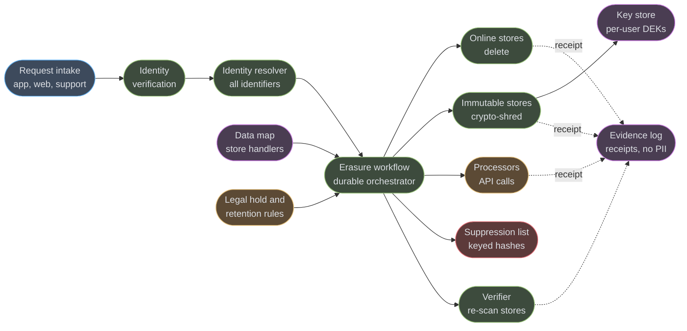
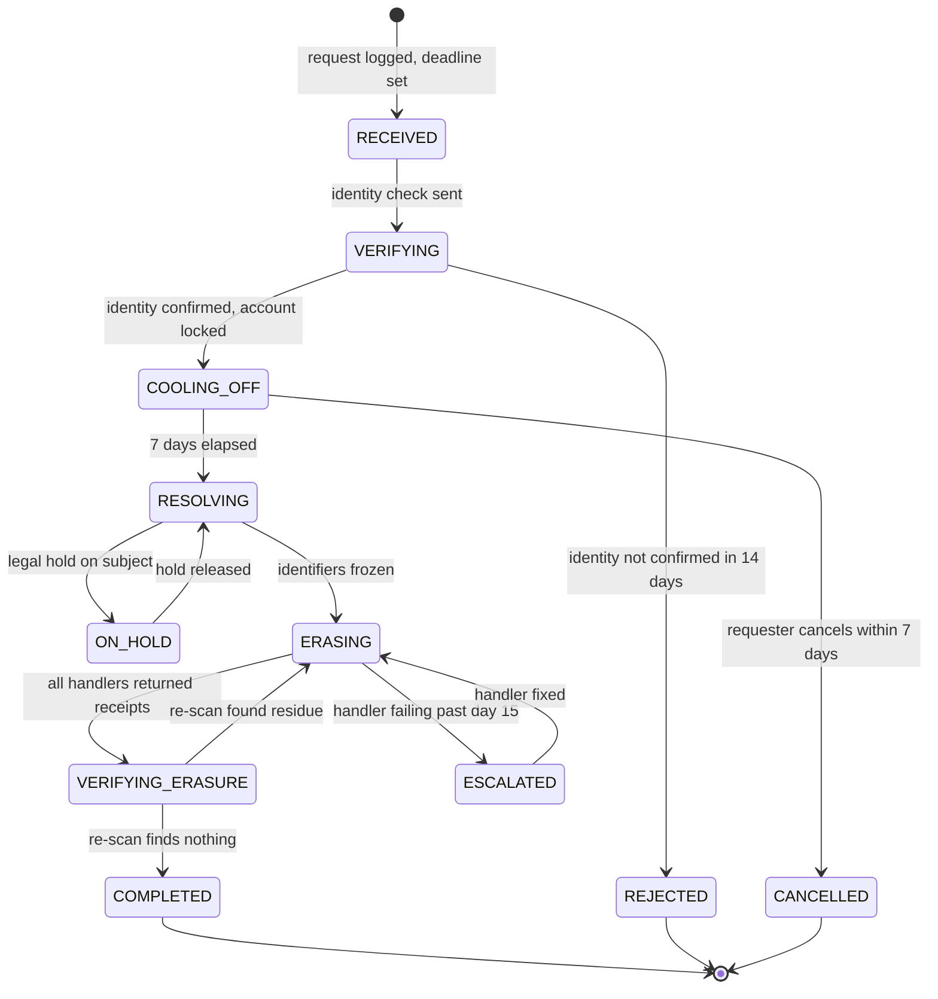
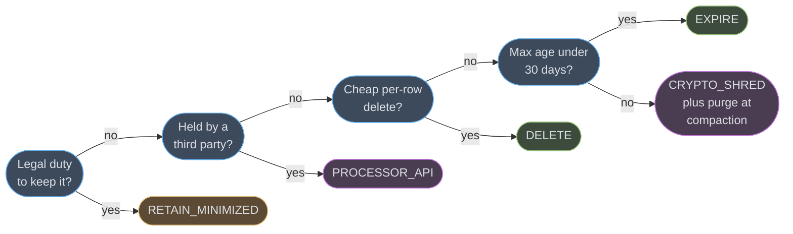

# Case Study: GDPR Erasure Pipeline Across 12 Data Stores
## Intuition

> **Design intuition**: Erasing a person from a modern backend is like recalling a product that has already shipped. The factory (the accounts database) is easy: you stop making it. The hard part is every warehouse, truck, store shelf and customer's garage the product passed through: the search index, the cache, the event log, the data lake, last month's backup, the analytics warehouse, the email vendor. A recall works only if you kept a shipping manifest before you needed it, track each location to a signed receipt, and stop the product re-entering circulation from a returns depot (a backup restore or an event replay) after you declared it gone.

**Key insight for this design**: right-to-erasure is **a distributed transaction with no rollback and a legal deadline**, run across stores that were never designed to forget. The failure is almost never "we deleted the wrong row". It is "we did not know store number 9 held this person's data", "store number 5 can only forget after its retention window", or "we deleted the identity record first and could no longer find the person's rows anywhere else". So the system is three things, and only the third is deletion: a **data map** that says where personal data lives and how each store erases it, a **durable orchestrator** that drives every store to a verified receipt before the deadline, and **per-store erasure strategies** (hard delete, pseudonymization, crypto-shredding, bounded expiry) chosen by what the store can physically do.

The second insight is that **some stores cannot delete one person cheaply, and pretending otherwise produces either a fake erasure or a ruinous bill.** An append-only event log, an immutable backup, or a two-year columnar lake can be made to forget one user only by rewriting enormous files. The design answer is to decide *at write time* how each byte of personal data will be forgotten: encrypt it with a key you can destroy, key it by a pseudonym whose mapping you can delete, or bound its lifetime so expiry is the erasure. Erasure is designed in, not bolted on.

**Boundary with sibling pages.** Database-level erasure choices for one Postgres database (soft delete vs hard delete vs anonymization, backup windows) live in [`../../../database/database_security_and_compliance/database_security_and_compliance.md`](../../../database/database_security_and_compliance/database_security_and_compliance.md). Privacy for LLM systems (training data, prompts, vector stores) lives in [`../../../llm/llm_security/privacy_and_data_governance.md`](../../../llm/llm_security/privacy_and_data_governance.md). Tenant-level offboarding (deleting a whole customer) lives in [`../design_multi_tenant_saas_backend/design_multi_tenant_saas_backend.md`](../design_multi_tenant_saas_backend/design_multi_tenant_saas_backend.md). The general discipline (PII inventory, retention, pseudonymization, consent, audit logs) is owned by the module [`../../privacy_engineering_and_data_lifecycle/privacy_engineering_and_data_lifecycle.md`](../../privacy_engineering_and_data_lifecycle/privacy_engineering_and_data_lifecycle.md). This case study owns the **cross-store pipeline for one data subject**: intake, identity resolution, orchestration, per-store strategies, verification and evidence.

> This page is an engineering view of erasure under the EU GDPR (Regulation (EU) 2016/679), with article references checked on 2026-11-25. It is not legal advice. Which exemptions apply to which data is a decision for counsel; the design's job is to make any decision they reach executable and provable.

---

## 1. Requirements Clarification

### Functional Requirements

- A user (or an agent acting for them) can request erasure from the app, the web, or support. The request is acknowledged immediately and tracked to completion.
- The requester's identity is verified before anything is erased; Art. 12(6) lets the controller ask for additional information where it has reasonable doubts about identity ([Art. 12](https://gdpr-info.eu/art-12-gdpr/)).
- The system resolves every identifier the person has across the estate: user id, current and past emails, phone numbers, device ids, payment customer ids at the PSP, CRM contact id, support ticket ids.
- Every store that holds personal data erases, pseudonymizes, or otherwise renders the data unusable, according to a per-store strategy registered in the data map.
- Data that must be retained under a legal obligation (invoices, tax records, fraud cases under legal hold) is kept, minimized, and excluded from all other processing; the requester is told which categories were retained and why.
- Recipients to whom the data was disclosed (email vendor, CRM, analytics processors) are notified of the erasure, as Art. 19 requires unless that proves impossible or involves disproportionate effort ([Art. 19](https://gdpr-info.eu/art-19-gdpr/)).
- Erased data must not come back: not from a backup restore, an event replay, a lake reprocessing job, or a re-import from a processor.
- Each request produces an evidence record showing what was done where and when, without itself re-creating a copy of the erased data.

### Non-Functional Requirements

| Requirement | Target | Why this number |
|---|---|---|
| Statutory response | Within one month of receipt, extendable by two further months with notice (Art. 12(3)) | The legal ceiling |
| Internal SLO, end to end | 20 days p99 | Leaves 10 days of buffer for retries, a store outage and human review before the one-month line |
| Online stores (accounts, search, cache, CRM) | Erased within 24 h of verification | The user expects the account to disappear quickly; most stores can do it cheaply |
| Immutable stores (backups, event log, lake) | Unusable within 24 h (keys destroyed), physically gone within their retention window | The physics of the store, made explicit |
| Missed stores | 0 known stores without a registered handler | The data map gate in CI (§4.1) enforces it |
| Resurrection | 0 erased subjects re-appearing after restore or replay | Suppression checks on every re-ingestion path |
| Evidence | Per-store receipt for 100% of requests | Supervisory authorities ask for proof, not intent |

### Clarifying Questions to Ask in the Interview

| Question | Why it changes the design |
|---|---|
| Which jurisdictions? Only GDPR, or also CCPA/CPRA and India's DPDP Act? | Different deadlines, exemptions and verification rules; the pipeline must make them per-request configuration |
| Is the product B2C (we are the controller) or B2B (we are a processor for customers)? | A processor erases on the controller's instruction and passes requests up, not down |
| Which data must be kept for legal reasons, and for how long? | Decides which stores get pseudonymization instead of deletion |
| Are backups immutable (object lock, tape) or deletable? | Decides whether crypto-shredding is required or merely convenient |
| Does the analytics lake hold raw identifiers or pseudonyms? | A lake keyed by raw email is an erasure problem measured in petabytes |
| Are there ML models trained on user data? | Model retraining or unlearning is a separate, much harder question (see the LLM privacy page) |

### Out of Scope

- The right of access (data export, Art. 15), which shares the identity-resolution and data-map machinery but not the erasure logic.
- Machine unlearning for trained models.
- Deleting a whole tenant (see the multi-tenant SaaS case study).

---

## 2. Scale Estimation

All figures are **design assumptions** for a consumer subscription service operating in the EU and the US.

### Requests

```
Registered users:                  40,000,000 (45% in the EU)
Erasure requests per year:         0.6% of users = 240,000
Average per day:                   240,000 / 365 = 658
Account closures handled as erasure: +540/day
Total erasure workflows/day:       ~1,200
Spike (privacy news cycle, 10x):   12,000/day for about a week
```

### The 12 Stores

| # | Store | What it holds about a user | Volume per average user | Erasure strategy (§4.4) |
|---|---|---|---|---|
| 1 | Postgres, accounts | Profile, credentials, preferences | 40 rows | Hard delete, identity row last |
| 2 | Postgres, billing | Invoices, payment references | 60 rows | Retain under legal obligation, minimize, restrict |
| 3 | Redis | Sessions, rate-limit counters, profile cache | 15 keys | Delete by key set + short TTL |
| 4 | Elasticsearch | User directory and user-generated content | 120 docs | Delete by query on user id |
| 5 | Kafka | Domain events (7-day retention), compacted profile topic | ~900 events in retention | Bounded expiry + tombstone on compacted topic |
| 6 | Object storage | Avatars, uploaded files | 25 objects, 80 MB | Delete objects and noncurrent versions |
| 7 | Data lake (Iceberg) | Clickstream and product events, 2 years | ~45,000 rows | Pseudonym + crypto-shredding; physical purge at compaction |
| 8 | Cloud warehouse | Aggregates, BI marts | ~300 rows | Rebuilt from lake; pseudonym-only by policy |
| 9 | Backups | Postgres PITR, object versioning, warehouse time travel | n/a | Crypto-shredding + suppression on restore |
| 10 | Log store | Application and access logs, 30 days | ~2,000 lines | Bounded expiry; no PII in logs by policy |
| 11 | Third-party processors | Email provider, CRM, support desk, PSP | 4 vendors | API erasure calls + receipts |
| 12 | Feature store | User features for recommendations | 1 entity, 300 features | Delete entity in online and offline stores |

### Work per Request

```
Identifiers resolved per user (avg):     6
Store handlers invoked per request:      12 store handlers + 4 processor calls = 16 activities
Activities/day:                          1,200 x 16 = 19,200
Activities/day at spike:                 192,000  -> 2.2 activities/s average
```

The orchestration load is tiny. The cost is in two stores.

### The Lake Problem in Numbers

```
Lake events/day:                    2,500,000,000 at ~160 bytes compressed = 400 GB/day
Retention:                          2 years -> 730 daily partitions -> 292 TB
File size:                          512 MB -> 800 files per day, 584,000 files total
Average user active days in 2 years: 60

Physical delete, copy-on-write, daily batch:
  1,200 users x 60 active days = 72,000 (user, day) pairs per day
  each pair rewrites at least the one file holding that user's rows for that day
  -> up to 72,000 files x 512 MB = 36.9 TB rewritten per DAY
  weekly: 8,400 users x 60 = 504,000 file hits over 584,000 files
  -> in practice, close to the whole 292 TB lake rewritten every week

Crypto-shredding instead:
  delete 1 key row per user -> 1,200 row deletes per day
  physical purge rides on the routine compaction that already rewrites files
```

That comparison, 292 TB a week against 1,200 row deletes a day, is why §4.5 exists.

### Backups

```
Postgres PITR: weekly base backups + WAL, 35-day retention
Object storage versioning: noncurrent versions kept 30 days
Warehouse time travel: 7 days

Restoring a backup older than an erasure brings the person back unless
the restore path consults the suppression list (§4.7).
```

---

## 3. High-Level Architecture



The orchestrator does not know how to delete anything. It knows which handlers the data map says exist, in what order they must run, which ones a legal hold suspends, and what a valid receipt looks like. Each store team owns its handler, because only that team knows what "erased" means for its store.

### Request Lifecycle



Two states carry most of the design. `ESCALATED` is a page to a human on day 15, not day 29, because a store outage on day 28 cannot be fixed in one day. `VERIFYING_ERASURE` is separate from `ERASING` because a handler that returns success is a claim; a re-scan that finds nothing is evidence.

**Shared primitives.** Backend's `case_studies/` has no `cross_cutting/` directory; shared primitives live as modules in the section. This design leans on:

| Primitive used here | Deep dive |
|---|---|
| PII inventory, retention, pseudonymization, crypto-shredding (owner module) | [`../../privacy_engineering_and_data_lifecycle/privacy_engineering_and_data_lifecycle.md`](../../privacy_engineering_and_data_lifecycle/privacy_engineering_and_data_lifecycle.md) |
| Durable workflows with retries, timers and versioning | [`../../durable_execution_and_workflows/durable_execution_and_workflows.md`](../../durable_execution_and_workflows/durable_execution_and_workflows.md) |
| Idempotent handlers and at-least-once activity execution | [`../../distributed_transactions_and_consistency/distributed_transactions_and_consistency.md`](../../distributed_transactions_and_consistency/distributed_transactions_and_consistency.md) |
| Compacted topics, tombstones and retention in Kafka | [`../../kafka_deep_dive/kafka_deep_dive.md`](../../kafka_deep_dive/kafka_deep_dive.md) |
| Secret and key management, envelope encryption | [`../../backend_security_owasp/backend_security_owasp.md`](../../backend_security_owasp/backend_security_owasp.md) |
| Calling processors' APIs with retries and backoff | [`../../fault_tolerance_patterns/fault_tolerance_patterns.md`](../../fault_tolerance_patterns/fault_tolerance_patterns.md) |
| Audit trails and structured logs without PII | [`../../observability_and_monitoring/observability_and_monitoring.md`](../../observability_and_monitoring/observability_and_monitoring.md) |
| Event-sourced stores, where deletion fights immutability | [`../../event_sourcing_and_cqrs/event_sourcing_and_cqrs.md`](../../event_sourcing_and_cqrs/event_sourcing_and_cqrs.md) |
| Iceberg snapshots, delete files and expiry | [`../../../technologies/apache_iceberg/apache_iceberg.md`](../../../technologies/apache_iceberg/apache_iceberg.md) |
| Temporal as the orchestrator | [`../../../technologies/temporal_durable_execution/temporal_durable_execution.md`](../../../technologies/temporal_durable_execution/temporal_durable_execution.md) |

---

## 4. Component Deep Dives

### 4.1 The Data Map Is Code, and CI Enforces It

Erasure fails first by omission. Meta's DELF paper describes exactly this: developers identify high-level deletion requirements well but are less effective at mapping them to concrete operations on every data store, and without framework support their mistakes lead to retained data, wrongly deleted data and exploitable bugs ([DELF, USENIX Security 2020](https://www.usenix.org/conference/usenixsecurity20/presentation/cohn-gordon)). DELF's answer is to make developers annotate data type definitions with deletion behavior and have the framework validate the annotations. This design applies the same idea at service granularity: every store that holds personal data registers a handler, and a build gate fails when a schema contains a personal-data field with no registered strategy.

```yaml
# data-map/stores/billing-postgres.yaml   (owned by the billing team)
store: billing-postgres
owner_team: payments
personal_data:
  - table: invoices
    columns: [customer_name, billing_email, billing_address]
    subject_key: user_id
    strategy: RETAIN_MINIMIZED          # legal obligation: tax records
    retention: P10Y                     # illustrative; counsel sets the real period per country
    on_erasure: pseudonymize_contact_fields
    legal_basis_ref: LEGAL-OBL-TAX-01
  - table: payment_methods
    columns: [psp_customer_id, card_last4, card_fingerprint]
    subject_key: user_id
    strategy: DELETE
handler:
  service: billing-erasure-handler
  activity: eraseBilling
  verify_activity: verifyBilling
  max_duration: PT6H
```

```java
/** Runs in CI for every service. Fails the build when personal data has no erasure strategy. */
public final class DataMapGate {

    public static void main(String[] args) throws IOException {
        Set<FieldRef> tagged = SchemaScanner.scanPersonalDataTags(Path.of(args[0]));  // @PersonalData, column comments
        Set<FieldRef> mapped = DataMap.load(Path.of(args[1])).allMappedFields();

        Set<FieldRef> missing = new TreeSet<>(tagged);
        missing.removeAll(mapped);
        if (!missing.isEmpty()) {
            missing.forEach(f -> System.err.println("No erasure strategy for personal field: " + f));
            System.exit(1);
        }
    }
}
```

The gate catches the common case (a new column in a mapped store). It cannot catch an entirely new store that nobody tagged. That gap is closed operationally: provisioning a new database, bucket, topic or vendor goes through a platform template that requires a data-map entry, and a quarterly scan of cloud accounts lists storage resources with no data-map owner.

### 4.2 Identity Resolution Before Any Deletion

Every downstream store indexes the person by a different key. The search index has `user_id`; the email vendor has the email address; the PSP has a customer id; the lake has a pseudonym; the support desk has the email the person used three years ago. Those mappings mostly live in store 1, the accounts database. Delete store 1 first and the pipeline can no longer find the person anywhere else.

```java
public record SubjectIdentifiers(
        String requestId,
        String userId,
        String pseudonym,                  // lake and warehouse key
        List<String> emails,               // current and historical
        List<String> phones,
        List<String> deviceIds,
        Map<String, String> processorIds   // "psp" -> "cus_...", "crm" -> "003...", "email" -> "..."
) {}
```

The resolver freezes this set at the start of `ERASING` and stores it **encrypted under a per-request key** in the workflow's state. It is itself personal data. When the workflow completes, the per-request key is destroyed, so the frozen identifier set becomes unreadable without anyone having to find and delete every copy of the workflow history. The evidence log (§4.9) refers to the request id only.

### 4.3 BROKEN -> FIXED: Fire-and-Forget "user.deleted"

**BROKEN**: the account service deletes the user and publishes an event; every team is asked to consume it.

```java
// BROKEN: no ordering, no completion tracking, no deadline, no proof.
@Transactional
public void deleteAccount(String userId) {
    User u = users.get(userId);
    users.delete(userId);                                   // identity row gone first
    outbox.publish(new UserDeleted(userId, u.email()));     // email now lives in an event, 7 days
}
```

What happens next, all of it ordinary:

```
day 0    the search team's consumer is mid-deploy; it starts at the latest offset
         after the deploy and never sees the event -> 120 docs stay searchable
day 0    the email vendor sync job reads emails from the accounts DB nightly; the user
         is already gone, so the job cannot find the vendor contact to delete
day 0    the UserDeleted event itself carries the email address into a 7-day topic
         and every consumer's logs -> erasure created new copies of the data
day 21   a support agent asks "did we finish?"; nobody can answer, because no
         component knows which consumers acted
day 40   a PITR restore after an unrelated incident brings the account back
```

**FIXED**: an orchestrated workflow that resolves identifiers first, runs each store's handler to a receipt, deletes the identity record last, and verifies.

```java
@WorkflowInterface
public interface ErasureWorkflow {
    @WorkflowMethod
    ErasureOutcome erase(ErasureRequest request);

    @SignalMethod
    void cancelByRequester();          // only accepted during the cooling-off window (4.10)
}

public class ErasureWorkflowImpl implements ErasureWorkflow {

    private boolean cancelled;

    private final StoreHandlers handlers = Workflow.newActivityStub(StoreHandlers.class,
            ActivityOptions.newBuilder()
                    .setStartToCloseTimeout(Duration.ofHours(6))
                    .setRetryOptions(RetryOptions.newBuilder()
                            .setInitialInterval(Duration.ofMinutes(1))
                            .setBackoffCoefficient(2.0)
                            .setMaximumInterval(Duration.ofHours(4))
                            .setDoNotRetry(PermanentHandlerException.class.getName())
                            .build())
                    .build());

    private final Control control = Workflow.newActivityStub(Control.class,
            ActivityOptions.newBuilder().setStartToCloseTimeout(Duration.ofMinutes(5)).build());

    @Override
    public void cancelByRequester() { cancelled = true; }

    @Override
    public ErasureOutcome erase(ErasureRequest req) {
        Instant deadline = req.receivedAt().plus(Duration.ofDays(30));          // internal ceiling
        control.lockAndHideAccount(req);                                        // reversible
        Workflow.await(Duration.ofDays(7), () -> cancelled);                    // cooling-off, 4.10
        if (cancelled) return control.cancel(req.requestId());

        SubjectIdentifiers ids = control.resolveAndFreeze(req);                 // 4.2: before any delete
        control.addToSuppressionList(req.requestId(), ids);                     // 4.7: before any delete
        List<StoreTask> plan = control.planFromDataMap(ids, req.jurisdiction()); // registered handlers only

        // Phase 1: everything except the identity store, in parallel.
        Map<String, Promise<Receipt>> running = new LinkedHashMap<>();
        for (StoreTask t : plan) {
            if (t.isIdentityStore()) continue;
            if (control.underLegalHold(ids, t.store())) {                       // 4.8
                running.put(t.store(), Async.function(control::recordHeld, req.requestId(), t.store()));
            } else {
                running.put(t.store(), Async.function(handlers::erase, t, ids));
            }
        }

        // Escalate to a human on day 15 if anything is still running; keep waiting afterwards.
        Promise<Void> all = Promise.allOf(running.values());
        Duration untilDay15 = Duration.between(Instant.ofEpochMilli(Workflow.currentTimeMillis()),
                req.receivedAt().plus(Duration.ofDays(15)));
        boolean finishedInTime = Workflow.await(
                untilDay15.isNegative() ? Duration.ZERO : untilDay15, all::isCompleted);
        if (!finishedInTime) control.escalate(req.requestId(), pending(running));
        all.get();

        // Phase 2: the identity store, only after every other store has a receipt.
        Receipt identity = handlers.erase(plan.stream().filter(StoreTask::isIdentityStore).findFirst().orElseThrow(), ids);

        // Phase 3: verification re-scan (4.9). Residue sends the workflow back to erase that store.
        List<String> residue = handlers.verifyAll(plan, ids);
        int rounds = 0;
        while (!residue.isEmpty() && rounds++ < 3) {
            for (String store : residue) handlers.erase(taskFor(plan, store), ids);
            residue = handlers.verifyAll(plan, ids);
        }
        if (!residue.isEmpty()) control.escalate(req.requestId(), residue);

        control.destroyRequestKey(req.requestId());                             // frozen ids become unreadable
        return control.complete(req.requestId(), collect(running), identity, deadline);
    }
}
```

The changes, each a separate interview answer:

1. **Nothing irreversible happens for 7 days.** The account is locked and hidden at once, but key destruction and processor calls wait out a cooling-off window the requester can cancel (§4.10).
2. **Identifiers are resolved and frozen before anything is deleted**, and the identity store is erased **last**.
3. **The suppression entry is written before any deletion**, so a restore or replay that runs during the workflow is already blocked.
4. **Every store has a handler that returns a receipt**, and the workflow waits for all of them; a consumer that missed an event cannot silently drop a request.
5. **The workflow is durable.** If the orchestrator crashes on day 9, it resumes on day 9 with every completed receipt intact; activities are retried with backoff for days, not minutes.
6. **A human is paged on day 15**, leaving half the statutory month to fix a broken store.
7. **No new copies.** The identifiers travel inside the encrypted workflow state, not in a broadcast event that lands in seven days of topic retention and every consumer's logs.

### 4.4 Per-Store Strategies

Every handler implements one interface. The strategy decides what `erase` does.

```java
public interface StoreHandler {
    Receipt erase(StoreTask task, SubjectIdentifiers ids) throws PermanentHandlerException;
    VerifyResult verify(StoreTask task, SubjectIdentifiers ids);
}

public record Receipt(String store, String requestId, Strategy strategy, long itemsAffected,
                      Instant completedAt, Instant physicallyGoneBy) {}
```

`physicallyGoneBy` is the honest part. For a Postgres hard delete it is "after the next VACUUM and once the oldest backup that contains the row has expired". For a crypto-shredded lake row it is "after the next compaction and snapshot expiry". The evidence log records both times: when the data became unusable, and when the bytes are expected to be gone.

| Strategy | Mechanism | Data unusable | Bytes physically gone | Use for |
|---|---|---|---|---|
| `DELETE` | Delete rows, keys, documents, objects | Immediately | After store-internal cleanup (VACUUM, segment merge) and backup expiry | OLTP, search, cache, object storage |
| `CRYPTO_SHRED` | Destroy the per-user data key | Immediately on key destruction | When the encrypted bytes age out or are compacted | Event log, lake, backups |
| `EXPIRE` | Do nothing per request; prove the store's maximum age | At the store's retention limit | Same | Logs, short-retention topics |
| `PSEUDONYMIZE` | Replace direct identifiers, delete the mapping | When the mapping is deleted, if the remaining data is not re-identifiable | Mapping gone immediately | Warehouse aggregates |
| `RETAIN_MINIMIZED` | Strip non-required fields, restrict access, keep the rest | Restricted, not erased | At end of the legal retention period | Invoices, legal holds |
| `PROCESSOR_API` | Call the vendor's deletion API, store its reference | Per vendor contract | Per vendor contract | Email, CRM, support, PSP |

Choosing a strategy is a short decision tree that each store team walks once, when the store is registered in the data map, not when a request arrives:



The order of the questions matters. A legal duty to retain overrides everything, so it is asked first. "Cheap per-row delete" is asked before "short retention" because a store that can delete cheaply should, rather than make the person wait up to its retention limit. Crypto-shredding is the fallback for stores that are both long-lived and expensive to rewrite, and it has to be decided before the store holds any data, because encrypting existing data later means rewriting it once anyway.

Store-specific mechanics worth knowing for the interview:

- **Postgres**: `DELETE` marks tuples dead; the bytes remain on disk until `VACUUM` reclaims the space, remain in WAL until archived WAL ages out, and remain in base backups until those expire. The handler records the backup retention (35 days) in `physicallyGoneBy`.
- **Elasticsearch**: a delete marks the document deleted in its segment; the bytes go away when segments merge. A forced merge on a hot index for one user is not worth it; the merge policy handles it.
- **Redis**: delete the user's key set (tracked in a per-user index set), and keep personal data out of keys that have no TTL.
- **Object storage with versioning**: deleting the current version leaves noncurrent versions; the handler deletes those explicitly or relies on a noncurrent-version expiration rule and records its age in `physicallyGoneBy`.

### 4.5 Crypto-Shredding: Making Immutable Stores Forget

Three stores cannot delete one person cheaply: the event log, the lake and backups. §2 shows the lake case: physical deletion approaches a full 292 TB rewrite every week. The design therefore encrypts personal fields **at write time** with a per-user data encryption key (DEK), and erasure destroys the key.

```java
/** Field-level envelope encryption with one DEK per user. */
@Service
@RequiredArgsConstructor
public class SubjectCrypto {

    private final UserKeyStore keys;          // Postgres table: pseudonym -> wrapped DEK
    private final KmsClient kms;              // one KEK in KMS wraps every DEK

    public byte[] encrypt(String pseudonym, byte[] plaintext, byte[] aad) throws GeneralSecurityException {
        SecretKey dek = keys.getOrCreate(pseudonym, () -> kms.generateDataKey(KEK_ID));  // cached, wrapped at rest
        byte[] iv = SecureRandomHolder.nextBytes(12);
        Cipher c = Cipher.getInstance("AES/GCM/NoPadding");
        c.init(Cipher.ENCRYPT_MODE, dek, new GCMParameterSpec(128, iv));
        c.updateAAD(aad);                               // binds ciphertext to table and column
        byte[] ct = c.doFinal(plaintext);
        return ByteBuffer.allocate(1 + iv.length + ct.length)
                .put((byte) 1).put(iv).put(ct).array(); // 1-byte format version for future rotation
    }

    /** Erasure: once the wrapped DEK row is gone (and its backups expire), every ciphertext is noise. */
    @Transactional
    public void shred(String pseudonym) {
        keys.delete(pseudonym);
        keyCache.invalidate(pseudonym);
    }
}
```

Three details decide whether crypto-shredding is real or theatre:

- **One KMS key per user does not scale, and destroying a KMS key is not instant.** AWS KMS applies a waiting period of 7 to 30 days (30 by default) before deleting a key, during which the key cannot be used but can be recovered ([ScheduleKeyDeletion](https://docs.aws.amazon.com/kms/latest/APIReference/API_ScheduleKeyDeletion.html)). This design uses a single KMS key-encryption key and stores per-user DEKs, wrapped by it, in an ordinary table. Shredding is a row delete.
- **The key table's backups must expire before the data's backups do.** If the wrapped-DEK table is backed up for 35 days, a restore of that table on day 34 brings the key back and every shredded ciphertext in a 2-year lake becomes readable again. The key table gets a separate backup policy: 7 days, and restores of it consult the suppression list (§4.7) before re-inserting any row.
- **Only the personal fields are encrypted, and they are encrypted under the pseudonym, not the user id.** Event structure, timestamps and product ids stay in clear so the lake remains useful for aggregate analytics. Whether the remaining clear fields can re-identify the person is a legal judgment: Recital 26 says pseudonymised data that could be attributed to a person "by the use of additional information" is still personal data, and identifiability depends on "all the means reasonably likely to be used" ([Recital 26](https://gdpr-info.eu/recitals/no-26/)). Precise location trails, for example, re-identify people easily; this design stores them only in a separate, bucketed table that is physically purged.

Physical removal still happens, just not per request. The lake's routine compaction rewrites files and drops rows whose pseudonym appears in the shredded list, and snapshot expiry then removes the old files. Iceberg's documentation is explicit that data files are not deleted until no snapshot that may be used for time travel or rollback references them, and that regularly expiring snapshots is what deletes unused data files ([Iceberg maintenance](https://iceberg.apache.org/docs/latest/maintenance/)). The lake handler's receipt sets `physicallyGoneBy` to the next compaction plus the snapshot-expiry window (7 days in this design).

### 4.6 Kafka: Bounded Expiry and Tombstones

The domain-event topics use the topic default retention of 7 days (`retention.ms` = 604800000) ([Kafka 4.3 topic configs](https://kafka.apache.org/43/configuration/topic-configs/)). For them the strategy is `EXPIRE` plus crypto-shredding of personal fields in event payloads: the data is unusable immediately and gone in at most 7 days, inside every deadline.

The compacted `user-profile` topic is different: compaction keeps the latest value per key forever. Erasure writes a tombstone (a `null` value for the user's key), and two topic settings decide when the bytes actually leave the broker:

| Setting | Default | Effect on erasure |
|---|---|---|
| `delete.retention.ms` | 86400000 (1 day) | How long the tombstone itself is retained after compaction, so slow consumers still see the delete |
| `max.compaction.lag.ms` | 9223372036854775807 (effectively never) | The maximum time a record stays ineligible for compaction; at the default, compaction timing depends on the dirty ratio and has no upper bound |

With the default `max.compaction.lag.ms`, a quiet partition may not be compacted for months, and the old profile value sits on disk behind the tombstone. This design sets `max.compaction.lag.ms` to 7 days on every compacted topic that holds personal data, which turns "eventually" into a number the receipt can state.

### 4.7 Suppression: Erased Data Must Not Come Back

Four paths re-introduce erased data: a database restore from before the erasure, an event replay (a consumer reset to an old offset), a lake reprocessing job that re-reads raw files, and a re-import from a processor (the CRM syncs its contacts back).

```sql
CREATE TABLE erasure_suppression (
    subject_hash   BYTEA PRIMARY KEY,          -- HMAC-SHA256(pepper, normalized identifier)
    request_id     TEXT        NOT NULL,
    identifier_kind TEXT       NOT NULL,       -- user_id | email | phone | psp_customer
    created_at     TIMESTAMPTZ NOT NULL DEFAULT now(),
    expires_at     TIMESTAMPTZ NOT NULL         -- longest backup or replay window + margin
);
```

Every re-ingestion path calls one check before writing a record: restore jobs filter rows, replaying consumers skip events, the lake reprocessing job drops rows, and processor syncs refuse contacts whose identifier hash is present. The pepper lives in a secret manager, not next to the table, so the table cannot be brute-forced offline from a list of known emails.

Two honest points about this table. First, a keyed hash of an email is still personal data under Recital 26 when the controller holds the key, so the suppression list needs its own documented purpose (preventing re-processing of erased data) and its own retention. Second, `expires_at` is set to the longest window from which data can come back (35-day backups, 7-day topics, plus margin), not "forever"; after that, nothing old enough to contain the person exists to be restored.

### 4.8 Legal Holds and Retention Exceptions

Art. 17(3) lists cases in which the right to erasure does not apply to the extent that processing is necessary, including compliance with a legal obligation under Union or Member State law and the establishment, exercise or defence of legal claims ([Art. 17](https://gdpr-info.eu/art-17-gdpr/)). In engineering terms that becomes two mechanisms:

| Mechanism | Example | What the pipeline does |
|---|---|---|
| Retention rule in the data map | Invoices kept under tax law | Handler runs `RETAIN_MINIMIZED`: deletes non-required fields, restricts the rest to the finance role, schedules deletion at end of the period |
| Subject-level legal hold | Open fraud case, litigation hold | Orchestrator records `HELD` for the affected stores, erases everything else, and resumes those stores when the hold is released |

Both outcomes appear in the response to the requester as categories retained and the reason, not as silence. A hold that has no expiry and no owner is reviewed monthly; "on hold" is not a place requests go to be forgotten.

### 4.9 Verification and Evidence

A handler's receipt says what it did. The verifier asks each store, independently, whether anything matching the frozen identifiers is still readable.

```java
public VerifyResult verifyElasticsearch(StoreTask t, SubjectIdentifiers ids) throws IOException {
    long hits = es.count(c -> c.index("users,content")
            .query(q -> q.bool(b -> b
                    .should(s -> s.term(tm -> tm.field("user_id").value(ids.userId())))
                    .should(s -> s.terms(tm -> tm.field("author_email")
                            .terms(v -> v.value(ids.emails().stream().map(FieldValue::of).toList()))))
                    .minimumShouldMatch("1")))).count();
    return hits == 0 ? VerifyResult.clean(t.store()) : VerifyResult.residue(t.store(), hits);
}
```

The evidence log stores, per request: request id, received and verified timestamps, jurisdiction, per-store strategy, receipt time, `physicallyGoneBy`, verifier result, and any retained categories with their legal basis reference. It stores **no identifiers**. An auditor can confirm that request `er_7Q1` was completed in 11 days across 16 handlers without the log becoming store number 13.

### 4.10 Intake: the API, the Clock and the Abuse Case

The intake API is deliberately boring. It accepts the request, starts the clock, and returns a resource the requester can check.

```http
POST /v1/privacy/erasure-requests HTTP/1.1
Authorization: Bearer <session token>
Idempotency-Key: 0c4b8e1f-7a2d-4f5e-9b3c-6d1e2a8f9c70
Content-Type: application/json

{ "scope": "ACCOUNT_AND_ALL_DATA", "channel": "IN_APP" }
```

```http
HTTP/1.1 202 Accepted
Location: /v1/privacy/erasure-requests/er_7Q1

{
  "request_id": "er_7Q1",
  "state": "VERIFYING",
  "received_at": "2026-11-25T10:14:03Z",
  "respond_by": "2026-12-25T10:14:03Z",
  "next_step": "Confirm the request from the email address on your account"
}
```

- **`received_at` is the legal clock**, and it is set by the server when the request first arrives through any channel, including a support agent logging an emailed request after the fact with the email's received time.
- **`202 Accepted` with a status resource** is the honest response: erasure takes days. The status endpoint shows the state from §3's lifecycle and, at completion, the categories retained and why.
- **The idempotency key** prevents a double-tap from starting two workflows that race on the same stores.

The abuse case is the one engineers forget: **an erasure request is a powerful account action, so it is an account-takeover target.** An attacker who has a stolen session, or who can socially engineer a support agent, can destroy a victim's data and history irreversibly. The controls scale with the strength of the evidence:

| Channel | Verification | Cooling-off before irreversible steps |
|---|---|---|
| In-app, recently authenticated session | Re-authentication (password or passkey) plus confirmation email to the account address | 7 days, during which the user can cancel from any signed-in device |
| Web form, not signed in | Link sent to the account email; must be clicked within 14 days | 7 days |
| Support agent on behalf of a user | Same email confirmation; the agent cannot bypass it | 7 days |
| Authorized agent (CCPA-style) | Signed authorization plus confirmation from the account owner | 7 days |

The cooling-off window is the same idea as DELF's "temporarily reversible" deletions: during it, the account is locked and hidden (the user sees it as gone), but no irreversible step (key destruction, processor calls) has run. After it, the workflow proceeds. Seven days uses less than a quarter of the statutory month and catches the most common takeover pattern, in which the real owner notices a confirmation email they did not trigger.

### 4.11 Two Handlers, End to End

A handler must be idempotent (the workflow retries it), bounded (it runs for at most `max_duration`), and honest about what it could not do.

```java
@Component
@RequiredArgsConstructor
public class SearchErasureHandler implements StoreHandler {

    private final ElasticsearchClient es;

    @Override
    public Receipt erase(StoreTask t, SubjectIdentifiers ids) throws PermanentHandlerException {
        try {
            DeleteByQueryResponse r = es.deleteByQuery(d -> d
                    .index("users", "content")
                    .conflicts(Conflicts.Proceed)           // a concurrent update must not abort the erasure
                    .refresh(true)                          // verifier must see the result immediately
                    .query(q -> q.bool(b -> b
                            .should(s -> s.term(tm -> tm.field("user_id").value(ids.userId())))
                            .should(s -> s.terms(tm -> tm.field("author_email").terms(v -> v.value(
                                    ids.emails().stream().map(FieldValue::of).toList()))))
                            .minimumShouldMatch("1"))));
            if (!r.failures().isEmpty())
                throw new RetryableHandlerException("partial failure: " + r.failures().size());
            // Deleted docs remain in segments until merges; state that honestly.
            return Receipt.now(t, Strategy.DELETE, r.deleted(), Duration.ofDays(7));
        } catch (ElasticsearchException e) {
            if (e.status() == 400)
                throw new PermanentHandlerException("query rejected, mapping changed? " + e.getMessage());
            throw new RetryableHandlerException(e.getMessage());
        } catch (IOException e) {
            throw new RetryableHandlerException(e.getMessage());
        }
    }
}
```

```java
@Component
@RequiredArgsConstructor
public class ObjectStorageErasureHandler implements StoreHandler {

    private final S3Client s3;

    @Override
    public Receipt erase(StoreTask t, SubjectIdentifiers ids) {
        String prefix = "users/" + ids.userId() + "/";
        long deleted = 0;
        String keyMarker = null, versionMarker = null;
        do {
            final String km = keyMarker, vm = versionMarker;
            ListObjectVersionsResponse page = s3.listObjectVersions(b -> b.bucket(t.bucket())
                    .prefix(prefix).keyMarker(km).versionIdMarker(vm).maxKeys(1000));
            List<ObjectIdentifier> batch = Stream.concat(
                    page.versions().stream().map(v -> ObjectIdentifier.builder().key(v.key()).versionId(v.versionId()).build()),
                    page.deleteMarkers().stream().map(m -> ObjectIdentifier.builder().key(m.key()).versionId(m.versionId()).build()))
                    .toList();
            if (!batch.isEmpty()) {
                s3.deleteObjects(b -> b.bucket(t.bucket()).delete(d -> d.objects(batch).quiet(true)));
                deleted += batch.size();
            }
            keyMarker = page.isTruncated() ? page.nextKeyMarker() : null;
            versionMarker = page.isTruncated() ? page.nextVersionIdMarker() : null;
        } while (keyMarker != null);
        // Every version deleted explicitly, so nothing waits for a noncurrent-version rule.
        return Receipt.now(t, Strategy.DELETE, deleted, Duration.ZERO);
    }
}
```

Three habits are visible in both: retryable and permanent failures are different exception types, so the workflow pages a human on the first permanent one instead of retrying it for two weeks; the handler deletes **every version**, not just the current one; and the receipt's `physicallyGoneBy` is set by what the store really does, not by what would sound best in an audit.

---

## 5. Design Decisions & Tradeoffs

| Decision | Chosen | Alternative | Rationale |
|---|---|---|---|
| Coordination | Durable orchestrated workflow | Broadcast `user.deleted` event | Choreography has no completion tracking, no deadline and no proof (§4.3) |
| Order | Resolve identifiers, suppress, erase leaves, erase identity store last | Delete account first | The identity store holds the keys to find everything else |
| Lake, event log, backups | Crypto-shredding with per-user DEKs, physical purge at compaction | Per-request physical rewrite | Physical rewrite approaches 292 TB a week at this scale |
| Key storage | Wrapped DEKs in a table, one KMS KEK | One KMS key per user | KMS key deletion has a 7-30 day waiting period and per-key cost |
| Logs | `EXPIRE` within 30 days and no PII in logs by policy | Per-request log scrubbing | Scrubbing log stores per request is slow and incomplete; keep PII out |
| Warehouse | Pseudonym-keyed, rebuilt from the lake | Per-request deletes in BI marts | Marts are derived; fix the source and rebuild |
| Proof | Per-store receipts + independent verifier + PII-free evidence log | Trust handler success | A handler can succeed against the wrong index |
| Re-ingestion | Keyed-hash suppression list with bounded expiry | No suppression | Restores and replays resurrect erased people |
| Escalation | Human page at day 15 | Alert at day 29 | Half the statutory month is the repair window |
| Ownership | Store teams own handlers; platform owns orchestrator and data map gate | Central team writes every handler | Only the store owner knows what erased means for its store |

| Dimension | Hard delete | Crypto-shredding | Pseudonymization | Bounded expiry |
|---|---|---|---|---|
| Time to unusable | Immediate | Immediate | Immediate if mapping deleted and data not re-identifiable | Up to the retention limit |
| Cost per request | Low in OLTP, very high in columnar or immutable stores | One row delete | One mapping delete | Zero |
| Works on backups | No (until they expire) | Yes, if key backups expire first | Partly | Yes |
| Main risk | Missed copies | Key resurrected from a key-table backup | Remaining fields re-identify | Retention quietly extended |

---

## 6. Real-World Implementations

**Meta (DELF).** Facebook's deletion framework, published at USENIX Security 2020, lets developers declare deletion behavior as annotations on data type definitions; the framework turns them into asynchronous, reliable and temporarily reversible operations on the backing stores and validates annotations statically and dynamically. Deployed in three online social networks, DELF detected and helped developers correct thousands of omissions and dozens of mistakes, and enabled timely recovery in tens of incidents where user data was deleted by mistake ([DELF paper](https://www.usenix.org/conference/usenixsecurity20/presentation/cohn-gordon)). "Temporarily reversible" is worth copying: a short undo window protects against the deletion bug that removes the wrong user's data, without weakening the erasure promise once it closes.

**Shopify** makes erasure part of its app platform contract. Every app distributed through the Shopify App Store must subscribe to three mandatory compliance webhooks, `customers/data_request`, `customers/redact` and `shop/redact`, must answer with a `2xx`, must reject requests with an invalid HMAC with `401`, and must complete the action within 30 days, unless the app is legally required to retain the data. Shopify sends `customers/redact` 5 days after the deletion request (withholding it until a scheduled gift card is delivered) and `shop/redact` 48 hours after a merchant uninstalls the app ([Shopify privacy law compliance](https://shopify.dev/docs/apps/build/compliance/privacy-law-compliance)). That is store number 11 seen from the other side: a platform that propagates erasure to its processors through signed, deadline-bound webhooks, the same delivery model as [`design_webhook_delivery_service`](../design_webhook_delivery_service/design_webhook_delivery_service.md).

**Amazon Web Services (KMS)** documents the behavior that shapes crypto-shredding design: deleting a KMS key makes all data encrypted under it unrecoverable, but deletion happens only after a waiting period of 7 to 30 days, 30 by default, during which the key can be recovered ([ScheduleKeyDeletion](https://docs.aws.amazon.com/kms/latest/APIReference/API_ScheduleKeyDeletion.html)). Per-user KMS keys therefore give at least a 7-day lag and a large key count; per-user DEKs wrapped by one KMS key give an immediate, auditable row delete.

**Apache Kafka** and **Apache Iceberg** document the two physical-retention facts §4.5 and §4.6 depend on: a 7-day default topic retention, a 1-day default tombstone retention and an unbounded default maximum compaction lag ([Kafka topic configs](https://kafka.apache.org/43/configuration/topic-configs/)); and data files that remain until no retained snapshot references them ([Iceberg maintenance](https://iceberg.apache.org/docs/latest/maintenance/)).

**The regulation itself** sets the outer bounds: erasure "without undue delay" on the Art. 17(1) grounds, a response within one month extendable by two further months with notice under Art. 12(3), notification of recipients under Art. 19, and administrative fines for infringing data subjects' rights under Articles 12 to 22 of up to EUR 20,000,000 or, for an undertaking, up to 4% of total worldwide annual turnover of the preceding financial year, whichever is higher, under Art. 83(5) ([Art. 83](https://gdpr-info.eu/art-83-gdpr/)).

---

## 7. Technologies & Tools

| Technology | Version | Usage | Why this, not that |
|---|---|---|---|
| Java | 25 (LTS) | Handlers, orchestrator workers, crypto | Section baseline; `javax.crypto` AES-GCM for field encryption |
| Temporal | current stable server and Java SDK | Durable erasure workflow, timers, retries | Days-long workflows with exact resume after crashes |
| PostgreSQL | 18 | Accounts, billing, wrapped DEK table, suppression list, evidence log | One transactional home for small control tables |
| AWS KMS | n/a | Key-encryption key wrapping per-user DEKs | Hardware-backed KEK; DEK rows give instant shredding |
| Apache Kafka | 4.3.x (KRaft) | Event topics with bounded retention, compacted profile topic | Explicit `retention.ms` and `max.compaction.lag.ms` make expiry provable |
| Apache Iceberg | Java 1.12.0 | Lake tables, delete files, snapshot expiry | Row-level deletes and expiry semantics documented and controllable |
| Elasticsearch | 9.5 | User and content search | Delete by query, count-based verification |
| Redis | current stable | Sessions and caches | Per-user key index set for complete key deletion |
| HashiCorp Vault | current stable | Suppression-list pepper and handler credentials | Keeps the pepper away from the hashed table |
| OpenTelemetry | 1.x | Traces per workflow with request id only | Debuggable pipeline without PII in telemetry |

---

## 8. Operational Playbook

### Dashboards and Alerts

| Panel | Why |
|---|---|
| Open requests by state and age, with the statutory deadline line | The single view a privacy officer and an on-call engineer both need |
| Handler success, retry and permanent-failure rate per store | A store whose handler keeps retrying is the next escalation |
| Verifier residue rate per store | A handler that returns success while the verifier finds data is a correctness bug |
| `physicallyGoneBy` distribution per store | Shows backup and compaction windows drifting upwards |
| Suppression hits per re-ingestion path | Hits on the restore path during an incident are the system working; zero hits ever on a path that runs daily means it is not wired |
| Data-map coverage: storage resources without an owner entry | The leading indicator of the next missed store |

| SLI | SLO | Alert | Page? |
|---|---|---|---|
| Requests completed within 20 days | 99% | any request at day 15 not completed | yes |
| Requests past the statutory month | 0 | any | yes, sev-1 |
| Online stores erased within 24 h of verification | 99% | > 5% over 24 h | no, ticket |
| Verifier residue after 3 rounds | 0 | any | yes |
| Re-ingestion path without suppression check | 0 | CI or scan finding | no, blocking ticket |

### Runbook 1: A Handler Is Failing for Many Requests

1. Check whether failures are retryable (store down, rate-limited vendor) or permanent (schema changed, field renamed). Retryable ones need patience and capacity; permanent ones need a fix before day 15.
2. If a processor's API is down, keep retrying with backoff for days; record the vendor's incident reference on affected requests.
3. Never mark a store `COMPLETED` manually to clear the queue. If a store truly cannot erase (vendor contract gap), the request records that store as an exception with the reason, and the privacy officer decides on the response.

### Runbook 2: A Backup Restore

1. Before restoring any database that may contain erased subjects, confirm the restore job applies the suppression filter. Restores of the wrapped-DEK table always do.
2. After the restore, run the verifier for every request completed since the backup's timestamp; any residue reopens the request in `ERASING`.

### Runbook 3: A Spike After a Privacy News Story

1. Volume can reach 10x for a week (12,000 requests per day). Orchestration scales trivially; the bottleneck is identity verification and vendor API rate limits.
2. Raise worker concurrency per store within each vendor's published limits and let the workflow timers absorb the rest; the 20-day SLO has room.
3. Watch the support queue for requests that bypassed intake (emails to the support desk). Each must be logged as a request with its real received date, because the deadline runs from receipt.

### Runbook 4: A New Store Appears Without a Handler

1. The quarterly scan or a code review finds a bucket, table or vendor holding personal data with no data-map entry.
2. Add the entry and handler, then run a **backfill**: every request completed since the store was created is re-run against the new handler only.
3. Record the gap and its duration in the evidence log; a known, remediated gap is a very different conversation with an auditor than an unknown one.

---

## 9. Common Pitfalls & War Stories

The stories below are **illustrative composites** built from the failure modes in §4, not reports of a named company's incident. Figures use §2's assumptions.

**1. Delete the account first.** A team's first erasure job deleted the user row and then tried to clean other stores by email. The email lived only on the user row. For five months, 14,000 requests "completed" in the accounts database while the CRM, the email vendor and the support desk kept the person's data. A complainant's DSAR reply revealed it. Fix: §4.2 and §4.3, identifiers frozen first, identity store last.

**2. The broadcast event that leaked.** A `user.deleted` event carried the email address so consumers could find the user. It sat in a 7-day topic, in a dead-letter queue with 30-day retention, and in three consumers' debug logs. Every erasure created four new copies of the data it was meant to remove. Fix: identifiers inside encrypted workflow state, never broadcast.

**3. The key table restore.** A team built crypto-shredding correctly for its lake but backed up the wrapped-DEK table with the same 35-day policy as everything else. After an unrelated incident, the key table was restored from a 3-week-old snapshot. Keys for 25,000 shredded users came back, and their lake records were readable again for 2 days until the verifier flagged residue. Fix: §4.5, a shorter backup window for the key table and suppression on its restore.

**4. The compacted topic that never compacted.** A tombstone was written for every erased user on a low-traffic compacted topic. With the default `max.compaction.lag.ms`, the partition's dirty ratio never crossed the threshold and old profile values stayed on disk for 9 months. Fix: §4.6, a 7-day maximum compaction lag on personal-data topics.

**5. Day 29.** A vendor changed its deletion API authentication. Handler retries failed for 3 weeks and the only alert fired at day 29. 600 requests missed the one-month deadline. Fix: the day-15 escalation and a permanent-failure classification that pages on the first schema or auth error, not the last retry.

### Pitfalls Without a War Story

- **Treating soft delete as erasure.** A `deleted_at` column hides the row from the product and keeps every byte.
- **Logging personal data in erasure handlers.** The handler that logs "deleted user alice@example.com" re-creates the data in the log store.
- **Erasing from derived stores but not the source.** Deleting a warehouse row that is rebuilt from the lake tonight undoes itself tomorrow.
- **Forgetting noncurrent object versions.** Deleting the current version of an avatar in a versioned bucket leaves every prior version.
- **An evidence log keyed by email.** The proof of erasure becomes a list of everyone who asked to be erased.

---

## 10. Capacity Planning

### Orchestrator and Handlers

```
Workflows/day: 1,200 normal, 12,000 at spike
Activities/day: 19,200 normal, 192,000 at spike -> 2.2/s average at spike
Temporal: a small cluster (3 frontend/history nodes) is far above this load
Workers: one worker deployment per store team, 2 replicas each, sized for the
         spike within each store's or vendor's rate limit
```

### Store Work per Day (normal load)

```
Postgres accounts:   1,200 users x 40 rows      =   48,000 row deletes
Postgres billing:    1,200 x 60 rows minimized  =   72,000 row updates
Elasticsearch:       1,200 x 120 docs           =  144,000 doc deletes
Redis:               1,200 x 15 keys            =   18,000 key deletes
Object storage:      1,200 x 25 objects         =   30,000 deletes + noncurrent versions
Lake:                1,200 DEK row deletes; purge rides on daily compaction
Kafka:               1,200 tombstones on compacted topics
Processors:          1,200 x 4 vendor API calls =    4,800 calls
```

All of these are small against the stores' normal write load. The design's cost is dominated by what it avoids: the lake rewrite.

### Lake: Crypto-Shredding vs Physical Rewrite (illustrative prices; check current pricing)

```
Physical rewrite approach (from §2): close to 292 TB rewritten per week
  compute at an assumed $5 per TB processed        ~ $1,460/week
  plus write amplification and snapshot churn: every rewritten file is
  retained until snapshot expiry, so storage peaks at nearly 2x for the window
  storage at an assumed $0.023/GB-month:
    extra 292 TB x 1,000 GB/TB x $0.023 ~ $6,700/month of transient storage

Crypto-shredding approach:
  1,200 key-row deletes/day: negligible
  per-field AES-GCM encryption at write: ~2.5B events/day; at ~1 microsecond
  per field and 3 personal fields per event (assumption):
    2.5e9 x 3 x 1e-6 s = 7,500 core-seconds/day ~ 0.09 cores average
  purge during existing compaction: no extra rewrite
```

### Key Store

```
Wrapped DEK row: ~120 bytes (pseudonym, wrapped key, version, timestamps)
40,000,000 users x 120 B = 4.8 GB, plus indexes ~ 8 GB
DEK cache hit rate at the event producers > 99% (hot users), so KMS unwrap
calls stay in the low hundreds per second
```

### Suppression List

```
Rows/day: 1,200 requests x 6 identifiers = 7,200
Retention: 35 days of backups + 7 days of topics + margin = 60 days
Steady-state rows: 7,200 x 60 = 432,000 (~40 MB with index)
Lookups: every restored row, replayed event and processor sync checks one hash;
         fits in memory as a Bloom filter in front of the table
```

---

## 11. Interview Discussion Points

**Q: Why not just publish a user.deleted event and let every team handle it?**
**Short:** A broadcast has no completion tracking, no deadline and no proof, and it often copies the very data being erased.

Consumers that are down or mid-deploy miss the event; nobody knows which stores acted; and an event that carries an email to help consumers find the user creates new copies in topics, dead-letter queues and logs. An orchestrated, durable workflow runs a registered handler per store to a receipt, retries for days, pages a human at day 15, and keeps identifiers in encrypted workflow state rather than broadcasting them.

**Q: In what order do you erase the stores?**
**Short:** Resolve and freeze identifiers, write the suppression entry, erase every other store, then erase the identity store last.

The accounts database is usually the only place that maps a user id to emails, phones, device ids and vendor customer ids. Deleting it first leaves the pipeline unable to find the person in the CRM, the email vendor or the support desk. Writing the suppression entry before any deletion means a restore or replay that runs during the workflow is already blocked.

**Q: How do you erase one person from an append-only lake or a backup?**
**Short:** Encrypt personal fields with a per-user key at write time and destroy the key, then purge physically during routine compaction.

At this design's scale, physically deleting each person's rows from a 2-year lake approaches a full 292 TB rewrite per week. Crypto-shredding turns erasure into deleting one wrapped-key row; the ciphertext in the lake and in every backup becomes unreadable immediately. The rows are removed physically when compaction rewrites their files and snapshot expiry removes the old ones, and the receipt records that date.

**Q: What breaks crypto-shredding in practice?**
**Short:** Restoring the key table from a backup brings shredded keys back, so key backups must expire first and be suppressed on restore.

If wrapped DEKs are backed up for 35 days like everything else, a routine restore resurrects the keys and makes years of shredded data readable again. The key table gets a shorter backup window and a restore path that consults the suppression list. Two more traps: per-user KMS keys have a 7-30 day deletion waiting period and do not scale, and encrypting only some fields leaves the rest to be judged for re-identifiability.

**Q: Is pseudonymized data still personal data?**
**Short:** Yes, if it can be attributed to a person using additional information that is reasonably likely to be used.

Recital 26 says pseudonymised data that could be attributed to a natural person by the use of additional information should be considered information on an identifiable person, and identifiability considers all means reasonably likely to be used. Deleting the mapping helps only if what remains cannot re-identify the person; precise location trails or rare attribute combinations often can. That is why this design physically purges a bucketed location table and treats the legal judgment as counsel's.

**Q: How do you handle data you are legally required to keep?**
**Short:** Minimize and restrict it under a documented legal basis, erase everything else, and tell the requester what was kept and why.

Art. 17(3) excludes processing necessary for compliance with a legal obligation and for legal claims. The data map marks such fields `RETAIN_MINIMIZED` with a legal-basis reference and a retention period; the handler strips non-required fields and restricts access; a subject-level legal hold suspends only the affected stores. "On hold" requests are reviewed monthly so they do not become a quiet way to never erase.

**Q: How do you prove an erasure happened without keeping the data?**
**Short:** Keep per-store receipts and an independent verifier result keyed by request id, with no identifiers in the evidence log.

A receipt states the strategy, the number of items affected, when the data became unusable and when the bytes are expected to be gone. A verifier then queries each store with the frozen identifiers and must find nothing. The frozen identifiers live encrypted under a per-request key that is destroyed at completion, so the proof never becomes a list of everyone who asked to be forgotten.

**Q: How do you stop erased people from coming back?**
**Short:** Check a keyed-hash suppression list on every re-ingestion path: restores, replays, reprocessing jobs and vendor syncs.

Restoring a backup older than the erasure, resetting a consumer to an old offset, re-running a lake job over raw files, or a CRM pushing contacts back all reintroduce erased data. Each of those paths consults an HMAC-of-identifier table before writing. The table is itself personal data, so it has a documented purpose and expires after the longest backup and replay window, about 60 days here.

**Q: Why do compacted Kafka topics need special settings for erasure?**
**Short:** Without a bounded max.compaction.lag.ms, old values behind a tombstone can stay on disk indefinitely.

Compaction runs when a partition's dirty ratio crosses a threshold, so a quiet partition may never be compacted, and the default `max.compaction.lag.ms` places no upper bound on the wait. Setting it to 7 days on personal-data topics makes compaction, and therefore physical removal, happen within a known time that the receipt can state. `delete.retention.ms`, 1 day by default, then controls how long the tombstone itself stays visible to slow consumers.

**Q: How do you make sure no store is missed?**
**Short:** Make the data map code owned by store teams, gate builds on unmapped personal fields, and scan cloud accounts for unowned storage.

Meta's DELF work showed that developers map high-level deletion requirements to concrete store operations poorly without framework support. Here, every store declares its personal fields and erasure strategy in a versioned data-map file; CI fails a build that adds a tagged personal field without one; provisioning templates require an entry; and a quarterly scan lists storage with no owner. When a gap is found, every past request is re-run against the new handler and the gap is recorded.

**Q: What is the deadline, and how do you design to it?**
**Short:** One month from receipt, extendable by two further months with notice; aim for 20 days and escalate at day 15.

Art. 12(3) requires information on the action taken within one month of receipt, extendable by two further months where necessary, with the extension communicated within the first month. An internal 20-day SLO absorbs a store outage, and a day-15 page leaves half the month for a human fix. The deadline runs from receipt, so requests arriving through support email must be logged with their real received date.

**Q: How does this change if you are a processor rather than a controller?**
**Short:** A processor erases on the controller's instruction, forwards requests to the controller, and propagates erasure to its own sub-processors.

As a B2B processor you do not decide whether erasure applies; your customer does. The pipeline becomes an API your customers call, or a webhook you receive, much like Shopify's `customers/redact`, with a contractual deadline. The internal machinery is the same: data map, durable workflow, per-store strategies, receipts and suppression, and the evidence you produce goes to the controller rather than the data subject.

**Q: Could an attacker use the erasure pipeline as a weapon?**
**Short:** Yes; erasure is an irreversible account action, so it needs strong verification and a reversible cooling-off window.

Someone with a stolen session or a convincing story for a support agent can destroy a victim's data and history permanently. The intake requires re-authentication plus confirmation from the account's email, support agents cannot bypass that confirmation, and the workflow locks and hides the account for 7 days before any irreversible step such as key destruction or a processor call. The real owner can cancel from any signed-in device during that window, and 7 days uses less than a quarter of the statutory month.

---

*Production lesson*: erasure is designed when data is written, not when the request arrives. A store that holds personal data without a key you can destroy, a pseudonym whose mapping you can delete, or a retention limit you can prove is a store that can only be erased expensively, late or not at all. Build the data map, give every store a handler and a receipt, delete the identity record last, and make sure nothing can bring the person back.
