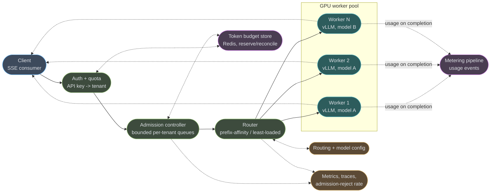
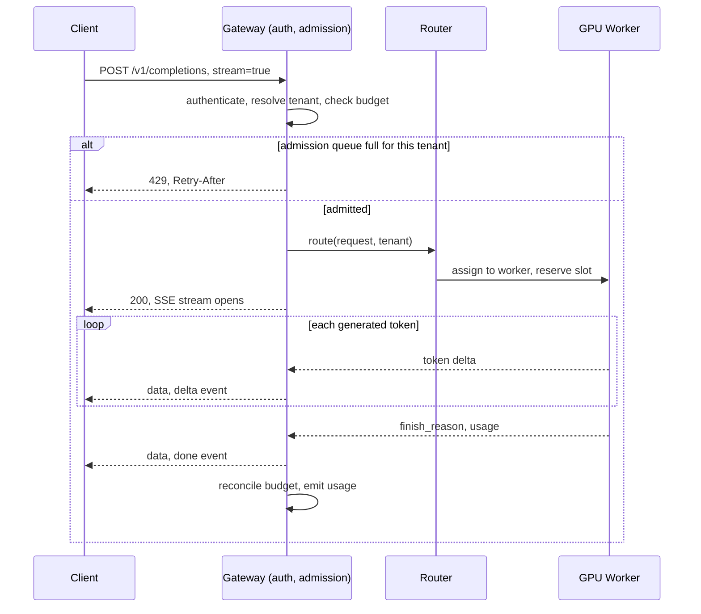
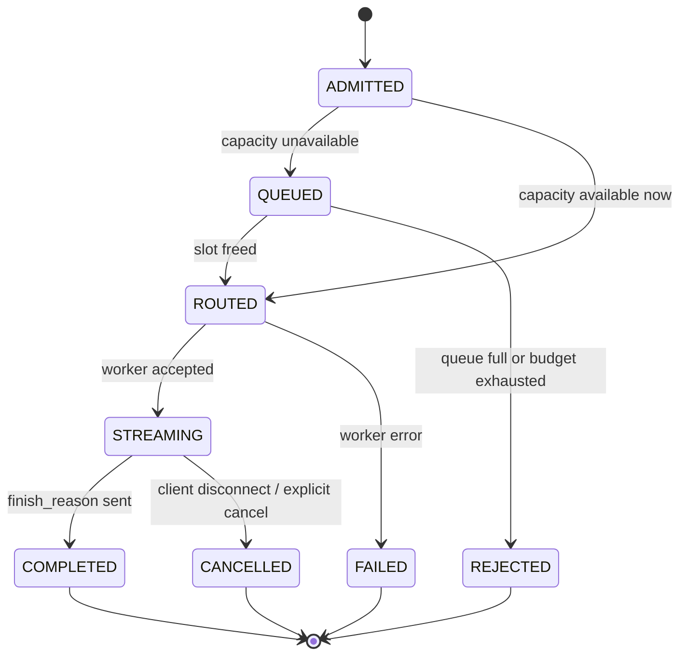

# Case Study: LLM Serving API — a Streaming Gateway in Front of a GPU Fleet

## Intuition

> **Design intuition**: a GPU is a cashier who can ring up 100 customers at once, but only if
> all 100 stand in one line where the cashier can see them — and once ringing starts, every
> customer watches their own items land in the bag one at a time. That is continuous batching
> (the GPU packs many requests into one forward pass) plus streaming (each caller sees their own
> tokens as they are produced). Your job is not the cashier. Your job is the store: the door
> that decides who gets in line, the line itself, the belt that routes a customer to whichever
> register has room, the register receipt that never gets billed twice, and the manager's office
> that knows how many registers to open before the rush arrives.

**Key insight for this design**: an LLM request is not a fixed-cost unit of work the way an HTTP
GET is. Two requests with the same latency budget can cost 50x different amounts of GPU time —
one asks for a 20-token classification, the other asks for a 4,000-token essay — so anything
that treats requests as fungible (round-robin load balancing, a queue with no priority, a flat
per-second rate limit) is wrong by construction. The whole design is organized around admitting,
routing, and billing by **token cost**, not by request count.

The second insight: streaming inverts the normal HTTP contract. A `200 OK` is sent before the
work is finished, so "the request succeeded" and "the response is complete" become two different
facts the system has to track separately — which is what makes cancellation, retries, and
idempotency all harder here than in a synchronous CRUD API.

---

## 1. Requirements Clarification

### Scope Line

This case study owns the **HTTP boundary in front of a GPU inference fleet**: admission
control, authentication and per-tenant quota, request routing across workers, the streaming
transport, cancellation, retries, and cost/capacity planning. It does **not** own model
internals — KV-cache layout, PagedAttention, speculative decoding, quantization, batching
kernels inside the worker process. Those live in
[`../../../llm/inference_and_decoding/inference_and_decoding.md`](../../../llm/inference_and_decoding/inference_and_decoding.md)
and [`../../../llm/vllm_deep_dive/vllm_deep_dive.md`](../../../llm/vllm_deep_dive/vllm_deep_dive.md) —
this document treats a GPU worker as a box with a known throughput curve and links out rather
than re-deriving how that curve is produced.

### Functional Requirements

- Accept a completions request (chat-style messages in, generated text out) either **streaming**
  (Server-Sent Events, token-by-token) or **non-streaming** (single JSON body after generation
  completes).
- Support tool/function calls inside a streamed response — the client must be able to
  distinguish a text delta from a tool-call delta in the same stream.
- Let a client **cancel** an in-flight generation (connection close, or an explicit cancel call)
  and have that free the GPU slot within one scheduling tick, not at generation end.
- Meter every request by **input and output token count** for billing and per-tenant quota
  enforcement, independent of whether the client disconnected early.
- Return a stable per-request id usable for retries, log correlation, and idempotent replay.
- Support many tenants (API keys) on shared GPU capacity with per-tenant fairness — one noisy
  tenant must not starve another's p99.
- Degrade gracefully under overload: reject fast with a retryable signal rather than queue
  forever or fall over.

### Non-Functional Requirements

| Requirement | Target | Why this number |
|---|---|---|
| Time to first token (TTFT), p95 | < 800 ms | Above this, users perceive the UI as "hung," not "thinking" |
| Time per output token (TPOT), p95 | < 60 ms/token | ~16.7 tok/s — comfortably faster than average adult reading speed (~5 tok/s) |
| Admission decision latency, p99 | < 20 ms | Admission must not itself become the bottleneck it is meant to prevent |
| Availability, accept path | 99.9% monthly (43.2 min/month) | One GPU pool outage should degrade capacity, not take the API down |
| Double-bill rate | 0 tolerated, measured | A retried stream that gets billed twice is a support ticket and a refund |
| Cancellation-to-free latency | < 1 scheduling tick (~50-200 ms) | Abandoned requests must not silently hold GPU memory and compute |
| Cost | minimize $ per 1M output tokens at the stated latency SLOs | GPU-hours are the dominant line item; see §10 |
| Multi-tenancy | per-tenant token budget + fairness, no cross-tenant starvation | Shared fleet economics only work if isolation holds |

### Clarifying Questions to Ask in the Interview

| Question | Why it changes the design |
|---|---|
| Is this fronting one model or a fleet of heterogeneous models/sizes? | Heterogeneous models need per-model pools and a routing layer that is model-aware, not just load-aware |
| Are prompts long-lived (chat history resent every turn) or short and independent? | Long, repeated prefixes make prefix-cache-aware routing worth the complexity; independent short prompts do not |
| Can generation run for minutes (agentic / long-form), or is it always short-lived? | Long generations push toward a submit-and-poll API, not a blocking HTTP connection held for minutes |
| Is exact-duplicate billing protection required, or is "mostly once" acceptable? | Determines whether idempotency keys and a dedupe store are in scope or a nice-to-have |
| Do tenants get hard quotas or soft (burst-then-throttle)? | Hard quotas need synchronous reservation; soft quotas can be reconciled asynchronously |

### Out of Scope

- Model training, fine-tuning, evaluation pipelines.
- KV-cache internals, attention kernels, quantization formats — see the LLM-section cross-links
  above.
- Prompt engineering, RAG retrieval, agent orchestration logic above this API.
- The GPU scheduler *inside* a single worker process (vLLM's own continuous-batching scheduler)
  — this document treats one worker as a unit with a measured throughput, not a thing to
  re-implement.

---

## 2. Scale Estimation

### Traffic and Token Volume

```
Requests/day:                50,000,000
Average req/sec:             50,000,000 / 86,400            =    579 req/sec
Peak (3x diurnal):           579 x 3                         =  1,737 req/sec

Mean input tokens/request:   600
Mean output tokens/request:  400

Input tokens/day:            50,000,000 x 600                = 30,000,000,000  (30B)
Output tokens/day:           50,000,000 x 400                = 20,000,000,000  (20B)
Total tokens/day:                                              50B

Avg output tokens/sec:       20,000,000,000 / 86,400          =  231,481 tok/s
Peak output tokens/sec (3x): 231,481 x 3                      =  694,444 tok/s

Avg input tokens/sec (prefill work, not a steady rate but a load proxy):
                              30,000,000,000 / 86,400          =  347,222 tok/s
```

### GPU Count — Two Independent Derivations That Should Agree

**Assumption (stated, not sourced — no vendor publishes a single "tokens/sec/GPU" number
because it depends on model size, batch composition, and sequence-length mix):** a 70B-class
model on one H100 80GB, served with continuous batching at roughly 90 concurrent sequences,
sustains **~3,000 output tokens/sec aggregate** at a TPOT around 30 ms/token per sequence
(90 seqs x 33.3 tok/s ≈ 3,000 tok/s). Every downstream number in this section inherits this
assumption; replace it with a measured number from a load test before trusting it for a real
capacity plan.

```
Derivation 1 — from throughput:
  GPUs needed at peak = 694,444 tok/s / 3,000 tok/s/GPU  =  231.5  ->  232 GPUs

Derivation 2 — from Little's Law (L = lambda x W):
  lambda (peak arrival rate)     = 1,737 req/sec
  W (mean time-in-system)        = TTFT + output_tokens x TPOT
                                  = 0.3 s + (400 x 0.03 s)
                                  = 0.3 s + 12.0 s = 12.3 s
  L (concurrent in-flight streams) = 1,737 x 12.3          ≈ 21,400 streams

  GPUs needed = concurrent streams / concurrent seqs per GPU
              = 21,400 / 90                                ≈  238 GPUs
```

232 and 238 agree within 3% — that convergence is the check, not a coincidence: both are
restatements of the same offered load divided by the same per-GPU capacity, so if they
diverged sharply it would mean one of the two input numbers (throughput/GPU or seqs/GPU) is
wrong relative to the other. **~235 GPUs at peak, ~78 GPUs at the daily average** (231,481 /
3,000 ≈ 77.2), a 3x spread that is exactly why this system autoscales rather than provisions
for peak permanently (see §10).

### Connections and Egress

```
Concurrent in-flight SSE connections at peak:      ~21,400   (= L above)

A single async gateway node (Netty/reactor-style event loop) comfortably holds
tens of thousands of idle-mostly, trickle-writing SSE connections — the ceiling here
is file descriptors and per-connection buffer memory, not CPU. Budgeting 8,000
sustained connections/node with headroom:
  gateway nodes needed = 21,400 / 8,000                      ≈  3   ->  6 for HA/rolling deploy

Per-token SSE frame overhead (small JSON delta + "data: " prefix + blank line):
  ~100 bytes/token on the wire (varies with token text length and JSON escaping)

Egress bandwidth at peak:
  694,444 tok/s x 100 bytes                                  = 69.4 MB/s  ≈ 556 Mbps

Egress bandwidth at daily average:
  231,481 tok/s x 100 bytes                                  = 23.1 MB/s  ≈ 185 Mbps

Daily egress volume (output stream only, excludes prompt echo):
  20,000,000,000 tok x 100 bytes                              = 2.0 TB/day
```

None of these numbers stress a modern network path — the binding constraints are GPU count
(compute) and admission-queue depth (fairness), not bandwidth or connection count. That is
the opposite of most HTTP APIs, where connection handling dominates and compute is cheap; it
is the single biggest reason an LLM-serving gateway is architected differently from a typical
REST backend.

### PSP-Style External Constraint: There Is No External Constraint Here

Unlike a payment processor rate-limited by a card network, this system's hard ceiling is
capacity it owns (GPU count) rather than a third party's API limit — which is *worse* in one
respect (there is no one else to blame or to raise a limit with) and *better* in another
(the fix is "buy or borrow more GPUs," a capacity problem, not a negotiation).

---

## 3. High-Level Architecture



Solid arrows carry tokens; dotted arrows are control-plane traffic (quota checks, usage
events, config, telemetry) that never sits on the hot streaming path. The GPU pool nodes
are the expensive, scarce resource — everything to their left exists to protect them from
overload and everything to their right (metering, reconciliation) exists to make their
output billable and observable.

### Request Lifecycle — Streaming Path



Note the `200` is sent the moment the SSE stream opens, before a single token exists — this
is the property that makes "the request succeeded" and "the response is complete" two
separate facts, discussed in the Intuition above and revisited in §4.5.

### Request State Machine



**Shared primitives.** This case study leans on five backend deep-dives rather than
restating their mechanics:

| Primitive used here | Deep dive |
|---|---|
| SSE framing, long-lived connections, WS comparison | [`../../websockets_and_sse/websockets_and_sse.md`](../../websockets_and_sse/websockets_and_sse.md) |
| Token bucket, sliding window, per-tenant limits | [`../../rate_limiting_in_depth/rate_limiting_in_depth.md`](../../rate_limiting_in_depth/rate_limiting_in_depth.md) |
| Circuit breaker, retry with jitter, bulkhead | [`../../fault_tolerance_patterns/fault_tolerance_patterns.md`](../../fault_tolerance_patterns/fault_tolerance_patterns.md) |
| SLO/SLI, Micrometer, correlation IDs | [`../../observability_and_monitoring/observability_and_monitoring.md`](../../observability_and_monitoring/observability_and_monitoring.md) |
| Continuous batching, PagedAttention, decoding internals | [`../../../llm/inference_and_decoding/inference_and_decoding.md`](../../../llm/inference_and_decoding/inference_and_decoding.md), [`../../../llm/vllm_deep_dive/vllm_deep_dive.md`](../../../llm/vllm_deep_dive/vllm_deep_dive.md) |

This design is the HTTP-boundary counterpart to the parent module
[`../../serving_ai_workloads/serving_ai_workloads.md`](../../serving_ai_workloads/serving_ai_workloads.md),
which covers the same territory at the pattern level (batching strategies, serving topologies,
model-server comparisons); this document works one fully-dimensioned example end to end rather
than surveying the space.

---

## 4. Component Deep Dives

### 4.1 The SSE Streaming Handler

Three things a naive SSE handler gets wrong: it never sends a heartbeat (so an idle proxy
times the connection out mid-generation), it has no `Last-Event-ID` resume story (so a client
that reconnects after a network blip restarts the whole generation), and it has no in-band
error event (so a mid-stream failure just... stops, and the client cannot tell "done" from
"broke").

```java
@RestController
@RequestMapping("/v1/completions")
public class CompletionStreamController {

    private final AdmissionController admission;
    private final InferenceRouter router;
    private final MeterRegistry meter;

    @PostMapping(produces = MediaType.TEXT_EVENT_STREAM_VALUE)
    public SseEmitter stream(
            @RequestHeader("Authorization") String apiKey,
            @RequestHeader(value = "Last-Event-ID", required = false) String lastEventId,
            @RequestBody CompletionRequest request) {

        Tenant tenant = admission.authenticate(apiKey);
        AdmissionTicket ticket = admission.admit(tenant, request);   // throws 429 if refused

        // No timeout on the emitter itself — the heartbeat below is what keeps
        // intermediate proxies (ALBs, nginx) from closing an "idle-looking" connection
        // that is actually still generating.
        SseEmitter emitter = new SseEmitter(0L);
        AtomicLong seq = new AtomicLong(
            lastEventId != null ? Long.parseLong(lastEventId) : 0L);
        AtomicBoolean clientGone = new AtomicBoolean(false);

        emitter.onCompletion(() -> ticket.release());
        emitter.onTimeout(() -> ticket.release());
        // Spring's onError fires on write failure — the surest signal a client vanished.
        // Propagate the cancellation to the worker so the GPU slot frees immediately
        // instead of finishing a generation nobody is reading (see §9's war story).
        emitter.onError(t -> {
            clientGone.set(true);
            router.cancel(ticket.requestId());
            ticket.release();
        });

        // Heartbeat: an SSE comment line (":" prefix) every 15s. Comments are invisible
        // to the client's event parser but keep every hop's idle timer reset.
        ScheduledFuture<?> heartbeat = heartbeatExecutor.scheduleAtFixedRate(() -> {
            if (clientGone.get()) return;
            try {
                emitter.send(SseEmitter.event().comment("hb"));
            } catch (IOException e) {
                clientGone.set(true);
            }
        }, 15, 15, TimeUnit.SECONDS);
        emitter.onCompletion(heartbeat::cancel);

        router.streamTo(ticket, token -> {
            if (clientGone.get()) return;   // stop pushing into a dead connection
            try {
                emitter.send(SseEmitter.event()
                    .id(String.valueOf(seq.incrementAndGet()))
                    .name("delta")
                    .data(token, MediaType.APPLICATION_JSON));
            } catch (IOException e) {
                clientGone.set(true);
                router.cancel(ticket.requestId());
            }
        }, usage -> {
            try {
                emitter.send(SseEmitter.event().name("done").data(usage));
                emitter.complete();
            } catch (IOException e) {
                emitter.completeWithError(e);
            }
        }, error -> {
            // In-band error event so the client can distinguish "generation finished"
            // from "generation broke halfway through" — a bare closed connection cannot.
            try {
                emitter.send(SseEmitter.event().name("error")
                    .data(Map.of("code", error.code(), "message", error.message())));
            } catch (IOException ignored) { /* connection already gone */ }
            emitter.completeWithError(error);
        });

        return emitter;
    }
}
```

`Last-Event-ID` is read but this handler does **not** implement true mid-stream resume — a
reconnect after `lastEventId` starts a *new* generation. True resume (replaying tokens 1..N
from a server-side buffer, then continuing live) needs a per-request token buffer keyed by
request id with a short TTL; it is worth building only if clients reconnect often enough to
matter (mobile networks, long generations) — most deployments skip it and instead make
generations short enough, or idempotent enough via §4.5, that a client simply retries clean.

### 4.2 BROKEN -> FIXED: Admission Without a Bound

**BROKEN** — the version every team ships first, because it works perfectly in every test
that does not include a traffic spike:

```java
@Service
public class NaiveAdmissionController {

    // BROKEN: unbounded. Every accepted connection blocks in this queue until a
    // worker thread picks it up — there is no upper bound on how many can wait.
    private final BlockingQueue<PendingRequest> queue = new LinkedBlockingQueue<>();

    public void admit(PendingRequest request) {
        queue.add(request);   // never rejects, never blocks the caller either
    }
}
```

The failure sequence, observed during a real traffic spike (a client retry storm after an
unrelated upstream blip tripled arrival rate for six minutes):

```
t=0s     queue depth: 40      (normal — roughly one worker's typical backlog)
t=60s    arrival rate triples; queue depth: 4,200 and climbing
t=90s    heap pressure from 4,200 buffered request objects + prompt strings;
         GC pause climbs from 15ms to 400ms, which itself slows draining
t=150s   queue depth: 31,000; process RSS at 11 GB and rising
t=180s   OOM killer kills the pod; every one of those 31,000 requests fails
         with a connection reset instead of a clean 429 -- including the ones
         that had been waiting only a few seconds and would have succeeded
         if the client had simply been told to back off and retry
```

The bug is not "no rate limiter upstream" — it is that a queue with no bound converts a
transient overload into a crash, and a crash loses *every* request in flight, including the
ones close to the front. A bounded queue converts the same overload into a fast, cheap,
retryable rejection for the requests at the back while the ones already admitted still
complete normally.

**FIXED** — bounded, per-tenant, with priority classes:

```java
@Service
@RequiredArgsConstructor
public class AdmissionController {

    private static final int GLOBAL_CAPACITY = 25_000;     // ~ derived L from §2, plus headroom
    private static final int PER_TENANT_CAPACITY = 500;    // fairness ceiling per tenant

    private final Map<String, BlockingQueue<PendingRequest>> tenantQueues =
        new ConcurrentHashMap<>();
    private final Semaphore globalSlots = new Semaphore(GLOBAL_CAPACITY);
    private final TokenBudgetStore budgetStore;

    public AdmissionTicket admit(Tenant tenant, CompletionRequest request) {
        // Reserve the token budget FIRST -- a request that cannot afford its own
        // worst-case cost should never occupy a queue slot at all. See 4.4.
        BudgetReservation reservation = budgetStore.reserve(tenant, estimateCost(request));
        if (!reservation.granted()) {
            throw new QuotaExceededException(tenant, reservation.retryAfter());
        }

        BlockingQueue<PendingRequest> tenantQueue = tenantQueues.computeIfAbsent(
            tenant.id(), id -> new ArrayBlockingQueue<>(PER_TENANT_CAPACITY));

        if (!globalSlots.tryAcquire()) {
            reservation.release();
            throw new CapacityExceededException(Duration.ofSeconds(2));   // 429 upstream
        }
        boolean queued = tenantQueue.offer(new PendingRequest(tenant, request, reservation));
        if (!queued) {
            globalSlots.release();
            reservation.release();
            // This tenant specifically is over its fair share -- others are unaffected,
            // which is the whole point of a queue per tenant instead of one shared queue.
            throw new TenantCapacityExceededException(tenant, Duration.ofSeconds(1));
        }
        return new AdmissionTicket(request.id(), tenantQueue, globalSlots, reservation);
    }
}
```

```java
@RestControllerAdvice
public class AdmissionExceptionHandler {

    @ExceptionHandler({CapacityExceededException.class, TenantCapacityExceededException.class,
                        QuotaExceededException.class})
    public ResponseEntity<ErrorBody> onOverload(RetryableAdmissionException e) {
        return ResponseEntity.status(HttpStatus.TOO_MANY_REQUESTS)
            .header(HttpHeaders.RETRY_AFTER, String.valueOf(e.retryAfter().toSeconds()))
            .body(new ErrorBody("overloaded", e.getMessage()));
    }
}
```

`Retry-After` is RFC 9110's standardized header for exactly this signal — either delta-seconds
or an HTTP-date — and it is what turns a 429 from "give up" into "the client's HTTP stack
already knows how long to wait." Bounding both a **global** semaphore and **per-tenant**
queues is what stops one tenant's burst from starving another's baseline traffic: the global
bound protects the fleet, the per-tenant bound protects fairness between tenants sharing it.

A priority class (interactive chat vs. batch/background generation) is a second dimension on
top of this: give each tenant two queues instead of one, drain the interactive queue first
whenever both are non-empty, and cap how many consecutive interactive requests can starve the
batch queue (e.g., drain at most 8 interactive requests before serving one batch request,
weighted round-robin rather than strict priority) so batch traffic still makes forward
progress under sustained interactive load.

### 4.3 Router — Prefix-Affinity vs. Least-in-Flight, and Why Round-Robin Is Wrong

Round-robin sizes work by *request count*; it is the same mistake as the naive admission
queue, one level up. Two requests can differ 50x in GPU-seconds, so a router that sends the
81st request to whichever worker is "next in rotation" can stack three expensive requests on
one worker while three cheap ones idle on another.

```java
@Component
@RequiredArgsConstructor
public class InferenceRouter {

    private final Map<String, WorkerHandle> workers;      // model -> pool of workers
    // Approximate LRU of "which worker last served this exact prompt prefix" --
    // not exact cache-hit tracking, but cheap and right often enough to matter.
    private final Cache<String, String> prefixAffinity = Caffeine.newBuilder()
        .maximumSize(100_000)
        .expireAfterAccess(Duration.ofMinutes(10))
        .build();

    public WorkerHandle route(CompletionRequest request, String model) {
        List<WorkerHandle> pool = workers.get(model).healthyMembers();
        if (pool.isEmpty()) {
            throw new NoCapacityException(model);
        }

        String prefixKey = hashPrefix(request.messages(), 256);   // first 256 tokens
        String affineWorkerId = prefixAffinity.getIfPresent(prefixKey);
        if (affineWorkerId != null) {
            WorkerHandle affine = pool.stream()
                .filter(w -> w.id().equals(affineWorkerId))
                .findFirst().orElse(null);
            // Only honor affinity if that worker isn't already badly loaded --
            // a warm KV-cache prefix is worth nothing if the request then waits
            // behind 40 others.
            if (affine != null && affine.inFlightRequests() < affine.softCapacity()) {
                return affine;
            }
        }

        // Least-in-flight, not round-robin: route by CURRENT LOAD, which already
        // reflects however expensive each worker's existing requests are, rather
        // than by how many requests have been sent historically.
        WorkerHandle chosen = pool.stream()
            .min(Comparator.comparingInt(WorkerHandle::inFlightRequests))
            .orElseThrow();
        prefixAffinity.put(prefixKey, chosen.id());
        return chosen;
    }
}
```

Prefix affinity matters because a re-used system prompt or chat history means the worker that
served the last turn has that prefix's KV cache already computed — routing the next turn
there turns a full prefill into a cache hit and directly cuts TTFT. It is a soft preference,
not a hard rule, because a warm cache on an overloaded worker is a worse trade than a cold
cache on an idle one — least-in-flight is the fallback and the override, in that order. This
is the same idea the Kubernetes Gateway API Inference Extension calls **prefix-cache-aware
load balancing**, and it is why that extension's `InferencePool` exposes real-time queue depth
and KV-cache utilization from each model server rather than routing on connection count alone
(see §6).

### 4.4 Token Budget and Metering Middleware — Reserve, Then Reconcile

A tenant's quota must be checked **before** the GPU does any work (so a quota-exhausted
request is rejected in microseconds, not after burning 12 seconds of generation), but the
*exact* cost is only known **after** generation completes (output length is not knowable in
advance). The fix is the same reserve/settle pattern used for holds on a payment card: reserve
a conservative upper bound at admission, settle to the real number at completion.

```java
@Component
@RequiredArgsConstructor
public class TokenBudgetStore {

    private final StringRedisTemplate redis;

    private static final String RESERVE_SCRIPT = """
        local key = KEYS[1]
        local reserve_amount = tonumber(ARGV[1])
        local limit = tonumber(ARGV[2])
        local window_seconds = tonumber(ARGV[3])

        local used = tonumber(redis.call('GET', key) or '0')
        if used + reserve_amount > limit then
            return {0, limit - used}
        end
        redis.call('INCRBY', key, reserve_amount)
        redis.call('EXPIRE', key, window_seconds)
        return {1, limit - used - reserve_amount}
        """;

    // Atomic check-and-increment in one round trip -- without the Lua script, a
    // read-then-write from application code races two concurrent requests from the
    // same tenant past the same limit, exactly the double-spend bug rate limiting
    // exists to prevent (see rate_limiting_in_depth.md).
    public BudgetReservation reserve(Tenant tenant, int estimatedTokens) {
        List<Long> result = redis.execute(
            RedisScript.of(RESERVE_SCRIPT, List.class),
            List.of("budget:" + tenant.id()),
            String.valueOf(estimatedTokens),
            String.valueOf(tenant.dailyTokenLimit()),
            String.valueOf(Duration.ofDays(1).toSeconds()));

        boolean granted = result.get(0) == 1;
        return new BudgetReservation(tenant, estimatedTokens, granted,
            granted ? Duration.ZERO : Duration.ofSeconds(30));
    }

    /** Called once generation finishes -- refunds the gap between the conservative
     *  reservation and what was actually generated, or charges more on an
     *  under-estimate (e.g. a max_tokens cap that was raised mid-stream). */
    public void reconcile(Tenant tenant, int reserved, int actual) {
        int delta = actual - reserved;
        if (delta != 0) {
            redis.opsForValue().increment("budget:" + tenant.id(), delta);
        }
        meterUsageEvent(tenant, actual);   // async, feeds billing -- never on the hot path
    }
}
```

Estimating `estimatedTokens` at admission uses `request.maxTokens()` if the client set one,
else a per-tenant historical p95 output length — either way it is a **ceiling**, deliberately
conservative, because reconciling a reservation downward is cheap (an `INCRBY` with a negative
delta) while a request that ran over an unreserved budget has already spent GPU-seconds no one
budgeted for.

### 4.5 Idempotency and Retry for a Partially-Streamed Response

A client that times out waiting for the first byte, or whose connection drops mid-stream,
cannot tell from the outside whether the server (a) never started, (b) is still generating, or
(c) finished and the response was lost in transit. Retrying blindly risks double-billing and
duplicate side effects (e.g., a tool call that sends an email). The fix is the same shape as
Stripe's idempotency-key contract used elsewhere in this section's payment case study: a
client-supplied key, server-side dedup, and — the detail specific to streaming — the dedup
record must distinguish "in flight" from "done."

```java
public record RequestState(String requestId, Status status, Instant startedAt,
                            String bufferedResponse, UsageRecord usage) {
    public enum Status { IN_FLIGHT, COMPLETED, FAILED }
}

@Service
@RequiredArgsConstructor
public class IdempotentCompletionService {

    private final RedisTemplate<String, RequestState> stateStore;

    public RequestOutcome resolve(String idempotencyKey, CompletionRequest request) {
        RequestState existing = stateStore.opsForValue().get("req:" + idempotencyKey);
        if (existing == null) {
            return RequestOutcome.startNew();   // first attempt -- caller proceeds normally
        }
        return switch (existing.status()) {
            // A concurrent duplicate of a request that is STILL running must not be
            // replayed (there is nothing finished to replay) and must not start a
            // second generation (that is exactly the double-charge bug) -- 409, same
            // as the payment processor's idempotency contract for a live in-flight key.
            case IN_FLIGHT -> RequestOutcome.conflict(existing.startedAt());
            // A finished request replays its buffered result byte-for-byte and its
            // recorded usage -- the client gets the SAME answer and is NOT billed again.
            case COMPLETED -> RequestOutcome.replay(existing.bufferedResponse(), existing.usage());
            // A request that failed cleanly (not "unknown", genuinely failed) is safe
            // to retry as new -- nothing to double-bill because nothing was billed.
            case FAILED -> RequestOutcome.startNew();
        };
    }
}
```

The `IN_FLIGHT` state is written **before** the first token is requested from the worker, in
the same admission step that reserves budget — mirroring the payment processor's
`saveAndFlush`-before-work pattern so the loser of a race hits a conflict instead of both
racers starting generations. It is deliberately **not** durable across a full server restart
mid-stream by default (an in-memory-backed Redis key with a short TTL, not a WAL-backed store)
— for most chat UIs the client simply retries on a 409/timeout, which is cheaper than building
crash-safe resume for a UX where a lost 12-second answer is an inconvenience, not a lost
transaction. A deployment with expensive, minutes-long agentic generations should upgrade this
to a durable, checkpointed state machine instead.

---

## 5. Design Decisions & Tradeoffs

### Streaming Transport

| Option | Pros | Cons | Verdict |
|---|---|---|---|
| SSE (HTTP/1.1 or /2, `text/event-stream`) | Plain HTTP — works through every proxy/CDN/LB unmodified; browser-native `EventSource`; simple to reason about (one-directional) | One-directional only (no client->server mid-stream messages); text-only payloads | **Chosen.** Matches the OpenAI and Anthropic public APIs, so client tooling already exists |
| WebSocket | Bidirectional (useful for interrupting/steering generation); binary frames | Needs its own reconnect/backpressure logic; many corporate proxies still mishandle the upgrade; stateful connection is harder to load-balance | Reserve for a future interactive/voice mode that genuinely needs bidirectional framing |
| gRPC server streaming | Strongly typed (protobuf), multiplexed over one HTTP/2 connection, efficient for service-to-service | Browsers cannot speak gRPC directly (need grpc-web + a proxy); worse ecosystem fit for a public API | Good choice for **internal** gateway-to-worker traffic; wrong choice for the public edge |

### Overload Response

| Strategy | Behavior | Cost of being wrong |
|---|---|---|
| **Shed (bounded queue + 429)** | Reject immediately once capacity is spoken for | A rejected request that would have fit if capacity freed 1s later |
| Queue unboundedly | Accept everything, let it wait | The §4.2 outage — OOM, every in-flight request lost |
| Autoscale on demand | Add GPU capacity when queue depth rises | GPU boot time (minutes) means autoscaling alone cannot absorb a spike inside its SLO window |
| **Chosen: shed + autoscale together** | Shed protects latency SLOs *now*; autoscale reduces how often shedding triggers *going forward* | Requires both pieces built and tuned together — one alone is insufficient (see §10) |

### Long-Generation API Shape

| Option | Fit | Tradeoff |
|---|---|---|
| Synchronous blocking request/response | Short generations only | Ties up a connection and a worker slot for the full generation; times out ugly on anything over ~60s |
| **Streaming (SSE), connection held for the duration** | Chosen for interactive chat | Connection lifetime scales with generation length; needs the heartbeat/cancellation machinery in §4.1 |
| Submit-and-poll (`202` + a job id, client polls or gets a webhook) | Best for long/agentic/batch generations (minutes+) | Adds a job store and a polling/webhook contract; wrong UX for a chat turn where the user is watching |

Most production APIs run **both**: streaming for interactive turns, submit-and-poll for a
`background: true` flag on long or batch jobs — OpenAI's Batch API and Anthropic's Message
Batches API are exactly this second mode bolted onto the same completions surface.

### Per-Tenant Isolation

| Approach | Fairness | Complexity |
|---|---|---|
| One global queue, no per-tenant separation | None — one tenant's burst delays everyone | Lowest |
| **Per-tenant bounded queues, weighted drain** | Strong — a starved tenant only ever hurts itself | Moderate: one queue + counter per active tenant |
| Dedicated GPU pool per tenant | Perfect isolation | Kills the multiplexing economics that make shared GPU serving affordable at all |

---

## 6. Real-World Implementations

**OpenAI's Chat Completions API** streams via SSE, sending a sequence of
`chat.completion.chunk` objects each carrying a `delta` (incremental content), and terminates
the stream with a literal `data: [DONE]` line — a sentinel outside the normal JSON-chunk shape
that exists specifically so a naive client can detect end-of-stream without parsing every
chunk's `finish_reason`.

**Anthropic's Messages API** streams a richer, more explicit SSE event vocabulary: named
event types — `message_start`, `content_block_start`, `content_block_delta`,
`content_block_stop`, `message_delta`, `message_stop`, `ping`, and `error` — rather than one
generic chunk type. `ping` events carry no content and exist purely as a keep-alive a client
is expected to ignore; `error` is delivered as its own named event so a mid-stream failure is
distinguishable from a clean `message_stop`. This is the same in-band-error idea implemented
in §4.1.

**The Kubernetes Gateway API Inference Extension** (`kubernetes-sigs/gateway-api-inference-extension`)
formalizes the router described in §4.3 as a Kubernetes-native primitive: an `InferencePool`
custom resource groups a set of model-server pods (vLLM, or any compatible server) behind an
Endpoint Picker that makes routing decisions using **live signals from each pod** — queue
depth and KV-cache utilization — rather than plain connection-count load balancing, and the
project's stated direction includes prefix-cache-aware load balancing across those pools. The
`InferencePool` API graduated to a stable `v1` as of the project's GA milestone, with
`v1alpha2` kept installable alongside it for zero-downtime migration.

```yaml
# Sketch of an InferencePool grouping a fleet of vLLM pods behind one logical
# routing target -- illustrative shape, verify exact fields against the
# project's current CRD before using in a real cluster.
apiVersion: inference.networking.k8s.io/v1
kind: InferencePool
metadata:
  name: llm-serving-70b
spec:
  selector:
    app: vllm-worker
    model: llama-70b-instruct
  targetPortNumber: 8000
  extensionRef:
    name: endpoint-picker
```

**vLLM** is the de facto reference implementation for the worker tier this gateway routes to:
its V1 engine runs continuous batching with **chunked prefill enabled by default**, which lets
a large prefill be split into pieces and interleaved with in-flight decode steps instead of
blocking them — directly protecting the TPOT SLO for requests already streaming when a new,
large request is admitted. `--max-num-seqs` and `--max-num-batched-tokens` are vLLM's own
per-worker admission knobs (the GPU-local equivalent of §4.2's admission controller, one layer
down); tune them against a real load test on the target GPU and model rather than a default,
since the right value is a function of model size, GPU memory, and target latency.

---

## 7. Technologies & Tools

| Layer | Technology | Why this, not the alternative |
|---|---|---|
| Streaming transport | SSE over HTTP/2 | Works through existing proxy infrastructure unmodified; matches the client ecosystem built around OpenAI/Anthropic-shaped APIs, unlike WebSocket |
| Gateway runtime | Spring WebFlux (Netty) | Non-blocking event loop holds tens of thousands of slow-trickle connections on a handful of threads — a thread-per-connection servlet model would exhaust its pool at the concurrency levels in §2 |
| Admission / budget store | Redis (Lua scripts for atomic reserve) | Sub-millisecond round trip, and a Lua script gives atomicity a read-then-write from application code cannot, without taking a distributed lock |
| Worker orchestration | Kubernetes + Gateway API Inference Extension `InferencePool` | Purpose-built for exactly this routing problem (KV-cache- and queue-aware LB), rather than hand-rolling the Endpoint Picker logic |
| Inference engine | vLLM (V1 engine, continuous batching, chunked prefill) | Reference-grade continuous batching and PagedAttention; broad model support; the ecosystem the Inference Extension itself targets |
| Metering pipeline | Append-only usage-event log, async consumer to billing | Decouples "the tokens were generated" from "the invoice line landed" — billing correctness never blocks the streaming path |
| Observability | Micrometer + OpenTelemetry, custom TTFT/TPOT histograms | Standard metrics libraries do not ship LLM-specific percentiles out of the box; these are first-class SLIs here, not derived after the fact |

---

## 8. Operational Playbook

### Dashboards

| Panel | Signal |
|---|---|
| TTFT p50/p95/p99, by model and tenant tier | The primary UX-facing SLI |
| TPOT p50/p95/p99, by model | Degrades under GPU contention before TTFT does — an early warning |
| Admission queue depth, per tenant and global | Leading indicator of overload, minutes before latency SLOs breach |
| Admission reject rate (429s), by reason (global capacity / tenant capacity / budget) | Distinguishes "the fleet is full" from "one tenant is over quota" — very different responses |
| GPU utilization (SM occupancy) and tokens/sec/GPU | Are workers doing useful work or stalled on scheduling overhead |
| Cancellation rate and GPU-seconds spent on cancelled requests | Directly measures the §9 war story's failure mode |

### Alerts

| Alert | Threshold | Response |
|---|---|---|
| TTFT p95 > 800 ms for 5 min | Page | Check queue depth first — usually a capacity problem, not a code regression |
| Admission reject rate (global) > 2% for 5 min | Page | Fleet is genuinely saturated; trigger the shedding ladder below |
| GPU pool health < 90% of target replica count | Page | Node failures or a stuck rollout; check drain/deploy state |
| Reconciliation mismatch: metered tokens vs. worker-reported usage, > 0.1% | Ticket, not page | Billing-affecting but not latency-affecting; investigate within 24h |

### Runbook — "Queue Depth Climbing"

1. Check whether it is one tenant (a burst) or global (a capacity shortfall) from the
   per-tenant queue-depth panel.
2. If one tenant: confirm their per-tenant cap is holding (it should be — everyone else's
   queue depth should be flat). No fleet action needed; the isolation is working as designed.
3. If global: check GPU pool health first (a node failure silently reduces capacity before
   anyone notices) before assuming it is organic demand growth.
4. If capacity is healthy and demand is genuinely up: trigger the load-shedding ladder —
   (a) lower the per-tenant queue cap temporarily, (b) reduce `max_tokens` ceilings for
   best-effort tiers, (c) shed the batch/background priority class entirely, (d) autoscale
   (already in flight from step 1 of the autoscaler, which reacts to the same signal).
5. Page the on-call GPU-capacity owner if step 4 does not stabilize queue depth within one
   autoscaler cool-down window.

### Deploy and Drain for a Stateful Streaming Service

A worker mid-generation cannot simply be `SIGTERM`'d without losing every stream it is
serving. The drain sequence: (1) mark the worker `NotReady` in the routing layer so the
router stops assigning *new* requests to it — existing `InFlight` connections are untouched;
(2) wait for its in-flight request count to reach zero, bounded by a max drain timeout
(e.g., 5 minutes — long enough for the slowest realistic generation, not infinite); (3) after
the timeout, force-cancel any stragglers with an in-band `error` event (§4.1) so their
clients get a clean, retryable signal instead of a silent connection reset; (4) only then
terminate the pod. Kubernetes' `preStop` hook plus a `terminationGracePeriodSeconds` matched
to the drain timeout implements this without custom orchestration.

---

## 9. Common Pitfalls & War Stories

**The abandoned-generation problem — 40% of GPU-seconds wasted.** An early version of this
design had no `onError`-triggered cancellation (§4.1 without the `router.cancel()` call). A
mobile client that navigates away, backgrounds the app, or simply loses signal mid-generation
leaves the SSE connection to time out on its own schedule, but the *worker* kept generating
tokens into a socket write that would eventually fail — for the full `max_tokens` budget in
the worst case. Instrumentation after the fact showed **~40% of total GPU-seconds were spent
on generations whose client had already disconnected**, discovered only because someone
correlated "tokens billed" against "bytes actually delivered" and found a systematic gap.
Fix: propagate `onError`/`onCompletion` from the SSE emitter into an explicit cancel call to
the worker (shown in §4.1), and alert on the cancellation-to-free latency metric so a
regression here is caught in minutes, not months.

**A buffering CDN broke streaming for a subset of users.** Requests routed through a CDN edge
that had response buffering enabled by default arrived at the client all at once, after the
full generation completed — technically correct output, but with all the UX benefit of
streaming gone, and TTFT metrics measured at the edge silently stopped reflecting reality
(they measured time-to-*edge-response-start*, which happened to be time-to-completion under
buffering). Fix: `X-Accel-Buffering: no` for nginx-fronted paths and the CDN's equivalent
streaming-passthrough setting, verified with an end-to-end synthetic check that asserts
*inter-chunk* arrival time, not just total response time — a check that only measures total
latency cannot distinguish "streamed" from "buffered then delivered at once."

**A 60-second load-balancer idle timeout killed long generations.** An LB default idle
timeout (no data seen on the connection for 60s) closed connections that were, from the
application's perspective, healthy — just generating a token every 30-80ms, which should have
kept the connection well under any reasonable idle window, except the LB's idle-timeout clock
in this case measured time since the *last full HTTP response*, not time since the last
byte on a still-open chunked response, on that particular LB configuration. Symptom: a
cluster of failures concentrated at generations running past ~55-65 seconds, invisible in
aggregate p95 latency (most generations finish faster) and only found by segmenting failure
rate by generation length. Fix: explicit heartbeats (§4.1) plus raising the LB's idle timeout
to exceed the longest supported generation, with the heartbeat as the primary defense since
LB configuration is not always in this team's control.

**A retry storm during a brief GPU-pool brownout amplified the outage.** A rolling deploy
briefly dropped healthy-worker count by more than the autoscaler's cool-down could absorb;
clients on a naive fixed-delay retry (no jitter) all retried at the same offset, arriving as
a synchronized second wave that looked, from the admission controller's point of view,
identical to a genuine 3x traffic spike — and triggered the same shedding ladder, extending
the visible outage window well past the original brownout. Fix: **exponential backoff with
jitter is not optional guidance, it is the difference between a brownout and a retry-storm
outage** — enforced client-side in the reference client library, and defended server-side by
the bounded admission queue in §4.2 doing exactly what it is for.

---

## 10. Capacity Planning

### GPU Count vs. Offered Load, and Headroom

```
Daily-average GPUs needed (from §2):          ~78
Peak GPUs needed (from §2):                   ~235   (3x the average, matching the 3x diurnal peak)

Headroom policy: run steady-state capacity at 1.3x the trailing-hour average
(not the bare average) so a modest, ordinary fluctuation does not immediately
start shedding:
  steady-state fleet size = 78 x 1.3                          ≈  102 GPUs

Autoscale range: 102 (floor) to 235+ (ceiling, with an explicit cap so a
runaway client cannot autoscale the bill to infinity).
```

### Cost Model

**Assumption, explicitly stated:** on-demand pricing for an AWS `p5.48xlarge` (8x H100 80GB)
is approximately **$55.04/hour**, i.e. **~$6.88 per H100-hour** — pricing varies by region and
changes over time, so treat this as an illustrative input, not a quote, and re-verify against
current AWS pricing before using it for a real budget.

```
Cost per 1M output tokens (compute only, on-demand, ignores input/prefill compute,
gateway/control-plane overhead, and margin):

  $6.88/GPU-hour / (3,000 tok/s/GPU x 3,600 s/hour) x 1,000,000 tokens
    = $6.88 / 10,800,000 tokens/hour x 1,000,000
    = $0.637 per 1M output tokens

Daily compute cost at the steady-state 102-GPU floor:
  102 GPUs x $6.88/hour x 24 hours                            ≈  $16,840/day

Daily compute cost if sized for peak, permanently:
  235 GPUs x $6.88/hour x 24 hours                             ≈  $38,780/day
  -- more than double, for capacity used only during the diurnal peak hours
```

Sizing for the trailing-average-with-headroom and autoscaling into the peak, rather than
provisioning for peak permanently, is the entire reason §4.2's bounded admission queue and
§9's retry-storm defenses matter: autoscaling only pays off if the shedding layer buys it the
time (minutes) it needs to bring new GPU capacity online without breaching latency SLOs in
the meantime.

### Autoscaling Lag vs. GPU Boot Time

A CPU-service autoscaler reacting in 30-60 seconds is fast enough to track most demand
curves. A GPU node is not: provisioning a new GPU instance, pulling a multi-tens-of-GB model
weights image, and warming the inference engine's CUDA graphs commonly takes **several
minutes**, not seconds. The admission-queue shedding ladder in §8 exists specifically to
survive that gap — it is not a fallback for when autoscaling fails, it is a load-bearing part
of the autoscaling design, since no autoscaler can react faster than its own boot time. A
warm-pool of a small number of pre-booted, idle GPU instances (paying steady-state cost for
faster reaction) is the standard mitigation when the boot-time gap itself is unacceptable for
the product's SLOs.

### When You Cannot Get More GPUs

Real GPU capacity is allocation-constrained, not just budget-constrained — a cloud region can
simply be out of the requested instance type. The mitigations, in order of how much they cost
to build: (1) multi-region failover to wherever capacity exists, at the cost of cross-region
data-locality complexity; (2) a smaller or quantized model as a capacity-constrained fallback
tier, trading quality for availability under an explicit, disclosed degradation policy rather
than a silent one; (3) reserved capacity (AWS Capacity Blocks or equivalent) purchased ahead
of a known-demand event, prepaid and non-elastic but guaranteed; (4) as a last resort, widen
the admission queue's shedding threshold and communicate degraded availability to tenants
rather than silently blowing every latency SLO.

---

## 11. Interview Discussion Points

**Q: Why does this design shed load with a bounded queue instead of just rate-limiting at a fixed requests-per-second number?**
**Short:** Because requests differ up to 50x in GPU cost, so request-count limits don't bound the resource that actually saturates.
A fixed RPS limit assumes every request costs roughly the same, which is true for typical CRUD
endpoints and false here — a 20-token classification and a 4,000-token essay hit the same
rate limiter identically but cost 50x different GPU-seconds. Bounding by queue depth (a proxy
for concurrent in-flight cost) and reserving actual token budget (§4.4) targets the resource
that is actually scarce, GPU-seconds, rather than the resource that is cheap, HTTP requests.

**Q: What specifically goes wrong with an unbounded admission queue under a traffic spike?**
**Short:** Buffered requests exhaust heap, GC pauses grow, draining slows further, and the process OOMs, losing every queued request.
It is a positive feedback loop, not just a memory leak: more queued objects means more heap
pressure means longer GC pauses means slower draining means the queue grows faster still,
until the OOM killer terminates the process and every request in flight — including ones
seconds from completing — fails with a connection reset instead of a clean, retryable 429.

**Q: Why send the HTTP 200 before the response is complete, and what does that cost you?**
**Short:** Streaming requires committing to success before generation finishes, so success and completeness become separately tracked facts.
The client needs bytes as they are produced, which means the status line and headers must go
out before a single token exists. The cost is that "the request succeeded" (200 sent, stream
opened) and "the response is complete" (finish_reason received) are no longer the same
event, which is exactly what makes cancellation (§4.1), retries, and idempotency (§4.5)
structurally harder than in a synchronous request/response API.

**Q: How does the router decide between prefix-affinity and least-loaded, and which wins when they conflict?**
**Short:** Least-in-flight always overrides affinity when the affine worker is already near its soft capacity limit.
A warm KV-cache prefix on an overloaded worker is a worse trade than a cold cache on an idle
one, since a request that waits behind 40 others loses far more time queued than a full
prefill would have cost. Affinity is checked first as a cheap win when available, but the
router falls back to least-in-flight whenever the affine candidate's in-flight count exceeds
its soft capacity threshold.

**Q: A client disconnects mid-generation. What is supposed to happen, and what happens if it doesn't?**
**Short:** The SSE emitter's onError should propagate a cancel to the worker, freeing the GPU slot within one scheduling tick.
`onError`/`onCompletion` on the server-side SSE emitter must call an explicit
`router.cancel(requestId)` so the worker stops generating and the slot frees immediately. If
that propagation is missing, the worker keeps generating into a dead socket for up to the
full `max_tokens` budget — measured in this design's own history at roughly 40% of total
GPU-seconds wasted on abandoned generations before the gap was found and fixed.

**Q: Why is the token budget reserved before generation instead of just billing after the fact?**
**Short:** Post-hoc billing lets a quota-exhausted tenant consume GPU-seconds before the system realizes the quota was already spent.
Reserving a conservative ceiling at admission (§4.4) rejects an over-quota request in
microseconds, before it ever touches a GPU. Billing only after completion would mean
discovering the overage only once the (possibly expensive) generation has already finished —
the resource was already spent by the time anyone could have said no.

**Q: Why is the reservation an upper-bound estimate rather than the exact eventual token count?**
**Short:** Output length isn't knowable at admission time, so the system reserves a ceiling and reconciles the difference afterward.
The exact number of tokens a generation will produce is not known until it stops generating —
it depends on the model's own stopping behavior, not just the request. The system reserves
`max_tokens` (or a historical p95 if the client didn't set one) as a safe ceiling, then
reconciles the gap between reserved and actual at completion, refunding the difference back
into the tenant's budget.

**Q: Two identical requests arrive concurrently with the same idempotency key. What should happen?**
**Short:** The second request gets a 409 Conflict, never a second generation, because the first hasn't finished yet.
Because the first request's dedup record is written as `IN_FLIGHT` before generation starts
(mirroring the payment processor's idempotency-key contract), the second request sees a
not-yet-`COMPLETED` state and is rejected with 409 rather than replayed or restarted — a
finished-and-replayable result and an in-flight one are deliberately different states, not
collapsed into one.

**Q: Why choose SSE over WebSocket for this API's public edge, given WebSocket is bidirectional?**
**Short:** SSE runs over plain HTTP, so it passes through existing proxies and CDNs unmodified, unlike a WebSocket upgrade.
Generation output is fundamentally one-directional (server to client), so WebSocket's
bidirectional channel buys nothing for the common case while adding its own reconnect and
backpressure machinery to build. SSE also matches what OpenAI's and Anthropic's public APIs
already do, so the client ecosystem (SDKs, proxies, tooling) is already built around it.

**Q: How does chunked prefill in the worker tier help this gateway hit its TPOT SLO?**
**Short:** It interleaves a large new prefill with in-flight decode steps instead of letting the prefill block them.
Without chunked prefill, a newly admitted request with a long prompt can monopolize a full
scheduling iteration doing prefill compute, stalling the token-by-token decode steps of every
request already streaming on that worker — a visible TPOT spike for unrelated, already
in-progress generations. Splitting the prefill into pieces that share iterations with decode
steps keeps those in-flight streams' inter-token latency stable.

**Q: Why does the design shard capacity by autoscaling plus a shedding queue, rather than just autoscaling alone?**
**Short:** GPU boot time runs to several minutes, far slower than any latency SLO, so shedding has to cover that gap.
A new GPU node needs provisioning, a multi-tens-of-GB weights pull, and inference-engine
warmup before it can serve traffic — commonly minutes, not the tens of seconds a CPU-service
autoscaler reacts in. No autoscaler can react faster than its own boot time, so the bounded
admission queue's shedding ladder is not a fallback for autoscaling failure — it is the
mechanism that keeps latency SLOs intact during the minutes autoscaling needs to catch up.

**Q: What made the retry-storm outage worse than the brownout that triggered it?**
**Short:** Fixed-delay retries with no jitter synchronized every client's retry into one wave that looked like a fresh spike.
A brief drop in healthy-worker count during a rolling deploy was the original, minor
brownout. Clients retrying on a fixed delay with no jitter all landed back on the gateway at
the same offset, and that synchronized wave was indistinguishable from a genuine 3x traffic
spike to the admission controller — triggering the same shedding ladder and extending the
visible outage well past the original brownout's duration.
