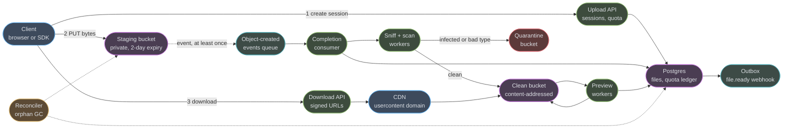
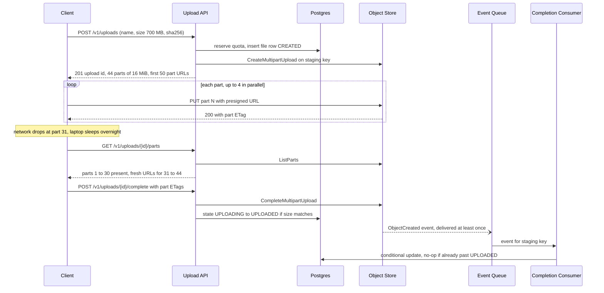
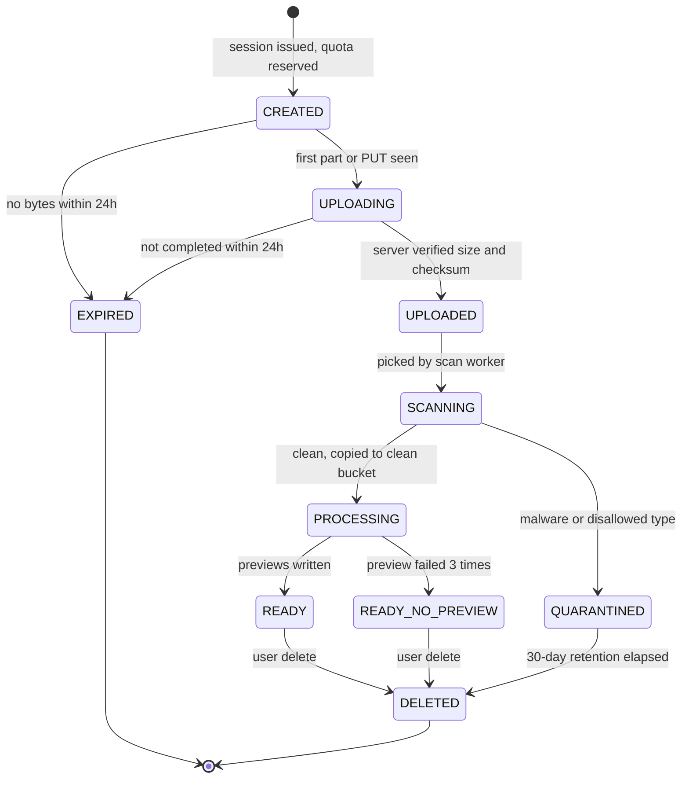

# Case Study: Media Upload API for a Collaboration SaaS
## Intuition

> **Design intuition**: An upload API is a coat check, not a conveyor belt. The coat check never carries your coat across the building; it hands you a numbered ticket, points you at the rack, and only later, after someone has checked the pockets, does the ticket become something you can redeem. A media upload API works the same way. The application server issues a ticket (an upload session), the bytes go straight from the client to the object store, and the file only becomes "yours to share" after the backend has verified the bytes arrived, sniffed what they really are, scanned them, and rendered whatever previews the product needs.

**Key insight for this design**: the hard part is not moving bytes. Object stores already move bytes better than any application server you will write. The hard part is that **two systems of record hold one fact** ("file F exists and is safe"): the metadata database knows the file's owner, name, quota charge and state; the object store knows whether the bytes are actually there. The two cannot share a transaction. Every bug in this domain is one of those two stores disagreeing with the other: a database row that says `READY` for bytes that never arrived, bytes that sit in a bucket forever with no row pointing at them, a quota that charged for an upload that was abandoned, or a file served to a second user before the scanner looked at it. The whole design below is organized around making the object store's view and the database's view converge, with a state machine whose transitions are idempotent and driven by server-side evidence, never by the client's word.

The second insight is that **"upload" is really five product promises with five different latency budgets**: the bytes are durable (seconds), the file is the type it claims to be (sub-second after upload), it is free of known malware (seconds to minutes), previews exist (seconds for images, minutes for video), and the uploader's quota is charged exactly once. Collapsing those into one synchronous `POST /upload` that returns `200 OK` only after all five are done is the design that times out at the load balancer on the first 2 GB video.

**Boundary with sibling pages.** The framework wiring for this API in FastAPI (spooled temp files, `request.form()` limits) lives in [`../../../fastapi/case_studies/design_file_upload_and_media_api.md`](../../../fastapi/case_studies/design_file_upload_and_media_api.md). The transcoding DAG and encoding ladder for a video platform live in [`../../../hld/case_studies/design_youtube_upload_pipeline.md`](../../../hld/case_studies/design_youtube_upload_pipeline.md). The object-store internals live in [`../../../hld/case_studies/design_object_storage_s3.md`](../../../hld/case_studies/design_object_storage_s3.md). The general pattern (presigned URLs, resumable upload, metadata-to-blob consistency) is owned by the module [`../../file_upload_and_media_handling/file_upload_and_media_handling.md`](../../file_upload_and_media_handling/file_upload_and_media_handling.md) and the HLD page [`../../../hld/large_blobs_and_media_pipelines/large_blobs_and_media_pipelines.md`](../../../hld/large_blobs_and_media_pipelines/large_blobs_and_media_pipelines.md). This case study owns the **backend API contract and the state machine**: what the endpoints return, which component is allowed to move a file between states, and how the two stores are reconciled.

---

## 1. Requirements Clarification

### Functional Requirements

- A signed-in user can attach a file of up to 5 GiB to a message, document or ticket in a workspace (5 GiB is a product limit chosen for this design, not a storage limit).
- Files up to 100 MB upload in one request; larger files upload in parts and can **resume** after a network drop or a browser restart without re-sending completed parts.
- The bytes never pass through the API servers. The API issues short-lived, narrowly scoped upload credentials; the client sends bytes directly to the object store.
- The backend verifies that the bytes arrived, checks the real content type against an allowlist, scans for malware, and generates previews (image thumbnails, PDF first-page render, video poster frame).
- A file is visible to other users only when it is `READY`. A file that fails the scan is `QUARANTINED`, never served, and the uploader is told why.
- Each workspace has a storage quota. An upload that would exceed it is refused **before** any bytes move.
- Downloads use short-lived signed URLs served through a CDN from a separate user-content domain.
- Integrators get a `file.ready` / `file.quarantined` webhook and can poll `GET /v1/files/{id}`.
- Deleting a file removes the bytes and all derived renditions, and releases the quota.

### Non-Functional Requirements

| Requirement | Target | Why this number |
|---|---|---|
| Create-session latency | p99 < 150 ms | It sits on the click path before the progress bar starts |
| Time from last byte to `READY`, image < 20 MB | p95 < 10 s | The user is waiting to see the thumbnail in the composer |
| Time from last byte to `READY`, video < 1 GiB | p95 < 3 min | Poster frame plus scan; a full transcode is out of scope |
| Unscanned files served to anyone other than the uploader | 0 | The one requirement with no error budget |
| Quota drift (charged bytes vs stored bytes) | < 0.1% per workspace, reconciled daily | Customers dispute storage invoices to the megabyte |
| Orphaned bytes (in the store, no `READY`/`QUARANTINED` row) | < 0.5% of stored bytes | Untracked bytes are untracked cost and untracked liability |
| Control-plane availability | 99.95%/month | Upload sessions cannot be created if this is down; downloads of existing files must not depend on it |
| Resume after interruption | Resume from the last completed part, for up to 24 h | Covers a laptop closed overnight |

### Clarifying Questions to Ask in the Interview

| Question | Why it changes the design |
|---|---|
| What is the largest file, and what fraction of bytes is video? | Decides whether multipart and resume are core or an edge case, and whether a transcode pipeline exists |
| Are uploaders trusted (employees) or anonymous (public forms)? | Anonymous uploaders need rate limits on session creation and stricter type allowlists |
| Must a file be shareable the instant the upload ends, before the scan finishes? | If yes, you need an "uploader-only" visibility state; if no, `READY` gates everything |
| Is end-to-end encryption required (the server never sees plaintext)? | If yes, server-side scanning and previews are impossible and the design changes completely |
| Is there a data-residency requirement per workspace? | Decides bucket-per-region and where the scanner runs |
| Do files ever need legal hold or retention locks? | Decides whether delete is immediate or a scheduled, auditable job |

### Out of Scope

- Adaptive-bitrate transcoding (owned by [`design_youtube_upload_pipeline`](../../../hld/case_studies/design_youtube_upload_pipeline.md)).
- Client-side encryption and key management for zero-knowledge storage.
- Collaborative editing of the uploaded file (that is a document service, not an upload service).

---

## 2. Scale Estimation

All scale figures below are **design assumptions** for a mid-size collaboration SaaS, not measured data from a named company.

### Upload Volume and Mix

```
Uploads/day:                        4,000,000

Mix (by count)       share    count/day     avg size    bytes/day
  images             72.0%    2,880,000      2.5 MB      7.200 TB
  documents          22.0%      880,000      1.8 MB      1.584 TB
  video               5.5%      220,000     80.0 MB     17.600 TB
  large archives      0.5%       20,000    700.0 MB     14.000 TB
                     -----    ---------                 ---------
                    100.0%    4,000,000                 40.384 TB/day

Average ingress:   40.384e12 B / 86,400 s = 467 MB/s  = 3.74 Gbit/s
Peak ingress (3x diurnal):                 1.40 GB/s  = 11.2 Gbit/s
```

The skew matters more than the total: **6% of uploads (video and archives) carry 78.2% of the bytes** (31.6 TB of 40.4 TB). Those are exactly the uploads that run long enough to be interrupted, which is why resume is a core requirement, not polish.

### Control Plane vs Data Plane

```
Control-plane calls per upload (single-PUT path):
  POST /v1/uploads            1
  GET  /v1/files/{id} polls   ~3 (client polls until READY)
Multipart path adds:
  part-URL batch requests     1 per 50 parts

Control-plane QPS, average:  4,000,000 x 4 / 86,400  = 185 req/s
Control-plane QPS, peak (3x):                          556 req/s
```

Five hundred requests per second of small JSON is a two-instance service. The comparison that justifies direct-to-store upload:

```
If the API proxied the bytes instead:
  peak ingress 11.2 Gbit/s; assume ~1 Gbit/s of sustained upload proxying per
  instance once TLS termination and request buffering are counted (assumption)
  -> 12 instances minimum, 16 with headroom, each holding thousands of
     slow uploads open for minutes
Direct-to-store:
  2-3 control-plane instances; the object store absorbs the 11.2 Gbit/s
```

### Multipart Part Sizing

S3 multipart allows at most **10,000 parts per upload**, part sizes from **5 MiB to 5 GiB** (no minimum on the last part), and a maximum object size of **48.8 TiB** ([Amazon S3 multipart upload limits](https://docs.aws.amazon.com/AmazonS3/latest/userguide/qfacts.html)). AWS recommends considering multipart once an object reaches 100 MB, which is where this design puts its single-PUT cut-off.

```
Part size rule:  max(16 MiB, ceil(size / 10,000) rounded up to 1 MiB)

5 GiB file at 16 MiB parts:   5,120 MiB / 16 = 320 parts   (well under 10,000)
Largest file 16 MiB parts allow: 10,000 x 16 MiB = 156.25 GiB  (headroom over 5 GiB)
80 MB video:                   5 parts
700 MB archive:                44 parts
```

A 16 MiB part is also the unit of **lost work** on an interruption: a client that drops mid-part re-sends at most 16 MiB, not the file.

### Scan and Preview Compute

```
Scanner throughput, illustrative: 50 MB/s per core for typical mixed content
  average: 467 MB/s / 50 = 9.3 cores      peak: 1,400 MB/s / 50 = 28 cores

Image previews: 3 renditions x ~120 ms CPU each = 0.36 core-s per image
  2,880,000 / 86,400 = 33 images/s avg, 100/s peak
  peak: 100 x 0.36 = 36 cores

Video poster frame + probe: ~2 core-s per video (illustrative)
  220,000 / 86,400 = 2.5/s avg, 7.6/s peak -> 15 cores peak
```

### Storage and Metadata

```
Raw bytes/year:            40.384 TB x 365 = 14.7 PB
Derived renditions:        ~3% of image bytes = 0.22 TB/day -> 79 TB/year

files table row:           ~600 bytes incl. indexes
Rows/year:                 4,000,000 x 365 = 1.46 B rows -> ~876 GB/year
```

1.46 billion rows a year in one Postgres table is the point where you partition by `created_at` month and keep the hot partitions on the primary. The rest of this page assumes that.

### Abandonment

```
Assume 3% of multipart sessions are abandoned after 30% of bytes upload:
  multipart bytes/day = 17.6 + 14.0 = 31.6 TB
  abandoned           = 31.6 TB x 0.03 x 0.30 = 0.284 TB/day

Without an abort rule, incomplete parts are billed storage that no object
listing shows: 0.284 TB/day x 365 = 104 TB of invisible parts in a year.
```

That last number is why §4.9 exists.

---

## 3. High-Level Architecture



Three buckets, three trust levels. The **staging** bucket accepts bytes from anyone holding a presigned URL and is never readable by other users. The **clean** bucket only ever receives bytes that a scan worker copied there. The **quarantine** bucket holds failures for 30 days for support and forensics. No code path can move bytes from staging to the CDN without passing through the scanner, because the CDN origin is the clean bucket and nothing else.

### Multipart Upload Sequence



The client never calls an endpoint that says "mark this file ready". The only thing the client can assert is "I think I finished"; the server checks that claim against the object store before any state changes.

### File Lifecycle



`READY_NO_PREVIEW` is deliberate. A corrupt-but-harmless PDF that crashes the renderer three times is still a file the user uploaded and the scanner passed; holding it in `PROCESSING` forever turns a preview bug into a data-loss complaint. `EXPIRED` releases the reservation and aborts the parts; `DELETED` removes bytes and renditions.

**Shared primitives.** Backend's `case_studies/` has no `cross_cutting/` directory; shared primitives live as modules in the section. This design leans on:

| Primitive used here | Deep dive |
|---|---|
| Presigned URLs, resumable protocols, scan and sniff pipeline (owner module) | [`../../file_upload_and_media_handling/file_upload_and_media_handling.md`](../../file_upload_and_media_handling/file_upload_and_media_handling.md) |
| Idempotency keys on `POST /v1/uploads`, 201 vs 202 semantics | [`../../rest_api_design/rest_api_design.md`](../../rest_api_design/rest_api_design.md) |
| At-least-once event consumption, inbox dedup, outbox for `file.ready` | [`../../messaging_patterns/messaging_patterns.md`](../../messaging_patterns/messaging_patterns.md) |
| Signed `file.ready` webhooks to integrators | [`../../webhooks_and_event_delivery/webhooks_and_event_delivery.md`](../../webhooks_and_event_delivery/webhooks_and_event_delivery.md) |
| Upload-session rate limits per user and per IP | [`../../rate_limiting_in_depth/rate_limiting_in_depth.md`](../../rate_limiting_in_depth/rate_limiting_in_depth.md) |
| Content-type confusion, SSRF on "import from URL", stored XSS via SVG | [`../../backend_security_owasp/backend_security_owasp.md`](../../backend_security_owasp/backend_security_owasp.md) |
| Per-workspace quota as a tenant resource | [`../../multi_tenancy_and_isolation/multi_tenancy_and_isolation.md`](../../multi_tenancy_and_isolation/multi_tenancy_and_isolation.md) |
| Bulkheading the preview pool so video does not starve thumbnails | [`../../fault_tolerance_patterns/fault_tolerance_patterns.md`](../../fault_tolerance_patterns/fault_tolerance_patterns.md) |

---

## 4. Component Deep Dives

### 4.1 The Upload Session Contract

The session is a resource, created with `POST` and an `Idempotency-Key`, so a client that retries a timed-out create gets the same session rather than a second quota reservation.

```http
POST /v1/uploads HTTP/1.1
Idempotency-Key: 6f1c9a52-3e7b-4b1d-9c0e-8a1f2d7c4b90
Content-Type: application/json

{
  "workspace_id": "ws_81f2",
  "filename": "q3-board-deck.mp4",
  "size_bytes": 734003200,
  "declared_type": "video/mp4",
  "sha256": "m3TJiXuscHD/ApEQoCAMXe0jrhJ..."
}
```

```http
HTTP/1.1 201 Created
Location: /v1/uploads/up_7Hq2

{
  "upload_id": "up_7Hq2",
  "file_id": "fl_Zc19",
  "strategy": "MULTIPART",
  "part_size_bytes": 16777216,
  "part_count": 44,
  "parts": [
    { "part_number": 1, "url": "https://staging.example-uploads.net/...&X-Amz-Expires=3600..." }
  ],
  "parts_url": "/v1/uploads/up_7Hq2/parts",
  "complete_url": "/v1/uploads/up_7Hq2/complete",
  "expires_at": "2026-11-26T18:20:00Z"
}
```

Four details in that response do real work:

- **`file_id` is issued now**, before a byte moves, so the client can attach a placeholder to the message being composed. The message references `fl_Zc19`; the UI shows a spinner until `file.ready`.
- **The response tells the client the strategy and the part size.** The server owns that decision (it knows the 10,000-part limit and its own cost model); a client that picks its own part size is a client that will one day pick 1 MiB parts for a 50 GiB file.
- **Part URLs are issued in batches of 50**, each valid for one hour. A 320-part upload does not receive 320 URLs that are all expired by the time the last part goes.
- **`expires_at` is the session deadline (24 h)**, not the URL deadline. After it, the reconciler aborts the multipart upload and releases the reservation.

The controller, in Java 25 with Spring Boot 4.1 and the AWS SDK for Java v2 presigner:

```java
public record CreateUploadRequest(String workspaceId, String filename, long sizeBytes,
                                  String declaredType, String sha256) {}

public record PartUrl(int partNumber, String url) {}

public record CreateUploadResponse(String uploadId, String fileId, String strategy,
                                   long partSizeBytes, int partCount, List<PartUrl> parts,
                                   Instant expiresAt) {}

@RestController
@RequestMapping("/v1/uploads")
@RequiredArgsConstructor
public class UploadController {

    static final long SINGLE_PUT_MAX = 100L * 1024 * 1024;          // 100 MiB
    static final long MAX_FILE = 5L * 1024 * 1024 * 1024;           // 5 GiB product limit
    static final long MIN_PART = 16L * 1024 * 1024;                 // 16 MiB
    static final int  S3_MAX_PARTS = 10_000;
    static final int  URL_BATCH = 50;
    static final Duration URL_TTL = Duration.ofHours(1);
    static final Duration SESSION_TTL = Duration.ofHours(24);

    private final UploadSessions sessions;      // Postgres repository
    private final QuotaLedger quota;
    private final S3Client s3;
    private final S3Presigner presigner;
    private final IdempotencyStore idempotency;

    @PostMapping
    @Transactional
    public ResponseEntity<CreateUploadResponse> create(
            @RequestHeader("Idempotency-Key") String key,
            @RequestBody CreateUploadRequest req,
            @AuthenticationPrincipal UserPrincipal user) {

        var replay = idempotency.find(user.id(), key, CreateUploadResponse.class);
        if (replay.isPresent()) return ResponseEntity.status(201).body(replay.get());

        if (req.sizeBytes() <= 0 || req.sizeBytes() > MAX_FILE)
            throw new ProblemException(413, "file-too-large", "Max file size is 5 GiB");
        if (!TypePolicy.declaredTypeAllowed(req.declaredType()))
            throw new ProblemException(415, "type-not-allowed", req.declaredType());

        // Reserve BEFORE issuing credentials. If this throws, no bytes can ever move.
        quota.reserve(req.workspaceId(), req.sizeBytes());   // 409 quota-exceeded on failure

        String fileId = Ids.file();
        String uploadId = Ids.upload();
        String stagingKey = "staging/%s/%s".formatted(req.workspaceId(), uploadId);  // never the filename
        Instant expiresAt = Instant.now().plus(SESSION_TTL);

        CreateUploadResponse body;
        if (req.sizeBytes() <= SINGLE_PUT_MAX) {
            String url = presignPut(stagingKey, req.sizeBytes(), req.sha256());
            sessions.insert(fileId, uploadId, user.id(), req, stagingKey, "SINGLE", null, expiresAt);
            body = new CreateUploadResponse(uploadId, fileId, "SINGLE", req.sizeBytes(), 1,
                    List.of(new PartUrl(1, url)), expiresAt);
        } else {
            long partSize = partSizeFor(req.sizeBytes());
            int partCount = (int) Math.ceilDiv(req.sizeBytes(), partSize);
            String s3UploadId = s3.createMultipartUpload(b -> b
                    .bucket(Buckets.STAGING).key(stagingKey)
                    .checksumAlgorithm(ChecksumAlgorithm.CRC32_C)).uploadId();
            sessions.insert(fileId, uploadId, user.id(), req, stagingKey, "MULTIPART", s3UploadId, expiresAt);
            List<PartUrl> first = presignParts(stagingKey, s3UploadId, 1, Math.min(URL_BATCH, partCount));
            body = new CreateUploadResponse(uploadId, fileId, "MULTIPART", partSize, partCount, first, expiresAt);
        }
        idempotency.save(user.id(), key, body);
        return ResponseEntity.created(URI.create("/v1/uploads/" + uploadId)).body(body);
    }

    static long partSizeFor(long size) {
        long mib = 1024L * 1024;
        long needed = Math.ceilDiv(size, S3_MAX_PARTS);
        long rounded = Math.ceilDiv(needed, mib) * mib;
        return Math.max(MIN_PART, rounded);
    }

    private String presignPut(String key, long size, String sha256Base64) {
        PutObjectRequest put = PutObjectRequest.builder()
                .bucket(Buckets.STAGING).key(key)
                .contentLength(size)                 // signed: a bigger body is rejected
                .checksumSHA256(sha256Base64)        // signed: different bytes are rejected
                .build();
        return presigner.presignPutObject(p -> p.signatureDuration(URL_TTL).putObjectRequest(put))
                .url().toString();
    }

    private List<PartUrl> presignParts(String key, String s3UploadId, int from, int to) {
        return IntStream.rangeClosed(from, to).mapToObj(n -> new PartUrl(n,
                presigner.presignUploadPart(p -> p.signatureDuration(URL_TTL)
                        .uploadPartRequest(u -> u.bucket(Buckets.STAGING).key(key)
                                .uploadId(s3UploadId).partNumber(n)))
                        .url().toString()))
                .toList();
    }
}
```

The presigned single-PUT URL signs `Content-Length` and the SHA-256 checksum, so the URL cannot be reused to upload a different or larger file to the same key. S3 SigV4 presigned URLs support checksum algorithms including CRC32C and SHA-256 and are valid for up to 7 days when created with long-term IAM user credentials, or only as long as the temporary credentials that signed them ([S3 presigned URLs](https://docs.aws.amazon.com/AmazonS3/latest/userguide/using-presigned-url.html)). This design signs with a role session and asks for one hour; the effective lifetime is the shorter of the two.

### 4.2 Staging Keys Are Not Filenames

The staging key is `staging/{workspace}/{uploadId}`. The user's filename lives only in Postgres. Three bugs disappear with that one decision:

| If the key were the filename | What breaks |
|---|---|
| `staging/ws_81f2/report.pdf` | Two users uploading `report.pdf` at once overwrite each other, because a presigned PUT replaces any existing object at that key |
| `../../clean/ws_81f2/x.png` | Path-traversal style keys and odd Unicode survive into the object store and into log lines |
| `invoice<script>.svg` | The filename becomes part of a URL that a browser may render; the key is now an injection vector |

After the scan passes, the bytes are copied to the clean bucket under a **content-addressed** key, `clean/{sha256}`. Two users who upload the same 40 MB PDF share one stored object; the `files` rows reference it with a reference count. Deduplication across workspaces leaks information (an attacker learns that someone else holds a known file by observing an instant upload), so the dedup key includes the workspace when the workspace's policy requires isolation: `clean/{workspace}/{sha256}`.

### 4.3 BROKEN -> FIXED: Trusting the Client's "Done"

This is the bug almost every first version ships, because the client really does know when it sent the last byte.

**BROKEN**: the client calls `/complete`, and the server believes it.

```java
// BROKEN: the server takes the client's word for three facts it can verify itself.
@PostMapping("/{uploadId}/complete")
@Transactional
public FileView complete(@PathVariable String uploadId, @RequestBody CompleteRequest req) {
    UploadSession s = sessions.get(uploadId);
    s3.completeMultipartUpload(b -> b.bucket(Buckets.STAGING).key(s.stagingKey())
            .uploadId(s.s3UploadId())
            .multipartUpload(m -> m.parts(req.parts())));
    files.setState(s.fileId(), "READY");             // 1. skips scan and sniff entirely
    quota.commit(s.workspaceId(), s.declaredSize()); // 2. charges the size the client CLAIMED
    outbox.publish(new FileReady(s.fileId()));       // 3. fires on every retry of /complete
    return files.view(s.fileId());
}
```

What goes wrong, in order of how fast it shows up in production:

```
day 1    a client retries /complete after a gateway timeout; CompleteMultipartUpload
         returns NoSuchUpload the second time; the handler 500s; the first call had
         already flipped READY and published file.ready -> integrators see it twice
week 2   a modified client declares size 1 KB and uploads 4.9 GiB of parts;
         quota charges 1 KB; the workspace's storage bill is wrong by 5 GiB per upload
week 3   an attacker uploads an HTML file declared as image/png; READY without a
         sniff; the download URL serves it; stored XSS on the usercontent domain
```

**FIXED**: `/complete` asks the object store what actually happened, and moves the file only one step, to `UPLOADED`. Scanning, sniffing and `READY` belong to workers that act on the stored bytes.

```java
@PostMapping("/{uploadId}/complete")
public ResponseEntity<FileView> complete(@PathVariable String uploadId,
                                         @RequestBody CompleteRequest req,
                                         @AuthenticationPrincipal UserPrincipal user) {
    UploadSession s = sessions.getOwnedBy(uploadId, user.id());   // 404 if not the uploader

    if (s.strategy() == Strategy.MULTIPART && s.state() == FileState.UPLOADING) {
        try {
            s3.completeMultipartUpload(b -> b.bucket(Buckets.STAGING).key(s.stagingKey())
                    .uploadId(s.s3UploadId())
                    .multipartUpload(m -> m.parts(req.parts())));
        } catch (NoSuchUploadException alreadyCompleted) {
            // A retry after a lost response. Fall through and verify the object instead.
        }
    }

    HeadObjectResponse head;
    try {
        head = s3.headObject(b -> b.bucket(Buckets.STAGING).key(s.stagingKey())
                .checksumMode(ChecksumMode.ENABLED));
    } catch (NoSuchKeyException e) {
        throw new ProblemException(409, "upload-incomplete", "No object at staging key");
    }

    // Server-side evidence, not client claims.
    var verdict = UploadVerifier.verify(s, head.contentLength(), head.checksumSHA256());
    if (!verdict.ok())
        throw new ProblemException(422, verdict.code(), verdict.detail());

    flow.markUploaded(s.fileId(), head.contentLength(), head.eTag());
    return ResponseEntity.accepted().body(files.view(s.fileId()));   // 202: work continues
}
```

```java
@Component
@RequiredArgsConstructor
public class UploadFlow {

    private final JdbcTemplate jdbc;
    private final QuotaLedger quota;
    private final JobQueue jobs;

    /** Idempotent: the WHERE clause makes the second, third and Nth call a no-op. */
    @Transactional
    public void markUploaded(String fileId, long actualSize, String etag) {
        int updated = jdbc.update("""
            UPDATE files
               SET state = 'UPLOADED', actual_size = ?, staging_etag = ?, uploaded_at = now()
             WHERE file_id = ? AND state IN ('CREATED', 'UPLOADING')
            """, actualSize, etag, fileId);
        if (updated == 1) {
            quota.adjustReservation(fileId, actualSize);   // charge what is really stored
            jobs.enqueue("scan", fileId);                  // job row in the same transaction
        }
    }
}
```

Four things changed and each is a separate interview answer:

1. **The state transition is conditional** (`WHERE state IN ('CREATED','UPLOADING')`). A retried `/complete` and the object-created event (§4.4) race to call `markUploaded`; exactly one wins, and the other updates zero rows.
2. **Size and checksum come from `HeadObject`**, not the request body. The quota is adjusted to the real size.
3. **The response is `202 Accepted`**, not `200` with `READY`. The client polls or waits for the webhook. The HTTP semantics now match reality: the work is not finished.
4. **The scan job row is written in the same transaction as the state change**, so there is no window where a file is `UPLOADED` with no scan scheduled.

### 4.4 Two Paths to `UPLOADED`: the Client and the Event

A client can upload every byte and then crash before calling `/complete`. A single-PUT client may never call `/complete` at all. So the object store's own event is the second, independent path to `UPLOADED`.

Amazon S3 event notifications are "designed to be delivered at least once" and are "typically delivered in seconds but can sometimes take a minute or longer" ([S3 Event Notifications](https://docs.aws.amazon.com/AmazonS3/latest/userguide/EventNotifications.html)). The event payload carries the key, size, ETag and a `sequencer` value used to order PUT and DELETE events for the same key ([event message structure](https://docs.aws.amazon.com/AmazonS3/latest/userguide/notification-content-structure.html)). The consumer is therefore written for duplicates and for lateness:

```java
@Component
@RequiredArgsConstructor
public class ObjectCreatedConsumer {

    private final UploadSessions sessions;
    private final S3Client s3;
    private final UploadFlow flow;

    @SqsListener("staging-object-created")
    public void onEvent(S3EventNotification notification) {
        for (var rec : notification.getRecords()) {
            String key = URLDecoder.decode(rec.getS3().getObject().getKey(), StandardCharsets.UTF_8);
            Optional<UploadSession> s = sessions.byStagingKey(key);
            if (s.isEmpty()) {
                // Bytes with no session: someone kept a presigned URL past its session,
                // or a bug wrote outside the staging prefix. The reconciler deletes it.
                Metrics.counter("upload.orphan_object_event").increment();
                continue;
            }
            // Re-read the object rather than trusting the event's size: the event may be
            // late and describe an object that a later PUT already replaced.
            HeadObjectResponse head = s3.headObject(b -> b.bucket(Buckets.STAGING).key(key)
                    .checksumMode(ChecksumMode.ENABLED));
            var verdict = UploadVerifier.verify(s.get(), head.contentLength(), head.checksumSHA256());
            if (verdict.ok()) flow.markUploaded(s.get().fileId(), head.contentLength(), head.eTag());
            else flow.markRejected(s.get().fileId(), verdict.code());
        }
    }
}
```

Two independent writers, one conditional `UPDATE`, zero coordination. This is the same move as the transactional inbox in [`messaging_patterns`](../../messaging_patterns/messaging_patterns.md): the dedup key is the state machine itself. Note one S3 constraint that shapes the queue choice: SQS FIFO queues are not supported as a direct S3 notification destination, so the consumer reads a standard queue and gets no ordering guarantee, which is fine because it never relies on order.

### 4.5 Resume: Ask the Store, Not the Client

Resume is a single read endpoint. The client does not need to remember which parts finished; the object store does.

```java
@GetMapping("/{uploadId}/parts")
public ResumeView parts(@PathVariable String uploadId, @AuthenticationPrincipal UserPrincipal user) {
    UploadSession s = sessions.getOwnedBy(uploadId, user.id());
    if (s.isExpired()) throw new ProblemException(410, "session-expired", "Start a new upload");

    Set<Integer> done = new TreeSet<>();
    Integer marker = null;
    do {                                              // ListParts returns at most 1,000 parts per page
        final Integer m = marker;
        ListPartsResponse page = s3.listParts(b -> b.bucket(Buckets.STAGING)
                .key(s.stagingKey()).uploadId(s.s3UploadId()).partNumberMarker(m));
        page.parts().forEach(p -> done.add(p.partNumber()));
        marker = page.isTruncated() ? page.nextPartNumberMarker() : null;
    } while (marker != null);

    List<Integer> missing = IntStream.rangeClosed(1, s.partCount())
            .filter(n -> !done.contains(n)).boxed().limit(UploadController.URL_BATCH).toList();
    return new ResumeView(done.size(), s.partCount(), presignParts(s, missing));
}
```

`ListParts` returns at most 1,000 parts per request ([S3 multipart limits](https://docs.aws.amazon.com/AmazonS3/latest/userguide/qfacts.html)), which is why the loop pages. At 16 MiB parts and a 5 GiB cap, one page always suffices; the loop is there for the day product raises the cap.

**Protocol choice.** This design exposes S3 multipart semantics through its own JSON endpoints. Two standard alternatives exist:

| Protocol | Status | How resume works | When to choose it |
|---|---|---|---|
| tus 1.0.0 | Community spec, version 1.0.0 dated 2016-03-25 ([tus protocol](https://tus.io/protocols/resumable-upload)) | `HEAD` returns `Upload-Offset`; client `PATCH`es from that offset with `Content-Type: application/offset+octet-stream`; an offset mismatch returns `409 Conflict` | You want off-the-shelf clients (tus-js-client, Uppy) and a server like tusd in front of storage |
| IETF Resumable Uploads for HTTP | `draft-ietf-httpbis-resumable-upload-16` (2026-11-22), an HTTPBIS working-group document intended as Proposed Standard ([datatracker](https://datatracker.ietf.org/doc/draft-ietf-httpbis-resumable-upload/)) | Offset retrieval and append semantics standardized in HTTP | Worth tracking; still an Internet-Draft, so do not promise it as a stable contract |
| Store-native multipart (this design) | Vendor API | `ListParts` plus fresh part URLs; parts are independent so they upload in parallel | Bytes go straight to the store with no upload server in the path |

The key difference: tus core resumes **sequentially from a byte offset**, so a single upload is one stream unless you add the Concatenation extension. S3 multipart parts are **independent and parallel**, which matters for a 5 GiB upload on a fat pipe: 4 parallel 16 MiB parts keep the link busy across TCP slow-start and per-request latency.

### 4.6 Sniff First, Then Scan

The declared `Content-Type` is a client claim. The sniffer reads the first bytes of the stored object and decides what it really is; the scanner then runs on the real thing.

```java
public final class Sniffer {

    public enum Kind { PNG, JPEG, GIF, WEBP, PDF, ZIP_CONTAINER, MP4, UNKNOWN }

    /** Reads at most 64 bytes. The object store supports a Range GET, so this costs one small request. */
    public static Kind sniff(byte[] h) {
        if (h.length >= 8 && (h[0] & 0xFF) == 0x89 && h[1] == 'P' && h[2] == 'N' && h[3] == 'G') return Kind.PNG;
        if (h.length >= 3 && (h[0] & 0xFF) == 0xFF && (h[1] & 0xFF) == 0xD8 && (h[2] & 0xFF) == 0xFF) return Kind.JPEG;
        if (h.length >= 6 && h[0] == 'G' && h[1] == 'I' && h[2] == 'F' && h[3] == '8') return Kind.GIF;
        if (h.length >= 12 && h[0] == 'R' && h[1] == 'I' && h[2] == 'F' && h[3] == 'F'
                && h[8] == 'W' && h[9] == 'E' && h[10] == 'B' && h[11] == 'P') return Kind.WEBP;
        if (h.length >= 5 && h[0] == '%' && h[1] == 'P' && h[2] == 'D' && h[3] == 'F' && h[4] == '-') return Kind.PDF;
        if (h.length >= 4 && h[0] == 'P' && h[1] == 'K' && h[2] == 3 && h[3] == 4) return Kind.ZIP_CONTAINER; // docx, xlsx, zip
        if (h.length >= 8 && h[4] == 'f' && h[5] == 't' && h[6] == 'y' && h[7] == 'p') return Kind.MP4;
        return Kind.UNKNOWN;
    }
}
```

```java
@Component
@RequiredArgsConstructor
public class ScanWorker {

    private final S3Client s3;
    private final ClamdClient clamd;     // INSTREAM over a pooled TCP connection
    private final UploadFlow flow;

    @JobHandler("scan")
    public void scan(String fileId) {
        FileRow f = flow.claimForScan(fileId);      // UPDATE ... SET state='SCANNING' WHERE state='UPLOADED'
        if (f == null) return;                       // another worker or a duplicate job got it

        byte[] head = s3.getObjectAsBytes(b -> b.bucket(Buckets.STAGING)
                .key(f.stagingKey()).range("bytes=0-63")).asByteArray();
        Sniffer.Kind kind = Sniffer.sniff(head);
        if (!TypePolicy.consistent(f.declaredType(), kind)) {
            flow.quarantine(f, "type-mismatch:" + kind);   // declared image/png, sniffed UNKNOWN
            return;
        }

        try (ResponseInputStream<GetObjectResponse> body =
                     s3.getObject(b -> b.bucket(Buckets.STAGING).key(f.stagingKey()))) {
            ScanResult r = clamd.instream(body, f.actualSize());
            switch (r) {
                case ScanResult.Clean c      -> flow.promoteToClean(f, kind);   // copy, then PROCESSING
                case ScanResult.Infected i   -> flow.quarantine(f, "malware:" + i.signature());
                case ScanResult.TooLarge t   -> flow.quarantine(f, "scan-limit-exceeded");
                case ScanResult.ScanError e  -> throw new RetryableJobException(e.message());
            }
        }
    }
}
```

The order matters. Sniff is a 64-byte read; scan is a full-object read. Rejecting a mislabelled file before streaming 700 MB to the scanner saves both bandwidth and scanner time. And `ScanResult.TooLarge` maps to **quarantine, not pass**: a scanner that silently skips files over its size limit is the most common way malware reaches the clean bucket. Configure the scanner's stream limit above the product's 5 GiB maximum, or quarantine anything above the limit and say so in the UI.

Two type rules belong in the policy, not the sniffer:

- **SVG is an image that executes script.** Either rasterize it server-side and serve only the PNG, or serve SVGs only as `Content-Disposition: attachment` from the usercontent domain.
- **A ZIP container is not a document.** `.docx` and `.xlsx` are ZIP files; so is a ZIP bomb. The scan worker enforces a decompressed-size ratio and a nesting depth before treating a container as clean.

### 4.7 Quota: Reserve, Adjust, Release

Quota is a small ledger, not a counter, because three different events touch it and any of them can be retried.

```sql
CREATE TABLE quota_entries (
    entry_id      BIGSERIAL PRIMARY KEY,
    workspace_id  TEXT        NOT NULL,
    file_id       TEXT        NOT NULL,
    kind          TEXT        NOT NULL CHECK (kind IN ('RESERVE','ADJUST','RELEASE')),
    bytes         BIGINT      NOT NULL,           -- signed: RELEASE is negative
    created_at    TIMESTAMPTZ NOT NULL DEFAULT now(),
    UNIQUE (file_id, kind)                        -- each kind happens at most once per file
);

CREATE TABLE workspace_usage (
    workspace_id  TEXT PRIMARY KEY,
    used_bytes    BIGINT NOT NULL DEFAULT 0,
    limit_bytes   BIGINT NOT NULL,
    CHECK (used_bytes <= limit_bytes)             -- the database enforces the cap
);
```

```sql
-- Reserve: one statement, the CHECK constraint is the quota check.
WITH ins AS (
  INSERT INTO quota_entries (workspace_id, file_id, kind, bytes)
  VALUES ($1, $2, 'RESERVE', $3)
  ON CONFLICT (file_id, kind) DO NOTHING
  RETURNING bytes
)
UPDATE workspace_usage u
   SET used_bytes = u.used_bytes + ins.bytes
  FROM ins
 WHERE u.workspace_id = $1;
-- A CHECK violation (SQLSTATE 23514) maps to 409 quota-exceeded.
```

`ADJUST` records `actual_size - declared_size` when the file reaches `UPLOADED`. `RELEASE` records the negative of everything charged when a session expires, a file is quarantined past retention, or a file is deleted. Because each `(file_id, kind)` is unique, a retried expiry job cannot release twice, and the daily reconciliation is a `SUM(bytes)` per workspace compared with `used_bytes` and with the object store inventory.

A single hot workspace (a 5,000-person company uploading during an all-hands) can make `workspace_usage` a hot row. At this design's peak of roughly 140 creates per second spread over tens of thousands of workspaces, it is not. If one workspace ever needs more, the techniques in [`hot_accounts_and_ledger_scaling`](../../../fintech/double_entry_ledger_design/hot_accounts_and_ledger_scaling.md) (sharded sub-counters, periodic rollup) apply unchanged.

### 4.8 Downloads: Short URLs on Another Origin

```java
@GetMapping("/v1/files/{fileId}/download")
public ResponseEntity<Void> download(@PathVariable String fileId, @AuthenticationPrincipal UserPrincipal user) {
    FileRow f = files.getVisibleTo(fileId, user);          // READY or READY_NO_PREVIEW, plus ACL check
    String disposition = TypePolicy.inlineSafe(f.sniffedKind())
            ? "inline"
            : "attachment; filename*=UTF-8''" + Rfc5987.encode(f.filename());
    URI signed = cdnSigner.sign(
            "https://files.example-usercontent.net/" + f.cleanKey(),
            Duration.ofMinutes(5),
            Map.of("response-content-disposition", disposition,
                   "response-content-type", f.sniffedKind().mime()));
    return ResponseEntity.status(302).location(signed)
            .header("Cache-Control", "private, no-store").build();
}
```

- **A separate registrable domain** (`example-usercontent.net`, not a subdomain of the app) means an HTML or SVG file that slips through cannot read the application's cookies.
- **The `Content-Type` served is the sniffed type**, never the declared one.
- **A 5-minute URL** is long enough for a slow mobile start and short enough that a URL pasted into a public channel stops working before it spreads. For video, the URL authorizes a byte-range session rather than a single GET.
- **The redirect itself is `no-store`**, so a shared proxy never caches one user's signed URL for another.

### 4.9 Orphans: Two Lifecycle Rules and a Reconciler

Abandoned sessions leave two kinds of debris: incomplete multipart uploads (parts that no `ListObjects` shows but that are billed) and complete objects in staging whose session expired before the scan ran.

```xml
<LifecycleConfiguration>
  <Rule>
    <ID>abort-incomplete-mpu</ID>
    <Filter><Prefix>staging/</Prefix></Filter>
    <Status>Enabled</Status>
    <AbortIncompleteMultipartUpload>
      <DaysAfterInitiation>2</DaysAfterInitiation>
    </AbortIncompleteMultipartUpload>
  </Rule>
  <Rule>
    <ID>expire-staging</ID>
    <Filter><Prefix>staging/</Prefix></Filter>
    <Status>Enabled</Status>
    <Expiration><Days>2</Days></Expiration>
  </Rule>
</LifecycleConfiguration>
```

`AbortIncompleteMultipartUpload` aborts uploads not completed within the configured number of days after initiation and deletes their parts; it never touches completed objects ([S3 lifecycle for incomplete uploads](https://docs.aws.amazon.com/AmazonS3/latest/userguide/mpu-abort-incomplete-mpu-lifecycle-config.html)). Two days is one day longer than the 24-hour session, so the lifecycle rule is a backstop, never the primary mechanism.

The primary mechanism is the reconciler, which runs hourly:

```sql
-- Sessions past their deadline that never reached UPLOADED: abort and release.
SELECT file_id, staging_key, s3_upload_id
  FROM files
 WHERE state IN ('CREATED','UPLOADING')
   AND expires_at < now()
 LIMIT 5000;
-- For each: AbortMultipartUpload, then
--   UPDATE files SET state='EXPIRED' WHERE file_id=? AND state IN ('CREATED','UPLOADING')
--   and a RELEASE quota entry.
```

Daily, a second pass joins the object store inventory report for `clean/` against `files` and flags objects with no live row. Those are deleted only after a 7-day grace period, because a reconciler that deletes bytes on its first disagreement turns a replication-lag bug into data loss.

---

## 5. Design Decisions & Tradeoffs

| Decision | Chosen | Alternative | Rationale |
|---|---|---|---|
| Byte path | Direct to object store with presigned URLs | Proxy through API servers | The API handles 556 req/s of JSON instead of 11.2 Gbit/s of bytes; no long-held connections on app servers |
| Who decides `UPLOADED` | Server, from `HeadObject` and the object-created event | Client calls `/complete` and is believed | The client is not a source of truth for size, checksum or type |
| Large-file protocol | Store-native multipart behind own JSON endpoints | tus server (tusd) in front of storage | Parallel independent parts, no upload server in the byte path; tus wins when you want stock clients |
| Single-PUT cut-off | 100 MB | Multipart for everything | Multipart costs 3+ extra round trips; most files are 2.5 MB images |
| Part size | max(16 MiB, size / 10,000) | Fixed 5 MiB | 5 MiB parts would allow only 48.8 GiB per upload and multiply request count by 3 |
| Scan placement | Async worker before promotion to clean bucket | Inline in the request | A 700 MB scan does not fit an HTTP request budget; a bucket boundary is easier to audit than a flag |
| Visibility before scan | Uploader-only, others wait for `READY` | Visible immediately, scan in background | "Visible then retracted" is a malware distribution window |
| Dedup | Content-addressed clean keys, per-workspace when isolation is required | No dedup | Saves storage on re-shared files; cross-tenant dedup leaks existence of files |
| Quota | Reserve on create, adjust on upload, release on expiry | Charge on completion only | Charge-on-completion lets a user start 50 parallel 5 GiB uploads against a 10 GiB quota |
| Preview failure | `READY_NO_PREVIEW` after 3 attempts | Stay in `PROCESSING` | A renderer bug must not become a lost file |

**The single most consequential decision is that the client cannot move a file past `UPLOADED`.** Every state after that is entered by a worker that has read the bytes. That rule is what lets the security review be one sentence long: "the CDN origin is a bucket only the scan worker can write to."

| Dimension | Presigned PUT / multipart (chosen) | Upload through the API | tus server in front of storage |
|---|---|---|---|
| App-server bandwidth | ~0 | All bytes | All bytes through the tus tier |
| Resume | `ListParts` + fresh URLs | Custom | Built in (`HEAD` + `PATCH`) |
| Parallel parts in one upload | Yes | Custom | Only with Concatenation extension |
| Client libraries | SDK or custom | Any HTTP client | tus-js-client, Uppy, mobile clients |
| Server-side validation before storage | No (validate after) | Yes, inline | Yes, in tus hooks |
| Best for | High volume, large files, cost-sensitive | Tiny files, strict inline checks | Heterogeneous clients needing a standard |

---

## 6. Real-World Implementations

**Slack** moved third-party file uploads to a three-step contract: call `files.getUploadURLExternal` with the filename and byte length and receive an `upload_url` and a `file_id`; send the bytes to that URL; then call `files.completeUploadExternal` to finish and share the file. Slack's documentation states the reason for the split directly: Slack scans every uploaded file for malware before making it available in the workspace, and larger files take longer to scan ([Slack: Working with files](https://docs.slack.dev/messaging/working-with-files/)). That is §4.1 and §4.3 of this design: a session that issues an id before bytes move, a byte channel separate from the API, and a completion step that does not equal "available".

**Cloudflare Stream** requires the tus protocol for videos over 200 MB and recommends it for smaller files on unreliable connections. Its tus endpoint requires chunks of at least 5,242,880 bytes (unless the whole file is smaller), recommends 52,428,800-byte chunks on reliable connections, caps chunks at 209,715,200 bytes, and requires every chunk except a lone final one to be divisible by 256 KiB ([Cloudflare Stream resumable uploads](https://developers.cloudflare.com/stream/uploading-videos/resumable-uploads/)). The server-dictated chunk geometry is the same idea as this design's server-chosen `part_size_bytes`.

**Google Cloud Storage** resumable uploads create a session that returns a session URI; each session remains active for up to a week, and an upload must complete within that week. Google's documentation warns that the session URI can be used by anyone to upload data to the target bucket without further authentication, and its client libraries require chunk buffer sizes that are multiples of 256 KiB ([GCS resumable uploads](https://cloud.google.com/storage/docs/resumable-uploads), [performing resumable uploads](https://cloud.google.com/storage/docs/performing-resumable-uploads)). The bearer-token nature of the session URI is exactly why this design keeps part URLs to one hour and sessions to 24 hours.

**Supabase Storage** implements tus for resumable uploads, recommends it for files that may exceed 6 MB, and its documented `tus-js-client` example fixes the chunk size at 6 MB ([Supabase resumable uploads](https://supabase.com/docs/guides/storage/uploads/resumable-uploads)). It is a concrete example of the "tus server in front of storage" column in §5.

**Amazon S3** itself supplies the primitives this design composes: multipart uploads of up to 10,000 parts of 5 MiB to 5 GiB each with a 48.8 TiB object ceiling, presigned URLs bounded by the signing credential's lifetime, at-least-once event notifications, and a lifecycle action that aborts incomplete multipart uploads (all cited in §2 and §4).

**The IETF HTTP working group** is standardizing resumable uploads as `draft-ietf-httpbis-resumable-upload`, whose lineage traces to the tus project's own `draft-tus-httpbis-resumable-uploads-protocol`; version 16 is dated 2026-11-22 ([datatracker](https://datatracker.ietf.org/doc/draft-ietf-httpbis-resumable-upload/)). A design reviewed in 2026 should name it, and should not depend on it until it is an RFC.

---

## 7. Technologies & Tools

| Technology | Version | Usage | Why this, not that |
|---|---|---|---|
| Java | 25 (LTS) | Upload API, workers | Virtual threads make the S3 and clamd blocking calls cheap; section baseline |
| Spring Boot | 4.1.x | REST controllers, `@Transactional` state transitions, `ProblemDetail` errors | Standard stack for this section |
| AWS SDK for Java | 2.x | `S3Presigner`, multipart, `HeadObject` with checksum mode | Native presigning of `PutObject` and `UploadPart` |
| Amazon S3 | n/a | Staging, clean and quarantine buckets; event notifications; lifecycle rules | Multipart, presigned URLs and inventory reports out of the box |
| Amazon SQS | n/a | Object-created event queue | A standard queue is a supported S3 notification destination and matches at-least-once delivery |
| PostgreSQL | 18 | `files`, `quota_entries`, job table | Conditional `UPDATE` state transitions and `CHECK` quota enforcement in one place |
| ClamAV | current stable | `clamd` INSTREAM scanning | Open-source baseline; pair with a commercial engine for higher-risk tenants |
| libvips | current stable | Image thumbnails | Streams large images with low memory compared with whole-image decoders |
| FFmpeg | current stable | Video probe and poster frame | The standard; run it sandboxed because it parses untrusted containers |
| tusd | current stable | Optional tus endpoint for clients that need the standard | Reference tus server; can store to S3 |
| Uppy | current stable | Web client with resume and parallel parts | Supports both tus and S3 multipart |
| Micrometer | 1.17+ | State-transition counters, queue age, scan latency | Feeds §8 dashboards |

---

## 8. Operational Playbook

### Dashboards and Alerts

| Panel | Why this one |
|---|---|
| Files by state, age of oldest in each non-terminal state | `UPLOADED` age growing means the scan pool is behind; `SCANNING` age growing means a scanner is wedged |
| Completion path split: client `/complete` vs event consumer | If the event path suddenly wins 100% of races, clients are failing to call `/complete` (a client release bug) |
| Quarantine rate by reason | A spike in `type-mismatch` is a client bug or an attack; a spike in `malware` is an incident |
| Quota drift per workspace (ledger sum vs inventory bytes) | The only signal that a release or adjust path is broken |
| Incomplete multipart bytes (from storage metrics) | Should stay near one day of abandonment, ~0.28 TB; growth means the reconciler stopped |

| SLI | SLO | Alert | Page? |
|---|---|---|---|
| `POST /v1/uploads` success | 99.95% | burn > 2%/h | yes |
| Last byte to `READY`, images p95 | < 10 s | > 30 s for 15 min | yes |
| Oldest `UPLOADED` file | < 2 min | > 10 min | yes |
| Files served while not `READY` | 0 | any | yes, sev-1 |
| Reconciler last successful run | < 2 h | > 4 h | no, ticket |

### Runbook 1: Scan Backlog

1. Check `UPLOADED` age per size bucket. If only the >1 GiB bucket is old, a few huge files are occupying the scanner pool; confirm the pool is split (small-file and large-file lanes) so thumbnails are not waiting behind archives.
2. Scale the scan worker deployment. Scanners are stateless; the job table is the queue.
3. **Never** add a "skip scan if backlog > N" switch. A backlog is a latency incident; skipping the scan is a security incident.
4. If the scanner's signature database is the cause (an update made it slow or crash), pin the previous signature version and page security.

### Runbook 2: A Malware Hit

1. The file is already in quarantine and was never in the clean bucket, so nothing to pull from the CDN.
2. Look up other files with the same SHA-256 across workspaces. Because the clean bucket is content-addressed, any earlier copy that passed an older signature set shares the key: rescan it with current signatures and quarantine on match.
3. Notify the uploader's workspace admin with the signature name; do not reveal other workspaces' matches.
4. If the uploader account shows a pattern (many quarantines in a day), rate-limit its session creation.

### Runbook 3: Quota Dispute

1. Pull the workspace's `quota_entries` and the inventory bytes for its clean prefix.
2. A `RESERVE` with no matching `ADJUST` or `RELEASE` older than 48 h is an expiry the reconciler missed; release it and file a bug.
3. A difference between ledger and inventory equal to a known file's size usually means a dedup reference count error; check `clean_objects.ref_count`.

### Runbook 4: Event Notifications Stopped

1. The client `/complete` path keeps working, so most uploads still reach `UPLOADED`. Single-PUT clients that never call `/complete` stall in `UPLOADING`.
2. Check the bucket notification configuration and the queue's access policy (a policy change is the usual cause).
3. Run the reconciler's catch-up mode: for every `UPLOADING` row older than 10 minutes, `HeadObject` the staging key and call `markUploaded` if the object exists.

---

## 9. Common Pitfalls & War Stories

The stories below are **illustrative composites** built from the failure modes in §4, not reports of a named company's incident. The dollar and user figures are computed from this design's §2 assumptions.

**1. The scanner that skipped large files.** A team configured its scanner with a stream limit of a few hundred megabytes and treated "limit exceeded" as "nothing found". For four months every archive above the limit went straight to the clean bucket. A security review found 37 known-malicious archives that had been downloaded 1,900 times by users in other workspaces. Cost: a disclosure to every affected customer and two weeks of rescan work over 14 PB of history. Fix: §4.6, where `TooLarge` maps to quarantine.

**2. Trusting `/complete`.** The version in §4.3's BROKEN block shipped with a mobile client that retried `/complete` on any non-2xx. A gateway timeout during a regional slowdown produced duplicate `file.ready` webhooks for 11% of uploads in a 40-minute window. One integrator's workflow created a support ticket per `file.ready`; it opened 18,000 duplicate tickets. Fix: conditional transitions and `202 Accepted`.

**3. The invisible bill.** A product launched multipart uploads without an abort rule. Incomplete parts do not appear in normal object listings. A year later, 104 TB of abandoned parts (§2's arithmetic) showed up only as a storage line item no dashboard explained. At an illustrative $0.023 per GB-month that is about $2,400 a month by year end, and it grows every month until someone adds two lines of lifecycle XML. Fix: §4.9.

**4. Filename as key.** Two members of the same workspace uploaded `invoice.pdf` within a second of each other. The second presigned PUT replaced the first object; both `files` rows pointed at the second invoice. A customer's accountant downloaded the wrong company's invoice. Fix: §4.2, keys from server-generated ids.

**5. SVG on the app origin.** An early version served downloads from `app.example.com/files/...` with the declared type. An uploaded SVG with an embedded script ran in the app's origin and read a session cookie. Fix: §4.8, a separate registrable domain, sniffed types, and SVG rasterization.

### Pitfalls Without a War Story

- **Presigning with long-lived keys "so URLs last longer".** The URL then outlives any session revocation; sign with a role session and keep TTLs short.
- **Letting the client choose `part_size`.** One client that picks 1 MiB parts for a large file hits the 10,000-part limit at 9.8 GiB and fails at 98%.
- **Generating thumbnails from the staging bucket.** That runs a complex decoder on unscanned bytes; previews read from the clean bucket only.
- **Running FFmpeg or image decoders without a sandbox.** Decoders parse attacker-controlled formats; run them with no network, a read-only filesystem and CPU and memory limits.
- **Polling `HeadObject` in a tight loop to detect completion.** Use the event plus `/complete`; polling multiplies request cost and adds nothing.

---

## 10. Capacity Planning

### Control Plane

```
Peak control-plane load (from §2):      556 req/s
Per-instance capacity (Java 25, mostly I/O to Postgres and presigning): ~800 req/s (assumption)
Instances: 1 needed, 3 for zone spread and headroom
```

### Postgres

```
Writes per upload: insert file, insert RESERVE, update usage, CREATED->UPLOADED,
                   ADJUST, job insert, SCANNING, PROCESSING, READY, outbox row
                   ~10 row writes per upload
Peak uploads/s:    4,000,000 / 86,400 x 3 = 139/s
Peak row writes/s: 139 x 10 = 1,390/s   (comfortable for one primary)

Storage: ~876 GB/year of file rows + ~250 GB/year of quota and job rows
Monthly partitions on created_at; keep 3 months hot, detach older to a read replica set.
```

### Workers

```
Scan workers:     peak 28 cores (from §2) -> 8 x 4-vCPU instances, 10 with headroom
                  split: 6 for files < 100 MB, 4 for files >= 100 MB
Preview workers:  images peak 36 cores + video 15 cores = 51 cores
                  -> 14 x 4-vCPU instances, 18 with headroom
Completion consumer: 139 events/s peak, each one HeadObject + one UPDATE
                  -> 2 instances
```

### Storage Cost (illustrative list prices; check current pricing before quoting)

```
Assumed rates:  object storage standard $0.023/GB-month
                infrequent-access tier  $0.0125/GB-month

Year-1 bytes:   14.7 PB raw + 0.08 PB renditions
Tiering: files not downloaded for 30 days move to infrequent access;
         assume 75% of bytes by month 3 (video and archives are rarely re-read)

Average month-12 stored:  14.8 PB
  hot  25%: 3.7 PB  x $0.023  = $85,100
  cold 75%: 11.1 PB x $0.0125 = $138,750
                               -----------
                               ~$224,000/month at month 12
Without tiering: 14.8 PB x $0.023 = ~$340,400/month
```

Storage is the dominant cost by two orders of magnitude over compute. That is why dedup, tiering and the abort rule are not optimizations here: each one is worth more per month than the entire API fleet.

### Network

```
Assume each READY file is downloaded 1.5 times on average:
  40.4 TB/day x 1.5 = 60.6 TB/day egress through the CDN
CDN egress is the second-largest cost line; serving thumbnails (KB) rather
than originals (MB) in list views is the main lever.
```

---

## 11. Interview Discussion Points

**Q: Why should file bytes not go through your API servers?**
**Short:** Direct-to-store uploads keep app servers small and stateless while the object store absorbs the bandwidth.

At this design's peak the bytes are 11.2 Gbit/s, while the control plane is about 556 small JSON requests per second. Proxying the bytes means app servers hold thousands of slow connections open for minutes, buffer request bodies, and scale with bandwidth instead of request count. A presigned URL hands the client a narrowly scoped credential (one key, one method, a signed size and checksum, one hour) and the object store does what it is built for. The API keeps the decisions: who may upload, how much quota, which part size, and which state the file is in.

**Q: The client says the upload finished. Why not mark the file ready?**
**Short:** The client is not a source of truth for size, checksum or type, so the server verifies with the object store.

A modified client can declare 1 KB and upload 5 GiB, declare `image/png` and upload HTML, or retry `/complete` after a lost response. The server calls `HeadObject` with checksum mode, compares the real size and checksum with the session, and moves the file only to `UPLOADED`. Scan and preview workers, which read the bytes, are the only components allowed to go further. The response is `202 Accepted` because the work is genuinely not finished.

**Q: How do you make completion idempotent when both the client and an S3 event can trigger it?**
**Short:** Use a conditional state transition so only the first writer moves the row and every other call updates nothing.

`UPDATE files SET state='UPLOADED' ... WHERE file_id=? AND state IN ('CREATED','UPLOADING')` returns 1 for the winner and 0 for every duplicate. The follow-up work (quota adjust, scan job) runs only when the update count is 1, inside the same transaction. S3 events are delivered at least once and can arrive late, so the consumer re-reads the object with `HeadObject` instead of trusting the event's size. No lock service, no dedup table: the state machine is the dedup key.

**Q: How does resume work, and who remembers which parts were sent?**
**Short:** The object store remembers; the client asks the API, which calls ListParts and returns fresh URLs for missing parts.

The client keeps only the upload id. On resume, `GET /v1/uploads/{id}/parts` pages through `ListParts` (at most 1,000 parts per page), computes the missing part numbers, and presigns new one-hour URLs for the next 50 of them. Expired URLs are not a problem because they are never reused. The session deadline (24 h) is the only clock that matters; after it, the reconciler aborts the multipart upload and releases quota.

**Q: How do you choose the part size?**
**Short:** The server picks max(16 MiB, size divided by 10,000) so no upload can hit the 10,000-part limit.

S3 allows 10,000 parts of 5 MiB to 5 GiB. With a fixed 5 MiB part the largest possible upload is about 48.8 GiB, and a 5 GiB file needs 1,024 requests. Sixteen MiB keeps a 5 GiB file at 320 parts and bounds the work lost on an interruption to 16 MiB. The server returns the part size in the session response so no client can choose a size that fails at 98%.

**Q: tus, the IETF resumable upload draft, or S3 multipart?**
**Short:** Multipart for direct-to-store parallel parts, tus for stock clients, the IETF draft to watch but not yet depend on.

tus 1.0.0 resumes from a byte offset with `HEAD` and `PATCH` and has mature clients, but core tus is sequential and needs an upload server in the byte path. S3 multipart parts are independent, so four upload in parallel straight to storage. The IETF `draft-ietf-httpbis-resumable-upload` (version 16, 2026-11-22) standardizes offset-based resume in HTTP and descends from tus; it is still a draft, so a public API should not promise it as its contract today.

**Q: What can go wrong between "clean" and "served"?**
**Short:** Serving the declared type from the app origin turns a harmless-looking upload into stored XSS.

The file passed the scanner, but an HTML or SVG file is dangerous by design, not because it matches a signature. Downloads go through a separate registrable domain, use the sniffed `Content-Type`, force `attachment` for anything not on the inline-safe list, and SVGs are rasterized. The signed URL lives 5 minutes and the redirect that carries it is `no-store` so a shared cache never hands one user's URL to another.

**Q: How do you stop users from exceeding their quota with parallel uploads?**
**Short:** Reserve the declared size when the session is created, then adjust to the real size and release on expiry.

Charging only on completion lets a user open 50 sessions of 5 GiB each against a 10 GiB quota. The quota ledger records `RESERVE`, `ADJUST` and `RELEASE` entries, each unique per file, and a `CHECK (used_bytes <= limit_bytes)` constraint makes the database refuse the reservation that would exceed the cap. Retries of any of the three steps are no-ops, and a daily job compares the ledger sum with the object store inventory.

**Q: Where does storage cost leak in an upload system?**
**Short:** Incomplete multipart parts, orphaned staging objects and untiered cold files leak cost without appearing in normal listings.

Incomplete parts are billed but invisible to `ListObjects`; at this design's abandonment rate that is about 104 TB in a year without an `AbortIncompleteMultipartUpload` rule. Staging objects whose session expired before the scan are the second leak. The third is not a leak but a missed saving: at the assumed prices, tiering files unread for 30 days cuts the month-12 bill from about $340,000 to about $224,000.

**Q: Why is the scanner's "file too large" result treated as a failure?**
**Short:** A scanner that skips oversized files and reports nothing lets the largest, least-inspected files reach the clean bucket.

Most scanners have a stream or file-size limit, and many integrations map "not scanned" to "no threat found". That silently exempts exactly the archives an attacker would choose. The scan worker maps `TooLarge` to quarantine, and the scanner's limit is set above the product's 5 GiB cap so that the quarantine branch fires only on misconfiguration. Skipping the scan when the backlog is long is forbidden for the same reason.

**Q: How do you keep the database and the object store consistent without a distributed transaction?**
**Short:** Make transitions idempotent and server-verified, then run a reconciler that repairs drift in both directions.

The database row is created first, so bytes never exist without a session; staging bytes without a live session are deleted by lifecycle rules after 2 days. Every forward transition is a conditional update driven by evidence read from the store. An hourly reconciler expires sessions and aborts their uploads; a daily inventory join finds clean objects with no live row and deletes them after a 7-day grace period, so a lag bug never becomes data loss.

**Q: Should a file be visible to others before the scan finishes?**
**Short:** No; show it to the uploader as pending and make it visible to others only when it is READY.

"Visible now, scanned later" creates a window in which a malicious file is distributed and then retracted, and retraction does not unshare a file that someone already downloaded. The uploader sees a placeholder with a spinner immediately because the `file_id` exists from the first call, which keeps the composer responsive. For images the wait is under 10 seconds at p95, short enough that the product rarely notices.

---

*Production lesson*: an upload API is a state machine with two systems of record, and every incident in §9 is a transition that trusted the wrong one. Let the client say what it intends; let the object store say what happened; let only the components that read the bytes say what the bytes are.
