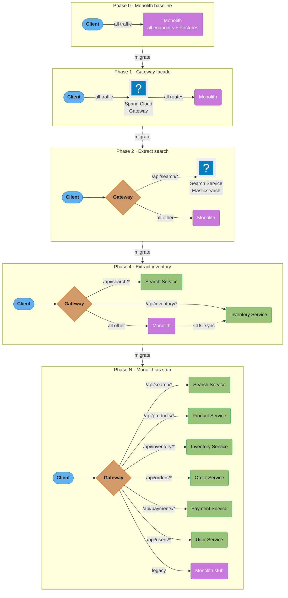
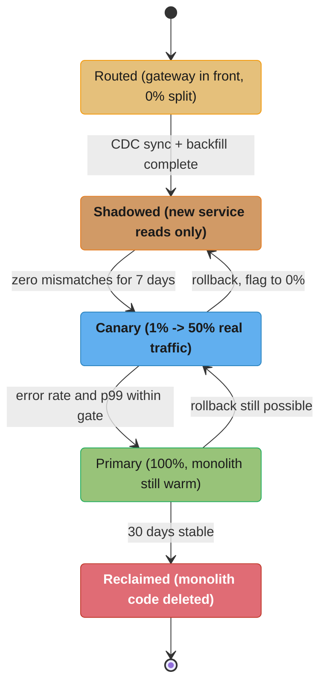
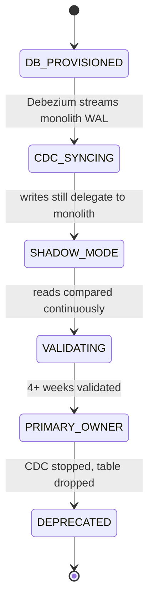

# Case Study: Microservices Migration via Strangler Fig

## Intuition

> **Design intuition**: A monolith migration is not an architecture project. It is a **sequence of
> reversible bets**, each one small enough that being wrong costs a week rather than a year. The
> strangler fig is famous for the metaphor, but the mechanism that actually matters is duller: a
> routing layer you control, in front of a system you are afraid of, so that every subsequent
> decision can be undone by changing a number rather than by shipping code.

**Key insight for this design**: the hard part is never the service. Standing up a Spring Boot
application that serves `/api/inventory` is a week's work for one engineer. The hard part is that
**the monolith's 50 tables are one transactional universe**, and every extraction takes something
out of it that used to be free — a foreign key, a join, an `ORDER BY` across two domains, an
`@Transactional` boundary. So the whole migration is organised around one question, asked once per
service: **what did this data used to be able to assume about the rest of the database, and what
replaces that assumption?** Where the answer is "nothing, it was already independent", extract it
first. Where the answer is "a transaction", you are looking at a saga, and you should extract it
last or not at all.

The second insight is the one teams learn expensively: **a migration that does not make the
organisation faster has failed even if the architecture diagram is correct.** The monolith's
symptoms are 3-hour deploys, 25 engineers colliding, and scaling checkout to scale search. If after
14 services the deploy is 20 minutes but a checkout change now touches four repositories and needs
a coordinated release, the distributed monolith has been built. Measure deployment frequency and
lead time from day zero, because those are the numbers the migration is actually for.

---

## 1. Requirements Clarification

A mid-size e-commerce platform runs on a Spring Boot monolith (500K lines of Java, 50 tables in one
PostgreSQL database, deployed as a single WAR). Symptoms:

- 25 engineers step on each other's code; a bug in the search module requires redeploying checkout
- Deployments take 3 hours and happen twice a month (fear of breaking things)
- The product catalog service needs to scale to 50K RPS during sales events but the entire monolith
  must scale, wasting compute on order processing
- The engineering team wants to move to microservices but a big-bang rewrite is too risky

**Goal**: Decompose the monolith incrementally using the strangler fig pattern with zero downtime
and the ability to roll back any individual migration.

### The requirements that are actually being bought

State these as outcomes with numbers, not as "microservices". If the migration cannot be tied to
one of these, it should not happen.

| # | Requirement | Today | Target |
|---|---|---|---|
| F1 | Independent deployability of a bounded context | 1 deployable | 6-8 deployables, each releasable without coordination |
| F2 | Independent scaling of read-heavy catalog | Whole monolith scales | Catalog scales to 50K RPS alone |
| F3 | Deployment frequency | 2 / month | Daily per service |
| F4 | Change lead time (commit to production) | ~11 days | < 1 day |
| F5 | Blast radius of a search bug | Whole platform | Search only |

### Non-functional constraints

| # | Constraint | Value |
|---|---|---|
| N1 | Downtime budget for the entire migration | **Zero.** Every cutover is traffic-shifted, never a maintenance window |
| N2 | Rollback time for any single step | < 60 seconds, no deployment |
| N3 | p99 latency regression tolerance on any migrated endpoint | +20 ms, hard gate on cutover |
| N4 | Data consistency during dual-run | Zero mismatches for 7 consecutive days before cutover |
| N5 | Team capacity | 25 engineers, of whom ~6 can be on migration at any time without stopping the roadmap |

### The three questions to ask before agreeing to any of this

1. **"What is slow today, and is it the architecture?"** A 3-hour deploy is often a 3-hour test
   suite. Splitting the codebase does not make a slow test suite fast; it makes it fourteen slow
   test suites. Fix the pipeline first — it is cheaper and it is a prerequisite anyway.
2. **"Do the team boundaries match the proposed service boundaries?"** Conway's law is not advice,
   it is an observation. Services that cut across team boundaries produce cross-team coordination
   on every change, which is precisely the problem being solved.
3. **"Can we observe the monolith today?"** If there is no distributed tracing, no per-endpoint
   latency histogram and no dependency map, the seam analysis in §4.2 is guesswork. **Observability
   is a prerequisite, not a phase.**

### Explicitly out of scope

Rewriting business logic (lift-and-shift the behaviour, refactor afterwards), changing the frontend,
and moving to a new cloud. Each of those is a separate risk; combining them is how a migration
becomes a two-year project with nothing shippable in the middle.

---

## 2. Scale Estimation

Migration arithmetic is not steady-state arithmetic. The units are endpoints, tables, slices and
engineer-weeks.

### Sizing the work

```
Monolith:                                       500,000 lines of Java
                                                     50 tables
                                                    340 HTTP endpoints
Proposed target services                                6  (+ monolith stub)

Endpoints per service (uneven — orders and catalog dominate):
  search             28      product catalog    74
  inventory          41      orders            96
  payments           35      users             52
  legacy remainder   14
                    ---
                    340
```

### How long one strangler slice takes

A "slice" is one service extracted end to end: seam analysis, service build, CDC sync, dual-run
validation, cutover, monolith code removal. Timed from the team's first two extractions:

```
Seam analysis + ACL design                              1.5 weeks
Service build (endpoints + own DB schema)               3.0 weeks
CDC pipeline + backfill                                 1.5 weeks
Dual-run validation (WALL CLOCK, not effort)            4.0 weeks   <- runs in parallel
Traffic cutover 1% -> 100%                              2.0 weeks   <- runs in parallel
Monolith dead-code removal                              1.0 weeks
                                                       ----------
Engineer-effort per slice                              ~7.0 engineer-weeks x 3 engineers = 21
Wall-clock per slice                                   ~9-10 weeks
```

The validation and cutover weeks are wall-clock waiting, not effort, which is what makes
**pipelining slices** the single biggest schedule lever: with 6 engineers you run two slices offset
by 4 weeks and the programme finishes in roughly half the serial time.

```
Serial:    6 slices x 9.5 weeks                       =  57 weeks
Two-track: 6 slices, offset 4 weeks                   =  ~32 weeks
Engineer-months:  6 x 21 engineer-weeks / 4           =  ~31 engineer-months
```

**Do not run more than two tracks.** The third track's bottleneck is not engineers, it is the shared
monolith: every slice modifies the same routing config, the same monolith delegation layer and the
same database, and three concurrent slices produce merge conflicts in exactly the code nobody wants
to have a merge conflict in.

### Dual-write and CDC volume

```
Monolith write rate (steady)                            1,800 writes/s
Inventory + reservations share of writes                   22%
CDC events during the inventory slice                     396 events/s
  peak (sales event, 4x)                                1,584 events/s

Backfill: inventory_items                               8,200,000 rows
  at 5,000 rows/s (batched, throttled to protect prod)  =  27 minutes
inventory_reservations                                 41,000,000 rows
  at 5,000 rows/s                                       =  2.3 hours
```

Throttling the backfill is not optional: an unthrottled `COPY`-speed read of 41 million rows
saturates the primary's I/O and shows up as checkout latency. Budget the backfill as a slow
background job with a kill switch.

### Cutover blast radius

The number that decides whether a cutover is safe is **how many requests are exposed per percentage
point of traffic shift**:

```
/api/inventory/** request rate                          2,400 rps
Requests exposed at 1% for 24 hours                     2,073,600
Requests exposed at 1% for 10 minutes                      14,400   <- start here instead
```

Start canaries at a bounded *duration*, not a bounded percentage. Ten minutes at 1% is 14,400 real
requests, which is enough signal for an error-rate comparison and small enough that a total failure
is a support-ticket event rather than an incident.

---

## 3. High-Level Architecture



Each phase is independently rollbackable through the gateway's traffic weighting: Phase 2's search
cutover runs both endpoints in parallel for 2 weeks while shifting weight 10% -> 50% -> 100%, and
Phase 4's inventory cutover layers in Debezium CDC to replicate monolith writes throughout that
parallel run, with cutover simply stopping CDC once the monolith starts delegating reads to the new
service.

### The five states every slice passes through



The state that teams skip is **Reclaimed**, and skipping it is why migrations stall at 80%. Until
the monolith's copy of the code and its tables are deleted, you are paying to run both, every
change has to be made twice, and the rollback path keeps the old logic alive as a plausible
destination. The 30-day wait is a deliberate cooling-off period; the deletion is not optional.

---

## 4. Component Deep Dives

**Shared primitives.** Backend's `case_studies/` has no `cross_cutting/` directory; by the convention
documented in [`../case_studies.md`](../case_studies.md), the shared primitives live as deep-dive
modules in the section itself. This case study leans on eight of them:

| Primitive used here | Deep dive |
|---|---|
| Decomposition, bounded contexts, data ownership, strangler fig theory | [`../../microservices_fundamentals/microservices_fundamentals.md`](../../microservices_fundamentals/microservices_fundamentals.md) |
| Saga, compensations, idempotency keys — what replaces the lost transaction | [`../../distributed_transactions_and_consistency/distributed_transactions_and_consistency.md`](../../distributed_transactions_and_consistency/distributed_transactions_and_consistency.md) |
| Routing, canary weights, BFF, gateway as the control plane | [`../../api_gateway_patterns/api_gateway_patterns.md`](../../api_gateway_patterns/api_gateway_patterns.md) |
| Expand-contract, zero-downtime schema change, backfill | [`../../database_migrations/database_migrations.md`](../../database_migrations/database_migrations.md) |
| CDC, outbox, DLQ, poison pill on the sync pipeline | [`../../messaging_patterns/messaging_patterns.md`](../../messaging_patterns/messaging_patterns.md) |
| Circuit breaker, retry with jitter, bulkhead on new hops | [`../../fault_tolerance_patterns/fault_tolerance_patterns.md`](../../fault_tolerance_patterns/fault_tolerance_patterns.md) |
| Tracing, per-endpoint SLIs, the baseline you must have first | [`../../observability_and_monitoring/observability_and_monitoring.md`](../../observability_and_monitoring/observability_and_monitoring.md) |
| mTLS, discovery, and when a mesh is worth it mid-migration | [`../../service_mesh_and_service_discovery/service_mesh_and_service_discovery.md`](../../service_mesh_and_service_discovery/service_mesh_and_service_discovery.md) |
| Architectural framing of the target state | [`../../../hld/microservices/microservices.md`](../../../hld/microservices/microservices.md) |

### 4.1 BROKEN -> FIXED: The Distributed Monolith

This is the failure mode, written out, because almost every regretted migration is this one. The
team extracts `OrderService` and `InventoryService` as separate deployables in six weeks and
declares success. Both still point at the monolith's database.

```java
// BROKEN: two services, one database, one synchronous call chain.
@Service
public class OrderService {

    @Transactional                                    // <- a transaction that spans a network call
    public Order placeOrder(OrderRequest req) {
        Order order = orderRepository.save(new Order(req));          // monolith DB

        // synchronous HTTP to the "independent" inventory service
        for (LineItem item : req.items()) {                          // N calls, serially
            inventoryClient.reserve(item.sku(), item.qty());         // ~40 ms each
        }
        pricingClient.quote(order);                                  // ~35 ms
        userClient.fetchAddress(req.userId());                       // ~30 ms
        return order;
    }
}
```

```sql
-- BROKEN: both services own the same tables. No boundary exists.
-- order-service   writes orders, reads inventory_items
-- inventory-service writes inventory_items, reads orders
GRANT ALL ON orders, inventory_items TO order_service, inventory_service;
```

What actually happens in production:

1. **Latency collapses.** A 5-item order used to be one in-process transaction at ~180 ms. It is now
   `5 x 40 + 35 + 30 = 265 ms` of network on top of the database work, and measured p99 checkout
   went from **180 ms to 1.4 s** because each of those hops has its own tail.
2. **The transaction is a lie.** `@Transactional` holds a database connection open across three
   network calls. Under load the HikariCP pool exhausts — 20 connections divided by a 265 ms hold
   time is a hard ceiling of ~75 orders/second — and a timeout on `pricingClient` rolls back the
   order row while inventory has already been reserved. There is now inventory reserved for an order
   that does not exist.
3. **Nothing is independently deployable.** Both services read tables the other writes, so a column
   change requires a coordinated release. The deploy is still 3 hours; it is now 3 hours across two
   repositories.

The fix has three parts and all three are required. Removing any one leaves the distributed monolith
intact.

```java
// FIXED (1): the transaction covers ONLY local state, and the network call moves out of it.
@Service
public class OrderService {

    @Transactional
    public Order placeOrder(OrderRequest req) {
        Order order = orderRepository.save(new Order(req, OrderStatus.PENDING));  // order-service DB only
        outbox.append(new OrderPlaced(order.id(), req.items()));   // same transaction, no network
        return order;                                              // returns in ~12 ms
    }
}
```

```java
// FIXED (2): the cross-service step becomes an asynchronous saga, not a synchronous call.
// Inventory reserves, then emits its own event; a failure compensates rather than rolls back.
@KafkaListener(topics = "order.placed", groupId = "inventory-svc")
public void onOrderPlaced(OrderPlaced event) {
    try {
        inventoryService.reserve(event.orderId(), event.items());   // idempotent on orderId
        publisher.send("inventory.reserved", new InventoryReserved(event.orderId()));
    } catch (InsufficientStockException e) {
        publisher.send("inventory.rejected", new InventoryRejected(event.orderId(), e.sku()));
    }
}
```

```sql
-- FIXED (3): ownership is enforced by the grant, not by convention.
-- If a service CAN read another's table, eventually it will.
REVOKE ALL ON inventory_items FROM order_service;
GRANT SELECT, INSERT, UPDATE ON orders TO order_service;
GRANT SELECT, INSERT, UPDATE ON inventory_items TO inventory_service;
```

Part 3 is the one that gets negotiated away in review, and it is the load-bearing one. A boundary
that is documented but not enforced is not a boundary; the first production incident at 2am will be
fixed with a cross-service `SELECT`, and it will never be removed. Saga mechanics and compensation
design live in
[`../../distributed_transactions_and_consistency/distributed_transactions_and_consistency.md`](../../distributed_transactions_and_consistency/distributed_transactions_and_consistency.md).

### 4.2 Seam Analysis — Choosing What to Extract

Extraction order is chosen by **decreasing independence**, measured rather than argued. Three inputs:

| Signal | How to get it | What it tells you |
|---|---|---|
| Table co-access | Parse the query log for 30 days; build a table-to-table graph weighted by co-occurrence in a transaction | Tables that always appear together are one bounded context, whatever the domain model says |
| Foreign keys crossing a candidate boundary | `information_schema.table_constraints` | Each one is a join you will have to replace with an API call or a denormalised copy |
| Endpoint fan-in | Distributed tracing, or the access log if there is no tracing | An endpoint called by 40 others is a bad first extraction regardless of how clean its domain is |

Applying that here gives the order used below:

1. **Search** — read-only, rebuildable from catalog events, zero foreign keys out. The ideal first
   slice precisely because failure is recoverable by re-indexing.
2. **Product Catalog** — low write frequency, clean domain, 3 outbound FKs.
3. **Inventory** — high write frequency, isolated domain, but 11 FKs to orders.
4. **Orders** — 96 endpoints and the highest fan-in in the system. Migrated late.
5. **Payments** — security-critical and audited; migrated last so the team has five slices of
   experience before touching money.

**Search goes first for a reason that has nothing to do with search.** The first slice's real
purpose is to build the machinery — gateway routing, CDC pipeline, shadow validator, cutover
runbook, rollback drill — and you want to build it against the service where being wrong costs a
re-index rather than an outage.

### 4.3 Gateway First

Introducing Spring Cloud Gateway as the first step costs nothing functionally — all traffic is
proxied through to the monolith unchanged. But it establishes the control plane for all future
migrations. From this point, routing decisions can be made without touching the monolith or client
code. This is the pivot point.

```java
@Configuration
public class GatewayRoutingConfig {

    @Bean
    public RouteLocator routes(RouteLocatorBuilder builder,
                                UnleashClient unleash) {
        return builder.routes()
            // All traffic to monolith initially
            .route("monolith-catchall", r -> r
                .path("/**")
                .uri("lb://monolith"))
            .build();
    }
}
```

```yaml
spring:
  application:
    name: api-gateway
  cloud:
    gateway:
      server:
        webflux:            # server.webflux distinguishes the WebFlux gateway
          discovery:        # from the Web MVC and proxy-exchange variants
            locator:
              enabled: true
          default-filters:
            - AddRequestHeader=X-Gateway-Version, 2.0
            - AddResponseHeader=X-Processed-By, api-gateway
```

Ship this alone, to 100% of traffic, and sit on it for two weeks before extracting anything. It is
the only step in the whole programme with no rollback story of its own, so it deserves its own
soak. The p99 cost of the extra hop is 2-4 ms; measure it and record the number, because it is the
baseline every later latency gate is compared against.

### 4.4 Canary Traffic Splitting for Search Service

```java
@Configuration
public class SearchRoutingConfig {

    @Bean
    public RouteLocator searchRoutes(RouteLocatorBuilder builder) {
        return builder.routes()
            // 10% of search traffic to new service (canary)
            .route("search-service-canary", r -> r
                .path("/api/search/**")
                .and().weight("search-group", 10)
                .filters(f -> f
                    .circuitBreaker(c -> c
                        .setName("search-cb")
                        .setFallbackUri("forward:/fallback/search"))
                    .retry(config -> config.setRetries(2))
                )
                .uri("lb://search-service"))

            // 90% still to monolith
            .route("search-monolith", r -> r
                .path("/api/search/**")
                .and().weight("search-group", 90)
                .uri("lb://monolith"))
            .build();
    }
}
```

The `retry(2)` is safe here only because search is idempotent. **Do not copy this filter onto a
route that mutates state** — a gateway retry on a `POST /api/orders` that timed out after the
monolith committed creates a duplicate order, and the gateway is the one place in the stack with no
idea whether the request was idempotent. Retries belong on read routes; write routes get a circuit
breaker and an `Idempotency-Key`.

### 4.5 Database per Service via CDC Sync

The monolith's shared PostgreSQL database cannot be split all at once. The pattern:

1. New service is deployed with its own database
2. Debezium CDC connector reads the monolith DB's WAL for the relevant tables
3. CDC events flow to Kafka, a consumer populates the new service's DB
4. New service is in "shadow mode" (receives writes via monolith delegation) while CDC syncs reads
5. After 4+ weeks of consistency validation, the new service takes primary ownership
6. CDC sync stopped, monolith table deprecated



Data ownership never splits across two writers — every extracted service walks this exact lifecycle,
and `VALIDATING` only advances to `PRIMARY_OWNER` once the consistency validator shows zero
mismatches for 7 consecutive days.

```json
// Debezium connector: read inventory table from monolith DB → Kafka
{
  "name": "inventory-migration-connector",
  "config": {
    "connector.class": "io.debezium.connector.postgresql.PostgresConnector",
    "database.hostname": "monolith-postgres",
    "database.port": "5432",
    "database.user": "debezium_reader",
    "database.password": "${secrets:postgres-password}",
    "database.dbname": "ecommerce",
    "plugin.name": "pgoutput",
    "slot.name": "inventory_migration_slot",

    "table.include.list": "public.inventory_items,public.inventory_reservations",

    "topic.prefix": "migration"
  }
}
```

No field-renaming SMT here, deliberately. `ReplaceField$Value` acts on the **top-level** fields of
the record value, and a Debezium record's value is the change envelope (`before`, `after`, `source`,
`op`, `ts_ms`) — `prod_id` and `inv_qty_on_hand` live nested inside `after`, so a rename configured
at that level is a silent no-op. To rename in Connect you must first flatten with
`ExtractNewRecordState`, which discards the `before` image the consumer below needs for DELETEs.
Renaming is therefore left to the anti-corruption layer in the consumer (§4.7).

**The replication slot is the operational hazard nobody warns you about.** A Postgres logical
replication slot holds WAL on the primary until its consumer acknowledges. If the Debezium connector
stops — a bad deploy, a Kafka outage, an OOM — the monolith's primary accumulates WAL indefinitely
and eventually **fills its disk and takes the whole platform down**. Alert on
`pg_replication_slots.confirmed_flush_lsn` lag, set `max_slot_wal_keep_size`, and have a documented
decision on when to drop the slot and re-backfill instead of waiting.

```java
// Inventory service CDC consumer — populates new service's DB
@Component
public class InventoryMigrationConsumer {

    private final InventoryRepository inventoryRepository;
    private final LegacyInventoryAdapter adapter;

    @KafkaListener(topics = "migration.public.inventory_items",
                   groupId = "inventory-migration")
    @Transactional
    public void handleInventoryChange(ConsumerRecord<String, JsonNode> record) {
        JsonNode after = record.value().get("after");
        if (after == null || after.isNull()) {
            // DELETE event — mark as deleted in new DB
            String legacyId = record.value().get("before").get("id").asText();
            inventoryRepository.deleteByLegacyId(legacyId);
            return;
        }

        // Translate legacy schema to new domain model via ACL
        InventoryItem item = adapter.fromLegacy(after);
        inventoryRepository.save(item);
    }
}
```

### 4.6 Expand-Contract for the Shared Schema

CDC moves rows between databases. Expand-contract is what lets the *schema* change while both sides
are live, and the two are used together on every slice.

```sql
-- EXPAND: additive only. Old code keeps working; new code can start using the new shape.
ALTER TABLE inventory_items ADD COLUMN sku_v2 text;                  -- nullable, no rewrite
CREATE INDEX CONCURRENTLY idx_inventory_sku_v2 ON inventory_items (sku_v2);  -- no ACCESS EXCLUSIVE

-- Backfill in bounded batches. NEVER a single UPDATE over 8.2M rows: that takes an
-- ACCESS EXCLUSIVE-free but very long transaction, bloats the table, and blocks VACUUM.
DO $$
DECLARE rows_updated int;
BEGIN
  LOOP
    UPDATE inventory_items SET sku_v2 = normalize_sku(prod_cat_code)
    WHERE sku_v2 IS NULL
      AND id IN (SELECT id FROM inventory_items WHERE sku_v2 IS NULL LIMIT 5000);
    GET DIAGNOSTICS rows_updated = ROW_COUNT;
    EXIT WHEN rows_updated = 0;
    COMMIT;
    PERFORM pg_sleep(0.1);          -- throttle: protects the primary's I/O
  END LOOP;
END $$;

-- Only after every reader is on sku_v2, and only after a soak period:
-- CONTRACT: ALTER TABLE inventory_items DROP COLUMN prod_cat_code;
```

Three rules that turn this from a pattern into a habit: every schema change ships in its own release
separate from the code that uses it; `CREATE INDEX CONCURRENTLY` always, because a plain
`CREATE INDEX` takes an `ACCESS EXCLUSIVE` lock and a 41-million-row index build is a multi-minute
outage; and the contract phase never runs in the same week as the expand phase, because the whole
point is that rollback stays available in between. Full treatment in
[`../../database_migrations/database_migrations.md`](../../database_migrations/database_migrations.md).

### 4.7 Anti-Corruption Layer at Each Service Boundary

The monolith's data model uses legacy conventions (`prod_cat_code`, `inv_qty_on_hand`). Each new
service has a clean domain model. An ACL (adapter layer) in the new service translates from the
monolith's event/API schema to the new service's domain model.

```java
/** The ONLY place in inventory-service that knows the monolith's vocabulary. */
@Component
public class LegacyInventoryAdapter {

    InventoryItem fromLegacy(JsonNode legacy) {
        return new InventoryItem(
            new Sku(legacy.get("prod_cat_code").asText()),          // prod_cat_code -> Sku
            Quantity.onHand(legacy.get("inv_qty_on_hand").asInt()), // int -> value object
            Quantity.reserved(legacy.get("inv_qty_rsvd").asInt()),
            // Legacy encodes "unlimited" as -1. The new model has no such concept;
            // translating it HERE is what stops -1 leaking into every downstream service.
            legacy.get("inv_qty_on_hand").asInt() == -1
                ? StockPolicy.UNLIMITED : StockPolicy.TRACKED,
            legacy.get("legacy_id").asText()                        // kept for reconciliation only
        );
    }
}
```

The `-1` case is the whole argument for an ACL in one line. Without it, a sentinel value invented in
2011 propagates into six new services, each of which grows its own `if (qty == -1)` branch, and the
clean domain model is dead before it shipped. An ACL is not a mapper — it is the place where legacy
weirdness is required to stop.

### 4.8 Consistency Validation Before Cutover

```java
// Shadow mode: compare monolith inventory response vs new service response
@Service
public class InventoryShadowValidator {

    private final MonolithInventoryClient monolithClient;
    private final InventoryService inventoryService;
    private final MeterRegistry meterRegistry;
    private final AlertingService alertingService;

    @Scheduled(fixedDelay = 30000)  // every 30 seconds
    public void validateConsistency() {
        List<String> sampleSkus = getSampleSkus(100);

        long mismatches = sampleSkus.stream()
            .filter(sku -> {
                int monolithQty = monolithClient.getQuantity(sku);
                int newServiceQty = inventoryService.getQuantity(sku);
                return monolithQty != newServiceQty;
            })
            .count();

        meterRegistry.gauge("migration.inventory.mismatch_count", mismatches);

        if (mismatches > 5) {
            alertingService.alert("Inventory migration: " + mismatches + " mismatches in 100 samples");
        }
    }
}
// Deploy to production, monitor for 4 weeks. Cutover only when mismatch_count == 0 for 7 days.
```

Two refinements this simple version needs before it is trustworthy. **Sample the hot keys, not
uniformly**: a random 100 SKUs out of 8.2 million will essentially never sample the 200 SKUs that
carry most of the traffic, so weight the sample by request frequency. And **compare with a
tolerance window**: CDC is asynchronous, so a SKU written 200 ms ago legitimately differs, and a
strict comparison produces a permanent noise floor that trains the team to ignore the alert. Re-read
a mismatch after 2 seconds and only count it if it persists.

### 4.9 Feature-Flag-Based Cutover

```java
@Configuration
public class InventoryRoutingConfig {

    @Bean
    public RouteLocator inventoryRoutes(RouteLocatorBuilder builder,
                                        Unleash unleash) {
        return builder.routes()
            .route("inventory-new-service", r -> r
                .path("/api/inventory/**")
                .and().predicate(exchange -> {
                    // Route to new service only when flag is enabled
                    String userId = exchange.getRequest().getHeaders().getFirst("X-User-ID");
                    return unleash.isEnabled("inventory-service-migration",
                        UnleashContext.builder().userId(userId).build());
                })
                .uri("lb://inventory-service"))

            .route("inventory-monolith-fallback", r -> r
                .path("/api/inventory/**")
                .uri("lb://monolith"))
            .build();
    }
}
// Rollback: flip "inventory-service-migration" flag to 0%
// Cutover: increment flag from 1% → 10% → 50% → 100% over 2 weeks
```

Each migration step uses a feature flag rather than hardcoded routing. This allows instant rollback
without a deployment (flip flag, 100% traffic back to monolith), gradual rollout by percentage, and
user-specific rollout so internal users dogfood first.

**Make the flag sticky per user.** Keying on `userId` rather than sampling per request is what stops
a single user's session bouncing between two backends mid-checkout, which produces bug reports that
are impossible to reproduce because they depend on which side of a coin flip each request landed.

---

## 5. Design Decisions & Tradeoffs

### Strangler Fig vs Big-Bang Rewrite

The big-bang rewrite would mean developing a complete replacement in parallel, then switching all
traffic at once. The risk is high: the new system may not have feature parity, there is no
intermediate validation, and rollback means throwing away months of work. Strangler fig migrates one
bounded context at a time — each migration is independently rollbackable and validated in production
with real traffic.

### CDC vs API-Based Data Sync

An alternative to CDC is having the new service call the monolith's API to seed its database. This is
simpler to set up but: it puts load on the monolith, has rate limiting concerns, misses updates that
happen between polls, and requires the monolith to have an export API. CDC from the WAL is more
reliable and near-real-time, but requires database replication permissions and adds operational
complexity (Debezium, replication slots).

### Data Ownership Transition

The most critical decision for each service extraction is: when does the new service become the
system of record? The pattern is "write to both, validate, then write to one." During migration:
monolith owns writes (source of truth), new service is a replica. After cutover: new service owns
writes, monolith is deprecated. Never have two services both owning writes to the same data — that
is a distributed monolith.

### Decisions summary

| Decision | Chosen | Rejected | Why |
|---|---|---|---|
| Migration shape | Strangler fig, one slice at a time | Big-bang rewrite | Rollback per slice costs a flag flip; rollback of a rewrite costs the project |
| Control plane | API gateway, introduced first | Client-side routing; DNS switching | Gateway routing is instantaneous and reversible; DNS TTLs are not, and clients cannot be redeployed |
| Data sync | Debezium CDC from the WAL | Polling the monolith's API | CDC is near-real-time and misses nothing between polls; the cost is a replication slot to operate |
| Schema change | Expand-contract, always separated by a soak | In-place `ALTER` | Additive changes keep both sides live and preserve rollback |
| Cross-service consistency | Saga with compensations | Distributed 2PC | 2PC across services couples their availability; the compensations are the honest model |
| Boundary enforcement | Database `GRANT`s per service | Convention and code review | A boundary that can be crossed will be, at 2am, permanently |
| Concurrency | Max two slices in flight | Six parallel teams | The bottleneck is the shared monolith, not engineers |
| Mesh | Deferred until >6 services | Istio from day one | A mesh solves problems you do not have at 2 services and adds ones you cannot debug |

---

## 6. Real-World Implementations

| Company | What they actually did, and what it cost |
|---|---|
| **Amazon** | The 2001-2005 decomposition of the retail monolith into services is the origin of the two-pizza-team model, and the durable lesson is organisational rather than technical: services were drawn to match team ownership, and the mandate that all cross-team access go through service interfaces is what made the boundaries real. It took years, not quarters. |
| **Netflix** | Moved from a datacenter monolith to cloud microservices between roughly 2009 and 2016 — **seven years** — triggered by a database corruption incident that stopped DVD shipping for three days. Worth quoting the duration in an interview: the canonical success story took most of a decade, which calibrates any "we'll be done in two quarters" plan. |
| **Uber** | Reached roughly 2,200 microservices and then published **DOMA** (Domain-Oriented Microservice Architecture) as an explicit correction, grouping services into domains behind gateways with layer-based dependency rules. Uber's own framing is that extreme decomposition brought back the coupling costs it was meant to remove. This is the clearest published admission that "more services" is not a direction, it is a dial. |
| **Airbnb** | Ran a multi-year move off its Rails monolith to an SOA, and invested heavily in a unified data-access layer rather than letting every service invent its own — the recurring theme being that the schema and data layer, not the services, is where the real work lives. |
| **Shopify** | Did **not** go to microservices. It hardened its Rails monolith into a **modular monolith** with enforced internal boundaries, on the reasoning that the coupling problem is solvable without the network. This is the option every migration plan should have to argue against explicitly. |
| **Segment** | The famous reversal. Segment moved from a monolith to per-destination microservices, reached a service and queue per destination — with roughly three new destinations added per month — and found that operational overhead grew linearly with each one while shared-library changes could not be tested across all of them. In 2018 Alexandra Noonan published "Goodbye Microservices" describing the move **back** to a monolith, with a new component (Centrifuge) replacing the per-destination queues. The trigger was not scale, it was **change amplification**: every shared change had to be applied N times. |
| **Amazon Prime Video** | In March 2023 the Video Quality Analysis team rebuilt its audio/video monitoring service, replacing an AWS Step Functions orchestration with all components running inside a **single ECS task**, and reported an infrastructure cost reduction of **over 90%**. Be precise about what this is: one service, moving from distributed serverless orchestration to a single process, where the win came from eliminating S3 as intermediate storage for video frames and passing data in memory instead. It is not "Amazon abandoned microservices" — it is a very good example of a workload whose data movement dominated everything else. |

**The honest summary to give an interviewer**: two of the seven above moved *toward* fewer
services, one never left the monolith, and the canonical success took seven years. Microservices
are a way of buying independent deployability with network latency, operational surface and
eventual consistency. If the thing you actually need is faster deploys, check whether a modular
monolith and a faster test suite buy it more cheaply first.

---

## 7. Technologies & Tools

| Technology | Usage |
|------------|-------|
| Spring Cloud Gateway | Facade for traffic routing, gradual cutover |
| Debezium | CDC from monolith PostgreSQL to Kafka; `pgoutput` plugin, one replication slot per slice |
| Apache Kafka | Event backbone for CDC events and new service integration |
| Unleash | Feature flags for per-percentage traffic cutover; OpenFeature-compatible SDKs |
| PostgreSQL | Both monolith DB and per-service DBs |
| Flyway | Versioned, expand-contract schema migrations per service |
| Docker / Kubernetes | New services deployed as containers alongside monolith |
| Resilience4j | Circuit breakers on gateway routes to new services |
| Micrometer | Migration consistency metrics, canary error rate |
| OpenTelemetry | Distributed tracing across the gateway, monolith and every new service — the prerequisite for seam analysis |
| Argo Rollouts | Progressive delivery with automated metric-gated promotion and rollback |
| ArchUnit | Enforces module boundaries inside the monolith before extraction, so the seam is proven before it is cut |

---

## 8. Operational Playbook

### The gates every slice must pass

No slice advances on someone's judgement; it advances on a number.

| Gate | Threshold | Blocks |
|---|---|---|
| Shadow consistency | 0 persistent mismatches, 7 consecutive days | Shadowed -> Canary |
| Error rate delta (new vs monolith) | < 0.1 percentage points over 24h at each step | Canary promotion |
| p99 latency delta | <= +20 ms vs the recorded gateway baseline | Canary promotion |
| CDC lag | p99 < 5 s | Any promotion |
| Replication slot lag | < 10 GB retained WAL | Any promotion; also pages |
| Rollback drill | Executed successfully within the last 14 days | Canary -> Primary |

That last row is the one that makes the rest real. **An untested rollback is not a rollback.** Flip
the flag to 0% deliberately, once a fortnight, in production, during business hours, and time it.

### Runbook: canary error rate spike

1. Flip the flag to 0%. Do this **first**, before diagnosing — the diagnosis is not urgent once
   traffic is off the new path, and the instinct to investigate while users are affected is the
   single most expensive habit in a migration.
2. Confirm the monolith absorbed the traffic (its request rate should return to the pre-canary
   baseline within one scrape interval).
3. Diagnose from the traces already captured. Compare the new service's spans against the monolith's
   for the same operation; the difference is usually an ACL translation gap or a missing index on
   the new database.
4. Do not re-enable at the previous percentage. Restart the ladder at 1%.

### Runbook: CDC lag rising

Check whether the connector is running before anything else. A stopped Debezium connector is not a
latency problem, it is a **countdown to a full primary disk**, because the replication slot pins WAL
until the consumer acknowledges. If the connector cannot be restarted within the WAL headroom, the
correct action is to drop the slot and re-backfill — losing hours of sync progress is strictly
better than taking the monolith's primary down. Decide that threshold in advance and write it in
the runbook, because it is not a decision anyone makes well at 3am.

### Runbook: rollback after full cutover

Between `Primary` and `Reclaimed`, the monolith's code still exists but its data is stale — the new
service has been the writer. Rolling back is therefore **not** a flag flip; it requires reversing
the CDC direction and backfilling the monolith with what it missed. Keep a reverse-CDC connector
defined and tested but stopped for the whole 30-day window. Teams that skip this discover during an
incident that "roll back" and "roll forward with a fix" are the same amount of work, which is fine
if you knew, and an outage if you did not.

### What to measure the whole time

Track the four DORA metrics per service and for the platform as a whole, from before slice one.
Deployment frequency and lead time are the migration's actual justification (F3, F4); change failure
rate and time to restore tell you whether the added distribution is costing more than it buys. A
migration where deploy frequency has not moved after three slices should be stopped and re-argued,
not continued.

---

## 9. Common Pitfalls & War Stories

**The shared database that made everything slower.** The first two extractions shipped in six weeks
and both kept reading the monolith's tables, because separating the schema "could come later". A
5-item checkout went from one in-process transaction to six network hops, and **p99 checkout moved
from 180 ms to 1.4 s** — an 7.8x regression on the most valuable endpoint in the business. Worse,
the `@Transactional` boundary now held a HikariCP connection open across those hops, capping
throughput at roughly 75 orders/second against a Black Friday plan of 400. It took **nine weeks** to
unpick, more than the original extraction took to build. The rule that came out of it: **a service
that cannot own its tables is not ready to be extracted.**

**The replication slot that filled the primary's disk.** A Kafka broker upgrade took the Debezium
connector down over a weekend. Nobody was alerted on slot lag, only on CDC event rate — which was
zero, and zero looked like "quiet weekend". By Monday the monolith's primary had accumulated
**310 GB of retained WAL** and was 40 minutes from a full disk, which would have stopped all writes
platform-wide. The alert that existed measured the wrong thing: monitor `pg_replication_slots` lag
directly, not the downstream event rate, because a healthy-looking zero and a catastrophic zero are
indistinguishable from the consumer side.

**The 94% migration that never finished.** Five of six slices reached `Primary` and stopped there.
The monolith's code was still deployed, still compiled, still had its tables, and every schema
change had to be applied in two places for **fourteen months**. Two engineers were permanently
allocated to keeping the duplicate paths in step, the infrastructure bill carried both, and new
hires could not tell which copy was authoritative. Nobody would delete the old code because it was
"the rollback plan" — a plan that had not been tested in a year and, after the reverse-CDC connector
bit-rotted, did not work. **Deletion is a phase with an owner and a date, or it does not happen.**

**Extracting orders first because it was the most painful.** The team picked the service causing the
most deploy pain as slice one. It had 96 endpoints, the highest fan-in in the system, and 11
foreign keys crossing the proposed boundary — so the first slice was also the hardest, attempted by
a team with zero migration experience and no gateway, CDC pipeline or shadow validator yet built.
It was abandoned after **11 weeks** with nothing shipped, and the programme lost executive support
for two quarters. Extract the *easiest* thing first. The first slice's product is the machinery, not
the service.

**The canary that measured nothing.** Search was canaried at 1% for six weeks, showed a clean error
rate, and broke on promotion to 50%. At 1% the new service never exceeded 24 rps, so its connection
pool, cache and GC behaviour were all in a regime the 50% traffic never resembled. **Canary
percentage measures correctness, not capacity.** Load-test the new service to its target throughput
separately, before the canary, and treat the canary as a correctness check only.

---

## 10. Capacity Planning

### The cost delta nobody budgets for

The single most useful number in a migration proposal, and the one most often missing. Infrastructure
cost goes **up**, usually 20-40%, and the migration is worth it anyway — but only if that is said
out loud in advance rather than discovered in the third month.

```
BEFORE — monolith
  App: 24 x c6i.2xlarge (sized for peak checkout + catalog together)  $ 6,900 / mo
  PostgreSQL: primary + 2 replicas (db.r6g.4xlarge)                   $ 4,200 / mo
  Load balancer + misc                                                $   400 / mo
                                                                     ------------
                                                                      $11,500 / mo

AFTER — 6 services + gateway + stub
  Gateway: 8 pods                                                     $   900 / mo
  search 6 / catalog 14 / inventory 10 / orders 18 / payments 8 /
    users 6 / monolith stub 4  = 66 pods, avg smaller instances       $ 8,100 / mo
  PostgreSQL: 6 clusters (primary + 1 replica each), right-sized      $ 7,600 / mo
  Kafka (managed, CDC + service events)                               $ 2,400 / mo
  Observability: tracing + metrics at 6x the span volume              $ 1,800 / mo
                                                                     ------------
                                                                      $20,800 / mo   (+81%)

DURING — the expensive middle: BOTH are running
  monolith (undiminished until the last slice)                        $11,500 / mo
  + new services accumulating                                         $ 0 -> 9,300
  + CDC pipeline and duplicate storage                                $ 2,400 / mo
                                                                     ------------
  peak, around month 7                                                $23,200 / mo
```

Three things fall out of that table. The steady-state increase is **+81%**, driven mostly by six
database clusters replacing one and by tracing volume — per-service database high availability is
the line item that surprises people, because "primary plus a replica" repeated six times is not
six times one small database. The *transition* is more expensive than either end state, and it
lasts roughly 7-9 months. And the offsetting saving is real but different in kind: catalog can now
scale to 50K RPS on its own instead of scaling the whole monolith, which at sale-event peaks is a
saving of roughly **$4,000 per event** in avoided over-provisioning.

### Sizing the migration infrastructure

```
CDC events, all slices, steady                        1,800 writes/s
Kafka partitions for CDC topics: one topic per table,
  sized for consumer parallelism, not bytes         =  6 partitions each
CDC retention: 7 days (recovery window)
  1,800 x 1.2 KB x 86,400 x 7 x RF 3               =  3.9 TB   <- CDC records are fat
```

CDC records carry `before` and `after` images plus source metadata, so budget roughly 1.2 KB per
event rather than the few hundred bytes a domain event would cost. This is the item that gets
under-provisioned.

### Gateway sizing

```
Total platform traffic, peak                        14,000 rps
Spring Cloud Gateway (WebFlux) per pod, comfortable  ~2,500 rps
Pods required                                     =        6
  + 2 for rolling deploys and AZ loss             =        8
Added p99 latency per hop (measured, not assumed)  =    2-4 ms
```

### Team capacity, restated as the real constraint

```
Engineers available for migration                            6
Engineers per slice                                          3
Concurrent slices                                            2
Wall-clock per slice                                   ~9.5 weeks
Slices                                                       6
Programme duration (two tracks)                        ~32 weeks
Engineer-months consumed                                   ~31
```

The 19 engineers not on the migration are still shipping product into the monolith the whole time,
which is the actual reason big-bang rewrites fail: they require freezing the thing that pays for the
rewrite. The strangler fig's real advantage is that it never asks for that freeze.

---

## 11. Interview Discussion Points

**Q: How do you handle in-flight requests during cutover?**

The gateway weight change takes effect immediately with no pod restart, so in-flight requests
complete against their original backend and only new requests route at the new weight. There is no
request interruption at the HTTP layer. The subtlety is at the session layer rather than the request
layer: if the flag is evaluated per request rather than per user, one user's checkout flow can
bounce between the monolith and the new service across three requests, and any state the new service
holds that the monolith does not — a reservation, a draft, a cache entry — is simply missing on the
next hop. Key the flag on user id so routing is sticky. For long-lived connections such as
WebSockets or SSE the "immediate" claim is also false, because an existing connection stays bound to
its backend until it is closed, so plan for a drain window sized to your connection lifetime.

**Q: What do you do if the new service has a bug after 50% traffic cutover?**

Flip the feature flag to 0% first, before diagnosing. This routes all traffic back to the monolith
within seconds with no deployment, and the diagnosis stops being urgent the moment users are off the
broken path — the instinct to investigate while the incident is live is the most expensive habit in
a migration. Then confirm the monolith actually absorbed it: its request rate should return to the
pre-canary baseline within a scrape interval, and if it does not, the monolith has scaled down under
the reduced load and needs a moment to scale back. Diagnose from the traces you already captured
rather than by reproducing. When you re-enable, restart the ladder at 1% rather than resuming at
50%, because the bug you fixed is evidence that your gate did not catch it and the gate has not
changed. This whole answer only holds while the monolith is still warm and its data still current —
after the `Reclaimed` phase the rollback is a reverse-CDC operation, not a flag flip.

**Q: How long do you run the CDC sync in parallel?**

Minimum 4 weeks, and the gate is not the duration but zero persistent mismatches for 7 consecutive
days. The longer parallel run also doubles as a load test for the new service under real traffic
shape rather than synthetic. Two refinements make the validator trustworthy: sample the hot keys
weighted by request frequency rather than uniformly, because a random 100 SKUs out of 8.2 million
will essentially never touch the 200 that carry the traffic; and re-check a mismatch after about two
seconds before counting it, because CDC is asynchronous and a strict comparison produces a permanent
noise floor that trains everyone to ignore the alert. A validator that cries wolf is worse than no
validator, since it converts a real signal into background noise.

**Q: What is the distributed monolith anti-pattern and how do you avoid it?**

A distributed monolith is a system split into microservices that are still tightly coupled: they
share a database, have circular synchronous dependencies, or must be deployed together. You now pay
every cost of distribution — network latency, partial failure, eventual consistency, six times the
operational surface — and receive none of the benefit, because nothing is independently deployable.
Avoiding it takes three things and all three are required: each service owns its tables outright, no
service depends synchronously on the monolith for a read on its own hot path, and cross-service
writes become sagas rather than transactions spanning a network call. The one that gets negotiated
away in review is the first, and it is the load-bearing one — enforce it with database `GRANT`s per
service rather than with convention, because a boundary that can be crossed will be crossed at 2am
during an incident and will never be removed afterwards. The diagnostic question: if two services
must be released together, they are one service.

**Q: How do you decompose the shared database?**

Expand-contract, one table at a time, never in one release. Expand means additive-only changes — add
the new column or table, add its index with `CREATE INDEX CONCURRENTLY` so you do not take an
`ACCESS EXCLUSIVE` lock that turns a 41-million-row index build into a multi-minute outage, and
backfill in bounded batches with a sleep between them so the primary's I/O is not saturated. Both
old and new shapes are live and correct throughout, which is what preserves rollback. Only once
every reader has moved, and after a deliberate soak of at least a week, does the contract phase drop
the old column. Combine it with CDC: expand-contract moves the *schema* while CDC moves the *rows*
into the new service's database, and the two run together on every slice. Never delete the old
schema in the same release as the code that stopped using it — that removes your ability to roll
back exactly when you most want it.

**Q: Which service do you extract first, and why is that not the one causing you the most pain?**

Extract the easiest, most independent one — here, search: read-only, rebuildable from catalog events
by re-indexing, and with no foreign keys crossing its boundary. The temptation is to start with
whatever hurts most, which is usually orders, and that is a trap: the first slice's real product is
not the service but the machinery — gateway routing, the CDC pipeline, the shadow validator, the
cutover runbook, the rollback drill — and you want to build that machinery against a service where
being wrong costs a re-index rather than an outage. A team that starts with a 96-endpoint,
highest-fan-in service is attempting the hardest problem with zero experience and none of the tools
built. Choose the order from measurements, not intuition: table co-access from 30 days of query
logs, foreign keys crossing each candidate boundary, and endpoint fan-in from traces.

**Q: You have removed a transaction that used to span orders and inventory. What replaces it?**

A saga: a sequence of local transactions, each with a compensating action, coordinated by events
rather than by a lock. Placing an order writes the order row and an outbox event in one local
transaction; inventory consumes it, reserves stock in its own local transaction, and emits either
`inventory.reserved` or `inventory.rejected`; the order service advances or compensates on that.
Three properties are non-negotiable. Every consumer must be idempotent, because delivery is
at-least-once — key the reservation on order id so a redelivery is a no-op. Compensation is a
semantic undo rather than a rollback: releasing a reservation is a new forward action, and for
anything already visible to a customer it may not fully undo the effect. And the intermediate states
must be modelled in the domain, so `PENDING` is a real order status the UI can render, not an
implementation detail. The cost you are accepting is that the invariant "no order exists without
reserved stock" is now eventually true rather than always true, and the product has to be able to
live with that window.

**Q: The migration is 94% done and has been for a year. What went wrong and how do you fix it?**

The `Reclaimed` phase has no owner. Five services are live and correct, but the monolith's code and
tables still exist, so every schema change is applied twice, both systems are paid for, and new
engineers cannot tell which copy is authoritative. The reason nobody deletes the old path is that it
is nominally "the rollback plan" — a plan that has not been tested in a year and, once the
reverse-CDC connector bit-rots, does not actually work. The fix is procedural rather than technical:
make deletion a phase with a named owner and a date on the same plan as the extraction, put a
30-day cooling-off timer on `Primary` after which the removal ticket opens automatically, and drill
the rollback fortnightly so it is either genuinely available or honestly declared dead. Then delete.
The remaining 6% is usually not hard, it is just nobody's job.

**Q: When should you NOT migrate to microservices?**

When the pain is not architectural. A 3-hour deploy is very often a 3-hour test suite, and splitting
the codebase turns one slow suite into fourteen slow suites while adding network latency, partial
failure and eventual consistency. Check the cheaper options first: fix the pipeline, and consider a
modular monolith with enforced internal boundaries — Shopify's answer, and one that solves the
coupling problem without the network. Also do not migrate if the team boundaries do not match the
proposed service boundaries, because Conway's law will reassert itself and you will have
cross-team coordination on every change, which is the problem you were solving. And do not migrate
if you cannot observe the system today: without tracing and per-endpoint latency data the seam
analysis is guesswork. The strongest single argument against is the cost table — steady-state
infrastructure here rises about 81%, the transition period costs more than either end state, and it
lasts most of a year.

**Q: Name a migration that was reversed, and what it teaches.**

Segment. They moved from a monolith to a service and queue per destination, kept adding roughly
three destinations a month, and found that operational overhead grew linearly with each one while a
change to a shared library could not be tested across all of them. In 2018 they published "Goodbye
Microservices" describing the move back, replacing per-destination queues with a single component.
The trigger was not scale, it was **change amplification** — every shared change had to be applied
N times — and that is the failure mode to watch for, because it is invisible at three services and
fatal at a hundred. Uber's DOMA is the same lesson at a different magnitude: after around 2,200
services they published an explicit correction grouping services into domains with layered
dependency rules. And Amazon Prime Video's Video Quality Analysis team in 2023 replaced a Step
Functions orchestration with a single ECS task and reported over 90% infrastructure cost reduction —
be precise about that one, since the win came from eliminating S3 as intermediate storage for video
frames and passing data in memory, not from "microservices being wrong". The common thread is that
service count is a dial, not a direction.

**Q: How do you know the migration is actually working, rather than just proceeding?**

Measure the outcome it was justified by, from before slice one. The four DORA metrics are the right
frame: deployment frequency and change lead time are what the migration is *for* — here 2 per month
to daily, and 11 days to under 1 — while change failure rate and time to restore tell you whether
the added distribution is costing more than it buys. Track them per service and for the platform as
a whole, because a platform-level improvement that hides one service getting worse is how a
distributed monolith stays undetected. The hard rule: if deployment frequency has not moved after
three slices, stop and re-argue the programme rather than continuing. Architecture diagrams do not
have outcomes; delivery metrics do, and a migration that produces a correct diagram and no change in
delivery speed has failed regardless of how clean the boundaries look.
