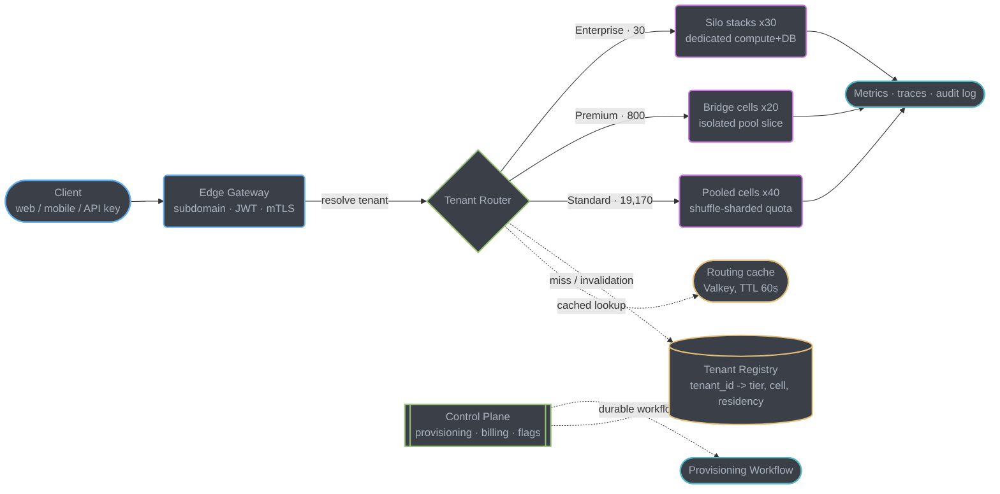
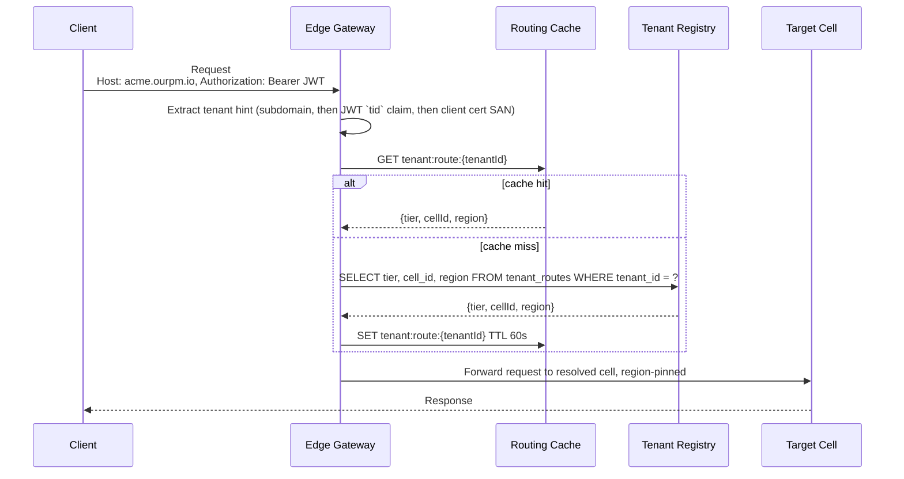
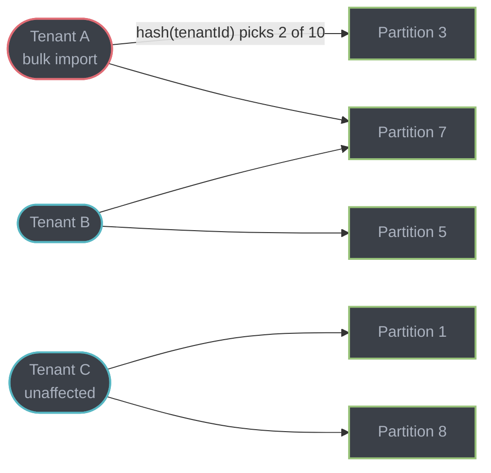
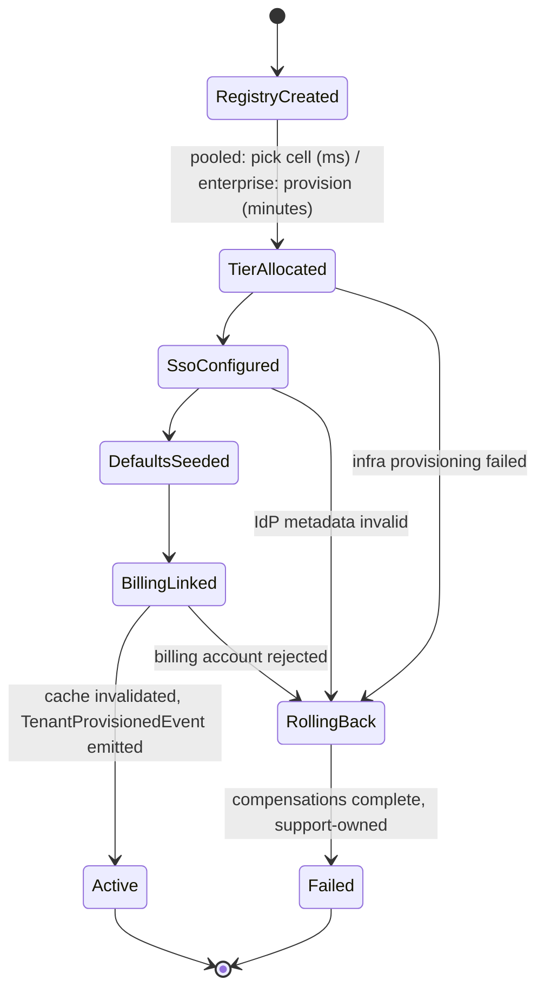
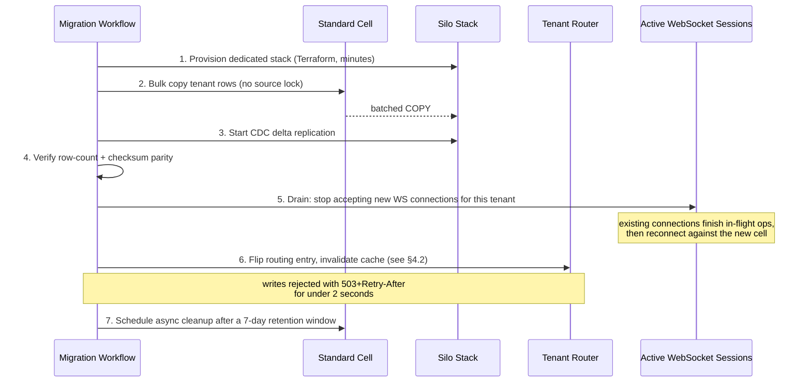

# Case Study: Multi-Tenant SaaS Backend at 20,000-Tenant Scale

## Intuition

> **Design intuition**: at 200 tenants, "multi-tenant" means one thing — everybody shares
> everything, and the only question is whether your `WHERE org_id = ?` is correct. At 20,000
> tenants, including 30 enterprise accounts whose contracts specify which country their bytes
> may sit in and who else's noisy Tuesday-morning bulk import may share a CPU with them,
> "multi-tenant" stops being one architecture and becomes a **placement problem**: which of
> several isolation strengths does this specific tenant need, and how do you serve all of them
> from one codebase without that codebase forking into three?

**Key insight for this design**: isolation is not a property of the platform, it is a property
of a *tenant*, and it changes as the tenant grows. The pooled stack that got you to 200
tenants is not wrong — it is *correct for 95% of the tenants you will ever have* — but a
single enterprise logo with a data-residency clause can force the whole platform to answer a
question the pooled architecture was never built to answer: "prove that this tenant's data
never left the EU, and prove that no other tenant's CPU spike ever touched its request." The
engineering answer is not "build a second platform for enterprise." It is **cell-based
architecture**: one routing layer that resolves *tenant → isolation tier → target cell*, three
tiers of cell (pooled, bridge, silo) built from the same application image, and a control plane
that can move a tenant from one tier to the next while it keeps serving traffic. Everything in
this case study — the router, the registry, the quota enforcement, the provisioning workflow,
the live migration — exists to keep that promise true at 100x the tenant count with the same
number of forks in the codebase: zero.

---

## 1. Requirements Clarification

### Functional Requirements

- Self-serve tenant signup and provisioning for the pooled tier; sales-assisted provisioning
  for enterprise, both through the same provisioning workflow.
- Per-tenant SSO: SAML 2.0 and OIDC, tenant-configurable identity provider, with a default
  email/password + social-login path for tenants who never configure one.
- Per-tenant configuration and feature flags — a plan tier, a rollout cohort, and an
  admin-toggleable feature set, evaluated per request without a deploy.
- Per-tenant data export (a full account export, machine-readable, self-serve) and **hard
  deletion** on request — not a soft `deleted_at` flag, an irreversible purge with proof.
- Move a tenant between isolation tiers as it grows, or on contract signature, without an
  extended outage.

### Non-Functional Requirements

| Requirement | Target | Why this number |
|---|---|---|
| Cross-tenant isolation | A tenant's load spike must not move another tenant's p99 by more than 10% | This is the entire reason a pooled architecture is defensible at all |
| Data residency | EU-resident enterprise tenants' data and processing stay in an EU region; US-resident stay in US | Contractual; audited, not best-effort |
| Onboarding latency (pooled) | Self-serve signup to first authenticated API call in under 5 minutes | Below this, trial conversion measurably drops; it is a product number, not an engineering courtesy |
| API latency | p99 < 150 ms for CRUD, independent of tenant tier | Same SLO for every tier; the isolation tier changes blast radius, not the latency target |
| Availability | 99.9% pooled tier, 99.95% enterprise (contractual) monthly | Enterprise pays for a stronger number and a dedicated stack is what makes it credible |
| One codebase | Zero tier-specific application images | The moment two tiers diverge in code, every future feature ships twice or ships wrong |
| GDPR erasure | Verifiable deletion across every data store within 30 days, provable on request | Not merely deleted — provably deleted, on demand, for an auditor |

### Clarifying Questions to Ask in the Interview

| Question | Why it changes the design |
|---|---|
| Is isolation a spectrum the platform assigns, or a menu the customer buys? | A menu means self-serve upgrade must exist as a real, tested path, not a sales exception |
| Does "data residency" mean storage only, or does compute (including logs and backups) have to stay in-region too? | The stricter reading rules out a shared US-region observability pipeline for EU enterprise tenants |
| Can a tenant be demoted, or only promoted? | Demotion needs the same migration machinery in reverse, and a business reason someone will eventually ask for |
| Who owns the SSO relationship if the tenant's IdP is down? | Determines whether there is a break-glass login path, and who is allowed to use it |
| Is "one codebase" a hard constraint on deployable artifacts, or a soft constraint on maintained logic paths? | A gateway that routes to three different deployed images is still "one codebase" by the second reading and a very different architecture by the first |

### Out of Scope

- The DATA tier's own schema-per-tenant / shared-schema / database-per-tenant mechanics — see
  §3's cross-link table; that decision belongs to
  [`design_multitenant_saas_database`](../../../database/case_studies/design_multitenant_saas_database/design_multitenant_saas_database.md)
  and is not re-derived here.
- Tenant-context propagation mechanics (thread-local vs. request-scoped bean, how a downstream
  service call carries tenant identity) — owned by
  [`multi_tenancy_and_isolation`](../../multi_tenancy_and_isolation/multi_tenancy_and_isolation.md);
  this case study applies that pattern to one product rather than re-teaching it.
- The CRM/PM product's own domain model (boards, tasks, comments) beyond what the isolation
  story needs to reference.

---

## 2. Scale Estimation

### Tenant Distribution — and the Power Law That Drives Everything Else

The starting point is 200 tenants on one pooled stack; the target is 20,000, of which 30 are
enterprise with contractual isolation and residency requirements. Splitting the remaining
19,970 into a "premium/bridge" band (larger tenants who need blast-radius protection but not a
dedicated stack) and a "standard" band gives three populations that map directly onto three
isolation tiers:

```
Standard (pooled):    19,170 tenants   avg   6 users/tenant  ->   115,020 users
Premium (bridge):         800 tenants   avg  60 users/tenant  ->    48,000 users
Enterprise (silo):          30 tenants   avg 1,200 users/tenant ->    36,000 users
                       -----------------------------------------------------------
Total                  20,000 tenants                              199,020 users
```

**Assume, as is typical of B2B SaaS usage, that load follows a power law rather than an even
spread**: the top 1% of tenants by size — the 200 largest, which is exactly all 30 enterprise
accounts plus the 170 largest premium tenants — generate roughly **80%** of total request
volume, while the remaining 19,800 tenants generate the other 20%. State this assumption
explicitly because every downstream number depends on it: those 200 tenants hold only 46,200
of the 199,020 users (23.2%), so 23% of the user base is producing 80% of the load — plausible
for a PM tool where the largest accounts run bots, integrations, and CI webhooks that a
five-person trial team never will.

### Request Volume

Assume 40 API requests per active user per business hour (board polling, task updates,
comment posts — a PM tool is chattier than a CRM), across an 8-hour active window:

```
Requests/user/day:           40 x 8                         = 320
Total requests/day:          199,020 x 320                  = 63,686,400  (~63.7M)
Average req/sec:             63,686,400 / 86,400             = 737 req/sec

Diurnal peak factor: 2.5x (a US+EU tenant base blends two business-hour windows,
so the peak is less extreme than a single-region 3x factor would be)
Peak req/sec:                 737 x 2.5                      = 1,843 req/sec (~1,850)
```

### Load Split by Tier (the Power Law Applied)

| Population | Tenants | Users | Share of load | Avg req/sec | Peak req/sec |
|---|---:|---:|---:|---:|---:|
| Top 200 (all enterprise + 170 largest premium) | 200 | 46,200 | 80% | 590 | 1,475 |
| — of which: 30 enterprise (proportional to their 36,000/46,200 = 77.9% of the top-200's users) | 30 | 36,000 | 62.3% overall | ~460 | ~1,149 |
| — of which: 170 largest premium | 170 | 10,200 | 17.7% overall | ~130 | ~326 |
| Remaining 19,800 (630 smaller premium + 19,170 standard) | 19,800 | 152,820 | 20% | 147 | 369 |

The line worth saying out loud in an interview: **30 tenants (0.15% of the tenant count) are
responsible for over 60% of platform request volume.** Any capacity or isolation plan that
treats "tenant" as a uniform unit sizes for the wrong population twice — once by
under-provisioning the enterprise tier, and once by over-provisioning the standard tier for load
it will never generate.

### Cost Delta: Pooled vs. Bridge vs. Silo, per Tenant per Month

This is an infrastructure-unit-cost question, not a data-modeling one — the DATA tier's own
per-row storage math is out of scope here (see §3). What this design needs is the cost of a
*cell*, divided by how many tenants share it.

```
Standard pooled cell (shared app + shared DB connection pool, ~479 tenants/cell):
  illustrative monthly cell cost (compute + DB share + cache share)   ~ $3,000/mo
  cost per tenant                     3,000 / 479                    ~ $6.30/tenant/mo

Premium/bridge cell (isolated logical partition, own connection-pool
slice, smaller blast radius, ~40 tenants/cell):
  illustrative monthly cell cost                                     ~ $4,500/mo
  cost per tenant                     4,500 / 40                     ~ $112.50/tenant/mo

Silo (dedicated app instances + dedicated DB + dedicated cache node
+ dedicated Vault namespace/KMS key + dedicated observability):
  baseline (smallest enterprise tenant)                               ~ $1,200/mo
  largest enterprise tenant (1,200+ users, own scaled DB class)        ~ $3,500/mo
  blended average across 30 enterprise tenants                        ~ $1,800/mo
```

Silo costs roughly **200x** a standard pooled tenant and roughly **11x** a premium tenant. That
ratio is the entire economic argument for a three-tier design rather than a two-tier one: the
30 tenants who contractually require it pay for isolation; the 800 who merely need blast-radius
protection get it far more cheaply through a smaller shared cell; and the 19,170 who need
neither are not carrying either cost. §10 rolls this up into a platform-wide monthly figure.

---

## 3. High-Level Architecture



Every request resolves *tenant → tier → cell* exactly once, at the edge — never re-derived
downstream. Solid arrows are the request path; dotted arrows are control-plane traffic that
moves far less often than requests do. The router is deliberately dumb: it holds no business
logic, only a cached copy of the registry's tier/cell assignment, which is what lets the same
router code serve all three tiers without a tier-specific deploy.

### Tenant Resolution Sequence



Three sources feed the tenant hint, in priority order: the **subdomain** (`acme.ourpm.io`,
convenience for browser sessions), the **JWT `tid` claim** (authoritative once a session
exists — a subdomain can be spoofed in a header, a validated JWT claim cannot), and an **mTLS
client-certificate SAN** for service-to-service and enterprise SIEM/webhook integrations that
never carry a browser session at all. The gateway trusts the JWT over the subdomain whenever
both are present — see §9 for what happens when a client is allowed to disagree with itself.

### Mapping to the DATA Tier

The backend's three isolation tiers are informed by, but not identical to, the DATA tier's own
tiering — a Premium/Bridge tenant with high traffic but a small dataset can sit on shared-schema
storage, and a Standard tenant with an unusually wide custom-field set can sit on a dedicated
schema. The DATA tier's decision, summarized from
[`design_multitenant_saas_database`](../../../database/case_studies/design_multitenant_saas_database/design_multitenant_saas_database.md)
(read in full there; not re-derived here):

| Backend isolation tier | Data tier used (typically) | Isolation mechanism | Promotion trigger (data tier) |
|---|---|---|---|
| Standard (pooled) | Shared schema + Row-Level Security | `FORCE ROW LEVEL SECURITY` policy, `org_id`-leading indexes | Sustained > 10K records or > 10 users |
| Premium (bridge) | Schema-per-tenant | `CREATE SCHEMA`, isolated `search_path` | Sustained > 1M records or custom entities |
| Enterprise (silo) | Database-per-tenant | Separate Postgres instance/process | Contractual isolation, HIPAA-class residency |

### Shared Primitives

| Primitive used here | Deep dive |
|---|---|
| Tenant context propagation, pool/bridge/silo model, per-tenant observability | [`multi_tenancy_and_isolation`](../../multi_tenancy_and_isolation/multi_tenancy_and_isolation.md) |
| Durable workflow execution, retries, compensations, resumability | [`durable_execution_and_workflows`](../../durable_execution_and_workflows/durable_execution_and_workflows.md) |
| SAML/OIDC flows, token validation, RBAC vs ABAC | [`auth_and_authorization_systems`](../../auth_and_authorization_systems/auth_and_authorization_systems.md) |
| Token bucket, sliding window, per-key rate limiting | [`rate_limiting_in_depth`](../../rate_limiting_in_depth/rate_limiting_in_depth.md) |
| Circuit breaker, bulkhead, retry with jitter | [`fault_tolerance_patterns`](../../fault_tolerance_patterns/fault_tolerance_patterns.md) |
| High-cardinality metric labels, SLO/SLI design | [`observability_and_monitoring`](../../observability_and_monitoring/observability_and_monitoring.md) |
| Idempotency keys as a general pattern | [`distributed_transactions_and_consistency`](../../distributed_transactions_and_consistency/distributed_transactions_and_consistency.md) |
| Saga-shaped compensation, outbox-backed commands | [`design_payment_processor`](../design_payment_processor/design_payment_processor.md) |

---

## 4. Component Deep Dives

### 4.1 Tenant Resolution and Routing at the Edge

The gateway filter runs before any downstream service sees the request. It never trusts a
single signal — a subdomain header is client-supplied and a client can lie about it.

```java
@Component
@RequiredArgsConstructor
public class TenantResolutionFilter implements GlobalFilter, Ordered {

    private final TenantRoutingCache routingCache;   // Valkey-backed, 60s TTL
    private final JwtDecoder jwtDecoder;

    @Override
    public Mono<Void> filter(ServerWebExchange exchange, GatewayFilterChain chain) {
        String subdomainHint = subdomainOf(exchange.getRequest());
        String bearerToken = bearerTokenOf(exchange.getRequest());
        String mtlsTenant = mtlsSanTenantOf(exchange.getRequest());   // service-to-service

        String tenantId = mtlsTenant;
        if (tenantId == null && bearerToken != null) {
            // The JWT `tid` claim is authoritative once a session exists — it was
            // issued by our own auth server after validating tenant membership,
            // so it outranks a client-suppliable Host header.
            Jwt jwt = jwtDecoder.decode(bearerToken);
            tenantId = jwt.getClaimAsString("tid");
            if (subdomainHint != null && !subdomainHint.equals(tenantId)) {
                // Disagreement between subdomain and JWT is not automatically an
                // attack — a user with two tabs open on two tenants' subdomains
                // reusing a stale token is the common case — but it must never be
                // silently resolved in the subdomain's favor. See §9.
                return unauthorized(exchange, "tenant_mismatch");
            }
        } else if (tenantId == null) {
            tenantId = subdomainHint;   // pre-auth paths only: signup, login
        }
        if (tenantId == null) return unauthorized(exchange, "no_tenant_signal");

        return routingCache.resolve(tenantId)
            .switchIfEmpty(Mono.error(new UnknownTenantException(tenantId)))
            .flatMap(route -> forward(exchange, chain, route));
    }

    @Override
    public int getOrder() { return Ordered.HIGHEST_PRECEDENCE; }
}
```

### 4.2 The Tenant Registry and the Cache-Invalidation-on-Tier-Change Problem

The registry is the single source of truth for *tenant → tier → cell*; the routing cache exists
only because a registry round trip on every request would add a synchronous hop to every one of
the 1,850 peak req/sec. The correctness hazard lives entirely in the gap between a tier change
committing and every gateway's cache learning about it.

```java
@Service
@RequiredArgsConstructor
public class TenantRoutingCache {

    private final ReactiveRedisTemplate<String, TenantRoute> redis;
    private final TenantRegistryRepository registry;
    private static final Duration TTL = Duration.ofSeconds(60);

    public Mono<TenantRoute> resolve(String tenantId) {
        String key = "tenant:route:" + tenantId;
        return redis.opsForValue().get(key)
            .switchIfEmpty(registry.findRoute(tenantId)
                .flatMap(route -> redis.opsForValue().set(key, route, TTL).thenReturn(route)));
    }

    /**
     * Called by the provisioning/migration workflow at the moment a tier change commits.
     * Explicit invalidation is not optional: with a 60s TTL, a gateway that already
     * cached the OLD route would otherwise keep forwarding to the old cell for up to
     * a minute after the new one is live — during a pool-to-silo migration that means
     * writes landing in a cell whose data is already stale relative to the new silo.
     */
    public Mono<Void> invalidate(String tenantId) {
        return redis.delete("tenant:route:" + tenantId).then();
    }
}
```

The trap is not the cache itself — it is **assuming a TTL is a substitute for invalidation.**
A 60-second TTL bounds the *worst case* if invalidation is ever missed; it must never be the
*primary* mechanism, because 60 seconds of requests landing on a cell mid-cutover is exactly the
kind of split-brain write the migration in §4.6 is built to prevent. Every write path that
changes a tenant's `tier`/`cell_id` — provisioning, promotion, migration — invalidates
synchronously, in the same transaction boundary as the registry update, before it reports
success.

### 4.3 BROKEN -> FIXED: The Shared Cache Key That Leaks Across Tenants

This is the failure this whole architecture exists to prevent, and it does not look like a
security bug when it is written — it looks like a completely ordinary cache-aside optimization.

**The setup.** Every task in this PM platform has a tenant-scoped *display id* — `ENG-123`,
`OPS-45` — generated from a per-tenant, per-project sequence, exactly like Jira issue keys.
Two different tenants can each configure a project with the key prefix `ENG`, and their
sequences run independently, so `ENG-123` exists **twice** in the system: once for Acme, once
for Globex, each pointing at a completely different task.

**BROKEN** — a `@Cacheable` keyed on the display id alone:

```java
@Service
@RequiredArgsConstructor
public class TaskSummaryService {

    private final TaskRepository taskRepository;

    // BROKEN. The cache key is the display id only. It is unique WITHIN a tenant's
    // project, and the author reasonably assumed "unique enough" — it is not unique
    // across tenants, and nothing about this signature says otherwise.
    @Cacheable(value = "taskSummaries", key = "#shortId")
    public TaskSummary getTaskSummary(String shortId) {
        return taskRepository.findByShortId(shortId)
            .map(TaskSummary::from)
            .orElseThrow(() -> new TaskNotFoundException(shortId));
    }
}
```

The failure sequence, no error at any step:

```
t=0     Acme's alice views task ENG-123 ("Confidential Q4 layoff plan")
        -> cache MISS -> DB query correctly scoped to Acme's tenant_id
        -> cache SET  key="taskSummaries::ENG-123"  TTL 10 min
t=140s  Globex's bob, an unrelated company, views HIS OWN ENG-123
        ("Migrate build pipeline to Bazel")
        -> cache HIT on key "taskSummaries::ENG-123"
        -> bob's screen renders Acme's cached title and description
```

Nothing throws. The query that would have scoped correctly never runs, because the cache
answered first. It surfaces as a support ticket — "I can see a task title that isn't mine" —
not as an alert, because every metric involved (cache hit rate, query latency, error rate)
looks *healthy*. See §9 for the detection lag this produces in practice.

**FIXED** — the tenant id is part of the key, and — because a namespacing convention is a
promise a future author can still forget — a structural guard makes forgetting it fail closed:

```java
@Service
@RequiredArgsConstructor
public class TaskSummaryService {

    private final TaskRepository taskRepository;
    private final TenantContext tenantContext;   // resolved per request; see the
                                                  // multi_tenancy_and_isolation module

    @Cacheable(value = "taskSummaries", key = "#root.target.tenantContext.tenantId() + ':' + #shortId")
    public TaskSummary getTaskSummary(String shortId) {
        // Defense in depth: even with a correctly namespaced cache key, the query
        // itself must still filter by tenant. The cache is a performance layer,
        // never the source of the isolation guarantee.
        return taskRepository.findByTenantIdAndShortId(tenantContext.tenantId(), shortId)
            .map(TaskSummary::from)
            .orElseThrow(() -> new TaskNotFoundException(shortId));
    }
}
```

```java
/**
 * Structural defense: a Hibernate StatementInspector that rejects, at execution time,
 * any SELECT against a tenant-scoped table that does not carry a tenant_id predicate.
 * Registered once (spring.jpa.properties.hibernate.session_factory.statement_inspector),
 * it protects every repository method — new and old — not just the ones an author
 * remembered to review.
 */
public class TenantPredicateStatementInspector implements StatementInspector {

    private static final Set<String> TENANT_SCOPED_TABLES = Set.of("tasks", "projects", "comments");

    @Override
    public String inspect(String sql) {
        String lower = sql.toLowerCase(Locale.ROOT);
        boolean touchesScopedTable = TENANT_SCOPED_TABLES.stream().anyMatch(lower::contains);
        boolean hasTenantPredicate = lower.contains("tenant_id");
        if (touchesScopedTable && !hasTenantPredicate) {
            throw new MissingTenantPredicateException(sql);
        }
        return sql;
    }
}
```

```java
// The test that fails the build the moment this regresses — not a monitoring alert
// discovered after a customer report, a red test before the code ever ships.
@Test
void queryWithoutTenantPredicateIsRejected() {
    assertThrows(MissingTenantPredicateException.class, () ->
        jdbcTemplate.query("SELECT * FROM tasks WHERE short_id = ?", TASK_MAPPER, "ENG-123"));
}

@Test
void queryWithTenantPredicateIsAllowed() {
    assertDoesNotThrow(() ->
        jdbcTemplate.query("SELECT * FROM tasks WHERE tenant_id = ? AND short_id = ?",
            TASK_MAPPER, TENANT_A, "ENG-123"));
}
```

The lesson generalizes past caching: **any identifier that is unique only within a tenant's
namespace — a display id, a sequence number, a slug — is unsafe as a standalone key anywhere
data crosses tenant boundaries: a cache, a search index, a webhook payload, a log line.** The
fix is never "remember to prefix it correctly"; it is a structural check that makes the
unprefixed form impossible to ship.

### 4.4 Per-Tenant Quota and Concurrency Enforcement — Shuffle Sharding

A per-tenant rate limit at the gateway (token bucket, see
[`rate_limiting_in_depth`](../../rate_limiting_in_depth/rate_limiting_in_depth.md)) catches the
obvious runaway client. It does not catch a *legitimate* burst — a bulk import, a webhook
replay — that is well under any reasonable per-tenant rate limit but still occupies a
disproportionate share of a shared cell's finite worker/connection capacity. That needs blast
radius reduction inside the cell, and the mechanism is **shuffle sharding**: instead of every
tenant in a cell sharing one worker pool outright, the pool is split into `N` partitions and
each tenant is deterministically assigned `K` of them.



**The combinatorics.** With `N = 10` partitions and `K = 2` assigned per tenant, the number of
distinct shard assignments is `C(10,2) = 45`. Two tenants land on the **exact same pair**
(full overlap — worst case, both partitions saturated together) with probability `1/45 ≈
2.2%`. They share **at least one** partition (partial contention) with probability
`1 - C(8,2)/C(10,2) = 1 - 28/45 = 17/45 ≈ 37.8%`. Applied to a standard cell of 479 tenants:

```
Without shuffle sharding (one shared pool):
  a saturating tenant affects up to               479 co-tenants   (100%)

With shuffle sharding (N=10, K=2):
  full-overlap exposure:      479 x (1/45)   ≈     11 co-tenants   (2.2%)
  partial-overlap exposure:   479 x (17/45)  ≈    181 co-tenants   (37.8%)
```

Shuffle sharding does not eliminate the noisy-neighbor problem — 181 tenants still share
*some* capacity with a saturating tenant, and that is worth stating plainly rather than
overselling the technique. What it buys is a **~44x reduction in worst-case full contention**
(479 down to 11) using nothing but a hash function and a partitioned pool, no additional
infrastructure. AWS's Builders' Library describes exactly this trade under "workload isolation
using shuffle-sharding" — the same statistical-isolation argument, generalized past its DNS
origin.

```java
@Component
public class ShuffleShardAssignment {

    private static final int PARTITIONS = 10;
    private static final int SHARDS_PER_TENANT = 2;

    /** Deterministic: the same tenant always resolves to the same 2 partitions,
     * so a retry or a second request from the same tenant lands predictably. */
    public Set<Integer> partitionsFor(String tenantId) {
        long h = Hashing.murmur3_128().hashString(tenantId, UTF_8).asLong();
        Set<Integer> shards = new LinkedHashSet<>();
        long seed = h;
        while (shards.size() < SHARDS_PER_TENANT) {
            shards.add((int) (Math.floorMod(seed, PARTITIONS)));
            seed = seed * 6364136223846793005L + 1442695040888963407L;   // LCG step
        }
        return shards;
    }
}
```

Each partition is a bounded worker pool sized with a Resilience4j `Bulkhead` (see
[`fault_tolerance_patterns`](../../fault_tolerance_patterns/fault_tolerance_patterns.md)); a
tenant whose requests exhaust both of its assigned partitions gets `429`s while every tenant
outside those two partitions is unaffected. Premium/bridge cells use the same mechanism at
`N = 4, K = 1` — fewer, larger partitions, because a bridge cell already has only 40 tenants and
the goal shifts from statistical blast-radius reduction to near-per-tenant isolation.

### 4.5 Tenant Provisioning as a Durable Workflow

Provisioning is idempotent, resumable, and must roll back cleanly on partial failure — exactly
the shape [`durable_execution_and_workflows`](../../durable_execution_and_workflows/durable_execution_and_workflows.md)
covers in general; this is that pattern applied to one concrete, seven-step business process.



```java
@WorkflowInterface
public interface TenantProvisioningWorkflow {
    @WorkflowMethod
    TenantId provision(ProvisionTenantRequest request);
}

public class TenantProvisioningWorkflowImpl implements TenantProvisioningWorkflow {

    private final TenantProvisioningActivities acts =
        Workflow.newActivityStub(TenantProvisioningActivities.class,
            ActivityOptions.newBuilder()
                .setStartToCloseTimeout(Duration.ofMinutes(30))   // enterprise infra can be slow
                .setRetryOptions(RetryOptions.newBuilder().setMaximumAttempts(5).build())
                .build());

    @Override
    public TenantId provision(ProvisionTenantRequest request) {
        // Workflow id = deterministic("provision:" + request.requestId()), so a
        // duplicate signup submission resumes the SAME workflow instance rather
        // than starting a second one — idempotency at the workflow-engine level,
        // no idempotency table of our own required.
        TenantId tenantId = acts.createRegistryRow(request);           // step 1
        try {
            CellAssignment cell = acts.allocateTierAndCell(tenantId, request.expectedScale());
            acts.configureSsoPlaceholder(tenantId, request.identityProviderHint());
            acts.seedDefaultWorkspace(tenantId, cell);
            acts.provisionBillingAccount(tenantId, request.plan());
            acts.activateAndInvalidateRoutingCache(tenantId, cell);    // step 7
            return tenantId;
        } catch (ActivityFailure failure) {
            // Every activity above is independently idempotent (looked up by a
            // deterministic id before creating a new resource), so compensating
            // activities are safe to run even if we do not know exactly which
            // step failed after a crash and resume.
            acts.deprovisionCellOrSilo(tenantId);
            acts.cancelBillingAccount(tenantId);
            acts.markRegistryRowFailed(tenantId, failure.getMessage());
            throw failure;
        }
    }
}
```

Pooled provisioning completes in well under the 5-minute onboarding target — cell allocation is
a registry write, not infrastructure creation. Enterprise silo provisioning is the same
workflow shape with a longer `allocateTierAndCell` step (Terraform/Crossplane apply, minutes),
which is why the API returns immediately with a `202` and a polling/SSE status endpoint rather
than blocking — the same asynchronous-accept argument the payment processor case study makes
for its own workflow (see cross-link table).

### 4.6 Migrating a Single Live Tenant from Pool to Silo

An enterprise contract signs, and a tenant currently on the Standard pooled tier must move to a
dedicated silo — live, with a bounded write-pause and a rollback plan if anything looks wrong
post-cutover. The DATA tier's copy-and-verify mechanics (bulk copy, CDC delta catch-up,
checksum verification) are the same shape documented in the DATA case study's own tier-promotion
section; what this design adds is the **application-layer** cutover those DB-level steps sit
inside.



**Consistency guarantee during the copy.** Steps 1-4 run with the tenant fully live on the old
cell — reads and writes continue there, and CDC keeps the new silo converging toward the old
cell's current state. Step 5 (WebSocket drain) is what makes step 6 safe: a client mid-session
that kept writing to the old cell through an open socket would race the cutover, so new writes
are quiesced *before* the routing flip, not after. The routing flip itself (step 6) is the only
moment writes are rejected, and it is a single registry `UPDATE` plus one cache invalidation
call — under two seconds, an order of magnitude tighter than the DATA tier's own schema-level
promotion because there is no DDL on this path, only a pointer swap.

**Rollback.** If post-cutover health checks (error rate, p99 latency, a synthetic
canary transaction) fail within a 15-minute observation window, the routing entry flips back to
the old cell — which is still fully intact and receiving CDC-replicated writes in reverse is
*not* attempted; instead, the small number of writes that landed on the new silo during the
failed window are replayed forward once the new silo's issue is fixed, using the same CDC
stream, rather than un-migrating. **Never roll back a live cutover by trying to merge two
divergent write histories** — flip back to the side that never stopped being consistent, and
retry the migration once the new silo's problem is understood.

---

## 5. Design Decisions & Tradeoffs

| Decision | Chosen | Alternative | Rationale |
|---|---|---|---|
| Isolation model | Cell-based: pool / bridge / silo | Uniform pool for everyone, or uniform silo for everyone | Uniform pool fails the 30 enterprise contracts outright; uniform silo makes the 19,170-tenant standard tier cost 200x more than it needs to (§2) |
| Tenant identity in the request | JWT `tid` claim authoritative; subdomain a convenience alias; mTLS SAN for service-to-service | Subdomain-only | A subdomain is client-supplied and trivially spoofable in a raw HTTP client; the JWT was issued by our own auth server after checking membership |
| One codebase vs. tier forks | One image; tier is a runtime routing/config decision | Separate deployable per tier | A fork means every feature, security patch, and bug fix ships three times, and the three copies drift the day after the fork |
| Provisioning execution | Async durable workflow, always | Synchronous, block until done | Enterprise infra provisioning takes minutes; making the API wait would violate the 150ms p99 target for an endpoint that is not even a CRUD path |
| Quota enforcement layer | Gateway rate limit + shuffle-sharded worker pools inside the cell | Rate limit only | A rate limit bounds one tenant's request *count*; it does nothing once a request is admitted and then holds a worker or a DB connection for a long transaction |
| Per-tenant encryption keys (BYOK) | Offered only on the silo tier (Vault Transit or customer-managed KMS key) | Offer to every tier | Per-row keys on a shared table destroy index usability and add a KMS round trip to every query; the tenants who need this contractually are exactly the tenants already paying for dedicated infrastructure |
| Migration rollback strategy | Flip routing back to the untouched source, replay forward later | Reverse-sync new -> old | Merging two divergently-written histories is a distributed-consistency problem with no clean answer; never being inconsistent in the first place (§4.6) sidesteps it entirely |

**Isolation is a placement decision, not a fixed architecture.** The single biggest design risk
in a system like this is treating "multi-tenant" as one static shape. Tenant 14,203 is a
five-person trial on the Standard tier today and, six months from now, the third-largest
enterprise contract on the platform — the migration path in §4.6 is not an edge case, it is the
normal lifecycle of a successful tenant, and the architecture is judged on how boring that
transition is to operate.

---

## 6. Real-World Implementations

**AWS's SaaS Factory whitepaper** is the direct source of this design's vocabulary. It defines
the **silo** model (each tenant on a fully dedicated resource stack), the **pool** model
(tenants sharing infrastructure, scaling in proportion to aggregate load), and the **bridge**
model — a deliberate mix, commonly a pooled web tier in front of siloed storage/business logic
for a subset of tenants — as the three baseline strategies every multi-tenant SaaS system
composes from. This case study's Standard/Premium/Enterprise split is exactly pool, bridge, and
silo under different product names.

**Shuffle sharding**, described in AWS's Builders' Library article "Workload isolation using
shuffle-sharding" (Colm MacCárthaigh), is the origin of §4.4's combinatorial argument: assign
each tenant a small, randomized subset of a larger resource pool rather than either a single
shared pool or one dedicated resource per tenant, so that two tenants sharing full overlap
becomes statistically rare without the cost of full dedication. AWS open-sourced the technique's
reference implementation in the Route 53 **Infima** library; the core idea — bound worst-case
blast radius with combinatorics instead of hardware — transfers directly to an application
worker pool, as §4.4 applies it.

**Salesforce** enforces tenant fairness on a shared platform not primarily through infrastructure
partitioning but through hard **governor limits** on every transaction: a documented cap of
100 synchronous (200 asynchronous) SOQL queries per transaction and a 50,000-row retrieval
ceiling across all queries in that transaction, enforced regardless of which org is running it.
It is the same goal as this design's per-tenant quota enforcement — bound what a single unit of
work can consume — implemented at the *application transaction* layer instead of the
*connection pool* layer, which is a legitimate alternative worth naming in an interview: cap
what a request can do, not only how many requests it gets to make.

**Shopify's "Pod" architecture** shards its entire stack — app servers, MySQL, Redis, Memcached
— by `shop_id`, explicitly under what Shopify calls the "shop isolation principle": one
merchant's flash-sale traffic spike must not degrade another merchant's storefront. That is the
Bridge tier's justification in miniature, one level more aggressive: Shopify pools within a pod
but silos across pods, trading Bridge's shared-pool statistical isolation for pod-level physical
isolation at a coarser tenant grouping.

**Atlassian** resolves tenant identity once per request through a dedicated **Tenant Context
Service (TCS)**, which attaches tenant metadata to a request and threads it through every
downstream microservice call in Jira and Confluence Cloud — the same single-resolution-point
argument behind this design's edge router (§4.1), just implemented as an internal service call
rather than a gateway filter. Atlassian's underlying platform, **Micros**, orchestrates
placement and routing for containers across a sharded model where each shard serves multiple
tenants and per-tenant isolation is enforced above the shard boundary — a pool-tier shape at
very large scale.

**Figma** built an internal proxy, **DBProxy**, specifically so the application code could treat
a horizontally sharded Postgres backend as a single logical database; different data types use
different shard keys (user id for some tables, file id or organization id for others) depending
on the access pattern that dominates each table. The lesson that generalizes to §4.6: a routing
layer that hides shard/cell placement from application code is what makes a live migration
possible without touching every call site — the same property this design's tenant router
provides for cell reassignment.

---

## 7. Technologies & Tools

| Technology | Version | Usage |
|---|---|---|
| Java | 25 (LTS) | Language; virtual threads for the gateway's fan-out to shuffle-sharded worker pools |
| Spring Boot | 4.1.x | REST API, Spring Cloud Gateway filters, `@Cacheable` layer |
| Spring Framework | 7.x | Bean-scoped `TenantContext`, `@Transactional` boundaries |
| Spring Cloud Gateway | 2025.1.x "Oakwood" | Edge tenant resolution filter (§4.1) |
| PostgreSQL | 18 | Tenant registry; per-cell OLTP storage (mechanics owned by the DATA case study) |
| Valkey | 8.x | Routing cache (§4.2), shuffle-shard partition state, per-tenant rate-limit buckets |
| Apache Kafka | 4.3.x (KRaft) | `TenantProvisionedEvent` / `TenantMigratedEvent` fan-out; CDC delta stream for §4.6 |
| Temporal Java SDK | 1.37.x | Durable provisioning and migration workflows (§4.5, §4.6) |
| HashiCorp Vault | Transit secrets engine + per-tenant namespaces | Enterprise-tier BYOK, per-silo encryption keys |
| OpenFGA | CNCF incubating (Zanzibar-model ReBAC/ABAC) | Fine-grained per-tenant authorization beyond RBAC |
| Resilience4j | 2.4+ (`resilience4j-spring-boot4`) | Bulkhead per shuffle-shard partition, circuit breaker on IdP calls |
| Micrometer | 1.17+ | Bucketed per-tenant metrics (never raw `tenant_id` as a label — see §9) |
| Kubernetes | 1.34.x | Namespace-per-cell for Standard/Premium; namespace-per-tenant (or dedicated node pool) for Enterprise |
| Testcontainers | 1.20+ | Postgres + Kafka + Temporal test server for provisioning-workflow integration tests |

---

## 8. Operational Playbook

### SLOs and Alerts

| SLI | SLO | Alert threshold | Page? |
|---|---|---|---|
| Cross-tenant p99 impact (a co-tenant's p99 delta during another's spike) | < 10% | > 25% sustained 5 min | yes |
| Onboarding latency (pooled, signup to first API call) | < 5 min | > 8 min, p50 | no |
| Routing cache staleness after a tier change | 0 (synchronous invalidation) | any request served against a stale route | yes, immediately |
| Shuffle-shard partition saturation | < 80% of bulkhead capacity | > 90% sustained 2 min | yes |
| Enterprise silo availability | 99.95%/month | error budget burn > 2%/hour | yes |
| GDPR erasure completion | within 30 days, all stores | any store unconfirmed at 25 days | yes |
| Active Prometheus series per tenant-labeled metric | < 50,000 | > 200,000 | yes |

### Runbook 1 — Tenant Onboarding (Pooled, Self-Serve)

1. `POST /tenants` triggers the provisioning workflow (§4.5); the API returns `202` with a
   status-polling URL immediately.
2. Pooled path: registry row + cell assignment complete in well under a second; SSO defaults to
   email/password, billing account created against the trial plan.
3. Client polls (or subscribes via SSE) until `status = ACTIVE`; typical wall-clock time under
   90 seconds, comfortably inside the 5-minute target.
4. First authenticated request for the new `tenant_id` must return `200` with an empty
   default workspace — a routing error on this first request is the most common early signal of
   a missed cache invalidation.

### Runbook 2 — "One Tenant Is Eating the Cell"

Symptom: a shuffle-shard partition alert fires (§4.4), or a cell's aggregate p99 degrades with
no corresponding traffic increase platform-wide.

1. Identify the tenant: `SELECT tenant_id, active_requests FROM cell_worker_pool_stats WHERE
   partition_id IN (?, ?) ORDER BY active_requests DESC LIMIT 5` — the shuffle-sharded partition
   assignment (§4.4) narrows this to at most a handful of candidate tenants, not the whole cell.
2. Confirm with the per-org rate-limit dashboard: a bulk import or webhook replay shows as a
   sustained request-count plateau, not a single spike.
3. Immediate mitigation: apply a temporary tighter `Bulkhead` limit scoped to that tenant's two
   partitions only — every other tenant in the cell, including the ~63% who share at least one
   partition but not both, is unaffected by this step.
4. If the tenant's legitimate workload has simply outgrown the Standard tier, open a promotion
   to Premium/Bridge (§4.6's migration workflow, shorter path since it stays pooled) rather than
   repeatedly tuning around it.

### Runbook 3 — Per-Tenant Incident Communication

- **Pooled tiers**: a single status-page component per cell; an incident affecting one cell
  notifies only the tenants routed to it (looked up from the registry, not guessed), never the
  whole platform's status page.
- **Enterprise (silo)**: individual, named incident notification per contract SLA, with the
  automatic SLA-credit calculation keyed off the same availability metric in the SLO table above
  — the silo's isolation is also what makes its incident blast radius (and therefore its credit
  liability) unambiguous: exactly one tenant, never "up to N tenants, TBD."

### Runbook 4 — Offboarding / GDPR Hard Deletion, and Proving It

Deletion must reach every store a tenant's data can be in, and the request must produce a
**verifiable record**, not just a completed job.

| Store | Deletion action | Verification |
|---|---|---|
| Postgres (pooled/bridge) | `DELETE ... WHERE tenant_id = ?` across every tenant-scoped table, FK-safe order | Row-count-zero confirmation query, logged with a checksum of the pre-deletion count |
| Postgres (silo) | Instance termination + storage volume deletion | Cloud-provider deletion receipt (a resource ARN/id no longer resolving) |
| Object storage (attachments) | Prefix delete, `tenant_id/` | Bucket listing returns zero objects under the prefix |
| Search index | `DELETE BY QUERY tenant_id: ?`, then force-merge to purge tombstones | Zero-hit confirmation query against the live index, not just the delete acknowledgement |
| Cache (Valkey) | `SCAN` + `UNLINK` for every key namespaced by `tenant_id` | Not usually load-bearing for compliance (TTL-bounded), but purged anyway and logged |
| Backups | Marked for exclusion from the next restore-eligible backup set; purged at the retention boundary | A documented, dated retention-window commitment, not immediate — stated to the requester |
| Logs | Redaction of `tenant_id`-tagged log lines beyond the retention window already in force | Confirmed against the log retention policy, not a special-cased purge |

Each row's deletion runs as an activity in the same durable-workflow pattern as provisioning
(§4.5) — `TenantOffboardingWorkflow`, one activity per store, each idempotent and independently
retryable. The workflow's completion produces a signed **Erasure Certificate**: one confirmation
record per store, aggregated into an immutable audit-log entry the requester (or an auditor) can
be shown on demand. "We ran a delete script" is not proof; a per-store, timestamped,
independently-verifiable confirmation record is.

---

## 9. Common Pitfalls & War Stories

*All four scenarios below are illustrative composites built from well-documented failure
patterns in multi-tenant systems generally, not reports of a specific company's incident.*

**1. The cache-collision leak went undetected for 9 days.** The §4.3 bug — a task-summary cache
keyed on a per-tenant display id — requires two unlikely things to align: two different tenants'
sequences both reaching the same display id, and a second tenant viewing that id inside the
first tenant's 10-minute TTL window. That rarity is exactly what made it dangerous: no error, no
latency change, no failed health check — nothing in the standard SLO table caught it. It
surfaced only when a Globex employee reported seeing an unfamiliar task title. A subsequent
7-day log audit found **46 display-id collisions across tenant pairs**, of which an estimated
**3 fell inside a TTL window** and produced an actual cross-tenant render. Quantified impact: a
9-day detection lag, 3 confirmed exposure events, and the structural fix (§4.3's statement
inspector plus a failing-by-default test) rather than a monitoring rule, because a monitoring
rule can only alert on a leak it already anticipates the shape of.

**2. A single per-tenant Micrometer label multiplied Prometheus's series count 45x in three
days.** A histogram intended to give per-tenant latency visibility was labeled
`{tenant_id, endpoint, status}` with the *raw* `tenant_id` — 20,000 distinct values — across
roughly 40 endpoints and 5 status buckets, a theoretical ceiling near 4 million series from one
metric. Prometheus's own guidance is explicit that per-metric cardinality in the tens of
thousands degrades memory and query performance; this metric alone produced **1.8 million active
series within 3 days**, taking the instance's total active series from roughly 40 million to
230 million and triggering OOM restarts on the metrics pipeline every 6 hours. Fix: replace the
raw `tenant_id` label with a bucketed tier label (`standard` / `premium` / `enterprise`) for the
default dashboard, and move true per-tenant latency to a **sampled** trace-based view (1% of
requests, tagged with the real `tenant_id` in the trace, never in a Prometheus label) — see
[`observability_and_monitoring`](../../observability_and_monitoring/observability_and_monitoring.md)
for the general cardinality-budgeting discipline this incident violated.

**3. A bulk import saturated a shuffle-shard pair before the per-tenant concurrency cap
existed.** Before §4.4's `Bulkhead`-per-partition was in place, a Standard-tier tenant's
200,000-row CSV import opened enough concurrent write transactions to occupy both of its
assigned worker-pool partitions completely for 40 minutes. Under the shuffle-sharding math from
§4.4, that meant roughly **181 of the cell's 479 tenants** (the ~37.8% sharing at least one of
the same two partitions) saw elevated latency during the window, while the remaining ~298
tenants in the cell were unaffected — worse than the post-fix state, but already a large
improvement over the pre-shuffle-sharding design where all 479 would have been exposed. Fix: the
`Bulkhead` cap per partition, plus routing bulk-operation endpoints through a dedicated
lower-priority partition pair reserved for exactly this workload shape.

**4. GDPR erasure missed the search index for three weeks.** An early version of the offboarding
checklist covered Postgres, object storage, and cache, but the search index was added to the
platform *after* the checklist was written and never added to it. A tenant's erasure request
correctly purged their rows, files, and cache entries; their task titles remained queryable in
the search index — visible only to internal platform-operator tooling, not to other tenants, but
still a documented erasure failure — for **21 days**, until a routine compliance audit's
cross-store row-count comparison caught the mismatch. The fix was not "remember the search
index" — it was making the offboarding workflow enumerate every registered data store
dynamically (the same store registry the provisioning workflow already writes to) rather than
hard-coding a store list that a new integration can silently fall outside of.

---

## 10. Capacity Planning

### Cell Sizing and Split Triggers

```
Standard cell target: 479 tenants/cell (19,170 / 40 cells), 10 shuffle-shard partitions
  Split trigger: sustained partition saturation (>90%, §8) on 2+ of 10 partitions at
  once, OR cell reaches 550 tenants (soft ceiling)
  Action: provision cell 41; new signups route there; existing tenants are NOT
  rebalanced automatically — that is the §4.6 migration, run only when hot

Premium/bridge cell target: 40 tenants/cell (800 / 20 cells), 4 shuffle-shard partitions
  Split trigger: cell reaches 55 tenants, or any single tenant's sustained load exceeds
  15% of the cell's provisioned capacity (a bridge cell's whole purpose is bounding this)
  Action: provision cell 21

Enterprise silo: no sizing question at the cell level — one stack per tenant, sized to
  contracted scale (16-128 GB RAM class per the DATA tier's table); split trigger N/A,
  vertical resize on the tenant's own SLO breach instead
```

### Headroom and Growth to 20,000

| Tier | Current allocation | Headroom | Growth to 20,000-tenant target |
|---|---:|---|---|
| Standard | 40 cells x 479 tenants | ~15% (each cell provisioned to 550) | Linear: every ~479 new standard signups adds one cell |
| Premium | 20 cells x 40 tenants | ~27% (provisioned to 55) | Linear, plus inbound promotions from Standard (§9's trigger) |
| Enterprise | 30 dedicated stacks | N/A (provisioned per contract) | Sales-driven, not a technical growth curve |
| Control plane (registry, routing cache, workflow engine) | Sized for 1,850 req/sec peak (§2) | ~3x at current provisioning | Scales with total request volume, not tenant count directly |

### Monthly Cost Roll-Up (illustrative, order-of-magnitude; verify current cloud list pricing before quoting)

```
Standard:      40 cells   x $3,000/mo             =  $120,000
Premium:       20 cells   x $4,500/mo              =   $90,000
Enterprise:    30 tenants x $1,800/mo (blended)     =   $54,000
Control plane (registry, routing cache, workflow
  engine, billing integration)                       =    $8,000
                                                    -------------
Total, illustrative monthly infra spend                $272,000

Blended cost per tenant: $272,000 / 20,000            ~   $13.60/tenant/mo
```

That blended figure hides the entire point of the design: no tenant actually costs
$13.60/month — Standard costs about $6.30, Enterprise 200-550x that. The blended average is
a finance-department number; capacity and cost decisions here are always made per tier.

---

## 11. Interview Discussion Points

**Q: A support ticket says a customer saw another company's task title. Where do you look
first?**
**Short:** Check every shared cache and index key for a tenant-scoped identifier used alone.

The highest-probability cause in a system like this is exactly §4.3: a cache, search index, or
webhook payload keyed on an identifier that is unique only *within* a tenant — a display id, a
sequence number, a slug — reused as a global key. Confirm by checking whether the two tenants
involved have any identifier collision (a shared display-id prefix is the classic case), then
check the cache/index TTL against the reported time gap between the two views. The permanent fix
is never "add the tenant id to this one key" — it is a structural guard (a query inspector, a
key-building helper that cannot compile without a tenant id) that makes the mistake impossible
to reintroduce elsewhere.

**Q: Why does a 60-second routing-cache TTL exist if every tier change synchronously
invalidates the cache anyway?**
**Short:** The TTL bounds the blast radius of a missed invalidation, not the normal path.

Synchronous invalidation is the primary correctness mechanism; the TTL is a safety net for the
case that invalidation itself fails to fire — a crashed workflow activity, a network partition
between the workflow engine and the cache. Without a TTL, a missed invalidation would route a
tenant's traffic to a stale cell indefinitely; with one, the exposure window is bounded to at
most 60 seconds even in the worst case. Treating the TTL as sufficient on its own, and skipping
explicit invalidation, is the mistake — it turns every ordinary tier change into a guaranteed
window of stale routing instead of an exceptional one.

**Q: What does shuffle sharding actually buy you, and what does it not fix?**
**Short:** It cuts worst-case full-overlap blast radius ~44x; partial contention still remains.

With `N=10` partitions and `K=2` assigned per tenant, two tenants share both partitions with
probability `1/45`, versus 100% co-exposure in a single shared pool — a roughly 44x reduction in
the worst case (479 down to about 11 tenants at full overlap, in this design's standard cell).
It does not eliminate contention: about 38% of a cell's tenants still share *at least one*
partition with any given tenant, so a saturating workload still degrades a meaningful subset,
just a much smaller and randomized one instead of the whole cell. It is a statistical isolation
technique, not a guarantee — the guarantee is reserved for the silo tier.

**Q: Why one codebase with tier switches instead of three separate deployables?**
**Short:** A fork means every future change ships three times and drifts by the next day.

The isolation tier is a *routing and configuration* decision — which cell a request lands in,
which connection pool it uses, whether a per-tenant encryption key is in play — not a different
program. Keeping it in one codebase means a security patch, a new feature, or a bug fix is
written once and is live for all three tiers as soon as it deploys. The cost is that the
codebase must carry conditional logic for tier-specific behavior (§4.1's routing filter, §4.4's
bulkhead configuration), which is a real complexity tax — but it is dramatically smaller than
maintaining three codebases that started identical and inevitably stop being so.

**Q: Walk through how a request resolves its tenant, and why three signals instead of one.**
**Short:** Subdomain for convenience, JWT claim as authority, mTLS SAN for service calls.

The subdomain is the fastest signal and works pre-authentication (signup, login), but it is
client-supplied and can be spoofed or simply stale in an open browser tab. The JWT `tid` claim
was set by the auth server after validating tenant membership, so once a session exists it
outranks the subdomain — and a mismatch between the two is treated as a hard error, not resolved
silently in either direction, because silently trusting the subdomain is exactly how a stale tab
could route an authenticated request to the wrong tenant's data. Service-to-service and
enterprise integration traffic carries no browser session at all, so an mTLS client-certificate
SAN is the tenant signal there instead.

**Q: How is the tenant-provisioning workflow made resumable after a crash mid-provision?**
**Short:** Every activity is independently idempotent and looked up before being created.

The workflow engine persists the workflow's execution history, so on a crash and restart it
replays from the last completed activity rather than starting over — but replay is only safe
because every activity (create the registry row, allocate the cell, configure SSO, seed
defaults, link billing, activate) looks up whether its target resource already exists by a
deterministic id before creating a new one. A resumed "allocate cell" call that already
succeeded before the crash finds the existing assignment and returns it rather than allocating a
second cell. Compensating activities on failure use the same idempotent-lookup property, so
rollback is safe to run even without knowing exactly which step failed.

**Q: You need to move a live enterprise-bound tenant from the pooled tier to a dedicated silo
with minimal downtime. Walk through it.**
**Short:** Bulk-copy live, CDC the delta, verify parity, drain sockets, then flip routing.

Provision the target silo, then bulk-copy the tenant's data while it stays fully live and
writable on the old cell — no source lock. Start CDC replication to catch the delta that
accumulates during the copy, then verify row-count and checksum parity between old and new.
Before flipping routing, drain active WebSocket sessions so no client keeps writing to the old
cell after the cutover — this is what makes the routing flip itself safe as a single, brief
write-pause (well under two seconds: one registry update plus one cache invalidation) rather
than a race. If post-cutover health checks fail, flip routing back to the old cell — which never
stopped being consistent — rather than attempting to reverse-sync the new silo's writes back
into it.

**Q: If something goes wrong right after a pool-to-silo cutover, why flip back to the old cell
instead of fixing forward on the new one?**
**Short:** The old cell is provably consistent; the new one just took its first live writes.

The old cell received every write up to the moment of cutover and nothing has touched it since,
so flipping back is a return to a known-good, fully consistent state. The new silo, by contrast,
just started accepting live writes for the first time — if something is wrong post-cutover, you
do not yet know whether the new silo's data is trustworthy. Rolling back to the side you know is
consistent, then replaying the small number of writes the new silo received during its brief
live window (via the same CDC stream) once its issue is diagnosed, avoids ever having to merge
two divergently-written histories, which has no clean general solution.

**Q: How do you prove a GDPR deletion request was actually completed, not just submitted?**
**Short:** A signed per-store deletion confirmation, aggregated into an immutable audit record.

A "delete succeeded" log line from a single script is not proof — it only says a job ran, not
that every store a tenant's data lives in was reached. The offboarding workflow runs one
idempotent activity per registered data store (Postgres, object storage, search index, cache,
backups, logs), and each activity produces its own verification — a zero-row confirmation
query, a zero-hit search query, a bucket listing showing no objects under the tenant's prefix —
not merely an acknowledgement that a delete command was issued. Those per-store confirmations
aggregate into a signed **Erasure Certificate** written to an immutable audit log, which is what
gets shown to the requester or an auditor on demand.

**Q: A dashboard team wants to label every metric with the raw tenant_id for per-tenant
visibility. What do you tell them?**
**Short:** Bucket the label into tiers for dashboards; use sampled tracing for per-tenant depth.

Do not do it directly — a raw `tenant_id` label on even a modest metric multiplies its series
count by the tenant count (20,000x), and combined with a few other label dimensions that reaches
millions of series from a single metric, which is exactly what degraded this platform's metrics
pipeline in §9. The label that belongs on a dashboard metric is the tenant's *tier*
(standard/premium/enterprise) — three values, not twenty thousand. True per-tenant latency
visibility, when it is genuinely needed, belongs in a sampled distributed trace where the real
`tenant_id` is a span attribute, not a metric label — traces do not multiply a fixed metric
cardinality the way labels do.

---

*Production lesson*: every mechanism in this design — the router, the cache invalidation, the
shuffle-sharded pools, the provisioning workflow, the migration cutover — answers the same
question at a different layer: **which tenant is this, and what is the smallest possible blast
radius if I get it wrong?** The pooled architecture that served 200 tenants was never the
problem; treating isolation as a single fixed answer instead of a placement decision would have
been. At 20,000 tenants the platform still has exactly one codebase — it simply asks that
question, correctly, on every request.
