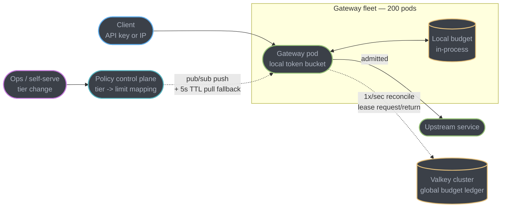
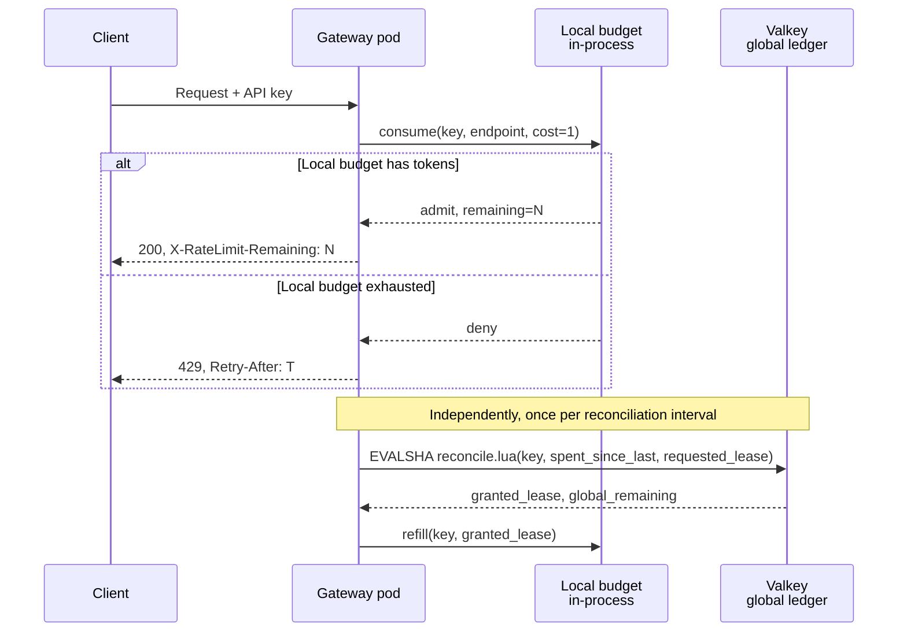
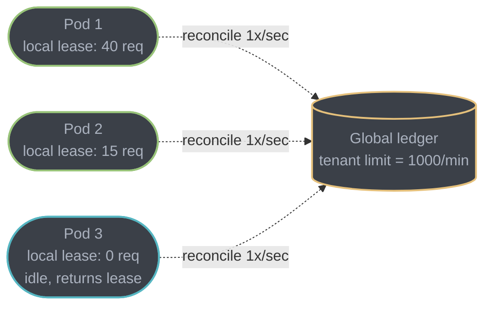
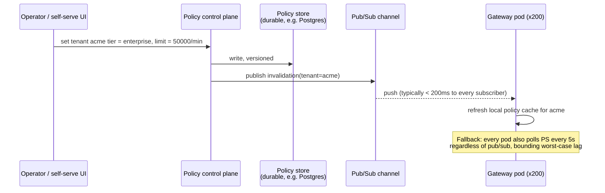

# Case Study: Rate Limiter as a Shared Service

## Intuition

> **Design intuition**: every module and case study elsewhere in this repo treats rate
> limiting as a filter one service applies to its own callers. This one is a different
> problem: the rate limiter **is** the product. A hundred teams' services sit behind it,
> none of them wants to think about it, and every one of them will notice instantly if it
> is wrong — either because a customer is being throttled who should not be, or because it
> silently disappears and nobody is throttled at all. A library gets forked, patched, and
> drifts per-team. A shared service has one behavior, one outage, and one blast radius.

**Key insight for this design**: the two requirements that usually trade off against each
other — *centrally enforced* (so the limit is real, not per-instance fiction) and *never on
the request's critical path in a way that matters* (so it cannot become the slowest thing in
every call in the company) — cannot both be satisfied by talking to a shared store on every
request. The way out is to stop treating "enforce" and "check remote state" as the same
operation: push enforcement to the edge as a **local decision against a locally-held budget**,
and demote the shared store to something a pod *reconciles* with on a schedule rather than
*asks permission from* on every call. Everything in §4 is that one idea applied to four
different problems: exactness, distribution, hot keys, and policy propagation.

The second insight is that "fail open or fail closed" is not one decision, it is one decision
**per caller class**. A rate limiter's outage mode is a product question disguised as an
infrastructure question, and the two answers a platform actually needs — permissive for paying
traffic, restrictive for anonymous traffic — are opposite defaults on the same failure.

---

## 1. Requirements Clarification

### Functional Requirements

- Enforce limits keyed by **API key**, by **IP address** (unauthenticated traffic only), by
  **endpoint**, and by **tenant tier** (free / pro / enterprise) — and a single request may
  need to pass more than one of these simultaneously (a free-tier key hitting an expensive
  search endpoint checks the key's tier limit *and* the endpoint's own ceiling).
- Distinguish **rate** (requests per second, smoothing burstiness) from **quota** (a hard
  monthly/daily cap tied to a pricing plan) — these are different mechanisms with different
  storage shapes, and a platform needs both simultaneously.
- Allow a configurable **burst allowance** above the steady rate, because rejecting a client
  that legitimately opens ten connections at page load is a worse product outcome than a
  short burst tolerance costs in protection.
- Return the de facto `X-RateLimit-*` header triple on every response and `Retry-After` on
  every `429`, and additionally emit the IETF-draft `RateLimit`/`RateLimit-Policy` Structured
  Field headers **alongside** them — see §6 for why this is additive, not a replacement.
- Let a limit change (a tier upgrade, an incident-driven throttle) take effect **without a
  service deploy** — the policy is data, not code, and it must propagate to every enforcement
  point in a bounded time (§4.5).
- Expose per-tenant, per-endpoint usage so a support engineer can answer "why is this
  customer being throttled" from a dashboard, not from grepping logs across 40 gateway pods.

### Non-Functional Requirements

| Requirement | Target | Why this number |
|---|---|---|
| Added latency at p99 | < 2 ms on top of the request's own processing time | The limiter must never be the reason a request misses its own SLO; it is infrastructure, not a feature the caller opted into |
| Throughput | 500,000 requests/sec platform-wide at peak | The scale this design is sized against throughout §2 and §10 |
| Fail-open vs fail-closed | Explicit, per caller class, not a single global switch | See the intuition above — one outage mode is provably wrong for at least one class of caller |
| Consistency | "Fair", not "exact" — a tenant may see up to a bounded, documented overshoot during a burst (§4.4), never an unbounded one | Exactness costs a network round trip per request; the business does not need penny-perfect enforcement, it needs a limit nobody can blow through by 10x |
| Multi-region | Each region enforces its own share of a tenant's global limit; no cross-region call is on the request path | A cross-ocean round trip alone burns the entire 2 ms budget |
| Policy propagation | New limit live everywhere within 5 s worst case, typically < 200 ms | Bounds how long an incident-driven emergency throttle takes to actually bite (§8) |
| Availability of the enforcement path | 99.99% — a limiter-store outage must degrade, never take the platform down | This is the single most common war story in the discipline (§9.1) |

### Clarifying Questions to Ask in the Interview

| Question | Why it changes the design |
|---|---|
| Is this in front of internal service-to-service traffic, external customer traffic, or both? | Internal traffic can often fail open with a coarser limit; external customer traffic is where tier enforcement and billing-adjacent correctness matter |
| Does a limit change need to be instant (incident response) or is a few seconds of lag acceptable? | Instant means a push channel (pub/sub); a few seconds means a poll-and-cache is enough and there is one fewer moving part |
| Are limits enforced once at the edge, or does an internal service also need its own limiter (e.g., protecting a specific expensive downstream)? | A pure edge design cannot protect one microservice's private dependency; that needs a second, narrower limiter, not a bigger edge one |
| What is the platform's stance on a limiter-store outage — degrade gracefully or protect at all costs? | Directly decides fail-open/fail-closed per caller class in §5 |
| Do tenants get billed on overage, or hard-capped? | Hard-capped needs the quota mechanism to be exact at the boundary; billed-overage can tolerate the same fuzziness the rate mechanism already accepts |

### Out of Scope

- The rate-limiting **algorithms themselves** — token bucket, leaky bucket, fixed/sliding
  window — are owned by
  [`../../rate_limiting_in_depth/rate_limiting_in_depth.md`](../../rate_limiting_in_depth/rate_limiting_in_depth.md)
  and this case study does not re-derive them; it applies GCRA (a fifth algorithm, introduced
  in §4.1) and cross-links the rest.
- Fraud/abuse *scoring* — this design rejects or admits based on a declared identity's
  configured budget, not on a risk model. A risk-scoring layer can sit in front of it and
  feed it a dynamically lowered per-identity limit, but that scoring logic is a different
  system.
- Payment/billing reconciliation of quota overage — covered by the platform's billing system,
  not this service.
- The single-payments-API, single-region worked example in
  [`../../../hld/rate_limiting/rate_limiting.md`](../../../hld/rate_limiting/rate_limiting.md)
  §14 is a different, narrower design (one algorithm, one datacenter cluster, fail-open only).
  This case study is the platform-wide, multi-region, multi-algorithm version of the same
  problem and does not repeat that ground.

---

## 2. Scale Estimation

### Traffic and Identity Cardinality

```
Platform peak throughput:            500,000 req/sec        <- the stated NFR
Platform average throughput (1/6 of peak, typical diurnal ratio):
                                       83,300 req/sec
Active API keys (tenants):         2,000,000
Active IPs needing a fallback limit (unauthenticated edges):
                                    ~5,000,000 (churns constantly, short TTL)
Distinct rate-limited endpoints per tenant (billing-relevant):
                                            ~40
Checks per request (key limit + endpoint limit + tier quota; IP check
  only on unauthenticated routes):            2-3, average 2.4
```

```
Total limiter decisions/sec at peak = 500,000 x 2.4 = 1,200,000 decisions/sec
```

That last line is the number that actually sizes the system — not the 500,000 requests, but
the 1.2M yes/no decisions those requests require, because the whole point of §4's hybrid
design is to keep the overwhelming majority of those 1.2M decisions from ever leaving the
gateway pod that received the request.

### What a 1 ms-per-request Limiter Would Cost If Every Request Paid It

```
500,000 req/sec x 1 ms of limiter latency = 500 CPU-seconds of *added critical-path wait*
                                              consumed every second, platform-wide

Over a day:   500 x 86,400              = 43,200,000 CPU-seconds/day
At a blended  $0.00002/CPU-second (a representative mid-tier general-purpose
  vCPU-hour price of ~$0.072 amortized to seconds; verify current pricing
  before quoting a specific bill):
                                          ~$864/day just in held-open capacity,
                                          before counting the store's own cost
```

This is why "add a Redis call to every request" is not a rounding error at this scale: it is
the difference between provisioning gateway fleet capacity for the request's own work and
provisioning it for the request's own work *plus* a synchronous round trip that has nothing
to do with serving the response. At 500k req/sec, 1 ms of pure added wait is over seven
minutes of aggregate CPU time held hostage every single second. The architecture in §3 exists
specifically to keep that number close to zero for the 99%+ of requests that never need to
leave the local pod to get an answer.

### Redis/Valkey Ops Budget Under the Hybrid Design

The hybrid architecture (§4.4) converts most of the 1.2M decisions/sec into **local** decisions
and reserves the shared store for reconciliation traffic, which scales with **gateway pod
count and reconciliation frequency**, not with request volume:

```
Gateway pods:                          200
Reconciliation interval:               1 second
Reconciliation calls/sec = 200 pods x (1 call/sec) = 200 ops/sec, PER TENANT-SHARD
  the pod owns a share of budget for every tenant it has seen recently, but one
  reconciliation call is a pipelined multi-key request, not one round trip per tenant

Realistic pipelined reconciliation traffic:
  200 pods x 1 pipelined call/sec = 200 ops/sec to the store, regardless of the
  1.2M decisions/sec happening locally on the pods

Compare to a naive design (every decision hits the store):
  1,200,000 ops/sec  vs.  200 ops/sec  =  6,000x reduction
```

That ratio — not a specific millisecond figure — is the entire argument for the hybrid over
a purely centralized limiter, and it is why the architecture in §3 spends its complexity
budget on the local/global split rather than on making the central store faster.

### Memory: What One Counter Costs

```
Redis/Valkey per-key overhead: ~70-90 bytes of object/dict-entry metadata plus
  ~30 bytes if a TTL is set, essentially independent of value size for a
  small counter or timestamp (measured Redis-internals estimate, not a
  vendor-published number — treat it as order-of-magnitude).

GCRA state per identity: one 8-byte timestamp (the TAT, see §4.1) + the
  metadata above  ~= 110-130 bytes/key

Sliding-window-counter state per identity: two small integers (current +
  previous window)  ~= 140-160 bytes/key (two keys)

At 2,000,000 tenants x ~2.4 limit dimensions each (key, endpoint, tier):
  ~4,800,000 active counters x 130 bytes  ~= 624 MB

Add the 5,000,000-IP fallback limiter (short TTL, high churn, GCRA state):
  5,000,000 x 130 bytes                    = 650 MB

Total resident rate-limit state: ~1.3 GB
```

Well under a single Valkey node's memory even before sharding — the store is never
memory-bound here, it is **operation-rate-bound** on the naive design and **pod-count-bound**
on the hybrid one, which is exactly why §2's Redis-ops arithmetic mattered more than the
memory arithmetic.

---

## 3. High-Level Architecture



*Enforcement is local and synchronous (solid arrow); everything that keeps local enforcement
honest — budget reconciliation and policy propagation — is asynchronous and off the request
path (dotted arrows). A pod can make a fully correct admit/reject decision using only
in-process state for up to one reconciliation interval, which is what keeps the p99 latency
budget in §1 achievable at 500k req/sec.*

### Request Path, Step by Step



*The client-facing decision (top) never waits on Valkey. The reconciliation exchange
(bottom) happens on a timer, batched across every tenant the pod has recently served, and its
latency is invisible to any individual request — it only has to complete before the pod's
local budget for a hot key runs dry.*

**Shared primitives.** Backend's `case_studies/` has no `cross_cutting/` directory; by the
convention documented in
[`../case_studies.md`](../case_studies.md), the shared primitives live as deep-dive modules in
the section itself. This case study leans on five of them plus the two sibling modules that
own the material it deliberately does not re-derive:

| Primitive used here | Deep dive |
|---|---|
| Token bucket, sliding window, adaptive throttling, Redis Lua basics | [`../../rate_limiting_in_depth/rate_limiting_in_depth.md`](../../rate_limiting_in_depth/rate_limiting_in_depth.md) |
| Placement in the request path, per-instance vs centralized tradeoff | [`../../../hld/rate_limiting/rate_limiting.md`](../../../hld/rate_limiting/rate_limiting.md) |
| Gateway responsibilities, BFF pattern, where enforcement composes with routing | [`../../api_gateway_patterns/api_gateway_patterns.md`](../../api_gateway_patterns/api_gateway_patterns.md) |
| Circuit breaker on the store, retry with jitter, bulkhead isolation | [`../../fault_tolerance_patterns/fault_tolerance_patterns.md`](../../fault_tolerance_patterns/fault_tolerance_patterns.md) |
| Cache-aside for the policy cache, stampede protection | [`../../caching_strategies_deep_dive/caching_strategies_deep_dive.md`](../../caching_strategies_deep_dive/caching_strategies_deep_dive.md) |
| Metrics/alerting for §8's dashboards, SLO framing | [`../../observability_and_monitoring/observability_and_monitoring.md`](../../observability_and_monitoring/observability_and_monitoring.md) |
| Feature-flag-style config propagation pattern reused for policy push | [`../../distributed_system_operational_patterns/distributed_system_operational_patterns.md`](../../distributed_system_operational_patterns/distributed_system_operational_patterns.md) |

---

## 4. Component Deep Dives

### 4.1 GCRA — a Single-Value Alternative to a Sliding Window

The sliding window log is exact but costs O(limit) memory per identity (one entry per
request); the sliding window counter is O(1) but an approximation built from two counters
(both owned by
[`rate_limiting_in_depth.md`](../../rate_limiting_in_depth/rate_limiting_in_depth.md)). GCRA
(Generic Cell Rate Algorithm, originally an ATM traffic-shaping algorithm, popularized for API
rate limiting by libraries such as `redis-gcra` and by Mailgun's open-sourced `gubernator`
service) gets O(1) memory **and** exactness, by storing a single value: the **Theoretical
Arrival Time (TAT)** — the moment at which the bucket would next have room, if no further
requests ever arrived.

```
emission_interval  T = window / limit          (time "cost" of one request)
burst_allowance    B = number of requests a client may fire instantly

On a request at time now, given the stored tat (default = now if absent):
  tat_now   = max(tat, now)
  allow_at  = tat_now - B * T
  if now < allow_at:
      reject; retry_after = allow_at - now
  else:
      new_tat = tat_now + T
      store(new_tat, ttl = new_tat - now)
      admit
```

**Walk one example.** `limit = 100/min`, `B = 20`, so `T = 60s / 100 = 0.6s`,
`B*T = 12s` of burst headroom:

```
  t=0.0s   no prior state, tat defaults to now (0.0s)
           allow_at = 0.0 - 12.0 = -12.0s ; now(0.0) >= allow_at -> ADMIT
           new_tat = 0.0 + 0.6 = 0.6s

  20 more requests arrive in the same instant (t=0.0s), each recomputing tat_now
  from the just-stored value:
           req 2: tat_now=0.6, allow_at=0.6-12.0=-11.4 -> ADMIT, new_tat=1.2
           ...
           req 21: tat_now=12.0, allow_at=12.0-12.0=0.0 ; now(0.0) < 0.0 is FALSE
                   (0.0 is not < 0.0) -> ADMIT (the 21st, using up the burst exactly)
           req 22: tat_now=12.6, allow_at=12.6-12.0=0.6 ; now(0.0) < 0.6 -> REJECT
                   retry_after = 0.6s

  So a burst of exactly B+1 = 21 requests clears instantly, the 22nd is rejected
  with a 0.6s retry-after, and the client is back to steady-state one admit per T.
```

The mechanism is the same shape as the token bucket — burst tolerance plus a steady rate —
but the storage is one timestamp instead of a token count that needs a separate refill
computation, which is what makes it the natural fit for the hybrid design in §4.4: a pod can
hand a peer or reconcile a TAT value with a single comparable number, no separate "how many
tokens have accrued since last touched" calculation.

```lua
-- KEYS[1]: identity key, e.g. "gcra:apikey:sk_live_abc:search"
-- ARGV[1]: now (ms), ARGV[2]: emission_interval (ms), ARGV[3]: burst_offset (ms)
-- Returns {allowed(0/1), retry_after_ms}
local key    = KEYS[1]
local now    = tonumber(ARGV[1])
local T      = tonumber(ARGV[2])
local burst  = tonumber(ARGV[3])   -- B * T, precomputed by the caller

local tat = tonumber(redis.call('GET', key) or now)
local tat_now = math.max(tat, now)
local allow_at = tat_now - burst

if now < allow_at then
    return {0, math.ceil(allow_at - now)}
end

local new_tat = tat_now + T
redis.call('SET', key, new_tat, 'PX', math.ceil(new_tat - now))
return {1, 0}
```

### 4.2 BROKEN -> FIX: the Non-Atomic Fixed-Window Limiter

This is the single most common defect in a first-pass rate limiter implementation, and it
carries two independent bugs, not one.

```java
// BROKEN — two separate round trips, neither atomic with the other
public boolean allow(String key, int limit, Duration window) {
    String raw = redis.opsForValue().get(key);
    if (raw == null) {
        redis.opsForValue().set(key, "1");
        redis.expire(key, window);      // <-- separate call; can be skipped entirely
        return true;
    }
    long count = Long.parseLong(raw);
    if (count < limit) {
        redis.opsForValue().increment(key);   // <-- not atomic with the GET above
        return true;
    }
    return false;
}
```

**Bug 1 — the lost update.** `GET` and the conditional `INCR` are two separate Redis
commands issued from the application. Redis executes each one atomically, but the
**pair** is not atomic: nothing stops another gateway pod's `GET` from landing between this
pod's `GET` and its `INCR`. With `limit = 1000` and `count` currently at `999`: pod A reads
`999`, pod B reads `999` before either has written back, both decide `999 < 1000` is true,
both increment. The window now admits `1001` requests, and the overshoot compounds with every
additional concurrent reader caught in the same window — at 200 gateway pods all serving one
very popular tenant, a burst that straddles the read can lose dozens of updates in the same
millisecond. This is a classic check-then-act race; single-threaded execution *inside* Redis
does nothing to protect a read-then-write pair that spans two separate round trips from the
client.

**Bug 2 — the immortal key.** The first branch calls `SET` and then, as a *second*, separate
call, `EXPIRE`. If the process crashes, the connection drops, or the `EXPIRE` call itself
times out in the gap between the two, the key is left in the store **with no TTL**. It never
expires. Every crash or transient error in that narrow window leaks one permanent key. At the
scale in §2 — millions of distinct identities, most of them short-lived IPs — this is not a
rare edge case, it is the unbounded-growth war story in §9.4.

```java
// FIX — a single Lua script; INCR and the conditional PEXPIRE happen inside
// one atomic Redis operation, so no other client's command can land between them
private static final String FIXED_WINDOW_SCRIPT = """
    local count = redis.call('INCR', KEYS[1])
    if count == 1 then
        redis.call('PEXPIRE', KEYS[1], ARGV[1])
    end
    if count > tonumber(ARGV[2]) then
        return 0
    end
    return 1
    """;

public boolean allow(String key, int limit, Duration window) {
    Long allowed = redis.execute(fixedWindowScript,
        List.of(key), String.valueOf(window.toMillis()), String.valueOf(limit));
    return allowed != null && allowed == 1L;
}
```

Both bugs disappear for the same reason: the script executes as one atomic Redis command, so
either the increment and the TTL stamp both happen as part of the same indivisible operation,
or — if the key already existed — the TTL branch is skipped correctly because `count` is not
`1`. There is no gap for another client's command to interleave in, and there is no gap for a
crash to land in between two calls that used to be two calls and are now one.

### 4.3 The Distributed Problem and the Hybrid Fix

**Local-only** (each gateway pod runs its own in-process GCRA against the full configured
limit) is wrong by construction: N pods each independently enforcing `limit` gives an
effective cap of `N x limit`. At 200 pods, a `1,000/min` tenant limit becomes a `200,000/min`
limit — 200x over, silently, because every pod's local view looks correct in isolation.

**Central-only** (every decision is a Valkey round trip) is correct, but it puts a network
hop with its own tail latency and its own availability on the critical path of *every single
request in the company* — the exact cost quantified in §2's CPU-seconds arithmetic, and a
direct violation of the "the limiter is never the reason a request misses its own SLO"
requirement in §1.

**The hybrid**: each pod enforces a **local GCRA bucket against a leased share of the global
budget**, and reconciles that lease with Valkey on a fixed interval, independent of request
volume.



*Each pod requests a lease sized to its own recent traffic for that tenant; an idle pod's
unused lease is returned to the shared pool at the next reconciliation and can be re-granted
to a busier pod — fair-share with borrowing, not an even static split.*

**Deriving the overshoot bound.** This is the number an interviewer wants: exactly how far
over the configured limit can this design go, and why is that bound acceptable.

```
Let:
  N        = number of gateway pods                              (200)
  L        = global limit per window W                            (1,000 req / 60s)
  dt       = reconciliation interval                                    (1s)
  b        = local burst allowance per pod's GCRA bucket, in requests    (5)

Worst case: every pod simultaneously receives a full lease at the instant right
before a global spike, and every pod's local bucket immediately admits its own
burst allowance before the next reconciliation can claw anything back.

  worst_case_overshoot = N x b
                        = 200 x 5
                        = 1,000 requests

As a fraction of the configured limit:
  1,000 / 1,000 = 100% in the worst possible pathological case — BUT that case
  requires all 200 pods to receive a full lease at the same instant AND every
  pod's traffic to spike in the same 1-second window, which does not happen for
  a single tenant spread across a gateway fleet by a load balancer.

Realistic case — a tenant's traffic touches ~8 pods per second (typical
connection-pool spread at this fleet size, not a universal constant):
  realistic_overshoot = 8 x 5 = 40 requests, i.e. 4% over the configured limit,
  self-correcting within one reconciliation interval (1s) as leases are reclaimed.
```

The bound is controlled entirely by two knobs the operator owns: `dt` (shrink it, and the
worst case shrinks with it, at the cost of more reconciliation traffic — the §2 tradeoff) and
`b` (shrink the per-pod burst allowance, and you trade smaller overshoot for more 429s on
legitimate local bursts). This is the honest cost of not paying a Redis round trip on every
request: a bounded, tunable, non-zero overshoot instead of an unbounded one.

### 4.4 Hot-Key / Hot-Shard Handling

A single very large tenant can generate enough traffic that its own counter becomes a
bottleneck, independent of the platform's aggregate load — a hashed Valkey cluster still maps
one key to one shard, so one tenant's reconciliation traffic can pin one node regardless of
how idle the other 15 are.

Three defenses, applied in order of how much exactness they cost:

1. **The hybrid itself is the first line of defense.** Because most of a hot tenant's
   requests are already resolved locally against a lease, the hot tenant's *reconciliation*
   traffic against Valkey scales with pod count (§2), not with the tenant's own request rate
   — a tenant doing 50,000 req/sec still only generates ~200 reconciliation calls/sec,
   because that is bounded by the number of pods, not by the tenant's throughput.
2. **Sub-key sharding for the reconciliation ledger itself**, if a single tenant's
   reconciliation traffic still concentrates on one Valkey shard: split the tenant's global
   counter into `K` sub-counters (e.g. `gcra:tenant:acme:shard:{0..7}`), have each gateway pod
   hash to one sub-shard by its own pod id, and sum sub-shards only when a periodic rebalancer
   needs the true total. This is the same local/central tradeoff one level down: exactness
   traded for spread load, at the cost of a slightly higher aggregate limit during the window
   before the rebalancer's next pass (bounded the same way §4.3's overshoot is bounded).
3. **Short local memoization of an ADMIT decision** for an identity generating requests
   faster than the local GCRA computation itself is worth repeating — cache "this identity
   was definitely under budget" for a few milliseconds so a burst of thousands of requests
   inside one scheduler tick collapses into a handful of real GCRA evaluations. This trades a
   few milliseconds of slack at the very top of a hot key's burst for avoiding CPU-bound
   contention on that key's in-process lock.

### 4.5 Policy Control Plane and Propagation Lag

A tier change, a temporary incident throttle, or a customer's negotiated limit must reach
every gateway pod without a deploy.



*The pub/sub push is the fast path; the 5-second poll is the correctness backstop for the
pod that missed the publish (a reconnecting pod, a dropped message) — worst-case propagation
is the poll interval, typical propagation is the push latency.* This is the same
push-plus-poll-fallback shape used for feature-flag propagation, documented generally in
[`distributed_system_operational_patterns.md`](../../distributed_system_operational_patterns/distributed_system_operational_patterns.md).

The reason the fallback poll cannot be removed even with a reliable pub/sub: a pod that was
mid-restart during the publish, or whose subscription silently dropped, would otherwise serve
a stale limit **forever** rather than for at most 5 seconds — an unbounded staleness window is
worse than a bounded one even if the bounded one is rarely exercised.

---

## 5. Design Decisions & Tradeoffs

**GCRA vs sliding window vs token bucket, for this system specifically.** All three are
functionally similar (burst tolerance plus a steady rate); the deciding factor here is the
storage shape under the hybrid design. GCRA's single TAT value is what makes lease
reconciliation cheap to reason about — a pod's "how much have I effectively spent" is one
number, comparable directly against the lease it was granted. A sliding window counter needs
two numbers per identity and an elapsed-fraction computation on every read; a token bucket
needs a stored token count plus a last-refill timestamp. None of these are prohibitively more
expensive, but GCRA is the natural fit for the reconciliation math in §4.3, which is why this
design standardizes on it rather than reusing the sliding window counter the module already
covers in depth.

**Centralized vs local vs hybrid enforcement.** Centralized is the correct choice when
exactness genuinely matters more than latency — a hard quota boundary a customer is billed
against, for example, where a Redis round trip on the (rare) request near the boundary is an
acceptable cost. Local-only is never correct for a shared multi-tenant service; it is only
correct for a single-instance deployment where "distributed" does not apply. The hybrid is
the default because it is the only option that satisfies both the p99 latency NFR and
central-enough correctness — see §4.3 for the bound it accepts in exchange.

**Fail-open vs fail-closed is not one answer.** For a spam filter or an anonymous-traffic
gate, fail-closed is correct: if the store is unreachable, you cannot tell a bot from a
customer, and letting all unauthenticated traffic through during that window is exactly the
DDoS-amplification scenario the limiter exists to prevent. For a payments API or any
authenticated, billed traffic, fail-open is correct: those callers have already been
authenticated and are accountable for their usage, and a brief store outage should degrade to
"unenforced but logged," not to "the entire product is down," because the limiter's failure
should never be worse than the abuse it is guarding against. A single global switch gets this
wrong for whichever caller class it was not tuned for; the policy must be per-route.

**429 vs 503 vs queueing.** `429 Too Many Requests` with `Retry-After` is correct when the
client is over its own budget — it is actionable and specific to that identity. `503` is
correct when the platform itself is shedding load irrespective of any one client's budget
(a different mechanism — load shedding, not rate limiting, and the two must not be conflated
in the same status code or a client cannot tell "you personally are over budget" from
"everyone is being shed right now"). Queueing (admit now, serve after a delay) is rarely
correct for a shared multi-tenant gateway — it converts a fast, cheap rejection into a slow,
resource-holding one, and it is the exact mechanism behind the leaky-bucket latency pitfall
already documented in the module (queue depth deeper than the caller's own timeout wastes a
slot on a request that fails anyway either way).

**Per-tenant fairness vs a simple global cap.** A single global cap protects the platform but
lets one large tenant starve every other tenant sharing the same downstream capacity. Per-
tenant, per-endpoint limits (as designed here) cost more state and more policy management, but
they are the only shape that satisfies "a free-tier bug should never be able to degrade an
enterprise customer's traffic," which is close to the entire commercial argument for running
a shared rate limiter at all rather than leaving each service to protect itself.

---

## 6. Real-World Implementations

**Stripe** runs a Redis-backed token bucket per account alongside a separate concurrent-
request limiter and two load shedders that reserve fleet capacity for critical traffic
(Stripe engineering, "Scaling your API with rate limiters"), and returns a
`Stripe-Rate-Limited-Reason` header naming exactly which limiter fired
(`global-rate`, `endpoint-rate`, `global-concurrency`, `endpoint-concurrency`,
`resource-specific`) — the same multi-limiter shape as §1's "more than one simultaneous check
per request," made debuggable by naming the limiter rather than returning a bare `429`.

**GitHub's REST API** layers a primary hourly limit (5,000 requests/hour authenticated, 60
unauthenticated) with **secondary** limits that fire independently of the hourly budget — a
concurrency cap of 100 requests, a points-per-minute ceiling, and a CPU-time-per-wall-clock-
time ceiling. The lesson for this design: a single "requests per window" number is not
sufficient protection on its own, because a client can stay under the hourly limit while still
holding open enough concurrent connections to exhaust a shared connection pool — which is why
§4.4's hot-key defenses target concurrency and burst rate, not only the steady-state count.

**Cloudflare** enforces its sliding-window-counter algorithm with **counters kept per data
center, not aggregated globally on the request path** — the same local-enforcement,
periodic-reconciliation tradeoff this case study makes at the gateway-pod level, applied one
layer up at the PoP level. Cloudflare accepts the resulting consequence explicitly: traffic
spread across many PoPs can, in aggregate, exceed the configured threshold while every
individual PoP stays under its own share.

**Envoy's global rate limit service (RLS)** is the closest existing system to this case
study's shape: Envoy's rate-limit HTTP filter calls out, over gRPC, to an external rate-limit
service (the reference implementation is `envoyproxy/ratelimit`, descended from Lyft's
original service) with a `domain` and a set of `descriptors` — key/value pairs describing the
request's rate-limit dimensions (API key, route, etc.) — and the service returns an
over-limit/under-limit decision plus a per-descriptor `hits_addend` for weighted costs.
Structurally this is the centralized half of §4.3's tradeoff, made pluggable: Envoy owns the
edge enforcement point, the RLS owns the shared decision, and a real deployment of this
pattern is exactly where the hybrid's local-lease layer would be added in front of the RLS
call to avoid paying a gRPC round trip on every request.

**Kong**'s rate-limiting plugin exposes the centralized-vs-local choice as a literal
`policy` config: `local` (per-node, not for anything accuracy-sensitive), `cluster`
(shared via the database Kong already runs on), or `redis` (an external store, recommended
once sync frequency needs to be high) — Kong's own guidance is to start with `cluster` and
move to `redis` only if that proves insufficient. **Apache APISIX** splits the same problem
into three separate plugins by *shape* rather than by backend: `limit-count` (fixed window),
`limit-req` (leaky bucket, for smoothing), and `limit-conn` (concurrent-connection limiting,
the same "count is not enough" lesson GitHub's secondary limits teach). **AWS API Gateway**
Usage Plans attach a token-bucket rate plus a separate DAY/WEEK/MONTH quota to each API key —
the rate and the quota are configured and enforced independently, the same rate-vs-quota
split called out as a functional requirement in §1.

**The IETF `RateLimit` header fields draft** (`draft-ietf-httpapi-ratelimit-headers`) defines
the standards-track `RateLimit` and `RateLimit-Policy` Structured Fields. As of this writing
it is at **draft-11 (23 May 2026), Standards Track, not yet an RFC**, with an expiration date
of 24 November 2026 — check `datatracker.ietf.org` before building against it, since the
syntax has changed across revisions and can change again before final publication. Emit it
alongside the de facto `X-RateLimit-*` headers, not instead of them, until it ships.

---

## 7. Technologies & Tools

| Technology | Role in this design | Notes |
|---|---|---|
| Valkey | Global reconciliation ledger, policy pub/sub channel | The default for new clusters on AWS ElastiCache and Google Memorystore; wire- and Lua-compatible with Redis, see [`rate_limiting_in_depth.md`](../../rate_limiting_in_depth/rate_limiting_in_depth.md) §12 |
| `redis-gcra` / `gubernator` (Mailgun) | Reference GCRA implementations | Gubernator is additionally a standalone, stateless distributed rate-limit microservice that spreads decisions across a peer cluster without a shared cache |
| Bucket4j | In-process local bucket on the JVM gateway pod | Used for the per-pod local lease bucket in §4.3 rather than for the shared/global side |
| Resilience4j `RateLimiter` | A narrower, single-service limiter protecting one internal dependency, distinct from the platform-wide shared service this case study designs | Correct choice per §1's clarifying question about internal service-to-service protection |
| Envoy + `envoyproxy/ratelimit` (RLS) | Reference architecture for the centralized half of the hybrid, if building on Envoy rather than a custom gateway | gRPC `domain` + `descriptors` interface, see §6 |
| Kong / Apache APISIX | Off-the-shelf gateway plugins covering the single-algorithm cases | Reach for these when the platform does not need the multi-tenant hybrid's complexity |
| AWS API Gateway Usage Plans | Managed rate + quota per API key | The right choice when the platform is already fully on API Gateway and does not need cross-cloud portability |

---

## 8. Operational Playbook

**Rollout: shadow mode before enforcement.** Ship every new or changed policy in
**observe-only mode** first — the limiter computes every admit/reject decision and emits it as
a metric and a log line, but always admits the request regardless of the decision. Run this
for at least one full weekly traffic cycle (to see the real diurnal and any weekly-batch
pattern) before flipping enforcement on for that policy. This is the single highest-leverage
practice in this playbook: it converts "did we just break a customer" from a production
incident into a dashboard you check before enforcement goes live.

**Dashboards.** Per-tenant and per-endpoint: allowed vs throttled request rate, the
throttled-to-allowed ratio (not just the raw throttled count — a ratio catches a small tenant
being 100% throttled that a raw count would bury), local-lease exhaustion rate (how often a
pod's local bucket runs dry before the next reconciliation — a leading indicator that `dt` or
`b` in §4.3 need tuning), and reconciliation latency/error rate against Valkey.

**Alerts.**
- Any single tenant throttled more than 5% of requests over a 5-minute window — signals
  either misconfiguration or a customer that needs a tier conversation, mirroring the
  pitfall already documented in the module.
- Valkey reconciliation error rate above a low threshold, paged immediately — a store outage
  degrades silently under fail-open (§9.1), so the alert on the *store*, not on the visible
  symptom, is what catches it early.
- Local-lease exhaustion rate spiking platform-wide — indicates either a genuine traffic
  surge or a reconciliation-path regression, and the two look identical from a single pod's
  perspective, which is why this metric must be aggregated centrally to distinguish them.

**Runbook: "a customer says they're being throttled and shouldn't be."**
1. Pull the tenant's dashboard: confirm the throttled request rate and which specific limit
   fired (key-tier, endpoint, or IP fallback — a shared IP behind the customer's own NAT is a
   frequent false alarm, see the module's Pitfall 2).
2. Check the policy store's current value for that tenant against what the account team
   believes was configured — a stale cache or a failed propagation (§4.5) is common enough to
   check before assuming the limit itself is wrong.
3. If the limit is correct and the tenant is genuinely over it, that is the system working;
   route to the account team for a tier conversation, not to engineering.
4. If the limit is wrong, correct it through the control plane (never by hand-editing a
   gateway pod's local state — it will be overwritten at the next reconciliation and the
   fix will silently vanish).

**Emergency global bypass.** A single, heavily audited operator action that disables
enforcement platform-wide (or for one tenant) without a deploy, intended for the case where
the limiter itself is the thing misbehaving during an incident. Making it safe requires three
things: it defaults to a **short TTL** (minutes, not indefinite) so a forgotten bypass does
not become a permanent hole; it is logged and paged on activation and on expiry, so it cannot
be used silently; and it is scoped (global vs one tenant vs one endpoint) rather than a single
all-or-nothing switch, so the blast radius of using it matches the blast radius of the
incident that required it.

---

## 9. Common Pitfalls & War Stories

**1. The store outage that took down the whole API — illustrative composite, not a specific
company's incident.** A platform's rate limiter was configured fail-closed everywhere, on
the reasoning that "fail-closed is the safe default." When the Valkey cluster serving the
limiter had a 6-minute network partition, every gateway pod's reconciliation calls started
timing out, local leases hit zero, and — because the fail-closed policy treated "cannot reach
the store" identically to "budget exhausted" — the platform returned `429` to essentially all
authenticated traffic for the duration of the partition. A rate limiter's job is to protect
the platform from a minority of bad traffic; this configuration let it take down 100% of good
traffic to prevent an outage it was not even experiencing. The fix is exactly §5's per-caller-
class policy: authenticated, billed traffic fails open; only the unauthenticated fallback
limiter (protecting against unauthenticated-endpoint abuse) stays fail-closed.

**2. Clock skew across gateway pods corrupting a fixed-window boundary — same failure mode
as the module's Pitfall 4, at platform scale.** Two regions' gateway fleets had NTP drift of
just under 4 seconds relative to each other. A fixed-window limiter keyed by a rounded
timestamp assigned requests near a minute boundary to different windows depending on which
region's clock served them, letting cross-region traffic burst to close to double the
configured limit at the boundary, every minute, indefinitely. GCRA does not eliminate the
need for a trustworthy clock (the TAT computation still depends on `now`), but it removes the
*hard boundary* that made a few seconds of skew visible as a discrete, exploitable jump — the
fix in both cases is the same: derive `now` from the store's own clock (`Valkey`'s `TIME` /
an equivalent), never from the calling gateway pod's local clock.

**3. A retry storm with no jitter turning a 10% throttle into a 100% outage — illustrative
composite, quantified.** During a legitimate traffic spike, roughly 10% of requests across
the platform were correctly throttled with `429` and a `Retry-After: 2` header. A widely-used
SDK ignored the header and retried on a fixed 2-second timer. Every throttled client's retry
landed in the same one-second window two seconds later, adding a synchronized spike equal to
roughly 10% of total platform traffic on top of the traffic that was already at capacity —
which pushed a further slice of *previously-fine* requests over the limit, whose retries then
synchronized two seconds after *that*. Within four retry cycles (eight seconds), the
throttled fraction had compounded from 10% to effectively 100% of requests failing, not
because demand grew, but because the retries stopped being random noise and became a
synchronized wave. The fix, on both sides: server-side, ensure `Retry-After` always carries
enough entropy-friendly guidance (a range, not a single second value, where the protocol
allows it); client-side (and this is the one the platform cannot fully control, which is why
it needs to be documented prominently for API consumers), jittered backoff — wait
`Retry-After + random(0, Retry-After)`, never a fixed delay.

**4. Unbounded key growth OOMing the store — direct consequence of §4.2's Bug 2 at
platform scale.** A version of the non-atomic `SET`-then-`EXPIRE` limiter (§4.2) ran in
production against the IP-fallback limiter, which sees millions of distinct, mostly
transient identities. Every process restart, every dropped connection between the two calls,
leaked one permanent key. Over several months of steady low-single-digit-percent leak rate
against millions of daily new IPs, the leaked-key population grew into the tens of millions,
each holding a small but nonzero amount of memory forever, until the store's memory usage
crossed its `maxmemory` threshold and began evicting *live, correctly-TTLed* rate-limit keys
under its eviction policy — which silently reset those tenants' limits far more often than
intended, the opposite of the intended failure mode. The permanent fix is §4.2's atomic Lua
script; the detection fix is alerting on the store's total key count trending upward with no
corresponding TTL'd expiry, which is a leak signature distinguishable from organic growth
well before `maxmemory` is reached.

### Pitfalls Without a Full War Story

- **Treating the reconciliation interval as a constant across all tenants.** A very
  low-traffic tenant reconciling every 1 second like everyone else wastes ops for no
  precision benefit; scale `dt` down for high-traffic tenants (tighter bound, §4.3) and up
  for low-traffic ones (fewer wasted round trips).
- **Forgetting that a lease, once granted, is spent whether or not the local traffic
  materializes.** A pod that requested a large lease in anticipation of a spike that never
  came holds that budget unavailable to other pods until it returns it at the next
  reconciliation — size lease requests off recent observed traffic, not off worst-case
  headroom.
- **Putting the policy control plane itself behind the rate limiter it configures.** A
  circular dependency where the policy service's own API is protected by the same limiting
  infrastructure it is trying to update means an incident that requires an emergency policy
  change can be the same incident that makes the policy change impossible to push.

---

## 10. Capacity Planning

### Valkey Cluster Sizing

```
Reconciliation ops/sec at 200 pods, 1s interval, pipelined:        ~200 ops/sec
Policy pub/sub fan-out (rare, event-driven, not steady-state):    negligible
Resident memory (from §2):                                          ~1.3 GB

A single Valkey primary comfortably clears low-hundreds-of-thousands
of ops/sec on modest hardware, so 200 ops/sec of reconciliation traffic
is not what sizes this cluster — availability and hot-key isolation are.

Sizing driver: shard count for hot-key isolation (§4.4), not throughput.
  8 shards, replication factor 2      -> one hot tenant's reconciliation
                                          traffic can saturate at most 1/8
                                          of aggregate cluster capacity
```

### Key TTL and Memory Reclamation

Every rate-limit key carries a TTL derived from the algorithm's own state (GCRA's `PEXPIRE`
is set to `new_tat - now`, i.e. the key outlives exactly as long as its TAT is still in the
future) — there is no separate "cleanup job" required, which is precisely what the §4.2 fix
guarantees and the §9.4 bug violated. At the steady-state churn from §2 (millions of
short-lived IP keys), memory stays bounded by "how many identities were active in roughly the
last window," not by cumulative history.

### Sharding and 10x Traffic

```
At 10x platform traffic (5,000,000 req/sec):
  Local decisions/sec: still resolved in-process, no store impact
  Reconciliation ops/sec: scales with POD COUNT, not request volume —
    if pod count also grows ~10x to handle the raw compute load
    (2,000 pods), reconciliation traffic grows to ~2,000 ops/sec,
    still trivial for the store.
  Hot-key risk grows, though: a tenant that was 8 pods' worth of
    traffic at 500k req/sec could be 80 pods' worth at 5M req/sec,
    which is exactly the case §4.4's sub-key sharding exists for —
    re-shard that tenant's ledger key from the standard 1 to K=8
    once its own reconciliation rate crosses a threshold, rather
    than uniformly sharding every tenant up front.
```

The headline result: this architecture's dominant cost driver (gateway pod count, which is
sized by the platform's actual request-serving compute needs regardless of rate limiting) and
the rate limiter's own marginal cost (a few hundred extra ops/sec on a store that clears
orders of magnitude more) stay decoupled from each other even at 10x scale, which is the
entire point of pushing enforcement to the edge in §3.

### Cost Summary at Steady State

```
Valkey cluster (8 shards, RF=2, small nodes — sized for isolation,
  not throughput)                                          ~$1,100/month
Policy store (small Postgres instance + pub/sub channel)   ~  $150/month
Incremental gateway-pod CPU for local GCRA computation
  (sub-millisecond per decision, folded into existing
  gateway compute, not separately provisioned)             ~    $0/month marginal
                                                             --------------
                                                             ~$1,250/month

Against 500,000 req/sec sustained (a platform doing meaningful volume
at that rate is not a small business): $1,250/month is the cost of
never letting rate limiting become the platform's latency floor.
```

---

## 11. Interview Discussion Points

**Q: Why does a shared rate limiter need a hybrid local/central design instead of just calling Redis on every request?**
**Short:** A Redis round trip on every request couples the platform's entire latency floor to the store's availability and adds real aggregate cost at scale.

At 500,000 requests/sec, even a fast Redis round trip (well under a millisecond) means the limiter's own latency and availability profile becomes every request's latency and availability floor — and the aggregate held-open capacity across the fleet is real, quantifiable cost (§2). The hybrid design pushes enforcement to a local decision against a leased share of the global budget, so the store is only touched on a fixed schedule (reconciliation) rather than once per request — a roughly 6,000x reduction in store operations at this scale, at the cost of a small, bounded, tunable overshoot instead of perfect exactness.

**Q: Walk through the race condition in a naive GET-then-INCR rate limiter. What exact interleaving loses an update?**
**Short:** Two pods both read the pre-increment count before either writes back, so both admit and the limit is silently exceeded.

`GET` and the conditional `INCR` are two separate round trips from the application, even though each individual Redis command is atomic. With the count at 999 and a limit of 1000: pod A issues `GET`, reads 999; before pod A's `INCR` lands, pod B issues its own `GET`, also reads 999 (pod A hasn't written yet); both compute `999 < 1000` as true and both increment, admitting a 1001st request against a 1000 cap. The fix is a single Lua script combining the read, the comparison, and the increment into one atomic Redis operation, so no other client's command can land in between.

**Q: The same broken limiter also has a second bug independent of the race condition. What is it?**
**Short:** A separate SET-then-EXPIRE creates keys with no TTL if a crash lands between the two calls, leaking memory forever.

The first-request branch calls `SET` to create the counter and then, as a second, separate call, `EXPIRE` to give it a TTL. If the process crashes, the connection drops, or the `EXPIRE` call itself fails in the gap between the two, the key is left permanently in the store with no expiry. At platform scale, with millions of short-lived identities (IP addresses in particular), this leaks one immortal key per crash-during-that-window and eventually exhausts the store's memory, forcing evictions that hit live, correctly-TTLed keys instead. The fix is the same atomic Lua script as the race-condition fix: the TTL is stamped as part of the same indivisible operation that creates the key.

**Q: Derive the worst-case overshoot bound for the local-lease hybrid design.**
**Short:** Worst-case overshoot equals pod count times per-pod local burst allowance, both operator-tunable knobs.

In the pathological case where every gateway pod simultaneously holds a full lease and every pod's local GCRA bucket admits its own full burst allowance before the next reconciliation can claw anything back, the overshoot is `N x b`, where `N` is the pod count and `b` is the per-pod burst allowance in requests. With 200 pods and a burst allowance of 5, that bound is 1,000 requests — 100% over a 1,000-request limit in the theoretical worst case, though a real tenant's traffic touching only a handful of pods per second makes the realistic overshoot far smaller. The two knobs an operator can tune are the reconciliation interval (shrink it to shrink the bound, at the cost of more store traffic) and the per-pod burst allowance (shrink it to shrink the bound, at the cost of more false 429s on legitimate local bursts).

**Q: What is GCRA and why does it fit this design better than a sliding window counter?**
**Short:** GCRA stores one timestamp per identity instead of two counters, which is exactly the number the lease-reconciliation math needs.

GCRA tracks a single Theoretical Arrival Time (TAT) per identity — the moment the bucket would next have room — and admits a request when `now` is at or past `TAT minus the burst allowance`, then advances the TAT by one emission interval. It gives the same exactness as a sliding window log but with O(1) memory, using one comparable number instead of the sliding window counter's two counters and elapsed-fraction computation. That single-number shape is what makes the hybrid design's lease reconciliation simple: a pod's "how much have I spent" and a shared "how much is left" are directly comparable TAT-shaped values rather than requiring a window-alignment computation on every reconciliation.

**Q: How do you decide fail-open versus fail-closed when the rate-limit store is unreachable?**
**Short:** Per caller class, never one global switch — authenticated billed traffic fails open, unauthenticated traffic fails closed.

Fail-closed is correct for unauthenticated or anonymous traffic, because an unreachable store means you cannot distinguish a legitimate client from a bot, and admitting everyone during that window is the exact DDoS-amplification scenario the limiter exists to prevent. Fail-open is correct for authenticated, billed traffic, because those callers are accountable for their usage and a brief store outage should degrade to "temporarily unenforced but logged," not to "the entire product returns errors" — a limiter's own outage should never be a worse outcome than the abuse it guards against. A single platform-wide switch gets one of the two classes wrong, which is why the policy must be configured per route, not globally.

**Q: How do you propagate a rate-limit policy change to every gateway pod without a deploy, and what bounds the propagation lag?**
**Short:** A pub/sub push for the fast path plus a periodic poll as a correctness backstop, bounded by the poll interval.

The policy store is the durable source of truth; a control plane publishes an invalidation event on a change, and subscribed gateway pods refresh their local policy cache within roughly the pub/sub delivery latency, typically under 200 milliseconds. Because a push can be missed (a pod mid-restart, a dropped subscription), every pod independently polls the policy store on a fixed interval — 5 seconds here — regardless of whether it received the push, which converts an otherwise-unbounded staleness window into a bounded one. The pub/sub path is the speed; the poll is the guarantee.

**Q: How do you keep one very large tenant's traffic from bottlenecking a single Valkey shard?**
**Short:** The hybrid design already decouples reconciliation traffic from request volume; extreme cases get their ledger sub-sharded.

Because the hybrid design resolves most decisions locally, a hot tenant's reconciliation traffic against Valkey scales with the number of gateway pods it touches, not with its own request rate — a tenant at 50,000 requests/sec still only generates on the order of a couple hundred reconciliation calls per second. For the rarer case where even that concentrates on one shard, the tenant's global counter is split into sub-counters keyed by pod id, with a periodic rebalancer summing them for the true total — the same local/central tradeoff applied one level down, trading a temporarily slightly-higher effective limit for spread load.

**Q: How would you protect a rate-limiter service itself from a retry storm, and what makes that failure mode particularly dangerous?**
**Short:** Fixed-delay client retries synchronize into waves that compound a partial throttle into a near-total outage within a few cycles.

If throttled clients retry on a fixed delay rather than a jittered one, every client throttled in the same window retries in the same later window, adding a synchronized spike on top of already-saturated traffic — which pushes a new slice of previously-fine requests over the limit, whose retries then synchronize on the next fixed interval. This compounds geometrically rather than staying flat, so a 10% throttle rate can reach near-100% failure within a handful of retry cycles, purely from the synchronization, not from any actual demand growth. The defense is jittered backoff on the client side (`Retry-After` plus a random component) and, on the server side, avoiding blanket unjittered `Retry-After` values that make synchronization easy.

**Q: Why return both the de facto `X-RateLimit-*` headers and the IETF-draft `RateLimit` Structured Fields?**
**Short:** The draft is not yet an RFC and its syntax has changed across revisions, so it is additive, never a replacement, until it ships.

The `X-RateLimit-Limit`/`-Remaining`/`-Reset` triple is what essentially every existing client integration already parses, including most SDKs generated against today's popular APIs. The IETF's `draft-ietf-httpapi-ratelimit-headers` defines the standards-track replacement, but as of this writing it is still an Internet-Draft, not an RFC, and its exact field syntax has changed materially across revisions — building only against the draft risks a breaking change before final publication. Emitting both costs a few extra response bytes and buys compatibility with today's clients plus early alignment with the eventual standard.

**Q: A tenant complains they're being throttled and shouldn't be. Walk through the runbook.**
**Short:** Confirm which specific limit fired, check for policy propagation lag or a shared-IP false alarm, then route by root cause.

First, pull the tenant's dashboard and identify exactly which limit fired — key-tier, a specific endpoint's own ceiling, or the IP fallback limiter (a shared corporate NAT triggering the IP limiter on an otherwise-fine authenticated tenant is a frequent false alarm). Second, check whether the policy control plane's current configured value matches what the account team believes was set — a failed or delayed propagation (§4.5) is common enough to rule out before assuming the configured limit itself is wrong. Third, if the limit is correct and the tenant is genuinely over it, that is the system working as intended and the conversation belongs with the account team, not engineering. If the limit is wrong, it is corrected through the control plane only — never by hand-editing a gateway pod's local state, which the next reconciliation would silently overwrite.

**Q: What's the difference between rate limiting a shared platform service and rate limiting one team's own API, and why does that difference drive most of this design?**
**Short:** A shared service's failure mode is company-wide, so its complexity budget goes toward bounding blast radius rather than toward one team's exactness needs.

A single team's rate limiter can accept a simpler design — even a purely centralized one — because its blast radius on failure is one service. A platform-wide shared service sits in front of every request the company serves, so its own outage, its own added latency, and its own bugs become everyone's outage, everyone's latency floor, and everyone's bug. That asymmetry is why this design spends its complexity budget on things a single-team limiter would never need: a hybrid architecture specifically to bound the store's role in the critical path, a per-caller-class fail-open policy instead of one global switch, hot-key isolation so one tenant cannot degrade another, and a policy control plane so an incident response does not require a fleet-wide deploy.
