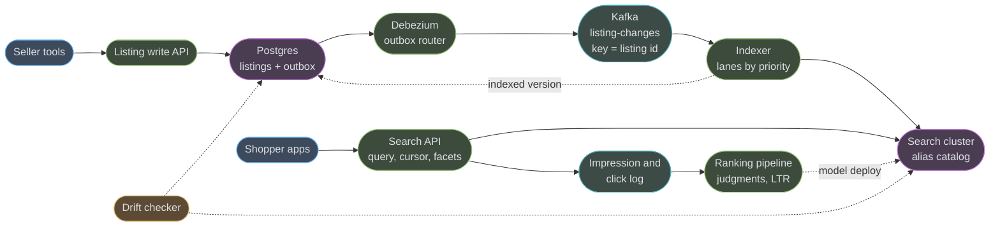
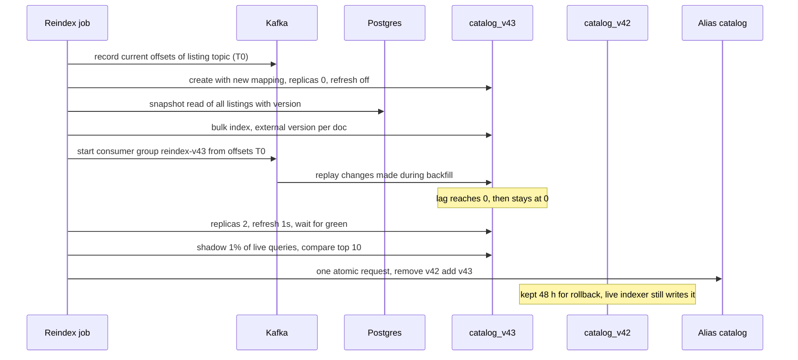

# Case Study: Search-Backed Catalogue API for a Marketplace
## Intuition

> **Design intuition**: A search index is a newspaper, and your database is the world. The newspaper is printed from the world, it is always a little behind it, and it is laid out for reading, not for recording. Nobody edits the world by writing a correction into the newspaper, and nobody expects this morning's paper to report what happened ten seconds ago. A search-backed catalogue API works when every component knows which of the two it is talking to: the database records what is true, the index answers questions fast, and a single, ordered pipeline prints one from the other.

**Key insight for this design**: the search engine is a **derived, eventually consistent projection** of the catalogue database, and almost every production incident in this space comes from forgetting one of those three words. *Derived* means the index is rebuilt from the database, never the other way round, so a reindex must be a routine operation, not a migration project. *Eventually* means there is a measurable window in which a seller's edit is committed but not searchable, so the API has to tell clients which world they are looking at. *Consistent* means that once the pipeline catches up, the index converges to the database state even if events arrived duplicated, late or out of order, which is a property you get from version numbers, not from careful code.

The second insight is that **a catalogue search API has three customers with three different correctness needs.** Shoppers want relevance and speed and never notice a five-second lag. Sellers want to see their own edit immediately and file a ticket when they do not. Ranking engineers want the click data that tells them whether a change made results better. One index serves all three, but the API contract, the freshness signals and the logging are designed separately for each.

**Boundary with sibling pages.** The catalogue schema, faceted counts and the basic Debezium-to-Elasticsearch sync live in [`../../../database/case_studies/design_ecommerce_catalog/design_ecommerce_catalog.md`](../../../database/case_studies/design_ecommerce_catalog/design_ecommerce_catalog.md). Inverted indexes, BM25 and Lucene segments live in [`../../../database/search_engines/search_engines.md`](../../../database/search_engines/search_engines.md) and [`../../../database/elasticsearch_internals/elasticsearch_internals.md`](../../../database/elasticsearch_internals/elasticsearch_internals.md). Learning-to-rank models live in [`../../../ml/information_retrieval_and_search/information_retrieval_and_search.md`](../../../ml/information_retrieval_and_search/information_retrieval_and_search.md). The general integration patterns (dual-write vs CDC, reindex, freshness UX) are owned by the module [`../../search_integration_patterns/search_integration_patterns.md`](../../search_integration_patterns/search_integration_patterns.md). This case study owns the **backend service between them**: the query API contract, the ordering guarantees of the indexing pipeline, the reindex procedure, read-your-writes for sellers, and the relevance feedback loop.

---

## 1. Requirements Clarification

### Functional Requirements

- Shoppers search listings by free text with filters (category, price range, condition, seller rating, location radius) and see facet counts.
- Results are paginated with a stable cursor, sortable by relevance, price or recency.
- Sellers create and edit listings (title, description, price, stock, photos) through a separate write API backed by Postgres.
- A seller's edit becomes searchable for shoppers within seconds, and the seller's own view shows the edit immediately.
- A delisted or banned listing disappears from search within seconds and never comes back from a late event.
- Mapping and analyzer changes (a new synonym list, a new field) ship without downtime.
- Every result impression and click is logged with a query id so ranking can be evaluated and improved.
- Search degrades, not fails, when the search cluster is slow: core results first, facets dropped before results.

### Non-Functional Requirements

| Requirement | Target | Why this number |
|---|---|---|
| Search latency | p50 < 60 ms, p99 < 250 ms at the API edge | Search is the top of the purchase funnel; latency directly reduces conversion |
| Freshness, shopper view | p99 < 5 s from commit to searchable | Price and stock errors are visible to buyers and cause cancellations |
| Freshness, delist | p99 < 5 s, and **never resurrected** | A banned listing that reappears is a trust-and-safety incident |
| Seller read-your-writes | Immediate in seller tools | Sellers re-edit or open tickets when they do not see their change |
| Availability, search read path | 99.95%/month | Search down means the marketplace is down |
| Reindex of full catalogue | < 6 h, zero downtime | Mapping changes ship weekly; a reindex cannot be a weekend event |
| Index-to-database drift | < 0.01% of listings, detected within 1 h | Drift is invisible until a buyer finds a listing that does not exist |

### Clarifying Questions to Ask in the Interview

| Question | Why it changes the design |
|---|---|
| How many listings, and how often does each change? | Decides shard count and whether the indexer is the bottleneck |
| Are price and stock in the search document, or fetched at render time? | High-churn fields in the index multiply write load; outside it, sort-by-price is hard |
| Do sellers search their own catalogue through the same API? | Decides whether read-your-writes is a search-path problem or a database-path problem |
| Is personalization in scope? | Per-user features turn caching from easy to nearly impossible |
| Is the catalogue multi-region? | One index per region with replicated pipelines, or one global cluster |
| How fast must a takedown be honored? | A legal takedown may need a synchronous path, not the async pipeline |

### Out of Scope

- Query autocomplete and spell correction (see [`design_search_autocomplete`](../../../hld/case_studies/design_search_autocomplete.md)).
- Semantic vector retrieval (see [`design_vector_search_platform`](../../../database/case_studies/design_vector_search_platform/design_vector_search_platform.md)).
- The ML model training itself; this page covers the data contract that feeds it.

---

## 2. Scale Estimation

All figures are **design assumptions** for a large marketplace, not measured data from a named company.

### Catalogue and Write Rate

```
Active listings:                 60,000,000
Sellers:                         400,000
Updates per listing per day:     4 (price, stock, edits; heavily skewed)
Listing updates/day:             60,000,000 x 4 = 240,000,000
Average update rate:             240,000,000 / 86,400 = 2,778/s
Peak (flash sale, 4x):           11,111/s
Bulk-seller spike:               one seller repricing 2,000,000 listings in 10 min
                                 = 3,333/s from ONE seller
```

The bulk-seller line is the one that breaks naive designs: a single large seller can generate more index traffic than the rest of the marketplace combined. The pipeline must not let that seller's backlog delay a small seller's delist.

### Query Load

```
Daily active shoppers:           25,000,000
Searches per shopper per day:    21 (including filter and page changes)
Searches/day:                    525,000,000
Average QPS:                     525,000,000 / 86,400 = 6,076
Peak QPS (4x evening + promos):  24,300
```

### Index Size and Shards

```
Search document (source + indexed fields), avg:  4 KB on disk after compression (assumption)
Primary index size:              60,000,000 x 4 KB = 240 GB
Target shard size:               30 GB
Primary shards:                  240 / 30 = 8
Replicas:                        2 (3 copies total) -> 720 GB on disk

Per query fan-out:               8 shards (one copy of each)
Shard-requests/s at peak:        24,300 x 8 = 194,400
```

### Indexing Throughput

```
Peak document writes:            11,111/s (marketplace) + bulk-seller burst
Each write lands on 1 primary + 2 replicas = 3 shard writes
Shard writes/s at peak:          33,333
Bulk batches of 500 documents:   11,111 / 500 = 22 bulk requests/s
```

### Reindex Budget

```
Full rebuild from Postgres snapshot:
  read 60M rows at ~20,000 rows/s per reader x 8 readers = 160,000 rows/s
  -> 60,000,000 / 160,000 = 375 s of reading
  bulk index at ~25,000 docs/s with replicas=0 and refresh disabled (assumption)
  -> 60,000,000 / 25,000 = 2,400 s = 40 min
  catch-up replay of changes made during the build:
  40 min x 2,778/s = 6.7M events, replayed at 25,000/s = 4.5 min
  replicas back to 2 and recovery: ~20 min
  shadow-traffic validation: 60 min
Total:                           ~2.2 h, inside the 6 h budget
```

### Click Log

```
Impressions logged per search:   24 results on the first page
Impressions/day:                 525,000,000 x 24 = 12.6 B
Click rate per search:           0.35 -> 184,000,000 clicks/day
Event size:                      ~180 bytes
Raw log/day:                     (12.6 B + 0.18 B) x 180 B = 2.3 TB/day
```

Logging every impression is expensive; logging only clicks makes the data useless (§4.6). The usual compromise is to log every impression for a sampled fraction of queries plus every click; at 10% impression sampling the log is about 0.26 TB/day.

---

## 3. High-Level Architecture



The one-way arrow from Postgres to the search cluster is the architecture. The search cluster has exactly one writer (the indexer), and the indexer has exactly one input (the ordered change topic). The search API never writes, the write API never touches the index, and the drift checker is the only component that reads both.

**Shared primitives.** Backend's `case_studies/` has no `cross_cutting/` directory; shared primitives live as modules in the section. This design leans on:

| Primitive used here | Deep dive |
|---|---|
| Dual-write vs CDC, reindex, freshness UX (owner module) | [`../../search_integration_patterns/search_integration_patterns.md`](../../search_integration_patterns/search_integration_patterns.md) |
| Transactional outbox, ordered per-key consumption, inbox dedup | [`../../messaging_patterns/messaging_patterns.md`](../../messaging_patterns/messaging_patterns.md) |
| Partition keys, consumer lag, offset management during replay | [`../../kafka_deep_dive/kafka_deep_dive.md`](../../kafka_deep_dive/kafka_deep_dive.md) |
| CQRS: the index as a read model built from the write model | [`../../event_sourcing_and_cqrs/event_sourcing_and_cqrs.md`](../../event_sourcing_and_cqrs/event_sourcing_and_cqrs.md) |
| Cursor pagination, opaque cursors, conditional requests | [`../../rest_api_design/rest_api_design.md`](../../rest_api_design/rest_api_design.md) |
| Fan-out tail latency across 8 shards | [`../../tail_latency_and_fan_out/tail_latency_and_fan_out.md`](../../tail_latency_and_fan_out/tail_latency_and_fan_out.md) |
| Circuit breaking and graceful degradation of facets | [`../../fault_tolerance_patterns/fault_tolerance_patterns.md`](../../fault_tolerance_patterns/fault_tolerance_patterns.md) |
| Result caching and stampede control for popular queries | [`../../caching_strategies_deep_dive/caching_strategies_deep_dive.md`](../../caching_strategies_deep_dive/caching_strategies_deep_dive.md) |
| Debezium connector mechanics and slot management | [`../../../technologies/debezium_change_data_capture/debezium_change_data_capture.md`](../../../technologies/debezium_change_data_capture/debezium_change_data_capture.md) |

---

## 4. Component Deep Dives

### 4.1 The Search API Contract

The public contract hides Elasticsearch completely. Clients never see shard counts, index names or the query DSL; they see a versioned, bounded API.

```http
GET /v1/search?q=road+bike&category=bikes&price_max=900&sort=relevance&limit=24 HTTP/1.1
```

```json
{
  "query_id": "q_01JD8Z6N4R",
  "results": [
    { "listing_id": "L_8812", "title": "Aluminium road bike 56cm", "price": { "amount": 64900, "currency": "EUR" },
      "seller": { "id": "S_19", "rating": 4.8 }, "thumbnail": "https://img.example/..." }
  ],
  "facets": {
    "condition": [ { "value": "used", "count": 1823 }, { "value": "new", "count": 412 } ],
    "price": [ { "range": "0-300", "count": 911 }, { "range": "300-600", "count": 1102 } ]
  },
  "total": { "value": 2235, "relation": "eq" },
  "next_cursor": "eyJwaXQiOiI0NlRv...",
  "index_generation": "catalog_v42",
  "degraded": []
}
```

- **`query_id`** ties every impression and click back to this exact request (§4.6).
- **`next_cursor`** is opaque. It encodes the point-in-time id, the `search_after` sort values and a hash of the query, so a client cannot change filters mid-pagination and get a page from a different result set.
- **`index_generation`** tells support and clients which index served the request; during a reindex rollback (§4.5) it is the first thing an on-call engineer checks.
- **`degraded`** lists anything the API dropped to meet its latency budget, such as `["facets"]` (§4.7).
- **`total.relation`** is `"gte"` beyond 10,000 hits because exact counting is not free; the UI shows "10,000+".

Why a cursor and not `page=37`: Elasticsearch's `index.max_result_window` defaults to 10,000 and limits `from + size`, because heap and time cost grow with `from + size` ([index settings](https://www.elastic.co/docs/reference/elasticsearch/index-settings/index-modules)). Elastic recommends `search_after` with a point in time (PIT) for deep paging; a PIT supplies an implicit `_shard_doc` tiebreaker, and without a PIT or a unique tiebreaker field "your paged results could miss or duplicate hits" ([paginate search results](https://www.elastic.co/docs/reference/elasticsearch/rest-apis/paginate-search-results)).

The query builder, in Java 25 with the Elasticsearch Java API client:

```java
public record SearchRequestDto(String q, String category, Long priceMaxMinor,
                               String condition, Sort sort, int limit, String cursor) {}

@Service
@RequiredArgsConstructor
public class CatalogSearchService {

    static final int MAX_LIMIT = 100;
    static final String ALIAS = "catalog";              // never a concrete index name
    static final Time PIT_KEEP_ALIVE = Time.of(t -> t.time("2m"));

    private final ElasticsearchClient es;
    private final CursorCodec cursors;                   // HMAC-signed, so clients cannot forge one
    private final ModelRegistry ranking;                 // current LTR model id, see 4.6

    public SearchResponseDto search(SearchRequestDto r) throws IOException {
        int limit = Math.min(Math.max(r.limit(), 1), MAX_LIMIT);
        Cursor c = r.cursor() == null ? null : cursors.decode(r.cursor(), r);  // rejects if query hash differs

        String pitId = c != null ? c.pitId()
                : es.openPointInTime(p -> p.index(ALIAS).keepAlive(PIT_KEEP_ALIVE)).id();

        BoolQuery.Builder bool = new BoolQuery.Builder()
                .must(m -> m.multiMatch(mm -> mm.query(r.q())
                        .fields("title^3", "brand^2", "description")
                        .type(TextQueryType.BestFields)))
                .filter(f -> f.term(t -> t.field("status").value("active")));   // tombstones excluded, see 4.3
        if (r.category() != null)
            bool.filter(f -> f.term(t -> t.field("category_path").value(r.category())));
        if (r.priceMaxMinor() != null)
            bool.filter(f -> f.range(rg -> rg.number(n -> n.field("price_minor").lte((double) r.priceMaxMinor()))));
        if (r.condition() != null)
            bool.filter(f -> f.term(t -> t.field("condition").value(r.condition())));

        var resp = es.search(s -> {
            s.pit(p -> p.id(pitId).keepAlive(PIT_KEEP_ALIVE))
             .query(q -> q.bool(bool.build()))
             .size(limit)
             .trackTotalHits(t -> t.count(10_000))
             .sort(r.sort().toEsSort())                 // relevance -> _score, then _shard_doc implicit
             .timeout("150ms");                         // per-shard budget, see 4.7
            if (r.sort() == Sort.RELEVANCE) {
                s.rescore(rs -> rs.windowSize(100).learningToRank(l -> l.modelId(ranking.currentModelId())
                        .params(Map.of("query_text", JsonData.of(r.q())))));
            }
            if (c == null) s.aggregations(Facets.standard());   // facets only on the first page
            if (c != null) s.searchAfter(c.sortValues());
            return s;
        }, ListingDoc.class);

        return SearchResponseDto.from(resp, cursors.encode(resp, r), limit);
    }
}
```

Three details carry weight: facets are computed only on the first page (pages 2 to N reuse the client's copy), the per-shard `timeout` caps how long one slow shard can hold the request, and the learning-to-rank rescore runs only on the top 100 hits of the first-stage BM25 query.

### 4.2 The Write Path: Outbox, One Topic, One Writer

Every listing change commits a row change and an outbox row in one Postgres transaction. The listing carries a `version` column incremented by the same statement.

```sql
CREATE TABLE listings (
    listing_id   TEXT PRIMARY KEY,
    seller_id    TEXT        NOT NULL,
    status       TEXT        NOT NULL CHECK (status IN ('active','delisted','banned')),
    title        TEXT        NOT NULL,
    price_minor  BIGINT      NOT NULL,
    currency     CHAR(3)     NOT NULL,
    stock        INT         NOT NULL,
    version      BIGINT      NOT NULL DEFAULT 1,     -- the external version for the index
    updated_at   TIMESTAMPTZ NOT NULL DEFAULT now()
);

CREATE TABLE listing_outbox (
    id             UUID PRIMARY KEY DEFAULT gen_random_uuid(),
    aggregatetype  TEXT   NOT NULL DEFAULT 'listing',
    aggregateid    TEXT   NOT NULL,                  -- listing_id: becomes the Kafka key
    type           TEXT   NOT NULL,                  -- ListingChanged | ListingRemoved
    payload        JSONB  NOT NULL,                  -- {"listing_id":..., "version":..., "priority":...}
    created_at     TIMESTAMPTZ NOT NULL DEFAULT now()
);
```

```sql
-- One transaction per seller edit. The version bump and the outbox row are atomic with the change.
WITH upd AS (
  UPDATE listings
     SET price_minor = $2, stock = $3, version = version + 1, updated_at = now()
   WHERE listing_id = $1
  RETURNING listing_id, version, status
)
INSERT INTO listing_outbox (aggregateid, type, payload)
SELECT listing_id,
       CASE WHEN status = 'active' THEN 'ListingChanged' ELSE 'ListingRemoved' END,
       jsonb_build_object('listing_id', listing_id, 'version', version, 'priority', 'normal')
  FROM upd;
```

Debezium's outbox event router captures inserts on the outbox table and routes each to a topic, using the aggregate id as the message key ([Debezium outbox event router](https://debezium.io/documentation/reference/stable/transformations/outbox-event-router.html)). Keying by `listing_id` puts every change for one listing on one partition, so the indexer sees them in commit order **within a partition**. That ordering is useful but not sufficient: redelivery after a consumer restart, a replay during reindex, and the reconciler's repairs can all deliver an older version after a newer one. Correctness comes from §4.3, not from Kafka.

The event carries **the id and the version, not the document**. The indexer re-reads the current row from a Postgres replica and builds the search document from that. Two consequences:

- A burst of 10 price changes for one listing within a second collapses into fewer index writes, because by the time the indexer reads the row it already reflects later changes. The external version check discards the stale ones.
- The document builder is the only place that knows the search document shape. A reindex (§4.5) calls the same builder, so the live pipeline and the rebuild can never disagree about what a document looks like.

### 4.3 BROKEN -> FIXED: Dual Writes, Clock Versions and Resurrected Listings

**BROKEN, version 1**: the write API writes Postgres, then Elasticsearch.

```java
// BROKEN: two writes, no atomicity, no ordering.
@Transactional
public void updatePrice(String listingId, long priceMinor) {
    listings.updatePrice(listingId, priceMinor);                       // commit #1 (at method end)
    es.index(i -> i.index("catalog").id(listingId)
                   .document(builder.build(listings.get(listingId)))); // write #2, inside the txn
}
```

```
t=0     API instance A: seller sets price 700; ES write sent; Postgres commit pending
t=1ms   API instance B: seller sets price 650 (a second tab); Postgres commits first
t=2ms   B's ES write lands: price 650
t=3ms   A's ES write lands late: price 700        <- index now disagrees with Postgres
t=4ms   A's Postgres commit fails on a serialization error and rolls back
        -> the index shows 700, a price that was never committed
```

Every interleaving of two writers produces a variant of this. Add an Elasticsearch `429` during a merge storm, which the method above swallows or turns into a failed seller edit, and the system has both lost updates and phantom updates.

**BROKEN, version 2**: the team moves to CDC but uses `updated_at` milliseconds as the external version and hard-deletes on delist.

```java
// BROKEN: a wall-clock version, and a hard delete that forgets its version after 60 s.
if (event.type() == REMOVED) {
    es.delete(d -> d.index(ALIAS).id(id)
            .version(event.updatedAtMillis()).versionType(VersionType.External));
} else {
    es.index(i -> i.index(ALIAS).id(id).document(doc)
            .version(event.updatedAtMillis()).versionType(VersionType.External));
}
```

Two separate defects:

1. **Clock versions are not monotonic.** Two edits in the same millisecond get the same version, and with `external` the second is rejected as a conflict. A replica with a slightly behind clock writes a smaller `updated_at` for a later edit.
2. **Deletes forget.** With `version_type=external`, Elasticsearch indexes a document only if the supplied version is greater than the stored one ([index API, versioning](https://www.elastic.co/docs/api/doc/elasticsearch/operation/operation-index)). But after a delete, the deleted document's version is retained only for `index.gc_deletes`, which defaults to **60 s** ([index settings](https://www.elastic.co/docs/reference/elasticsearch/index-settings/index-modules)). A `ListingChanged` event for an older version that arrives after that window (a replay, a slow partition, a reconciler repair) finds no document and no remembered version, so it is indexed. **The banned listing is back.**

**FIXED**: a database-owned monotonic version, and tombstones instead of deletes.

```java
@Component
@RequiredArgsConstructor
public class ListingIndexer {

    private final ElasticsearchClient es;
    private final ListingReadRepo replica;     // reads from a Postgres replica
    private final DocumentBuilder builder;
    private final IndexStateRepo indexState;  // writes indexed_version back to Postgres

    @KafkaListener(topics = "outbox.event.listing", concurrency = "8")
    public void onBatch(List<ConsumerRecord<String, ListingEvent>> batch) throws IOException {
        BulkRequest.Builder bulk = new BulkRequest.Builder();
        Map<String, Long> attempted = new HashMap<>();

        for (var rec : batch) {
            ListingRow row = replica.get(rec.key());             // current truth, not event payload
            if (row == null) continue;                            // never hard-deleted; see below
            if (row.version() < rec.value().version()) {
                throw new RetryableException("replica behind for " + rec.key()); // retry the batch
            }
            ListingDoc doc = builder.build(row);                  // status=active|delisted|banned
            bulk.operations(op -> op.index(i -> i.index(ALIAS).id(row.listingId())
                    .document(doc)
                    .version(row.version())                       // monotonic, from Postgres
                    .versionType(VersionType.External)));
            attempted.put(row.listingId(), row.version());
        }

        BulkResponse resp = es.bulk(bulk.build());
        for (BulkResponseItem item : resp.items()) {
            if (item.error() == null) {
                indexState.markIndexed(item.id(), attempted.get(item.id()));
            } else if (item.status() == 409) {
                // A newer version is already in the index. That is success, not an error.
                Metrics.counter("indexer.stale_skipped").increment();
            } else if (item.status() == 429) {
                throw new RetryableException("search cluster rejected writes");   // back off, retry batch
            } else {
                deadLetter.send(item.id(), item.error().reason());
            }
        }
    }
}
```

The fixes, one per defect:

- **The version is `listings.version`**, incremented inside the same transaction as the change. It is monotonic per listing by construction, independent of any clock.
- **Delist and ban are index writes of a document with `status: delisted|banned`**, which every query filters out (§4.1). The document keeps its version forever, so no late event can ever win against it. A weekly compaction job hard-deletes tombstones older than 30 days, which is far longer than any replay window, and only after checking that Postgres agrees.
- **A `409` means "already newer", which is success.** Counting it as an error would page someone every time a burst collapsed.
- **If the replica is behind the event's version, the batch retries.** Building a document from a replica older than the event would index stale data with a fresh-looking version.

### 4.4 Read-Your-Writes for Sellers

A shopper does not notice a 3-second lag. A seller who changes a price and immediately searches for the listing does. Three options, in increasing cost:

| Option | How | Cost |
|---|---|---|
| Seller tools read Postgres | "My listings" is a database query, not a search query | Free; covers 90% of seller complaints |
| Freshness badge | The write API returns `version`; the seller UI polls `indexed_version` and shows "Updating search..." until it catches up | One indexed small table; honest UX |
| `refresh=wait_for` on the write | Blocks the indexer's request until the change is visible to search | Forces refresh-listener load on hot shards; one slow shard stalls the pipeline |

Elasticsearch supports `refresh=wait_for` on index requests, which waits for a refresh to make the operation visible, using per-shard refresh listeners capped by `index.max_refresh_listeners` ([index settings](https://www.elastic.co/docs/reference/elasticsearch/index-settings/index-modules)). It is the right tool for a test suite and the wrong one for a pipeline at 11,000 writes per second. This design uses the first two options.

```sql
CREATE TABLE listing_index_state (
    listing_id       TEXT PRIMARY KEY REFERENCES listings(listing_id),
    indexed_version  BIGINT NOT NULL,
    indexed_at       TIMESTAMPTZ NOT NULL
);

-- markIndexed: monotonic, so a late ack never moves it backwards.
INSERT INTO listing_index_state (listing_id, indexed_version, indexed_at)
VALUES ($1, $2, now())
ON CONFLICT (listing_id) DO UPDATE
   SET indexed_version = EXCLUDED.indexed_version, indexed_at = EXCLUDED.indexed_at
 WHERE listing_index_state.indexed_version < EXCLUDED.indexed_version;
```

The seller API joins `listings.version` with `listing_index_state.indexed_version`. If they differ, the listing card shows "Updating search" and the time since the edit. The same join is the drift checker's input (§8).

**What "searchable" means is also a refresh question.** `index.refresh_interval` defaults to 1 s, but if it is not set explicitly, a shard that has received no search for `index.search.idle.after` (default 30 s) stops background refreshes until the next search arrives ([index settings](https://www.elastic.co/docs/reference/elasticsearch/index-settings/index-modules)). On a catalogue cluster that is always being searched this never triggers; on a staging cluster or a freshly built index it does, and the first search after an idle period pays for the refresh. This design sets `refresh_interval: 1s` explicitly on the live index so freshness does not depend on traffic.

### 4.5 Zero-Downtime Reindex with Alias Swap and Replay

Mapping changes (a new analyzer, a new field, a changed synonym set) need a new index. The procedure is a backfill plus a catch-up replay, then an atomic alias move.



```java
public void cutover(String oldIndex, String newIndex) throws IOException {
    es.indices().updateAliases(u -> u
            .actions(a -> a.remove(r -> r.index(oldIndex).alias(ALIAS)))
            .actions(a -> a.add(ad -> ad.index(newIndex).alias(ALIAS).isWriteIndex(true))));
}
```

The alias update API applies all its actions atomically ([update aliases](https://www.elastic.co/docs/api/doc/elasticsearch/operation/operation-indices-update-aliases)), so there is no instant in which `catalog` points at zero indices or at both.

Why this is safe:

- **Replay is idempotent because of external versions.** The backfill indexes version 17 of a listing; the replay then delivers versions 15, 16, 17 and 18 from the topic. Versions 15 to 17 are rejected with `409`; 18 wins. The order in which the backfill and the replay touch a document does not matter.
- **Offsets are recorded before the snapshot starts.** Any change committed after T0 is in the replay; any change before T0 is in the snapshot. Overlap is harmless; a gap is impossible.
- **Both indices stay live for 48 h.** The live indexer writes to both `catalog_v42` and `catalog_v43` during that window, so a rollback is another single alias move, not a second reindex.
- **Shadow comparison catches relevance regressions that counts cannot.** The job sends 1% of live queries to the new index and compares the top-10 overlap. An analyzer change that silently stops stemming plurals keeps the document count identical and drops overlap to 40%.

### 4.6 The Relevance Feedback Loop

Ranking improves only if the API logs what it showed, not only what was clicked.

```json
{ "event": "impression", "query_id": "q_01JD8Z6N4R", "listing_id": "L_8812", "position": 3,
  "model_id": "ltr-2026-11-18", "index_generation": "catalog_v42", "ts": "2026-11-25T19:02:11Z" }
{ "event": "click", "query_id": "q_01JD8Z6N4R", "listing_id": "L_8812", "position": 3,
  "ts": "2026-11-25T19:02:14Z" }
```

Clicks alone are biased by position: the result at position 1 is clicked far more often than position 8, regardless of quality. A simple and defensible correction is **clicks over expected clicks** (COEC): divide a listing's clicks by the sum of the average click-through rate of the positions at which it was shown.

```java
public record PositionCtr(int position, double ctr) {}

public static double coec(List<Integer> shownAtPositions, int clicks, Map<Integer, Double> ctrByPosition) {
    double expected = shownAtPositions.stream()
            .mapToDouble(p -> ctrByPosition.getOrDefault(p, 0.01))
            .sum();
    return expected == 0 ? 0 : clicks / expected;   // > 1.0 means better than its positions predict
}
```

COEC per `(query, listing)` pair, bucketed into grades 0 to 4, becomes a judgment list. Elasticsearch's Learning To Rank, introduced in version 8.12, uses a trained model as a second-stage re-ranker over a first-stage retrieval, and its documentation describes judgment lists built from engagement data such as clicks or conversions ([Elastic LTR](https://www.elastic.co/docs/solutions/search/ranking/learning-to-rank-ltr)). The training itself belongs to [`information_retrieval_and_search`](../../../ml/information_retrieval_and_search/information_retrieval_and_search.md); the backend's job is the data contract and the deployment gate:

| Gate | Threshold | Why |
|---|---|---|
| Offline NDCG@10 on held-out judgments | >= current model + 0.5% | A model that is not better offline is not worth an online test |
| Online A/B, conversion per search | No regression at 95% confidence over 7 days | Offline judgments are themselves click-derived and biased |
| p99 latency with rescore | < 250 ms | A 100-document rescore window has a cost; measure it |
| Exploration share | 2% of first-page slots shuffle within ranks 4 to 10 | Without it, new listings never get impressions and never get clicks |

The last row is the one most teams skip. A ranker trained only on clicks from its own previous rankings converges on what it already showed: popular listings get more impressions, therefore more clicks, therefore higher rank. A small randomized slot breaks the loop and also produces unbiased position-CTR estimates for the COEC denominator.

### 4.7 Degrade, Do Not Fail

The search path has a 250 ms budget at p99. Aggregations are the most expensive part of a typical catalogue query, so they are the first thing shed.

```java
public SearchResponseDto searchWithBudget(SearchRequestDto r) {
    Deadline d = Deadline.after(Duration.ofMillis(230));
    if (breaker.isOpen() || clusterPressure.high()) {
        // Shed facets first: results without facets are still a useful page.
        return withDegraded(searchService.searchNoFacets(r, d), "facets");
    }
    try {
        return searchService.search(r, d);
    } catch (EsTimeoutException | EsRejectedException e) {
        breaker.recordFailure();
        var cached = popularResults.get(r.cacheKey());      // per-category top results, refreshed every 60 s
        if (cached != null) return withDegraded(cached, "stale-results");
        throw new ProblemException(503, "search-unavailable", "Retry after 2 seconds");
    }
}
```

The `timeout` set per request in §4.1 makes Elasticsearch return partial results from shards that answered in time rather than waiting for the slowest one. With 8 shards per query, one slow shard would otherwise set the latency of every request (see [`tail_latency_and_fan_out`](../../tail_latency_and_fan_out/tail_latency_and_fan_out.md)). The response carries `"degraded": ["partial-results"]` when any shard timed out, so a client never mistakes a partial page for the full answer.

### 4.8 Lanes: Keep the Bulk Seller Out of the Delist Path

A single topic keyed by `listing_id` spreads the bulk seller's 2,000,000 repricing events across every partition, so every partition's lag grows and a small seller's delist waits behind them. The outbox `priority` field fixes this:

| Lane | Topic | Producers | Indexer concurrency | Lag SLO |
|---|---|---|---|---|
| `urgent` | `listing.urgent` | delist, ban, legal takedown | dedicated 4 consumers | p99 < 2 s |
| `normal` | `listing.normal` | single edits from seller tools | 8 consumers | p99 < 5 s |
| `bulk` | `listing.bulk` | CSV imports, API batch updates, repricing tools | 8 consumers, rate-limited per seller | best effort, < 15 min |

The write API sets the lane from the operation, not the seller's choice. Bulk operations also carry a per-seller rate limit at the write API ([`rate_limiting_in_depth`](../../rate_limiting_in_depth/rate_limiting_in_depth.md)), so one seller can fill only its own share of the bulk lane. Because every lane writes with the same external version, a listing that receives a bulk update and an urgent ban in the same second converges correctly regardless of which lane drains first.

### 4.9 Denormalized Fields That Fan Out: Seller Rating and Category Renames

The search document copies fields from other aggregates so a query can filter and rank without a join: the seller's rating, the seller's country, the category's display path. Each copy is a fan-out waiting to happen. When a seller's rating changes from 4.8 to 4.6, every one of that seller's listings is now stale; for the bulk seller in §2 that is 2,000,000 documents.

| Strategy | How | Write cost of one rating change | Read cost | Fits when |
|---|---|---|---|---|
| Re-index every listing of the seller | Outbox emits one `ListingChanged` per listing on the bulk lane | 2,000,000 document writes for the largest seller | None | The field changes rarely (category renames: a few per month) |
| Partial update by query | `_update_by_query` on `seller_id` with a script | Same document rewrites inside Elasticsearch, no Postgres reads | None | Rare changes, and you accept that this bypasses the single-writer rule |
| Bucketed copy | Store `seller_rating_bucket` (4.5-5.0, 4.0-4.5, ...) instead of the exact value | Re-index only when the bucket changes, a small fraction of rating updates | None | Ranking needs a coarse signal, not the exact value |
| Lookup at query time | Keep rating out of listing docs; rescore with a seller-feature lookup for the top 100 hits | Zero listing writes | One cache lookup per hit in the rescore window | The field changes often and is used for ranking, not filtering |

This design uses the bucketed copy for filtering ("4.5 stars and up") and the query-time lookup for ranking, because seller ratings change daily for active sellers. Category renames use the first strategy on the bulk lane, because they happen a few times a month and must stay inside the single-writer rule.

```java
/** Emits listing re-index events only when the bucketed value a query can see actually changes. */
@Transactional
public void onSellerRatingChanged(String sellerId, double oldRating, double newRating) {
    if (RatingBucket.of(oldRating) == RatingBucket.of(newRating)) {
        sellerFeatures.put(sellerId, newRating);       // ranking reads this in the rescore window
        return;                                        // zero listing writes
    }
    sellerFeatures.put(sellerId, newRating);
    // Bump every listing's version in bounded chunks; each chunk writes outbox rows on the BULK lane.
    jdbc.update("""
        WITH bumped AS (
          UPDATE listings SET version = version + 1
           WHERE seller_id = ? AND status = 'active'
          RETURNING listing_id, version
        )
        INSERT INTO listing_outbox (aggregateid, type, payload)
        SELECT listing_id, 'ListingChanged',
               jsonb_build_object('listing_id', listing_id, 'version', version, 'priority', 'bulk')
          FROM bumped
        """, sellerId);
}
```

Two cautions. First, the single `UPDATE` above is fine for a seller with 5,000 listings and wrong for one with 2,000,000: it holds row locks on every listing for the whole statement and blocks that seller's own edits. Production code walks the seller's listings in chunks of 10,000 by `listing_id`, one transaction per chunk. Second, bumping `version` for a change that did not touch the listing row is deliberate: the external version must increase whenever the search document changes, whatever the cause, or the indexer's write is rejected as stale.

---

## 5. Design Decisions & Tradeoffs

| Decision | Chosen | Alternative | Rationale |
|---|---|---|---|
| Sync mechanism | Transactional outbox + Debezium | Dual write from the API | Dual write has no atomicity and no ordering across instances (§4.3) |
| Change event content | Id + version; indexer re-reads the row | Full document in the event | One document builder for live and reindex; bursts collapse naturally |
| Ordering guarantee | External version from Postgres | Rely on Kafka partition order | Replays, redeliveries and repairs break partition order; versions do not care |
| Delete semantics | Tombstone documents, compacted after 30 days | Hard delete | Hard deletes forget their version after `gc_deletes` (60 s) and allow resurrection |
| Seller freshness | Database reads in seller tools + indexed-version badge | `refresh=wait_for` on every write | Refresh listeners on hot shards stall the pipeline |
| Pagination | PIT + `search_after`, opaque signed cursor | `from`/`size` | `max_result_window` caps at 10,000; deep `from` is expensive and unstable |
| Reindex | New index, backfill, replay from recorded offsets, alias swap | In-place `_update_by_query` | Mapping changes need a new index; alias swap gives instant rollback |
| Ranking | BM25 retrieval + LTR rescore on top 100 | Pure BM25 with hand-tuned boosts | Boost tuning does not scale past a few signals; LTR learns them from judgments |
| Write isolation | Three priority lanes | One topic | A bulk seller must not delay a ban |
| Degradation order | Facets, then partial shards, then cached results | Fail the request | Results without facets still convert |

**The decision that makes everything else simple is "the index has one writer and every write carries a database version."** Once that holds, the reindex, the replay, the lanes and the reconciler are all the same operation: send documents with versions and let the index keep the newest.

| Dimension | Dual write | CDC from outbox (chosen) | CDC from table WAL directly |
|---|---|---|---|
| Atomic with the business write | No | Yes | Yes |
| Event schema control | n/a | Explicit, versioned outbox payload | Coupled to table columns |
| Multi-table aggregates (price in another table) | Manual | Outbox written once per aggregate change | One event per table; join in the indexer |
| Extra write per change | One remote call | One local row | None |
| Failure mode | Silent divergence | Lag, visible in metrics | Lag; schema migrations break consumers |

---

## 6. Real-World Implementations

**GitHub code search (Blackbird)** is the clearest public description of an event-driven index pipeline at scale. GitHub built a custom search engine in Rust after finding general text search products slow to index and expensive at its scale; when it first deployed Elasticsearch, indexing all code (about 8 million repositories at the time) took months. In Blackbird, Kafka provides the events that say what to index, crawlers fetch content from Git, and Kafka is used again so that each shard consumes documents for indexing at its own pace. The ingest pipeline publishes around 120,000 documents per second, so 15.5 billion documents take about 36 hours; delta indexing cuts the crawl by over 50% and a full re-index to about 18 hours. Shards are keyed by Git blob object id to spread load and avoid duplication, per-shard p99 is on the order of 100 ms, and a query occupies one core for that time, giving a 64-core host an upper bound of about 640 queries per second ([GitHub blog, 2023-02-06](https://github.blog/engineering/architecture-optimization/the-technology-behind-githubs-new-code-search/)). The shape is this design's §3: an ordered change log, independent consumers, and a full rebuild treated as a routine, time-budgeted operation.

**Meta's Unicorn** is the in-memory, graph-aware index behind Facebook search. Its VLDB paper describes a system that searches trillions of edges between tens of billions of users and entities on thousands of commodity servers, answers billions of queries per day at latencies in the hundreds of milliseconds, and became the primary backend for Facebook's search offerings ([Unicorn, VLDB](https://research.facebook.com/publications/unicorn-a-system-for-searching-the-social-graph/)). It is the reference point for "post search" interview questions and a reminder that at sufficient scale the index is a purpose-built system, not a general engine.

**Elastic** documents the primitives this design depends on: external versioning that rejects any version less than or equal to the stored one and makes out-of-order indexing safe "as long as version numbers from the source database are used" ([index API](https://www.elastic.co/docs/api/doc/elasticsearch/operation/operation-index)); `index.gc_deletes` defaulting to 60 s; `refresh_interval` defaulting to 1 s with search-idle behavior after 30 s; `max_result_window` defaulting to 10,000 ([index settings](https://www.elastic.co/docs/reference/elasticsearch/index-settings/index-modules)); atomic alias updates; and Learning To Rank since 8.12.

**Debezium** provides the outbox event router used in §4.2: it captures inserts into an outbox table and routes them as events, with the aggregate id as the message key by default ([outbox event router](https://debezium.io/documentation/reference/stable/transformations/outbox-event-router.html)). The operational side (replication slots, WAL retention when a connector stalls) is covered in [`debezium_change_data_capture`](../../../technologies/debezium_change_data_capture/debezium_change_data_capture.md).

---

## 7. Technologies & Tools

| Technology | Version | Usage | Why this, not that |
|---|---|---|---|
| Java | 25 (LTS) | Search API, indexer | Section baseline; virtual threads for fan-out to Postgres replicas |
| Spring Boot | 4.1.x | REST API, Kafka listeners | Section stack |
| Elasticsearch | 9.5 | Catalogue index, PIT pagination, LTR rescore | External versioning and alias swaps are first-class |
| Elasticsearch Java API client | matching 9.x | Typed query building | Replaces string-built DSL; compile-time field names via builders |
| PostgreSQL | 18 | Listings, outbox, index state | Source of truth and version authority |
| Debezium | current stable | Outbox event router | Outbox capture without a polling relay |
| Apache Kafka | 4.3.x (KRaft) | Change topics in three lanes, click log | Replayable from recorded offsets, which the reindex relies on |
| Redis | current stable | Popular-results cache for degraded mode | Sub-ms reads, simple TTL |
| Apache Spark or Flink | current stable | Click-log aggregation into COEC judgments | Batch or streaming aggregation over billions of impressions |
| XGBoost | current stable | LTR model training | Gradient-boosted trees are a common model family for learning to rank; train offline, deploy by model id |
| Micrometer | 1.17+ | Lane lag, stale-skip counter, freshness histograms | Feeds §8 dashboards |

---

## 8. Operational Playbook

### Dashboards and Alerts

| Panel | Why |
|---|---|
| Commit-to-searchable latency per lane, p50/p99 | The freshness SLO, measured from `listings.updated_at` to `indexed_at` |
| Consumer lag per lane and partition | A single hot partition means a hot listing or a stuck consumer |
| `indexer.stale_skipped` rate | Rises during bursts and replays; a flat zero during a reindex means versions are not being sent |
| Drift: listings where `version <> indexed_version` for more than 5 minutes | The direct measure of index-to-database disagreement |
| Search p99 split by facets on/off and by shard | Separates aggregation cost from shard health |
| Degraded-response rate by reason | `facets` is acceptable at peak; `stale-results` is an incident |

| SLI | SLO | Alert | Page? |
|---|---|---|---|
| Search success (non-5xx) | 99.95% | burn > 2%/h | yes |
| Search p99 | < 250 ms | > 400 ms for 10 min | yes |
| Urgent lane commit-to-searchable p99 | < 2 s | > 10 s for 5 min | yes |
| Normal lane p99 | < 5 s | > 30 s for 10 min | yes |
| Drift count | < 6,000 (0.01%) | > 60,000 | yes |

### Runbook 1: Freshness Lag on One Lane

1. Check lag per partition. One partition far behind: a stuck consumer (restart it) or one listing receiving thousands of updates (expected; the version check collapses them).
2. All partitions behind: check the search cluster's write rejections (`429`). If the cluster is rejecting, slow the bulk lane first; never slow the urgent lane.
3. Check the Postgres replica lag the indexer reads from. A replica behind the event version makes every batch retry (§4.3).
4. If a takedown is pending during the lag, use the urgent lane's synchronous admin endpoint, which writes the tombstone document directly with the current version.

### Runbook 2: A Delisted Listing Is Visible

1. Compare the listing's Postgres `version` and `status` with the index document's `_version` and `status`.
2. If the index has an older version with `status: active`: an event was lost. Re-enqueue the listing on the urgent lane.
3. If the index has no document at all and then an active one reappears: someone hard-deleted a tombstone too early. Check the compaction job's age threshold.
4. Add the listing id to the drift checker's report and confirm it clears within one cycle.

### Runbook 3: Reindex Rollback

1. Symptom: conversion per search drops or zero-result rate rises after an alias swap.
2. Check `index_generation` in failing responses to confirm the new index is serving.
3. Move the alias back with one atomic update. The old index has been receiving live writes, so it is current.
4. Keep the new index for diagnosis; compare shadow overlap logs to find the analyzer or mapping difference.

### Runbook 4: Ranking Model Regression

1. The model id is in every impression event. Split conversion per search by `model_id`.
2. Roll back by setting the previous model id in the model registry; the search API reads it on every request, so no deploy is needed.
3. Check whether the training judgment list was built from impressions that included the exploration slots; a pipeline that dropped them biases the model toward the incumbent ranking.

### Runbook 5: A Fan-Out Storm on the Bulk Lane

1. Symptom: bulk-lane lag jumps from minutes to hours, and `stale_skipped` stays low (these are genuinely new versions, not collapsing bursts).
2. Find the source: group recent outbox rows by `payload->>'priority'` and by seller. A category rename or a rating-bucket change for a very large seller is the usual cause.
3. Confirm the urgent and normal lanes are unaffected; if they are, this is working as designed and the fix is patience plus a per-seller cap on bulk throughput.
4. If a denormalized field changes this often for the same seller every day, move it from "copy into the document" to "lookup at query time" (§4.9).

### Drift Checker

The drift checker runs every 5 minutes against a Postgres replica and every night against a sample of the index.

```sql
-- Listings whose committed version has not reached the index within 5 minutes.
SELECT l.listing_id, l.version, s.indexed_version, now() - l.updated_at AS age
  FROM listings l
  LEFT JOIN listing_index_state s USING (listing_id)
 WHERE (s.indexed_version IS NULL OR s.indexed_version < l.version)
   AND l.updated_at < now() - interval '5 minutes'
 ORDER BY l.updated_at
 LIMIT 10000;
-- Each row is re-enqueued on the normal lane (urgent if status <> 'active').
```

The nightly pass samples 100,000 listing ids, fetches the index documents with a multi-get, rebuilds the expected documents with the same builder the indexer uses, and compares field by field. Version drift is caught by the 5-minute query; **builder drift** (the index has the right version but a wrong field because a mapping or builder change shipped without a reindex) is only caught by the nightly comparison.

---

## 9. Common Pitfalls & War Stories

The stories below are **illustrative composites** built from the failure modes in §4, not reports of a named company's incident. Figures use §2's assumptions.

**1. The banned seller who came back.** A trust-and-safety team banned a seller with 4,200 counterfeit listings. The indexer hard-deleted the documents. Three hours later, a reindex replay delivered older `ListingChanged` events for those listings. The deleted versions had been forgotten after 60 seconds (`gc_deletes`), so every one was indexed again as active. The listings were searchable for 40 minutes and sold 310 units before a buyer report caught it. Refunds and chargebacks cost about $38,000; the regulator correspondence cost more. Fix: §4.3 tombstones.

**2. Dual writes during a flash sale.** A team kept the "write Postgres, then Elasticsearch" path for price updates because it was "simpler than CDC". During a flash sale, Elasticsearch returned `429` on 3% of writes for 20 minutes and the code logged and continued. About 400,000 listings showed pre-sale prices in search while checkout used the sale price, or the reverse. 6,800 orders were cancelled for price mismatch. Fix: §4.2, one writer fed by the outbox.

**3. The repricing tool that delayed every delist.** A large seller's repricing tool updated 2,000,000 listings every hour. On a single topic it added 10 minutes of lag to every partition each hour. A legal takedown for a single listing took 9 minutes to become effective, past a 5-minute contractual commitment. Fix: §4.8 lanes.

**4. Page 418.** A scraper paginated with `from=10000&size=24` across thousands of category pages. Each request asked every shard for 10,024 sorted hits. Shard CPU rose 4x and p99 search latency for real users went from 180 ms to 1.4 s. Fix: §4.1 cursor-only pagination, with `limit` capped at 100 and no `from` parameter in the public API.

**5. The ranker that only learned popularity.** A team trained LTR on clicks without position correction or exploration. Within three model generations, new listings with zero history were ranked so low they received almost no impressions, and new-seller first-week sales fell 22%. Fix: §4.6 COEC and the 2% exploration share.

### Pitfalls Without a War Story

- **Using `updated_at` as a version.** Same-millisecond edits collide and clock skew inverts order; use a database counter.
- **Building documents from the event payload in one place and from the database in another.** Live and reindex documents drift apart; one builder only.
- **Treating `409` from external versioning as an error.** It is the system working.
- **Forgetting to dual-write to both indices after an alias swap.** Without it, rollback means losing every change since the swap.
- **Not setting `refresh_interval` explicitly.** Freshness then depends on search traffic because of search-idle shards.

---

## 10. Capacity Planning

### Search Cluster

```
Peak shard-requests/s:          194,400 (from §2)
Per data node (16 vCPU, 64 GB): ~10,000 shard-requests/s for this query shape (assumption,
                                measure with production queries before committing)
Data nodes for queries:          194,400 / 10,000 = 20
Shard copies:                    8 primaries x 3 copies = 24 shard copies
Placement:                       24 copies over 24 data nodes, one copy each
                                 -> 24 data nodes (spread over 3 zones, 8 per zone)
Disk per node:                   720 GB / 24 = 30 GB of index, 300 GB volumes leave room
                                 for a second index during reindex (2x) and merges
Dedicated master nodes:          3
```

Twenty-four nodes is driven by query fan-out, not by data size: 720 GB of index would fit on three nodes. That is the normal shape for a catalogue cluster and the reason result caching for the top queries matters.

### Result Cache

```
Assume the top 50,000 query+filter combinations cover 35% of searches (assumption).
Cache hit at 35%: 24,300 x 0.35 = 8,505 QPS served from cache
Remaining to cluster: 15,795 QPS -> 126,360 shard-requests/s -> 13 nodes of query
capacity, but shard placement keeps 24; the cache buys headroom for reindex and merges
rather than fewer nodes.
```

### Indexer

```
Peak document writes:     11,111/s + bulk lane (rate-limited to 5,000/s total)
Per indexer consumer:     ~1,500 docs/s (replica read + bulk of 500, assumption)
Consumers:                urgent 4 + normal 8 + bulk 8 = 20 consumers on 6 instances
Postgres replica reads:   16,111/s peak point reads by primary key on one replica pair
```

### Kafka

```
Change events/day:        240,000,000 at ~200 bytes = 48 GB/day per copy
Retention:                7 days (enough for a reindex replay and a slow rollback)
Storage:                  48 GB x 7 x 3 replicas = 1 TB
Partitions:               urgent 12, normal 48, bulk 48
Click log:                0.26 TB/day sampled, 3-day retention in Kafka, then object storage
```

### Monthly Cost (illustrative on-demand order of magnitude; check current pricing)

```
24 data nodes  x ~$1,100/month  = $26,400
3 master nodes x ~$250/month    =    $750
6 indexer instances x ~$300      =  $1,800
Kafka (3 brokers, 1 TB)          =  $2,000
Postgres replicas for indexer    =  $2,500
Click-log storage + processing   =  $3,000
                                    -------
                                    ~$36,450/month

Per search: $36,450 / (525,000,000 x 30) = $0.0000023
```

---

## 11. Interview Discussion Points

**Q: Why not write to Postgres and Elasticsearch from the same request handler?**
**Short:** Two independent writes have no atomicity and no ordering, so the index silently diverges from the database.

A crash or a `429` between the two writes loses an update; two API instances writing the same listing can land in the index in the opposite order from their database commits; a rolled-back transaction can leave a phantom value in the index. The outbox makes the change and the event atomic in one Postgres transaction, and a single indexer becomes the only writer to the index. The cost is a few seconds of lag, which is visible and measurable instead of silent.

**Q: Kafka keeps per-key order. Why do you still need external versions?**
**Short:** Replays, redeliveries and repairs deliver old events after new ones, and only a version makes the index keep the newest.

Partition order holds for one consumer reading one partition once. A consumer restart redelivers a batch, a reindex replays hours of events into an index that already has newer documents, and the reconciler re-enqueues listings out of band. With `version_type=external` and a version taken from a database counter, Elasticsearch rejects any version less than or equal to the stored one, so every one of those paths converges to the latest state. The `409` it returns is success, not an error.

**Q: Why are deletes dangerous in a versioned index?**
**Short:** A deleted document's version is kept only for gc_deletes, 60 seconds by default, so a late older event can resurrect it.

After that window there is no document and no remembered version, so an older `index` request passes the external-version check and the listing reappears. This design never hard-deletes on delist: it writes a tombstone document with `status: delisted` and the current version, every query filters on `status: active`, and a weekly job removes tombstones older than 30 days, far beyond any replay window.

**Q: Why should the change event carry only an id and a version?**
**Short:** The indexer re-reads the current row so one document builder serves both the live pipeline and reindexing.

If events carry full documents, the live pipeline and the reindex job build documents in two places, and they drift. Re-reading the row also collapses bursts: ten price changes in a second produce one or two index writes because the row already reflects the latest. The indexer checks that the replica it reads has at least the event's version, and retries if not, so it never indexes stale data under a fresh version.

**Q: How do sellers see their own edits immediately if the index lags?**
**Short:** Seller tools read the database, and a badge shows when the index has caught up to the edited version.

The seller's "my listings" view is a Postgres query, which is consistent by definition. Where a seller uses search, the API compares `listings.version` with `listing_index_state.indexed_version` and shows "Updating search" until they match. `refresh=wait_for` on every write would also work, but it holds refresh listeners on hot shards and lets one slow shard stall a pipeline running at 11,000 writes per second.

**Q: How do you reindex 60 million listings without downtime?**
**Short:** Record Kafka offsets, backfill a new index from a snapshot, replay changes from those offsets, then swap the alias atomically.

Offsets recorded before the snapshot guarantee no gap; overlap is harmless because external versions make replay idempotent. The new index loads with replicas at 0 and refresh off, then goes to 2 replicas and 1 s refresh before shadow traffic compares top-10 overlap with the old index. The alias update applies its remove and add atomically. Both indices keep receiving live writes for 48 hours, so rollback is one more alias move.

**Q: Why cursor pagination instead of page numbers?**
**Short:** from plus size is capped at 10,000 by default and costs every shard 10,000 sorted hits for a deep page.

Each shard returns `from + size` hits to the coordinator, so page 418 costs as much as returning ten thousand results. A point in time plus `search_after` costs the same on page 400 as on page 2 and gives a consistent view while paging, with an implicit `_shard_doc` tiebreaker so no hit is missed or duplicated. The cursor is opaque and signed with a hash of the query, so a client cannot change filters halfway through.

**Q: How do you stop one seller's bulk update from delaying a ban?**
**Short:** Route changes into urgent, normal and bulk lanes with separate consumers, and rate-limit bulk per seller.

On one topic, a 2,000,000-listing repricing run adds lag to every partition, and a takedown waits behind it. The write API assigns the lane by operation type, not by seller choice; the urgent lane has dedicated consumers and a 2-second SLO. Since every lane writes with the same database version, a listing that receives a bulk update and a ban in the same second ends in the right state no matter which lane drains first.

**Q: What do you log to improve ranking, and why impressions?**
**Short:** Log impressions with position, model id and query id, because clicks alone cannot separate relevance from position bias.

Without impressions you cannot compute click-through rate, and without position you cannot correct for the fact that position 1 is clicked far more than position 8 regardless of quality. Clicks over expected clicks (COEC) divides clicks by the sum of the position CTRs at which a listing was shown, giving a less biased relevance signal for judgment lists. The model id on every impression lets you compare models online and roll back without a deploy.

**Q: Why include randomized exploration in a production ranker?**
**Short:** A ranker trained only on its own outputs reinforces popularity and starves new listings of impressions.

Listings the model ranks low get no impressions, so they get no clicks, so the next model ranks them even lower. A small exploration share, here 2% of first-page slots shuffled within ranks 4 to 10, gives new listings a chance to collect evidence and yields cleaner position-CTR estimates. The cost is a small, measurable dip in average relevance; the benefit is a marketplace where new sellers can be found.

**Q: How does the search API degrade under load?**
**Short:** Drop facets first, accept partial shard results second, and serve cached popular results before returning an error.

Aggregations are the costly part of a catalogue query, and a results page without facets still converts. A per-request timeout lets Elasticsearch return what fast shards found instead of waiting for the slowest of 8, and the response marks `degraded: ["partial-results"]`. If the cluster is unavailable, a per-category popular-results cache refreshed every 60 seconds keeps the browse experience alive; only when that misses does the API return `503` with a retry hint.

**Q: How do you detect that the index has drifted from the database?**
**Short:** Track the indexed version per listing in Postgres and alert when it lags the row version for more than 5 minutes.

The indexer writes back `indexed_version` with a monotonic upsert, so a late acknowledgement never moves it backwards. A drift query counts listings where `listings.version` differs from `indexed_version` for more than 5 minutes, and a nightly sample compares index documents with database rows field by field to catch builder bugs that versions cannot see. Repairs go through the normal pipeline by re-enqueueing ids, never by writing to the index directly.

**Q: A seller's rating is copied into 2 million listing documents. What happens when it changes?**
**Short:** Copy only a coarse bucket for filtering and look up the exact value at query time, so most changes cause no listing writes.

Re-indexing every listing on every rating change turns one review into 2,000,000 document writes. Storing a rating bucket means listings are re-indexed only when the bucket changes, and the exact value used for ranking comes from a seller-feature cache read during the 100-document rescore. When a copied field must change (a category rename), the listing versions are bumped in chunks of 10,000 and the events go to the bulk lane, so the fan-out never delays a ban and never bypasses the single writer.

---

*Production lesson*: the index is a printed copy of the database, and every incident in §9 is a moment when someone treated the copy as a second original. Give the index one writer, give every write a version the database owns, never let a delete forget, and make the rebuild cheap enough to run every week.
