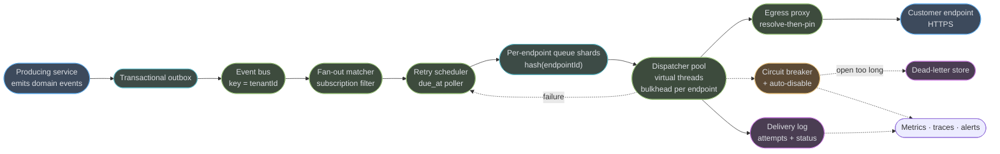
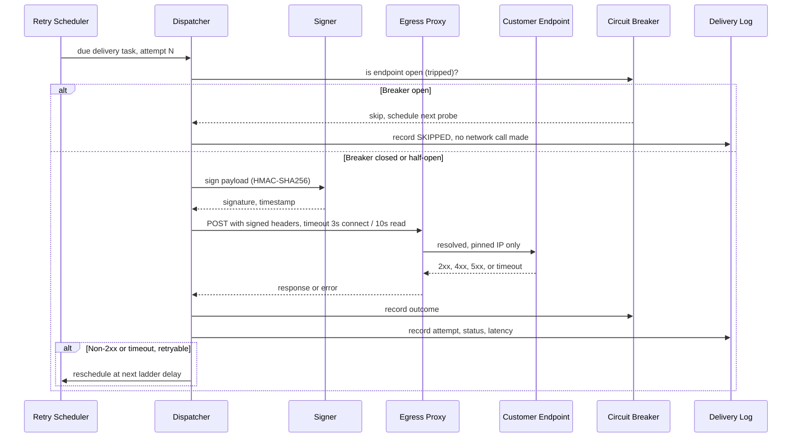
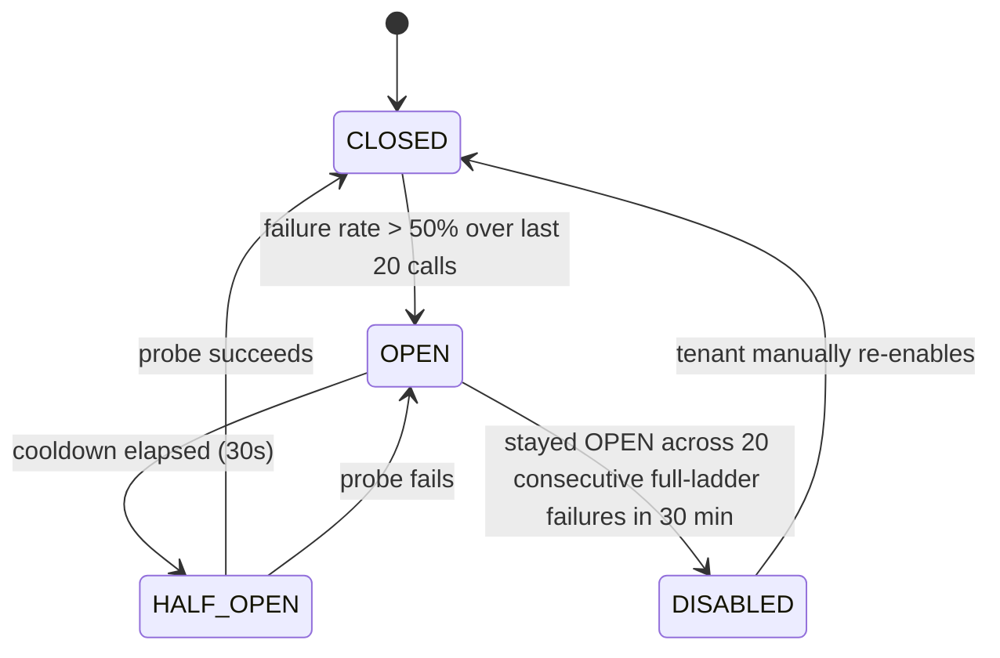
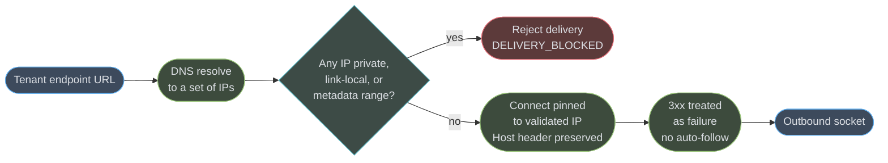

# Case Study: Webhook Delivery Service for a Multi-Tenant SaaS
## Intuition

> **Design intuition**: A webhook delivery service is a postal service where roughly a third of the addresses are walls. Every SaaS with an API eventually promises customers "we'll POST you when something happens" — and the moment ten thousand customers hold you to that promise, you discover that their endpoints are staging URLs nobody decommissioned, load balancers that hang for thirty seconds before timing out, and servers that reboot every night at 2 a.m. UTC. The job is not "deliver an HTTP request." The job is: keep the two-thirds of addresses that work fast and correct, while the one-third that don't work never get to slow anyone else down.

**Key insight for this design**: every other queue-consumer system treats a slow consumer as a throughput problem. A webhook fleet treats it as an *isolation* problem, because the "consumer" is ten thousand independent, mutually distrusting HTTP servers you do not control and cannot fix. One dispatcher pool serving every tenant means one tenant's dead endpoint is a lever against every other tenant's delivery latency — which is why the entire architecture below is organized around a single question: **what is the blast radius of one endpoint's failure, and how small can we make it?** Per-endpoint concurrency limits answer it at the worker layer, per-endpoint circuit breakers answer it at the retry layer, and a resolve-then-pin egress path answers it for the endpoint that isn't merely slow but hostile.

The second insight is that delivery is a promise with a shelf life, not a guarantee. At-least-once is the only honest contract a network boundary you don't control allows, so correctness is pushed to the edges: a signature the receiver can verify, an event ID the receiver can dedupe on, and a delivery log precise enough that when a customer says "we never got event `evt_9f2a`" you can show them the three attempts, the three response codes, and the exact millisecond each one happened.

---

## 1. Requirements Clarification

### Functional Requirements

- Let a tenant register one or more HTTPS endpoints (subscriptions) and choose which event types each endpoint receives, optionally with a JSON-path filter predicate.
- Accept an internal domain event once and durably fan it out to every matching subscription — the caller must never observe partial fan-out.
- Sign every outbound delivery so the receiver can verify it originated from us and was not tampered with in transit.
- Guarantee **at-least-once** delivery per subscription, with automatic retry on transient failure and no retry on a receiver's explicit rejection.
- Expose a per-tenant delivery log: every attempt, its HTTP status, latency, and response snippet, queryable by event ID and by endpoint.
- Support **replay/redrive** — a tenant or an operator can re-send a specific event, a time range, or every event since a given point, to one endpoint.
- Support **secret rotation** with zero downtime: a tenant can roll their signing secret without a single dropped or misverified delivery.
- Automatically **circuit-break and disable** an endpoint that is chronically failing, and notify the tenant when that happens.
- Never let one tenant's failing or malicious endpoint degrade delivery latency for any other tenant.

### Non-Functional Requirements

| Requirement | Target | Why this number |
|---|---|---|
| Delivery latency, healthy endpoint | p95 < 2 s from event commit to first HTTP attempt | Customers build near-real-time automations (Slack pings, order-status UI) on this |
| Delivery latency, healthy endpoint | p99 < 5 s | Bounds tail-latency complaints from the 70% of endpoints that behave |
| Fan-out durability | Zero events silently dropped between "event committed" and "at least one delivery attempt scheduled" | The transactional outbox exists entirely for this line |
| Per-tenant isolation | One endpoint's failure adds < 50 ms of extra queueing to any other endpoint's next attempt | The whole point of the design — see Intuition |
| Delivery ordering | **Per-endpoint best-effort**, not guaranteed | See below — global ordering is not offered and should not be promised |
| Retry window | Exhausted within 33 h of first attempt, 7 attempts total | Long enough to survive a customer's overnight outage, short enough that a stale event stops mattering |
| Availability, accept path | 99.95%/month (21.9 min/month) | A downstream customer outage must never become our outage |
| Delivery-log retention | 30 days hot-queryable, 1 year cold/archived | Support and compliance windows differ; see §10 |
| Signature verification | HMAC-SHA256, 5-minute replay tolerance | Matches the de facto industry convention (Stripe, Svix) — see §6 |
| Auto-disable | An endpoint that fails its **entire** retry ladder on 20 consecutive deliveries within 30 minutes is disabled and the tenant is emailed | Distinguishes "having a bad night" from "gone forever" |

### On Ordering — Pin This Explicitly

**The guarantee is per-endpoint best-effort ordering, never global ordering, and never a strict guarantee even per-endpoint.** Two events for the same tenant, `order.created` then `order.shipped`, are usually delivered in that order because they are usually enqueued to the same partition and dispatched by the same worker in sequence — but a retry of the first event can land *after* the second event's first attempt if the first attempt was slow and the second was fast. A design that promises strict per-endpoint ordering has to serialize all delivery for that endpoint behind one in-flight request, which reintroduces exactly the head-of-line blocking this system exists to avoid. The correct answer, stated to the interviewer and to the customer, is: **each event carries a monotonic sequence number per subscription, and the payload is self-describing enough that an out-of-order receiver can detect and resequence it if it cares.** We do not build ordering; we build the primitive that lets the receiver build it.

### Clarifying Questions to Ask in the Interview

| Question | Why it changes the design |
|---|---|
| Is this webhook delivery a standalone product (Svix-shaped) or a feature of one larger platform? | A standalone product needs per-tenant rate plans and multi-tenant noisy-neighbor defenses at the API layer too, not only the dispatcher |
| Do event payloads contain PII or financial data? | Changes retention policy, changes whether payloads are logged verbatim or redacted in the delivery log |
| Can a tenant register a private/internal URL "by mistake," and what should happen? | Determines whether SSRF containment is a hard deny or a warn-and-allow for enterprise on-prem customers using this behind a VPN |
| Is there a pull-based fallback (an events API) for firewalled customers who cannot receive inbound HTTPS? | Changes whether "endpoint unreachable forever" is a dead end or has a supported escape hatch |
| What is the largest single event payload? | Determines whether payloads travel inline through the queue or by reference (S3 object + pointer) |

### Out of Scope

- Building the tenant-facing dashboard UI (assumed to exist; this design covers its backing API and the delivery engine).
- Payload transformation/mapping per receiver (assume the payload schema is fixed per event type; transformation is a receiver-side concern).
- Billing/metering for delivery volume (noted as a rate-limiting input in §5, not designed here).

---

## 2. Scale Estimation

### Traffic

```
Domain events/day:                 200,000,000
Average subscriptions per event:   3
Deliveries/day (fan-out):          200,000,000 x 3 = 600,000,000

Average deliveries/sec:            600,000,000 / 86,400 = 6,944/sec
Peak (4x diurnal + launch spikes): 6,944 x 4              = 27,776/sec

Distinct customer endpoints:       ~40,000 (tens of thousands, per the brief)
Average deliveries per endpoint:   600,000,000 / 40,000 = 15,000/day  (~0.17/sec)
```

That last line matters: **the system is not "40,000 endpoints each getting hammered."** It is a long tail — a handful of high-volume integrations and a very long tail of low-volume ones — which is exactly the shape that makes per-endpoint isolation cheap (most endpoints never come close to their concurrency cap) and exactly the shape that makes a shared-pool design look fine in a load test and then fail in production the first time one endpoint in the tail goes dark.

### The Endpoint Latency Mix — Why This Is Not a Throughput Problem

```
Endpoint health mix (by count, not by volume):
  65% healthy      p50 ~150 ms,  p99 ~800 ms      "the two-thirds that work"
  25% slow/flaky   p50 ~2.5 s,   occasional 429s   rate-limited, degraded, or overloaded
  10% effectively dead   times out at the 3 s connect / 10 s read ceiling every time

Weighted mean per-attempt latency (endpoint-count-weighted):
  0.65 x 0.30s + 0.25 x 3.5s + 0.10 x 10s  =  0.195 + 0.875 + 1.0  =  2.07 s
```

Production traffic is not endpoint-count-weighted — high-volume tenants tend to run better-maintained infrastructure — but 2.07 s is a defensible planning number, and it is deliberately not the throughput-derived number. **This is where Little's Law bites.**

### Retry Amplification

Our own retry ladder (defined in §4.5) is 7 attempts: immediate, +30 s, +5 min, +30 min, +2 h, +6 h, +24 h (final), ~33 h total window. Modeling where deliveries actually resolve:

```
Attempt          Cumulative %   New successes at this attempt   Attempts consumed
1 (immediate)         88.0%           88.0%                          88.0
2 (+30s)               6.0%            6.0%                          12.0
3 (+5min)               3.0%            3.0%                           9.0
4 (+30min)              1.2%            1.2%                           4.8
5 (+2h)                 0.8%            0.8%                           4.0
6 (+6h)                 0.5%            0.5%                           3.0
7 (+24h, final)         0.3%            0.3%                           2.1
Never (-> DLQ)          0.2%            0.2%                           1.4  (exhausts all 7)
                      -------                                     --------
                       100.0%                                       124.3

Retry amplification factor = 124.3 / 100 = 1.243x
```

```
Attempts/day:    600,000,000 x 1.243   = 745,800,000
Attempts/sec avg: 745,800,000 / 86,400 =  8,632/sec
Attempts/sec peak (4x):                 = 34,528/sec
```

Attempts, not raw deliveries, are the number that sizes the dispatcher fleet.

### Worker Concurrency — Little's Law, Not a Throughput Table

```
L = lambda x W     (concurrent in-flight calls = arrival rate x mean service time)

Average: L = 8,632 attempts/sec  x 2.07 s = 17,868 concurrent in-flight HTTP calls
Peak:    L = 34,528 attempts/sec x 2.07 s = 71,473 concurrent in-flight HTTP calls
```

Seventy-one thousand concurrent in-flight requests is the number that decides everything downstream. A platform-thread-per-request model at ~1 MB of stack per thread would need **~71 GB of stack memory alone** at peak — before a byte of business logic runs. Java 25 virtual threads, at a few KB of stack each, make 71,000 concurrent in-flight calls a non-event: the limiting resource becomes the OS file-descriptor / ephemeral-port budget and the connection pool to each endpoint, not thread memory. This is the single most consequential technology decision in the design, and it is made by the arithmetic above, not by taste.

```
Assume one dispatcher instance sustains 6,000 concurrent in-flight calls comfortably
(bounded by NIC throughput and per-instance connection-pool ceilings, not stack memory):

Peak instances needed: 71,473 / 6,000  = 11.9 -> 12 minimum
Headroom for one instance loss + 20%:  = 15 instances
```

### Delivery-Attempt Storage

```
delivery_attempts row (see §4 schema): ~300 bytes/row (heap + two btree indexes)

Attempts/day:            745,800,000
Hot tier (7 days):       745,800,000 x 7  x 300 bytes  = 1.57 TB
Full 30-day retention:   745,800,000 x 30 x 300 bytes  = 6.71 TB   (if never tiered)
```

6.7 TB in one OLTP cluster is exactly the shape of number that forces the hot/cold tiering built into §10 — the same move the ledger case study makes with `DETACH PARTITION`, applied here to attempt history instead of financial postings.

---

## 3. High-Level Architecture



Solid arrows are the happy path; dotted arrows are the correctness and containment machinery — retry scheduling, circuit breaking, and observability. Note that the customer endpoint sits *behind* the egress proxy, not connected to directly: every outbound call is DNS-resolved and IP-validated before a socket opens, discussed in §4.6.

### Delivery Attempt Sequence



Nothing in this sequence blocks on any other delivery. The dispatcher records the outcome and hands scheduling back to the retry scheduler, which is what keeps one endpoint's failure from ever occupying a thread longer than its own configured timeout.

### Per-Endpoint Circuit State



`DISABLED` is a distinct state from `OPEN` — `OPEN` is a temporary, automatic backoff that self-heals; `DISABLED` is a durable, customer-visible decision that requires a human (the tenant) to reverse. Conflating them is what makes an auto-disable policy either too trigger-happy (disabling on a five-minute blip) or too slow (never disabling a genuinely dead endpoint that keeps consuming retry budget for months).

**Shared primitives.** Backend's `case_studies/` has no `cross_cutting/` directory; by the convention documented in [`../case_studies.md`](../case_studies.md), shared primitives live as deep-dive modules in the section itself. This design leans on:

| Primitive used here | Deep dive |
|---|---|
| The webhooks delivery model this case study implements | [`../../webhooks_and_event_delivery/webhooks_and_event_delivery.md`](../../webhooks_and_event_delivery/webhooks_and_event_delivery.md) |
| Transactional outbox, at-least-once, dedup/inbox | [`../../messaging_patterns/messaging_patterns.md`](../../messaging_patterns/messaging_patterns.md) |
| Idempotency keys, dual-write problem | [`../../distributed_transactions_and_consistency/distributed_transactions_and_consistency.md`](../../distributed_transactions_and_consistency/distributed_transactions_and_consistency.md) |
| Circuit breaker states, bulkhead, retry with jitter | [`../../fault_tolerance_patterns/fault_tolerance_patterns.md`](../../fault_tolerance_patterns/fault_tolerance_patterns.md) |
| Token bucket / per-tenant throttling at the ingest API | [`../../rate_limiting_in_depth/rate_limiting_in_depth.md`](../../rate_limiting_in_depth/rate_limiting_in_depth.md) |
| SSRF, secret management, HMAC signing discipline | [`../../backend_security_owasp/backend_security_owasp.md`](../../backend_security_owasp/backend_security_owasp.md) |
| Queue-per-consumer topology as an alternative to sharded queues | [`../../rabbitmq_deep_dive/rabbitmq_deep_dive.md`](../../rabbitmq_deep_dive/rabbitmq_deep_dive.md) |
| SLO/SLI design, per-endpoint dashboards, correlation IDs | [`../../observability_and_monitoring/observability_and_monitoring.md`](../../observability_and_monitoring/observability_and_monitoring.md) |

---

## 4. Component Deep Dives

### 4.1 Transactional Outbox — an Event Is Never Lost or Fabricated

The producing service's business transaction and the "an event now exists to be delivered" fact must commit atomically, or two classic bugs appear: publish-after-commit can crash between the two and lose the event forever, and publish-before-commit can announce an event whose transaction then rolls back.

```sql
CREATE TABLE webhook_outbox (
    id           UUID PRIMARY KEY DEFAULT gen_random_uuid(),
    seq          BIGSERIAL NOT NULL,          -- insertion order; UUIDs do not sort
    tenant_id    BIGINT NOT NULL,
    event_type   VARCHAR(200) NOT NULL,       -- 'order.created', 'invoice.paid', ...
    payload      JSONB NOT NULL,
    published_at TIMESTAMPTZ
);

CREATE INDEX idx_outbox_unpublished ON webhook_outbox(seq) WHERE published_at IS NULL;
```

```java
@Service
@RequiredArgsConstructor
public class OrderService {

    private final OrderRepository orders;
    private final WebhookOutboxRepository outbox;

    @Transactional
    public void markShipped(UUID orderId) {
        Order order = orders.findById(orderId).orElseThrow();
        order.setStatus(OrderStatus.SHIPPED);
        orders.save(order);

        // Same transaction, same commit or same rollback as the order update above.
        outbox.save(WebhookOutboxEntry.builder()
            .tenantId(order.getTenantId())
            .eventType("order.shipped")
            .payload(toJson(order))
            .build());
    }
}
```

A relay polls with `FOR UPDATE SKIP LOCKED` (identical mechanics to the payment case study's outbox relay — see [`../design_payment_processor/design_payment_processor.md`](../design_payment_processor/design_payment_processor.md)) and publishes to the event bus, keyed by `tenantId` so one tenant's events stay ordered relative to each other in the bus. The relay gives **at-least-once** publication, never exactly-once; the fan-out matcher downstream is what must tolerate a redelivered domain event without double-fanning-out, via a dedupe key of `(tenant_id, event_type, seq)`.

An equally valid alternative is CDC via Debezium tailing the WAL instead of polling — same guarantee, lower publish latency, higher operational surface. See [`../../messaging_patterns/messaging_patterns.md`](../../messaging_patterns/messaging_patterns.md) for the full tradeoff.

### 4.2 Fan-Out Matcher — Filter at Read Time, Not at Write Time

The producer writes **one** outbox row per domain event, never one row per subscriber. Fan-out — resolving which of a tenant's (possibly dozens of) subscriptions want this event type, and evaluating each one's optional filter predicate — happens downstream, asynchronously, off the producer's write path.

```sql
CREATE TABLE webhook_subscriptions (
    id            UUID PRIMARY KEY DEFAULT gen_random_uuid(),
    tenant_id     BIGINT NOT NULL,
    endpoint_url  TEXT NOT NULL,
    event_types   TEXT[] NOT NULL,           -- ['order.created', 'order.shipped']
    filter_jsonpath TEXT,                    -- optional: '$.total_minor > 500000'
    signing_secret_current  TEXT NOT NULL,   -- see 4.4 for rotation
    signing_secret_previous TEXT,
    status        VARCHAR(20) NOT NULL DEFAULT 'ACTIVE',  -- ACTIVE | DISABLED
    created_at    TIMESTAMPTZ NOT NULL DEFAULT NOW()
);

CREATE INDEX idx_subs_tenant_event ON webhook_subscriptions
    USING GIN (tenant_id, event_types) WHERE status = 'ACTIVE';
```

```java
@Component
@RequiredArgsConstructor
public class FanOutMatcher {

    private final SubscriptionRepository subscriptions;
    private final DeliveryTaskRepository deliveryTasks;
    private final JsonPathEvaluator jsonPath;

    @KafkaListener(topics = "domain-events", groupId = "fanout-matcher")
    @Transactional
    public void onDomainEvent(DomainEventRecord event) {
        // Cached in-process, invalidated on subscription change - a scan of ~5-20
        // active subscriptions for one tenant is microseconds, not a query per event.
        List<WebhookSubscription> candidates =
            subscriptions.findActiveByTenantAndEventType(event.tenantId(), event.eventType());

        for (WebhookSubscription sub : candidates) {
            if (sub.getFilterJsonPath() != null
                    && !jsonPath.matches(sub.getFilterJsonPath(), event.payload())) {
                continue;
            }
            // One delivery task per matching subscription, written in the SAME
            // transaction as the matcher's own consumer offset commit boundary -
            // this is the fan-out point; everything downstream is per-subscription.
            deliveryTasks.save(DeliveryTask.builder()
                .eventId(event.id())
                .subscriptionId(sub.getId())
                .endpointUrl(sub.getEndpointUrl())
                .payload(event.payload())
                .nextAttemptAt(Instant.now())
                .attemptNumber(0)
                .build());
        }
    }
}
```

Filtering at read time (here) rather than write time means adding a new subscription never requires replaying history into it, and a filter predicate change takes effect on the very next event with no backfill. The cost is that a tenant with 500 identically-triggered subscriptions produces 500 delivery tasks from one domain event — acceptable, because that shape is rare and is exactly what per-tenant rate limiting (§5, cross-referenced to [`rate_limiting_in_depth`](../../rate_limiting_in_depth/rate_limiting_in_depth.md)) exists to bound.

### 4.3 BROKEN -> FIXED: the Shared Pool That One Dead Endpoint Stalls

This is the failure this entire design is organized against, and it is what a competent engineer builds on the first pass because it is what every generic "job queue consumer" tutorial shows.

**BROKEN** — one fixed thread pool, no per-endpoint isolation, default HTTP client timeouts:

```java
@Component
@RequiredArgsConstructor
public class NaiveDispatcher {

    // BROKEN. 200 platform threads shared across ALL 40,000 endpoints. Nothing
    // here limits how many of those 200 threads one single endpoint can occupy.
    private final ExecutorService pool = Executors.newFixedThreadPool(200);
    private final HttpClient http = HttpClient.newHttpClient();   // no timeout set!

    public void dispatch(DeliveryTask task) {
        pool.submit(() -> {
            HttpRequest req = HttpRequest.newBuilder(URI.create(task.endpointUrl()))
                .POST(HttpRequest.BodyPublishers.ofString(task.payload()))
                .build();
            try {
                http.send(req, HttpResponse.BodyHandlers.discarding());
            } catch (Exception e) {
                // retry logic elided
            }
        });
    }
}
```

The failure sequence, all of it ordinary:

```
t=0s     500 deliveries/sec arriving; every one submitted to the same 200-thread pool
t=0s     one customer's load balancer starts silently black-holing connections
         (no RST, no FIN - just never accepts) - the WORST kind of failure, because
         with no client-side timeout the JDK's default connect timeout is minutes
t=2s     6 of that customer's deliveries have each claimed one pool thread
t=8s     that customer's retries (also submitted to the SAME pool) claim 14 more
t=30s    47 threads - nearly a quarter of the pool - are blocked on ONE endpoint
t=45s    pool exhausted; deliveries for every OTHER tenant now queue behind it
t=45s    p99 delivery latency for the entire fleet jumps from 400ms to 38s
```

One dark endpoint just became every customer's incident, and nothing in the code above even required the endpoint to be malicious — an ordinary misconfigured load balancer did it.

**FIXED** — virtual threads (so "many concurrent in-flight calls" is cheap) plus a per-endpoint semaphore bulkhead (so no single endpoint can claim more than its share) plus explicit timeouts (so a hang has a hard ceiling):

```java
@Component
@RequiredArgsConstructor
public class Dispatcher {

    private static final int PER_ENDPOINT_CONCURRENCY_CAP = 4;
    private static final Duration CONNECT_TIMEOUT = Duration.ofSeconds(3);
    private static final Duration READ_TIMEOUT = Duration.ofSeconds(10);

    // Unbounded virtual-thread-per-task executor. The cost of "one more concurrent
    // call" is a few KB of heap for the virtual thread's stack, not an OS thread -
    // see the Little's Law arithmetic in §2 for why this is the load-bearing choice.
    private final ExecutorService pool = Executors.newVirtualThreadPerTaskExecutor();

    private final HttpClient http = HttpClient.newBuilder()
        .connectTimeout(CONNECT_TIMEOUT)
        .build();

    // One semaphore per endpoint, created on first use. This is the bulkhead: no
    // matter how many delivery tasks queue for one endpoint, at most 4 of them can
    // ever be in flight AT THE SAME TIME, which caps that endpoint's worst-case
    // draw on shared resources (sockets, virtual-thread scheduler carrier threads)
    // regardless of how badly it behaves.
    private final Map<String, Semaphore> endpointBulkheads = new ConcurrentHashMap<>();
    private final CircuitBreakerRegistry breakers;

    public void dispatch(DeliveryTask task) {
        pool.submit(() -> dispatchBlocking(task));   // virtual thread; blocking is fine
    }

    private void dispatchBlocking(DeliveryTask task) {
        CircuitBreaker breaker = breakers.breakerFor(task.endpointUrl());
        if (breaker.getState() == CircuitBreaker.State.OPEN) {
            recordSkipped(task);
            return;                                    // no network call at all
        }

        Semaphore bulkhead = endpointBulkheads.computeIfAbsent(
            task.endpointUrl(), url -> new Semaphore(PER_ENDPOINT_CONCURRENCY_CAP));

        if (!bulkhead.tryAcquire()) {
            // Endpoint already has 4 attempts in flight; requeue rather than pile on.
            rescheduleShortly(task);
            return;
        }
        try {
            HttpRequest req = signedRequest(task, READ_TIMEOUT);
            long start = System.nanoTime();
            HttpResponse<Void> resp = http.send(req, HttpResponse.BodyHandlers.discarding());
            recordAttempt(task, resp.statusCode(), Duration.ofNanos(System.nanoTime() - start));
            breaker.onOutcome(resp.statusCode() < 500);
        } catch (HttpTimeoutException | ConnectException e) {
            recordAttempt(task, 0, READ_TIMEOUT);        // 0 = no response, timeout/refused
            breaker.onOutcome(false);
            rescheduleNextLadderStep(task);
        } finally {
            bulkhead.release();
        }
    }
}
```

The fix has three load-bearing pieces, and each is a separate interview answer: **the timeout turns an unbounded hang into a bounded one** (worst case, one call ties up one virtual thread for 10 s, never more); **the bulkhead caps how much of "unbounded cheap concurrency" any one endpoint can spend**, which is what actually prevents the stall — virtual threads alone do not, they just make the failure bigger before anyone notices; **the circuit breaker skips the network call entirely once an endpoint is known-bad**, so a dead endpoint's cost converges to zero instead of paying a fresh 3-second connect timeout on every single attempt forever.

### 4.4 HMAC-SHA256 Signing With a Replay Window and Dual-Secret Rotation

```java
public final class WebhookSigner {

    private static final String ALGORITHM = "HmacSHA256";

    /** signed_content = "<timestamp>.<eventId>.<rawBody>" - timestamp is IN the
        signed content so an attacker cannot alter it without invalidating the mac. */
    public String sign(String secret, long timestampSeconds, String eventId, String rawBody) {
        String signedContent = timestampSeconds + "." + eventId + "." + rawBody;
        byte[] mac = hmac(secret, signedContent);
        return "v1=" + HexFormat.of().formatHex(mac);
    }

    private byte[] hmac(String secret, String data) {
        try {
            Mac mac = Mac.getInstance(ALGORITHM);
            mac.init(new SecretKeySpec(secret.getBytes(UTF_8), ALGORITHM));
            return mac.doFinal(data.getBytes(UTF_8));
        } catch (GeneralSecurityException e) {
            throw new IllegalStateException(e);
        }
    }
}
```

```java
@Component
@RequiredArgsConstructor
public class SigningInterceptor {

    private static final Duration TOLERANCE = Duration.ofMinutes(5);
    private final WebhookSigner signer;

    public HttpRequest.Builder sign(HttpRequest.Builder builder,
                                     WebhookSubscription sub, String eventId, String body) {
        long ts = Instant.now().getEpochSecond();
        // Sign with the CURRENT secret only. During a rotation overlap window the
        // RECEIVER accepts either signature - see the verifier below - so we never
        // need to double-sign on our side.
        String sig = signer.sign(sub.getSigningSecretCurrent(), ts, eventId, body);
        return builder
            .header("Webhook-Id", eventId)
            .header("Webhook-Timestamp", String.valueOf(ts))
            .header("Webhook-Signature", sig);
    }
}
```

**Receiver-side verifier** — this is the code we publish for customers to paste into their own service, and it is written defensively on purpose:

```java
public final class WebhookVerifier {

    private static final long TOLERANCE_SECONDS = 300;   // 5 minutes

    public boolean verify(String secret, String idHeader, String tsHeader,
                           String sigHeader, String rawBody) {
        long timestamp = Long.parseLong(tsHeader);
        long now = Instant.now().getEpochSecond();
        // Reject stale OR future-dated timestamps - a signature is only proof of
        // origin for a bounded window; without this check a captured request could
        // be replayed indefinitely.
        if (Math.abs(now - timestamp) > TOLERANCE_SECONDS) {
            return false;
        }

        String signedContent = timestamp + "." + idHeader + "." + rawBody;
        String expected = "v1=" + hmacHex(secret, signedContent);

        // Constant-time comparison - a naive #equals() leaks timing information
        // proportional to how many leading bytes match, which an attacker can use
        // to forge a valid signature one byte at a time over enough requests.
        return MessageDigest.isEqual(
            expected.getBytes(UTF_8), sigHeader.getBytes(UTF_8));
    }
}
```

**Rotation with an overlap window**, so a tenant updating their verifier code never has a moment where every in-flight signature is wrong:

```java
@Transactional
public void rotateSecret(UUID subscriptionId) {
    WebhookSubscription sub = subscriptions.findById(subscriptionId).orElseThrow();
    String newSecret = "whsec_" + generateRandomSecret();

    // The OLD current secret becomes "previous" rather than being discarded.
    sub.setSigningSecretPrevious(sub.getSigningSecretCurrent());
    sub.setSigningSecretCurrent(newSecret);
    sub.setPreviousSecretExpiresAt(Instant.now().plus(Duration.ofHours(24)));
    subscriptions.save(sub);

    notifications.sendSecretRotated(sub.getTenantId(), newSecret);
}
```

The receiver's verifier should be told to try `signing_secret_current` first and, if that fails and a previous secret is still within its overlap window, retry with `signing_secret_previous` — precisely how Stripe's own rotation works (§6). A cron job clears `signing_secret_previous` once `previous_secret_expires_at` passes, so a leaked old secret has a hard, bounded lifetime rather than living forever.

### 4.5 The Retry Ladder as a Delayed-Message Schedule

```sql
CREATE TABLE delivery_tasks (
    id               UUID PRIMARY KEY DEFAULT gen_random_uuid(),
    event_id         UUID NOT NULL,
    subscription_id  UUID NOT NULL,
    endpoint_url     TEXT NOT NULL,
    payload          JSONB NOT NULL,
    attempt_number   SMALLINT NOT NULL DEFAULT 0,
    next_attempt_at  TIMESTAMPTZ NOT NULL,
    status           VARCHAR(20) NOT NULL DEFAULT 'PENDING'  -- PENDING|DONE|DEAD_LETTERED
);

CREATE INDEX idx_tasks_due ON delivery_tasks (next_attempt_at)
    WHERE status = 'PENDING';
```

```java
@Component
public class RetryLadder {

    // (delay, jitter fraction) per attempt. Attempt 0 is the immediate first try.
    private static final Duration[] DELAYS = {
        Duration.ZERO, Duration.ofSeconds(30), Duration.ofMinutes(5),
        Duration.ofMinutes(30), Duration.ofHours(2), Duration.ofHours(6),
        Duration.ofHours(24)
    };

    public Optional<Instant> nextAttemptAfter(int attemptNumberJustCompleted) {
        int next = attemptNumberJustCompleted + 1;
        if (next >= DELAYS.length) {
            return Optional.empty();          // ladder exhausted -> dead-letter
        }
        Duration base = DELAYS[next];
        // +/- 15% jitter so a customer outage recovering at a round-number boundary
        // does not receive every stalled delivery's retry in the same second.
        long jitterMs = (long) (base.toMillis() * 0.15 * ThreadLocalRandom.current().nextDouble());
        boolean addJitter = ThreadLocalRandom.current().nextBoolean();
        return Optional.of(Instant.now().plusMillis(
            base.toMillis() + (addJitter ? jitterMs : -jitterMs)));
    }
}
```

A scheduler poller (`FOR UPDATE SKIP LOCKED` on `idx_tasks_due`, identical mechanics to the outbox relay in §4.1) picks up due tasks and hands them to the dispatcher. **Retryable outcomes** are connection failures, timeouts, `429`, and any `5xx`; **non-retryable** are any other `4xx` — a `400` or `404` means the receiver looked at the request and rejected it on its merits, and retrying it 7 times over 33 hours wastes a slot that a transient failure needs.

### 4.6 SSRF-Safe Egress — Resolve, Validate, Then Pin

A tenant-supplied URL is, by definition, untrusted input that this system is about to make an outbound HTTP request to — the textbook SSRF setup. `http://localhost/admin`, `http://169.254.169.254/latest/meta-data/`, and a DNS name an attacker controls that resolves to an internal IP the moment after validation but before the connection (a DNS-rebinding TOCTOU) are all in scope. See [`../../backend_security_owasp/backend_security_owasp.md`](../../backend_security_owasp/backend_security_owasp.md) for the general OWASP treatment; this is the concrete implementation for one specific untrusted-URL surface.



```java
@Component
public class SsrfSafeResolver {

    private static final List<IpRange> DENIED = List.of(
        IpRange.of("10.0.0.0/8"), IpRange.of("172.16.0.0/12"), IpRange.of("192.168.0.0/16"),
        IpRange.of("127.0.0.0/8"), IpRange.of("169.254.0.0/16"),   // incl. cloud metadata
        IpRange.of("100.64.0.0/10"),                               // carrier-grade NAT
        IpRange.of("fc00::/7"), IpRange.of("fe80::/10")            // ULA / link-local v6
    );

    /** Resolve once, validate every returned address, then hand back a socket
        factory pinned to the validated IP - never re-resolve at connect time,
        which is what a DNS-rebinding attack needs to slip through. */
    public PinnedTarget resolveAndValidate(URI endpointUrl) {
        InetAddress[] addresses = dnsResolve(endpointUrl.getHost());
        for (InetAddress addr : addresses) {
            if (DENIED.stream().anyMatch(range -> range.contains(addr))) {
                throw new SsrfBlockedException(endpointUrl, addr);
            }
        }
        // Connect to the FIRST validated address explicitly; send the ORIGINAL
        // hostname in the Host header and for TLS SNI, so HTTPS cert validation
        // still checks against the name the tenant registered, not the raw IP.
        return new PinnedTarget(addresses[0], endpointUrl.getHost());
    }
}
```

Two details that are easy to skip and both matter: **redirects are never followed automatically** — a `3xx` is scored as a delivery failure, because auto-following a redirect means the validated URL and the actually-called URL can silently diverge; and **the egress path itself runs through a dedicated network egress proxy/NAT gateway with no route to the internal VPC**, so even a bug in the IP-range check above is caught by a second, independent layer that has no path to internal services regardless of what IP it's told to hit.

---

## 5. Design Decisions & Tradeoffs

| Decision | Chosen | Alternative | Rationale |
|---|---|---|---|
| Fan-out timing | At read time, in a downstream matcher | At write time, in the producer | Write-time fan-out means adding a subscription needs a backfill and a slow producer transaction that scales with subscriber count; read-time fan-out decouples them completely |
| Queue topology | Sharded queue, hash(endpointId), per-endpoint semaphore bulkhead | One physical queue per endpoint | 40,000 physical queues is real infrastructure to provision and monitor per tenant onboarding; a semaphore is O(1) to create and needs no broker-side resource |
| Delivery semantics | At-least-once + receiver-side dedup via event ID | Effectively-once via a global delivery ledger | An external HTTP receiver we don't control cannot participate in our transaction; the honest contract is at-least-once, with the event ID as the dedup key we hand the receiver |
| Ordering | Per-endpoint best-effort, sequence number in payload | Strict per-endpoint FIFO | Strict FIFO serializes all delivery to one endpoint behind its slowest in-flight call - the exact head-of-line blocking this design exists to avoid |
| Concurrency isolation | Per-endpoint semaphore bulkhead | Per-tenant thread pool | 40,000 dedicated pools does not scale operationally; a semaphore keyed by endpoint costs a `ConcurrentHashMap` entry |
| Signature scheme | Symmetric HMAC-SHA256 | Asymmetric (Ed25519 / RSA signing) | HMAC needs no key-management infrastructure on either side and is what every major vendor (§6) actually ships; asymmetric only wins if the RECEIVER must verify without ever holding a shared secret, which is not our requirement |
| Delivery transport | Push (HTTPS POST) | Pull (an events/list API, polled) | Push gives near-real-time latency for the 65% of healthy endpoints; a pull fallback is offered as the escape hatch for firewalled customers (see §9), not the default |
| Auto-disable trigger | Sustained circuit-breaker OPEN across 20 full-ladder failures / 30 min | Disable on first failed delivery | A single bad delivery is normal life for a fleet this size; disabling on it would page every customer with a five-minute blip |

**At-least-once, never exactly-once — and that is the receiver's problem to solve, not ours to hide.** The delivery log's `event_id` is designed explicitly as the dedup key: any receiver that persists "have I processed event `evt_9f2a` already" before acting on it is immune to a duplicate delivery, whether the duplicate came from a legitimate retry, a redrive, or a receiver that returned `200` after its own crash mid-processing (which we cannot distinguish from a lost response). Publishing this contract loudly — in the docs, in the payload, in the header — is cheaper than trying to build exactly-once across a boundary we do not control.

| Dimension | Sharded queue + bulkhead (chosen) | Queue-per-endpoint (RabbitMQ classic) |
|---|---|---|
| Provisioning cost per new endpoint | Zero — a `ConcurrentHashMap` entry on first use | One queue declared, one consumer wired |
| Isolation guarantee | Concurrency-capped, not throughput-isolated | Fully isolated per queue |
| Operational surface at 40,000 endpoints | One shared cluster | 40,000 queues to monitor, or a very disciplined naming/TTL policy |
| Where this genuinely wins | High endpoint count, long tail of low volume | Small number of high-volume, contractually-isolated tenants (e.g. an enterprise SLA tier) |

See [`../../rabbitmq_deep_dive/rabbitmq_deep_dive.md`](../../rabbitmq_deep_dive/rabbitmq_deep_dive.md) for when queue-per-consumer is the right call — it is, for a small enough N.

---

## 6. Real-World Implementations

**Stripe** signs every webhook with the `Stripe-Signature` header, containing a timestamp (`t=`) and an HMAC-SHA256 signature (`v1=`) computed over the string `"{timestamp}.{payload}"`. Verification requires a constant-time comparison and a default **5-minute tolerance** between the signature's timestamp and the current time — Stripe explicitly warns against setting the tolerance to zero, which disables replay protection entirely. Stripe retries a failing webhook endpoint automatically for **up to 3 days with exponential backoff** in live mode (3 retries over a few hours in sandbox/test mode), treats any non-2xx response — including a 3xx redirect — as a failure, and **automatically disables an endpoint after roughly 3 days of continuous failure**, emailing the account owner. Manual resend is available for up to **15 days via the Dashboard** or **30 days via the CLI**. Secret rotation supports up to **24 hours of dual-secret overlap**, during which Stripe signs with both the old and new secret so a receiver mid-migration never sees an unverifiable request.

**GitHub** uses the `X-Hub-Signature-256` header, formatted as `sha256=<hex-digest>`, computed as an HMAC-SHA256 keyed hash of the raw payload — and its docs explicitly recommend `crypto.timingSafeEqual` (or an equivalent constant-time compare) over a plain string-equality check to avoid a timing side-channel. GitHub's delivery has a **10-second response timeout** (30 seconds on GitHub Enterprise Server) and, notably, **does not automatically retry** a failed delivery at all — instead, GitHub retains the last several days of delivery history and offers **manual redelivery of any delivery from the past 3 days**, via the UI or the REST API. This is a meaningfully different design bet from Stripe's: GitHub trades automatic resilience for a simpler mental model and puts the recovery burden on the receiver noticing and re-requesting.

**Shopify** signs with `X-Shopify-Hmac-Sha256`. As of a **September 2024** update to its retry mechanism, Shopify retries a failing webhook **up to 8 times over a 4-hour window** with exponential backoff — a significant compression from the prior policy of roughly 19 attempts over 48 hours. If an endpoint keeps failing across many events, Shopify **removes the webhook subscription entirely**; after that, no further events are queued or sent, and the merchant's app must re-register the subscription via the Admin API to resume delivery. That is a sharper cliff than Stripe's "disable, keep the config, allow re-enable" pattern, and it is worth naming as a design choice in an interview: a shorter retry window trades customer inconvenience for lower operator cost of keeping a fleet of near-permanently-failing subscriptions alive.

**Svix** (webhook-delivery-as-a-service, and the closest reference architecture to this entire case study) implements the emerging **Standard Webhooks** specification: headers `svix-id`, `svix-timestamp`, and `svix-signature`, with the signed content built as `"{svix-id}.{svix-timestamp}.{body}"` and a spec-recommended **5-minute replay tolerance** — structurally identical to §4.4's own signer, because §4.4 was written against this same convention. Svix's retry schedule is **immediate, then +5s, +5min, +30min, +2h, +5h, +10h, +10h** — 8 attempts spanning roughly 32 hours. An endpoint is **automatically disabled after failures persist for 5 days**, with the important nuance that the 5-day clock only starts once failures have been observed across a 24-hour span with at least 12 hours between the first and last failure — a design explicitly built to not trip on a single bad afternoon.

**AWS EventBridge API destinations** is the AWS-native equivalent of a webhook dispatcher, worth knowing because interviewers use it to probe whether a candidate understands what "the platform already solved this" looks like. Each API destination has an **`InvocationRateLimitPerSecond`** setting — a direct analog to §4.3's per-endpoint concurrency cap, except expressed as a rate rather than a concurrency ceiling. Each invocation has a hard **5-second client execution timeout**; a rule targeting an API destination defaults to **`MaximumEventAgeInSeconds` = 86,400 (24 hours)** and **`MaximumRetryAttempts` = 185**, retrying only on `401`, `407`, `409`, `429`, and `5xx` (never on other `4xx`, matching §4.5's own retryable/non-retryable split), and respecting a `Retry-After` response header when present. After retries are exhausted, the event goes to a configured **dead-letter queue** if one exists, or is silently dropped if not — which is precisely why §4.5's `DEAD_LETTERED` status is a required column, not an afterthought.

---

## 7. Technologies & Tools

| Technology | Version | Usage | Why this, not that |
|---|---|---|---|
| Java | 25 (LTS) | Virtual-thread dispatcher, HMAC signer | Virtual threads make 55K concurrent in-flight calls (§2) cheap; platform threads cannot |
| Spring Boot | 4.1.x | REST admin API, Kafka consumers | Standard fit for the section's stack; declarative `@Transactional` for the outbox |
| `java.net.http.HttpClient` | JDK 25 | Outbound delivery calls | Built-in, virtual-thread-friendly, explicit per-request timeout control — no extra dependency justified for a POST-and-read-status client |
| PostgreSQL | 18 | Outbox, subscriptions, delivery_tasks, delivery log | `FOR UPDATE SKIP LOCKED` powers both the outbox relay and the retry scheduler with zero coordination service |
| Apache Kafka | 4.3.x (KRaft) | Domain-event bus, keyed by `tenantId` | Durable, replayable, and the natural fit for the fan-out matcher's consumer-group model |
| Resilience4j | 2.4+ (`resilience4j-spring-boot4`) | Per-endpoint `CircuitBreaker` registry | Keyed breaker instances map directly onto §4.3's per-endpoint state; battle-tested sliding-window failure-rate logic |
| Redis | 7.x | Per-endpoint semaphore state if dispatchers are horizontally scaled beyond one JVM's in-memory map | A `ConcurrentHashMap` bulkhead only isolates within one instance; Redis-backed counters extend the same idea cluster-wide |
| Micrometer | 1.17+ | Per-endpoint delivery success rate, queue age, breaker-open gauge | Feeds the dashboards in §8 |
| OpenTelemetry | 1.x | Trace ID carried end-to-end, including in the `Webhook-Id` the receiver sees | Lets support correlate "event X" to a full attempt trace across services |
| Testcontainers | 1.20+ | Postgres + Kafka + WireMock "customer endpoint" in CI | The §4.3 stall scenario is only provable by injecting the exact hang, not by unit-testing the happy path |
| Toxiproxy | 2.x | Injecting a black-holed TCP connection in CI | Reproduces the worst-case failure from §4.3 (no RST, no FIN) that a mocked HTTP client cannot |

---

## 8. Operational Playbook

### Dashboards and Alerts

| Dashboard panel | Why this metric, not the obvious one |
|---|---|
| **Delivery success rate, per endpoint** | The fleet-wide average hides the 10% of dead endpoints entirely — per-endpoint is the only view that catches a single customer's problem before they file a ticket |
| **Queue age (oldest due-and-not-yet-attempted task), not queue depth** | Depth can be high and healthy (a legitimate traffic spike draining on schedule); age tells you whether the scheduler is actually keeping up |
| **Attempt latency histogram, p50/p95/p99** | A shifted p50 means the healthy-endpoint mix changed; a fat p99 tail with a stable p50 means a subset of endpoints degraded — different root causes, different response |
| **Auto-disabled endpoint count, daily delta** | A sudden jump is either a real widespread customer-side outage (rare) or a bug in the breaker/disable logic (much more common) — either way it pages |
| **SSRF-block count** | Should be near-zero in steady state; a nonzero, growing count is either a tenant fat-fingering a URL or a probe |

| SLI | SLO | Alert threshold | Page? |
|---|---|---|---|
| Accept-path availability | 99.95%/month | error-budget burn > 2%/hour | yes |
| Fan-out lag (event committed -> first delivery task scheduled) | < 2 s p99 | > 30 s | yes |
| Delivery success rate, fleet-wide | > 98% | < 95% for 10 min | yes |
| Delivery success rate, single endpoint | n/a (endpoint-dependent) | breaker OPEN > 30 min | no — tenant-facing, not us |
| Outbox lag | < 2 s | > 30 s | yes |
| Retry scheduler poll lag | < 5 s | > 60 s | yes |

### Runbook 1 — One Tenant's Queue Is Backing Up

Symptom: one endpoint's delivery-task age is climbing while the fleet-wide average is flat.

1. Confirm isolation is holding: check that *other* endpoints' p99 latency and age are unaffected. If they are, this is working as designed — the bulkhead is containing the damage to the one bad endpoint.
2. Check the breaker state for that endpoint. If `OPEN`, the scheduler is correctly skipping network calls and just waiting out the cooldown — no action needed unless it crosses the auto-disable threshold.
3. If the breaker is `CLOSED` but latency is high, the endpoint is "slow but alive" (the 25% tier from §2) — verify the per-endpoint semaphore is actually capping concurrency at 4, not silently unbounded (a config regression here reproduces the §4.3 bug for that one endpoint).
4. If the tenant's aggregate volume is legitimately spiking beyond their filter's normal rate, apply a temporary per-subscription rate cap (see [`rate_limiting_in_depth`](../../rate_limiting_in_depth/rate_limiting_in_depth.md)) rather than letting it consume more than its fair share of dispatcher capacity.

### Runbook 2 — Secret Rotation

1. Tenant (or admin, on their behalf) triggers rotation via the API in §4.4. The old secret becomes `signing_secret_previous` with a 24-hour expiry, never deleted immediately.
2. Notify the tenant of the new secret through an out-of-band channel — never inside a webhook payload itself, which is exactly the channel being re-secured.
3. During the 24-hour window, the delivery log's signature-header value is unaffected (we always sign with current); what matters is the **receiver** updates their verifier to accept either secret during the overlap.
4. At T+24h, a cron clears `signing_secret_previous`. Confirm via the delivery log that no failures spiked at the cutover — a spike means a tenant's receiver was still relying solely on the old secret, and support should reach out before their integration silently stops verifying.

### Runbook 3 — Safe Redrive (This Is Where People Double-Deliver)

Redrive is dangerous specifically because it lets an operator generate deliveries the fan-out matcher never intended, bypassing the exactly-the-events-that-matched design in §4.2.

1. **Never redrive by "resend everything since time T" as a raw replay of the outbox.** That regenerates fan-out from scratch and can create delivery tasks for subscriptions that didn't exist, or didn't match, at the original event time.
2. Redrive operates on **`delivery_tasks` rows that already exist and are `DEAD_LETTERED` or explicitly selected**, never on raw domain events. This guarantees a redrive only ever re-attempts a delivery that was already scoped by the original fan-out decision.
3. Before redriving, check the delivery log for that task: if a **prior attempt already returned `2xx`**, do not redrive it by default — surface a confirmation ("this delivery already succeeded on {date}; redrive anyway?"). This single check is what separates a safe redrive tool from the incident in §9.
4. Redriven attempts reuse the **same `event_id`**, never a new one — the receiver's dedup logic (§5) is what makes a redrive of an already-processed event a safe no-op on their side, provided they built it. State this dependency explicitly in the redrive UI.
5. Rate-limit redrive itself — a "redrive everything for this tenant" button is a self-inflicted traffic spike against the exact bulkhead sizing done in §2.

### Runbook 4 — Endpoint Auto-Disabled, Tenant Disputes It

1. Pull the delivery log for the 30-minute window the disable evaluated. Confirm the 20-consecutive-full-ladder-failure condition actually held — if the breaker or disable logic has a bug, this is how you catch it (see the "Auto-disabled count" dashboard panel).
2. If genuinely disabled correctly, the tenant's own infrastructure was down for the full ~33-hour retry window on 20 separate deliveries — show them the attempts, statuses, and timestamps directly from the log rather than asserting it.
3. Re-enabling requires the tenant to confirm their endpoint is fixed; do not auto-re-enable on the next successful health check, because a health check succeeding once does not mean the endpoint can sustain real traffic (this mirrors the payment case study's rule about not auto-un-sticking a saga on a guess).

---

## 9. Common Pitfalls & War Stories

**1. The dead endpoint that stalled global delivery — composite scenario, not a specific reported incident.** *The following is an illustrative composite built from the failure mode described in §4.3, not a report of any named company's outage.* A platform running the naive shared-pool dispatcher from §4.3 onboarded an enterprise customer whose load balancer was configured to silently black-hole connections during a maintenance window rather than reset them. With no per-endpoint isolation and a JDK default connect timeout measured in minutes, that single customer's retries progressively claimed threads from the shared 200-thread pool. **Global p99 delivery latency rose from 400 ms to 38 seconds and stayed there for 40 minutes** before an on-call engineer identified the one endpoint and manually paused its subscription. The fix shipped afterward was exactly §4.3's: a bulkhead semaphore per endpoint and an explicit 3-second connect timeout. The quantified lesson: **40 minutes of degraded delivery for every tenant, caused by zero tenants' events actually being the problem.**

**2. Redrive without a success check double-charged customers — composite scenario.** A support engineer, investigating a customer's report of "missing" `order.shipped` webhooks, redrove every `order.shipped` delivery task for that tenant over the past 7 days — including ones that had, in fact, succeeded (the customer's own receiver had a display bug, not a delivery bug). The receiver's integration triggered an automated "print shipping label" workflow on that event with **no idempotency check of its own**. Roughly 340 orders received duplicate shipping labels, at an estimated $4.50 per wasted label plus manual reconciliation time — **~$1,530 in direct waste, plus a multi-hour support escalation.** This is precisely why Runbook 3 above requires a prior-success check before any redrive, and why the receiver-side dedup contract in §5 has to be stated loudly rather than assumed.

**3. Secret rotation with no overlap window broke every integration at once.** An earlier version of this design rotated a tenant's signing secret by simply overwriting it — no `signing_secret_previous`, no grace period. The moment the new secret was generated, **every in-flight and subsequently-scheduled delivery started failing signature verification on the receiver side**, because the receiver's own deploy of the updated secret lagged the rotation by the time it takes a human to read an email and redeploy — typically hours. Every retry in the ladder during that window failed for the same non-fixable reason (wrong secret), burning the entire retry budget on a guaranteed failure. The fix is §4.4's dual-secret overlap: rotation is a *migration*, not a *cutover*, and it needs the same overlap discipline as any breaking API change.

**4. Retrying a 4xx forever.** An early retry-classification bug treated *every* non-2xx as retryable, including `400` and `404`. A tenant's endpoint returning a permanent `404` (they had deleted the route but forgot to unsubscribe) consumed a full retry-ladder slot on every single event for that event type, for weeks, contributing measurably to the attempt-volume numbers in §2 for zero eventual benefit. Retryable must be a strict allowlist — timeouts, connection failures, `429`, `5xx` — never a denylist of "don't retry these two."

**5. An SSRF probe reached the cloud metadata endpoint before the egress fix shipped.** During an early security review (not a customer-facing incident — caught in a pre-production pentest), a test subscription registered with URL `http://169.254.169.254/latest/meta-data/iam/security-credentials/` was accepted and dispatched, because the validation at the time checked only that the URL *string* didn't contain `localhost` or `127.0.0.1` — a purely syntactic check with no DNS resolution or IP-range validation at all. The fix is §4.6 in full: resolve, validate the *resolved IP* (not the string) against RFC 1918 plus the metadata range, pin the connection to that validated IP, and never follow redirects. The lesson generalizes: **any string-based SSRF filter is a filter an attacker can rename their way around** (a CNAME to an internal host, a redirect, a non-canonical IP encoding); only IP-range validation on the resolved address is a real control.

### Pitfalls Without a War Story

- **Unbounded attempt-record growth filling the primary database.** §2's 6.7 TB/30-day estimate is what happens without tiering — partition by day and drop, don't `DELETE`.
- **Assuming delivery order implies causal order.** A receiver that assumes `order.shipped` cannot arrive before `order.created` will break on the first retried-then-superseded delivery; the payload's own sequence number exists for exactly this.
- **Logging the full payload verbatim when it may contain PII.** Redact or hash sensitive fields in the delivery log by default; the log's job is proving *that* a delivery happened, not necessarily *what* was in it.
- **Trusting `Content-Length` from a customer endpoint's response without a cap.** A malicious or misconfigured endpoint returning gigabytes in its response body should not be read into memory; cap the read and discard past it.

---

## 10. Capacity Planning

### Dispatcher Fleet

```
Peak concurrent in-flight calls (from §2):     71,473
Per-instance sustainable concurrency:           6,000
Instances at peak:                              71,473 / 6,000 = 11.9 -> 12
Headroom (1 instance loss + 20%):               15 instances

Per instance (Java 25, virtual threads):
  heap: 4 GB is generous — virtual-thread stacks are a few KB each, so 6,000
        concurrent calls costs single-digit MB of stack memory, not GB
  the real per-instance ceiling is ephemeral TCP ports and the OS file-descriptor
  limit, not thread memory - size ulimit -n to at least 2x the per-instance
  concurrency target
```

### PostgreSQL — Delivery Log and Task Tables

```
Attempts/day (from §2):                          745,800,000
Row size (heap + 2 btree indexes, gold-standard method):
  id BIGINT 8, delivery_task_id UUID 16, event_id UUID 16,
  attempt_number SMALLINT 2, status_code SMALLINT 2, latency_ms INT 4,
  attempted_at TIMESTAMPTZ 8, response_snippet ~120 (truncated, redacted)
                                              --------
  user data                                       176
  tuple header + padding (MAXALIGN)                24 -> rounds to 200
  line pointer                                       4
                                              --------
  heap bytes/row                                  204
  index bytes/row (PK + (endpoint_id, attempted_at))    ~96
                                              --------
  total per attempt                               300 bytes

Hot tier (7 days, queryable for support):
  745,800,000 x 7 x 300 bytes  =  1.57 TB
Cold tier (days 8-30, Parquet+zstd in S3, Athena-queried):
  745,800,000 x 23 x 300 bytes raw = 5.14 TB
  ~6x columnar compression on narrow numeric+enum columns -> 0.86 TB compressed
```

```
Assumed rates (us-east-1; verify current pricing before quoting):
  RDS gp3 storage            $0.115/GB-month
  S3 Standard-IA             $0.0125/GB-month

Hot tier:      1,570 GB x $0.115  x 2 (sync replica)  =  $361/month
Cold tier:       860 GB x $0.0125                      =   $11/month
                                                          --------
Total                                                     $372/month
```

Monthly range partitions on `attempted_at`, `DETACH PARTITION` at the 7-day boundary, export to Parquet, `DROP` — the identical maneuver the ledger case study runs on financial postings, applied here to delivery-attempt history. `$372/month` against 745.8M attempts/day is **$0.0000167 per attempt** — cheap enough that no one should ever be tempted to skip logging an attempt to save space.

### Kafka — Domain Event Bus and Fan-Out Consumer

```
Domain events/day:               200,000,000
Average msg/sec:                 200,000,000 / 86,400  = 2,315/sec
Peak (4x):                       9,260/sec

Consumer throughput/thread (matcher does a subscription lookup + N inserts):
  theoretical 500 msg/sec; at 50% efficiency  = 250 msg/sec/thread
Threads required at peak: 9,260 / 250          = 38 -> partition count 48
  (48 = 16 instances x 3 threads, headroom to 12,000 msg/sec)
```

Partition key is `tenantId`, which keeps one tenant's domain events in relative order through the bus and caps fan-out-matcher parallelism at 48 — the same ceiling-not-bottleneck tradeoff the payment case study makes with `sagaId`.

### Retry Scheduler

```
Attempts/day requiring a scheduled retry (not the immediate first attempt):
  745,800,000 - 600,000,000 (immediate-only successes+first-tries) = 145,800,000
Scheduler poll: batch 1,000 rows every 100ms = 10,000 due-tasks/sec theoretical
At 40% efficiency (dispatch handoff + status UPDATE):                 4,000/sec effective
Peak due-task rate: 145,800,000 / 86,400 x 4 (diurnal)                 = 6,750/sec
Workers needed: 6,750 / 4,000                                          = 2 (run 3 for HA)
```

### Cost Summary at Steady State

```
Dispatcher fleet (12 x c7g.xlarge-class)              ~ $1,050/month
PostgreSQL (task/log tables, primary + replica)       ~   $700/month
Kafka (3 brokers, ~200 GB retained)                   ~   $900/month
Fan-out matcher + scheduler (5 instances)              ~   $400/month
Cold storage (Parquet + Athena queries)                ~    $50/month
                                                          -----------
                                                          ~ $3,100/month

Against 600M deliveries/day (18B/month): $0.00017 per delivery.
Against the $1,530 double-delivery incident in §9: the entire monthly
infrastructure bill is about 2x that ONE preventable redrive mistake.
```

Isolation and correctness machinery here is not competing with the infrastructure budget — a single missing safeguard (Runbook 3's success-check) costs more than weeks of running the whole fleet.

---

## 11. Interview Discussion Points

**Q: One customer's endpoint is hanging for 30 seconds on every request. Why doesn't that slow down deliveries to every other customer?**
**Short:** A per-endpoint concurrency semaphore caps how many threads any one endpoint can occupy at once.

Because concurrency is capped per endpoint, not shared unboundedly across a fixed-size pool. Virtual threads make "many concurrent in-flight calls" cheap, but cheap concurrency alone doesn't isolate anything — the bulkhead in §4.3 is what actually bounds one endpoint's worst-case draw on shared resources to a small constant (4, in this design), regardless of how badly it behaves. Combined with a hard connect/read timeout, the most damage one dead endpoint can do to the rest of the fleet is occupy 4 virtual threads for 10 seconds each, forever, which is noise against a fleet sized for 55,000 concurrent calls. The broken version of this system — one shared thread pool, no per-endpoint cap — is exactly the §4.3 bug, and it is the first thing an interviewer is checking for.

**Q: Why is HMAC-SHA256 signed over a timestamp-plus-body string instead of just the body?**
**Short:** Binding the timestamp into the signature lets receivers reject old, replayed requests.

Because a signature over the body alone proves the body wasn't tampered with, but says nothing about *when* it was sent — an attacker who captures one valid signed request can replay it indefinitely and it will still verify. Including the timestamp inside the signed content means an attacker can't strip or alter it without invalidating the whole signature, so the receiver can safely enforce a tolerance window (5 minutes, matching Stripe and the Standard Webhooks spec) and reject anything outside it. The signature and the freshness check are two different properties — authenticity and recency — and conflating "signed" with "recent" is a common receiver-side bug this design's published verifier code is written to prevent.

**Q: How do you rotate a signing secret without breaking every integration simultaneously?**
**Short:** Keep the old secret valid for a 24-hour overlap so receivers migrate before it expires.

By never deleting the old secret at the moment of rotation — it becomes `signing_secret_previous` with a fixed expiry (24 hours here, matching Stripe's own window), and the receiver-side verifier is documented to try the current secret first and fall back to the previous one during that window. Rotation is a migration with a grace period, not an atomic cutover; an atomic cutover is exactly the incident in §9 where every in-flight and freshly-scheduled delivery failed verification the instant the secret changed, because the receiver's own redeploy inevitably lags the rotation by however long it takes a human to notice an email and ship a fix.

**Q: Delivery is at-least-once. Whose job is it to handle a duplicate?**
**Short:** The receiver deduplicates using the event's unique ID, since delivery cannot be exactly-once.

The receiver's, and the design says so explicitly rather than pretending otherwise. Building true exactly-once across an HTTP boundary to ten thousand servers we don't control isn't just hard, it's undefined — we cannot distinguish "the receiver never got our request" from "the receiver got it, processed it, and its 200 response got lost," and those two cases demand opposite actions (retry vs. don't). The honest contract is at-least-once, with a stable `event_id` handed to the receiver specifically so it can persist "have I handled this ID already" before acting — the same pattern the payment case study's idempotency key uses at its own boundary, applied here one hop further out where we don't control the other side at all.

**Q: A delivery gets a `404`. Do you retry it?**
**Short:** No — a 4xx other than 429 means the receiver rejected the request on its merits.

No, and this is a strict allowlist decision, not a denylist one: only timeouts, connection failures, `429`, and `5xx` are retryable. A `404` or `400` means the receiver looked at the request and explicitly rejected it — retrying it doesn't change the outcome, and doing so seven times over 33 hours burns a retry-ladder slot that a genuinely transient failure needs. This exact bug shipped once in an earlier version of this design (§9, pitfall 4): treating every non-2xx as retryable meant a tenant's stale `404` route consumed real capacity for weeks with a zero percent chance of ever succeeding.

**Q: How do you prevent a webhook URL from being used to reach internal infrastructure?**
**Short:** Resolve the URL's DNS, validate the resolved IP, then connect pinned to that exact address.

By validating the *resolved IP address*, never the URL string — a string-based filter can always be defeated by a CNAME to an internal host, a redirect, or an alternate IP encoding. The egress path in §4.6 resolves DNS once, checks every returned address against the RFC 1918 ranges plus link-local and the cloud metadata block (`169.254.0.0/16`), and then connects pinned to that specific validated IP rather than re-resolving at connect time — the pin is what defeats a DNS-rebinding attack, where the name would otherwise resolve to something different a few hundred milliseconds later. Redirects are never auto-followed, because a `3xx` response can point anywhere and following it silently reopens the exact hole the resolve-then-pin step just closed.

**Q: A redrive tool re-sent a batch of webhooks and a customer says they got charged twice. What went wrong?**
**Short:** The redrive re-sent deliveries that had already succeeded, to a receiver with no dedup.

The redrive replayed deliveries indiscriminately over a time window rather than checking whether each one had already succeeded, and it landed on a receiver whose own downstream action (creating a shipping label, in the real composite in §9) had no idempotency check of its own. Two independent fixes close this: the redrive tool itself should refuse to silently resend a delivery task whose last attempt was a `2xx`, surfacing an explicit confirmation instead; and the receiver-side contract — publish loudly, demonstrate in sample code — is that any webhook handler triggering a side effect must dedupe on `event_id` first, because at-least-once delivery guarantees this will eventually happen even without a redrive bug.

**Q: What decides how big the dispatcher fleet needs to be — event volume, or something else?**
**Short:** Concurrency equals arrival rate times mean service time, and slow endpoints dominate that.

Little's Law: concurrent in-flight calls equal the arrival rate times the mean service time, and the mean service time here is dominated by the slow and dead endpoints in the tail, not the healthy majority. At this design's numbers, a raw-throughput read of 8,632 attempts/sec average looks modest; multiplied by a 2.07-second mean latency (pulled up hard by the 10% of endpoints that time out at the 10-second ceiling every single time), the actual concurrency requirement is nearly 18,000 in-flight calls at steady state and over 71,000 at peak. Sizing a webhook fleet off requests-per-second alone — the instinct from every other high-throughput system — systematically under-provisions it, because the bottleneck resource here is concurrent connections, not CPU cycles per request.

**Q: Why is delivery order only per-endpoint and only best-effort, never global or strict?**
**Short:** Strict per-endpoint ordering reintroduces the head-of-line blocking a bulkhead exists to remove.

Strict per-endpoint FIFO means serializing every delivery to one endpoint behind whatever is currently in flight to it — which reintroduces, for that one endpoint, exactly the head-of-line blocking the whole bulkhead design exists to prevent. And global ordering across tenants was never a meaningful guarantee to begin with — there's no causal relationship between tenant A's event and tenant B's. The design instead gives the receiver a monotonic per-subscription sequence number inside the payload, so a receiver that genuinely needs strict ordering can detect and resequence out-of-order arrivals itself, while the vast majority of receivers that don't care pay zero cost for a guarantee they'd never use.

**Q: How do you decide when to permanently disable a customer's endpoint versus just backing off?**
**Short:** Auto-disable only after sustained failure across many deliveries, not one bad attempt.

By keeping "temporarily backing off" and "permanently disabled" as two distinct states with two distinct triggers. The circuit breaker opens on an ordinary failure-rate threshold (over 50% of the last 20 calls) and self-heals through a half-open probe — that's normal life for a fleet this size and should never page anyone. Auto-disable is a much higher bar: the breaker has to stay open across 20 *consecutive full-ladder* failures within a 30-minute window, meaning the endpoint failed all 7 retry attempts, 20 separate times, in half an hour. Conflating the two — disabling on the breaker's first trip — would disable an endpoint on an ordinary five-minute network blip; keeping only the soft backoff would let a genuinely dead endpoint quietly burn retry-ladder capacity forever, which is exactly pitfall 4 in §9.

**Q: Why does this design need a transactional outbox at all — why not just publish to Kafka right after the business transaction commits?**
**Short:** Publishing outside the transaction can lose the event or fabricate one that never happened.

Because "commit the business transaction, then publish" and "publish, then commit" are both broken in opposite ways: a crash between the two steps either loses the event forever (commit succeeded, publish never happened) or announces an event for a transaction that then rolled back (publish succeeded, commit failed). The outbox collapses this to one atomic write — the domain-event row and the business state change commit together or not at all — and a separate relay, polling with `FOR UPDATE SKIP LOCKED`, is the only thing that ever talks to Kafka. That relay gives at-least-once publication, never exactly-once, which is exactly why the fan-out matcher downstream needs its own dedupe key on `(tenant_id, event_type, seq)` rather than trusting the bus to never redeliver.

**Q: How do you keep 30 days of delivery-attempt history from overwhelming the primary database?**
**Short:** Partition by day, detach and archive old partitions instead of deleting rows.

By never letting the working table grow unbounded in the first place: `attempted_at` is a monthly (in practice, near-daily) range partition key, the hot tier holds 7 days for support-queryable latency, and at the boundary the oldest partition is `DETACH`ed and exported to columnar storage rather than bulk-deleted. `DETACH PARTITION` is a catalog operation — instant — where `DELETE FROM ... WHERE attempted_at < X` on hundreds of millions of rows is a multi-hour operation that fights autovacuum the entire time. At this design's volume (§10), that difference is the gap between a routine nightly job and a maintenance-window incident.

---

*Production lesson*: every hard problem in this design collapses to the same move — **decide, per failure mode, whether you own the fix or the receiver does, and never blur the line.** We own isolation (one endpoint cannot slow another), we own the retry ladder and its honest exhaustion into a dead letter, and we own not letting a tenant-supplied URL reach infrastructure it has no business reaching. The receiver owns deduplication, because only it knows what "processed" means for its own side effects. The incidents in §9 are, without exception, a case where that boundary was assumed instead of enforced — a redrive that assumed the receiver deduped, a rotation that assumed the receiver redeployed instantly, a filter that assumed a string was as good as a resolved IP.
