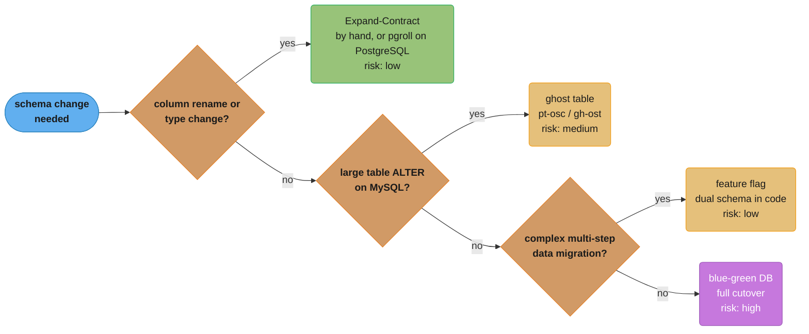
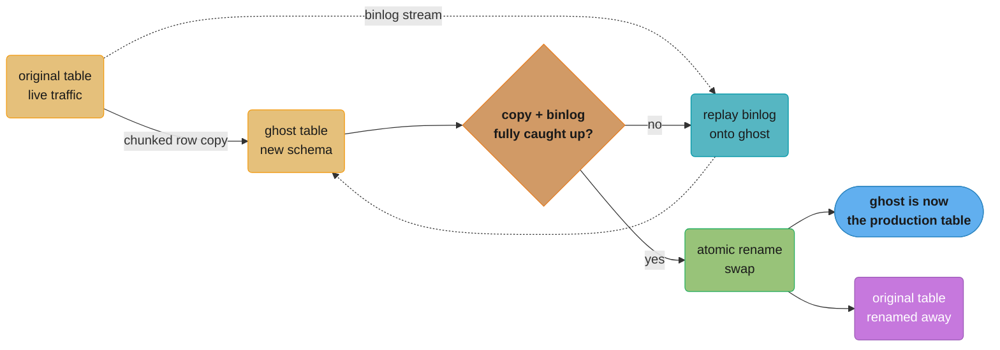

# Database Migrations

## 1. Concept Overview

Database migrations are version-controlled schema changes that transform the database structure from one state to another. As applications evolve, schemas must evolve — new tables, columns, indexes, constraints. Migrations must be: reversible (to support rollbacks), tested (to prevent production disasters), and zero-downtime-compatible (to avoid service interruptions during deployment). The tools that manage migrations (Flyway, Liquibase) provide versioning, checksums, and execution tracking.

Zero-downtime migration is the hardest part: deploying a schema change while old and new application code runs simultaneously requires backward-compatible changes. The expand-contract (parallel change) pattern is the professional approach for renaming columns, changing types, or restructuring data.

---

## 2. Intuition

> **One-line analogy**: Database migrations are like home renovations — you need a detailed plan before starting, you must ensure the house is livable during construction (not just after), and some changes (like moving a load-bearing wall) must be done in stages to avoid the structure collapsing.

**Mental model**: Each migration is a numbered script. Flyway/Liquibase tracks which scripts have run (in a history table). Migrations run in order, once. The state of the database is deterministic from the migration history. Rolling back means running a reverse migration or restoring from backup — not undoing in place.

**Why it matters**: A wrong migration in production can lock tables for minutes (ALTER TABLE in MySQL without online DDL), corrupt data (wrong type cast), or break running services (dropping a column before deploying the code that removes its usage). Most production database incidents are caused by migrations, not application code.

**Key insight**: Application deployments and schema changes are independent axes. At any point during a rolling deployment, old and new code run simultaneously. Your schema must be compatible with both. The expand-contract pattern enforces this: first add the new schema (compatible with both old and new code), then migrate data, then deploy new code that uses the new schema, then remove the old schema.

---

## 3. Core Principles

- **Versioned migrations**: Each migration has a unique version number. Applied in order. Once applied, never modified.
- **Checksum integrity**: Flyway checksums each migration file. Modifying an applied migration causes Flyway to refuse to run and alert.
- **Idempotent repeatable migrations**: Views, stored procedures, and functions that must always reflect the latest version use repeatable migrations (prefixed R__, re-run when checksum changes).
- **Backward compatibility**: During rolling deployments, old code and new code run simultaneously. Schema changes must not break old code.
- **Offline DDL vs online DDL**: Some ALTER TABLE operations take an exclusive lock (lock the table, block all reads/writes). On MySQL, use online DDL tools (pt-online-schema-change, gh-ost, native online DDL) for large tables. On PostgreSQL, most additive DDL is already metadata-only or has a non-blocking form (`CONCURRENTLY`, `NOT VALID`), so the hard part is serving two app versions during a breaking change, which versioned-view tools such as pgroll automate (§6.4).

---

## 4. Types / Architectures / Strategies

### 4.1 Flyway vs Liquibase

| Feature | Flyway | Liquibase |
|---------|--------|-----------|
| Primary format | SQL (preferred), Java | XML, YAML, JSON, SQL |
| Rollback | Pro feature (manual undo scripts) | Built-in changeset rollback |
| Changesets | Versioned migrations (V1__, V2__) | Named changesets with IDs |
| Checksum | Per-file checksum | Per-changeset checksum |
| Schema history table | flyway_schema_history | databasechangelog |
| Enterprise features | Flyway Teams: undo, versioned schema, drift detection | Liquibase Secure: quality checks (Community is FSL-licensed since 5.0, September 2025) |
| Spring Boot integration | Auto-configured; Boot 4 needs `spring-boot-starter-flyway`, `flyway-core` alone does not trigger it | Auto-configured; Boot 4 needs `spring-boot-starter-liquibase` |
| Community | Large | Large |
| Best for | Greenfield, SQL-focused | Enterprise, XML-pref teams |

### 4.2 Zero-Downtime Migration Strategies

| Strategy | Description | Risk | Use When |
|----------|-------------|------|---------|
| Expand-Contract | Add new, keep old, migrate, remove old | Low | Column rename, type change |
| Versioned views (pgroll, Reshape) | Tool-run expand-contract on PostgreSQL: old and new schema served as views, triggers sync both column versions | Low | PostgreSQL breaking change while two app versions are live |
| Ghost table (pt-osc, gh-ost) | Copy-as-you-go with triggers | Medium | Large table ALTER |
| Blue-Green DB | Two databases, cutover | High | Major restructuring |
| Feature flag | Code supports both schemas behind flag | Low | Complex data migration |



Walking the table above as a decision path: default to expand-contract for an ordinary column rename or type change, and reach for ghost-table copying, a feature flag, or a full blue-green cutover only when the change does not fit that low-risk case.

---

## 5. Architecture Diagrams

### Expand-Contract (Parallel Change) Pattern

```mermaid
flowchart LR
    classDef io      fill:#61afef,stroke:#2e86c1,color:#1a1a1a,font-weight:bold
    classDef frozen  fill:#c678dd,stroke:#9b59b6,color:#fff
    classDef train   fill:#98c379,stroke:#27ae60,color:#1a1a1a
    classDef mathOp  fill:#d19a66,stroke:#e67e22,color:#1a1a1a,font-weight:bold
    classDef lossN   fill:#e06c75,stroke:#c0392b,color:#fff,font-weight:bold
    classDef req     fill:#56b6c2,stroke:#0097a7,color:#1a1a1a
    classDef base    fill:#e5c07b,stroke:#f39c12,color:#1a1a1a

    Start(["rename phone to<br/>phone_number<br/>100M rows · zero downtime"]) -->|"Week 1"| P1("PHASE 1 — EXPAND<br/>V15: ADD COLUMN phone_number<br/>new code dual-writes both")
    P1 -->|"Week 2"| P2("PHASE 2 — MIGRATE<br/>V16: backfill phone_number<br/>from phone, batched")
    P2 -->|"Week 3"| P3("PHASE 3 — SWAP<br/>new code reads/writes<br/>phone_number only")
    P3 -->|"Week 4"| P4("PHASE 4 — CONTRACT<br/>V17: DROP COLUMN phone")
    P4 --> Done(["zero downtime achieved<br/>no code ever saw<br/>a missing column"])

    class Start,Done io
    class P1 base
    class P2 mathOp
    class P3 train
    class P4 frozen
```



Each phase ships as its own Flyway migration (V15 to V17); old and new application code stay compatible with the schema at every step, and `phone` is dropped only in the final phase, once nothing references it, matching the 4-week rollout described above.

### Flyway Migration File Structure

```
src/main/resources/db/migration/
  V1__create_users.sql
  V2__create_orders.sql
  V3__add_user_email_index.sql
  V4__add_order_status.sql
  V5__rename_phone_expand.sql      <- phase 1 of rename
  V6__migrate_phone_data.sql       <- phase 2 of rename
  V7__rename_phone_contract.sql    <- phase 4 of rename
  V8__add_payment_table.sql
  R__views.sql                     <- repeatable: re-run when changed
  U8__add_payment_table.sql        <- undo migration (Flyway Teams)

flyway_schema_history table:
  version | description           | checksum   | success | installed_on
  1       | create users          | 1234567890 | true    | 2024-01-01
  2       | create orders         | 0987654321 | true    | 2024-01-02
  ...
  8       | add payment table     | 1122334455 | true    | 2024-05-01
```

---

## 6. How It Works — Detailed Mechanics

### 6.1 Flyway Configuration (Spring Boot)

```yaml
# application.yml
spring:
  flyway:
    enabled: true
    locations: classpath:db/migration
    baseline-on-migrate: true     # if existing DB without migration history
    baseline-version: 0
    validate-on-migrate: true     # fail if checksums changed (default true)
    out-of-order: false           # disallow running older versions after newer
    table: flyway_schema_history  # custom history table name
    placeholders:
      schema: myapp               # ${schema} in SQL files
```

```sql
-- V1__create_users.sql
-- Comments allowed; single transaction for the entire file
CREATE TABLE users (
    id          BIGSERIAL PRIMARY KEY,
    email       VARCHAR(255) NOT NULL UNIQUE,
    name        VARCHAR(255) NOT NULL,
    created_at  TIMESTAMP    NOT NULL DEFAULT CURRENT_TIMESTAMP,
    deleted_at  TIMESTAMP
);

CREATE INDEX idx_users_email ON users(email);
CREATE INDEX idx_users_created ON users(created_at DESC);
```

### 6.2 Safe Zero-Downtime Migration Patterns

```sql
-- SAFE: Adding a nullable column (no table rewrite in PostgreSQL)
ALTER TABLE orders ADD COLUMN discount_amount DECIMAL(10,2);

-- SAFE: Adding a column with a default value in PostgreSQL 11+
-- (Previously required table rewrite for DEFAULT; now metadata-only)
ALTER TABLE orders ADD COLUMN processed BOOLEAN NOT NULL DEFAULT FALSE;

-- SAFE: Adding an index CONCURRENTLY (no table lock)
-- Runs in background, slower, but does not block reads/writes.
-- Flyway wraps each migration in a transaction and CONCURRENTLY cannot run inside one,
-- so this statement needs its own file with the directive below at the top:
--   -- flyway:executeInTransaction=false
CREATE INDEX CONCURRENTLY idx_orders_status ON orders(status);

-- SAFE (PostgreSQL 18+): NOT NULL on an existing column as a NOT VALID constraint
-- Step 1: brief ACCESS EXCLUSIVE lock, no scan; new writes are checked from here on.
-- lock_timeout makes it fail fast instead of queueing every query behind a long transaction.
SET lock_timeout = '2s';
ALTER TABLE orders ADD CONSTRAINT orders_user_id_nn NOT NULL user_id NOT VALID;
-- Step 2: scan existing rows under SHARE UPDATE EXCLUSIVE (reads and writes continue)
ALTER TABLE orders VALIDATE CONSTRAINT orders_user_id_nn;
-- Never finish with ALTER COLUMN ... SET NOT NULL instead: on a column with an invalid
-- not-null constraint, SET NOT NULL validates it while holding ACCESS EXCLUSIVE.

-- SAFE (PostgreSQL 12 to 17): NOT VALID is not allowed on NOT NULL, so prove it with a CHECK
ALTER TABLE orders ADD CONSTRAINT orders_user_id_not_null
  CHECK (user_id IS NOT NULL) NOT VALID;
ALTER TABLE orders VALIDATE CONSTRAINT orders_user_id_not_null;
-- SET NOT NULL sees the validated CHECK and skips the scan, so its ACCESS EXCLUSIVE lock is brief
ALTER TABLE orders ALTER COLUMN user_id SET NOT NULL;
ALTER TABLE orders DROP CONSTRAINT orders_user_id_not_null;

-- SAFE: Adding a foreign key constraint (same NOT VALID pattern)
ALTER TABLE orders ADD CONSTRAINT fk_orders_users
  FOREIGN KEY (user_id) REFERENCES users(id) NOT VALID;
ALTER TABLE orders VALIDATE CONSTRAINT fk_orders_users;

-- SAFE since PostgreSQL 9.2: widening a varchar length limit, or dropping it for TEXT,
-- is metadata-only -- the ACCESS EXCLUSIVE lock is taken but released immediately
ALTER TABLE orders ALTER COLUMN status TYPE VARCHAR(100);
ALTER TABLE orders ALTER COLUMN status TYPE TEXT;

-- UNSAFE: a type change that needs every row re-encoded or re-checked
ALTER TABLE orders ALTER COLUMN id TYPE BIGINT;              -- full rewrite, holds the lock
ALTER TABLE orders ALTER COLUMN status TYPE VARCHAR(20);     -- NARROWING rescans every row
-- SAFER approach: expand-contract pattern
```

### 6.3 gh-ost for Large Table Alterations



gh-ost copies rows into a new ghost table in chunks while replaying the MySQL binlog to keep it in sync, then atomically renames the tables once caught up — no triggers and no long-held lock, unlike a plain `ALTER TABLE`.

```bash
# gh-ost creates a ghost table, copies rows, uses MySQL binlog for changes
# Zero downtime for ALTER TABLE on large tables

gh-ost \
  --user="ghuser" \
  --password="ghpass" \
  --host="mysql-primary" \
  --database="myapp" \
  --table="orders" \
  --alter="ADD COLUMN discount_code VARCHAR(50), ADD INDEX idx_discount_code(discount_code)" \
  --execute \
  --max-load=Threads_running=25 \     # pause if DB load exceeds threshold
  --critical-load=Threads_running=50 \ # abort if critical threshold exceeded
  --chunk-size=1000 \                  # rows per batch copy
  --throttle-control-replicas="mysql-replica:3306" \  # monitor replica lag
  --max-lag-millis=1500 \              # pause if replica lag exceeds 1.5s
  --ok-to-drop-table \
  --initially-drop-ghost-table

# PostgreSQL: pg_repack (online table bloat removal) or native DDL
# PostgreSQL 11+: Most ADD COLUMN DEFAULT is metadata-only (no table rewrite)
# PostgreSQL: CREATE INDEX CONCURRENTLY (non-blocking)
```

**The idea behind it.** "Trade one unbounded lock for a very large number of tiny ones, then let the database itself decide how fast you are allowed to go."

A plain `ALTER TABLE` holds a single lock for however long the rewrite takes — an interval nobody can bound in advance. gh-ost converts that into 100,000 lock acquisitions of a millisecond each, which is strictly more total work but has a property the alternative lacks: it can be paused at any point, and it never blocks a production query for longer than one chunk.

| Symbol | What it is |
|--------|------------|
| `--chunk-size=1000` | Rows copied per batch. Each batch is its own short transaction |
| Chunk count | `rows ÷ chunk-size`. The number of separate short locks taken |
| `--max-lag-millis=1500` | Pause copying whenever a replica falls more than 1.5 s behind |
| `--max-load=Threads_running=25` | Pause when the primary already has 25 queries running |
| `--critical-load=Threads_running=50` | Abort entirely — this is a kill switch, not a throttle |
| Binlog replay | Concurrent writes captured from the binlog and applied to the ghost table, so the copy stays current |

**Walk one example.** The 100M-row table from the expand-contract diagram:

```
  chunks  =  100,000,000 / 1,000  =  100,000 chunks

  Wall clock at various per-chunk costs:
      5 ms/chunk  ->    500 s  =   8.3 min
     10 ms/chunk  ->  1,000 s  =  16.7 min
     20 ms/chunk  ->  2,000 s  =  33.3 min

  With throttling pausing roughly half the wall clock (10 ms/chunk):
                        ->  2,000 s  =  33.3 min
```

Two things fall out of this. First, the throttle is the *point*, not an inconvenience: the
migration is deliberately willing to take twice as long so it never competes with production
traffic, and `--max-lag-millis=1500` means replicas — which serve reads — stay usable
throughout. Second, chunk size is a real dial with a real cost on both ends. Raising it to
10,000 cuts the chunk count to 10,000 and reduces per-batch overhead, but each batch now holds
its lock roughly 10x longer, so p99 latency on concurrent queries rises. 1,000 is the common
default because it keeps individual lock hold times in the single-digit-milliseconds range,
which is short enough to hide inside normal query variance.

Note that `--critical-load` is categorically different from `--max-load` despite the similar
name: one pauses and resumes automatically, the other aborts the migration and leaves you to
restart it. Setting them to the same value gives you a migration that dies instead of waiting.

### 6.4 PostgreSQL Online Schema Tools: pgroll, Reshape, and Atlas

MySQL needed gh-ost because many MySQL `ALTER TABLE` forms copy the table. PostgreSQL does most additive DDL without a rewrite (metadata-only `ADD COLUMN`, `CREATE INDEX CONCURRENTLY`, `NOT VALID` constraints), so the hard part on PostgreSQL is different: during a breaking change (rename, type change, a new NOT NULL), the old and new application versions run at the same time against one schema. Two tool families address it.

**Versioned-view tools (pgroll, Reshape)** run expand-contract for you. pgroll (Xata, Apache-2.0, release v0.16.3) reads a JSON migration file:

```json
{
  "name": "02_user_email_not_null",
  "operations": [
    {
      "alter_column": {
        "table": "users",
        "column": "email",
        "nullable": false,
        "up": "SELECT CASE WHEN email IS NULL THEN 'unknown@example.com' ELSE email END",
        "down": "email"
      }
    }
  ]
}
```

```bash
pgroll init                                    # create pgroll's state schema once
pgroll start 02_user_email_not_null.json       # expand: new column, views, triggers, backfill
#   --backfill-batch-size / --backfill-batch-delay throttle the backfill
#   --lock-timeout (default 500 ms) bounds every DDL lock wait
pgroll complete                                # contract: drop old schema, triggers, old column
pgroll rollback                                # or: drop the new version, old one untouched
```

```
  app v1: search_path=public_01_init       app v2: search_path=public_02_user_email_not_null
             |                                           |
             v                                           v
  +--------------------------+               +--------------------------+
  | view users               |               | view users               |
  |   email -> old column    |               |   email -> new column    |
  +--------------------------+               +--------------------------+
               \                                       /
                v                                     v
         +--------------------------------------------------+
         | physical table users                             |
         |   old email (nullable)   new email (NOT NULL)    |
         |   trigger: v1 writes run "up", v2 writes "down"  |
         +--------------------------------------------------+
   pgroll complete: drop the v1 schema and triggers, rename the new column to email
```

*Each app version reads and writes through its own schema of views, and triggers keep both physical columns in step until `complete` removes the old side.*

`pgroll start` adds the new column, creates a schema named after the migration that holds one view per table, installs triggers that apply `up` to writes from old clients and `down` to writes from new clients, and backfills existing rows in batches. Old pods keep their `search_path`; new pods connect with `SET search_path TO 'public_02_user_email_not_null'` (in HikariCP, `connectionInitSql`). Rollback before `complete` is a schema drop with no data loss. Reshape uses the same design (`reshape migration start`, `complete`, `abort`, with the schema picked through `search_path`). The costs: every connection must set the right `search_path`, triggers add write cost on the affected tables until `complete`, and the tool owns the migration history, so it replaces Flyway for that schema rather than running beside it.

**Declarative tools (Atlas)** start from the desired schema instead of a list of steps. `atlas schema apply` diffs an HCL or SQL schema file against the live database and plans the DDL; `atlas migrate diff` writes the same plan out as versioned SQL files for a Flyway-style flow. `atlas migrate lint` checks those files in CI for destructive changes, backward-incompatible changes, data-dependent changes, and table locks or rewrites, with `--atlas:nolint` to suppress checks on one statement or a whole file; since v0.38 lint is not in the free Starter plan, so it needs Atlas Pro or the Apache-2.0 community build. Atlas plans the DDL but does not keep two app versions working, so it pairs with expand-contract rather than replacing it.

### 6.5 Testing Migrations in CI

```java
// Spring Boot test: run migrations against in-memory H2 or Testcontainers PostgreSQL
@SpringBootTest
@ActiveProfiles("test")
class MigrationTest {

    // Flyway runs automatically via Spring Boot auto-configuration
    @Test
    void allMigrationsApplyCleanly() {
        // If we get here, all migrations ran without error
        // Flyway throws FlywayException on migration failure
    }
}

// Testcontainers 2.x (testcontainers-postgresql) for real PostgreSQL behavior:
import org.testcontainers.postgresql.PostgreSQLContainer;

@TestConfiguration
public class TestDatabaseConfig {

    @Bean
    @Primary
    public DataSource testDataSource() {
        PostgreSQLContainer container = new PostgreSQLContainer("postgres:17")
            .withDatabaseName("testdb")
            .withUsername("test")
            .withPassword("test");
        container.start();

        return DataSourceBuilder.create()
            .url(container.getJdbcUrl())
            .username(container.getUsername())
            .password(container.getPassword())
            .build();
    }
}

// Verify schema state after migration:
@Test
void v15MigrationAddsPhoneNumberColumn() {
    // After running all migrations up to V15:
    boolean columnExists = jdbcTemplate.queryForObject(
        "SELECT COUNT(*) > 0 FROM information_schema.columns " +
        "WHERE table_name = 'users' AND column_name = 'phone_number'",
        Boolean.class);
    assertThat(columnExists).isTrue();
}
```

---

## 7. Real-World Examples

**GitHub zero-downtime migrations**: GitHub uses the expand-contract pattern consistently. Their blog post "gh-ost: triggerless online schema migrations for MySQL" describes how they built gh-ost to migrate hundreds of gigabyte tables with no downtime. Key insight: MySQL's LOCK=NONE for DDL has limitations; a proper ghost table approach works at any scale.

**Stripe schema evolution**: Stripe runs thousands of service deployments per week. Their philosophy: schema migrations are deployed before application code that uses new columns. Old columns are never dropped until confirmed to be unused by all deployed versions. They use a 90-day retention window — no column is dropped unless it has been unused for 90+ days (to account for any rollback scenario).

---

## 8. Tradeoffs

| Approach | Downtime | Complexity | Risk | Use Case |
|----------|---------|------------|------|---------|
| Simple ALTER TABLE | Seconds to minutes (lock) | Low | Medium | Small tables (<1M rows) |
| Expand-contract | Zero | High | Low | Any size, production |
| pgroll / Reshape (versioned views) | Zero | Medium | Low | PostgreSQL breaking change with two app versions live |
| gh-ost / pt-osc | Zero | Medium | Medium | Large MySQL tables |
| Blue-green DB | Minutes (cutover) | Very high | High | Major restructuring |

| Migration tool | SQL support | Rollback | Spring integration |
|---------------|-------------|---------|-------------------|
| Flyway | Excellent | Manual (Undo in Pro) | Excellent |
| Liquibase | Good | Built-in | Excellent |

---

## 9. When to Use / When NOT to Use

**Expand-contract**: Use for any production schema change on a table with more than 100K rows, where the application has zero-downtime requirements. Do not skip it because it feels slow — one bad migration can cause hours of downtime.

**CREATE INDEX CONCURRENTLY**: Always use CONCURRENTLY for adding indexes to large production tables. The cost is longer index build time; the benefit is no table lock. Exception: primary key creation or unique constraint creation that requires validation cannot always use CONCURRENTLY.

**Flyway vs Liquibase**: Use Flyway when your team is comfortable with SQL and you want simplicity. Use Liquibase when you need database-independent migrations, multiple formats, or built-in rollback.

---

## 10. Common Pitfalls

**Modifying an applied migration file**: Flyway checksums migration files. Editing V5__migration.sql after it has run causes the checksum to no longer match, and Flyway throws `Migration checksum mismatch` on the next startup. Never modify applied migrations. Create a new migration to fix any errors.

**Missing CONCURRENTLY on index creation**: `CREATE INDEX ON orders(status)` takes a ShareLock on the table — blocks all writes while building. On a table with millions of rows, this can take minutes. All writes queue behind the lock. In production, always use `CREATE INDEX CONCURRENTLY`.

**Putting CONCURRENTLY in an ordinary Flyway migration**: Flyway runs each migration inside a transaction, and PostgreSQL rejects `CREATE INDEX CONCURRENTLY` / `DROP INDEX CONCURRENTLY` there with `cannot run inside a transaction block`. The migration fails on the very first deploy that includes it, which is a broken release rather than a slow one. Give the statement its own migration file headed by `-- flyway:executeInTransaction=false`, and put nothing else in that file: without the transaction there is no rollback, so a second statement failing leaves the first one applied and the history row marked failed.

**DROP COLUMN without checking application usage**: Dropping a column while old application code still reads from it causes SQL errors on SELECT queries that name the column. The safe sequence: (1) deploy new code that does not reference the column; (2) verify old version is completely removed; (3) run the DROP COLUMN migration. Use usage tracking (query logging, code review) to confirm no references.

**Long-running migration holding a transaction**: Running a migration that updates millions of rows in a single transaction (`UPDATE users SET ... WHERE TRUE`) holds a transaction open for minutes, blocking other operations. Break large data migrations into batches with committed transactions between batches.

**Finishing a PostgreSQL 18 NOT VALID NOT NULL with SET NOT NULL**: On PostgreSQL 18, a team added `ADD CONSTRAINT nn NOT NULL user_id NOT VALID` to a 400M-row table, then copied the PG 12 to 17 recipe and ran `ALTER COLUMN user_id SET NOT NULL` as the last step. On a column with an invalid not-null constraint, `SET NOT NULL` validates it, and it does so while holding ACCESS EXCLUSIVE, so every read and write on the table queued for the length of the scan. Fix: finish with `VALIDATE CONSTRAINT nn`, which scans under SHARE UPDATE EXCLUSIVE and lets traffic continue; use the CHECK-then-`SET NOT NULL` sequence only on PostgreSQL 12 to 17.

**Running migrations from multiple application instances simultaneously**: When deploying to a cluster, multiple instances may attempt to run Flyway simultaneously. Flyway uses an advisory lock (or lock table row) to prevent concurrent migration runs. However, if the lock mechanism fails or is bypassed (e.g., two separate schema-creation scripts), migrations can be duplicated or corrupted. Ensure only one instance runs Flyway on startup (e.g., run migrations in the Kubernetes init container, not in all pod startups).

---

## 11. Technologies & Tools

| Tool | Purpose |
|------|---------|
| Flyway | Java-first SQL migration tool |
| Liquibase | XML/YAML/SQL migration tool |
| gh-ost | GitHub's online MySQL schema tool |
| pt-online-schema-change | Percona's MySQL online schema change |
| `pg_repack` | PostgreSQL online table/index defragmentation |
| pgroll | PostgreSQL expand-contract through versioned view schemas, sync triggers, and batched backfill (Xata, Apache-2.0) |
| Reshape | PostgreSQL zero-downtime migrations with the same views-per-migration and `search_path` design |
| Atlas | Declarative schema-as-code (`atlas schema apply`), versioned diff generation, and `atlas migrate lint` CI checks |
| `flyway migrate` | CLI or Maven/Gradle plugin |
| `liquibase update` | CLI or build plugin |
| Testcontainers | Real DB for migration testing in CI |
| `pg_dump --schema-only` | Export schema for review |
| `ALTER TABLE ... NOT VALID` | PostgreSQL FOREIGN KEY, CHECK, and (PostgreSQL 18+) NOT NULL constraint without a full scan at creation |

---

## 12. Interview Questions with Answers

**Q: What is the expand-contract pattern for zero-downtime migrations?**
**Short:** Expand-contract adds the new schema alongside the old, backfills, then removes the old only once nothing depends on it.

Expand-contract (also called parallel change) is a three-phase approach: (1) Expand: add the new schema element (new column, table) while keeping the old. Deploy code that writes to both. (2) Migrate: backfill existing data to the new schema. (3) Contract: deploy code that reads/writes only the new schema; remove the old schema. This ensures that at every point, both the old and new application code can function correctly. It eliminates the race condition where a migration removes a column before all instances of the old code are updated.

**Q: How does Flyway track which migrations have been applied?**
**Short:** Flyway records each applied migration's version, checksum, and status in a flyway_schema_history table.

Flyway maintains a `flyway_schema_history` table in the target database. Each row records: version number, description, script filename, checksum (a CRC-32 of the file content, not a cryptographic hash), whether it succeeded, and the timestamp. On application startup, Flyway reads this table, compares against the available migration files, and applies any pending migrations in version order. If a migration file's checksum does not match the stored checksum, Flyway throws an error — preventing silent script modifications.

**Q: What is CREATE INDEX CONCURRENTLY and when must you use it?**
**Short:** CREATE INDEX CONCURRENTLY builds an index without an exclusive lock, essential on busy production tables to avoid blocking writes.

`CREATE INDEX CONCURRENTLY` builds an index without taking an exclusive table lock. It performs multiple passes: first scan creates the index structure without blocking writes; subsequent passes catch up with changes made during the first scan. The downside: takes significantly longer than regular CREATE INDEX. Always use CONCURRENTLY for adding indexes to production tables with significant write traffic — a regular CREATE INDEX on a busy table blocks all writes until the index builds, potentially causing timeouts and cascading failures. The migration-tool trap: `CONCURRENTLY` cannot run inside a transaction block, and Flyway wraps every migration in one by default, so a `CREATE INDEX CONCURRENTLY` in a normal migration fails with `CREATE INDEX CONCURRENTLY cannot run inside a transaction block`. Put it in its own file with `-- flyway:executeInTransaction=false` at the top, and keep that file to a single statement, since with the transaction gone a mid-file failure leaves the earlier statements committed.

**Q: How do you handle a migration that fails in production?**
**Short:** Repair the failed history entry, revert any partial change manually, and ship the fix as a new migration version, never editing the failed one.

(1) Flyway marks failed migrations as failed in the history table. The application will not start until the migration is repaired. (2) Fix the issue: if the migration partially applied, manually revert the partial change and mark it repaired (`flyway repair`). (3) Create a corrected migration with a new version number (do NOT modify the failed migration file — its checksum is tracked). (4) In testing environments: `flyway clean` + remigrate is acceptable; never run `flyway clean` in production (drops all tables).

**Q: What is the difference between Flyway's versioned and repeatable migrations?**
**Short:** Versioned migrations run once in order, while repeatable migrations re-run whenever their checksum changes.

Versioned migrations (V1__, V2__) are applied once, in order, and never re-applied. Repeatable migrations (R__views.sql) are re-applied whenever their checksum changes. Use repeatable for database objects that should always reflect their latest definition: views, stored procedures, functions, and seed data. Every time R__views.sql changes, Flyway re-runs it, replacing the previous version of the views.

**Q: How do you safely add a NOT NULL column to a large table?**
**Short:** Add it nullable and backfill in batches; then on PostgreSQL 18 add NOT NULL ... NOT VALID and VALIDATE it, or on 12 to 17 validate a CHECK before SET NOT NULL.

If one constant default fits every existing row, PostgreSQL 11+ makes `ALTER TABLE t ADD COLUMN new_col TYPE NOT NULL DEFAULT x` metadata-only, with no rewrite. Otherwise: (1) Add the column as nullable: `ALTER TABLE t ADD COLUMN new_col TYPE`. (2) Backfill in batches keyed on the primary key, because PostgreSQL `UPDATE` has no `LIMIT`: `UPDATE t SET new_col = default_val WHERE id IN (SELECT id FROM t WHERE new_col IS NULL LIMIT 10000)` (repeat until 0 rows). (3) On PostgreSQL 18+, add the constraint as NOT VALID, which takes a brief ACCESS EXCLUSIVE lock and no scan: `ALTER TABLE t ADD CONSTRAINT nn NOT NULL new_col NOT VALID`, with `SET lock_timeout = '2s'` first so it cannot queue traffic behind a long transaction. (4) Validate it: `ALTER TABLE t VALIDATE CONSTRAINT nn` scans under SHARE UPDATE EXCLUSIVE, so reads and writes continue. On PostgreSQL 12 to 17, NOT VALID is not allowed on NOT NULL, so steps 3 and 4 use `CHECK (new_col IS NOT NULL) NOT VALID` and `VALIDATE CONSTRAINT`, then `ALTER COLUMN new_col SET NOT NULL`, which sees the validated CHECK and skips the scan, then drop the CHECK.

**Q: On PostgreSQL 18, why must a NOT VALID NOT NULL constraint be finished with VALIDATE CONSTRAINT rather than SET NOT NULL?**
**Short:** SET NOT NULL validates an invalid not-null constraint while holding ACCESS EXCLUSIVE, blocking all traffic during the scan; VALIDATE CONSTRAINT scans under SHARE UPDATE EXCLUSIVE.

PostgreSQL 18 stores not-null constraints in `pg_constraint` and lets `ADD CONSTRAINT nn NOT NULL col NOT VALID` skip the initial scan. The PostgreSQL 18 `ALTER TABLE` docs say that if a column has an invalid not-null constraint, `SET NOT NULL` validates it, and `ALTER COLUMN ... SET NOT NULL` holds an ACCESS EXCLUSIVE lock, so the full-table scan runs with every read and write on the table blocked. On a 400M-row table that can be minutes of total outage. `VALIDATE CONSTRAINT nn` does the same scan under SHARE UPDATE EXCLUSIVE, which conflicts only with VACUUM, ANALYZE, `CREATE INDEX CONCURRENTLY`, and other DDL, because concurrent transactions already enforce the constraint on rows they write. The trap comes from the PostgreSQL 12 to 17 recipe, where `SET NOT NULL` is the correct last step because the validated CHECK lets it skip the scan. On 18, end with `VALIDATE CONSTRAINT` and drop the `SET NOT NULL` step.

**Q: How would you rename a column with zero downtime?**
**Short:** Rename via expand-contract: add the new column, dual-write, backfill, cut reads over, then drop the old column.

Use expand-contract: (1) Add the new column name. (2) Update application code to write to both the old and new column. (3) Backfill: update all rows where the new column is null to copy from the old. (4) Deploy code that reads from the new column only (writes to both). (5) Deploy code that reads and writes only the new column (drop writes to old). (6) Drop the old column once no running instances reference it.

**Q: What is gh-ost and how does it enable online schema changes in MySQL?**
**Short:** gh-ost copies rows into a ghost table while replaying the binlog to sync it, then atomically swaps table names.

gh-ost creates a "ghost" table with the desired new schema, copies rows from the original table to the ghost table, and simultaneously applies changes from MySQL's binary log (binlog) to keep the ghost table in sync. When the copy and sync are complete, gh-ost atomically swaps the original and ghost table names. Unlike triggers (used by pt-osc), gh-ost reads the binlog independently — no write amplification from triggers. It includes throttling mechanisms (pause on high load, replica lag) to prevent impacting production traffic.

**Q: How does pgroll let the old and new application versions run against one PostgreSQL database during a breaking change?**
**Short:** pgroll exposes each schema version as its own schema of views over the physical tables, and triggers sync the old and new columns until pgroll complete drops the old version.

`pgroll start migration.json` makes only additive physical changes: for an `alter_column` that sets NOT NULL or changes a type, it adds a new column next to the old one. It then creates a schema named after the migration (for example `public_02_user_email_not_null`) containing one view per table, so the new version sees the new column under the original name, while the previous version's schema still maps to the old column. Triggers run the migration's `up` SQL on writes from old clients and `down` on writes from new clients, and existing rows are backfilled in batches (`--backfill-batch-size`, `--backfill-batch-delay`). Each app version chooses its schema with `search_path`. `pgroll complete` drops the old schema, the triggers, and the old column and renames the new one; `pgroll rollback` drops the new version and leaves the old untouched. DDL runs with a 500 ms `lock_timeout` by default, so a lock wait fails fast instead of stalling traffic. The cost is that every connection must set `search_path` and writes pay trigger overhead until `complete`.

**Q: When does a declarative schema tool such as Atlas fit better than hand-written Flyway migrations?**
**Short:** When many schemas or teams make hand-written DDL hard to review: Atlas plans DDL from a desired-state schema and lints it in CI for destructive, locking, and breaking changes.

Hand-written Flyway files work well when one team owns one schema and reviewers read every `ALTER TABLE`. Atlas starts from the desired schema (HCL or SQL): `atlas schema apply` diffs it against the live database and plans the DDL, and `atlas migrate diff` writes that plan out as versioned files, so the history stays reviewable. `atlas migrate lint` then checks the files in CI for destructive changes (dropped columns or tables), backward-incompatible changes, data-dependent changes, and table locks or rewrites, and fails the build unless a statement or file opts out with `--atlas:nolint`; since v0.38 lint is not in the free Starter plan, so it needs Atlas Pro or the Apache-2.0 community build. This pays off with dozens of services or tenants where reviewers miss a lock-heavy statement. It does not replace expand-contract: Atlas can generate a rename as one `ALTER`, and keeping the old app version working is still a sequencing decision that pgroll or a manual expand-contract plan has to make.

**Q: How do you test database migrations in a CI pipeline?**
**Short:** Test migrations with a real database via Testcontainers, covering schema structure, data transformation, rollback, and performance.

(1) Unit: test each migration file's SQL syntax with a real database (Testcontainers PostgreSQL/MySQL). (2) Integration: run the full migration sequence against a clean schema; verify table structure, indexes, and constraints match expectations. (3) Data migration: if the migration transforms data, load representative test data, run the migration, assert the transformed data is correct. (4) Rollback: if using Liquibase with rollback, test the rollback script. (5) Performance: for large-table migrations, test execution time on a copy of production data.

**Q: What is flyway repair and when do you use it?**
**Short:** flyway repair clears failed migration records and realigns checksums, used after manually cleaning up a partial failure.

`flyway repair` does two things: (1) removes any failed migration records from the schema history table so the migration can be re-run after fixing the SQL; (2) realigns checksums for applied migrations that you have modified in place (only for resolving drift in non-production environments). Use repair when a migration failed partway and you have cleaned up the partial effects manually. Never repair checksums on production unless you fully understand the consequences.

**Q: How do you run Flyway in a Kubernetes deployment without running it in every pod?**
**Short:** Run flyway migrate in a single init container or Job so only one process applies migrations before app pods start.

Use an init container that runs `flyway migrate` before the main container starts. Only the init container runs migrations. All main application pods start only after the init container succeeds. This prevents race conditions from multiple pods running migrations simultaneously. The Kubernetes Job resource is an alternative: run migrations as a one-time job before rolling out the main Deployment. Ensure the migration user has `flyway_schema_history` write permissions; the application user can have read-only schema access.

**Q: What are baseline migrations in Flyway?**
**Short:** Baseline lets Flyway adopt a pre-existing schema by marking migrations up to a version as applied without running them.

Baseline is for databases that already have a schema (pre-Flyway). When `baseline-on-migrate` is true, if Flyway finds no history table and the database is not empty, it creates the history table and marks all existing migrations up to `baseline-version` as already applied — without executing them. This allows Flyway to manage a pre-existing database. All migrations after the baseline version will run normally. Never use baseline on a fresh empty database; that is the default starting scenario for Flyway.

**Q: Why is Hibernate's `ddl-auto=update` risky in production, and what should you use instead?**
**Short:** ddl-auto=update applies unreviewed DDL from entity mappings at startup; use ddl-auto=validate with versioned Flyway or Liquibase migrations instead.

Hibernate's `ddl-auto=update` infers schema changes directly from your JPA entity mappings and applies them at application startup, bypassing migration history, code review, and any rollback path. Because every pod in a rolling deployment runs its own inference pass independently, two instances starting within seconds of each other can issue conflicting DDL against the same table, and a typo in an `@Column` annotation becomes a live `ALTER TABLE` the next time the service restarts. Set `ddl-auto=validate` (or `none`) in every environment above local development so Hibernate only checks entity mappings against the existing schema and fails fast on a mismatch, then drive every real schema change through a reviewed, versioned Flyway or Liquibase migration. Never let an ORM's automatic schema inference touch a database that any shared environment depends on.

**Q: In a microservices architecture where each service owns its own schema, how do you coordinate a change that spans two services' data?**
**Short:** Each service migrates only its own schema, and cross-service changes are coordinated through a versioned API or event contract, not a shared migration.

In a shared-nothing microservices deployment, only the service that owns a schema runs migrations against it; no migration may touch two services' tables at once. This holds even when both schemas happen to live on the same physical database instance — ownership is a service boundary, not a storage boundary. When two services need related data to change together, coordinate through each service's own migration pipeline plus a versioned API or event contract between them, treating the boundary as the same eventual-consistency problem as any other cross-service data flow rather than a distributed transaction. Run each service's migrations inside that service's own CI/CD pipeline and deployment, so a schema change in service A never blocks or waits on service B's migration, and version the shared contract itself so a consumer can adopt a producer's change on its own release schedule. Treat cross-service data dependencies as an integration contract to version, never as a multi-schema migration to run atomically.

**Q: What is the feature-flag (dual-schema) strategy for complex data migrations and when is it preferable to backfilling data?**
**Short:** A runtime toggle lets code switch between old and new schema logic, useful when the transformation itself is complex or uncertain.

The feature-flag strategy ships code that reads and writes both old and new schema shapes behind a runtime toggle, not a new deployment. This is preferable to a pure backfill-then-cutover approach when the data transformation itself is complex or uncertain enough that you need to flip back and forth between old and new logic while validating correctness in production. Because the flag is a runtime toggle, a bad migration can be reverted instantly by flipping it off, unlike expand-contract's schema changes which require another migration to undo. Use feature flags when the risk lives in the data transformation logic itself, not just in the schema change.

**Q: What does Flyway's out-of-order configuration control, and why is it disabled by default?**
**Short:** out-of-order controls whether a lower-versioned migration may run after a higher one already applied, and it is off by default to catch coordination gaps.

The `out-of-order` setting controls whether Flyway will apply a migration whose version number is lower than one already applied, such as running V3 after V5 has already run. It is disabled by default because allowing out-of-order migrations can mask a coordination problem — two developers creating migrations independently on different branches, or a migration that was supposed to run earlier but was merged late. Enabling it is sometimes necessary for parallel feature branches that each add migrations concurrently, but it trades away Flyway's guarantee that migrations run in a single, predictable sequence. Leave `out-of-order` disabled unless your branching strategy specifically requires interleaved migration versions, and enable it only with strict code-review discipline around version numbering.

---

## 13. Best Practices

- Never modify an already-applied migration file — create a new one.
- Always use CREATE INDEX CONCURRENTLY for production indexes.
- Use expand-contract for any column rename or type change in production.
- Run migrations from a single init container or migration job, not from each application instance.
- Include migration tests in CI with Testcontainers running the real database engine.
- Break large data migrations (UPDATE ALL rows) into batches of 1,000–10,000 rows with COMMIT between batches.
- On PostgreSQL 18+, add NOT NULL constraints as NOT VALID and finish with `VALIDATE CONSTRAINT`; on 12 to 17, validate a CHECK first and then `SET NOT NULL`.
- Document each migration's purpose with a comment at the top of the SQL file.

---

## 14. Case Study

**Problem**: An order management system needed to rename the `customer_name` column to `buyer_name` and change its type from VARCHAR(100) to TEXT, across a 200M row `orders` table in production. Zero downtime required.

**Plan**:
The index steps get their own single-statement files. `CREATE INDEX CONCURRENTLY` and `DROP INDEX CONCURRENTLY` cannot run inside a transaction block, and Flyway wraps a migration in one unless the file says otherwise — combining the `ALTER TABLE` and the index into one migration is what makes the first deploy fail.

```sql
-- V20__expand_buyer_name.sql
-- Phase 1: ADD new column (metadata-only for TEXT, no table rewrite)
ALTER TABLE orders ADD COLUMN buyer_name TEXT;
```

```sql
-- V21__index_buyer_name.sql
-- flyway:executeInTransaction=false
-- One statement only: with the transaction disabled there is no rollback.
CREATE INDEX CONCURRENTLY idx_orders_buyer_name ON orders(buyer_name);
```

```sql
-- V22__migrate_buyer_name_data.sql
-- Phase 2: Backfill in batches (run separately, not in one migration transaction)
-- (This migration calls a custom Flyway Java callback that does batched updates)
-- Or: use a separate batch job outside migration:
-- UPDATE orders SET buyer_name = customer_name
--   WHERE id IN (SELECT id FROM orders WHERE buyer_name IS NULL LIMIT 10000);
-- (repeat 20,000 times for 200M rows, ~2 rows/ms = ~28 hours for 200M)
```

```sql
-- V23__drop_customer_name_index.sql (deployed after code switches to buyer_name)
-- flyway:executeInTransaction=false
DROP INDEX CONCURRENTLY idx_orders_customer_name;
```

```sql
-- V24__contract_buyer_name.sql
-- Phase 3: Contract: drop old column
ALTER TABLE orders DROP COLUMN customer_name;
```

**Code changes**:
- V20/V21 deployed: writes to both `customer_name` and `buyer_name` (dual-write)
- V22 data migration complete (backfilled all rows)
- New code deployed: reads from `buyer_name` only, writes to both
- After full rollout: writes to `buyer_name` only
- V23/V24 deployed: `customer_name` index and column dropped

**Outcome**: Zero downtime. 200M rows backfilled over 28 hours using a background job. No table locks taken during business hours. Entire migration completed over 2 weeks with full rollback capability at each step.
