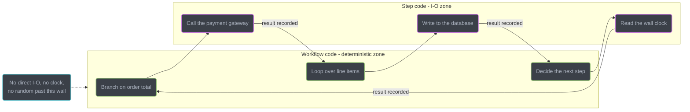
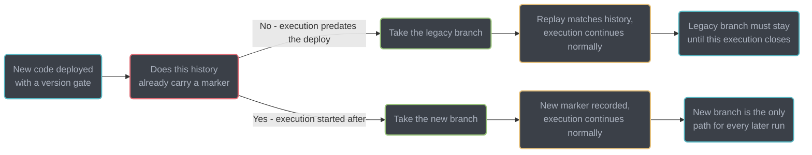
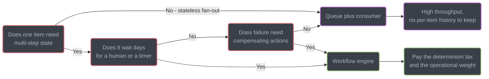

# Durable Execution and Workflows

Durable execution is the pattern of making a program's *progress* — not just its data — survive a crash: instead of writing state to a row and polling it back, you event-source the function's own execution so a worker can be killed mid-line and another one resumes exactly where it left off. This page teaches the pattern engine-agnostically — the determinism constraint, the versioning hazard, the primitives, and the decision of when it beats a plain queue — using Temporal's Java SDK only as the concrete vehicle for code, the way the section already uses Kafka or gRPC as a vehicle for a pattern that is bigger than the product.

---

## 1. Concept Overview

A normal function's progress lives in a stack frame: the program counter, the local variables, the call depth. Kill the process and all of it is gone. Every hand-built workaround — a `status` column, a `retry_count`, a cron that sweeps rows stuck in `PENDING`, a compensating job triggered by a dead-letter queue — is a partial, bespoke reconstruction of that lost progress, rebuilt by hand every time a team hits this problem for the first time.

**Durable execution persists the progress itself**, not a summary of it. A durable-execution engine appends every meaningful step of a function's run to an append-only **history** — a log of (command, event) pairs — before letting the function move past that step. If the worker dies at step 7 of 12, another worker replays the function from line one, and the runtime **short-circuits** every call whose result is already in the history, returning the recorded value instantly instead of redoing the work. Execution arrives back at step 7 with the same local variables, the same loop counter, the same call stack, and continues from there. The code itself **is** the state machine; there is no separate state diagram to keep in sync with it.

Contrast this with a job queue plus a database row, which is the thing nearly every team builds at least once before reaching for a durable-execution engine. A three-line intent —

```text
reserved = reserveInventory(order)
charged  = authorizePayment(order)
shipped  = ship(order)
```

— becomes, by hand: a `status` enum with six values, an `attempt_count` column, a consumer per step, a dead-letter queue per consumer, a cron sweeping rows stuck in `PAYMENT_PENDING`, a hand-written compensation path for when shipping fails after payment succeeds, and a runbook nobody fully trusts. None of that machinery is business logic. All of it exists to reconstruct progress that the programming language already gave you for free and the crash took away. A durable-execution engine gives it back, and the reserve/charge/ship intent above becomes, verbatim, the function body.

### Scope — what this page owns, and what it deliberately does not re-teach

Three modules already exist in this repository that a reader might expect this page to duplicate. It does not, and each boundary is worth stating explicitly so this module is never re-audited as redundant:

- [`technologies/temporal_durable_execution`](../../technologies/temporal_durable_execution/temporal_durable_execution.md) owns the **Temporal product**: its two-plane architecture (Service versus workers), task-queue matching and sticky caches, the full SDK surface (Nexus, Schedules, Update-with-Start, Worker Deployments), and its operational surface (namespaces, retention, archival, rate limits). This page does not re-teach any of that. Where Temporal's Java SDK is used below as a concrete code vehicle, it is illustrating the *pattern*, not documenting the *product* — read the technologies page for the product.
- [`llm/agents_and_tool_use/durable_long_running_agents`](../../llm/agents_and_tool_use/durable_long_running_agents.md) owns durable execution **applied to LLM agents specifically** — checkpointing a conversation/tool-call loop, context compaction over a long run, and cost caps for a process that spends tokens while it sleeps. This page is the general-purpose engineering pattern underneath that use case; it does not cover agent-specific concerns like context windows or token budgets.
- [`../distributed_transactions_and_consistency/distributed_transactions_and_consistency.md`](../distributed_transactions_and_consistency/distributed_transactions_and_consistency.md) owns **Saga, the transactional outbox, 2PC and idempotency keys built by hand** — the compensating-transaction mechanics or a hand-rolled orchestrator. This page is the answer to the question that module's reader eventually asks: *"and then an engine does all of that bookkeeping for me?"* It cross-links into that module rather than restating its saga step-by-step mechanics, and §14 here is explicitly the case study of replacing a hand-rolled saga-plus-cron-plus-status-column with a durable-execution engine.

---

## 2. Intuition

> **One-line analogy:** durable execution gives an ordinary function an infinitely long, crash-proof call stack.

**Mental model.** Stop treating workflow state as something you write to a database. A durable function's local variables, its loop counters, its `if` branches and its call stack **are** the durable state — the engine reconstructs them by replaying the history, not by you reading a row. You never `UPDATE orders SET status = 'PAID'`; you write `boolean paid = authorizePayment(order)` and the fact that payment succeeded is a recorded event. The next time anything needs to know, the runtime rebuilds `paid` by replaying that event straight into the variable.

**Why it matters.** The payoff is the line of code that would be reckless anywhere else: `sleep(Duration.ofDays(30))` as a legitimate, cheap statement in production. So is a loop that waits for a human to click Approve, a saga that unwinds six services' worth of side effects on failure, and a retry policy that keeps trying for a week without a single thread being held open for any of it.

**Key insight.** *The history is the source of truth; your local variables are a cache of it.* Every property of the pattern falls out of that one sentence:

- Replay must be **deterministic**, because a cache is only valid if recomputing it produces the same answer — hence the constraint in §6.2.
- The history has a **size limit**, because a worker loads and replays it into memory — hence the checkpoint-and-restart primitive in §6.4.
- Changing the code changes what replay recomputes — hence **versioning is a deploy concern**, not an afterthought, covered in depth in §6.5.
- **Side-effecting work exists as a separate unit at all** only because I/O is exactly the thing that cannot be safely recomputed. Its *result* is what gets recorded, so it need never run twice for the same step.

---

## 3. Core Principles

- **Durable progress, not durable data.** The pattern persists *where a program is*, not merely what it holds. Every other property below serves this one fact.
- **The history is an append-only log; in-memory state is a fold over it.** This is event sourcing ([`event_sourcing_and_cqrs`](../event_sourcing_and_cqrs/event_sourcing_and_cqrs.md)) applied to a *function's execution* rather than to a domain aggregate — the log entries are steps a program took, not business facts about an order.
- **Replay determinism: same history + same code ⇒ same command sequence.** A durable-execution runtime checks that the commands your code emits on replay match what the history already recorded. A mismatch is a hard failure, not a warning, and it is the single most consequential rule in the pattern (§6.2).
- **The control plane never runs your business logic.** It stores histories, enforces timers, and routes work to workers; the workers — processes you deploy, in your network, against your own dependencies — execute the actual function. This split is common to every engine discussed here, though where the "control plane" and "log" physically live differs sharply (§11).
- **The function decides; the side-effecting step acts.** Anything that reads a clock, calls the network, touches a file, or draws randomness must go through the runtime's deterministic API or be pushed into a side-effecting unit whose *result*, not its *execution*, is what gets replayed.
- **A side-effecting step is at-least-once, so idempotency is still your job.** The engine guarantees the step runs until it succeeds or its policy gives up. It cannot guarantee it ran exactly once end-to-end — a crash between "the charge succeeded" and "the result was recorded" means a retry, and a retry against a non-idempotent payment call is a double charge (§10).
- **A durable timer is server-side state, not a blocked thread.** A month-long wait consumes no worker memory, no thread, and no poll between the moment it starts and the moment it fires.
- **Versioning is a first-class deploy concern from the first production execution.** Long-lived runs guarantee that old histories will be replayed by new code — this is the steady state, not an edge case (§6.5).
- **A queue and a durable-execution engine solve different problems.** A queue delivers a message once; an engine remembers everything that happened to a *process* across an arbitrary span of time. Reaching for the wrong one is the most common architectural mistake in this space (§9).

---

## 4. Types / Architectures / Strategies

### 4.1 The primitive taxonomy — engine-agnostic

Every durable-execution engine covered in §11 expresses some version of this taxonomy, even though the vendor-specific names differ (a "workflow" is Restate's "durable handler"; DBOS calls the same idea a "workflow function"; AWS calls it a "state machine"). The shape is what matters, and the last column is the one that keeps people out of trouble:

| Primitive | Durable? | May do I/O directly? | Blocks the caller? | Wrong tool for… |
|---|---|---|---|---|
| **Workflow / orchestration function** | Yes | **No** | n/a | Anything that fits one request/response, or needs sub-10 ms latency |
| **Activity / step / task** | Yes (result recorded) | **Yes** | The workflow awaits it | Pure computation on data already in scope — the recorded-result overhead buys nothing |
| **Child workflow / sub-orchestration** | Yes | No | Optional | A plain function call — a child has its own history, retention and identity |
| **Signal** | Yes (input recorded) | n/a | No — fire-and-forget | Anything the sender needs a result from — that is a synchronous call, not a signal |
| **Query** | **No** — read-only | **No** | Yes, synchronously | Triggering work or mutating state — a query that mutates is a replay-consistency bug |
| **Timer** | Yes (server state) | n/a | The awaiting code | A latency-sensitive deadline — timers are second-resolution, not millisecond |
| **Cancellation** | Yes (recorded) | n/a | Cooperative | Forcing an immediate stop of in-flight I/O — cancellation is cooperative, not preemptive |
| **Compensation** | Application code | Yes (via a step) | n/a | Anything perfectly reversible — most compensations are new forward operations (a refund), not an undo |

### 4.2 Architectural families — how engines actually differ under the hood

The taxonomy above looks identical across vendors; the *architecture* underneath it does not, and conflating them is the single biggest source of wrong intuition when reading a vendor's docs. Three genuinely different shapes, illustrated by the products in §11 that best represent them:

1. **Central log, replay-the-whole-function.** A separate control plane (Temporal Service, Cadence, Netflix Conductor's server) owns the append-only history for every execution. A worker fetches the history, replays the function from the top on every new decision, and the control plane never executes a line of user code. This is the architecture §6 describes in the most depth, because it makes the determinism constraint the sharpest.
2. **Journaled invocation, no separate database required.** Restate's server is a single self-hosted binary that both routes invocations and owns the journal — there is no external Service cluster and no external database dependency to run it. The programming model still replays a handler against its journal on recovery, but state reads/writes for a "virtual object" are first-class journaled operations rather than something reconstructed purely from replayed function calls.
3. **Library, not infrastructure — the log is your own database.** DBOS ships as a language library your application imports; workflow state and step outputs are rows in **your own Postgres**, written and read by ordinary SQL from inside your process. There is no separate control-plane cluster at all — recovery is another process (or the same one, on restart) querying Postgres for incomplete workflows and resuming them. This is the sharpest architectural departure from family 1: adopting the pattern does not mean adopting a new piece of infrastructure, only a library and a schema.

Family 3's consequence is worth internalizing before reading the decision table in §9: "a workflow engine is a new failure domain" is a claim about family 1 and, to a lesser extent, family 2. It does not describe family 3 at all — DBOS's failure domain is the Postgres you already operate.

**AWS Lambda durable functions** (launched December 2, 2025) are family 1's replay model with the control plane and the workers both run by Lambda. The handler, wrapped by the AWS Durable Execution SDK, receives a `DurableContext`; each side effect goes in a step that Lambda checkpoints, and on resume the function re-runs from the top, skipping completed steps and returning their stored results. Waits suspend the function with no compute charge, and one execution can last up to one year. There is no worker fleet to operate, but the determinism burden is the same as Temporal's, because it is real code being replayed. This is the code-first contrast to Step Functions, whose Amazon States Language definition has no code to replay.

### 4.3 Versioning strategies, taxonomically

Every engine offers some mix of two strategies for the hazard in §6.5, and the choice is a spectrum, not a binary:

| Strategy | Mechanism | Cost |
|---|---|---|
| **In-code branching (patch/version gate)** | A version marker recorded in the history the first time an execution takes the new branch; old executions see no marker and take the old branch | The old branch must stay in the codebase until every execution that predates the patch has closed, then be deleted in a second deploy |
| **Pinned execution + parallel deploys** | An execution is pinned to the code build it started on for its entire life; a new build only affects newly-started executions | No branching in the code at all, but two or more builds must run simultaneously until the old one's executions drain — an operational cost, not a code cost |

---

## 5. Architecture Diagrams

```mermaid
flowchart LR
    classDef store fill:#3b4048,stroke:#e5c07b,stroke-width:2px,color:#abb2bf
    classDef proc fill:#3b4048,stroke:#98c379,stroke-width:2px,color:#abb2bf
    classDef bad fill:#3b4048,stroke:#e06c75,stroke-width:2px,color:#abb2bf
    classDef note fill:#3b4048,stroke:#56b6c2,stroke-width:2px,color:#abb2bf

    A(Step 1 completes) --> B(Step 2 completes)
    B --> C(Step 3 completes)
    C --> D(Worker crashes<br/>mid Step 4)
    D --> E(Durable history<br/>holds Steps 1-3)
    E --> F(A new worker<br/>picks up the run)
    F --> G(Replay Steps 1-3<br/>from history, no I-O)
    G --> H(Local variables<br/>rebuilt in memory)
    H --> I(Execute Step 4<br/>for the first time)

    class A,B,C proc
    class D bad
    class E store
    class F,G note
    class H,I proc
```



The history is what survives the crash; the local variables are only ever a replay of it, which is why steps 1-3 never re-run their side effects on the way back to step 4.



Everything inside the workflow box must be reproducible from its own inputs; everything that cannot be reproduced — a network call, a clock read, a random draw — is pushed across the wall into a step, whose *result* is what actually gets replayed.



An in-flight execution's history decides which branch it takes; skip this fork and old executions replay against code that no longer has their branch, which is the crash-loop in §10.



The decision tree from §9 as a flowchart: a queue wins by default, and only multi-step state plus a long wait or real compensation logic earns the extra machinery of an engine.

---

## 6. How It Works — Detailed Mechanics

### 6.1 Event-sourcing a function, not a domain aggregate

[`event_sourcing_and_cqrs`](../event_sourcing_and_cqrs/event_sourcing_and_cqrs.md) event-sources a domain aggregate: `OrderPlaced`, `OrderShipped` are facts about a business entity, and a projection folds them into a read model. Durable execution applies the identical append-only-log-plus-fold idea one level down, to the **execution of a single function**. The "events" are not business facts — they are a record of what the program itself did: `StepScheduled`, `StepCompleted`, `TimerStarted`, `TimerFired`. The "fold" is not a projection a separate reader builds — it is literally re-running your function's source code, letting each already-recorded event supply the answer to the call it corresponds to instead of doing the work again.

This is why durable execution can run inside a system that has no separate "workflow" concept in the business domain at all — the workflow is an artifact of the *implementation*, not a new domain object you had to invent.

### 6.2 The determinism constraint — three broken/fixed pairs

Replay compares the commands your code emits against what the history already recorded. If they diverge, the runtime raises a hard error and the run cannot progress until you deploy code that produces the original sequence again. Three concrete violations, each with the sanctioned fix, using Temporal's Java SDK as the vehicle:

**1. The wall clock.**

```java
// BROKEN — a different value every replay
public void run(Order order) {
    long deadline = System.currentTimeMillis() + 3_600_000;
    // ...branches on `deadline` diverge between the original run and any replay
}
```

```java
// FIXED — frozen at the workflow task's start time, identical on every replay
public void run(Order order) {
    long deadline = Workflow.currentTimeMillis() + 3_600_000;
}
```

**2. Randomness and identifiers.**

```java
// BROKEN — a fresh UUID every replay; anything keyed on it diverges
public void run(Order order) {
    String idempotencyKey = UUID.randomUUID().toString();
    Workflow.newActivityStub(PaymentActivities.class).charge(order, idempotencyKey);
}
```

```java
// FIXED — recorded once as a marker event, replayed as the same value forever after
public void run(Order order) {
    String idempotencyKey = Workflow.randomUUID().toString();
    Workflow.newActivityStub(PaymentActivities.class).charge(order, idempotencyKey);
}
```

**3. Iterating an unordered collection.**

```java
// BROKEN — HashMap iteration order is not guaranteed identical across JVM runs,
// so the order activities get scheduled in can differ on replay
public void run(Map<String, LineItem> items) {
    for (String sku : items.keySet()) {
        Workflow.newActivityStub(InventoryActivities.class).reserve(sku);
    }
}
```

```java
// FIXED — sort first, so iteration order is a pure function of the data, not the map's internals
public void run(Map<String, LineItem> items) {
    List<String> skus = new ArrayList<>(items.keySet());
    Collections.sort(skus);
    for (String sku : skus) {
        Workflow.newActivityStub(InventoryActivities.class).reserve(sku);
    }
}
```

Every one of these bugs is invisible in the original run — it only appears the first time an execution has to replay, which can be days or weeks after the code shipped, on a worker restart nobody was watching. That gap between "wrote it" and "found it" is why the constraint list is memorized rather than caught by ordinary testing (§10).

### 6.3 What a worker does on pickup, and why a step's result is recorded rather than recomputed

When a worker picks up a pending execution it fetches the history (or, warm-cache, only the increment since its last task), and re-runs the function from the top. Every call the function makes to a durable primitive is intercepted by the SDK: if a matching event already exists in the history, the SDK returns the recorded result immediately without doing the work; if it does not, the SDK emits a new command, the control plane turns it into a new event, and the real work happens for the first time.

This is exactly why side-effecting work is pushed into a separate unit rather than left inline: **a step's execution is at-least-once, but its *result* is recorded exactly once.** The replay engine never re-invokes the network call, the database write, or the payment charge — it reads the stored result. What it cannot give you is a guarantee that the call itself happened exactly once end to end: a crash between "the payment provider accepted the charge" and "the result was written to the history" means the runtime retries the step, and the retry hits the payment provider again. Nothing in the engine removes the need to make that step idempotent — an idempotency key threaded through to the provider is still the caller's responsibility, exactly as it is in the hand-rolled version this pattern replaces (see [`distributed_transactions_and_consistency` §3, "idempotency is non-negotiable"](../distributed_transactions_and_consistency/distributed_transactions_and_consistency.md)).

### 6.4 History growth and the checkpoint-and-restart primitive

A history that grows without bound eventually cannot be loaded and replayed in a worker's memory in reasonable time, so every engine in this family enforces a size or event-count ceiling. The practical answer, common across engines under different names (Temporal's Continue-As-New is the concrete example), is the same shape everywhere: the function periodically closes its current history and starts a fresh one with a small, explicit carry-over state, so a logically single, years-long process is actually a chain of short-lived executions stitched together by a shared identity. Skipping this for anything that loops indefinitely — an entity that waits on a signal forever, a subscription that renews every month — is how a history silently grows for months until it hits the ceiling and the execution is terminated (§10).

### 6.5 Versioning hazards — the part that is genuinely under-taught

**The hazard, stated plainly.** Long-running executions guarantee that code will change while executions are in flight. When a new deploy changes the sequence of commands a function emits — reorders two steps, removes one, changes which branch a conditional takes — every execution that is mid-flight and has *not yet reached* that point in its history will replay against code that no longer matches what it already recorded. The result is not a graceful error message; it is a **non-determinism failure on every affected execution, simultaneously, the moment each one's next decision is due.** If the runtime automatically retries failed decisions (most do, because a transient worker crash looks identical from the outside), the result is a **crash loop**: the same execution fails, retries, fails again, forever, consuming worker CPU and filling logs, until someone deploys a fix or manually terminates the execution.

**Why "just deploy and restart" is a data-loss event here, when it would be a non-event anywhere else.** In a stateless service, redeploying and restarting is close to free — every request is independent, so the worst case is a handful of in-flight requests getting a 503 and retrying. A durable execution is not a request; it is a *process with history*, and that history is a contract with the exact code that wrote it. Restarting the worker fleet on new code does not lose the data in the sense of deleting rows — the history is still there — but it can strand every in-flight execution in a state where it can never make forward progress again without manual intervention, which is functionally the same outcome as data loss from the business's point of view: work that was accepted and is now stuck.

**Patching, the general shape.** The universal fix is a **version gate**: branch explicitly on whether this particular execution's history already contains a marker recording that it took the new path.

```java
// Temporal Java SDK 1.37 — GetVersion as the concrete vehicle for a version gate
int version = Workflow.getVersion("use-fraud-check-v2", Workflow.DEFAULT_VERSION, 1);
RiskScore score;
if (version == Workflow.DEFAULT_VERSION) {
    score = legacyActivities.legacyRiskScore(order);      // no marker in history: old executions
} else {
    score = fraudActivities.fraudCheckV2(order);           // marker recorded: new executions
}
```

The lifecycle has four steps, and skipping the fourth is how a codebase silently accumulates dead branches nobody dares delete:

1. **Patch** — deploy the two-branch version. Executions that predate the deploy have no marker and take the old branch; new executions record a marker and take the new one.
2. **Drain** — wait, and verify rather than guess, until every execution that predates the patch has closed.
3. **Deprecate** — deploy a marker that asserts "everything is on the new branch now" while still tolerating the old marker if one somehow remains.
4. **Remove** — delete the gate and the old branch entirely.

**The alternative shape — pin instead of branch.** Rather than writing a conditional into the code, some engines let an execution stay pinned to the exact build it started on for its entire life, while new executions start on whatever build is current. This trades a code cost (the gate, forever until step 4) for an operational cost (two or more worker builds alive simultaneously until the old one's pinned executions all drain) — genuinely useful when an execution can run for months and a codebase full of permanent version gates becomes its own maintenance burden.

**The problem pinning does not solve on its own.** An execution that loops forever via the checkpoint-and-restart primitive in §6.4 never naturally "finishes" in a way that would let it pick up a new pinned build — "keep the old build running until it drains" becomes "keep it running forever" for anything long-lived by design (an entity workflow, a durable agent session). The only clean answer is to let an execution move to the current build **at its own checkpoint boundary**, exactly the point where its history resets and there is nothing left to replay-diverge.

**The only real safety net: replay old histories in CI.** Every mechanism above depends on knowing, before you deploy, whether the new code still replays yesterday's real executions correctly. The only reliable way to know is to try it — export a sample of production histories and run the SDK's replayer against the candidate build as a required CI gate, so a determinism regression is caught in a pull request rather than discovered as a live crash loop on a Friday deploy.

### 6.6 Signals, queries, timers, cancellation and compensation

**Signal — asynchronous input, engine-agnostic shape.**

```java
@SignalMethod
void approve(Approval approval);
```

A signal is fire-and-forget from the sender's perspective and durable from the receiver's: it is recorded even if the workflow has not yet registered a handler for it, and delivered the moment one exists.

**Query — synchronous, read-only, and never allowed to mutate.**

```java
@QueryMethod
OrderStatus currentStatus();
```

A query runs against replayed or cached state and produces no history entry of its own. Mutating anything inside a query handler is a latent, hard-to-diagnose bug: the mutation exists only in the memory of whichever worker happened to answer that query, a different worker's replay never sees it, and the two workers' views of the execution silently diverge.

**A durable timer that survives every deploy in between.**

```java
public void run(Subscription sub) {
    while (!sub.cancelled()) {
        Workflow.await(Duration.ofDays(30), () -> sub.cancelled());  // durable, not a blocked thread
        if (sub.cancelled()) break;
        billingActivities.charge(sub);
    }
}
```

Between the moment this wait starts and the moment it resolves — thirty days, or however long a cancellation signal takes to arrive — the execution consumes zero worker memory, zero threads, and zero polling. It is a durable wait condition on the control plane's side, not a call the process has to stay alive to honor; a rolling deploy, a scale-down, or the entire worker fleet restarting mid-wait changes nothing about when it fires.

**Cancellation is cooperative, never preemptive.** A cancellation request is delivered as an event; the running function (and any step it is waiting on) must observe it and unwind deliberately. This is why a long-running step that never checks in with the runtime — no heartbeat, no cooperative check — cannot be cancelled cleanly; it runs to completion or to its own timeout regardless of the cancellation request.

**Compensation is the durable-execution answer to the Saga pattern's hardest part: writing the unwind path by hand.** [`distributed_transactions_and_consistency`](../distributed_transactions_and_consistency/distributed_transactions_and_consistency.md) teaches compensation as application code you sequence and track yourself — a compensating step per forward step, invoked in reverse order, with your own bookkeeping of which steps actually committed. Inside a durable-execution engine, that bookkeeping is free: the history already records exactly which steps completed, so a `try`/`catch` around the forward sequence, with a compensation call per already-completed step in reverse, is ordinary code — no separate saga-state table, no separate tracking of "how far did we get" because the history already answers that question precisely.

```java
public void run(Order order) {
    List<Runnable> compensations = new ArrayList<>();
    try {
        inventoryActivities.reserve(order);
        compensations.add(0, () -> inventoryActivities.release(order));
        paymentActivities.charge(order);
        compensations.add(0, () -> paymentActivities.refund(order));
        shippingActivities.ship(order);
    } catch (ActivityFailure e) {
        for (Runnable compensate : compensations) compensate.run();
        throw e;
    }
}
```

---

## 7. Real-World Examples

**Temporal in production at scale.** As of Temporal's own mid-2026 reporting, more than 2,000 companies run Temporal in production, with Snap, Box and Stripe named among them — evidence that the pattern generalizes well beyond any single industry (payments, social, storage all appear in that list).

**Netflix's internal Conductor deployment.** Netflix's own engineering blog reports its internal Conductor fork backing roughly 200,000 workflow definitions owned by around 150 applications, spanning Content and Studio Engineering, Ads and Games — a concrete data point for how far a durable-execution-shaped orchestrator scales inside one company, even after the open-source project was handed to the community (§11).

**Uber's Cadence at Uber's own scale.** Cadence, the system Temporal forked from, remains in heavy internal use at Uber, reported as facilitating billions of workflows and hundreds of billions of state updates every month — the original production motivation for the whole pattern (ride matching, driver payouts, trip lifecycle) is still running on it.

**AWS Step Functions as the managed, DSL-first end of the spectrum.** Step Functions is the default choice inside AWS-native shops precisely because it needs no worker fleet of your own to operate — the tradeoff, covered in §8, is a JSON-based Amazon States Language definition instead of ordinary code, and Lambda-shaped side effects instead of a long-lived worker process.

---

## 8. Tradeoffs

### 8.1 Queue-plus-database versus a durable-execution engine

| Dimension | Queue + DB status column (hand-rolled) | Durable-execution engine |
|---|---|---|
| Multi-step state | Reconstructed by hand from a `status` column and joins | Reconstructed automatically by replay |
| Long waits (days) | A cron sweep, or a scheduled job re-triggering the consumer | A native durable timer — no polling infrastructure |
| Compensation on failure | Hand-tracked: a table of "which steps committed", a hand-written unwind | Free: the history already answers "which steps committed" |
| "Where is order 12345 right now" | A query across tables, hopefully indexed on `status` | A first-class query against the execution, always answerable |
| Throughput ceiling | Very high — a queue message is cheap | Materially lower per execution — a step costs a database write on the control-plane side |
| Debuggability of a stuck item | Grep the logs, hope the right one was logged | A single ordered history, replayable and diffable |
| Determinism discipline required | None | Permanent — every change to workflow code must be replay-safe |

### 8.2 Engine versus engine — programming model and where the log lives

| Engine family | Programming model | Where the durable log lives | Determinism burden |
|---|---|---|---|
| **Central-log, replay-whole-function** (Temporal, Cadence, Netflix Conductor's server mode) | Ordinary code in a general-purpose language; the control plane never runs it | A separate control-plane cluster you deploy and operate (or a managed equivalent) | Heaviest — the *entire* function is subject to replay, so every line is in scope for the constraint list in §6.2 |
| **Journaled invocation, self-contained server** (Restate) | Ordinary code; `ctx.run()`-style wrapping per step, first-class "virtual object" state | A single self-hostable binary Restate itself ships, no external database required | Similar in shape to the central-log family (replay against a journal), but stateful "virtual objects" make entity-style state a first-class primitive instead of something you reconstruct purely by replay discipline |
| **Library over your own database** (DBOS) | Ordinary code; step functions checkpoint their output as rows in your own Postgres | Your existing Postgres — no separate control-plane cluster at all | Lighter operationally (no new infrastructure to run), but the same core rule still applies: the sequence of step calls a workflow function makes must be reproducible on recovery |
| **Managed code-first replay** (AWS Lambda durable functions) | Ordinary Lambda handler code; side effects wrapped in SDK steps, waits suspend the function | Lambda's own checkpoint store, managed by AWS | Same as the central-log family: the handler re-runs from the top on every resume, so §6.2's rules apply in full |
| **DSL / JSON state machine** (AWS Step Functions, Azure Durable Functions' orchestrator functions sit closer to code, Step Functions closer to DSL) | A declarative definition (Amazon States Language JSON for Step Functions) or, for Azure, ordinary orchestrator-function code with the same event-sourced replay model as the central-log family | The managed cloud service | Step Functions: none in the traditional sense, because there is no arbitrary code to replay — the tradeoff is expressive power, not safety. Azure Durable Functions: the same replay discipline as the central-log family, because its orchestrator functions are genuinely replayed code |

---

## 9. When to Use / When NOT to Use

**A queue wins** for high-throughput, stateless fan-out: one message, one independent unit of work, no waiting on anything but the next message. Paying the machinery of a durable-execution engine here buys nothing and costs real latency and infrastructure per item.

**An engine wins** when the process genuinely has multi-step state that must survive a crash, human-in-the-loop waits measured in hours or days, timeouts measured in days rather than seconds, compensation logic on failure, and — the question that keeps coming up in an incident — you need to answer "where is this specific unit of work right now, and what has already happened to it" without grepping logs across five services.

**The costs, stated as plainly as the benefits:**

- **Operational weight.** Adopting the central-log or journaled-invocation families (§4.2) means running (or paying for) a new piece of infrastructure with its own scaling characteristics, its own on-call surface, and its own failure modes — a bad worker deploy stalls execution progress in a way that looks nothing like a normal service outage.
- **A new failure domain.** The control plane can itself be unavailable, rate-limited, or degraded, independent of whether your own dependencies are healthy.
- **Determinism as a permanent tax on the code.** Every future change to a long-lived workflow function must be reasoned about for replay-safety, forever — this is a real, ongoing engineering-discipline cost, not a one-time setup cost.
- **Testing and local-dev friction.** Replay tests, a local test server, and a mental model most engineers do not already have are now part of the team's baseline skill set.
- **Vendor and architectural gravity.** A codebase full of workflow and step definitions written against one engine's SDK is not a small migration to another engine — the code, not just the infrastructure, encodes the choice.

Do not adopt the pattern for a process that finishes in milliseconds, has no waiting, and has nothing worth surviving a crash for — that is what request/response and a queue are for. Do adopt it the moment "we hand-rolled a state machine with a cron and a status column, and it has a bug we can't reproduce" becomes a sentence someone on the team actually says (§14).

---

## 10. Common Pitfalls

**A determinism regression crash-loops tens of thousands of in-flight executions after a routine deploy.** *(Illustrative composite, built from the mechanics in §6.5 and §6.2 — the shape recurs across every team's first year on any central-log engine.)* A refactor reorders two steps inside a long-lived workflow function — logically harmless, since both steps still run — and ships in an otherwise unremarkable deploy. Every execution that had already completed the first step but not yet the second, at the moment the new code takes over, now replays against a history whose event order no longer matches the code's command order. Each of those roughly 40,000 in-flight executions fails its next decision simultaneously; because failed decisions retry automatically by default, the same executions fail, retry, and fail again in a loop, burning worker CPU and flooding alerting, until an engineer rolls the worker fleet back to the previous build. The fix that should have shipped instead was a version gate (§6.5) around the reorder — a one-line-looking refactor is exactly the kind of change the determinism constraint makes non-trivial, which is why the CI replay-test gate in §6.5 exists.

**A payment step retried after a partial success double-charges a customer.** *(Illustrative composite.)* A payment step calls a card processor, the processor accepts and captures the charge, and the worker process is killed by an infrastructure event before the step's result is written back to the history. The engine — correctly, per its at-least-once guarantee — retries the step, and the retry places a second, separate charge with the processor, because the step was written to call the charge endpoint directly rather than with an idempotency key the processor itself would deduplicate on. The engine's guarantee was never "your side effect happens once"; it was "the step keeps retrying until it reports success", and nothing in that promise removes the caller's obligation to make the underlying call itself idempotent (§6.3).

**A workflow's history quietly grows for months and then hits its hard size ceiling.** *(Illustrative composite.)* An entity-style workflow — one instance per active user account, running indefinitely, incrementing a counter and recording a small fact on every login — was written without the checkpoint-and-restart primitive from §6.4, because at launch nobody expected any single account to log in often enough for it to matter. A year later, the heaviest users' histories cross the event-count ceiling and their executions are terminated outright, mid-flight, with no warning beyond a metric nobody was watching. The fix is not a bigger ceiling — every engine in this family has one, for the same reason a worker cannot replay an unbounded log into memory — the fix is periodically checkpointing and restarting the history, which is the kind of design decision that has to be made before the first production instance of a genuinely long-lived entity workflow, not after the first one hits the wall.

---

## 11. Technologies & Tools

Verified against each project's own site/repository; every version, licence and status claim below was checked rather than recalled.

| Engine | Programming model | Log / state location | Deployment | Language support | Determinism burden | Licence |
|---|---|---|---|---|---|---|
| **Temporal** | Ordinary code, full replay | Separate Temporal Service (self-host or Temporal Cloud) | Self-host or managed | Go, Java, Python, TypeScript, .NET | Heaviest — whole function replays | MIT |
| **Cadence** | Ordinary code, full replay (Temporal's ancestor) | Separate Cadence cluster | Self-host (Uber runs it internally at large scale) | Go, Java | Heaviest, same shape as Temporal | Apache 2.0 |
| **Netflix Conductor / Conductor OSS** | JSON/code-defined task graphs on a server-side engine | Separate Conductor server | Self-host, or Orkes' managed offering | Java server; clients in several languages | Task-graph model rather than arbitrary replayed code — less determinism burden, less expressive per task | Apache 2.0 (community-maintained as Conductor OSS since Netflix stepped back from the open-source project) |
| **Restate** | Ordinary code, `ctx.run()`-wrapped steps, first-class virtual-object state | Self-hosted single binary Restate ships (no external DB required); Restate Cloud is the managed option | Self-host or Restate Cloud | TypeScript, Java, Kotlin, Python, Go, Rust | Journaled-invocation replay, with built-in stateful entities | Business Source License 1.1, converting to Apache 2.0 after four years |
| **DBOS (DBOS Transact)** | A library imported into your own service; step functions checkpoint to your own Postgres | Your existing Postgres — no separate control-plane cluster | Runs inside your own process/deployment | TypeScript, Python, Java, Go | Lightest operationally (no new infra), same core determinism rule for step-call order | MIT |
| **Inngest** | Step functions (`step.run()`) triggered by events/webhooks | Inngest's own event/step store (self-hosted server or Inngest Cloud) | Self-host or managed | TypeScript/JavaScript-first, with additional SDKs | Per-step checkpointing rather than whole-function replay | Apache 2.0 for the open-source engine (self-hosting requires signing keys as of 2026); managed Cloud is commercial |
| **Hatchet** | Task/workflow definitions with an SDK per language | Hatchet's own server (self-host or Hatchet Cloud) | Self-host or managed | Python, TypeScript, Go, Ruby | Task-graph-style, no full-function replay requirement | MIT |
| **AWS Lambda durable functions** | Ordinary handler code with checkpointed steps and waits, replayed from the top on resume | Lambda-managed checkpoints; executions up to one year, no compute charge while waiting | Managed only | JavaScript, TypeScript, Python, Java, Go, .NET (C#) | Heaviest, same shape as Temporal | Proprietary AWS managed service |
| **AWS Step Functions** | Declarative Amazon States Language (JSON) state machine | AWS-managed, fully hosted | Managed only | Language-agnostic — states typically invoke Lambda or direct AWS SDK integrations | None in the replay sense — there is no arbitrary code to replay; the cost is DSL expressiveness | Proprietary AWS managed service |
| **Azure Durable Functions** | Orchestrator functions written as ordinary code, using the same event-sourcing/replay model as the central-log family | Azure Storage or a configured backend, managed by the Durable Task Framework | Managed (Azure Functions runtime) | C#, JavaScript/TypeScript, Python, PowerShell, Java | Same replay discipline as Temporal/Cadence — orchestrator code is genuinely replayed | Proprietary Azure managed service; the underlying Durable Task Framework/SDK is open source |

For Temporal's full product surface — task queues, Nexus, Worker Deployments, namespaces, retention — see [`technologies/temporal_durable_execution`](../../technologies/temporal_durable_execution/temporal_durable_execution.md), which this table deliberately does not duplicate.

---

## 12. Interview Questions with Answers

**Q: Why can't a durable workflow function call `System.currentTimeMillis()` or an equivalent wall-clock read directly?**
**Short:** Replay must reproduce the same value every time, and the wall clock returns a different one each run.

Durable execution works by replaying a function from its recorded history to rebuild its in-memory state after a crash. If the function reads the real wall clock, it gets a different value on the original run than on any later replay, and any branch depending on that value diverges — a hard error the runtime cannot ignore, since it can no longer trust that replay reproduces the original execution. The fix is always the same shape: use the runtime's own deterministic clock accessor, which is frozen at the start of the current step and replayed as a recorded value, not re-read from the OS.

**Q: An engine guarantees a step will run "at-least-once" until it succeeds. Why does the step still have to be idempotent?**
**Short:** At-least-once means a step can execute twice; only your own idempotency key prevents a duplicate side effect.

"At-least-once" is a promise about the step *finishing*, not about the underlying side effect happening exactly one time. If a worker crashes after a payment provider accepts a charge but before the engine records that success, the engine correctly retries the step — and the retry places a second charge unless the call itself carries an idempotency key the provider can deduplicate on. This is exactly the same idempotency discipline required of a hand-rolled saga step; the engine removes the bookkeeping around retries, not the requirement that the retried call be safe to repeat.

**Q: What actually breaks in production when you deploy new workflow code while executions are still in flight?**
**Short:** Old executions replay against code whose command sequence no longer matches their recorded history.

Any change that alters the sequence of commands a function emits — reordering steps, removing one, changing which branch a conditional takes — causes every execution that is mid-flight and has not yet reached that point in its history to fail a non-determinism check the moment its next decision comes due. If the engine retries failed decisions automatically, which most do by default, the result is every affected execution crash-looping simultaneously rather than failing once cleanly — which is why this class of change requires an explicit version gate, not just a passing test suite.

**Q: Why is "just redeploy and restart the worker fleet" a data-loss event for a durable-execution system, when it's routine for a stateless service?**
**Short:** A stateless restart drops nothing but in-flight requests; here it can permanently strand in-flight executions.

A stateless service's requests are independent, so a restart costs at most a handful of retried requests. A durable execution is a process with a history, and that history is a contract with the exact code that wrote it — if the new code cannot replay an in-flight execution's history correctly, that execution can be stuck in a state where it never makes forward progress again without manual, per-execution intervention. The work was accepted and is now unrecoverable without operator effort, which is functionally equivalent to data loss even though no row was literally deleted.

**Q: Why does iterating a `HashMap` (or an unordered set) inside workflow code cause a production bug, and why does it only show up after a restart?**
**Short:** Unordered iteration can differ between runs, so replay can schedule steps in a different order than the original run.

Java's `HashMap` (and Go's map, and Python's `set`) does not guarantee a stable iteration order across runs, so a loop that schedules a step per key can emit those steps in a different sequence on replay than it did originally — a determinism mismatch. It is invisible in the original execution, because nothing replays there; it only surfaces the first time that specific execution has to be replayed, which can be weeks after the code shipped, on an unrelated worker restart. The fix is to sort the keys into a deterministic sequence — a list — before iterating.

**Q: What is the difference between a Signal and a Query, and when would using one instead of the other be a bug?**
**Short:** A signal is durable, asynchronous input; a query is synchronous, read-only, and produces no history.

A signal delivers input into a running execution and is itself recorded in the history, so it survives a crash and is redelivered on replay; it is fire-and-forget from the sender's side, so a caller that needs a result or an acknowledgment should not use one. A query is the opposite: synchronous and read-only, running against replayed or cached state without writing anything to the history — mutating state inside a query handler is a real bug, because the mutation exists only in whatever worker's memory answered that specific query and a different worker's replay never sees it, silently diverging the two workers' view of the same execution.

**Q: How does a worker actually rebuild a function's in-memory state after a crash — what does replay physically do?**
**Short:** It re-runs the function from the start and returns each recorded result instead of redoing the work.

On pickup, a worker fetches the execution's history and re-executes the function's code from the top. Every call to a durable primitive is intercepted: if a matching event already exists in the history, the recorded result is returned immediately with no work done; if no matching event exists, the real work — the network call, the database write — happens for the first time and a new event is appended. The function arrives back at the point it was interrupted with its local variables, loop counters and call stack rebuilt exactly as they were, because every one of those was a pure function of the history it just replayed.

**Q: Why does a durable execution need something like a "checkpoint and restart" primitive at all — why can't the history just grow forever?**
**Short:** A worker must load and replay the whole history into memory, so an unbounded history eventually becomes unreplayable.

Replay works by loading the execution's history and re-running the function against it, which means the history has to fit comfortably in a worker's memory and replay in reasonable time — every engine in this family therefore enforces a hard event-count or byte-size ceiling. The answer for a process that is logically single and years-long — an entity that waits on signals forever, a subscription renewing every month — is to periodically close the current history and start a fresh one carrying forward only the small state that actually matters, so what looks like one continuous execution from the outside is really a chain of short executions under a shared identity.

**Q: How does a durable timer sleep for thirty days without holding a thread, a connection, or any worker memory open for that whole time?**
**Short:** The wait is server-side state on the control plane, not a blocked call in the worker process.

Starting a durable wait emits a command that the control plane turns into its own persisted state — a row in a timer queue, keyed on the fire time — and the worker process is free to do other work, restart, or scale to zero in the meantime. When the fire time arrives, the control plane's own timer processor notices, independent of any worker being alive to notice for it, and schedules the next step of the function to run. Between the moment the wait starts and the moment it fires, the execution literally holds nothing in any worker's process — which is the property that makes a month-long wait a cheap, ordinary line of code instead of an infrastructure project.

**Q: Why can't I/O — a network call, a database write, reading a feature flag — happen directly inside a durable workflow function?**
**Short:** I/O cannot be safely recomputed on replay, so its result, not its execution, must be what gets replayed.

The whole mechanism depends on replay producing the exact same outcome every time, and direct I/O breaks that guarantee twice over: the call might return a different answer on replay than it did originally, and re-issuing the call itself (a second charge, a second email) is often unsafe regardless of the answer. Pushing I/O into a separate unit whose *result* — not its execution — gets recorded and replayed is what lets the function stay deterministic while the actual side effect still only needs to happen (with idempotent-retry safety) rather than needing to be replay-safe itself.

**Q: Walk through the version-gate pattern for shipping a behavior change safely to a long-lived workflow.**
**Short:** Branch on a recorded marker, drain old executions, deprecate the marker, then delete the old branch.

The pattern has four steps: deploy a two-branch version where the branch taken depends on whether a version marker already exists in that execution's history (old executions have none and take the legacy branch; new executions record one and take the new branch); wait, verified rather than assumed, until every execution predating the change has closed; deploy a deprecation marker asserting every execution is now on the new branch; and only then delete the old branch and the gate itself. Skipping the last step is how a codebase accumulates permanent dead branches nobody trusts enough to remove.

**Q: What is "pinned" versioning, and what problem does it solve that in-code version gates do not?**
**Short:** Pinning keeps an execution on its starting code build for life instead of branching inside the code.

Rather than writing an explicit conditional for every behavior change, a pinned execution simply stays on the exact worker build it started on for its entire life, while newly-started executions run on whatever build is current — trading a permanent code cost (the gate) for an operational one (running two or more builds simultaneously until the old one's pinned work finishes). It genuinely helps once a codebase accumulates so many long-lived version gates that the branches themselves become a maintenance burden, at the cost of needing real fleet-management discipline to know when an old build is finally safe to retire.

**Q: When does a plain message queue beat a durable-execution engine?**
**Short:** For high-throughput, stateless fan-out where no single item needs multi-step state.

A queue is the right tool when each unit of work is independent, finishes without waiting on anything but the next message, and needs no memory of what happened to it beyond delivery and acknowledgment — durable execution's per-item history, replay discipline and versioning tax buy nothing there and cost real throughput and latency per item. The decision flips the moment an item's processing genuinely spans multiple steps that must survive a crash together, needs to wait on a timer or a human measured in hours or days, or needs compensation logic if a later step fails.

**Q: When does a durable-execution engine beat a hand-rolled queue-plus-database-status-column state machine?**
**Short:** When the process has multi-step state, long human/timer waits, and needs compensation on failure.

The hand-rolled version needs its own status enum, its own retry-count bookkeeping, its own cron sweeping stuck rows, and its own hand-written unwind logic when a later step fails after an earlier one committed — all of it reconstructing progress a language's own call stack would give for free if it survived a crash. An engine is worth adopting exactly when that machinery would otherwise have to be built by hand, and the clearest single tell is a team already fielding the question "where is this specific unit of work right now, and what already happened to it" by grepping logs across several services instead of answering it directly.

**Q: What are the real costs of adopting a durable-execution engine, beyond the code you write?**
**Short:** Operational weight, a new failure domain, a permanent determinism tax, and testing friction.

Running (or paying for) the control plane is new infrastructure with its own on-call surface and its own way to be degraded independent of whether the rest of the system is healthy; every future change to a long-lived workflow function must be reasoned about for replay-safety forever, not just at adoption time; and local development, testing and debugging require tooling (a local test server, replay tests) most teams do not already have on hand. None of that argues against adopting the pattern where it fits — it argues against adopting it reflexively for something that would be simpler as a queue.

**Q: How does Restate's programming model genuinely differ from Temporal's, not just in API surface?**
**Short:** Restate ships as one self-hostable binary with built-in stateful entities, no separate database.

Temporal's architecture is a separate control-plane cluster (self-hosted or Temporal Cloud) that a worker fleet talks to, with entity-style long-lived state modeled by looping and periodically restarting a workflow's history. Restate is a single binary Restate itself ships, requiring no external database to run, and gives stateful "virtual objects" first-class treatment — per-key state reads and writes are journaled operations in their own right rather than something reconstructed purely through replay discipline, which changes how naturally an entity-shaped workload is modeled even though both systems still replay a handler against a recorded log on recovery.

**Q: How do AWS Lambda durable functions differ from Step Functions and from Temporal?**
**Short:** Lambda durable functions replay ordinary handler code from Lambda-managed checkpoints; Step Functions runs a JSON state machine with no code to replay; Temporal replays code on a worker fleet you run.

All three give a workflow that survives crashes and long waits; they differ in who runs the code and what gets replayed. Lambda durable functions (December 2025) wrap a Lambda handler with the Durable Execution SDK: side effects go in checkpointed steps, waits suspend the function with no compute charge, and an execution can run up to one year. On resume the handler re-runs from the top and skips completed steps, so the determinism rules of Temporal apply in full, but AWS runs both the log and the compute. Step Functions defines the workflow in Amazon States Language, so there is no replay burden, and it has native integrations with over 220 AWS services and a visual designer, at the cost of a DSL instead of code. Temporal replays code on your own workers against a Temporal Service (self-hosted or Temporal Cloud), which makes it portable across clouds and gives richer versioning and visibility tooling, at the cost of operating the worker fleet. AWS's own guidance: durable functions for Lambda-centric application logic, Step Functions for orchestration across many AWS services; Temporal fits when the workflow must not be tied to one cloud.

**Q: How does DBOS's architecture genuinely differ from both Temporal's and Restate's?**
**Short:** DBOS is a library that checkpoints to your own Postgres — there is no separate control-plane server at all.

Temporal and Restate both introduce a piece of infrastructure your application talks to over the network. DBOS is imported as a library into your own service; a workflow function's steps checkpoint their output as ordinary rows in the Postgres database you already operate, and recovery is another process (or the same one, on restart) querying that same Postgres for incomplete work and resuming it. This removes "a new failure domain" from the adoption cost almost entirely — the durability dependency is a database most teams already run in production — while the core determinism obligation (a workflow function's sequence of step calls must be reproducible on recovery) still applies.

**Q: What does "compensation" mean inside a durable-execution engine, and how is it different from writing Saga compensation by hand?**
**Short:** The engine's history already tracks which steps committed, so compensation is ordinary try/catch code.

Hand-rolled Saga compensation, as covered in [`distributed_transactions_and_consistency`](../distributed_transactions_and_consistency/distributed_transactions_and_consistency.md), requires your own bookkeeping of exactly which forward steps actually committed before a later step failed, so the right subset of compensating actions can run in reverse order. Inside a durable-execution engine, that bookkeeping already exists as the history — a `try`/`catch` around the forward sequence, appending a compensating action after each step that actually succeeds, is enough, because the history is the authoritative record of what already happened; no separate saga-state table is needed to answer "how far did we get."

**Q: What actually happens when a workflow's event history hits its hard size limit?**
**Short:** The execution is terminated outright — not paused, not archived, simply stopped.

Every engine in this family enforces a ceiling on history size or event count, because a worker has to load and replay the whole thing into memory on every new decision. Crossing it does not degrade gracefully — the execution is terminated, mid-flight, and whatever work it represented stops with no automatic recovery path beyond starting over. The preventive fix is designing any workflow that loops indefinitely — an entity, a subscription, an agent session — with a checkpoint-and-restart boundary from the start, not discovering the ceiling in production months after launch.

**Q: How do you actually verify, before deploying, that a code change to a long-running workflow is safe to ship?**
**Short:** Replay real production histories against the candidate code as a required CI gate.

Reasoning about the constraint list in §6.2 by eye catches the obvious violations but not a subtle reordering that "looks harmless" in review. The only reliable check is mechanical: export a corpus of real production histories, run the SDK's replayer against the new code as part of CI, and treat a replay failure as a build failure — the same discipline as a database migration dry-run, applied to a code change instead of a schema change, and the only thing standing between a determinism regression and a live crash loop across every in-flight execution.

---

## 13. Best Practices

- **Treat the determinism constraint list as a linter, not a memory test.** Where the SDK offers static analysis (a workflow sandbox, a determinism checker), run it in CI; where it does not, mandate replay tests as the gate instead — do not rely on code review alone to catch a `HashMap` iteration or a stray clock read.
- **Never let workflow code touch I/O, the wall clock, randomness, or unordered collections directly.** Every one of those belongs behind the runtime's deterministic accessor or pushed into a side-effecting step; this is the single rule from which most of the pattern's other advice derives.
- **Make every side-effecting step idempotent, independent of the engine's retry guarantee.** An idempotency key threaded through to the downstream system is still your responsibility — the engine guarantees the step keeps trying until it reports success, not that the underlying call happens exactly once.
- **Design the checkpoint-and-restart boundary before the first long-lived execution ships, not after one hits the history ceiling.** Any workflow shaped as an indefinite loop — an entity, a subscription, a session — needs this from day one.
- **Version-gate any change that reorders, removes, or reconditions a step, and always finish the four-step lifecycle.** A patch left in "step 1: deployed" forever is a permanent liability; schedule the drain-verify-deprecate-remove steps as real follow-up work, not an aspiration.
- **Reach for a queue first, and justify the engine, not the other way around.** The decision table in §9 exists because the default architectural instinct should be the cheaper tool; adopt the heavier one when the workload's shape genuinely demands it.
- **Pick the engine architecture that matches your operational appetite, not just the API you like best.** A library-over-your-own-Postgres model (DBOS) and a separate-control-plane model (Temporal) trade code ergonomics for operational footprint in opposite directions — decide which cost your team is actually equipped to carry.
- **Export and replay real production histories in CI before every deploy that touches a long-lived workflow's code.** This is the one practice that turns a determinism regression from a live incident into a failed pull request.

---

## 14. Case Study

**Replacing a hand-rolled saga, a cron sweeper, and a status column with a durable-execution engine.**

*(Illustrative composite, reflecting the shape of order-fulfillment migrations described across the vendor case studies and blog posts cited in §7 and §11 — no specific company's exact numbers are claimed.)*

**Before.** A checkout flow spanning inventory reservation, payment authorization and shipping dispatch was implemented as: an `orders` table with a six-value `status` enum, an `attempt_count` column per step, one Kafka consumer per step publishing to the next step's topic, a dead-letter topic per consumer for exhausted retries, and a cron job running every five minutes that scanned for rows stuck in `PAYMENT_PENDING` or `RESERVATION_PENDING` longer than a threshold and re-published them. Compensation — releasing inventory if payment failed, refunding payment if shipping failed — was a second set of hand-written consumers keyed off failure events, with no single place that recorded which compensating actions still needed to run if the process crashed mid-unwind. Answering "where is order 12345 right now" meant joining the orders table against the consumer-group offsets and hoping nothing was mid-flight in a way the status column didn't capture.

**The trigger.** A production incident: a consumer crashed after debiting a customer's card but before publishing the "charged" event, leaving the order stuck in `PAYMENT_PENDING`. The cron sweeper, seeing no distinction between "never charged" and "charged but not recorded", re-published the payment step, and the retry — lacking an idempotency key, because the original code had never needed one inside a single request — charged the customer a second time. The postmortem's root cause was not the missing idempotency key alone; it was that no single component in the system had an authoritative answer to "did this step already run", which is precisely the property a durable-execution history provides for free.

**After.** The checkout flow became one workflow function: reserve, charge, ship, in sequence, each call a step with its own retry policy and an idempotency key threaded through to the payment provider, wrapped in a `try`/`catch` that ran the appropriate compensating step (release, refund) in reverse order on failure. The `status` enum, the `attempt_count` column, the per-step consumers, the dead-letter topics and the cron sweeper were all deleted — every one of them existed only to reconstruct progress the workflow engine's history now provides directly. "Where is order 12345 right now" became a direct query against the execution rather than a cross-table join.

**Derived before/after, from the components actually removed or added:**

| Metric | Before | After |
|---|---|---|
| Discrete infrastructure components for this one flow | 1 status column + 1 attempt-count column + 3 per-step consumers + 3 dead-letter topics + 1 cron job = **9** | 1 workflow function + 3 steps = **4** (all application code, no separate consumers or cron) |
| Idempotency enforcement | Ad hoc, added only after the double-charge incident | Systematic — every step call now carries an idempotency key by convention |
| "Where is this order" answerable by | A join across `orders` and consumer-group offsets, best-effort | A direct, always-consistent query against the running execution |
| Compensation bookkeeping | A second set of hand-written consumers, no authoritative "what already ran" record | The workflow's own history, already authoritative, reused for the `try`/`catch` unwind |
| New operational cost taken on | None (queue and cron already existed) | A workflow-engine control plane (or, if the DBOS-style architecture in §4.2 was chosen instead, none beyond the existing Postgres) — and a determinism-review step added to code review for this workflow going forward |

The honest tradeoff, stated in the postmortem's own follow-up: the double-charge bug could also have been fixed by adding an idempotency key to the existing hand-rolled pipeline, without adopting an engine at all. What the migration bought beyond that one fix was the elimination of the *class* of bug — every future step added to this flow inherits idempotent-by-convention retries and free compensation bookkeeping, rather than requiring its own hand-written status transition, its own dead-letter handling and its own place in the cron sweeper's scan condition.
