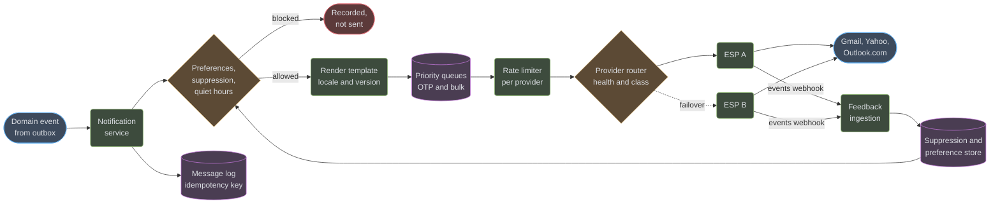
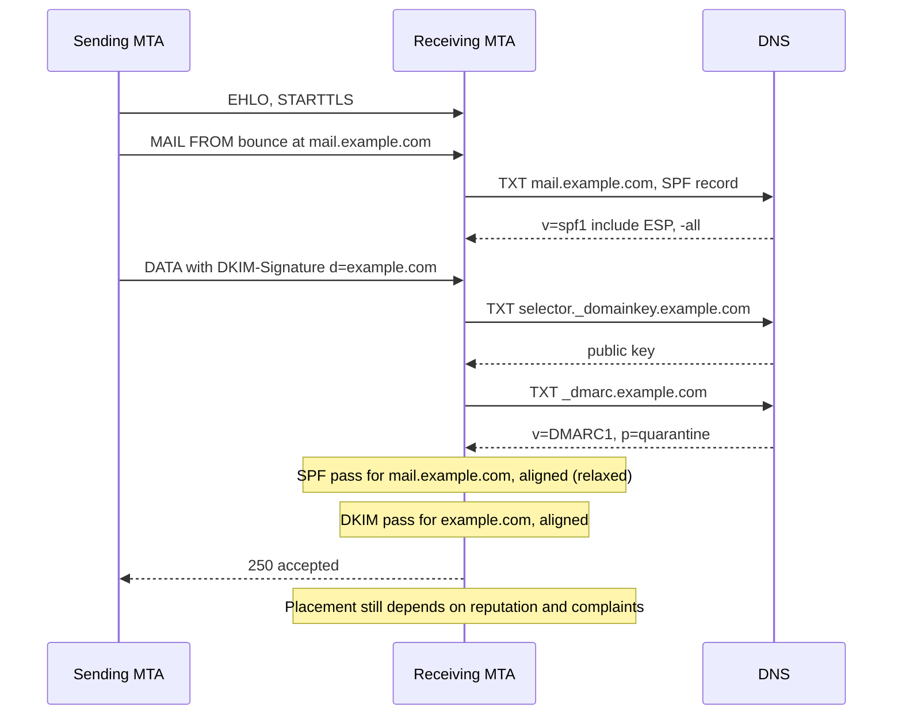
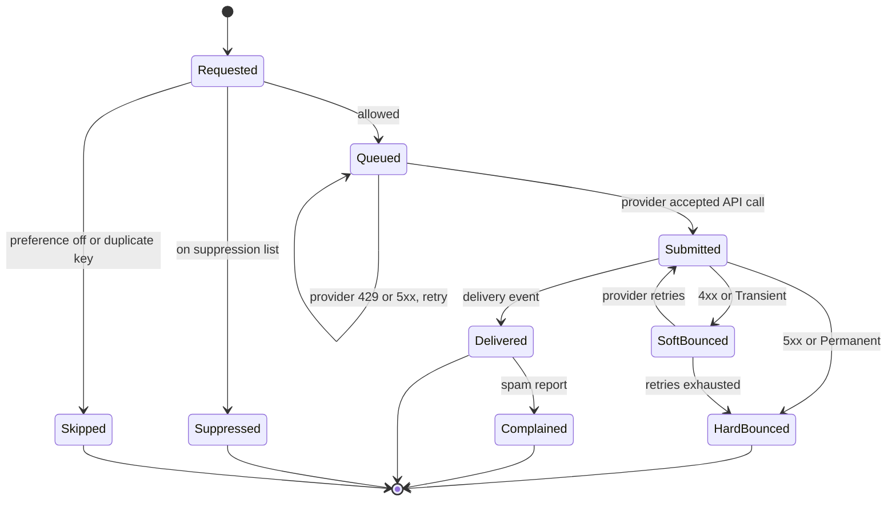
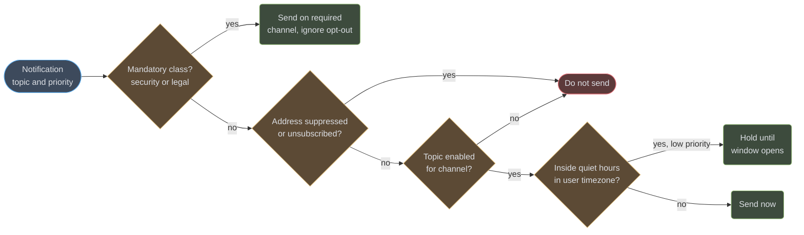

# Email and Notification Delivery

> **Facts checked 2026-11-25.** Protocol facts come from the RFC Editor: SMTP (RFC 5321), SPF (RFC 7208), DKIM (RFC 6376, Ed25519 in RFC 8463), DMARC (RFC 9989, May 2026, which obsoletes RFC 7489 and RFC 9091, with aggregate reporting in RFC 9990 and failure reporting in RFC 9991), ARC (RFC 8617, Experimental), MTA-STS (RFC 8461), TLS-RPT (RFC 8460), List-Unsubscribe (RFC 2369), one-click unsubscribe (RFC 8058), DSN (RFC 3464), enhanced status codes (RFC 3463) and ARF (RFC 5965). Mailbox-provider rules come from Google's "Email sender guidelines" and its FAQ, Yahoo Sender Hub "Sender Requirements & Recommendations", and Microsoft's 2025-04-02 Outlook.com post (updated 2025-04-29). Amazon SES limits come from the SES Developer Guide. Volumes in worked examples are labelled as assumptions.

Sending a password-reset email is one API call. Making sure it reaches the inbox, quickly, only once, only to people who still want your mail, and through a provider outage, is a backend subsystem. This module covers that subsystem: domain authentication, the send pipeline, bounce and complaint handling, provider failover, templating, and the preference center that decides whether a notification should be sent at all.

---

## 1. Concept Overview

An application sends three kinds of messages, and they have different rules:

| Class | Examples | Trigger | Can the user opt out? | Failure cost |
|---|---|---|---|---|
| Transactional | Password reset, OTP code, receipt, shipping update | A user action, one recipient | No for security and legally required mail; yes for most status updates | High: a missing OTP blocks login |
| Product notification | "New comment on your post", weekly digest | Activity by other users or schedules | Yes, per topic and per channel | Medium |
| Marketing | Promotions, newsletters | Campaign, many recipients | Yes, and the law and mailbox providers both require an easy way | Low per message, high in aggregate reputation |

Email is the hardest channel because the receiving side is independent and adversarial. Gmail, Yahoo and Outlook.com decide whether your message lands in the inbox, the spam folder, or is rejected, using authentication results, your domain and IP reputation, and how their users react to your mail. Since February 2024 Gmail and Yahoo enforce explicit rules for anyone sending about 5,000 or more messages a day to their users, and Outlook.com followed for its consumer domains in May 2025.

**What this page owns.** The sending side at mechanism level: DNS authentication records, the send pipeline and its idempotency, bounce and complaint ingestion, suppression, provider failover, one-click unsubscribe, templating, and multi-channel orchestration with a preference center.

**What it does not own.** Building a mailbox provider (inbound MTA, storage, spam filtering at the receiver) is the [Design an Email Service](../../hld/case_studies/design_email_service.md) case study. Fan-out architecture across push, SMS and email at system level is [Design a Notification System](../../hld/case_studies/design_notification_system.md). The class design of a notification sender is the LLD problem [Notification Service](../../lld/system_design_problems/NotificationService.md). HMAC signing and retry ladders for HTTP callbacks are in [Webhooks and Event Delivery](../webhooks_and_event_delivery/webhooks_and_event_delivery.md).

---

## 2. Intuition

> **One-line analogy:** Your email domain is a passport and your sending history is a credit score. SPF, DKIM and DMARC prove the passport is real. Bounces and spam complaints are missed payments. A mailbox provider checks both before it lets you into the inbox.

**Mental model:** think of every message as passing four gates in order. **Should we send it** (user preferences, suppression list, quiet hours, deduplication)? **Can we send it** (rate limits, provider health)? **Will they accept it** (authentication, TLS, format, reputation)? **Did it work** (delivery, bounce, complaint, unsubscribe events flowing back)? Most production incidents are a gate that someone skipped: no suppression check, no bounce ingestion, no idempotency key.

**Why it matters:** email reputation is shared and slow. A single bad marketing send to a stale list can raise your complaint rate past Gmail's 0.3% line, and the damage hits your password-reset mail too if it shares the domain or IP. Recovery takes weeks of clean sending, not a deploy.

**Key insight:** the receiver judges the domain in the `From:` header, not your infrastructure. Everything in authentication exists to tie that visible domain to the servers and signatures that actually sent the message, which is what DMARC alignment means.

---

## 3. Core Principles

- **Authenticate every sending domain with SPF, DKIM and DMARC, aligned to the `From:` domain.** Gmail and Yahoo require all three from bulk senders, and DMARC passes only when SPF or DKIM passes for a domain aligned with `From:`.
- **Separate reputations by mail class.** Send transactional and marketing mail from different subdomains (and, at volume, different IP pools). Yahoo's guidance says to segregate email types by IP or DKIM domain, because each IP and DKIM domain carries its own reputation.
- **Never send to a suppressed address.** Hard bounces, spam complaints and unsubscribes go into a suppression list that every send checks. Sending to known-bad addresses is the fastest way to lose reputation and, on Amazon SES, to get the account paused.
- **Make sending idempotent.** Each logical notification has a deterministic key. Retries and duplicate events must not produce a second email.
- **Close the feedback loop.** Delivery, bounce, complaint and unsubscribe events from the provider are inputs, not logs. They update suppression and preference state within minutes.
- **Unsubscribe must be one click and honored fast.** Google requires honoring within 48 hours and Yahoo within 2 days for bulk senders.
- **Respect the user's preferences before the channel's mechanics.** The preference center decides whether, where and when a notification goes; the channel adapter only decides how.
- **Measure what the receiver measures.** Track spam-complaint rate in Google Postmaster Tools and Yahoo's Complaint Feedback Loop, bounce rate per provider, and inbox placement for a seed list. Open rates are not reliable: Apple Mail Privacy Protection prevents senders from seeing whether a message was opened.

---

## 4. Types / Architectures / Strategies

### 4.1 Sending architectures

| Architecture | What you run | Strengths | Weaknesses |
|---|---|---|---|
| ESP API | Your app calls an email service provider (Amazon SES, SendGrid, Postmark, Mailgun) over HTTPS | Provider runs MTAs, IP pools, feedback loops and bounce parsing | Vendor limits and account-level enforcement; shared IP reputation unless you buy dedicated IPs |
| Own MTA | Postfix, PowerMTA or KumoMTA on your IPs | Full control of queues, throttles per receiving domain, IP warm-up | You own bounce parsing, feedback loops, blocklist monitoring and on-call |
| Multi-ESP with a router | One internal email service fronting two or more ESPs | Failover, cost routing, reputation isolation per mail class | Two sets of DNS records, two sets of event webhooks, cross-provider idempotency is impossible |
| Notification platform | A vendor or internal service that handles preferences and routes to email, push, SMS and in-app | One preference model across channels | Another hop; still needs the email mechanics underneath |

### 4.2 Authentication stack

| Mechanism | Standard | Question it answers | Identity it checks |
|---|---|---|---|
| SPF | RFC 7208 | Is this connecting IP allowed to send for the envelope sender domain? | `MAIL FROM` (Return-Path) domain, or `HELO` |
| DKIM | RFC 6376, Ed25519 in RFC 8463 | Was this message signed by the domain in `d=`, and is it unaltered? | The `d=` signing domain |
| DMARC | RFC 9989 (reports in RFC 9990, RFC 9991) | Does SPF or DKIM pass for a domain aligned with the visible `From:`, and what should happen if not? | The `From:` header domain |
| ARC | RFC 8617 (Experimental) | What did authentication look like before a forwarder or mailing list modified the message? | Intermediaries' signed results |
| MTA-STS | RFC 8461 | Must senders use TLS with a valid certificate when delivering to this domain? | The receiving domain's policy |
| TLS-RPT | RFC 8460 | Where should senders report TLS delivery failures? | The receiving domain |

SPF and DKIM each authenticate a domain, but not necessarily the one the user sees. DMARC is the layer that binds them to the `From:` domain.

### 4.3 Bounce and feedback types

| Event | Source | Meaning | Action |
|---|---|---|---|
| Hard bounce | SMTP 5xx, DSN (RFC 3464) with a 5.x.x status, SES `Permanent` | Address does not exist or will never accept mail | Suppress the address immediately |
| Soft bounce | SMTP 4xx, SES `Transient` | Mailbox full, greylisting, temporary rate limit | Retry; suppress after repeated failures over days |
| Undetermined | SES `Undetermined` | The receiver's reply could not be classified | Treat as soft, investigate if frequent |
| Complaint | Feedback loop report in ARF (RFC 5965), Yahoo CFL, ESP complaint event | The user pressed "report spam" | Suppress all non-transactional mail to the address |
| Unsubscribe | RFC 8058 POST, `mailto:` unsubscribe, preference center | The user opted out of a list | Update preferences within 48 hours |
| Delivery | ESP delivery event | The receiving MTA accepted the message | Record only; acceptance is not inbox placement |

RFC 3463 defines the enhanced status codes you see inside bounces. The ones that matter most: `X.1.1` bad destination mailbox address, `X.2.1` mailbox disabled, `X.2.2` mailbox full, `X.4.7` delivery time expired, `X.7.1` delivery not authorized, message refused. The leading digit is the class: `4` transient, `5` permanent.

### 4.4 Notification orchestration strategies

| Strategy | What it does | Use for |
|---|---|---|
| Single channel | Send on the one channel the event defines | OTP by SMS, receipts by email |
| Fallback chain | Try push; if not delivered or not opened within N minutes, send email | Time-sensitive alerts where any channel will do |
| Fan-out | Send on every channel the user enabled | Security alerts (new login), where redundancy is the point |
| Digest | Collect events per user and send one summary per period | Social activity, comments, low-priority updates |
| Collapse | Replace an unread notification with a newer one for the same entity | "5 new messages in thread X" instead of 5 pushes |

---

## 5. Architecture Diagrams

### 5.1 Send pipeline



The feedback edge from the providers back into the suppression store is the part teams forget. Without it the pipeline keeps sending to addresses that bounced yesterday.

### 5.2 What a receiving server checks



A `250` means the receiving MTA accepted responsibility for the message. It says nothing about inbox versus spam folder.

### 5.3 DMARC alignment at a glance

```
From: header          news@example.com     Organizational domain: example.com

Authenticated id      Domain               Passes?   Relaxed aligned?   Strict aligned?
------------------    -----------------    -------   ----------------   ---------------
SPF (MAIL FROM)       bounce.example.com   pass      yes  (same org)    no  (not exact)
SPF (MAIL FROM)       amazonses.com        pass      no                 no
DKIM d=               example.com          pass      yes                yes
DKIM d=               esp-shared.net       pass      no                 no

DMARC result = pass if ANY row passes AND is aligned under the policy's mode (aspf / adkim)
```

Caption: a message can pass SPF and DKIM and still fail DMARC if both passing identities belong to the ESP's domains. Custom MAIL FROM and a DKIM key published under your own domain are what produce the aligned rows.

### 5.4 Message lifecycle



Every terminal state except `Delivered` writes to the suppression or preference store. `Delivered` is the only state that changes nothing.

### 5.5 Preference resolution



Mandatory messages bypass marketing opt-outs but never bypass a hard-bounce suppression, because the address does not exist.

---

## 6. How It Works — Detailed Mechanics

### 6.1 DNS records for a sending domain

A typical setup uses the root domain in `From:`, a subdomain as the custom MAIL FROM for SPF alignment, and a DKIM key per provider.

```text
; SPF for the custom MAIL FROM (Return-Path) domain. ESPs give you the include.
bounce.example.com.            TXT  "v=spf1 include:amazonses.com -all"
bounce.example.com.            MX   10 feedback-smtp.us-east-1.amazonses.com.

; DKIM: separate selectors per provider, so you can rotate or remove a provider independently.
; SES Easy DKIM hands you CNAME records of this shape; the token is generated by SES.
k7xq2token._domainkey.example.com. CNAME  k7xq2token.dkim.amazonses.com.
sg2026a._domainkey.example.com.    TXT    "v=DKIM1; k=rsa; p=MIIBIjANBgkq..."

; DMARC (RFC 9989). Start at p=none with reports, then tighten.
_dmarc.example.com.            TXT  "v=DMARC1; p=none; rua=mailto:dmarc-rua@example.com; adkim=r; aspf=r"

; Later stage: enforce, with a separate policy for non-existent subdomains.
; _dmarc.example.com.          TXT  "v=DMARC1; p=quarantine; sp=quarantine; np=reject; rua=mailto:dmarc-rua@example.com"

; Receiving-side TLS policy for mail TO example.com (RFC 8461, RFC 8460).
_mta-sts.example.com.          TXT  "v=STSv1; id=20261125"
_smtp._tls.example.com.        TXT  "v=TLSRPTv1; rua=mailto:tls-rpt@example.com"
```

Three rules bite in production:

- **SPF has a 10-lookup limit.** RFC 7208 counts every `include`, `a`, `mx`, `ptr`, `exists` and `redirect` term toward a total of 10 DNS lookups, and exceeding it produces `permerror`, which receivers treat as an SPF failure. Each ESP `include` often expands into several more lookups. RFC 7208 also says implementations SHOULD limit "void lookups" (empty or NXDOMAIN answers) to two. Keep one SPF record per MAIL FROM subdomain instead of stacking every vendor on the root domain.
- **DKIM key length.** Gmail requires keys of 1024 bits or longer for personal Gmail accounts and recommends 2048. RFC 8463 adds Ed25519 signatures; sign with both RSA and Ed25519 if you want Ed25519, because not every receiver verifies it.
- **DMARC changed in May 2026.** RFC 9989 is a Standards Track document that obsoletes RFC 7489. It removed the `pct` tag (partial enforcement) and the `rf` and `ri` tags, added `np` (policy for non-existent subdomains), `psd` (public suffix domain flag) and `t` (test mode), and replaced the Public Suffix List with a DNS tree walk capped at eight queries. With `t=y`, a receiver applies one level below the published policy, so `p=reject; t=y` is treated as quarantine. A record that still carries `pct` does not break, because RFC 9989 says unknown tags MUST be ignored, but a receiver implementing RFC 9989 will not honour the percentage; use `t=y` for staged rollout.

### 6.2 Alignment and the custom MAIL FROM

By default many ESPs use their own domain as the envelope sender, so SPF passes for `amazonses.com`, not for you. That SPF pass does not align with `From: news@example.com`. DMARC can still pass through DKIM, if the DKIM signature uses `d=example.com`. Relying on one aligned mechanism is fragile: if a mailing list modifies the body, DKIM breaks, and you have no aligned SPF to fall back on. Configure a custom MAIL FROM (`bounce.example.com`) so that both SPF and DKIM align in relaxed mode.

RFC 9989 Section 7.4 also says domains used for general-purpose user email SHOULD NOT publish `p=reject`, because mailing lists and forwarders break DKIM on legitimate user mail. Application sending domains, which never send person-to-person mail through mailing lists, are the case where `p=reject` is reasonable after a clean monitoring period.

### 6.3 The send path in code

```java
import java.time.*;
import java.util.*;

enum MailClass { TRANSACTIONAL, NOTIFICATION, MARKETING }
enum Outcome { SENT, SKIPPED_DUPLICATE, SUPPRESSED, PREFERENCE_OFF, DEFERRED_QUIET_HOURS, RETRY_LATER }

record SendRequest(String idempotencyKey, long userId, String to, String topic,
                   MailClass mailClass, String templateId, Map<String, Object> vars) {}

interface MessageLog {           // unique index on idempotency_key
    boolean insertIfAbsent(String key, long userId, String topic);
    void markSubmitted(String key, String provider, String providerMessageId);
}
interface Suppressions { boolean isSuppressed(String email, MailClass c); }
interface Preferences {
    boolean allows(long userId, String topic, String channel);
    Optional<ZonedDateTime> nextSendWindow(long userId, Instant now);  // empty = send now
}
interface Renderer { RenderedEmail render(String templateId, String locale, Map<String, Object> vars); }
record RenderedEmail(String subject, String html, String text, Map<String, String> headers) {}

interface EmailProvider {
    String name();
    String send(String from, String to, RenderedEmail m) throws ProviderException;  // returns message id
}
final class ProviderException extends Exception {
    final boolean retryable;
    ProviderException(String msg, boolean retryable) { super(msg); this.retryable = retryable; }
}

final class EmailSender {
    private final MessageLog log; private final Suppressions sup; private final Preferences prefs;
    private final Renderer renderer; private final List<EmailProvider> providers;  // ordered by health

    EmailSender(MessageLog log, Suppressions sup, Preferences prefs,
                Renderer renderer, List<EmailProvider> providers) {
        this.log = log; this.sup = sup; this.prefs = prefs;
        this.renderer = renderer; this.providers = providers;
    }

    Outcome send(SendRequest r, String locale) {
        // Gate 1: should we send? Suppression first, it applies even to transactional mail.
        if (sup.isSuppressed(r.to(), r.mailClass())) return Outcome.SUPPRESSED;
        if (r.mailClass() != MailClass.TRANSACTIONAL && !prefs.allows(r.userId(), r.topic(), "email"))
            return Outcome.PREFERENCE_OFF;
        if (r.mailClass() == MailClass.MARKETING
                && prefs.nextSendWindow(r.userId(), Instant.now()).isPresent())
            return Outcome.DEFERRED_QUIET_HOURS;          // caller re-enqueues with a delay

        // Gate 2: idempotency. The key is deterministic, e.g. "pwreset:" + resetTokenId.
        if (!log.insertIfAbsent(r.idempotencyKey(), r.userId(), r.topic()))
            return Outcome.SKIPPED_DUPLICATE;

        RenderedEmail m = renderer.render(r.templateId(), locale, r.vars());
        String from = switch (r.mailClass()) {
            case TRANSACTIONAL, NOTIFICATION -> "Example <no-reply@mail.example.com>";
            case MARKETING -> "Example News <news@news.example.com>";  // separate reputation
        };

        // Gate 3: provider with failover. Only retry on the next provider for errors that
        // prove the first provider did NOT accept the message (connect failure, 5xx before accept).
        for (EmailProvider p : providers) {
            try {
                String id = p.send(from, r.to(), m);
                log.markSubmitted(r.idempotencyKey(), p.name(), id);
                return Outcome.SENT;
            } catch (ProviderException e) {
                if (!e.retryable) throw new IllegalStateException("permanent: " + e.getMessage(), e);
                // fall through to next provider
            }
        }
        return Outcome.RETRY_LATER;   // all providers unhealthy: queue retries with backoff
    }
}
```

The idempotency row is inserted before the provider call. If the process crashes after the provider accepted the message but before `markSubmitted`, a retry finds the key and skips, which can lose that one email. The alternative ordering duplicates instead. Pick per class: for marketing, losing one is fine; for an OTP, the user can press "resend", which creates a new key.

### 6.4 Provider failover and the ambiguous timeout

Failover is easy when the first provider refuses the request. It is hard when the request times out: the provider may have accepted and queued the message, and you cannot ask the second provider to deduplicate against the first.

| Failure seen by the client | Did provider A accept? | Safe action |
|---|---|---|
| TCP connect refused, DNS failure | No | Send through provider B |
| HTTP 429 | No | Back off; send through B if the backlog is time-sensitive |
| HTTP 5xx before any response body | Unknown for some providers | Treat as ambiguous |
| Read timeout after the request was sent | Unknown | Ambiguous |
| HTTP 200 with a message id | Yes | Done |

For ambiguous outcomes, decide by class. OTP and security codes: send through B, because a duplicate code is a minor annoyance and a missing one blocks login. Marketing: do not fail over; queue the retry against A with the same provider-side idempotency key if the provider supports one, or drop. Receipts: query A's message status API or wait for its delivery webhook before resending.

Keep the secondary provider warm. A provider that carries 0% of traffic for months arrives at failover time with cold IPs (or a cold shared pool), DKIM keys that nobody tested, and an expired API key. Routing a steady slice of transactional traffic through it (for example 10%, an assumption to tune) keeps its reputation and configuration exercised.

### 6.5 Bounce and complaint ingestion

Providers report outcomes by webhook (SendGrid Event Webhook, Mailgun webhooks, Postmark webhooks) or by queue (Amazon SES publishes to SNS or EventBridge). The handler must be idempotent, because these events are delivered at least once.

```java
import java.time.Instant;

enum FeedbackType { DELIVERY, HARD_BOUNCE, SOFT_BOUNCE, COMPLAINT, UNSUBSCRIBE }

record Feedback(String eventId, String provider, String email, FeedbackType type,
                String smtpStatus, Instant at) {}

interface SuppressionStore {
    void suppress(String email, String reason, Instant at);              // all mail
    void suppressNonTransactional(String email, String reason, Instant at);
    int recordSoftBounce(String email, Instant at);                      // returns count in 7 days
}
interface ProcessedEvents { boolean markIfNew(String provider, String eventId); }

final class FeedbackHandler {
    private static final int SOFT_BOUNCE_LIMIT = 3;   // assumption: 3 soft bounces in 7 days
    private final SuppressionStore store; private final ProcessedEvents seen;

    FeedbackHandler(SuppressionStore store, ProcessedEvents seen) { this.store = store; this.seen = seen; }

    void handle(Feedback f) {
        if (!seen.markIfNew(f.provider(), f.eventId())) return;   // at-least-once delivery
        String email = f.email().strip().toLowerCase(java.util.Locale.ROOT);
        switch (f.type()) {
            case HARD_BOUNCE -> store.suppress(email, "hard_bounce " + f.smtpStatus(), f.at());
            case COMPLAINT   -> store.suppressNonTransactional(email, "complaint", f.at());
            case UNSUBSCRIBE -> store.suppressNonTransactional(email, "unsubscribe", f.at());
            case SOFT_BOUNCE -> {
                if (store.recordSoftBounce(email, f.at()) >= SOFT_BOUNCE_LIMIT)
                    store.suppress(email, "repeated_soft_bounce", f.at());
            }
            case DELIVERY -> { }   // acceptance only; nothing to change
        }
    }
}
```

Classify by the enhanced status code, not by the free-text diagnostic, and know the exceptions. A `5.7.x` "not authorized" bounce from Gmail can mean your authentication failed (Gmail's FAQ lists `5.7.27` for SPF failure and `5.7.30` for DKIM failure), which is your problem, not the recipient's. Suppressing every recipient that bounced with `5.7.x` during a DKIM misconfiguration will suppress half your user base. Route `5.7.x` bounces at volume to an alert, not to the suppression list.

Amazon SES classifies bounces as `Permanent`, `Transient` or `Undetermined`, and offers an account-level suppression list per AWS Region. SES places an account under review when its bounce rate reaches 5% and may pause sending at 10%; for complaints the thresholds are 0.1% for review and 0.5% for a possible pause. SES recommends keeping bounces below 2% and complaints below 0.1%.

### 6.6 One-click unsubscribe (RFC 8058)

Gmail and Yahoo require bulk senders to support one-click unsubscribe on marketing and subscribed messages, plus a visible unsubscribe link in the body. RFC 8058 defines the mechanism:

```text
List-Unsubscribe: <https://news.example.com/u/eyJ1IjoxMjM0LCJsIjoid2Vla2x5In0.9f2c>, <mailto:unsub@news.example.com?subject=u-1234-weekly>
List-Unsubscribe-Post: List-Unsubscribe=One-Click
DKIM-Signature: v=1; a=rsa-sha256; d=example.com; s=k7xq2token;
        h=from:to:subject:date:message-id:list-unsubscribe:list-unsubscribe-post; ...
```

The rules from RFC 8058:

- `List-Unsubscribe` MUST contain one HTTPS URI and MAY contain others such as `mailto:`.
- `List-Unsubscribe-Post` MUST contain the single value `List-Unsubscribe=One-Click`.
- The message MUST carry a valid DKIM signature that covers both headers, so nobody can inject an unsubscribe URL.
- The mailbox provider sends `POST` with body `List-Unsubscribe=One-Click`. The POST MUST NOT include cookies or HTTP authorization, so the URI itself must identify the subscription. The sender MUST NOT answer with a redirect.

```java
import javax.crypto.Mac;
import javax.crypto.spec.SecretKeySpec;
import java.nio.charset.StandardCharsets;
import java.security.MessageDigest;
import java.util.Base64;

// The token is userId.listId.HMAC, so the endpoint needs no session and no lookup table.
final class UnsubscribeTokens {
    private final byte[] key;
    UnsubscribeTokens(byte[] key) { this.key = key.clone(); }

    String issue(long userId, String listId) throws Exception {
        String payload = userId + "." + listId;
        return payload + "." + mac(payload);
    }

    /** Returns "userId.listId" if valid, or null. Constant-time comparison. */
    String verify(String token) throws Exception {
        int cut = token.lastIndexOf('.');
        if (cut < 0) return null;
        String payload = token.substring(0, cut);
        byte[] given = token.substring(cut + 1).getBytes(StandardCharsets.US_ASCII);
        byte[] want = mac(payload).getBytes(StandardCharsets.US_ASCII);
        return MessageDigest.isEqual(given, want) ? payload : null;
    }

    private String mac(String payload) throws Exception {
        Mac h = Mac.getInstance("HmacSHA256");
        h.init(new SecretKeySpec(key, "HmacSHA256"));
        byte[] d = h.doFinal(payload.getBytes(StandardCharsets.UTF_8));
        return Base64.getUrlEncoder().withoutPadding().encodeToString(d).substring(0, 22);
    }
}
// POST /u/{token}: verify, write the opt-out synchronously, return 200 with no redirect.
// GET  /u/{token}: render a confirmation page; never unsubscribe on GET, link scanners prefetch it.
```

The GET rule matters: security scanners and mail clients fetch links in messages. An endpoint that unsubscribes on `GET` silently removes users who never clicked. RFC 8058 uses `POST` for exactly that reason.

### 6.7 Preference center data model

```sql
CREATE TABLE notification_topic (
    topic_id      text PRIMARY KEY,            -- 'weekly_digest', 'comment_reply', 'security_alert'
    mail_class    text NOT NULL CHECK (mail_class IN ('transactional','notification','marketing')),
    mandatory     boolean NOT NULL DEFAULT false,
    default_email boolean NOT NULL,
    default_push  boolean NOT NULL
);

CREATE TABLE user_preference (
    user_id     bigint NOT NULL,
    topic_id    text   NOT NULL REFERENCES notification_topic,
    channel     text   NOT NULL CHECK (channel IN ('email','push','sms','in_app')),
    enabled     boolean NOT NULL,
    source      text   NOT NULL,               -- 'preference_center', 'one_click', 'complaint', 'signup'
    changed_at  timestamptz NOT NULL DEFAULT now(),
    PRIMARY KEY (user_id, topic_id, channel)
);

CREATE TABLE email_suppression (
    email        text PRIMARY KEY,             -- normalized lower-case
    scope        text NOT NULL CHECK (scope IN ('all','non_transactional')),
    reason       text NOT NULL,
    created_at   timestamptz NOT NULL DEFAULT now()
);

CREATE TABLE user_delivery_settings (
    user_id          bigint PRIMARY KEY,
    timezone         text NOT NULL DEFAULT 'UTC',   -- IANA zone, e.g. 'Asia/Kolkata'
    quiet_start      time,                           -- e.g. 22:00 local
    quiet_end        time,                           -- e.g. 08:00 local
    digest_frequency text NOT NULL DEFAULT 'daily'
);
```

Design choices that matter:

- **Absence means default.** Store only explicit choices; the topic row holds defaults. Adding a topic then needs no backfill of millions of preference rows.
- **Keep the source and time of every change.** When a user says "I never unsubscribed", the `source` column answers whether it was a one-click POST, a complaint, or the preference page. Consent records are also what you show a regulator.
- **Suppression is keyed by address, preferences by user.** A user can change email address; a hard bounce belongs to the address, not the person.
- **Mandatory topics are explicit.** A `security_alert` with `mandatory = true` is shown in the preference center as not configurable, which is clearer than a toggle that silently does nothing.

### 6.8 Templating

- **Version templates and pin the version in the message log.** When a customer forwards a broken receipt, you need to know which template rendered it.
- **Always send a `text/plain` part** alongside HTML. Some clients and accessibility tools read only text, and the text part is what many previews show.
- **Escape variables by context.** User-supplied names in HTML must be HTML-escaped; in a URL query they must be URL-encoded. A template engine with auto-escaping on by default prevents HTML injection through a user's display name.
- **Localize at render time** from the recipient's locale, with a fallback chain (`pt-BR` to `pt` to `en`). Format dates in the recipient's time zone.
- **Inline CSS** for HTML email. Many clients strip `<style>` blocks or ignore external stylesheets. Tools such as MJML compile a component markup into table-based, inlined HTML.
- **Snapshot-test rendering.** Render every template with fixture data in CI and diff against approved snapshots, so a variable rename does not ship "Hello {{first_name}}" to a million users.

### 6.9 Multi-channel orchestration

The notification service owns the decision of whether, where and when; channel adapters own how.

1. **Deduplicate at the event level.** Key = `topic + entity + recipient + time bucket`. Five comments in one minute on the same post become one notification, not five.
2. **Resolve preferences per channel** (section 5.5) and drop channels the user disabled.
3. **Pick the strategy** from the topic: single channel, fallback chain, fan-out, digest or collapse (section 4.4).
4. **Apply quiet hours in the user's time zone** for non-urgent topics, and hold messages in a delayed queue until the window opens. Store the zone as an IANA name, not an offset, so daylight-saving changes are correct.
5. **Use separate queues by priority.** OTP and security mail must never wait behind a 2-million-recipient campaign. A single shared queue with one worker pool is the most common cause of "the password reset took 40 minutes".
6. **Record every decision** (sent, suppressed, preference off, deferred) in the message log. Support teams need "why did user 1234 not get the email" answered from data.

### 6.10 Reputation, warm-up and the 2024 to 2025 provider rules

What the three largest consumer mailbox providers require from senders of about 5,000 or more messages a day:

| Requirement | Gmail (personal accounts) | Yahoo | Outlook.com (consumer) |
|---|---|---|---|
| Effective | 2024-02-01; enforcement ramp-up with temporary and permanent rejections from November 2025 | February 2024, gradual rollout | Announced 2025-04-02; rejection with `550 5.7.515` from 2025-05-05 per the 2025-04-29 update |
| SPF | Required, and must pass | Required | Must pass |
| DKIM | Required, key of 1024 bits or more | Required | Must pass |
| DMARC | Record required, `p=none` acceptable, alignment with SPF or DKIM | `p=none` minimum, must pass, relaxed alignment acceptable | `p=none` minimum, aligned with SPF or DKIM |
| Spam rate | Below 0.3%; keep below 0.1% | Below 0.3%, measured on mail delivered to the inbox | Not stated as a number |
| Unsubscribe | One-click for marketing and subscribed mail, honored within 48 hours | One-click (POST recommended, `mailto:` acceptable), honored within 2 days | Functional unsubscribe link recommended |
| Other | Valid forward and reverse DNS (PTR), TLS, RFC 5322 format | Valid forward and reverse DNS, RFC 5321 and 5322 compliance | Valid, replyable From or Reply-To address (recommended) |

Gmail counts the 5,000 per primary domain across subdomains, and a domain that crosses it once is classified as a bulk sender permanently.

**Warm-up.** A new dedicated IP or a new sending domain has no reputation, and receivers throttle unknown senders. Ramp volume over a few weeks, starting with the most engaged recipients (people who opened or clicked recently), and increase daily only while bounce and complaint rates stay low. A schedule that roughly doubles daily volume from a few thousand messages is common practice; treat any specific schedule as a starting assumption and let the deferral (`4xx`) rate from each receiver steer it.

**Throttle per receiving domain.** Large receivers rate-limit by connection and by volume. Yahoo states that it accepts a limited number of messages per SMTP connection and asks senders to be moderate with concurrent connections. An own-MTA setup needs per-destination connection and rate limits; an ESP does this for you.

---

## 7. Real-World Examples

**Gmail and Yahoo, February 2024.** Both providers announced aligned requirements for bulk senders in late 2023 and began enforcement in February 2024: SPF and DKIM, a DMARC record, alignment, one-click unsubscribe, and a spam-complaint rate below 0.3%. Google's FAQ states that from November 2025 it ramped up enforcement on non-compliant traffic with temporary and permanent rejections, and publishes specific codes such as `4.7.27` and `5.7.27` for SPF failure, `4.7.30` and `5.7.30` for DKIM failure, `4.7.31` for a missing DMARC record and `4.7.32` for misalignment.

**Outlook.com, May 2025.** Microsoft announced on 2025-04-02 that domains sending more than 5,000 messages a day to Outlook.com, Hotmail and Live addresses must pass SPF and DKIM and publish DMARC with at least `p=none` and alignment. Its 2025-04-29 update states that non-compliant messages are rejected with `550 5.7.515 Access denied, sending domain does not meet the required authentication level` starting 2025-05-05.

**DMARC as a Standards Track RFC.** For a decade DMARC lived in RFC 7489, an Independent Submission with no IETF standing. In May 2026 the IETF published RFC 9989 (protocol), RFC 9990 (aggregate reporting) and RFC 9991 (failure reporting) on the Standards Track, removing `pct` and adding the `t`, `np` and `psd` tags and the DNS tree walk.

**Amazon SES enforcement.** SES publishes the bounce and complaint rates that trigger review and pause (5% and 10% for bounces, 0.1% and 0.5% for complaints), and new accounts start in a per-Region sandbox limited to 200 messages per 24 hours and 1 message per second, sending only to verified addresses.

**Open tracking stopped being a signal.** Apple's Mail Privacy Protection hides the recipient's IP address and prevents senders from seeing whether a message was opened. Engagement-based list hygiene that relies on opens alone now keeps or removes the wrong people; use clicks, logins and purchases instead.

---

## 8. Tradeoffs

### 8.1 ESP versus own MTA

| Dimension | ESP | Own MTA |
|---|---|---|
| Time to first send | Hours | Weeks |
| Bounce parsing, feedback loops | Included | You build and maintain |
| Per-receiver throttling and warm-up | Mostly managed | Fully yours to tune |
| Reputation | Shared pool unless you pay for dedicated IPs | Fully yours, good or bad |
| Cost at very high volume | Per-message pricing adds up | Infrastructure plus a deliverability engineer |
| Account-level risk | Provider can pause the account | No third-party pause, but blocklists still apply |

### 8.2 Single versus multiple providers

| Dimension | Single ESP | Two ESPs with a router |
|---|---|---|
| Availability | Provider outage stops all email | Failover for transactional mail |
| DNS and keys | One SPF include, one DKIM selector set | Two of each, both must stay valid |
| Event handling | One webhook format | Two formats normalized into one model |
| Deduplication | Provider idempotency key works | Impossible across providers on ambiguous failures |
| Reputation | One history | Split history; the secondary must be kept warm |

### 8.3 Shared versus dedicated IPs

| Dimension | Shared pool | Dedicated IP |
|---|---|---|
| Reputation | Inherited from other senders on the pool | Earned only by you |
| Minimum volume | Works at any volume | Needs steady volume to build and keep reputation |
| Warm-up | Not needed | Required for weeks |
| Blast radius of a bad campaign | Mostly absorbed by the pool | Hits your IP directly |

### 8.4 Strict versus relaxed DMARC alignment

| Mode | Matches | Use when |
|---|---|---|
| Relaxed (`adkim=r`, `aspf=r`, the default) | Same organizational domain (`bounce.example.com` aligns with `example.com`) | Almost always: subdomain MAIL FROM and per-class subdomains need it |
| Strict (`s`) | Exact domain match | A domain whose subdomains are controlled by different teams or vendors and must not vouch for each other |

---

## 9. When to Use / When NOT to Use

**Use an ESP with a thin internal email service when:**

- You send up to tens of millions of messages a month and do not have a deliverability engineer.
- You need bounce and complaint feedback, suppression and analytics without building them.

**Add a second ESP when:**

- Transactional email is on a critical path (login codes, payment confirmations) and a provider outage would block users.
- You want marketing and transactional reputation in different accounts.

**Run your own MTA when:**

- Volume is high enough that per-message pricing outweighs infrastructure and staff, and you have people who can operate IP warm-up, blocklist response and per-receiver throttling.

**Do not use email when:**

- The message is time-critical in seconds (fraud alert during a checkout). Email has no delivery-time guarantee; RFC 5321 retries span days. Use push, SMS or in-app, and send email as the record.
- The content is secret. A one-time login link is acceptable; a plaintext password is not.

**Do not add a notification platform when:**

- You have one channel and five topics. A preferences table and a queue are enough; a platform is justified when channels, topics and teams multiply.

---

## 10. Common Pitfalls

**A marketing blast took down password resets.** Marketing and transactional mail shared one queue, one sending domain and one ESP account. A 3-million-recipient campaign filled the queue, so reset emails waited behind it for 40 minutes; the campaign's complaint rate then pushed the shared domain into Gmail's spam folder, and resets that did go out landed in spam for days. Fix: separate queues by priority, separate subdomains (`mail.example.com` for transactional, `news.example.com` for marketing), and separate ESP accounts or IP pools for the two classes.

**Duplicate receipts on every retry.** An order service sent a receipt from a Kafka consumer and retried the whole handler on any exception. A flaky downstream call after the send made the handler retry, and customers received 3 to 5 identical receipts.

```java
// BROKEN: no idempotency. Any retry of the handler sends another email.
void onOrderPaid(OrderPaid e) {
    emailProvider.send("receipts@mail.example.com", e.email(), renderReceipt(e));
    loyaltyService.addPoints(e.userId(), e.amountCents());   // throws, handler retries, email resent
}
```

```java
// FIX: a deterministic key per logical message, checked in a durable log before sending,
// and side effects that can fail are moved out of the send path.
void onOrderPaid(OrderPaid e) {
    sender.send(new SendRequest("receipt:" + e.orderId(), e.userId(), e.email(),
            "order_receipt", MailClass.TRANSACTIONAL, "receipt_v7", Map.of("order", e)), e.locale());
    // loyalty points are a separate consumer with its own idempotency
}
```

**Suppressing the whole user base after a DKIM mistake.** A key rotation published the new DKIM selector but the ESP kept signing with the removed one. Gmail rejected mail with DKIM failures, the bounce handler classified every `5.x.x` as a hard bounce, and 30% of active users were suppressed within an hour. Fix: classify authentication-related `5.7.x` rejections as sender-side failures, alert on bounce-rate spikes, and require a sudden jump in hard bounces to pause automatic suppression until a human reviews it.

**Unsubscribing users who never clicked.** An unsubscribe link performed the opt-out on `GET`. Corporate mail scanners fetched every link in incoming mail to check for malware, and thousands of B2B users were unsubscribed. Fix: one-click unsubscribe uses `POST` per RFC 8058; the `GET` page asks for confirmation.

**SPF `permerror` after adding one more vendor.** The root domain's SPF record grew to include a CRM, a helpdesk, two ESPs and a survey tool. The eleventh DNS lookup turned every SPF check into `permerror`, and DMARC began failing for any message that was not also DKIM-aligned. Fix: give each vendor its own MAIL FROM subdomain with its own SPF record, and rely on aligned DKIM per vendor.

**Quiet hours computed in server time.** A digest job ran at 07:00 UTC for everyone, which is midnight on the US West Coast and noon in India. Users in the wrong zones received digests at night and complained. Fix: store the user's IANA time zone, compute the next window per user, and schedule from a delayed queue.

---

## 11. Technologies & Tools

| Tool | Purpose |
|---|---|
| Amazon SES | AWS email API and SMTP relay with configuration sets, account-level suppression list, and SNS or EventBridge event publishing |
| SendGrid | Twilio's email API with an Event Webhook for delivery, bounce, complaint and unsubscribe events |
| Postmark | Transactional-focused email API with separate message streams for transactional and broadcast mail |
| Mailgun | Email API with routing, webhooks and validation |
| Postfix | Open-source MTA used for self-hosted outbound relays |
| PowerMTA | Commercial high-volume MTA with per-domain throttling and IP pools |
| KumoMTA | Open-source high-volume MTA for self-hosted sending |
| Google Postmaster Tools | Spam rate, authentication and compliance dashboard for mail sent to Gmail |
| Yahoo Complaint Feedback Loop | Spam complaint reports for DKIM-signed mail sent to Yahoo |
| MJML | Markup language that compiles responsive components into email-safe HTML |
| Firebase Cloud Messaging | Google's push delivery service for Android, iOS and web |
| Apple Push Notification service | Apple's push delivery service for iOS and macOS |
| Twilio | SMS and voice API often used for OTP delivery |

---

## 12. Interview Questions with Answers

**Q: Why can a message pass SPF and DKIM yet still fail DMARC?**
**Short:** DMARC also needs alignment: the passing SPF or DKIM domain must match the From: header's domain, and ESP-owned domains do not.

SPF authenticates the envelope sender (MAIL FROM) and DKIM authenticates the `d=` signing domain. If your ESP uses its own bounce domain and signs with its own `d=`, both checks pass for the ESP's domains, while `From:` shows your domain. DMARC requires at least one of them to pass for a domain aligned with `From:` (same organizational domain in relaxed mode, exact match in strict mode). Fix it with a custom MAIL FROM subdomain and a DKIM key published under your domain.

**Q: What happens when an SPF record needs more than 10 DNS lookups?**
**Short:** SPF evaluation returns permerror, which receivers treat as an SPF failure, so mail without aligned DKIM starts failing DMARC.

RFC 7208 caps the terms that cause DNS lookups (`include`, `a`, `mx`, `ptr`, `exists`, `redirect`) at 10 per evaluation, and nested includes count. Each vendor include can cost several lookups, so a root-domain record with five vendors often exceeds the limit. The clean fix is one MAIL FROM subdomain per vendor, each with a short SPF record, plus aligned DKIM; flattening includes into IP lists works but breaks silently when a vendor changes IPs.

**Q: What are the bulk-sender requirements Gmail and Yahoo enforce since February 2024?**
**Short:** SPF and DKIM, a DMARC record with at least p=none and alignment, one-click unsubscribe for marketing mail, and a spam rate below 0.3%.

Both apply to senders of roughly 5,000 or more messages a day to their users. Both also require valid forward and reverse DNS and RFC-compliant formatting; Gmail requires TLS and keys of at least 1024 bits. Gmail asks for unsubscribes to be honored within 48 hours and Yahoo within 2 days. Gmail recommends keeping the spam rate below 0.1%, and since November 2025 it rejects non-compliant traffic more aggressively.

**Q: What changed in DMARC with RFC 9989?**
**Short:** DMARC became a Standards Track RFC in May 2026; pct, rf and ri were removed, t, np and psd were added, and a DNS tree walk replaced the Public Suffix List.

RFC 9989 obsoletes RFC 7489 and RFC 9091, with aggregate and failure reporting split into RFC 9990 and RFC 9991. The `t=y` test mode replaces `pct` for staged rollout: the receiver applies one level below the published policy. `np` sets policy for non-existent subdomains, and `psd` marks public suffix domains. Organizational domain discovery now walks DNS labels with at most eight queries instead of depending on which Public Suffix List copy a receiver had.

**Q: How do you build one-click unsubscribe correctly?**
**Short:** Send List-Unsubscribe with an HTTPS URI and List-Unsubscribe-Post: List-Unsubscribe=One-Click, cover both with DKIM, and opt out on POST.

RFC 8058 requires the HTTPS URI to identify the subscription by itself, because the provider's POST carries no cookies or authorization; a signed token in the path works well. The DKIM signature must cover both headers so attackers cannot inject an unsubscribe target. The endpoint must not redirect, and the opt-out should be written synchronously. Never unsubscribe on `GET`, because link scanners and prefetchers fetch URLs in mail.

**Q: Why separate transactional and marketing email onto different subdomains and queues?**
**Short:** Reputation and capacity are shared per domain, IP and queue, so a bad or large campaign degrades password resets and receipts.

Mailbox providers score reputation per domain and IP, and complaints concentrate on marketing mail. If both classes share `example.com`, a campaign that crosses the 0.3% complaint line pushes receipts into spam too. A shared queue lets a multi-million-recipient campaign delay OTP codes for tens of minutes. Use `mail.example.com` and `news.example.com`, separate priority queues, and ideally separate ESP accounts or IP pools.

**Q: How should a hard bounce and a soft bounce be handled differently?**
**Short:** Suppress a hard bounce immediately because the address will never accept mail; retry soft bounces and suppress only after repeated failures over days.

A hard bounce (SMTP 5xx, SES `Permanent`, enhanced code `5.1.1`) means the mailbox does not exist; sending again raises your bounce rate, which SES reviews at 5%. A soft bounce (4xx, `4.2.2` mailbox full) is temporary, so the MTA retries and you count failures. A common policy is suppression after three soft bounces in a week, a threshold to tune. Exclude authentication failures (`5.7.x` from your own misconfiguration) from automatic suppression.

**Q: What does a spam complaint do to the pipeline?**
**Short:** It suppresses all non-transactional mail to that address immediately and counts toward the complaint rate that mailbox providers and ESPs enforce.

A complaint arrives as an ARF report from a feedback loop, a Yahoo CFL report, or an ESP event. Continuing to send marketing to someone who reported spam guarantees more complaints. Keep sending only mandatory transactional mail such as security alerts. Watch the rate: Gmail's limit is 0.3% with 0.1% recommended, and SES reviews accounts at 0.1% and may pause at 0.5%.

**Q: How do you make notification sending idempotent?**
**Short:** Derive a deterministic key per logical message, insert it into a message log with a unique constraint before sending, and skip sends whose key exists.

Event consumers and job runners retry, so the same "order paid" event can be processed several times. A key such as `receipt:{orderId}` or `pwreset:{tokenId}` makes every retry map to one row. Insert-then-send risks losing one message on a crash after the provider accepted; send-then-insert risks a duplicate. Choose per class, and also pass the key to the provider if it supports a provider-side idempotency key.

**Q: Why is failing over to a second email provider on a timeout risky?**
**Short:** A timeout is ambiguous: the first provider may have accepted the message, and the second cannot deduplicate against it, so failover can send twice.

Failover is safe when the first provider clearly did not accept the request (connection refused, 429). On a read timeout or some 5xx responses you do not know. Decide by class: duplicate OTP codes are tolerable, so fail over; duplicate marketing is not, so retry the same provider later or drop; for receipts, check the first provider's status or wait for its event before resending.

**Q: Why should a secondary email provider carry live traffic before an outage?**
**Short:** An idle provider has cold reputation and untested DKIM, SPF and API credentials, so failover traffic lands in spam or fails outright.

Mailbox providers trust senders with consistent history. A provider that suddenly starts sending your full volume looks like a new sender and gets throttled. Configuration also rots: an expired API key or a DKIM selector removed during cleanup is discovered only during the incident. Route a steady share of transactional mail through the secondary and alert on its error rate like the primary.

**Q: Why are email open rates no longer a reliable engagement signal?**
**Short:** Apple Mail Privacy Protection prevents senders from seeing whether a message was opened, so tracking pixels misreport opens for its users.

Open tracking relies on a remote image request. Mail Privacy Protection hides the recipient's IP and blocks senders from learning whether mail was opened, so open data for those users is not trustworthy. List hygiene and send-time optimization that rely on opens will keep disengaged users or drop engaged ones. Use clicks, logins, purchases and replies as engagement signals.

**Q: What does a 250 response from the receiving SMTP server prove?**
**Short:** Only that the receiving MTA accepted responsibility for the message; it does not prove inbox placement or that the user saw it.

After `250`, the receiver may still deliver to the spam folder, quarantine the message, or bounce it later with a DSN. Providers report this acceptance as "delivered", which is why delivery rate looks healthy while engagement collapses during a reputation problem. Measure inbox placement with seed accounts and watch Postmaster Tools spam rate and authentication dashboards.

**Q: How long does SMTP keep retrying a message, and what does that mean for time-sensitive notifications?**
**Short:** RFC 5321 suggests retry intervals of at least 30 minutes and a give-up time of at least 4 to 5 days, so email cannot guarantee timely delivery.

A greylisting receiver or a temporary failure can delay a message by half an hour or more, and a message can still arrive days later. That is fine for receipts and digests, and wrong for a code that expires in 10 minutes. For time-critical messages use push or SMS as the primary channel, set short expiry on codes, and let the user request a new one.

**Q: How do quiet hours and digests work in a notification service?**
**Short:** Resolve each user's IANA time zone, hold non-urgent notifications in a delayed queue until their window opens, and batch low-priority events into one digest.

Store the zone name, not an offset, so daylight-saving shifts are handled. When a non-urgent notification falls inside quiet hours, compute the next allowed time and schedule it, rather than running one global job at a server-time hour. Digests group events per user and topic over a period and render one message, which cuts volume and complaints. Security and transactional messages bypass both.

**Q: What belongs in a preference center data model?**
**Short:** Per-user, per-topic, per-channel opt-ins with source and timestamp, defaults on the topic, mandatory flags, and a separate address-keyed suppression list.

Storing only explicit choices keeps the table small and lets new topics ship with defaults and no backfill. The `source` and `changed_at` columns explain every opt-out and serve as consent evidence. Suppression belongs to the address, because a hard bounce or complaint is about the mailbox, not the person; a user who changes address starts clean. Mandatory topics are marked so the UI shows them as not configurable.

**Q: Why should an unsubscribe endpoint never act on GET?**
**Short:** Mail scanners and clients prefetch links in messages, so a GET unsubscribe opts out users who never clicked.

Enterprise gateways fetch every URL in incoming mail to scan for malware, and some clients prefetch links. RFC 8058 uses `POST` with a fixed body so that only a deliberate action unsubscribes. The `GET` page should show a confirmation button, and the visible unsubscribe link in the body can lead to the preference center.

**Q: When is p=reject the wrong DMARC policy?**
**Short:** For domains used by people for general email, because mailing lists and forwarders break DKIM and SPF on legitimate mail; RFC 9989 says they SHOULD NOT use it.

Mailing lists often add footers or subject tags, which breaks DKIM, and forwarding changes the connecting IP, which breaks SPF. Under `p=reject` those legitimate messages are rejected. Application sending domains that never pass through lists are different: after monitoring aggregate reports at `p=none` and confirming every legitimate source is aligned, moving to `quarantine` and then `reject` blocks spoofing of your brand.

---

## 13. Best Practices

- Publish SPF, DKIM (2048-bit RSA) and DMARC for every sending domain, and use a custom MAIL FROM subdomain so SPF aligns too.
- Start DMARC at `p=none` with `rua` reports, fix every unaligned source, then move to `quarantine` and `reject`; use `t=y` for staged rollout instead of `pct`.
- Split transactional and marketing mail by subdomain, queue and, at volume, by IP pool or ESP account.
- Check suppression on every send, including transactional mail, and update suppression from bounce and complaint events within minutes.
- Give every logical message a deterministic idempotency key stored in a message log with a unique constraint.
- Implement RFC 8058 one-click unsubscribe with a signed token, act only on `POST`, and honor opt-outs within 48 hours.
- Keep a second provider warm with real traffic if transactional email is on a critical path, and decide failover per message class.
- Exclude sender-side authentication failures (`5.7.x` at volume) from automatic suppression, and alert on bounce-rate spikes.
- Store user time zones as IANA names and schedule quiet hours and digests per user.
- Version templates, always include a plain-text part, auto-escape variables, and snapshot-test rendering in CI.
- Monitor Google Postmaster Tools, Yahoo CFL, provider bounce and complaint rates, and a seed-list inbox placement test; do not rely on open rates.

---

## 14. Case Study

**Scenario.** A B2C fintech app has 8 million users and sends, per day (assumptions): 1.2 million transactional emails (OTP codes, payment receipts, security alerts), 3 million product notifications, and a weekly marketing newsletter to 5 million subscribers. Everything goes through one ESP account from `example.com`, through one queue. Support reports that OTP emails "sometimes take 30 minutes" and that some users "never get emails".

**Diagnosis.**

- Postmaster Tools shows the spam rate for `example.com` rising to 0.35% on newsletter days and falling back to 0.08% between them (illustrative figures for this scenario).
- OTP latency p99 is 31 minutes on newsletter days, because OTPs wait behind newsletter jobs in a single FIFO queue.
- The bounce webhook is subscribed but the handler only logs events. 4% of sends go to addresses that hard-bounced before.
- The unsubscribe link unsubscribes on `GET` and there is no `List-Unsubscribe` header.
- The SPF record on `example.com` has 12 lookups, so SPF returns `permerror`; DMARC passes only through DKIM.

**Broken code at the centre of it.**

```java
// BROKEN: one queue, no suppression check, no idempotency, one domain for every class.
void enqueue(Notification n) {
    queue.publish("email", n);                 // newsletter and OTP share one FIFO
}
void worker(Notification n) {
    esp.send("hello@example.com", n.email(), render(n));   // bounced and complained addresses too
}
```

**Redesign.**

1. **Domains.** `mail.example.com` for transactional and product notifications, `news.example.com` for marketing. Each has a custom MAIL FROM (`bounce.mail.example.com`, `bounce.news.example.com`) with a single-include SPF record, its own DKIM selectors, and DMARC on `example.com` at `p=none` with aggregate reports for 30 days, then `p=quarantine`.
2. **Queues.** Three priority queues: `otp_security`, `transactional`, `bulk`. Separate worker pools; `bulk` workers are rate-limited so a newsletter takes about 6 hours to drain instead of saturating the ESP account's send rate (assumption to tune).
3. **Suppression and feedback.** The webhook handler from section 6.5 writes hard bounces and complaints into `email_suppression`; every send checks it. A spike guard pauses automatic suppression if hard bounces exceed 3x their 7-day average within an hour.
4. **Unsubscribe.** RFC 8058 headers on every newsletter and product notification, signed tokens, `POST`-only opt-out, confirmation page on `GET`, and a preference center with per-topic switches.
5. **Idempotency.** Every notification carries a key (`otp:{challengeId}`, `receipt:{paymentId}`, `newsletter:{issueId}:{userId}`) stored in the message log.
6. **Failover.** A second ESP carries 10% of `otp_security` and `transactional` traffic permanently. On connect failures or 429 from the primary, OTP traffic moves to the secondary; marketing never fails over.
7. **Engagement-based list hygiene.** Subscribers with no click, login or purchase in 180 days get a re-permission email; non-responders are moved to a monthly digest instead of the weekly newsletter.

```java
// FIX: priority routing, suppression, idempotency and class-specific domains.
void enqueue(Notification n) {
    String queueName = switch (n.mailClass()) {
        case TRANSACTIONAL -> n.topic().startsWith("otp") ? "otp_security" : "transactional";
        case NOTIFICATION -> "transactional";
        case MARKETING -> "bulk";
    };
    queue.publish(queueName, n);
}
void worker(Notification n) {
    Outcome o = sender.send(new SendRequest(n.idempotencyKey(), n.userId(), n.email(), n.topic(),
            n.mailClass(), n.templateId(), n.vars()), n.locale());   // section 6.3
    metrics.count("email.outcome", o.name());
}
```

**Capacity arithmetic (assumptions).** Transactional peak of about 60 messages per second (1.2 million per day with a 4x peak-to-mean factor) needs a handful of workers at around 50 ms per provider call. The 5-million newsletter drained over 6 hours averages about 230 messages per second, isolated from the OTP pool. Removing the 4% of sends to known-bad addresses cuts about 200,000 doomed newsletter sends per issue.

**Outcome to verify, not assume.** The team tracks OTP p99 latency on newsletter days, spam rate per subdomain in Postmaster Tools (target below 0.1%, never 0.3%), hard-bounce rate (target below 2%), and DMARC aggregate reports showing every legitimate source aligned before moving to `quarantine`. The important change is structural: a bad newsletter can now only hurt `news.example.com` and the `bulk` queue.

**Related reading.** [Rate Limiting in Depth](../rate_limiting_in_depth/rate_limiting_in_depth.md) covers the token buckets used for per-provider send rates. [Fault Tolerance Patterns](../fault_tolerance_patterns/fault_tolerance_patterns.md) covers the circuit breaker behind the provider router. [Messaging Patterns](../messaging_patterns/messaging_patterns.md) covers the outbox that feeds the notification service. [Search Integration Patterns](../search_integration_patterns/search_integration_patterns.md) reuses the same outbox-and-idempotent-consumer backbone for a different derived store.
