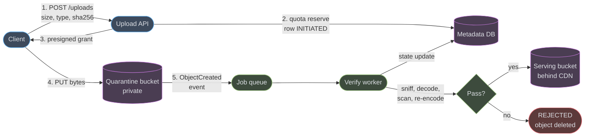
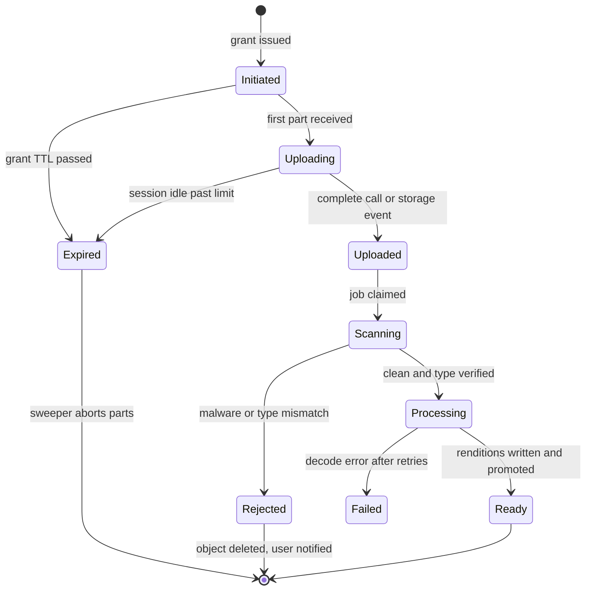
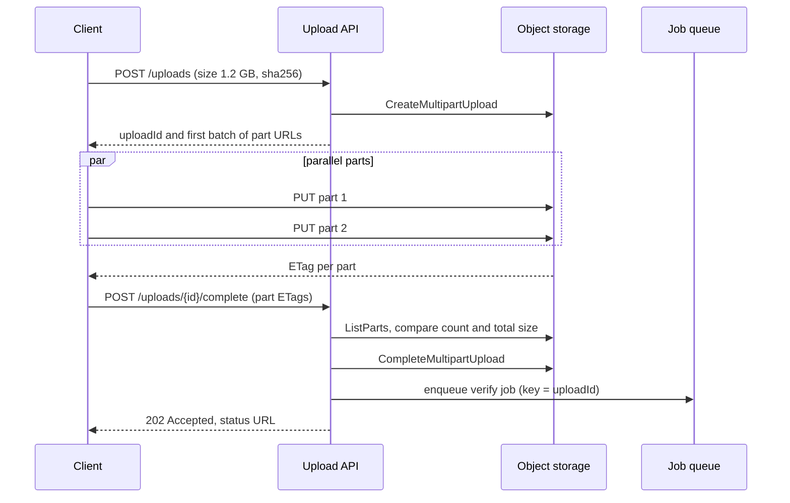
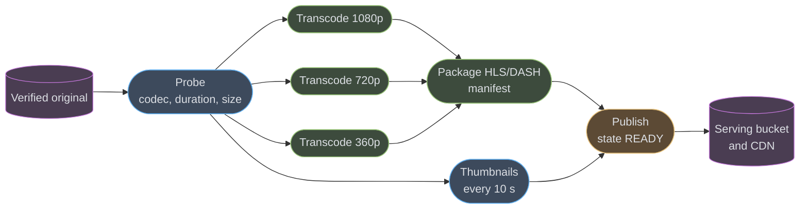

# File Upload & Media Handling

> Limits and specs checked 2026-11-25: Amazon S3 upload and multipart limits, S3 presigned-URL expiry, S3 event-notification delivery semantics, Google Cloud Storage resumable chunking, tus 1.0.0, `draft-ietf-httpbis-resumable-upload-16`, RFC 9110, RFC 7578, RFC 6266, the WHATWG Fetch `X-Content-Type-Options` header, ClamAV `clamd.conf` defaults and Pillow's decompression-bomb guard. Re-check the S3 and IETF rows before an audit pass; both move.

An upload endpoint is the one place in a backend where an anonymous stranger hands you an arbitrary blob of bytes, tells you what it is, and asks you to store it, process it and later serve it back to other people. Every part of that sentence is a trust boundary. This module covers the backend discipline: how the bytes travel (proxied, presigned, multipart, resumable), how you decide what the bytes really are, how you keep a malicious file from reaching a decoder or another user, and how the slow work (scanning, thumbnailing, transcoding) runs off the request path with quotas and cleanup.

---

## 1. Concept Overview

A naive upload is a `POST` with a `multipart/form-data` body (RFC 7578) that the application server reads into memory or a temp file, writes to disk or object storage, and answers `201 Created`. That design works for a 200 KB avatar on a 10-user intranet. It fails on four axes at scale:

1. **Bandwidth and threads.** A 2 GB video proxied through your API holds a request thread, a socket and (often) a temp-disk slot for the whole transfer. At 1 Gbit/s that is 16 seconds; on a mobile uplink at 5 Mbit/s it is almost an hour. Your fleet is sized for API calls, not for bulk transfer.
2. **Failure.** A single `POST` of 2 GB that dies at 1.9 GB starts again from zero. Mobile networks drop connections constantly.
3. **Trust.** The filename, the `Content-Type` header and the extension are all attacker-chosen strings. The bytes may be a polyglot (valid as both a JPEG and an HTML page), a decompression bomb, an image whose header claims 50,000 x 50,000 pixels, a ZIP containing `../../etc/cron.d/x`, or plain malware aimed at the next user who downloads it.
4. **Lifecycle.** Uploads start and never finish, objects get written but the database row never commits, users exceed their quota, and derived renditions (thumbnails, HLS ladders) outlive the original.

The production shape that answers all four is the same across Dropbox-, Drive- and YouTube-class systems: **the API issues a short-lived, narrowly scoped upload grant; the client sends bytes directly to object storage (in parts, resumably); a completion event triggers an asynchronous pipeline that verifies, scans, sniffs and processes the object in a quarantine area; only then is the object promoted and made visible.** The API never touches the payload bytes on the hot path.

This module owns the backend mechanics of that shape: the upload API contract, presigned and multipart grants, the resume protocol, content verification, malware scanning, the processing queue and quotas. The architecture-level view (storage tiers, CDN, transcoding DAGs, metadata-to-blob consistency at petabyte scale) lives in [Large Blobs & Media Pipelines](../../hld/large_blobs_and_media_pipelines/large_blobs_and_media_pipelines.md), and the end-to-end designs live in [Design Object Storage (S3)](../../hld/case_studies/design_object_storage_s3.md), [Design Google Drive](../../hld/case_studies/design_google_drive.md) and [Design YouTube Upload Pipeline](../../hld/case_studies/design_youtube_upload_pipeline.md). The FastAPI-specific wiring (Starlette's multipart limits, `UploadFile` spooling, the async-boundary trap) is in [Design a File Upload and Media API](../../fastapi/case_studies/design_file_upload_and_media_api.md). Deleting uploaded media when a user asks for erasure is in [Privacy Engineering & Data Lifecycle](../privacy_engineering_and_data_lifecycle/privacy_engineering_and_data_lifecycle.md).

> **See also:** [Design a Media Upload API](../case_studies/design_media_upload_api/design_media_upload_api.md) for the end-to-end API contract and file state machine.

---

## 2. Intuition

> **One-line analogy:** A proxied upload is a courier who walks every parcel through your office lobby. A presigned upload is a numbered locker key you hand the sender: they drop the parcel straight into the warehouse, and a clerk inspects it in a back room before it goes on any shelf.

**Mental model:** separate the **control plane** (who may upload what, how big, where, until when) from the **data plane** (the bytes). Your API owns the control plane and issues capabilities. Object storage owns the data plane. A pipeline owns the step in between, where "bytes exist" becomes "a verified, processed asset exists".

**Why it matters:** the failure modes are expensive and visible. A proxied 1 GB upload endpoint turns one user on a slow link into one pinned thread for 15 minutes. An unvalidated SVG served from your main origin is stored XSS. A missing lifecycle rule on incomplete multipart uploads is a storage bill for parts nobody can see in a normal bucket listing.

**Key insight:** an upload is not an event, it is a state machine (`initiated -> uploading -> uploaded -> scanning -> processing -> ready`, with `rejected` and `expired` exits). Every bug in this module is a missing state, a missing timeout on a state, or a transition that trusts input it should have verified.

---

## 3. Core Principles

- **Bytes bypass the API.** For anything larger than a few MB, the client uploads directly to object storage with a presigned or session URL. The API handles small JSON calls only.
- **Grants are narrow and short-lived.** A grant names one key, one method, one size, one content type and expires in minutes. A presigned URL is a bearer token: anyone holding it can use it until it expires.
- **Keys are server-chosen.** The client never chooses the object key or path. The server generates an opaque key (`q/{tenantId}/{uuid}`), which removes path traversal and key collision by construction.
- **Nothing the client says about the content is evidence.** Filename, extension and `Content-Type` are hints. The bytes decide: magic-number sniffing, a full decode with dimension limits, and a malware scan.
- **Quarantine, then promote.** New objects land in a non-public prefix or bucket. Only a passing pipeline copies or re-encodes them into the serving location.
- **Re-encode, do not pass through.** For images and video, serve a rendition your own pipeline produced, not the user's original bytes. Re-encoding strips EXIF location data and destroys most polyglot and parser-exploit payloads.
- **Every state has a timeout and a sweeper.** Incomplete multipart uploads, abandoned upload sessions, orphaned objects and unpromoted quarantine files all get cleaned up on a schedule.
- **Serve from a different origin.** User content is served from a separate cookieless domain (or CDN host) with `Content-Disposition` and `X-Content-Type-Options: nosniff`, so a malicious file cannot run script in your application's origin.

---

## 4. Types / Architectures / Strategies

### 4.1 Transport strategies

| Strategy | How bytes travel | Resumable | Size ceiling | Use when |
|---|---|---|---|---|
| Proxied `multipart/form-data` | Client -> API -> storage | No | Tens of MB in practice | Small files, internal tools, you must inspect bytes inline |
| Proxied streaming (`PUT` raw body) | Client -> API (streamed) -> storage | No | Hundreds of MB in practice | You need inline processing and can afford the connection time |
| Presigned single `PUT` | Client -> object storage | No | S3: 5 GB per single `PUT` | Files up to ~100 MB from reliable clients |
| Presigned multipart | Client -> storage, N parts in parallel | Yes, per part | S3: 10,000 parts, 48.8 TiB per object | Large files, parallel upload, browser and desktop clients |
| Resumable session (GCS JSON API, tus, IETF draft) | Client -> server or storage, offset-based append | Yes, per byte offset | Protocol- or server-defined | Mobile, flaky networks, very large files |

Amazon S3's own guidance is to consider multipart once an object reaches 100 MB. Each part is 5 MiB to 5 GiB (the last part has no minimum), and part numbers run 1 to 10,000.

### 4.2 Resume protocols

| Protocol | Status | Resume primitive | Notes |
|---|---|---|---|
| S3 multipart | Proprietary API, de facto standard | Re-upload the missing part numbers; `ListParts` shows what landed | Parts are independent, so the client can upload them in parallel and out of order |
| GCS resumable upload (JSON API) | Proprietary API | Session URI plus byte offset | Chunks must be a multiple of 256 KiB except the last; Google recommends at least 8 MiB chunks |
| tus 1.0.0 | Open protocol, dated 2016-03-25 | `HEAD` returns `Upload-Offset`, then `PATCH` from that offset | Extensions: creation, creation-with-upload, expiration, checksum, termination, concatenation |
| Resumable Uploads for HTTP (`draft-ietf-httpbis-resumable-upload-16`) | IETF HTTPbis working-group draft, intended Proposed Standard, dated 2026-11-22 | `HEAD` for `Upload-Offset`, append with `PATCH` and `Content-Type: application/partial-upload` | Grew out of the tus protocol draft; adds `Upload-Complete`, `Upload-Limit` and the `104 (Upload Resumption Supported)` interim status |

The IETF draft is not yet an RFC. Design your server so the resume logic (offset bookkeeping, idempotent append, expiry) is independent of the wire protocol, and you can expose tus today and the RFC later.

### 4.3 Verification layers

| Layer | What it catches | What it misses |
|---|---|---|
| Size limit at the edge | Disk and bandwidth exhaustion | Small malicious files |
| Extension allowlist | Accidental wrong uploads | Everything an attacker renames |
| Magic-number sniffing | Renamed executables, HTML posing as `.jpg` | Polyglots that start with valid magic bytes |
| Full decode with limits | Truncated or corrupt files, pixel bombs, polyglots that fail to decode | Payloads hidden in metadata that the decoder tolerates |
| Re-encode | Metadata payloads, EXIF location, most polyglots | Nothing for formats you cannot re-encode (PDF, Office, ZIP) |
| Antivirus scan (ClamAV or a vendor engine) | Known malware signatures in any format | Zero-days, encrypted archives |
| Content Disarm and Reconstruction (CDR) | Active content in Office and PDF documents | Requires a commercial engine; changes the file |

### 4.4 Processing topologies

- **Inline, synchronous:** the request waits for the thumbnail. Simple, and wrong past ~1 second of work, because the client's retry turns into duplicate processing and a slow decoder becomes an API latency incident.
- **Event-driven queue:** a storage event (S3 `s3:ObjectCreated:CompleteMultipartUpload`, `s3:ObjectCreated:Put`) or an API "complete" call enqueues a job. Workers scan, sniff, process and promote. The default.
- **Durable workflow:** for video (probe, transcode into a ladder, package HLS/DASH, generate thumbnails, publish), a workflow engine models each step with retries and timeouts. See [Durable Execution & Workflows](../durable_execution_and_workflows/durable_execution_and_workflows.md).

---

## 5. Architecture Diagrams

### 5.1 The presigned upload pipeline



The API touches only steps 1 to 3, which are small JSON calls. Bytes go from the client to the quarantine bucket. The worker is the only component that reads the uploaded bytes, and it never runs in the request path.

### 5.2 Upload lifecycle state machine



Every non-terminal state has an exit on a timer. A state with no timeout is where storage leaks come from: `Initiated` rows that hold quota forever, `Uploading` sessions whose parts are billed but invisible, `Scanning` jobs that died with their worker.

### 5.3 Why bytes must bypass the API

```
Proxied upload: 1 GB file, client uplink 10 Mbit/s (1.25 MB/s)

  API thread  |##############################################################| 800 s
  temp disk   |##############################################################| 1 GB
  retry cost  |  connection drops at 90%  ->  restart from byte 0            |

Presigned multipart: same file, 100 MiB parts, 3 parallel streams

  API thread  |#|  ~20 ms to issue grants, then free
  storage     |######## parts 1-3 ########|######## parts 4-6 ########|... 10 parts
  retry cost  |  part 7 fails  ->  re-send 100 MiB, not 1 GB                  |
```

The API thread cost drops from 800 seconds to milliseconds, and a failure costs one part instead of the whole file. The parallel streams share the same uplink, so wall-clock time on a saturated link barely changes; the win is thread cost and resume granularity.

### 5.4 Sequence: multipart upload with a server-side completion check



The API calls `ListParts` before completing, so a client cannot complete an upload whose total size differs from what it declared and what the quota reserved.

### 5.5 Video processing as a DAG



The fan-out steps are independent jobs with their own retries. A 360p rendition can publish first, so the video becomes playable at low quality while 1080p is still encoding. The architecture-level treatment of this DAG, with cost and capacity numbers, is in [Large Blobs & Media Pipelines](../../hld/large_blobs_and_media_pipelines/large_blobs_and_media_pipelines.md).

---

## 6. How It Works — Detailed Mechanics

### 6.1 The upload API contract

Model an upload as a resource with its own lifecycle, not as a side effect of creating the business entity. The pattern matches the long-running-operation shape in [REST API Design](../rest_api_design/rest_api_design.md):

```http
POST /v1/uploads
Content-Type: application/json
Idempotency-Key: 6f1c2a3e-1d1e-4c55-9d2c-0b6c1a7f1e10

{ "filename": "IMG_2041.HEIC", "size": 4194304,
  "declaredType": "image/heic", "sha256": "n4bQgYhMfWWaL+qgxVrQFaO/TxsrC4Is0V1sFbDwCgg=" }

HTTP/1.1 201 Created
Location: /v1/uploads/upl_01JDX4
{ "id": "upl_01JDX4", "state": "INITIATED",
  "method": "PUT", "url": "https://uploads-quarantine.s3.amazonaws.com/q/...&X-Amz-Expires=900",
  "headers": { "Content-Type": "image/heic",
               "x-amz-checksum-sha256": "n4bQgYhMfWWaL+qgxVrQFaO/TxsrC4Is0V1sFbDwCgg=" },
  "expiresAt": "2026-11-25T14:15:00Z" }
```

Then `POST /v1/uploads/{id}/complete` (or the storage event) moves it to `UPLOADED`, and the business call references the upload by id: `POST /v1/posts { "mediaUploadId": "upl_01JDX4" }`. The business call succeeds only for an upload in `READY` state owned by the caller. This separation keeps post creation a small, fast transaction, and a user who abandons the post leaves an upload that the sweeper reclaims.

The upload table is small and boring, which is the point:

```sql
CREATE TABLE uploads (
  id              text PRIMARY KEY,
  tenant_id       text NOT NULL,
  owner_id        text NOT NULL,
  storage_key     text NOT NULL UNIQUE,      -- server-generated, never user input
  multipart_id    text,                      -- S3 UploadId when multipart
  declared_size   bigint NOT NULL CHECK (declared_size > 0),
  declared_type   text NOT NULL,             -- client hint, never served
  verified_type   text,                      -- set by the pipeline
  sha256_b64      text NOT NULL,
  original_name   text,                      -- sanitized metadata only
  state           text NOT NULL CHECK (state IN
                   ('INITIATED','UPLOADING','UPLOADED','SCANNING','PROCESSING',
                    'READY','REJECTED','EXPIRED','FAILED')),
  reject_reason   text,
  lease_until     timestamptz,
  expires_at      timestamptz NOT NULL,      -- grant expiry; sweeper key
  created_at      timestamptz NOT NULL DEFAULT now()
);
CREATE INDEX uploads_sweep ON uploads (state, expires_at) WHERE state IN ('INITIATED','UPLOADING');
```

### 6.2 Issuing a narrow presigned PUT (Java 25, AWS SDK for Java v2)

```java
import java.time.Duration;
import java.util.UUID;
import software.amazon.awssdk.services.s3.model.ChecksumAlgorithm;
import software.amazon.awssdk.services.s3.model.PutObjectRequest;
import software.amazon.awssdk.services.s3.presigner.S3Presigner;
import software.amazon.awssdk.services.s3.presigner.model.PutObjectPresignRequest;

public final class UploadGrantService {
    private static final long MAX_SINGLE_PUT_BYTES = 100L * 1024 * 1024; // multipart above this
    private static final Duration GRANT_TTL = Duration.ofMinutes(15);

    private final S3Presigner presigner;
    private final QuotaService quota;
    private final UploadRepository uploads;

    public UploadGrantService(S3Presigner presigner, QuotaService quota, UploadRepository uploads) {
        this.presigner = presigner; this.quota = quota; this.uploads = uploads;
    }

    public UploadGrant initiate(String tenantId, String userId, InitiateUpload req) {
        if (req.size() <= 0 || req.size() > MAX_SINGLE_PUT_BYTES) {
            throw new UploadRejected("size must be 1.." + MAX_SINGLE_PUT_BYTES + " bytes for single PUT");
        }
        if (!AllowedTypes.IMAGES.contains(req.declaredType())) {
            throw new UploadRejected("type not allowed: " + req.declaredType());
        }
        // Reserve quota BEFORE issuing the grant; the sweeper releases it if the upload expires.
        quota.reserve(tenantId, userId, req.size());

        // Server-chosen opaque key: no user filename, no path segments from input.
        String key = "q/" + tenantId + "/" + UUID.randomUUID();

        PutObjectRequest put = PutObjectRequest.builder()
                .bucket("uploads-quarantine")
                .key(key)
                .contentType(req.declaredType())
                .contentLength(req.size())               // signed: a body of another length fails auth
                .checksumAlgorithm(ChecksumAlgorithm.SHA256)
                .checksumSHA256(req.sha256Base64())      // storage rejects bytes that do not match
                .build();

        var presigned = presigner.presignPutObject(PutObjectPresignRequest.builder()
                .signatureDuration(GRANT_TTL)
                .putObjectRequest(put)
                .build());

        uploads.insertInitiated(new UploadRow(key, tenantId, userId, req.size(),
                req.declaredType(), req.sha256Base64(), presigned.expiration()));
        return new UploadGrant(key, presigned.url(), presigned.signedHeaders(), presigned.expiration());
    }
}
```

Three details carry the security of this grant:

- **The key is server-generated.** The original filename is stored as metadata only, and it is sanitized before it is ever written into a `Content-Disposition` header.
- **The checksum is signed.** S3 presigned URLs signed with SigV4 accept additional checksum algorithms (CRC-64/NVME, CRC32, CRC32C, SHA-1, SHA-256 and others). A body whose hash does not match the declared SHA-256 is rejected by storage, so the bytes you scan are the bytes the client declared.
- **The TTL is short.** AWS SDKs and the CLI allow a presigned URL to live up to 7 days with long-term IAM user credentials, and a URL signed with temporary credentials dies when those credentials expire. S3 checks expiry when a request starts, so a long transfer that began before expiry still completes. Use 5 to 15 minutes for single `PUT`s. A bucket policy with the `s3:signatureAge` condition key can also reject any presigned request whose signature is older than a ceiling you set, which caps the damage of a leaked URL even if application code signs with a long TTL by mistake.

### 6.3 Multipart: grant per part, verify before completion

For a 1.2 GB file with 100 MiB parts, the client needs 12 part URLs. Issue them in batches (for example 20 at a time) so a stolen batch covers only part of the upload window:

```java
import software.amazon.awssdk.services.s3.S3Client;
import software.amazon.awssdk.services.s3.model.*;
import software.amazon.awssdk.services.s3.presigner.model.UploadPartPresignRequest;

public MultipartGrant initiateMultipart(String key, long size) {
    final long MiB = 1024L * 1024;
    // 10,000 parts maximum; size each part from the total, floor 64 MiB for throughput.
    long partSize = Math.max(64 * MiB, ((size + 9_999) / 10_000 + MiB - 1) / MiB * MiB);
    if (partSize > 5L * 1024 * MiB) throw new UploadRejected("object too large for 5 GiB parts");
    long parts = (size + partSize - 1) / partSize;

    String uploadId = s3.createMultipartUpload(CreateMultipartUploadRequest.builder()
            .bucket("uploads-quarantine").key(key)
            .checksumAlgorithm(ChecksumAlgorithm.CRC32C).build()).uploadId();

    var urls = new java.util.ArrayList<String>();
    for (int n = 1; n <= Math.min(parts, 20); n++) {           // first batch only
        var part = UploadPartRequest.builder().bucket("uploads-quarantine").key(key)
                .uploadId(uploadId).partNumber(n).build();
        urls.add(presigner.presignUploadPart(UploadPartPresignRequest.builder()
                .signatureDuration(Duration.ofMinutes(30)).uploadPartRequest(part).build())
                .url().toString());
    }
    return new MultipartGrant(uploadId, partSize, parts, urls);
}

public void complete(UploadRow row, java.util.List<CompletedPart> clientParts) {
    // Never trust the client's part list alone: ask storage what actually landed.
    var listed = s3.listPartsPaginator(ListPartsRequest.builder()
            .bucket("uploads-quarantine").key(row.key()).uploadId(row.uploadId()).build())
            .parts().stream().toList();
    long total = listed.stream().mapToLong(Part::size).sum();
    if (total != row.declaredSize() || listed.size() != clientParts.size()) {
        s3.abortMultipartUpload(b -> b.bucket("uploads-quarantine").key(row.key()).uploadId(row.uploadId()));
        uploads.markRejected(row.id(), "size mismatch: declared " + row.declaredSize() + ", got " + total);
        return;
    }
    s3.completeMultipartUpload(b -> b.bucket("uploads-quarantine").key(row.key()).uploadId(row.uploadId())
            .multipartUpload(m -> m.parts(clientParts)));
    uploads.markUploaded(row.id());
    jobs.enqueue("verify-upload", row.id());                // idempotency key = upload id
}
```

Part-size arithmetic matters at the edges. With the 5 MiB minimum and 10,000 parts, 5 MiB parts cap an object at about 48.8 GiB. A client that hard-codes 5 MiB parts fails on a 60 GB file at part 10,001. Compute the part size from the declared size, as above, and prefer 64 to 128 MiB parts for throughput on good links.

### 6.4 Resumable sessions (tus and the IETF draft)

The tus 1.0.0 core protocol is two requests. The client asks where to resume:

```http
HEAD /files/24e533e02ec3bc40c387f1a0e460e216 HTTP/1.1
Tus-Resumable: 1.0.0

HTTP/1.1 200 OK
Upload-Offset: 70
Upload-Length: 100
Cache-Control: no-store
Tus-Resumable: 1.0.0
```

and then sends the rest:

```http
PATCH /files/24e533e02ec3bc40c387f1a0e460e216 HTTP/1.1
Content-Type: application/offset+octet-stream
Upload-Offset: 70
Tus-Resumable: 1.0.0

[remaining 30 bytes]

HTTP/1.1 204 No Content
Upload-Offset: 100
Tus-Resumable: 1.0.0
```

The server rules that make this correct:

- **`Upload-Offset` must equal the stored offset**, or the server answers `409 Conflict` and changes nothing. A duplicated or reordered `PATCH` is therefore harmless: it is an optimistic-concurrency check on the byte offset.
- **The `HEAD` response is never cached** (`Cache-Control: no-store`), because a proxy that cached an old offset would make the client resend or skip bytes.
- **Limits are advertised**: `Tus-Max-Size` tells the client the maximum upload size before it sends anything. A `PATCH` without `Content-Type: application/offset+octet-stream` should get `415`. An unsupported `Tus-Resumable` version gets `412 Precondition Failed` with the `Tus-Version` list.
- **The offset is persisted only after the bytes are durable.** If the server acknowledges offset 100 MB and then crashes before the chunk reached storage, the client will never resend those bytes.

```java
// Server-side append with an offset compare-and-set. Returns the new offset or throws 409.
long append(String uploadId, long clientOffset, java.io.InputStream chunk, long chunkLength) throws Exception {
    UploadSession s = sessions.lockForUpdate(uploadId);              // SELECT ... FOR UPDATE
    if (s.expired()) throw new HttpError(404, "upload expired");
    if (clientOffset != s.offset()) throw new HttpError(409, "offset is " + s.offset());
    if (s.offset() + chunkLength > s.length()) throw new HttpError(400, "chunk overruns Upload-Length");
    storage.writeChunkDurably(s.storageKey(), clientOffset, chunk, chunkLength); // fsync or storage ack
    long newOffset = clientOffset + chunkLength;
    sessions.updateOffset(uploadId, newOffset);                       // commit AFTER the bytes are durable
    if (newOffset == s.length()) jobs.enqueue("verify-upload", uploadId);
    return newOffset;
}
```

The IETF draft (`draft-ietf-httpbis-resumable-upload-16`) uses the same offset model with standard header names: `Upload-Offset`, `Upload-Complete` (a structured boolean, `?1` on the final append), `Upload-Length`, and `Upload-Limit` with `max-size`, `min-size`, `max-append-size`, `min-append-size` and `max-age` parameters. Appends use `PATCH` with `Content-Type: application/partial-upload`. A server can send the interim `104 (Upload Resumption Supported)` response on an ordinary upload request to tell the client it can resume if the connection drops. Its mismatching-offset and inconsistent-length errors are defined as problem types.

### 6.5 Proxied uploads: when you must, do it with hard limits

Some uploads must pass through the API: a CSV import that you parse row by row, a signed document you must hash before accepting. Then stream, never buffer, and enforce limits at every layer:

| Layer | Limit to set |
|---|---|
| Load balancer / ingress | Maximum request body size, answered with `413 Content Too Large` (RFC 9110 §15.5.14) |
| Application server | Maximum form part size, number of parts, number of fields |
| Request timeout | A bytes-per-second floor (slowloris protection), not only a total timeout |
| Temp storage | Spool to disk above a threshold, on a volume with its own quota |

```java
// Streaming a raw PUT body to storage with a hard byte ceiling. Never readAllBytes().
public void proxyUpload(java.io.InputStream body, long declaredLength, String key) throws java.io.IOException {
    final long ceiling = 50L * 1024 * 1024;
    if (declaredLength < 0 || declaredLength > ceiling) throw new PayloadTooLarge(ceiling);
    var limited = new CountingInputStream(body, declaredLength);   // throws once more bytes arrive
    s3.putObject(b -> b.bucket("uploads-quarantine").key(key).contentLength(declaredLength),
            software.amazon.awssdk.core.sync.RequestBody.fromInputStream(limited, declaredLength));
    if (body.read() != -1) throw new PayloadTooLarge(ceiling);      // body longer than declared
}
```

The `Content-Length` header is a claim. A chunked-transfer request has no length at all, so the server must count bytes itself and stop reading at the ceiling.

### 6.6 Deciding what the bytes are: sniffing and decoding

Sniff the first bytes against an allowlist of signatures, then confirm with a full decode:

```java
import java.util.Arrays;

public final class MagicSniffer {
    public enum Kind { JPEG, PNG, GIF, WEBP, PDF, ZIP, UNKNOWN }

    public static Kind sniff(byte[] h) {
        if (h.length >= 3 && (h[0] & 0xFF) == 0xFF && (h[1] & 0xFF) == 0xD8 && (h[2] & 0xFF) == 0xFF) return Kind.JPEG;
        if (h.length >= 8 && Arrays.equals(Arrays.copyOf(h, 8),
                new byte[]{(byte) 0x89, 'P', 'N', 'G', 0x0D, 0x0A, 0x1A, 0x0A})) return Kind.PNG;
        if (h.length >= 6 && h[0] == 'G' && h[1] == 'I' && h[2] == 'F' && h[3] == '8') return Kind.GIF;
        if (h.length >= 12 && h[0] == 'R' && h[1] == 'I' && h[2] == 'F' && h[3] == 'F'
                && h[8] == 'W' && h[9] == 'E' && h[10] == 'B' && h[11] == 'P') return Kind.WEBP;
        if (h.length >= 5 && h[0] == '%' && h[1] == 'P' && h[2] == 'D' && h[3] == 'F' && h[4] == '-') return Kind.PDF;
        if (h.length >= 4 && h[0] == 'P' && h[1] == 'K' && h[2] == 3 && h[3] == 4) return Kind.ZIP; // also DOCX, XLSX, JAR, APK
        return Kind.UNKNOWN;
    }
}
```

Sniffing answers "does this start like a PNG", not "is this a safe PNG". Three traps:

1. **Container formats share magic bytes.** `PK\x03\x04` is ZIP, and also DOCX, XLSX, JAR and APK. Deciding "is this a DOCX" means opening the archive and checking its content-types part.
2. **Polyglots.** A file can begin with valid JPEG bytes and still contain HTML or JavaScript that a browser runs if it is served as `text/html` or sniffed as HTML. Sniffing passes it; a decode-and-re-encode step destroys the payload.
3. **Decompression bombs.** A 50 KB PNG can declare 30,000 x 30,000 pixels, which is 3.6 GB at 4 bytes per pixel when decoded. Read the dimensions from the header and reject before allocating. Pillow, for example, warns above `MAX_IMAGE_PIXELS` and raises `DecompressionBombError` above twice that value. In Java, read dimensions with an `ImageReader` without decoding the raster:

```java
import javax.imageio.ImageIO;

static void checkDimensions(java.nio.file.Path file) throws java.io.IOException {
    final long maxPixels = 40_000_000L;                       // 40 MP ceiling for this product
    try (var in = ImageIO.createImageInputStream(file.toFile())) {
        var readers = ImageIO.getImageReaders(in);
        if (!readers.hasNext()) throw new UploadRejected("no decoder for content");
        var r = readers.next();
        try {
            r.setInput(in, true, true);                       // header only; metadata ignored
            long px = (long) r.getWidth(0) * r.getHeight(0);   // long: int overflows at 46,341 x 46,341
            if (px > maxPixels) throw new UploadRejected("image too large: " + px + " px");
        } finally { r.dispose(); }
    }
}
```

The same idea applies to archives: cap the total uncompressed size, the number of entries and the nesting depth before you extract, and reject any entry whose normalized path leaves the destination directory (the "zip slip" path-traversal bug).

### 6.7 Malware scanning

ClamAV's daemon (`clamd`) scans a stream sent over a socket with the `INSTREAM` command: the client sends `zINSTREAM\0`, then chunks of `<4-byte length in network byte order><data>`, then a zero-length chunk. The shipped `clamd.conf.sample` defaults matter for sizing:

| Setting | Default | Meaning |
|---|---|---|
| `StreamMaxLength` | 100M | An `INSTREAM` larger than this gets `INSTREAM size limit exceeded` and the connection closes |
| `MaxFileSize` | 100M | Files larger than this are not scanned; ClamAV cannot scan files over 2 GB at all |
| `MaxScanSize` | 400M | Total data scanned per file, including extracted archive members |
| `MaxRecursion` | 17 (maximum 100) | Archive nesting depth |
| `MaxFiles` | 10000 | Archive members scanned |
| `AlertExceedsMax` | no | When `yes`, an over-limit file is flagged `Heuristics.Limits.Exceeded` |

The trap is the default `AlertExceedsMax no`: a 150 MB file is silently **not scanned** and nothing is flagged. Set `AlertExceedsMax yes` and treat that verdict as "unscanned, do not promote", or route large files to a different policy (block, accept only from trusted tenants, or scan with a commercial engine).

```java
import java.io.*;
import java.net.Socket;
import java.nio.ByteBuffer;
import java.nio.charset.StandardCharsets;

static String clamdScan(InputStream data, String host) throws IOException {
    try (var sock = new Socket(host, 3310);
         var out = new BufferedOutputStream(sock.getOutputStream());
         var in = sock.getInputStream()) {
        sock.setSoTimeout(30_000);
        out.write("zINSTREAM\0".getBytes(StandardCharsets.US_ASCII));
        byte[] buf = new byte[64 * 1024];
        for (int n; (n = data.read(buf)) > 0; ) {
            out.write(ByteBuffer.allocate(4).putInt(n).array());   // network byte order
            out.write(buf, 0, n);
        }
        out.write(new byte[4]);                                     // zero-length chunk ends the stream
        out.flush();
        String reply = new String(in.readAllBytes(), StandardCharsets.US_ASCII).replace("\0", "").trim();
        // "stream: OK" | "stream: <Signature> FOUND" | "INSTREAM size limit exceeded. ERROR"
        if (reply.equals("stream: OK")) return "CLEAN";
        if (reply.endsWith("FOUND")) return "INFECTED:" + reply;
        return "ERROR:" + reply;                                    // fail closed
    }
}
```

Fail closed: a scanner timeout, a connection error or an unparsed reply means "not promoted", never "clean". Keep signature databases current (`freshclam`) and alert when the database age passes a threshold, because a scanner with week-old signatures still reports `OK`.

### 6.8 Processing queue, idempotency and quotas

The verify-and-process job must be idempotent, because storage events are at-least-once: S3 documents that event notifications are delivered at least once, are not guaranteed to arrive in order, and that its retry can occasionally produce a duplicate notification for the same object event. Key the job on the upload id and make each step a conditional state transition:

```sql
-- Only one worker wins the transition; a duplicate event finds 0 rows and exits.
UPDATE uploads SET state = 'SCANNING', lease_until = now() + interval '10 minutes'
 WHERE id = :id AND state = 'UPLOADED';
```

A worker that dies leaves a `SCANNING` row with an expired lease; a sweeper resets it to `UPLOADED` after the lease passes. Combine this with the inbox and DLQ patterns in [Messaging Patterns](../messaging_patterns/messaging_patterns.md), and keep media work on a separate queue from user-facing jobs so a burst of 4K video uploads cannot delay password-reset emails.

Quotas have several numbers, and production systems need all of them:

| Quota | Enforced where | Why |
|---|---|---|
| Per-file size | Grant issuance and storage (signed length) | Bounds a single transfer and scan |
| Reserved bytes (in flight) | Grant issuance; released on expiry or rejection | Stops a user opening 1,000 grants of 5 GB each |
| Stored bytes (committed) | Promotion; decremented on delete | The billing number |
| Rate (grants per minute) | API gateway | Abuse and cost control; see [Rate Limiting in Depth](../rate_limiting_in_depth/rate_limiting_in_depth.md) |
| Processing minutes | Job scheduler, per tenant | Video transcoding is the expensive part; see [Multi-Tenancy & Isolation](../multi_tenancy_and_isolation/multi_tenancy_and_isolation.md) |

Charge quota at reservation, convert to stored bytes at promotion, and refund on expiry. A quota checked only at promotion lets a user upload unlimited bytes into quarantine.

### 6.9 Serving user content safely

```http
HTTP/1.1 200 OK
Content-Type: image/webp
Content-Disposition: inline; filename="photo.webp"; filename*=UTF-8''photo.webp
X-Content-Type-Options: nosniff
Content-Security-Policy: default-src 'none'; img-src 'self'; style-src 'unsafe-inline'; sandbox
Cache-Control: public, max-age=31536000, immutable
```

- Serve from a separate registrable domain (for example `example-usercontent.net`), so a malicious HTML or SVG file cannot read your application's cookies.
- `X-Content-Type-Options: nosniff` (defined in the WHATWG Fetch standard) stops the browser from overriding your `Content-Type` by sniffing.
- Set `Content-Type` from your verified type, never from the client's declared type. For types you will not render inline (HTML, SVG, PDF from untrusted users), send `Content-Disposition: attachment` (RFC 6266).
- Use content-addressed or versioned keys so `immutable` caching is safe; see [CDN](../../hld/cdn/cdn.md).
- For private content, issue short-lived signed download URLs or signed CDN cookies per request, scoped to one object.

### 6.10 Cleanup: sweepers and lifecycle rules

Incomplete multipart uploads consume storage that a normal object listing does not show. Configure a bucket lifecycle rule with `AbortIncompleteMultipartUpload`, and run an application sweeper for the database side:

```xml
<LifecycleConfiguration>
  <Rule>
    <ID>abort-stale-mpu</ID>
    <Filter><Prefix>q/</Prefix></Filter>
    <Status>Enabled</Status>
    <AbortIncompleteMultipartUpload><DaysAfterInitiation>2</DaysAfterInitiation></AbortIncompleteMultipartUpload>
  </Rule>
  <Rule>
    <ID>expire-quarantine</ID>
    <Filter><Prefix>q/</Prefix></Filter>
    <Status>Enabled</Status>
    <Expiration><Days>7</Days></Expiration>
  </Rule>
</LifecycleConfiguration>
```

The two rules together guarantee that nothing stays in quarantine for more than 7 days: either the pipeline promoted it (copied it out) or it expires. The application sweeper handles the other direction:

```sql
-- Release quota for grants that were never used; run every 5 minutes.
WITH expired AS (
  UPDATE uploads SET state = 'EXPIRED'
   WHERE state IN ('INITIATED','UPLOADING') AND expires_at < now() - interval '15 minutes'
  RETURNING tenant_id, owner_id, declared_size, multipart_id, storage_key)
INSERT INTO quota_ledger (tenant_id, owner_id, delta_reserved_bytes, reason)
SELECT tenant_id, owner_id, -declared_size, 'grant expired' FROM expired;
```

A daily reconciliation job lists serving-bucket objects with no `READY` database row (the "object written, transaction rolled back" orphan) and deletes them after a grace period, and alerts on the inverse case (a `READY` row whose object is missing).

### 6.11 Upload from URL: the SSRF variant

"Import from URL" (paste a link to an image) turns your fetcher into an HTTP client pointed wherever the user says. It needs the same defenses as webhook dispatch in [Webhooks & Event Delivery](../webhooks_and_event_delivery/webhooks_and_event_delivery.md): resolve DNS once and connect to the pinned IP, deny loopback, link-local (`169.254.0.0/16`, the cloud metadata range) and private ranges, refuse redirects or re-validate each hop, cap the response size and time, and run the fetcher in a network segment that cannot reach internal services. The fetched bytes then enter the same quarantine pipeline as any other upload. See [Backend Security & OWASP](../backend_security_owasp/backend_security_owasp.md) for SSRF generally.

---

## 7. Real-World Examples

- **Amazon S3.** A single `PUT` takes up to 5 GB, and multipart upload goes to 48.8 TiB per object with up to 10,000 parts of 5 MiB to 5 GiB. AWS recommends a lifecycle rule with `AbortIncompleteMultipartUpload` to reclaim abandoned parts, and its documentation example uses `DaysAfterInitiation` of 7. AWS's own documentation calls presigned URLs bearer tokens and shows an `s3:signatureAge` bucket-policy condition that rejects signatures older than 10 minutes.
- **Google Cloud Storage.** The JSON API's resumable upload uses a session URI and byte offsets. Chunks must be multiples of 256 KiB (except the last), and Google recommends at least 8 MiB per chunk.
- **tus.** The open resumable-upload protocol (1.0.0, dated 2016-03-25). Its site states the protocol received feedback from people at Vimeo and Google. `tusd` is the official reference server and stores uploads on local disk, Google Cloud Storage or S3-compatible storage.
- **IETF HTTPbis.** `draft-ietf-httpbis-resumable-upload-16` (2026-11-22, authors Marius Kleidl, Guoye Zhang of Apple, and Lucas Pardue) is the standards-track successor of the tus protocol draft, with intended status Proposed Standard.
- **ClamAV.** The open-source engine most upload pipelines start with; its defaults (`MaxFileSize` 100M, `StreamMaxLength` 100M, the 2 GB hard limit) shape how large-file policies are written.

---

## 8. Tradeoffs

### 8.1 Proxied vs direct-to-storage

| | Proxied through API | Presigned / direct |
|---|---|---|
| API capacity | One thread and socket per transfer for its full duration | Milliseconds per grant |
| Inline inspection | Yes, can reject mid-stream | No, inspection happens after the fact |
| Client complexity | One `POST` | Grant call, storage call, complete call |
| Auth on the data path | Your session or token | Bearer URL, valid until expiry |
| Network cost | Bytes cross two hops (client to API, API to storage) | Bytes go to storage once |

### 8.2 Single PUT vs multipart vs resumable session

| | Single PUT | Multipart | Resumable session (tus / draft) |
|---|---|---|---|
| Resume granularity | None | One part (5 MiB to 5 GiB on S3) | Byte offset |
| Parallelism | None | Many parts at once | Sequential per upload (tus concatenation adds parallel) |
| Server state | None | Upload id plus part ETags in storage | Offset per session in your store |
| Best client | Server-to-server, small files | Desktop and browser with good bandwidth | Mobile, unreliable links |

### 8.3 Scan before or after promotion

| | Scan before promotion (quarantine) | Scan after promotion |
|---|---|---|
| User-visible latency | Seconds to minutes before "ready" | Instant |
| Risk window | None; nothing is served unscanned | Malware is downloadable until the scan completes |
| Complexity | Two locations, a copy step | One location, a takedown path |
| Fit | Default for multi-user content | Single-user private storage where the uploader is the only reader |

### 8.4 Keep the original or keep only renditions

| | Keep original | Renditions only |
|---|---|---|
| Re-processing (new codec, new size) | Possible | Lossy re-encode of a rendition |
| Storage cost | Original plus all renditions | Renditions only |
| Privacy | Original carries EXIF location, device ids | Metadata stripped by construction |
| Erasure surface | One more copy to delete | Smaller |

---

## 9. When to Use / When NOT to Use

**Use presigned direct-to-storage uploads** for any user-facing upload above a few MB, for any client on a mobile network, and whenever upload volume could compete with API traffic for threads or bandwidth.

**Use a resumable protocol (tus today, the IETF protocol when it is an RFC)** when files exceed ~100 MB on unreliable networks, or when your mobile SDK needs to survive app backgrounding.

**Proxy through the API** only for small files that you must parse inline (CSV import, signed documents), and only with streaming and hard limits at every layer.

**Do not build your own resumable protocol.** Every hand-rolled "chunk upload" endpoint rediscovers offset races, a missing `no-store` on the offset response and double-acknowledged chunks. Use S3 multipart, GCS resumable sessions or tus.

**Do not accept active content you cannot neutralize.** If the product does not need SVG, HTML, PDF or Office uploads, block them. Each format you accept adds a parser to your attack surface.

---

## 10. Common Pitfalls

**The SVG avatar that stole sessions.** A profile-picture endpoint accepted `image/svg+xml` because "it is an image", stored it at `app.example.com/avatars/123.svg` and served it with the client's declared type. An attacker uploaded an SVG with an embedded `<script>` and sent the URL to support staff. The script ran in the application's origin with the staff member's session. Fix: serve user content from a separate domain, rasterize SVG server-side or block it, and set `Content-Type` from the verified type.

```java
// BROKEN: content type and filename come from the client; served from the app origin.
response.setContentType(upload.declaredType());                 // "image/svg+xml" or "text/html"
response.setHeader("Content-Disposition", "inline; filename=" + upload.originalName());
stream(upload.key(), response.getOutputStream());

// FIX: type from verification, attachment for anything not re-encoded, nosniff, separate origin.
VerifiedType vt = upload.verifiedType();                          // set by the pipeline, never by the client
response.setContentType(vt.mime());
response.setHeader("X-Content-Type-Options", "nosniff");
response.setHeader("Content-Disposition",
        (vt.reencoded() ? "inline" : "attachment") + "; filename*=UTF-8''" + rfc5987Encode(upload.safeName()));
// and this handler is deployed only on the usercontent domain
```

**The 150 MB file that was "scanned clean".** The pipeline marked anything ClamAV did not flag as clean. With the default `MaxFileSize` of 100M and `AlertExceedsMax no`, every file over 100 MB passed without being scanned. Fix: set `AlertExceedsMax yes`, treat `Heuristics.Limits.Exceeded` as unscanned, and add a test that uploads a 101 MB file with the EICAR test string past the 100 MB mark.

**Invisible storage bill from abandoned multipart uploads.** A mobile app started a multipart upload for every video draft. Users abandoned 30% of drafts. Parts were never completed or aborted, did not appear in normal object listings, and accumulated for 14 months before a cost review found them. Fix: an `AbortIncompleteMultipartUpload` lifecycle rule on day one, plus a dashboard on incomplete-upload bytes.

**Quota checked at promotion only.** A free-tier user opened 400 presigned grants of 5 GB each in a loop, uploaded into quarantine and let the files fail processing. Quarantine grew by 2 TB in a day. Fix: reserve quota when issuing the grant and release it on expiry or rejection.

**Image header bomb.** A thumbnailer decoded every upload fully. A 60 KB PNG declaring 40,000 x 40,000 pixels made each worker try to allocate 6.4 GB and get OOM-killed; the job retried on the next worker, which also died, until the whole pool was down. Fix: read dimensions from the header first (§6.6), reject above a pixel ceiling, cap job retries, and run decoders in a memory-limited sandbox.

**Zip slip.** A bulk-import feature extracted user ZIPs with `new File(dest, entry.getName())`. An entry named `../../app/config/application.yml` overwrote the server's configuration. Fix:

```java
// BROKEN: entry name is used as a path.
Path out = dest.resolve(entry.getName());

// FIX: normalize and require the result to stay inside dest.
Path out = dest.resolve(entry.getName()).normalize();
if (!out.startsWith(dest.toRealPath()) || entry.getName().startsWith("/")) {
    throw new UploadRejected("archive entry escapes target: " + entry.getName());
}
```

**Duplicate thumbnails from at-least-once events.** S3 delivered a rare duplicate event. Two workers both generated renditions and both incremented the stored-bytes counter, so the user was billed twice. Fix: the conditional `UPDATE ... WHERE state = 'UPLOADED'` transition in §6.8, with the counter update inside the same transaction as the `READY` transition.

---

## 11. Technologies & Tools

| Tool | Purpose |
|---|---|
| Amazon S3 multipart upload | Parallel, part-resumable uploads up to 48.8 TiB with presigned part URLs |
| Google Cloud Storage | Resumable uploads with session URIs and 256 KiB-aligned chunks |
| tusd | Official reference server for the tus resumable-upload protocol, storing to disk, GCS or S3-compatible storage |
| Uppy | Browser upload UI with a tus plugin (`@uppy/tus`) among its upload destinations |
| ClamAV | Open-source antivirus engine; `clamd` scans streams over `INSTREAM` |
| Apache Tika | Content-type detection and metadata extraction for many formats in Java |
| libvips | Low-memory, streaming image processing library used for thumbnailing |
| ImageMagick | General image toolkit; restrict its coders with `policy.xml` if you must use it |
| FFmpeg | Probing and transcoding audio and video into renditions and HLS/DASH packages |
| AWS Elemental MediaConvert | Managed video transcoding service |
| Amazon CloudFront signed URLs | Time-limited, per-object download authorization at the CDN edge |

---

## 12. Interview Questions with Answers

**Q: Why should large uploads go directly to object storage instead of through the API servers?**
**Short:** Proxying pins an API thread and socket for the whole transfer and moves bytes twice, while a presigned upload costs the API only milliseconds.

A 1 GB upload at 10 Mbit/s takes 800 seconds, and a proxied design holds an API request slot, a socket and usually temp disk for all of it, so a few hundred slow uploaders can exhaust a fleet sized for short API calls. A presigned grant moves the data plane to object storage, which is built for bulk transfer, and leaves the API with small control-plane calls. Proxy only when you must inspect bytes inline, and then stream with hard limits.

**Q: What can go wrong if you trust the client's Content-Type header or file extension?**
**Short:** Both are attacker-chosen strings, so HTML, SVG or an executable can be stored and served as an "image" and run in a victim's browser.

A client can upload an HTML page named `cat.jpg` with `Content-Type: image/jpeg`, and if you later serve it with the stored declared type, or let the browser sniff, it renders as a page in your origin. Decide the type from the bytes (magic-number sniffing plus a full decode), store that verified type, set `Content-Type` from it, and send `X-Content-Type-Options: nosniff`. Extensions and declared types are useful only as hints for user-facing errors.

**Q: Your ClamAV pipeline reports every file as clean. Why might large files be unscanned?**
**Short:** With default limits, clamd skips files over MaxFileSize (100M) and, with AlertExceedsMax off, flags nothing instead of reporting an error.

`clamd.conf` defaults include `MaxFileSize 100M`, `MaxScanSize 400M` and `StreamMaxLength 100M`, and ClamAV cannot scan files over 2 GB at all. Unless `AlertExceedsMax yes` is set, an over-limit file is simply not flagged, so a pipeline that treats "no virus found" as clean promotes unscanned files. Enable the alert, treat `Heuristics.Limits.Exceeded` as unscanned, and give large files a separate policy.

**Q: How do you make a presigned upload URL safe to hand to a browser?**
**Short:** Scope it to one server-chosen key, method, size and checksum, keep the TTL to minutes, and upload into a private quarantine location.

A presigned URL is a bearer token: whoever holds it can use it until expiry. Generate the object key on the server, sign the content length and a SHA-256 checksum so storage rejects different bytes, set a 5 to 15 minute TTL, and point it at a private quarantine bucket so a successful upload is still invisible to others until the pipeline promotes it. A bucket policy on `s3:signatureAge` adds a server-side ceiling on how old a signature may be.

**Q: A multipart upload of a 60 GB file fails at part 10,001. What went wrong?**
**Short:** The client used fixed 5 MiB parts, and S3's 10,000-part limit caps 5 MiB parts at about 48.8 GiB, so part size must scale with file size.

S3 allows 10,000 parts of 5 MiB to 5 GiB each. At 5 MiB per part the maximum object is 10,000 x 5 MiB, roughly 48.8 GiB, so a 60 GB file needs parts of at least about 6 MB. Compute `partSize = max(floor, ceil(size / 10,000))`, round up to a whole MiB, and use 64 to 128 MiB parts for throughput. Validate this server-side when issuing the grant, not at part 10,001.

**Q: Why do abandoned multipart uploads cost money, and how do you prevent that?**
**Short:** Uploaded parts are stored and billed until the upload is completed or aborted, yet they do not appear as objects; a lifecycle rule aborts them.

An initiated multipart upload holds every uploaded part in storage. Normal object listings do not show them, so they grow silently when clients abandon uploads. Configure an `AbortIncompleteMultipartUpload` lifecycle rule (for example 2 to 7 days after initiation) and track incomplete-upload bytes as a metric. The application sweeper should also mark expired rows and release their quota reservations.

**Q: How does a resumable upload protocol stay correct when the client retries a chunk?**
**Short:** Each append carries the expected byte offset, and the server applies it only if it equals the stored offset, otherwise it answers 409.

In tus 1.0.0 the client sends `PATCH` with `Upload-Offset`; if it does not match the server's current offset the server must answer `409 Conflict` without changing anything. A duplicate or reordered chunk therefore cannot corrupt the file. The client recovers by sending `HEAD`, reading the authoritative `Upload-Offset`, and resuming from there. The server must persist the new offset only after the bytes are durable.

**Q: What is the IETF resumable upload work, and how does it relate to tus?**
**Short:** draft-ietf-httpbis-resumable-upload is an HTTPbis draft, grown out of tus, that standardizes offset resumption with Upload-Offset, Upload-Complete and a 104 status.

The draft (version 16 dated 2026-11-22, intended Proposed Standard) keeps tus's offset model but uses standard HTTP mechanisms: `Upload-Offset`, a structured-boolean `Upload-Complete`, `Upload-Length`, an `Upload-Limit` header with size and age parameters, appends as `PATCH` with `application/partial-upload`, problem-type errors, and an interim `104 (Upload Resumption Supported)` response. It is not an RFC yet, so production systems use tus or vendor APIs today and keep their resume bookkeeping protocol-independent.

**Q: What is a decompression bomb in an image upload, and how do you defend against it?**
**Short:** A small compressed file declares huge dimensions so decoding allocates gigabytes; read dimensions from the header and reject above a pixel ceiling first.

A 50 KB PNG can declare 30,000 x 30,000 pixels, about 3.6 GB at 4 bytes per pixel once decoded, enough to OOM-kill a worker and then the next one that retries the job. Read width and height from the header without decoding the raster, compute the product in 64-bit arithmetic, and reject above a product-specific limit. Libraries ship guards (Pillow raises `DecompressionBombError` above twice `MAX_IMAGE_PIXELS`), and decoders should still run in memory-limited sandboxes with capped retries.

**Q: Why re-encode uploaded images instead of serving the original file?**
**Short:** Re-encoding strips metadata like GPS coordinates and destroys polyglot and parser payloads, so you serve bytes your own encoder produced.

Originals carry EXIF data (location, device serials) that users rarely mean to publish, and can be polyglots that are both a valid JPEG and a valid HTML or script file. Decoding to pixels and encoding a fresh WebP or JPEG keeps only image data. It also normalizes orientation, color profile and size. Keep the original in private storage only if the product needs re-processing, and include it in erasure handling.

**Q: How do you keep storage-triggered processing from running twice?**
**Short:** Treat events as at-least-once and gate each step with a conditional state transition keyed by upload id, so only one worker wins.

S3 documents that event notifications are delivered at least once and can be duplicated or reordered. Make the job idempotent: `UPDATE uploads SET state='SCANNING' ... WHERE id=? AND state='UPLOADED'` succeeds for exactly one worker, and a duplicate event finds zero rows and exits. Give the claimed state a lease so a crashed worker's job is reclaimed, and put side effects such as quota counters in the same transaction as the state change.

**Q: Why should user-uploaded content be served from a different domain?**
**Short:** If an uploaded HTML or SVG file ever renders, it runs in that domain's origin, so a separate cookieless domain keeps it away from your sessions.

Browsers isolate by origin. Content at `app.example.com/uploads/x.svg` that executes script can read that origin's cookies and call its APIs as the victim. Hosting user content on an unrelated registrable domain means even a missed validation cannot reach application sessions. Pair it with `X-Content-Type-Options: nosniff`, a restrictive `Content-Security-Policy` and `Content-Disposition: attachment` for types you do not re-encode.

**Q: How should upload quotas be enforced so users cannot bypass them?**
**Short:** Reserve the declared size when issuing the grant, enforce it at storage with a signed length, convert to stored bytes on promotion and refund on expiry.

A quota checked only after processing lets a user fill quarantine with unlimited failed uploads. Reserve bytes at grant time (so 1,000 open grants count against the quota), sign the size into the grant so storage enforces it, verify the actual size with `ListParts` or `HEAD` before completing, and release the reservation when the grant expires or the upload is rejected. Rate-limit grant issuance separately.

**Q: What is zip slip, and how do you prevent it in an archive import?**
**Short:** A malicious archive entry name like ../../config.yml writes outside the extraction directory; normalize each path and require it to stay inside the target.

Archive formats store entry names as arbitrary strings. Code that does `new File(dest, entry.getName())` will write to `dest/../../config.yml`. Resolve and normalize each entry path, reject it unless it starts with the canonical destination directory, reject absolute paths and symlink entries, and cap the number of entries, total uncompressed size and nesting depth before extracting anything.

**Q: When is proxying an upload through the API the right choice?**
**Short:** When files are small and you must inspect or transform the bytes inline, such as a CSV import or a signed document you hash before accepting.

Inline processing lets you reject a bad CSV row immediately or compute a hash under your own control. The cost is an API thread and socket per transfer, so keep these endpoints to small files (tens of MB), stream instead of buffering, enforce a body limit at the load balancer (`413 Content Too Large`) and in the application, and add a minimum bytes-per-second rate so slow clients cannot hold connections open.

**Q: How do you clean up objects whose database transaction failed?**
**Short:** Run a periodic reconciliation that deletes objects with no matching READY row after a grace period, and use lifecycle expiry on the quarantine prefix.

Writing a blob and committing a database row are two systems, so either can succeed without the other. Write blobs first into quarantine under an opaque key, commit the row, then promote. A lifecycle rule expires anything left in quarantine after N days, and a daily job compares the serving bucket with the metadata table and deletes objects with no `READY` row older than the grace period. The inverse (a row pointing at a missing blob) is caught by the same job and alerted on.

**Q: Why must the offset response in a resumable upload not be cached?**
**Short:** A cached stale offset makes the client resend or skip bytes, which wastes bandwidth, triggers 409 loops or corrupts the upload.

The resume decision depends entirely on the server's current `Upload-Offset`. If a proxy or client cache returns an older value, the client appends from the wrong position: too low collides with 409s, too high would skip bytes if the server did not check. tus requires `Cache-Control: no-store` on the `HEAD` response for this reason, and the same rule applies to any home-grown status endpoint.

**Q: How long should a presigned upload URL live, and what limits the maximum?**
**Short:** Minutes for a single PUT; AWS SDKs allow up to 7 days with long-term credentials, and a URL signed with temporary credentials expires with them.

Shorter is safer because the URL is a bearer token. S3 checks expiry when a request starts, so a large transfer that begins before expiry still completes, and a short TTL does not cut off slow uploads in progress. For multipart, issue part URLs in batches with 30 to 60 minute TTLs and issue more as parts complete. A URL signed with an EC2 role or STS session dies when that session expires, regardless of the requested TTL.

**Q: How does "import from URL" change the threat model of an upload feature?**
**Short:** The server now fetches an attacker-chosen URL, so it is an SSRF vector that needs IP pinning, private-range denial and response size limits.

A pasted URL can point at `169.254.169.254` (cloud metadata), an internal admin service or a redirect chain that ends there. Resolve the hostname once and connect to the pinned address, deny loopback, link-local and private ranges, refuse or re-validate redirects, cap download size and time, and run the fetcher in a network segment with no internal reachability. The downloaded bytes then go through the same quarantine, sniff and scan pipeline as a direct upload.

**Q: Where should media processing jobs run relative to other background work?**
**Short:** On a separate queue and worker pool with per-tenant limits, because transcoding bursts would otherwise starve small, latency-sensitive jobs.

A single 4K video can need minutes of CPU per rendition. If it shares a queue with password-reset emails and webhook dispatch, an upload burst delays everything behind it. Give media its own queue, its own autoscaled pool with memory limits sized for decoders, and a per-tenant concurrency or minutes budget so one customer's bulk import cannot consume the whole pool.

---

## 13. Best Practices

- Issue upload grants from the API and send bytes directly to object storage; keep the API out of the data path.
- Generate object keys on the server; keep user filenames as sanitized metadata only.
- Sign size and checksum into grants; keep TTLs in minutes and upload into a private quarantine location.
- Decide file type from the bytes, then decode with dimension and size limits, then re-encode media you will serve.
- Scan with an antivirus engine, fail closed on errors and timeouts, and treat over-limit files as unscanned.
- Make processing idempotent with conditional state transitions and leases; storage events are at-least-once.
- Reserve quota at grant time, enforce it in storage, and refund on expiry or rejection.
- Add `AbortIncompleteMultipartUpload` and quarantine-expiry lifecycle rules before launch, plus an orphan reconciliation job.
- Serve user content from a separate domain with `X-Content-Type-Options: nosniff`, a verified `Content-Type` and `Content-Disposition`.
- Treat uploads as personal data: strip metadata, record which renditions exist, and make every copy reachable by erasure.

---

## 14. Case Study

**Problem.** A community marketplace let sellers attach up to 10 photos per listing. The original endpoint accepted `multipart/form-data` on the API servers, wrote files to a shared NFS volume and generated thumbnails inline with ImageMagick. At 40,000 listings per day it held, with p99 listing creation at 4.8 seconds. Three incidents in one quarter forced a redesign. A holiday-sale spike of sellers on slow mobile links pinned all 200 Tomcat threads on 12 API nodes for 22 minutes, and checkout calls on the same fleet timed out. A seller uploaded a crafted 70 KB PNG declaring 45,000 x 45,000 pixels; inline thumbnailing tried to allocate about 8 GB per attempt and crash-looped every node the retry reached. And a security researcher showed that an SVG uploaded as a listing photo was served from `www` with `image/svg+xml` and ran script.

**Fix.** The team rebuilt the flow on the pattern in §5.1:

```java
// BROKEN: inline, proxied, trusts the client, decodes without limits, serves from the app origin.
@PostMapping(path = "/listings/{id}/photos", consumes = "multipart/form-data")
public PhotoDto upload(@PathVariable long id, @RequestParam("file") MultipartFile file) throws Exception {
    Path dest = Path.of("/mnt/nfs/photos", id + "_" + file.getOriginalFilename());  // user-controlled path
    file.transferTo(dest);
    BufferedImage img = ImageIO.read(dest.toFile());                                   // full decode, no ceiling
    thumbnailer.writeThumb(img, dest);                                                 // in the request thread
    return new PhotoDto("https://www.example.com/photos/" + dest.getFileName(), file.getContentType());
}

// FIX: the API issues a grant only. Bytes go to quarantine; a worker verifies, scans, re-encodes, promotes.
@PostMapping("/listings/{id}/photo-uploads")
public UploadGrant grant(@PathVariable long id, @RequestBody InitiateUpload req, Principal p) {
    listings.requireOwner(id, p.getName());
    if (req.size() > 15L * 1024 * 1024) throw new UploadRejected("max 15 MB per photo");
    return grants.initiate(tenantOf(p), p.getName(), req);   // §6.2: opaque key, signed size + sha256, 15 min TTL
}

// Worker: separate deployment, 2 GiB memory limit per pod, max 3 attempts per job.
void verify(String uploadId) throws Exception {
    if (!uploads.claim(uploadId, "UPLOADED", "SCANNING")) return;          // duplicate event: exit
    Path tmp = storage.download("uploads-quarantine", uploads.key(uploadId));
    byte[] head;
    try (var in = Files.newInputStream(tmp)) { head = in.readNBytes(16); }
    var kind = MagicSniffer.sniff(head);
    if (kind != MagicSniffer.Kind.JPEG && kind != MagicSniffer.Kind.PNG && kind != MagicSniffer.Kind.WEBP) {
        uploads.reject(uploadId, "unsupported type " + kind); return;
    }
    checkDimensions(tmp);                                                   // 40 MP ceiling from the header (§6.6)
    try (var in = Files.newInputStream(tmp)) {
        if (!clamdScan(in, "clamd").equals("CLEAN")) { uploads.reject(uploadId, "scan"); return; }
    }
    var renditions = vips.reencodeToWebp(tmp, List.of(1600, 800, 320));    // strips EXIF, destroys polyglots
    storage.putAll("photos-serving", renditions);                           // served only from the usercontent CDN host
    uploads.transition(uploadId, "SCANNING", "READY");
}
```

The serving bucket sits behind a CDN hostname on a separate registrable domain with `X-Content-Type-Options: nosniff` and long-lived immutable caching. SVG is no longer accepted. Lifecycle rules abort incomplete multipart uploads after 2 days and expire quarantine objects after 7.

**Result.** Listing creation p99 dropped from 4.8 seconds to 180 ms, because it now references `READY` upload ids instead of carrying bytes. API thread usage stopped tracking seller bandwidth: the next peak, at 2.3 times the previous upload volume, showed no change in API latency. The pixel-bomb file now fails in milliseconds at the header check, inside a worker pod with a memory limit, and never reaches a decoder. Photos appear on the listing 4 to 9 seconds after upload instead of instantly, which the product team accepted after adding a "processing" placeholder. Storage fell 31% because the 4 MB phone originals are no longer served and only three WebP renditions are kept, and EXIF location data disappeared from public photos. (Figures in this case study are illustrative.)

For the architecture-level treatment of the same pipeline at video scale (transcoding ladders, CDN origin shielding, metadata-to-blob consistency), see [Large Blobs & Media Pipelines](../../hld/large_blobs_and_media_pipelines/large_blobs_and_media_pipelines.md) and [Design YouTube Upload Pipeline](../../hld/case_studies/design_youtube_upload_pipeline.md).
