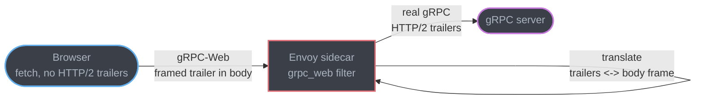
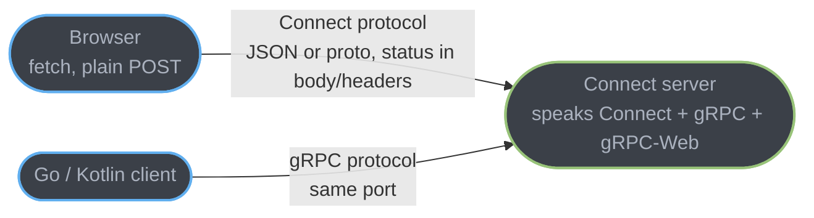
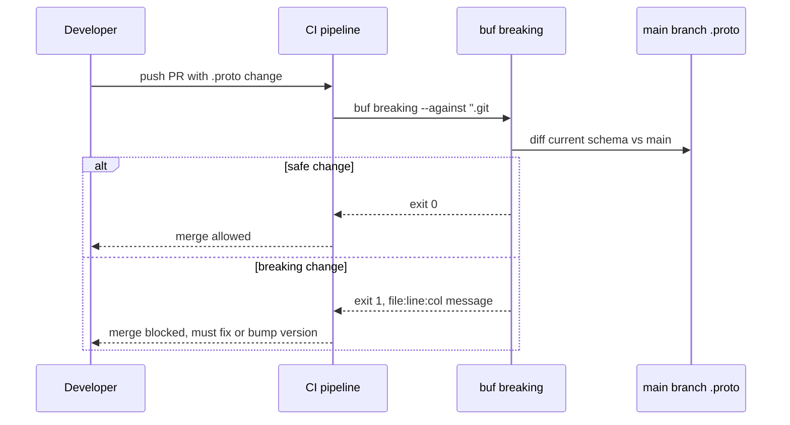

# Connect RPC & Browser-Native gRPC

The parent module names the browser problem — HTTP/2 trailers, a mandatory translating proxy, `curl`-hostile binary payloads — but stops at the workaround. This deep-dive covers what actually replaced the workaround: the Connect protocol, the Buf toolchain that generates and governs it, and the two adjacent frontier questions (HTTP/3 transport, Protobuf Editions) an interviewer expects a gRPC-fluent candidate to have an opinion on.

---

## 1. Concept Overview

Connect is a protocol and a set of libraries (`connect-go`, `connect-es`, `connect-kotlin`, `connect-swift`) built on top of Protobuf service definitions that speak three wire protocols from one handler: its own Connect protocol, standard gRPC, and gRPC-Web — all on the same port, with no separate proxy process. A unary Connect request is plain HTTP POST with a JSON or binary-protobuf body and the status in the HTTP status code and response body, not a trailer, which is why it is `curl`-able and readable in a browser network tab. Buf is the tool that generates the code for all of this, lints the `.proto` source, and blocks a schema change that would break an existing consumer, in CI, before merge.

The parent module's gRPC-Web section (§10, "gRPC-Web vs gRPC") describes the disease: browsers cannot read HTTP/2 trailing HEADERS, so gRPC-Web reroutes `grpc-status` into a data frame and needs Envoy or an nginx gRPC-Web module to translate it back into real gRPC on the other side. Connect is the cure that removes the translation step entirely by not depending on trailers in the first place.

---

## 2. Intuition

> **One-line analogy**: gRPC-Web is a diplomatic translator standing between two people who speak different dialects, repeating everything back and forth at a cost of one more hop. Connect is both of them agreeing to speak a third, mutually intelligible language directly — no translator needed, and a stranger walking by (`curl`) can still follow the conversation.

**Mental model**: A Connect server is a gRPC server with a wider vocabulary. It ships one Protobuf service definition, one generated handler, and understands three request shapes on the wire. A gRPC-only client, a gRPC-Web browser client, and a plain Connect client can all hit the identical endpoint; the server auto-detects the protocol from the `Content-Type` header and framing on the way in.

**Why it matters**: The operational win is not a performance number — it is deleting a piece of infrastructure. A team that ran an Envoy sidecar solely to gRPC-Web-translate for a browser SPA can delete that sidecar, delete its config, and delete the extra network hop and its failure mode, while keeping the exact same `.proto` contract, generated stubs, and interceptor chain used internally.

**Key insight**: The reason Connect can dodge the trailers problem is that it never puts terminal status in a trailer for a unary call — HTTP status codes and a JSON error body do that job, the same place REST already puts it. Streaming responses still need an end-of-stream signal, but Connect sends that as an ordinary framed message in the body (an `EndStreamResponse`), not as an HTTP trailer — so the browser's `fetch` never has to read anything a browser cannot read.

---

## 3. Core Principles

- **One handler, three protocols**: a Connect handler on the wire accepts Connect, gRPC, and gRPC-Web requests, distinguishing them by `Content-Type` (`application/json` / `application/proto` for Connect, `application/grpc` for gRPC, `application/grpc-web` for gRPC-Web).
- **Status lives where HTTP already puts it**: unary calls return a real HTTP status code (`404` for `not_found`, `503` for `unavailable`) with error detail as a JSON body — not a trailer.
- **Same `.proto`, same generated types**: Connect does not introduce a second IDL. It generates from the identical `.proto` files gRPC uses; a Connect service and a gRPC service targeting the same file are wire-compatible on the gRPC and gRPC-Web protocols.
- **Buf governs the schema, Connect governs the transport**: `buf lint` and `buf breaking` operate on the `.proto` regardless of which server framework consumes it; that governance is transport-agnostic and already covered in depth in the sibling module (see §4 below).
- **Streaming is real but constrained in the browser** by what `fetch` and the Fetch Streams spec allow, not by anything Connect chooses to withhold — see §4.

---

## 4. Types / Architectures / Strategies

### 4.1 Connect protocol vs gRPC vs gRPC-Web, side by side

| | gRPC | gRPC-Web | Connect |
|---|---|---|---|
| Transport | HTTP/2 only | HTTP/1.1 or HTTP/2 | HTTP/1.1 or HTTP/2 (bidi streaming needs HTTP/2) |
| Status location | Trailing HEADERS | Trailer packed into a data frame | HTTP status code (unary); framed `EndStreamResponse` (streaming) |
| `curl`-able | No (framing + trailers) | No (framing) | Yes — unary Connect looks like a plain JSON POST |
| Needs a translating proxy for browsers | Yes | No (that IS the translation, but a separate proxy usually still does it) | No — the origin server speaks it natively |
| Browser client streaming | N/A (no browser gRPC) | Unsupported | Constrained by `fetch` half-duplex — see 4.2 |
| Server streaming from a browser | N/A | Supported | Supported |
| Interop with existing gRPC servers | — | Needs a proxy in front of a plain gRPC server | A Connect *client* can call a plain gRPC or gRPC-Web server directly |

### 4.2 Streaming from a browser — support and its honest limits

Browsers implement `fetch` request bodies as **half-duplex**: per the WHATWG Fetch Standard, a request built from a `ReadableStream` body requires `duplex: "half"`, and no major browser ships full-duplex streaming — the response does not start arriving until the request body finishes, even if the server would have replied sooner. This is a browser platform limitation, not a Connect protocol limitation, and it applies identically to gRPC-Web and to raw `fetch` usage.

The practical consequence for `connect-es` in a browser:
- **Unary** and **server-streaming** RPCs work fully — one request, then a stream of framed responses, exactly like Server-Sent Events.
- **Client-streaming** and **bidirectional streaming** RPCs are protocol-legal (the Connect protocol itself only requires HTTP/2 for bidi; client- and server-streaming work over HTTP/1.1 too) but are constrained in a browser to the half-duplex pattern the platform allows — the client cannot both keep writing to the request stream and read the response stream concurrently the way a Go or Kotlin client can over a raw HTTP/2 socket. Verify current behavior against `@connectrpc/connect-web`'s own docs before promising true bidi from a browser tab; treat "the browser is a full bidi streaming peer" as false today.
- Non-browser Connect clients (`connect-go`, `connect-kotlin`, `connect-swift` on native platforms) are not subject to the browser's half-duplex restriction and support all four RPC modes over HTTP/2.

### 4.3 The Buf toolchain — what belongs here vs what is already covered

`buf lint`, `buf breaking`, and `buf generate` are already covered as CI governance gates in [API Contracts & Schema Governance §6.6, §7, §10, §11](../api_contracts_and_schema_governance/api_contracts_and_schema_governance.md) — the `buf generate --template buf.gen.yaml buf.build/example/orders-api` invocation, the Buf Schema Registry (BSR) as a hosted schema artifact store, and the "Schema Registry left on `NONE` compatibility" pitfall all live there and are not repeated here. What that module does not show is the actual `buf.yaml` shape and a `buf breaking` CI failure's literal output — that belongs to this file because it is specifically what makes Connect development safe to iterate on quickly. See §6.

### 4.4 Protobuf Editions — per-feature settings instead of two syntax modes

Protobuf Editions replace the `syntax = "proto2";` / `syntax = "proto3";` line with `edition = "2023";` (or newer), turning what used to be two hard-coded syntax modes into a set of individually-toggleable per-feature settings (field presence, repeated-field packing, enum type, UTF-8 validation, and more). The current released edition is **Edition 2024**; proto2 and proto3 files still compile and are not removed from the toolchain, but new `.proto` files should use an edition, and language-specific codegen fidelity is where editions is now getting investment. See §12 for the interview-ready version of this.

### 4.5 gRPC over HTTP/3 — where the ecosystem actually stands

There is no single official "gRPC over HTTP/3" that the whole ecosystem ships. Status differs by implementation:
- **grpc-dotnet**: has preview-level HTTP/3 transport support in Kestrel (`HttpProtocols.Http1AndHttp2AndHttp3`) and on the client via `SocketsHttpHandler.Http3Enabled`; it is not the default and interop gaps between a Kestrel HTTP/3 server and the .NET gRPC client have been an open discussion point.
- **grpc-go / grpc-core (C++)**: no merged, GA HTTP/3 transport as of this writing; HTTP/3 support is tracked as a long-standing open proposal, not a shipped feature.
- **grpc-java, grpc-objc, grpc-core on mobile**: get HTTP/3 indirectly via Cronet (Chromium's network stack) as a transport option, which is a mobile-specific integration, not the core gRPC HTTP/3 protocol binding.

Say exactly this in an interview: **HTTP/3 for gRPC is not yet a mainstream default in any major server-side implementation** — treat any claim of GA support as suspect and check the specific language runtime's release notes before committing an architecture to it.

---

## 5. Architecture Diagrams

### Before: gRPC-Web needs a translating proxy



The proxy exists for exactly one reason: turning trailer-based `grpc-status` into something a browser can read, and back. It is a whole extra process, config file, and failure mode purely to work around what a browser cannot do.

### After: Connect server speaks the browser's language directly



One handler, one port, no translator — the server itself understands what the browser is already capable of sending, and a native gRPC client hits the same port unmodified.

### buf breaking in CI



`buf breaking` runs the same diff logic whether the consumer is a gRPC client, a gRPC-Web browser, or a Connect client — the schema check is transport-agnostic, which is why it belongs in CI once, not once per protocol.

---

## 6. How It Works — Detailed Mechanics

### 6.1 The `.proto` — identical for gRPC, gRPC-Web, and Connect

```protobuf
syntax = "proto3";

package greet.v1;

option go_package = "example/gen/greet/v1;greetv1";

message GreetRequest {
  string name = 1;
}

message GreetResponse {
  string greeting = 1;
}

service GreetService {
  rpc Greet(GreetRequest) returns (GreetResponse);
}
```

Nothing about this file is Connect-specific — the same `.proto` generates a plain gRPC server, a Connect server, or both from one `buf generate` run, because Connect does not introduce a new IDL.

### 6.2 `connect-go` handler

```go
package main

import (
	"context"
	"log"
	"net/http"

	"connectrpc.com/connect"
	greetv1 "example/gen/greet/v1"
	"example/gen/greet/v1/greetv1connect"
	"golang.org/x/net/http2"
	"golang.org/x/net/http2/h2c"
)

type greetServer struct {
	greetv1connect.UnimplementedGreetServiceHandler
}

func (s *greetServer) Greet(
	ctx context.Context,
	req *connect.Request[greetv1.GreetRequest],
) (*connect.Response[greetv1.GreetResponse], error) {
	if req.Msg.GetName() == "" {
		return nil, connect.NewError(
			connect.CodeInvalidArgument,
			nil,
		)
	}
	res := connect.NewResponse(&greetv1.GreetResponse{
		Greeting: "Hello, " + req.Msg.GetName(),
	})
	return res, nil
}

func main() {
	mux := http.NewServeMux()
	path, handler := greetv1connect.NewGreetServiceHandler(&greetServer{})
	mux.Handle(path, handler)

	// h2c: this one handler answers Connect, gRPC, and gRPC-Web —
	// no separate proxy process, no grpc-web Envoy filter.
	srv := &http.Server{
		Addr:    ":8080",
		Handler: h2c.NewHandler(mux, &http2.Server{}),
	}
	log.Fatal(srv.ListenAndServe())
}
```

`connect.CodeInvalidArgument` maps to the same semantic space as gRPC's `INVALID_ARGUMENT` and to HTTP `400` — a Connect client, a gRPC client, and a browser's own `fetch().status` check all see a coherent answer from the same error.

### 6.3 `connect-es` browser client

```typescript
import { createClient } from "@connectrpc/connect";
import { createConnectTransport } from "@connectrpc/connect-web";
import { GreetService } from "./gen/greet_pb";

const transport = createConnectTransport({
  baseUrl: "https://api.example.com",
});

const client = createClient(GreetService, transport);

async function greet(name: string): Promise<string> {
  const res = await client.greet({ name });
  return res.greeting;
}
```

No proxy URL, no gRPC-Web-specific transport class needed — `createConnectTransport` talks straight to the origin server from §6.2. Swapping to `createGrpcWebTransport` from the same package targets a gRPC-Web-only backend without changing a line of generated client code.

### 6.4 `buf.yaml` + `buf breaking` in CI

```yaml
# buf.yaml
version: v2
modules:
  - path: proto
    name: buf.build/example/greet
lint:
  use:
    - STANDARD
breaking:
  use:
    - FILE
```

```yaml
# .github/workflows/proto.yml (excerpt)
- name: buf lint
  run: buf lint

- name: buf breaking
  run: buf breaking --against '.git#branch=main'
```

Broken run's actual failure shape — this is what a reviewer sees in the CI log, not a hypothetical:

```
proto/greet/v1/greet.proto:8:3:Field "1" on message "GreetRequest" changed type from "string" to "int32".
proto/greet/v1/greet.proto:12:3:Field "2" with name "email" on message "GreetRequest" was deleted without a reserved name.
```

`buf breaking` exits non-zero on either line and the PR cannot merge — the same governance the parent module's §10 pitfall on reused field numbers describes, enforced mechanically instead of by review discipline.

### 6.5 Broken → fixed: hand-rolled grpc-web + Envoy vs the Connect equivalent

**Broken (the thing being replaced) — a real Envoy `grpc_web` filter config, one more YAML file the team owns and must keep correct:**

```yaml
http_filters:
  - name: envoy.filters.http.grpc_web
    typed_config:
      "@type": type.googleapis.com/envoy.extensions.filters.http.grpc_web.v3.GrpcWeb
  - name: envoy.filters.http.cors
    typed_config:
      "@type": type.googleapis.com/envoy.extensions.filters.http.cors.v3.Cors
  - name: envoy.filters.http.router
```

This buys unary and server-streaming only, adds one hop and one more service to deploy, monitor, and version alongside the actual gRPC server, and still leaves `curl` unable to poke the API directly (gRPC-Web framing is still binary-and-trailer-shaped, just relocated).

**Fixed — the Connect server from §6.2 answers the same browser request with no Envoy in the path**, and the same origin also answers a plain gRPC client on the identical port with no config divergence between "the browser path" and "the internal path." The Envoy YAML above is simply deleted, not replaced by different Envoy YAML.

---

## 7. Real-World Examples

**Buf** — the company behind `buf` and Connect — dogfoods Connect for its own Buf Schema Registry APIs, both server and browser-facing dashboard, on the claim that BSR itself needed a browser-callable Protobuf API and chose to build Connect rather than stand up a gRPC-Web proxy for its own product.

**Twitch** uses Connect (`connect-go`) for internal Go services, citing the ability to keep gRPC-shaped services `curl`-testable during development as a stated reason in public talks about the migration, distinct from any performance claim.

**grpc-gateway users migrating away from a REST-transcoding layer**: teams that previously ran `grpc-gateway` purely to give browsers a JSON/REST view of a gRPC service are a commonly cited Connect adoption path, because Connect's JSON codec gives the same "plain JSON over HTTP" ergonomics without a second generated proxy layer to keep in sync with the `.proto`.

---

## 8. Tradeoffs

| Aspect | gRPC-Web + Envoy proxy | Connect |
|---|---|---|
| Extra infrastructure | Envoy (or nginx grpc-web module) process | None — origin server handles it |
| `curl`-able | No | Yes, for unary and JSON |
| Bidirectional streaming from a browser | Not supported | Not supported (browser `fetch` half-duplex — a platform limit, not a Connect one) |
| Interop with existing plain gRPC infra | Needs the proxy in front | Client can call a plain gRPC server directly with no code change |
| Migration cost from existing gRPC service | Add a proxy + config | Regenerate with the Connect plugin; same `.proto`, same business logic |
| Governance (lint/breaking) | Via `buf`, same as any Protobuf project | Identical — Connect adds nothing here |
| Maturity/ecosystem size vs pure gRPC | gRPC is older, wider industry deployment | Connect is newer; check current library support for your specific language before committing |

---

## 9. When to Use / When NOT to Use

**Use Connect when**: a Protobuf-defined service needs to be called from a browser without standing up or maintaining a translating proxy; the team wants one server binary that answers gRPC internally and browser clients externally; `curl`/Postman debuggability during development matters as much as production efficiency.

**Stick with plain gRPC-Web (or keep the Envoy layer) when**: the existing infrastructure is heavily invested in Envoy already for other reasons (mTLS, service mesh, rate limiting) and the marginal cost of the `grpc_web` filter on an Envoy you are running anyway is close to zero; or the server framework in use has no mature Connect implementation and adopting Connect would mean introducing a whole new server stack, not just a new protocol.

**Do NOT reach for gRPC or Connect at all when**: the consumer is a truly public, unauthenticated API meant for arbitrary third-party HTTP clients with no generated-stub workflow — plain JSON/REST still wins there on pure reach: every HTTP client library on earth can call it with zero codegen, and OpenAPI tooling (already covered in [API Contracts & Schema Governance](../api_contracts_and_schema_governance/api_contracts_and_schema_governance.md)) is the more universally understood contract format for that audience.

---

## 10. Common Pitfalls

**Assuming Connect gives a browser true bidirectional streaming.** It does not — the Fetch Standard's half-duplex requirement is a browser platform limit that Connect cannot route around, not a protocol shortcoming Connect chose. A team designing a live-collaboration feature around "the browser will stream both ways over Connect" discovers this constraint late; design duplex-heavy browser features around WebSocket or SSE (both already covered in [WebSockets & SSE](../websockets_and_sse/websockets_and_sse.md)) and reserve Connect/gRPC bidi for server-to-server or native-client-to-server links.

**Running `buf generate` against a local, uncommitted `.proto` edit instead of the published module.** The generated SDK then silently diverges from what the registry and every other consumer built against, defeating the entire point of a schema registry — always generate from the published, versioned module reference (`buf.build/org/module:tag`) in CI, and reserve local-path generation for iterative development only.

**Treating gRPC-Web and Connect's JSON mode as interchangeable on the wire.** They are not — a client built for Connect's JSON codec cannot talk to a gRPC-Web-only backend and vice versa; `createConnectTransport` and `createGrpcWebTransport` in `connect-es` are two different transport implementations for a reason. Picking the wrong one produces a confusing runtime failure that looks like a CORS problem but is a protocol mismatch.

**Shipping HTTP/3 support into a gRPC deployment because a blog post said it works.** As of this writing, no major server-side gRPC implementation ships HTTP/3 as a GA default (see §4.5) — a team that wires HTTP/3 into a load balancer expecting gRPC framing over it without checking the specific language runtime's current support inherits an unsupported configuration, not a performance win.

---

## 11. Technologies & Tools

| Tool | Purpose |
|---|---|
| `connect-go` | Go server/client library speaking Connect, gRPC, and gRPC-Web from one handler |
| `connect-es` (`@connectrpc/connect`, `@connectrpc/connect-web`) | TypeScript/JavaScript client library for Node and browsers |
| `connect-kotlin` | Kotlin client for Android/JVM |
| `connect-swift` | Swift client for iOS/macOS |
| `buf` CLI | `buf lint`, `buf breaking`, `buf generate` — schema lint, breaking-change detection, codegen |
| Buf Schema Registry (BSR) | Hosted registry for the `.proto` module; source for `buf generate` and generated-SDK distribution (full coverage: [API Contracts & Schema Governance §7](../api_contracts_and_schema_governance/api_contracts_and_schema_governance.md)) |
| `buf curl` | `curl`-equivalent CLI for calling gRPC, gRPC-Web, or Connect endpoints without a `.proto` file on disk (uses reflection or a BSR module) |
| Envoy Proxy | Still the standard translating proxy for gRPC-Web-only backends that have not adopted Connect |

---

## 12. Interview Questions with Answers

**Q: Why can't a browser call a plain gRPC service directly?**
**Short:** Browsers cannot read HTTP/2 trailing headers, and gRPC puts the terminal grpc-status there.

Browsers have no `fetch`/XHR API that exposes HTTP/2 trailing HEADERS frames, and gRPC's `grpc-status` and `grpc-message` are sent as trailers after the response body. A browser can receive the DATA frames but never sees whether the call actually succeeded. gRPC-Web works around this by repacking the trailer into the response body as a special data frame, requiring a translating proxy (typically Envoy) in front of the actual gRPC server. Connect avoids the problem altogether by never depending on trailers for unary status and by framing streaming end-of-stream information inside the body.

**Q: What is the Connect protocol and how does it differ from gRPC-Web?**
**Short:** Connect is a browser-friendly RPC protocol served natively alongside gRPC and gRPC-Web from one handler, no proxy.

Connect is a protocol (and the libraries implementing it) where a unary RPC is a plain HTTP POST with a JSON or binary-protobuf body, and the terminal status is a real HTTP status code, not a trailer. A Connect *server* additionally understands the gRPC and gRPC-Web wire protocols on the same port, auto-detecting from `Content-Type` — so it is a superset handler, not a competing incompatible protocol. Unlike gRPC-Web, which still requires a translating proxy (Envoy's `grpc_web` filter) in front of a plain gRPC server, a Connect server needs no proxy: the origin process itself speaks what the browser sends.

**Q: Can a browser do true bidirectional streaming over Connect or gRPC-Web?**
**Short:** No — the browser Fetch API is half-duplex by platform design, independent of which RPC protocol is used.

The WHATWG Fetch Standard requires `duplex: "half"` for a streamed request body, and the response does not start arriving until the request finishes sending, even on HTTP/2. This is a browser platform constraint, not a limitation either Connect or gRPC-Web chooses to impose — gRPC-Web additionally disallows client-streaming and bidi outright at the protocol level, while Connect's protocol permits them but a browser client still cannot exploit true concurrency between the request and response streams. Design duplex UI features (chat, live cursors, collaborative editing) around WebSocket instead, and reserve Connect/gRPC streaming for server-to-server or native (non-browser) clients where HTTP/2 full duplex is genuinely available.

**Q: What does `buf lint` check that `protoc` alone does not?**
**Short:** buf lint enforces style and structural conventions protoc's compiler does not care about, like naming and package layout.

`protoc` only checks that a `.proto` file is syntactically valid and compiles; it has no opinion on naming conventions, whether every RPC has a request/response wrapper message, or package/directory layout consistency. `buf lint` runs a configurable rule set (the `STANDARD` category by default) covering exactly these style and structural conventions, catching issues in seconds locally or in CI before a schema is ever published — the same category of value ESLint or golangci-lint provide over "the compiler didn't complain."

**Q: What does `buf breaking` actually compare, and what triggers a failure?**
**Short:** buf breaking diffs the current schema against a reference (usually the main branch) and fails on wire- or source-incompatible changes.

`buf breaking --against '.git#branch=main'` compiles both the working-tree `.proto` set and the referenced git state, then diffs them for changes the configured breaking-change category considers unsafe — deleting a field without reserving it, changing a field's type incompatibly, renumbering, removing an RPC. On a violation it prints a `file:line:col:message` line per break (e.g. `greet.proto:8:3:Field "1" on message "GreetRequest" changed type from "string" to "int32".`) and exits non-zero, which a CI step turns into a blocked merge — this is the mechanical enforcement of the same rules the parent module's §10 "reusing field numbers" pitfall describes by hand.

**Q: What is the Buf Schema Registry (BSR) and what does it add over a `.proto` file checked into git?**
**Short:** BSR is a hosted, versioned home for a Protobuf module that CI can generate from and consumers can pull without vendoring `.proto` files.

BSR runs `buf breaking` on every push to a module, rejects an incompatible registration outright, and serves as the pull source for both `buf generate` and any downstream consumer's codegen — the Protobuf-world analog of an npm or Maven registry, except the published artifact is the contract itself rather than a compiled library. Full BSR coverage — versioning, `buf generate --template buf.gen.yaml buf.build/org/module`, and how it fits into a broader schema-governance pipeline alongside Confluent Schema Registry for Kafka — lives in [API Contracts & Schema Governance](../api_contracts_and_schema_governance/api_contracts_and_schema_governance.md).

**Q: What is a Protobuf Edition and why is it replacing `syntax = "proto3"`?**
**Short:** An edition (e.g. edition = "2024") replaces proto2/proto3 syntax with individually toggleable per-feature settings.

Protobuf Editions collapse the old binary choice between `syntax = "proto2"` and `syntax = "proto3"` into a single `edition = "2024";` declaration plus a set of independently configurable features (field presence, whether repeated scalars pack by default, enum openness, string UTF-8 validation strictness, and more). This lets a team pick, say, proto2-style explicit field presence without inheriting proto2's `required` fields, which was impossible under the old two-mode system. proto2 and proto3 files still compile under current toolchains and are not being removed outright, but new `.proto` files should target an edition, not a legacy syntax string.

**Q: Is HTTP/3 supported by gRPC today?**
**Short:** No mainstream server-side gRPC implementation ships HTTP/3 as GA; support is preview-level or mobile-only via Cronet.

As of this writing there is no unified, GA "gRPC over HTTP/3" across the ecosystem. `grpc-dotnet` has preview-level HTTP/3 transport in Kestrel and via `SocketsHttpHandler.Http3Enabled` on the client, not enabled by default. `grpc-go` and `grpc-core` (C++) have no merged HTTP/3 transport — it remains a long-open proposal. `grpc-java` and other mobile-targeted runtimes get HTTP/3 indirectly through Cronet, Chromium's network stack, which is a mobile-specific integration rather than a core protocol binding. Verify the specific language runtime's current release notes before an architecture depends on this — treat any blanket "gRPC now supports HTTP/3" claim as needing a citation.

**Q: When would you choose plain REST/JSON over both gRPC-Web and Connect?**
**Short:** When the consumer is a truly public API with no generated-stub workflow and universal HTTP-client reach matters most.

A public, third-party-facing API where consumers write ad-hoc scripts, use Postman, or integrate with tools that expect OpenAPI (not a Protobuf toolchain) is still better served by REST/JSON — every HTTP client on earth can call it with zero codegen, and OpenAPI's tooling ecosystem for public-facing documentation and SDK generation is broader than Protobuf's for that specific audience. gRPC-Web and Connect both assume the consumer is willing to run codegen against a `.proto`; that assumption holds for internal and partner integrations far more often than for the general public.

**Q: How does error handling differ between plain gRPC and Connect?**
**Short:** Connect maps the same status-code space onto real HTTP status codes with a JSON error body, instead of gRPC trailers.

Both use the same set of semantic codes (`NOT_FOUND`, `INVALID_ARGUMENT`, `UNAUTHENTICATED`, etc. — `connect.CodeNotFound` mirrors gRPC's `codes.NotFound`), but Connect surfaces them as actual HTTP status codes (`404`, `400`, `401`) with a JSON body carrying the message and any structured error details, readable directly in a browser's network tab or by `curl -i`. Plain gRPC instead sends `grpc-status` and `grpc-message` as trailing metadata, invisible to a browser and requiring a gRPC-aware client library to decode even from the command line.

**Q: What is `buf curl` and why would you use it over `grpcurl`?**
**Short:** buf curl is a curl-equivalent for gRPC, gRPC-Web, and Connect endpoints that can use a BSR module instead of a local .proto.

`buf curl` sends a request against a gRPC, gRPC-Web, or Connect endpoint from the command line, resolving the request/response schema either via server reflection or by pulling the schema straight from a BSR module reference — so a caller does not need the `.proto` file on local disk at all if the schema is published. `grpcurl` covers plain gRPC well but has no native Connect-protocol awareness or BSR module resolution; reach for `buf curl` specifically when the target speaks Connect or when you want to test against a published schema without checking out the source repo.

**Q: A team wants to delete their gRPC-Web Envoy layer. What has to be true first?**
**Short:** The backend service must be reachable as, or replaced by, a Connect handler that natively speaks gRPC-Web on the same port.

Deleting the Envoy `grpc_web` filter only works if something else now answers gRPC-Web requests without translation — either the existing gRPC server is regenerated/rewritten with a Connect-compatible server library (`connect-go` and peers understand gRPC-Web natively), or the team accepts that browser clients lose access until that migration lands. It is not safe to simply remove the proxy in front of a plain (non-Connect) gRPC server, because that server alone cannot parse gRPC-Web framing — the Envoy layer was doing real translation work, not merely forwarding.

**Q: Does adopting Connect require rewriting business logic?**
**Short:** No — Connect reuses the same generated service interface shape gRPC does; only the transport wiring changes.

Because Connect generates from the identical `.proto` service definition gRPC uses, the generated server interface a handler implements is structurally the same shape (request in, response or stream out, `context.Context` for cancellation/deadlines). Migrating an existing `connect-go`-eligible gRPC service typically means re-running codegen with the Connect plugin and swapping the HTTP server construction (§6.2's `NewGreetServiceHandler` call replacing a plain `grpc.NewServer()` registration) — the method bodies implementing actual business logic do not need to change.

**Q: What happens if a Connect client calls a plain (non-Connect) gRPC server?**
**Short:** It works unmodified — a Connect client can speak the gRPC protocol to any standard gRPC server.

Because Connect client libraries implement the gRPC wire protocol as one of their supported protocols (alongside Connect and gRPC-Web), pointing a `connect-go` or `connect-es`-with-`createGrpcWebTransport` client at an existing, unmodified gRPC server works with no server-side change — this is what makes Connect adoption incremental: teams can start writing new clients against old servers before migrating the servers themselves.

**Q: Why does `buf breaking`'s default `FILE` category matter over the alternative categories?**
**Short:** FILE-level breaking checks are conservative and treat each proto file's public surface as the compatibility boundary — the safest default.

Buf's breaking-change categories (`FILE`, `PACKAGE`, `WIRE_JSON`, `WIRE`) differ in how broad a scope of "did this actually break someone" they check — `FILE` is the documented conservative default appropriate for most teams, checking each file's exported types and fields. Loosening to `WIRE`-only compatibility would permit changes that are wire-safe but still break generated-code consumers (e.g., renaming a message type), which is exactly the class of break `buf breaking`'s stricter defaults exist to catch before it reaches a CI-blocking check instead of a production incident.

**Q: What is the operational cost this deep-dive's case study team eliminated by adopting Connect?**
**Short:** One entire Envoy sidecar process, its gRPC-Web filter config, and the extra network hop it added — see §14.

The team in §14 ran an Envoy sidecar solely to translate gRPC-Web framing for a browser SPA — a process to deploy, monitor, upgrade, and keep configuration-synchronized with the backend's `.proto` changes, plus one extra network hop on every browser-originated call. Adopting Connect meant regenerating the same `.proto` with a Connect-capable server library and deleting the sidecar outright, because the origin server itself now understood gRPC-Web (and Connect, and plain gRPC) natively.

---

## 13. Best Practices

- Generate from a published BSR module reference in CI, not a local uncommitted `.proto` edit — keeps every consumer's generated code traceable to one schema version.
- Run `buf lint` and `buf breaking --against` on every PR touching a `.proto`, before merge, not as a manual pre-release step.
- Pick `createConnectTransport` for new browser clients unless the backend is genuinely gRPC-Web-only; it avoids a second transport-selection decision later.
- Do not design browser-facing duplex features (chat, live collaboration) around Connect or gRPC streaming — use WebSocket, and reserve streaming RPCs for server-to-server or native-client paths where full HTTP/2 duplex is actually available.
- Verify HTTP/3 support against the specific language runtime's current release notes before an architecture depends on it — this is a fast-moving area and a stale blog post is not a source.
- Track Protobuf Edition adoption per-file rather than attempting an all-at-once migration off proto2/proto3 — both remain compilable, so the migration can be incremental.

---

## 14. Case Study

**Problem** (illustrative composite, not a published incident): a mid-size SaaS company ran a fleet of internal gRPC services in Go, all `.proto`-defined, plus a single browser-facing admin dashboard that needed to call two of those services. To make that work, the team stood up an Envoy sidecar running the `envoy.filters.http.grpc_web` filter in front of those two services, with a separate `Cors` filter and its own deploy pipeline, purely so the dashboard's `fetch` calls could reach gRPC-shaped APIs.

**What the Envoy layer actually cost**: one more process per environment to provision, monitor, and keep TLS-terminated correctly; a config file (§6.5) that had to be updated by hand whenever a new RPC method needed dashboard access, since the `grpc_web` filter's CORS allowlist was maintained separately from the `.proto` source of truth; and every browser-originated call took one extra network hop through the sidecar before reaching the real service — small in absolute latency, but a second thing to instrument and alert on when a call was slow.

**Migration**: the two dashboard-facing services were regenerated with `connect-go` alongside their existing `grpc-go`-generated code (both can be produced from the same `buf.gen.yaml` template targeting the same `.proto` files), and the server construction was swapped from a bare `grpc.NewServer()` registration to the `h2c.NewHandler` pattern from §6.2, wired to answer Connect, gRPC, and gRPC-Web on the existing port. The dashboard's fetch calls were repointed at `createConnectTransport` (§6.3) instead of the Envoy sidecar's URL.

**Results after migration**:
- The Envoy sidecar and its `grpc_web`/`cors` filter config were deleted outright — one fewer process per environment, one fewer config file to keep synchronized with `.proto` changes.
- Dashboard developers could `curl` a unary endpoint directly during local development without any proxy running, cutting debugging round-trips when diagnosing a failing dashboard call.
- The two migrated services' internal Go-to-Go calls were unaffected — they still spoke plain gRPC to every other internal consumer, because the Connect handler answers all three protocols from the same registration.

**Lessons**: the win here was structural, not a latency number — deleting a piece of infrastructure that existed solely to work around a browser platform limitation, while keeping the exact same `.proto` contract and business logic. Teams already running Envoy for other reasons (mTLS, service mesh) may find the marginal cost of keeping the `grpc_web` filter lower than a full Connect migration; the decision hinges on whether Envoy is there anyway or exists only for this one translation.
