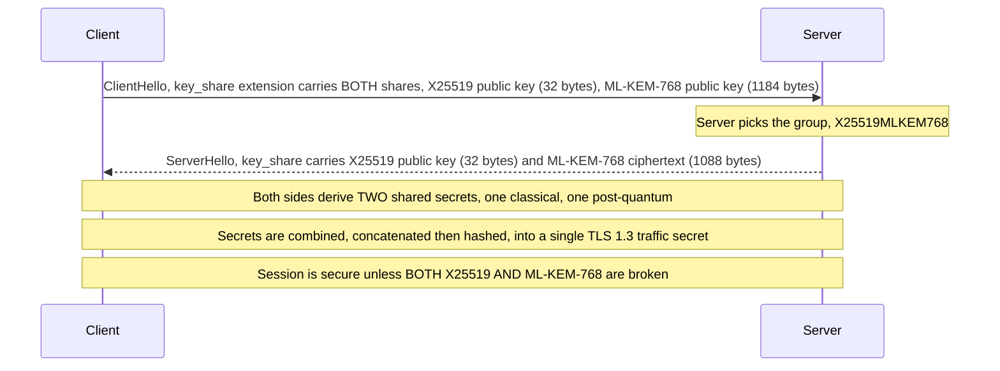
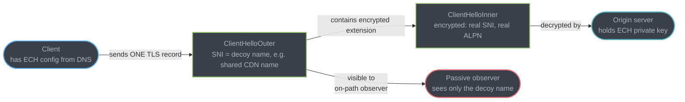

# Transport Security Frontier: Post-Quantum TLS, ECH, and QUIC Multipath

The parent module and its sibling [UDP & QUIC](../udp_and_quic/udp_and_quic.md) cover TLS 1.3's handshake, ALPN, SNI, and QUIC's connection-migration basics — but neither names the four things reshaping transport security handling right now: quantum-resistant key exchange, hiding the hostname itself, using more than one network path at once, and a certificate lifetime already cut to 200 days and headed for under two months. This deep-dive covers those four, what a backend team actually has to change for each, and how to verify the claims yourself rather than trust a blog post.

---

## 1. Concept Overview

Four independent, mostly-unrelated changes are landing on the TLS/QUIC stack at once. **Post-quantum key exchange** (a hybrid of classical elliptic-curve Diffie-Hellman and a NIST-standardized lattice algorithm) is already the default for most browser-to-CDN traffic, defending against an attacker who records encrypted traffic today to decrypt it once a cryptographically relevant quantum computer exists. **Encrypted Client Hello (ECH)** hides the one plaintext field TLS 1.3 still leaked — the hostname — by encrypting the real ClientHello inside a decoy outer one. **QUIC multipath** extends QUIC's existing single-path connection-migration trick (already free, already in RFC 9000) into genuinely using two network paths — Wi-Fi and cellular — at the same time, and it is not yet a finished standard. **Certificate lifetime compression**, driven by a CA/Browser Forum ballot rather than a protocol change, has already cut the maximum TLS certificate validity from 398 days to **200 days**, in force since 15 March 2026, and takes it to 47 days by 2029 — which makes manual certificate renewal operationally impossible and ACME automation mandatory.

None of these four is optional infrastructure work a backend team can defer indefinitely — the first two are already live in the browsers and CDNs your users connect through today, whether or not your own stack has adopted them.

---

## 2. Intuition

> **One-line analogy**: post-quantum key exchange is sealing today's letter in an envelope a future machine cannot open even after finding today's lock trivial to pick. ECH is putting a second, blank envelope around the address label itself, so the mail carrier can route the letter without ever reading who it's actually for. Multipath QUIC is sending that letter by two couriers on two different roads at once, so a pothole on one road doesn't stop delivery. The certificate lifetime ballot is the postal service deciding your return address stamp now expires in six weeks instead of a year — annoying only if you were still hand-stamping envelopes instead of running a machine that does it automatically.

**Mental model**: none of these four changes what TLS/QUIC *achieves* — confidentiality, integrity, low-latency multiplexed transport. They change the assumptions under which those guarantees hold: post-quantum assumes today's asymmetric crypto eventually breaks; ECH assumes the hostname itself is sensitive metadata, not just the payload; multipath assumes a single path is an artificial constraint, not a law of networking; short-lived certificates assume automation is the baseline, not an optional nicety.

**Why it matters**: A backend team does not typically implement any of this in application code — it is almost entirely a **terminator-and-DNS** concern (load balancer, CDN edge, reverse proxy, ACME client), not a service-code concern. The practical skill being tested is knowing which layer to touch, recognizing the failure symptoms when a legacy component chokes on one of these changes, and not inventing a rollout plan around a number nobody actually published.

**Key insight**: Every one of these four features makes the ClientHello (or the certificate) bigger or more automated, and every deployment failure documented so far traces back to some piece of middlebox or load-balancer code that assumed a fixed, small size or a human doing renewal by hand — the theme is "something downstream hard-coded an assumption that used to be safe."

---

## 3. Core Principles

- **Harvest-now-decrypt-later (HNDL) is the actual threat model for post-quantum key exchange** — an adversary who cannot break today's ECDHE key exchange can still record the ciphertext today and decrypt it once a sufficiently large quantum computer exists, which matters for any data with a confidentiality horizon longer than "a few years" (health records, government communications, long-lived trade secrets).
- **Hybrid, not pure post-quantum, is the deployed default** — the key exchange combines a classical algorithm and a post-quantum one so that breaking either one alone does not break the connection; see §4.1 for why.
- **Key exchange and signatures are different problems moving at different speeds** — post-quantum key exchange is already widely deployed; post-quantum signatures are a much later, harder migration because of certificate chain size (§4.4).
- **ECH's privacy guarantee depends on DNS privacy** — encrypting the ClientHello's hostname is pointless if the DNS lookup that fetches the ECH config itself leaks the hostname in plaintext.
- **A protocol feature and its standardization status are two different facts** — QUIC multipath is real, running code exists, and it is still, as of this writing, an Internet-Draft, not an RFC. Say which one you mean.
- **Certificate lifetime compression is a governance decision (CA/Browser Forum ballot), not a protocol RFC** — it changes an operational deadline, not a wire format.

---

## 4. Types / Architectures / Strategies

### 4.1 Hybrid post-quantum key exchange — why hybrid, not pure ML-KEM

NIST finalized **FIPS 203 (ML-KEM)** on August 13, 2024 as the standardized post-quantum key-encapsulation mechanism (the algorithm formerly known as CRYSTALS-Kyber). The deployed TLS 1.3 group is **X25519MLKEM768**: the classical X25519 elliptic-curve exchange run in parallel with ML-KEM-768, and the two shared secrets are combined (not chosen between) to derive the final key.

Hybrid, not pure ML-KEM, is the default for two independent reasons:
1. **Defense against an implementation flaw in the newer algorithm.** ML-KEM is mathematically younger than elliptic-curve cryptography and has had far less cryptanalytic attention. If a flaw is later found in ML-KEM, the X25519 component still protects the connection against a classical attacker — the hybrid is only as weak as its weakest *proven-broken* component, not its newest one.
2. **Defense against the quantum threat the classical component cannot cover.** If a large quantum computer arrives, X25519 alone falls, and ML-KEM-768 is what continues to protect the session — this is the actual post-quantum guarantee, and it is the reason to run PQ at all.

Either component failing alone leaves the other standing; both would need to fail for the session to be compromised.

### 4.2 ECH's outer/inner ClientHello split

ECH, standardized as **RFC 9849** (Proposed Standard, published March 2026), splits the ClientHello into two: a `ClientHelloOuter` sent in the clear, containing an innocuous, often-shared placeholder hostname (frequently the CDN's own name, e.g. `cloudflare-ech.com`), and an encrypted extension inside it carrying the real `ClientHelloInner` — the actual hostname, ALPN offer, and everything else a normal ClientHello would expose. The server decrypts the inner ClientHello using a key it published in DNS and processes the real request; a passive on-path observer sees only the outer placeholder.

### 4.3 QUIC multipath vs the connection migration you already have for free

RFC 9000 (the base QUIC transport spec) already gives every QUIC connection **connection IDs** that decouple a connection's identity from any one 4-tuple (source IP, source port, destination IP, destination port) — this is what lets a phone's QUIC connection survive switching from Wi-Fi to cellular mid-download, covered in [UDP & QUIC §7](../udp_and_quic/udp_and_quic.md). That is **path migration**: one active path at a time, with the option to switch.

**Multipath** is a different, larger claim: using two (or more) paths **simultaneously** for the same connection, each with its own congestion-control state, so a phone could stream over Wi-Fi and cellular at once rather than choosing one. This is specified in `draft-ietf-quic-multipath`, which is a late-stage IETF Internet-Draft (in IESG review as of this writing) — **not yet an RFC**. Do not describe multipath QUIC as standardized; describe migration (already standard, already in RFC 9000) and multipath (draft, not yet finalized) as two different maturity levels.

### 4.4 Why post-quantum signatures are a separate, harder problem than post-quantum key exchange

Key exchange only needs the two parties in *this* handshake to support the new algorithm — swap the ephemeral key share, done. Signatures are structurally worse: a certificate signed with a post-quantum signature algorithm (**FIPS 204 / ML-DSA**, or **FIPS 205 / SLH-DSA**) has to be verified by every client that will ever see it, for the certificate's entire validity period, and the certificate sits inside a **chain** — leaf, intermediate, root — where every link needs a compatible signature. ML-DSA signatures and public keys run into the low kilobytes (roughly an order of magnitude larger than a P-256 ECDSA signature, which is under 100 bytes), and SLH-DSA signatures are larger still. A 2-3 certificate chain, each carrying a post-quantum signature, can push the TLS Certificate message from a few KB to tens of KB — which reintroduces the exact same fragmentation risk described in §5's third diagram, except for the *Certificate* message instead of the *ClientHello*, and multiplied across every hop of the chain. This is why PQ key exchange shipped years before PQ signatures are anywhere near broad deployment: it's a strictly harder rollout, not a slower version of the same one.

### 4.5 Certificate lifetime compression — the schedule

CA/Browser Forum **Ballot SC-081v3** passed April 2025 (29 in favor, 0 opposed; sponsored by Apple and Sectigo, all four major browser vendors voting yes) and sets a phased reduction of maximum public TLS certificate validity:

| Effective date | Max certificate validity | Max domain-validation (DCV) reuse |
|---|---|---|
| Pre-ballot baseline (through 14 March 2026) | 398 days | 398 days |
| March 15, 2026 — **in force today** | **200 days** | shortened per schedule |
| March 15, 2027 | 100 days | shortened per schedule |
| March 15, 2029 | **47 days** | **10 days** |

Verify the exact intermediate DCV-reuse values against the live ballot text at cabforum.org before quoting them in a design doc — the table above reproduces the certificate-validity column faithfully; the DCV reuse column tightens on the same schedule but the source page's public summary did not spell out every intermediate figure at time of writing.

---

## 5. Architecture Diagrams

### Hybrid post-quantum key exchange in the TLS 1.3 handshake



The client sends both key shares up front in one flight — no extra round trip versus classical TLS 1.3 — but the combined client key share grows from 32 bytes to roughly 1216 bytes, which is the entire reason §5's third diagram exists.

### ECH outer/inner ClientHello



An on-path censor or ISP sees the outer, decoy SNI on the wire; only the terminating server, holding the private key matching the ECH config published in DNS, can decrypt the inner ClientHello to learn the real hostname.

### ClientHello exceeds one TCP segment / QUIC initial packet

```
Classical ClientHello (~200-300 bytes)
[ record ][ h a n d s h a k e   f i e l d s ] < 1 typical MSS (~1460 B) - fits in ONE segment

Post-quantum ClientHello (~1400-1600 bytes with X25519MLKEM768)
[ record ][ h a n d s h a k e   f i e l d s ][ key_share: X25519 + ML-KEM-768 pubkey, 1216 B ]
  \_____________________ now brushes or exceeds one MSS / one QUIC initial datagram ______/

  A middlebox that reads only the FIRST segment/packet and assumes
  the ClientHello ends there:
    - never sees the rest of the message
    - either hangs waiting for a completion that already arrived
      in a second segment it didn't read, or resets the connection
```

The failure is invisible until the exact moment a ClientHello crosses the size threshold — a connection that worked perfectly on classical TLS starts silently failing the moment post-quantum groups are added, with no error message pointing at the actual cause. This is the mechanism behind the tldr.fail incompatibilities cataloged in §10.

---

## 6. How It Works — Detailed Mechanics

### 6.1 Testing what a server or client actually negotiates

```bash
# Ask a server what post-quantum-capable groups it will negotiate
openssl s_client -connect example.com:443 -groups X25519MLKEM768:X25519 -tls1_3 </dev/null 2>&1 | grep -i "server temp key\|negotiated"

# curl's view of the negotiated curve/group (curl 8.x built against a PQ-capable TLS library)
curl -v --curves X25519MLKEM768 https://example.com/ 2>&1 | grep -i "TLSv1.3\|(SSL)"

# Cloudflare's own PQ readiness test endpoint
curl -s https://pq.cloudflareresearch.com/ | head -20
```

Read the `openssl s_client` output's `Server Temp Key` line — if it names `X25519MLKEM768` (or any `MLKEM`-suffixed group), the negotiated connection is hybrid post-quantum; if it falls back to `X25519` or `P-256` alone, either the client or server declined PQ, and the next debugging step is checking which side is missing support, not assuming the feature is broken.

### 6.2 What a backend team actually changes — usually the terminator, not the app

```
Typical deployment:

  Browser --- TLS terminates HERE ---> [ Load Balancer / CDN edge ] ---(often plain HTTP internally)---> App server

  Post-quantum key exchange:  upgrade the TERMINATOR's TLS library (OpenSSL 3.2+, BoringSSL,
                               or the CDN vendor's own stack) — the app never touches a key share.
  ECH:                        configure the TERMINATOR with the ECH key pair + publish the
                               HTTPS/SVCB DNS record — the app never sees SNI either way.
  Certificate lifetime:       point the TERMINATOR's cert renewal at an ACME client — the
                               app is unaffected as long as the terminator's cert stays valid.
```

The one place application code is affected: **certificate-pinning code** (mobile apps, service-to-service mTLS clients) that hard-codes a certificate or public key hash now has to tolerate rotation on a much shorter cycle (§4.5) — pinning logic written assuming a year of stability will start breaking on the new 47-day cadence unless it already handles rotation gracefully.

### 6.3 A load balancer configuration that silently drops oversized ClientHellos — broken, then fixed

**Broken** — an HAProxy config with a hand-tuned TLS record buffer sized for pre-PQ ClientHellos, silently truncating anything larger instead of erroring clearly:

```
# haproxy.cfg (illustrative, trimmed)
global
    tune.ssl.default-dh-param 2048
    # tune.bufsize left at an old, small default sized for classical ClientHellos —
    # never revisited when PQ groups were enabled upstream
    tune.bufsize 4096

frontend https_in
    bind *:443 ssl crt /etc/haproxy/certs/example.com.pem
```

With PQ groups enabled on the client and a buffer sized years before hybrid key shares existed, a fraction of handshakes fail with no application-level error — TCP resets or hangs at the TLS layer, invisible to anything logging at the HTTP layer.

**Fixed** — bump the buffer explicitly and verify against a real oversized ClientHello, rather than trusting the platform default was already large enough:

```
global
    tune.bufsize 16384    # comfortably covers a ~1.6 KB hybrid PQ ClientHello
                            # plus normal extensions, SNI, ALPN offer list

frontend https_in
    bind *:443 ssl crt /etc/haproxy/certs/example.com.pem
```

```bash
# Verify: force a PQ-heavy ClientHello at the load balancer and confirm the
# handshake completes rather than hanging or resetting
openssl s_client -connect lb.example.com:443 -groups X25519MLKEM768 -tls1_3 </dev/null
```

---

## 7. Real-World Examples

**Cloudflare** made hybrid post-quantum key exchange (X25519MLKEM768) the default for TLS connections across its network, and reports on Cloudflare Radar that the majority of human-generated TLS traffic to its network was already using post-quantum key exchange by late October 2025, per Cloudflare's own blog — treat the exact figure as a snapshot that keeps climbing, not a fixed constant, and re-check Cloudflare Radar's live dashboard for the current number rather than citing a stale one.

**Google Chrome** shipped ML-KEM-based hybrid key exchange starting with Chrome 131 (November 2024), and Google's Chromium team worked directly with vendors whose middleboxes broke on the larger ClientHello before the stable rollout — a temporary `PostQuantumKeyAgreementEnabled` enterprise policy exists for organizations still running incompatible appliances, itself scheduled for removal in a later Chrome release, which is a deliberate forcing function rather than a permanent escape hatch.

**tldr.fail** is a public tracker (maintained by researchers documenting "TLS Didn't Read" bugs) cataloging real middlebox and server software that failed to correctly reassemble a multi-segment ClientHello once post-quantum key shares made ClientHellos larger — documented incompatibilities include Vercel's edge (patched August 2023), Zscaler (patched September 2023), Envoy (config-only fix, April 2024), and Palo Alto's appliances (patched March 2025), among others; ingress-nginx had an open, unpatched issue as of the tracker's last update. This is the single best primary source for "who actually broke and when" rather than a vague claim that "some middleboxes have issues."

**Mozilla Firefox and Cloudflare** jointly enabled ECH by default (Firefox 119+, for users with DNS-over-HTTPS already active) — the DoH dependency is deliberate: ECH without encrypted DNS still leaks the hostname through the DNS query that fetches the ECH config in the first place, so Firefox's default-on gating on DoH is the correct behavior, not an arbitrary restriction.

---

## 8. Tradeoffs

| Feature | Cost | Benefit | Who bears the cost |
|---|---|---|---|
| Hybrid PQ key exchange | Larger ClientHello/ServerHello (~1.2 KB added); slightly more CPU per handshake | Defends against harvest-now-decrypt-later for data with a multi-year confidentiality horizon | TLS terminator (load balancer/CDN); occasionally a legacy middlebox that breaks outright |
| ECH | Requires DNS support for HTTPS/SVCB records; requires DoH/DoT for the privacy guarantee to actually hold; breaks SNI-based network policies (corporate filtering, some parental controls) | Hides the real hostname from passive network observers, closing the last major plaintext metadata leak in TLS 1.3 | DNS operator, TLS terminator, and any network relying on SNI inspection for policy enforcement |
| QUIC multipath | Not yet standardized; implementations are experimental; doubles congestion-control bookkeeping | Uses two network paths simultaneously instead of one-at-a-time migration | Client and server QUIC stack implementers; not yet a decision most backend teams need to make |
| Short-lived certificates (47-day target) | Manual certificate management becomes impossible; any team without a working ACME pipeline must build one before 2029 | Shrinks the exposure window if a private key or CA is compromised; forces automation that also improves reliability | PKI/platform teams; anyone still hand-renewing certificates |

---

## 9. When to Use / When NOT to Use

**Adopt hybrid post-quantum key exchange now, at the terminator, for anything with a multi-year confidentiality requirement** — health data, financial records, government or legal communications, long-lived trade secrets. The upgrade is almost always a TLS library/CDN configuration change, not an application change, so the cost of adopting early is low and the HNDL threat model means waiting has a real, non-hypothetical cost for that specific data class.

**Do not rush ECH onto an internal, non-browser-facing service.** ECH's value is hiding the hostname from a passive on-path observer on the public internet; it adds DNS and terminator complexity for no benefit on an internal mTLS-only path where the two ends already trust each other and no censor or ISP sits between them.

**Do not architect around QUIC multipath yet.** It is not standardized; building a system that depends on simultaneous dual-path QUIC today means depending on an Internet-Draft that could still change before becoming an RFC. Track it, do not deploy against it in production.

**Start building or verifying your ACME automation now, regardless of your current certificate lifetime** — by the 2029 deadline, 47-day certificates make manual renewal impossible at any scale beyond a handful of hosts, and the intermediate steps have already started biting — the 200-day cap has been in force since 15 March 2026 and the 100-day cap lands 15 March 2027 — so the automation work belongs in progress now, not deferred until the deadline is imminent.

---

## 10. Common Pitfalls

**A load balancer silently dropped or hung on connections offering post-quantum groups, and nobody connected the symptom to the cause.** As documented across the tldr.fail tracker (§7), the failure mode is not a clear TLS alert — it is a hang or a bare TCP reset, because the middlebox never got far enough into TLS to send a proper error. Teams chasing "random connection failures, seems intermittent" for weeks eventually traced it to exactly this: their load balancer or a corporate TLS-inspecting proxy in the client's network path was reading only the first TCP segment of the ClientHello and choking once PQ key shares pushed it past one segment. The fix is either a middlebox software update or, if you control the terminator, verifying its buffer sizing explicitly (§6.3) rather than trusting an old default.

**A corporate TLS-inspecting middlebox broke once ECH was enabled by an upstream CDN the company had no control over.** A firewall or DLP appliance doing SNI-based policy enforcement (allow/deny by hostname before decryption) depends on reading the real SNI in plaintext. When a site behind a CDN turned on ECH by default, every client behind that corporate middlebox started presenting an outer ClientHello with a decoy hostname the appliance couldn't map to any policy rule — some appliances failed open (letting everything through, silently defeating the policy), others failed closed (blocking the connection outright, breaking legitimate traffic). This is a known, structural tension: ECH's privacy goal and SNI-based network policy enforcement are direct opposites, and there is no configuration that satisfies both — the organization has to choose to inspect at a different layer (e.g., DNS-based or endpoint-based policy) instead of relying on SNI.

**Assuming a "PQ-ready" claim means the signature chain is post-quantum too.** A CDN or load balancer advertising post-quantum support almost always means post-quantum *key exchange* only — the certificate itself is still signed with classical ECDSA or RSA. Conflating the two in a compliance document overstates what is actually protected; PQ signatures are a separate, much less mature migration (§4.4).

**Treating QUIC connection migration and QUIC multipath as the same feature.** Migration (one active path, can switch) has been standard since RFC 9000 and needs nothing from a backend team beyond running QUIC at all. Multipath (multiple simultaneous active paths) is still a draft. A design doc that says "QUIC gives us multipath for free" is describing the wrong feature — it has migration for free; multipath is neither free nor finished.

**Discovering the certificate-lifetime ballot only when a renewal fails.** A team with a manual or semi-manual renewal process has years of runway before the 47-day endpoint bites — but the 200-day cap has been in force since 15 March 2026 and the 100-day cap lands 15 March 2027, so a process tuned for "renew once a year, comfortably" is already missing windows, not about to. Any certificate issued today expires inside seven months whether or not the runbook was updated.

---

## 11. Technologies & Tools

| Tool | Purpose |
|---|---|
| `openssl s_client -groups <name>` | Force and inspect a specific TLS key-exchange group, confirm PQ negotiation |
| `curl --curves <name>` | curl-level equivalent, useful for scripted verification in CI |
| Cloudflare's PQ test endpoint (`pq.cloudflareresearch.com`) | Quick browser/curl check of whether a client negotiates post-quantum |
| Cloudflare Radar | Live, dated adoption statistics for PQ TLS and ECH across Cloudflare's network — the primary source to cite for a current percentage, not a cached blog post |
| tldr.fail | Public tracker of middlebox/server incompatibilities with oversized (PQ) ClientHellos, with vendor names and patch dates |
| OpenSSL 3.2+ / BoringSSL | TLS libraries with ML-KEM / hybrid group support; the terminator's library is almost always what needs upgrading |
| ACME clients (Certbot, `acme.sh`, cloud-native ACME integrations) | Automated certificate issuance/renewal — mandatory, not optional, once the CA/Browser Forum's shorter-lifetime schedule lands |
| `dig HTTPS <hostname>` / `dig SVCB <hostname>` | Inspect the DNS record type (RFC 9460) that carries an ECH config |

---

## 12. Interview Questions with Answers

**Q: What is the actual threat model post-quantum TLS key exchange defends against today?**
**Short:** Harvest-now-decrypt-later — an adversary recording today's traffic to decrypt once quantum computers can break it.

An attacker with no quantum computer today cannot break classical ECDHE key exchange in real time, but can passively record encrypted TLS sessions now and decrypt them years later once a cryptographically relevant quantum computer exists. This matters specifically for data whose confidentiality needs to hold for years — health records, government communications, long-lived trade secrets — not for data that is worthless the moment it's stale. Post-quantum key exchange closes this retroactive-decryption window today, even though no quantum computer capable of the attack exists yet.

**Q: Why does TLS use a hybrid X25519MLKEM768 exchange instead of pure ML-KEM-768?**
**Short:** Hybrid means either component alone failing still leaves the connection protected by the other.

X25519MLKEM768 runs the classical X25519 elliptic-curve exchange and the post-quantum ML-KEM-768 exchange in parallel and combines both resulting secrets into the final key. If a future cryptanalytic flaw is found in ML-KEM (a mathematically younger, less battle-tested algorithm), X25519 still protects the session against a classical attacker. If a large quantum computer eventually breaks X25519, ML-KEM-768 still protects it. An attacker needs to break both simultaneously, which is why hybrid, not pure post-quantum, is what browsers and CDNs deploy as the default today.

**Q: Why are post-quantum digital signatures a separate, harder migration than post-quantum key exchange?**
**Short:** Signature migration means re-signing every certificate in a chain, and PQ signatures are far larger than ECDSA's.

Key exchange only needs the two endpoints of one live handshake to agree on a new algorithm — swap the ephemeral key share and it works immediately. Signatures are embedded in certificates that persist for the certificate's whole validity period and sit inside a chain (leaf, intermediate, root), where every link needs a compatible signature verifiable by every client that will ever see it. Post-quantum signature algorithms (ML-DSA/FIPS 204, SLH-DSA/FIPS 205) produce signatures and public keys an order of magnitude or more larger than classical ECDSA, which can push a multi-certificate chain's TLS Certificate message into the tens of kilobytes — reintroducing the same fragmentation risk oversized ClientHellos already caused, but for every certificate in the chain. That is a much larger operational rollout than swapping a key-exchange group.

**Q: Why did enabling post-quantum key exchange break some production connections when it rolled out?**
**Short:** The larger ClientHello (~1.2 KB bigger) exceeds one TCP segment, and some middleboxes never read past the first one.

Adding an ML-KEM-768 key share to the ClientHello adds roughly 1.2 KB (a 1184-byte public key versus X25519's 32 bytes), which pushes many real-world ClientHellos past the size that fits in a single TCP segment or QUIC initial packet. Middleboxes, TLS-inspecting proxies, and some load balancers that assumed a ClientHello always arrives whole in the first segment — a safe assumption for classical TLS — either hang waiting for data that already arrived in a second segment they never read, or reset the connection outright. The tldr.fail tracker documents real, named incompatibilities (Vercel, Zscaler, Envoy, Palo Alto, and others) discovered exactly this way.

**Q: What does Encrypted Client Hello (ECH) actually hide, and what does it not hide?**
**Short:** ECH hides the hostname (SNI) from passive on-path observers; it does not hide the destination IP address.

ECH encrypts the real ClientHello — including the true SNI hostname and ALPN offer — inside an extension of a plaintext outer ClientHello that presents an innocuous decoy hostname (often a shared CDN name). A passive observer on the network path sees only the decoy name, not the real one the client is actually connecting to. ECH does not hide the destination IP address, packet timing, or size — an observer who can correlate IP addresses to known services (common for large CDNs hosting few high-traffic domains per IP, less so for shared hosting) can still narrow down or infer the destination through traffic analysis, independent of ECH.

**Q: Why does ECH's privacy guarantee depend on encrypted DNS (DoH/DoT)?**
**Short:** Without encrypted DNS, the query fetching the ECH config leaks the same hostname ECH is trying to hide.

Before a client can send an ECH-protected ClientHello, it has to fetch the server's ECH configuration from a DNS HTTPS/SVCB record (RFC 9460, carrying the config per RFC 9848) — and that DNS lookup is for the real hostname. If the DNS query itself travels over plaintext UDP port 53, any on-path observer capable of reading DNS traffic learns the hostname from the query before ECH ever gets a chance to hide it from the subsequent TLS handshake. This is exactly why Firefox gates ECH's default-on behavior on DNS-over-HTTPS already being active — ECH without encrypted DNS provides no real privacy benefit.

**Q: Which countries interfere with ECH, and how?**
**Short:** Russia blocks the specific Cloudflare SNI+ECH combination at the network level; China and Iran block it by censoring encrypted DNS instead.

Russia's Roskomnadzor began blocking a specific network-level signature — Cloudflare's SNI combined with the ECH extension — in November 2024, targeting the combination rather than the TLS protocol generally, after citing its use for censorship circumvention. China and Iran take a different approach: rather than detecting ECH directly on the wire, they effectively prevent its use by censoring the encrypted-DNS traffic (DoH/DoT) a client needs to fetch the ECH config in the first place — since ECH depends on encrypted DNS to have any privacy value (see the prior question), blocking the DNS layer neutralizes ECH without needing to detect it in the TLS handshake at all.

**Q: What is the difference between QUIC connection migration and QUIC multipath?**
**Short:** Migration switches between one active path at a time (standardized); multipath uses several paths simultaneously (still a draft).

QUIC's connection IDs (RFC 9000, already standardized) decouple a connection's identity from any single IP/port tuple, letting a client's connection survive switching networks — Wi-Fi to cellular — by migrating to a new path, one active path at a time, with essentially no application-visible interruption. This has been in the base spec since QUIC's original standardization. Multipath is a materially different, larger claim: using two or more paths *simultaneously* for the same connection, each with independent congestion-control state, roughly analogous to Multipath TCP. That capability is specified in `draft-ietf-quic-multipath`, which remained a late-stage IETF Internet-Draft, not yet an RFC, as of this writing — do not describe it as standardized.

**Q: What does the CA/Browser Forum's Ballot SC-081v3 actually change, and by when?**
**Short:** It steps the max public TLS certificate lifetime down from 398 days to 200 (in force since March 2026), 100 in 2027, and 47 in 2029.

Ballot SC-081v3, passed by the CA/Browser Forum in April 2025 with unanimous support from Apple, Google, Mozilla, and Microsoft, sets a phased schedule reducing the maximum validity period of a publicly trusted TLS certificate: 200 days starting March 15, 2026; 100 days starting March 15, 2027; and 47 days starting March 15, 2029, alongside a matching reduction in how long domain-control validation can be reused before it must be repeated. This is a CA/Browser Forum governance decision, not a TLS protocol RFC — it changes an operational deadline every publicly trusted certificate is subject to, not the wire format.

**Q: Why does the shortening certificate-lifetime schedule make ACME automation mandatory rather than merely convenient?**
**Short:** At 47 days per certificate, manual renewal cannot keep pace at any meaningful scale without near-certain outages.

A team manually renewing certificates on a roughly annual cadence has enough slack to survive occasional lapses in process discipline. At a 47-day maximum lifetime, a single missed renewal window causes an outage within weeks rather than months, and any fleet larger than a handful of hosts makes tracking renewal dates by hand infeasible. ACME (the protocol behind Let's Encrypt and most modern CAs' automated issuance) turns renewal into a scheduled, unattended job — the practical response to the ballot's schedule is standing up or verifying an ACME pipeline well before the 2029 deadline, not scaling up a manual process that is already fragile at today's 200-day maximum.

**Q: A backend engineer says "we need to add post-quantum key exchange to our microservice's HTTP client code." Is that usually correct?**
**Short:** Usually no — PQ key exchange lives in the TLS library at the terminator, not in application code.

Post-quantum key exchange is a TLS handshake concern, handled entirely by the TLS library the terminating component (load balancer, CDN edge, or the service's own TLS termination) uses — OpenSSL 3.2+, BoringSSL, or a managed CDN's stack. An application's HTTP client code doesn't select key-exchange groups; it calls into whatever TLS stack is configured underneath it. The one place application-level code is genuinely affected is certificate-pinning logic that hard-codes an expected certificate or public key, which needs to tolerate the certificate's now much shorter rotation cycle (§4.5) — that is a real application change; PQ key exchange itself is not.

**Q: How would you verify whether a given server actually negotiates post-quantum key exchange, without trusting a vendor's marketing claim?**
**Short:** Force the group with openssl s_client -groups and read the negotiated key back from the handshake output.

Run `openssl s_client -connect host:443 -groups X25519MLKEM768 -tls1_3 </dev/null` and inspect the `Server Temp Key` line in the output — if it names an `MLKEM`-suffixed group, the negotiation succeeded; if the connection falls back to a classical-only group or fails outright, either the server declined the offered group or something in the path (per §10) is incompatible with the larger ClientHello. `curl --curves X25519MLKEM768 -v` gives an equivalent check that's easier to script into CI. This is strictly better than trusting a vendor's "PQ-ready" claim, which — per §10's pitfall — frequently means key exchange only, not signatures.

**Q: What is the difference between a middlebox "failing open" versus "failing closed" when ECH breaks its SNI-based policy, and why does it matter?**
**Short:** Failing open silently drops the security policy; failing closed blocks legitimate traffic — both are bad, differently.

A corporate TLS-inspecting appliance doing SNI-based allow/deny policy enforcement cannot read the real hostname once ECH replaces it with a decoy. If the appliance is configured to fail open, it lets the connection through when it cannot classify the SNI, which silently defeats whatever policy it was enforcing — a security regression nobody notices until an incident review. If it fails closed, legitimate traffic to a perfectly safe destination gets blocked because the appliance couldn't read the (now-hidden) hostname, which surfaces immediately as a support ticket. Neither behavior is a fix; the real fix is moving policy enforcement to a layer ECH doesn't hide (DNS-based policy, or an endpoint agent) rather than depending on plaintext SNI at all.

**Q: What should a backend or platform team actually prioritize among these four changes, and why in that order?**
**Short:** ACME automation first (a hard deadline), then verify PQ key exchange at the terminator; ECH and multipath can wait.

Certificate lifetime compression has a fixed, published, unavoidable deadline (§4.5) that breaks manual processes regardless of whether a team opts in — that makes ACME automation the one item on this list that isn't optional and should be prioritized first. Verifying (or enabling) post-quantum key exchange at the TLS terminator is next: it's almost entirely a configuration/library-version change with a clear, live threat model (HNDL) and no protocol immaturity risk. ECH is valuable but optional and depends on DNS infrastructure most teams haven't touched yet; correctly weigh it against whether the service is public-internet-facing at all. QUIC multipath isn't yet something to build against — track it, don't deploy on it.

**Q: A negotiated TLS group is named X25519Kyber768 in one system's logs and X25519MLKEM768 in another's. Are these the same thing?**
**Short:** Conceptually yes, but they are different, non-interoperable TLS codepoints from before and after standardization.

Kyber768 was the pre-standardization algorithm name and used TLS group codepoint `0x6399`; once NIST finalized the algorithm as ML-KEM in FIPS 203, the TLS working group assigned it the distinct, permanent codepoint `0x11EC` under the name X25519MLKEM768. These are not wire-compatible — a client offering only the old Kyber768 codepoint and a server that has moved on to only the final ML-KEM codepoint will fail to negotiate a PQ group and silently fall back to a classical-only exchange (or fail entirely, depending on configuration). Seeing "Kyber" in a log from anything built after the FIPS 203 finalization is a signal that component is running a pre-standard, effectively obsolete implementation and should be upgraded, not a harmless naming variation.

**Q: Does ECH require the DNS operator and the TLS-terminating server to be the same entity?**
**Short:** No, but they must share the ECH key — commonly the case when both are the same CDN.

The client-facing server (the one presenting the outer ClientHello and holding the private key to decrypt the inner one) is what needs the ECH key material; the DNS operator only needs to publish the corresponding public ECH config in the HTTPS/SVCB record. In practice these are usually the same organization — a CDN both terminates TLS and controls the DNS record for domains it fronts — which is why ECH has rolled out fastest through CDNs like Cloudflare rather than through independent origin operators who would need to coordinate key distribution with whoever manages their DNS separately.

---

## 13. Best Practices

- Verify post-quantum negotiation with `openssl s_client -groups` or `curl --curves` against your own terminator rather than trusting a vendor's dashboard claim.
- Upgrade the TLS *terminator's* library (OpenSSL 3.2+, BoringSSL, or your CDN's managed stack) — this is almost always where post-quantum key exchange and ECH both need to land, not application code.
- Explicitly size any hand-tuned TLS record/buffer setting on load balancers and proxies for a ~1.6 KB post-quantum ClientHello, and test with a forced-PQ handshake rather than trusting an old default.
- Check tldr.fail before assuming a given middlebox, proxy, or appliance already handles oversized ClientHellos correctly.
- Do not enable ECH on a network relying on SNI-based policy enforcement without first deciding how that policy will be enforced afterward — the conflict is structural, not a bug to patch around.
- Treat "PQ-ready" claims in vendor documentation as key-exchange-only unless the document explicitly names a post-quantum signature algorithm for the certificate chain itself.
- Start or verify ACME automation now — the 2026 and 2027 steps of the certificate-lifetime schedule are close enough that "not our problem until 2029" is already the wrong framing.
- Track `draft-ietf-quic-multipath`'s progress toward RFC status before committing an architecture to simultaneous multi-path QUIC.

---

## 14. Case Study

**Problem** (illustrative composite grounded in publicly documented industry patterns — not a specific named incident): a mid-size CDN operator serving several thousand customer domains ran a TLS terminator fleet with a mix of managed load balancer instances and a smaller set of self-hosted edge proxies still on an older TLS library. Customers were increasingly asking whether the CDN supported "quantum-safe" TLS, driven by their own compliance teams citing NIST's FIPS 203 finalization and the general industry move toward hybrid PQ key exchange.

**Rollout approach**: the managed load balancer fleet was upgraded first — a library version bump enabling `X25519MLKEM768` as a negotiable group, defaulted on, with no customer-visible configuration change required. The smaller fleet of self-hosted edge proxies needed an explicit review of buffer sizing (the same class of issue as §6.3's HAProxy example) before enabling PQ groups, because their TLS record buffers had been tuned years earlier for classical ClientHello sizes and had never been revisited.

**What broke during rollout, and how it was caught**: a subset of connections from customers behind older corporate network appliances began failing intermittently once PQ groups were enabled broadly — the same fragmentation failure mode documented on tldr.fail (§5's third diagram, §10's first pitfall). The CDN operator's response mirrored what Cloudflare and Google have both done publicly: identify the specific appliance vendor and version from failing connection logs, reach out directly where a vendor relationship existed, and in the interim offer affected customers a documented opt-out (disable PQ negotiation for their specific domain) rather than forcing every customer through the same rollout timeline regardless of their downstream network's readiness.

**Results after the rollout stabilized**:
- The managed load balancer fleet negotiated hybrid PQ key exchange for the substantial majority of eligible TLS 1.3 connections within weeks of the default flipping on, consistent with the broad industry adoption curve Cloudflare's own public reporting describes for its network.
- The self-hosted edge proxies required an explicit buffer-size fix before enabling PQ groups at all — deploying PQ negotiation without first checking that configuration would have reproduced the exact tldr.fail-style failure on infrastructure the operator directly controlled, which is precisely the mistake §6.3's "broken" example illustrates.
- The documented per-customer opt-out reduced support escalations from the affected minority behind incompatible corporate appliances, converting an intermittent, hard-to-diagnose failure into an explicit, self-service configuration choice while those customers worked with their own vendors to patch the underlying appliance.

**Lessons**: post-quantum key exchange's rollout risk is concentrated almost entirely in infrastructure nobody has looked at in years — old buffer-size tuning, unpatched middleboxes, corporate appliances outside the CDN operator's control — not in the cryptography itself. The mitigation pattern that worked (self-hosted infrastructure audited and fixed *before* enabling; external, uncontrolled infrastructure handled via documented opt-out plus vendor engagement) generalizes to ECH rollout as well, where the equivalent uncontrolled infrastructure is SNI-inspecting corporate middleboxes rather than buffer-limited TLS terminators.
