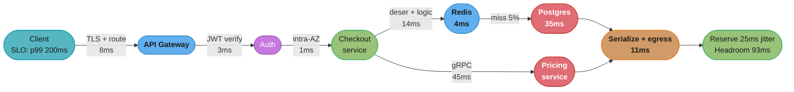
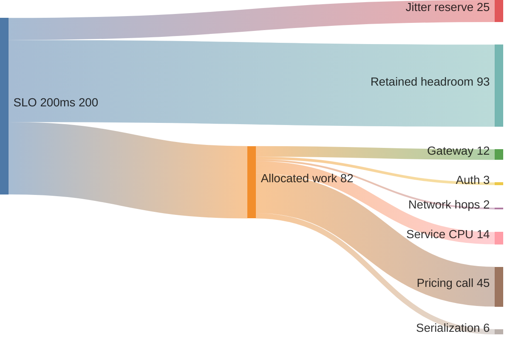

# Latency Budgets and SLO Math

## 1. Concept Overview

Every team that ships a latency SLO writes down a single number — "p99 under 200ms" — and then never does the arithmetic that turns it into engineering constraints. The number sits on a dashboard, gets missed, gets debated, and gets missed again. The missing artifact is a **latency budget**: a bill of materials that allocates the SLO across every hop in the request path, so that each component owns a number it can be held to, and so that the sum is provably under the promise.

A latency budget is a design document, not a monitoring artifact. It is written before the system exists, in the same session where you draw the architecture, because it is the thing that tells you whether the architecture is possible. A design that puts a cross-region call inside a 200ms p99 API has already failed — 70ms of that budget is the speed of light, before a single line of code runs — and the budget is the two minutes of arithmetic that would have caught it.

This module is the arithmetic. How latency composes serially and in parallel, what physics charges you and why no engineering buys it back, how to decompose an SLO into per-hop line items that actually sum, what you have already spent before your handler starts, what to cut when the budget is overspent, how to enforce a budget in code with deadline propagation and a timeout ladder that adds up, and how to pick an SLI that is not a lie. Error budgets — the availability analogue — are covered in [`devops/sre_principles_and_slos`](../../devops/sre_principles_and_slos/sre_principles_and_slos.md); here we only wire the two together.

---

## 2. Intuition

> **One-line analogy**: A latency budget is a bill of materials for time. A manufacturer who promises a 1.2 kg laptop does not weigh the finished product and hope — every screw has a gram allocation, and the design is rejected on paper if the parts sum over. Time is the same, except that unlike grams, some of it is charged by physics and cannot be engineered away.

**Mental model**: think of the SLO as a fixed pot of milliseconds that gets **spent** as the request travels. Each hop takes its cut and passes the remainder down. A hop that overspends does not fail locally — it silently steals from every hop after it, which is why the component that gets blamed is almost never the component that overspent.

**Why it matters**: without the budget, per-component timeouts get chosen by copy-paste (30 seconds, always 30 seconds), latency regressions have no owner, and architectural decisions that make the SLO arithmetically unreachable get made in a design review where nobody did the sum. With it, "can we add a call to the risk service here?" has a one-line answer: the risk service's p99 is 90ms, we have 34ms unallocated, so no — not synchronously.

**Key insight**: **serial composition adds, parallel composition takes the maximum, and the maximum of many things is much worse than the average of them.** That single asymmetry explains most production latency surprises. Adding a tenth sequential hop costs you its p99. Adding a hundredth parallel leaf costs you the leaf's *p99.99*, because with 100 leaves you draw from the tail a hundred times per request.

---

## 3. Core Principles

- **The budget is written at design time, not derived from production.** Measuring what you currently do and calling it a budget is a description, not a constraint.
- **Every hop owns a number.** An unallocated hop is a hop that will consume whatever is left.
- **Allocate on p99, not on the mean.** The mean is the budget for a request nobody has.
- **Physics is a line item.** Speed of light in fibre is a fixed, non-negotiable cost of your topology, so topology is a latency decision.
- **Reserve headroom explicitly.** A budget that sums to exactly the SLO is already broken, because GC, scheduling, and queueing are real and unmodelled.
- **Timeouts must be derived from the budget, never chosen.** A timeout larger than the caller's remaining budget cannot help anyone and can only hold resources.
- **Deadlines propagate; timeouts do not.** A timeout is a local duration. A deadline is an absolute instant shared by the whole call tree, and only the second one composes.
- **The SLI must be a ratio of countable events.** Good requests over valid requests. Averages and instance-level percentiles do not aggregate.
- **Budget at 60-70% utilization.** Queueing delay is `S/(1-rho)`; a budget computed at 90% utilization is a budget for a system that is already 10x its service time.

---

## 4. Types / Architectures / Strategies

### 4.1 How Latency Composes

| Composition | Formula | Effect on p99 | Where it shows up |
|---|---|---|---|
| **Serial** | `T = sum(t_i)` | Means add; variances add; p99 of the sum is *less* than the sum of p99s if hops are independent, and close to it if they are not | Gateway → auth → service → DB chain |
| **Parallel, all needed** | `T = max(t_i)` | The tail dominates: N leaves each with 1% chance of being slow gives `1 - 0.99^N` chance of a slow request | Scatter-gather, search shards, fan-out reads |
| **Parallel, first-wins** | `T = min(t_i)` | The tail *improves*: hedged requests, this is why a duplicate request at p95 is cheap insurance | Hedged requests, multi-replica reads |
| **Conditional** | `T = p*t_hit + (1-p)*(t_hit + t_miss)` | A 95% cache hit still pays the miss path 5% of the time, and p99 lives entirely in that 5% | Every cache |
| **Retried** | `T = t + backoff + t` (per retry) | A retry is serial composition with yourself; the budget must contain all attempts | Any client with retries |

The mathematics of serial composition contains a trap worth stating precisely. Take five independent hops, each with a mean of 10ms and a p99 of 50ms:

```
Sum of the means .................... 50 ms   <- this is roughly your p50, not your p99
Sum of the p99s .................... 250 ms   <- a conservative upper bound
True p99 of the sum (independent) .. ~126 ms  <- what you will actually measure
```

**Budget on the sum of p99s.** It over-provisions by roughly 2x under independence, and that over-provision is exactly the safety margin you want — because independence is the assumption that fails first. When hops share a node, a GC pause, a connection pool or a saturated dependency, their slow moments *correlate*, and the true p99 climbs toward the sum-of-p99s bound. Budgeting on the sum of means is the version that is always wrong: it produces a budget for the median request and an SLO measured on the 99th.

### 4.2 The Physical Floor

Light in a vacuum travels 299,792 km/s. Inside a silica fibre with refractive index around 1.47, the signal propagates at roughly **200,000 km/s** — about 200 km per millisecond, one way. A round trip therefore costs about **1ms per 100km of fibre**, and real fibre routes run roughly 1.2-1.5x the great-circle distance because cables follow terrain, rights of way and undersea corridors.

```
RTT_min = 2 x fibre_path_km / 200,000 km/s
```

| Path | Fibre path (approx) | Physics floor (RTT) | Typical observed RTT |
|---|---|---|---|
| Loopback, same host | — | — | 25-50 us |
| Same rack | ~10 m | ~0.1 us | 60-150 us |
| Same AZ | 1-2 km | ~20 us | 0.15-0.5 ms |
| Cross-AZ, same region | 5-100 km | 0.05-1 ms | 0.5-2 ms |
| `us-east-1` to `us-east-2` | ~1,050 km | 10.5 ms | 12-15 ms |
| `us-east-1` to `us-west-2` | ~5,500 km | 55 ms | 60-70 ms |
| `us-east-1` to `eu-west-1` | ~6,750 km | 67 ms | 68-80 ms |
| `eu-west-1` to `ap-southeast-1` | ~15,500 km | 155 ms | 155-180 ms |
| `us-east-1` to `ap-southeast-1` | ~21,000 km | 210 ms | 210-240 ms |

Two things follow, and both are architectural rather than technical:

1. **Observed RTT is already close to the floor on major routes.** `us-east-1` to `eu-west-1` measures 68-80ms against a 67ms floor. There is nothing left to optimize — no protocol, no compression, no faster NIC, no CDN, no amount of money. Hollow-core fibre pushes the propagation speed toward 99% of `c` and shaves perhaps 30%, and it exists on a handful of financial routes, not on your VPC peering.
2. **A synchronous cross-region call is a topology decision, not a performance bug.** If your 200ms p99 budget includes one round trip to Europe, 70ms — 35% of the entire budget — is spent before any code executes. The only fixes are topological: replicate the data, move the computation, or make the call asynchronous.

### 4.3 Budget Allocation Strategies

| Strategy | How it allocates | Use when |
|---|---|---|
| **Measured-plus-margin** | Take each hop's current p99, add 20-30%, check the sum | The system exists and mostly works |
| **Criticality-weighted** | Big allocations to hops that genuinely need them (DB, ML inference), small to hops that do not (auth, serialization) | Designing new; forces the conversation about what deserves time |
| **Equal-split** | SLO / number of hops | Almost never — it gives serialization the same budget as a database |
| **Floor-first** | Subtract the physics and connection-setup floor first, allocate only what remains | Any path crossing an AZ or region boundary |
| **Reverse-derived** | Fix the hops you cannot change (third parties, physics), give the remainder to the code you own | A path with a dominant external dependency |

In practice you use floor-first to establish what is actually available, then criticality-weighted to divide the remainder, then hold back 25-30% as unallocated headroom.

### 4.4 SLI Shapes

| SLI form | Definition | Aggregates across instances? | Verdict |
|---|---|---|---|
| Mean latency | `sum(duration) / count` | Yes (weighted) | **Never an SLI.** Hides the tail completely |
| p99 per instance, then averaged | `avg(p99_i)` | **Mathematically meaningless** | Never |
| p99 from summed histogram buckets | `histogram_quantile(0.99, sum(rate(bucket)))` | Yes | Good for dashboards |
| **Threshold ratio** | `count(duration < 200ms AND status < 500) / count(valid)` | Yes — just sum counters | **Best.** This is the SLI |
| Multi-threshold | Ratio at 200ms and at 1s, both tracked | Yes | Best for a tiered promise |

The threshold ratio is the form to reach for, and the reason is composability: it is a count of good events over a count of valid events, so it sums trivially across instances, shards and time windows, and it plugs directly into an error budget without a second definition. A percentile does none of those things — you cannot average p99s, you cannot add them across shards, and you cannot express "we have burned 60% of our budget" from them.

---

## 5. Architecture Diagrams

### 5.1 The Budget as a Bill of Materials



Note that `Redis` and `Pricing` are drawn as separate branches from the service: they are issued **in parallel**, so the path cost is `max(4 or 35, 45) = 45ms`, not their sum. That single decision is worth 39ms of budget and is invisible in a diagram that draws everything as one chain.

### 5.2 Where the 200 Milliseconds Goes



Two things a budget sankey makes obvious immediately: how little of the promise the work actually needs (41% of the pot is allocated work, because the 39ms data-access branch hides inside pricing's parallel max and never appears as its own flow), and that a single remote call — pricing at 45ms — is 55% of all allocated work. That is where the next architectural conversation happens, not in the gateway.

### 5.3 Serial Adds, Parallel Maxes

```
SERIAL: four hops, each p99 = 40 ms
    |----40----|----40----|----40----|----40----|          total p99 <= 160 ms
    A          B          C          D                     (sum of p99s bound)

PARALLEL: four hops, each p99 = 40 ms
    A |----40----|
    B |--22--|                                             total p99 = MAX = 40 ms
    C |------31------|                                     (looks like a 4x win)
    D |----38----|

BUT the max draws from the tail once PER LEAF:
    P(all N leaves under their own p99) = 0.99^N
      N=1    99.0%      N=20    81.8%
      N=5    95.1%      N=50    60.5%
      N=10   90.4%      N=100   36.6%   <- 63% of requests hit a slow leaf

    To hold a 99% chance that ALL 100 leaves are fast, each leaf needs
    P(fast) = 0.99^(1/100) = 0.99990  ->  the fan-out's p99 is the leaf's p99.99.
```

Parallelizing converts a sum into a maximum, which is the cheapest large win in the whole budget — and it converts your dependence on a leaf's p99 into a dependence on its p99.99, which is the most expensive number in any system to hold. The full treatment of that tradeoff, hedging, and tail-tolerant fan-out is in [`tail_latency_and_fan_out`](../tail_latency_and_fan_out/tail_latency_and_fan_out.md).

---

## 6. How It Works — Detailed Mechanics

### 6.1 Decomposing a 200ms p99 API SLO

The worked example. Path: mobile client → CloudFront → API Gateway → checkout service → (Redis, Postgres, pricing gRPC) → response. Server-side SLO, measured at the gateway, so client network time is out of scope and is budgeted separately.

| # | Line item | p99 budget | Basis |
|---|---|---|---|
| 1 | Gateway TLS termination + routing | 8 ms | Measured; TLS 1.3 with session resumption on a warm connection |
| 2 | Gateway to auth, JWT verify (JWKS cached in memory) | 3 ms | RS256 verify ~0.4ms plus intra-AZ hop |
| 3 | Gateway to service, network (intra-AZ) | 1 ms | Physics floor 20us; the rest is kernel, proxy and queueing |
| 4 | Request deserialization (12 KB JSON) | 2 ms | Jackson, ~6 MB/s/core effective on nested payloads |
| 5 | Business logic, validation, mapping | 12 ms | CPU-bound; measured on a warm JIT |
| 6a | Redis lookup (intra-AZ, pooled) | 4 ms | 95% of requests stop here |
| 6b | Postgres query on cache miss, incl. pool acquire | 35 ms | Indexed, p99 including a 2ms acquire budget |
| 7 | Pricing service gRPC call | 45 ms | Issued in parallel with 6; the max of this branch and 6b |
| 8 | Response serialization (30 KB JSON) | 6 ms | |
| 9 | Service to gateway, network | 1 ms | |
| 10 | Gateway egress + gzip | 4 ms | gzip level 4 on 30 KB, ~1.5ms; rest is proxy |
| | **Allocated (serial path, with 6 and 7 in parallel)** | **82 ms** | `8+3+1+2+12+max(4or35, 45)+6+1+4` |
| | GC and scheduler jitter reserve | 25 ms | One G1 mixed pause plus scheduling noise |
| | Retained headroom (46%) | 93 ms | Unallocated. Do not spend it in the design review |
| | **Total** | **200 ms** | |

Three rules this table encodes:

- **Line 7 is 55% of allocated work.** Any budget where one remote call dominates should trigger the question "must this be synchronous?" before any micro-optimization elsewhere.
- **The parallel `max` in the middle is load-bearing.** Serialized, lines 6a, 6b and 7 would cost 84ms instead of 45ms — allocated work rises from 82ms to 121ms and headroom collapses from 93ms to 54ms, leaving nothing for the next dependency somebody asks to add.
- **Headroom is a line item with a name.** This one retains far more than the 25-30% the discipline asks for, which is what a path with a genuine parallel branch looks like — and naming it is what stops it being quietly spent. A budget that sums to exactly 200 is a budget that misses, because the model excludes queueing, retries, cold caches and the day traffic is 1.4x normal.

### 6.2 The Budget You Already Spent

Before your first line of handler code runs, the request has already consumed time you did not allocate.

| Cost | Warm path | Cold path | Notes |
|---|---|---|---|
| DNS resolution | 0 (OS/JVM cache) | 20-120 ms | The JVM caches positive lookups for 30s by default (`networkaddress.cache.ttl`), and it is often left too high or too low |
| TCP handshake | 0 (pooled) | 1 RTT | Intra-AZ ~0.5ms, cross-region 70ms |
| TLS 1.3 full handshake | 0 (pooled) | 1 RTT | TLS 1.2 costs **2** RTTs — 140ms cross-region |
| TLS session resumption | 0 | 0-1 RTT | 0-RTT early data only for idempotent requests, and it is replayable |
| First byte of request | 1 RTT | 1 RTT | Unavoidable |
| Lambda cold start (Java) | 0 | 400 ms - 6 s | SnapStart brings it to roughly 200-400 ms |
| JIT warmup | 0 | 3-10x slower for the first ~1,000 calls | C2 compilation threshold; visible in every deploy's p99 spike |
| Connection pool acquire | 0-2 ms | up to the acquire timeout | See [`connection_pooling_deep_dive`](../connection_pooling_deep_dive/connection_pooling_deep_dive.md) |

The arithmetic that surprises people: a **cold** cross-region HTTPS call at 70ms RTT costs DNS (say 40ms) + TCP (70ms) + TLS 1.3 (70ms) + request/response (70ms) = **250ms before the server does anything**. On TLS 1.2 it is 320ms. The same call on a pooled warm connection is 70ms. That 180ms delta is the entire justification for connection pooling to external services, and it is why a client library that opens a fresh connection per call is a latency bug, not a style issue.

### 6.3 Deadline Propagation, Not Timeouts

A **timeout** is a local duration: "I will wait 45ms." A **deadline** is an absolute instant: "everything downstream of this must be done by `T0 + 200ms`." Only the deadline composes, because it shrinks automatically as the request travels.

```java
// Caller: convert the SLO into an absolute deadline once, at the edge.
public Response handle(Request req) {
    Instant deadline = Instant.now().plusMillis(200);        // the whole budget
    return svc.checkout(req, deadline);
}

// Every downstream call derives its timeout from what is LEFT, not from a constant.
private PriceQuote fetchPrice(Order o, Instant deadline) {
    long remainingMs = Duration.between(Instant.now(), deadline).toMillis();
    if (remainingMs <= 5) {
        throw new DeadlineExceededException("no budget left for pricing");  // fail fast
    }
    long attemptMs = Math.min(45, remainingMs - 5);          // keep 5ms to respond
    return PricingGrpc.newBlockingStub(channel)
            .withDeadlineAfter(attemptMs, TimeUnit.MILLISECONDS)
            .quote(toProto(o));
}
```

gRPC does this natively and it is one of the strongest reasons to pick it for internal calls: `withDeadlineAfter` serializes into the `grpc-timeout` header, the server exposes it as `Context.current().getDeadline()`, and any call the server makes with `Context`-derived deadlines inherits the remainder automatically. A server that is already past its deadline can reject the work *before* executing it — the single largest saving in an overload, because it stops the system doing work whose result nobody will read.

Over plain HTTP there is no standard, so pick one and enforce it in your client filter. Envoy propagates `x-envoy-expected-rq-timeout-ms`; a common house convention is an absolute `X-Request-Deadline` in epoch milliseconds, which survives clock-agnostic hops better than a duration only if your clocks are disciplined — otherwise send the remaining duration and accept the drift. Details in [`grpc_and_protobuf`](../grpc_and_protobuf/grpc_and_protobuf.md).

### 6.4 The Timeout Ladder

Per-hop timeouts must sum — **including retries and backoff** — to less than the caller's remaining budget. Derive them, never choose them.

```
Client SLO                                            200 ms
  Gateway request timeout                             190 ms   (10ms for gateway work)
    Checkout service handler deadline                 175 ms
      Auth call:      attempt 8ms,  0 retries    =      8 ms
      Redis:          attempt 5ms,  1 retry, 2ms bo =  12 ms
      Postgres:       attempt 35ms, 0 retries    =     35 ms
      Pricing gRPC:   attempt 20ms, 1 retry, 5ms bo =  45 ms   (parallel with above)
      ------------------------------------------------------
      worst-case serial path = 8 + 12 + max(35, 45)  =  65 ms
      + local CPU 14ms + serialization 6ms           =  85 ms
      leaves 90 ms of slack inside the 175 ms deadline
```

Two arithmetic facts hide in that ladder:

- **A retry lives inside its hop's allocation, not outside it.** Pricing gets 45ms total, so its per-attempt timeout is 20ms with a 5ms jittered backoff, giving `20 + 5 + 20 = 45`. Setting a 45ms attempt timeout *with* a retry silently doubles the hop to 95ms and blows the budget.
- **Retries multiply downward.** Three tiers each retrying three times turns one leaf failure into 27 leaf requests. Cap total retry load with a retry budget (a token bucket allowing retries only up to ~10% of successful request volume) rather than per-call retry counts. See [`fault_tolerance_patterns`](../fault_tolerance_patterns/fault_tolerance_patterns.md).

### 6.5 What to Cut When the Budget Is Overspent

In order of engineering cost, cheapest first. Work down until the sum fits.

| # | Lever | Typical saving | What it costs |
|---|---|---|---|
| 1 | **Delete the work** — an enrichment nobody reads, a validation the DB already enforces, a log write on the hot path | 100% of that line | Nothing. Always check first |
| 2 | **Parallelize independent hops** — turn a sum into a max | Sum minus max, often 30-60% | Fan-out tail exposure; more concurrent load downstream |
| 3 | **Batch** — one query for N items instead of N queries | Removes `(N-1)` round trips | Larger blast radius per failure |
| 4 | **Cache** — read-through with a bounded TTL | `hit_rate x t_origin` | Staleness, invalidation, and a p99 that lives in the miss path |
| 5 | **Precompute** — materialize at write time what you were computing at read time | Moves the cost off the read path entirely | Write amplification, a rebuild path, eventual consistency |
| 6 | **Degrade** — drop optional enrichment past a sub-deadline, serve a partial or stale response | Bounds the worst case by construction | Product surface must tolerate it; needs a product decision |
| 7 | **Move the data** — regional read replica, colocated cache, denormalized projection | The entire cross-region RTT, 60-210 ms | Replication lag, consistency model change, cost |
| 8 | **Move the computation** — edge function, client-side rendering | The round trip | Deployment and debugging complexity |
| 9 | **Relax the SLO** | Whatever you need | Sometimes the correct answer, if 200ms was picked by vibes |

Levers 1-3 are almost always available and almost always skipped, because they are unglamorous. Lever 6 is the one that turns an unbounded worst case into a bounded one and is undervalued: a "return whatever you have at `deadline - 20ms`" rule makes the p99.9 a design parameter rather than an emergent property.

### 6.6 SLI Selection — Why an Average Is Never an SLI

Consider 10,000 requests: 9,900 at 10ms and 100 at 10,000ms.

```
mean          = (9900 x 10 + 100 x 10000) / 10000 = 109.9 ms   <- dashboard looks fine
p99           = 10,000 ms                                       <- one in a hundred users waits 10s
threshold SLI = 9900 / 10000 = 99.0% under 200 ms               <- exactly the truth
```

The mean is a weighted description of the requests you do not care about. Three further problems:

1. **No user experiences the mean.** SLOs are promises to users, and users experience individual requests.
2. **It is insensitive in the wrong direction.** Making the worst 1% twice as slow moves the mean by 100ms and the p99 by 10 seconds.
3. **It cannot express a promise.** "Mean under 110ms" is satisfied by the distribution above, which is a service nobody would ship.

**And percentiles do not aggregate.** `avg(p99_per_instance)` is not the fleet p99 — it is a number with no interpretation. If instance A serves 10 rps at p99 = 1s and instance B serves 1,000 rps at p99 = 20ms, their average p99 of 510ms describes neither. Two correct approaches:

```promql
# Correct percentile: sum the histogram BUCKETS first, then take the quantile.
histogram_quantile(0.99,
  sum by (le) (rate(http_server_request_duration_seconds_bucket{route="/checkout"}[5m])))

# Better as an SLI: a ratio of countable events. Aggregates by simple addition,
# composes with the error budget, and needs no percentile machinery at all.
sum(rate(http_server_request_duration_seconds_bucket{route="/checkout", le="0.2"}[30d]))
  /
sum(rate(http_server_request_duration_seconds_count{route="/checkout"}[30d]))
```

The second form requires that `0.2` is an actual bucket boundary in your histogram. Choose bucket boundaries to include your SLO thresholds — a histogram whose nearest buckets are 0.1 and 0.25 cannot measure a 200ms SLO, and this is a configuration decision made once, at instrumentation time, that is painful to change later because it invalidates history.

### 6.7 Where Latency Budgets Meet Error Budgets

Define the SLI so that **a slow request is a bad request**:

```
good  = requests where (status < 500) AND (duration < 200 ms)
valid = all requests to the route, excluding client 4xx you do not own
SLI   = good / valid
SLO   = 99.5% over 30 days
error budget = 0.5% of 30 days of requests
```

That single definition makes latency and availability spend the *same* budget, which is what you want: from the user's side a 10-second checkout and a failed checkout are the same event. Burn-rate alerting, the error-budget policy and the freeze mechanics are covered in [`devops/sre_principles_and_slos`](../../devops/sre_principles_and_slos/sre_principles_and_slos.md) — the only thing to add here is the interaction:

- **Latency work and reliability work compete for one budget.** If 80% of the burn is slow requests rather than errors, the reliability project is a latency project.
- **A latency SLO with no threshold in the SLI cannot burn budget.** "p99 under 200ms" as a percentile has no notion of a partially bad window; the threshold ratio does.
- **The two failure modes trade off.** Tightening a timeout converts slow requests into errors. That is budget-neutral by the definition above, which is the point — it stops teams gaming the latency number by letting requests hang.

---

## 7. Real-World Examples

**Google's "Speed Matters" and Amazon's 100ms.** Amazon's frequently cited internal experiment put every additional 100ms of latency at roughly 1% of sales; Google found a 500ms delay reduced searches per user by around 20%. These are old figures and should not be quoted as current, but they are the reason latency budgets are funded and the reason the numbers in them are business numbers, not engineering ones.

**Google's tail-at-scale result.** The observation that a service whose individual servers are fast at p99 becomes slow at the fan-out level — one server in a hundred being slow makes 63% of 100-way requests slow — is the empirical foundation of §5.3 and the origin of hedged requests as standard practice.

**AWS documented latency envelopes.** AWS publishes single-digit-millisecond expectations for cross-AZ traffic in a region and the AZ design constraint that AZs are meaningfully separated but close enough for synchronous replication. That constraint is *why* the cross-AZ number is 0.5-2ms rather than 20ms, and it is the reason a multi-AZ synchronous write is affordable inside a 200ms budget while a multi-region one is not.

**gRPC deadlines as an ecosystem default.** gRPC's decision to make deadlines absolute and automatically propagated through `Context` is the clearest production example of "deadlines compose, timeouts do not". Services built on it get budget enforcement close to free, which is a large part of why internal RPC at scale converged on it.

**Financial-market microwave links.** Trading firms pay for microwave and hollow-core routes precisely because those beat fibre's `c/1.47` — microwave through air is close to `c` and takes a straighter path. Chicago-to-New Jersey drops from roughly 6.5ms to about 4ms one-way. The cost is enormous and the bandwidth is tiny. It is the exception that proves the rule: the speed of light is beatable only by changing the medium, only marginally, and only when a millisecond is worth millions.

---

## 8. Tradeoffs

| Decision | Buys | Costs |
|---|---|---|
| Budget on sum-of-p99 vs true p99 | Safety when hops correlate | Roughly 2x over-provisioning under independence |
| Parallelize a hop | Sum becomes max, often 30-60% | Exposure to the leaf's p99.99, more concurrent downstream load |
| Tight per-hop timeouts | Fast failure, budget stays enforceable | Converts slow requests into errors; needs a retry budget or you amplify load |
| Loose timeouts | Fewer errors under transient slowness | Threads and connections held; a stuck dependency takes the whole tier |
| Deadline propagation | Downstream can reject doomed work early | Requires every client and framework in the path to honour it |
| Regional read replica | Removes 60-210ms of physics | Replication lag becomes a correctness concern |
| Cache with 95% hit rate | Mean drops hard | p99 unchanged — it lives entirely in the 5% miss path |
| Degrade past a sub-deadline | Bounded worst case by construction | Requires product agreement on partial results |
| Threshold-ratio SLI | Aggregates, composes with error budget | Bucket boundaries fixed at instrumentation time |
| Percentile SLI | Familiar, one number | Does not aggregate across instances or windows |

---

## 9. When to Use / When NOT to Use

**Write a latency budget** for any user-facing synchronous path with a stated SLO, any path that crosses an AZ or region boundary, any design review that adds a synchronous hop, and any service whose latency is contractual.

**Write it at design time.** The budget's highest value is rejecting an architecture on paper. A budget derived from production after the fact is a description of what you built, and it will rationalize whatever the numbers happen to be.

**Skip it** for asynchronous and batch work, where throughput and completion deadlines are the right frame; for internal tools with no latency promise; and for a prototype whose shape is still moving — you would be budgeting a design that will not exist next week.

**Do not budget on the mean, ever.** Do not budget at 90% utilization, because queueing already multiplies service time by ten there. Do not budget without headroom. And do not treat a budget as immutable: it is a design artifact that gets revised when the topology or the SLO changes, and a budget nobody has revisited in a year is describing a system that no longer exists.

---

## 10. Common Pitfalls

**Every timeout was 30 seconds (illustrative composite, 4-hour full outage).** A payments platform used the framework default everywhere. A read replica became slow — not down, slow, roughly 8 seconds per query. Because every tier waited 30 seconds, nothing failed fast: the checkout service's 200 Tomcat threads filled in 25 seconds, the gateway's connection pool to checkout filled next, and the outage propagated *upward* to services that never touched the replica. Total customer-facing outage: 4 hours 10 minutes, versus the roughly 90 seconds the degraded replica would have caused on its own.

```yaml
# BROKEN: copy-pasted defaults. Nothing here relates to the 200ms SLO,
# and every hop is willing to wait 150x the entire budget.
spring:
  datasource:
    hikari:
      connection-timeout: 30000     # 30s to ACQUIRE a pooled connection
  cloud:
    openfeign:
      client:
        config:
          default:
            connectTimeout: 30000
            readTimeout: 30000      # every downstream call, 30s
resilience4j:
  timelimiter:
    instances:
      pricing:
        timeoutDuration: 30s
```

```yaml
# FIXED: derived from the 200ms budget in section 6.1. Each number traces
# to a line item, and the sum of the worst case is under the caller's budget.
spring:
  datasource:
    hikari:
      connection-timeout: 2000      # acquire budget: 2ms of the 35ms DB line,
      validation-timeout: 1000      # 2000ms is the CEILING before we shed load
      maximum-pool-size: 27         # Little's Law: 112 rps x 0.012s = 1.4 busy, x20 burst margin
  cloud:
    openfeign:
      client:
        config:
          auth:      { connectTimeout: 1000, readTimeout: 8 }
          pricing:   { connectTimeout: 1000, readTimeout: 20 }   # 20 + 5 backoff + 20 = 45
resilience4j:
  timelimiter:
    instances:
      pricing: { timeoutDuration: 45ms }   # the whole hop, retries included
      auth:    { timeoutDuration: 8ms }
  retry:
    instances:
      pricing:
        maxAttempts: 2                     # 2 attempts, NOT 3 -- the budget holds 2
        waitDuration: 5ms
        enableExponentialBackoff: false    # no room to back off inside 45ms
```

**Impact of the fix**: the same degraded-replica event three months later produced 71 seconds of elevated errors on one route and no cascade.

**A 95% cache hit rate did nothing for p99.** A catalog service added Redis, hit rate reached 95%, mean latency fell from 180ms to 22ms, and the team declared victory. p99 was unchanged at 840ms, because p99 *is* the miss path — at a 95% hit rate the 99th percentile request is a miss by definition. Worse, the miss path got slower: the cache had absorbed enough load that the origin's connection pool had been downsized, so misses now queued. **A cache improves the mean; only a cache with a hit rate above the SLO percentile improves that percentile.** To move p99 you need 99%+ hits, or you need to fix the miss path.

**Averaged the p99s across 80 instances.** A media-metadata service's dashboard computed `avg(p99)` over 80 pods. One pod wedged on a degraded EBS volume was serving essentially every request in 11 seconds — 1.25% of fleet traffic; the averaged panel showed 290ms, comfortably inside a 350ms line. Customers whose sticky sessions landed on that pod complained for **five weeks**. Recomputing from summed histogram buckets showed the true fleet p99 at 10.9 seconds, because once more than 1% of traffic is slow the 99th percentile sits inside the bad pod by construction. The averaged-percentile panel is the single most common broken dashboard in production, because Grafana makes it trivially easy to build.

**Budgeted the fan-out on the leaf's p99.** A search service fanned out to 60 shards and budgeted 40ms because each shard's p99 was 40ms. Measured end-to-end p99 was 310ms. With 60 leaves, only `0.99^60 = 55%` of requests have every shard inside its own p99, so 45% hit at least one slow shard and the fan-out's p99 tracked the leaf's p99.983 (`0.99^(1/60) = 0.99983`), not its p99. The fix was hedging — reissue to a replica at the 40ms mark — which brought p99 to 62ms for a 4% increase in leaf load. See [`tail_latency_and_fan_out`](../tail_latency_and_fan_out/tail_latency_and_fan_out.md).

**Put a cross-region call in a 150ms budget.** A team moved a fraud vendor from a US endpoint to the vendor's EU endpoint for data-residency reasons. Nobody recomputed the budget: the call went from a 12ms p99 to 79ms, of which 67ms is the physics floor between `us-east-1` and `eu-west-1`. p99 went from 118ms to 191ms against a 150ms SLO and stayed there through two sprints of profiling, because there was nothing in the code to find. The eventual fix was a regional deployment of the calling service — a topology change, which is the only category of fix that works against physics.

**Retry amplification inside a nominally correct budget.** Every service used a sane 3-attempt retry with jittered backoff, and each service's own budget was respected. Across four tiers that is `3^4 = 81` leaf requests per user request in the worst case. A 40-second blip on the leaf produced 81x offered load, which turned a blip into a 22-minute outage. Per-hop retry policies are locally correct and globally catastrophic; the fix is a **retry budget** — a client-side token bucket capping retries at ~10% of successful request volume — plus circuit breaking at each tier.

---

## 11. Technologies & Tools

| Tool | Role in budgeting |
|---|---|
| OpenTelemetry + Jaeger / Tempo | Per-span durations — the only way to see actual line items against the budget |
| Prometheus histograms + `histogram_quantile` | Correct fleet percentiles; put your SLO thresholds on bucket boundaries |
| Micrometer `Timer.builder(...).publishPercentileHistogram()` | Emits the buckets the above needs; `serviceLevelObjectives()` adds exact SLO boundaries |
| Sloth / OpenSLO / Pyrra | Generate SLO recording rules and burn-rate alerts from a declarative spec |
| gRPC deadlines (`withDeadlineAfter`, `Context`) | Native absolute-deadline propagation |
| Envoy / Istio (`x-envoy-expected-rq-timeout-ms`, retry budgets) | Enforce per-hop timeouts and cap retry amplification at the mesh |
| Resilience4j `TimeLimiter` + `Retry` | Per-hop budget enforcement inside the JVM |
| `ping`, `mtr`, `iperf3` | Measure the actual RTT floor of your topology before assuming it |
| CloudPing / AWS inter-region latency dashboards | Published region-pair RTTs for design-time budgeting |
| k6 / Gatling with open-model arrival | Validate the budget under load without coordinated omission |
| `EXPLAIN (ANALYZE, BUFFERS)` | Prove a DB line item is achievable, not aspirational |

---

## 12. Interview Questions with Answers

**Q: Why is the p99 of a sum not the sum of the p99s?**
**Short:** Independent hops are rarely all slow at once, so the true p99 of a chain lands well below the sum of per-hop p99s, though correlation pushes it back up.

For a hop to contribute its p99 to a given request, that request must be unlucky at that hop; being unlucky at all five hops simultaneously is far rarer than being unlucky at one. Concretely, five independent hops each with a 10ms mean and a 50ms p99 sum to 250ms of p99s, but the true p99 of the total is around 126ms. You should still budget on the sum of p99s, for two reasons: it is conservative, and independence is the assumption that breaks first — when hops share a node, a GC pause, a connection pool or a saturated dependency, their slow moments correlate and the real p99 climbs toward that bound. What you must never do is budget on the sum of means, which produces a budget for the median request against an SLO measured at the 99th percentile.

**Q: Why is parallel composition a maximum, and why does that make fan-out dangerous?**
**Short:** A request needing all N parallel responses finishes with the slowest, so it draws from the tail once per leaf rather than once per request.

If every leaf must return, the request time is `max(t_i)`, which looks like a huge win over the sum — four 40ms calls in parallel cost 40ms instead of 160ms. The danger is in the tail. If each leaf has a 1% chance of exceeding its own p99, the probability that all N are fast is `0.99^N`: 90% at ten leaves, 82% at twenty, 37% at a hundred. So a 100-way fan-out's p99 corresponds to the leaf's p99.99, which is the most expensive number in any system to hold. The mitigations are hedged requests, tail-tolerant replication and reducing the fan-out width; the full treatment is in the tail-latency module. The budgeting rule is simple: never budget a fan-out at the leaf's p99.

**Q: How much latency does physics charge between us-east-1 and eu-west-1, and can you engineer it away?**
**Short:** About 67ms round trip at the speed of light in fibre, and no protocol, hardware, or CDN can recover it because the medium sets the floor.

Light moves at roughly 200,000 km/s in silica fibre, about 200km per millisecond one way, so the round-trip floor is about 1ms per 100km of fibre. Real cable routes run 1.2 to 1.5 times the great-circle distance, and the Ashburn-Dublin great circle is about 5,525km, giving roughly 6,750km of fibre and a 67ms floor. Observed RTT is 68-80ms, so the route is already at physics — there is nothing left to optimize. Hollow-core fibre and microwave links beat it by changing the medium, but by tens of percent, on a handful of financial routes, at enormous cost. The only real fixes are topological: replicate the data closer, move the computation, or make the call asynchronous. That is why a synchronous cross-region call inside a 200ms budget is an architecture decision, not a performance bug.

**Q: How do you decompose a 200ms p99 SLO into per-hop budgets?**
**Short:** Subtract the physics and connection floor first, allocate the remainder by criticality, then hold back 25-30% as named headroom.

Start by writing down every hop in the path and marking which are serial and which are parallel, because parallel branches contribute their maximum, not their sum. Subtract the immovable costs — RTTs implied by your topology, TLS and pool acquisition — since those are not negotiable. Allocate the remainder by criticality rather than equally: a database or an inference call needs tens of milliseconds, JSON serialization needs single digits, and giving them the same allocation is how equal-split budgets fail. Then add two explicit line items: a jitter reserve for GC and scheduling, typically 20-25ms, and retained headroom of 25-30% that nobody is allowed to spend in a design review. A budget that sums to exactly the SLO already misses, because queueing, retries and traffic growth are real and unmodelled.

**Q: What is the bug where every hop uses a 30-second timeout?**
**Short:** Uniform long timeouts remove fail-fast entirely, so one slow dependency fills every thread pool upward and turns a local degradation into a full outage.

Timeouts are supposed to be derived from the caller's budget, and copy-pasted framework defaults are not. When a dependency becomes slow rather than down — say 8 seconds per query — a 30-second timeout means nothing ever fails fast. The calling service's worker threads all park waiting, its pool fills in tens of seconds, its callers' pools fill next, and the failure propagates upward to services that never touched the slow dependency. A real case turned a 90-second degradation into a four-hour outage this way. The fix is a derived ladder: each hop's timeout comes from its budget line item, including retries and backoff, and the sum of the worst case stays under the caller's remaining budget. Then the slow dependency causes bounded errors on one route instead of a cascade.

**Q: What is deadline propagation and how is it different from a timeout?**
**Short:** A timeout is a local duration, while a deadline is an absolute instant shared down the call tree, so only the deadline shrinks correctly as the request travels.

Setting a 45ms timeout at hop three is meaningless if 190ms of a 200ms budget is already gone. A deadline is computed once at the edge as `now + 200ms` and passed down; every hop computes its own timeout as the minimum of its allocation and what remains, and rejects immediately if nothing is left. The largest win is that a server already past its deadline can refuse the work *before* doing it, which is the biggest saving available during an overload because the system stops producing results nobody will read. gRPC does this natively — `withDeadlineAfter` becomes the `grpc-timeout` header, and `Context` propagates the remainder to onward calls. Over plain HTTP there is no standard, so you enforce a house convention in a client filter.

**Q: Why is an average never a valid SLI?**
**Short:** An average is dominated by the requests you do not care about and can look healthy while one in a hundred users waits ten seconds.

Take 9,900 requests at 10ms and 100 at 10 seconds. The mean is 110ms, which passes almost any latency dashboard, while the p99 is 10 seconds and one user in a hundred is having an unusable experience. Three problems compound: no user experiences the mean, so it is not a promise about anyone; it is insensitive in the wrong direction, since doubling the worst 1% moves it by 100ms; and it cannot express a threshold, which is what an SLO is. The right SLI shape is a ratio of countable events — the proportion of requests both successful and faster than the threshold — because it aggregates by simple addition across instances and windows and plugs straight into an error budget. Percentiles from summed histogram buckets are fine for dashboards, but the ratio is the SLI.

**Q: Why can you not average p99s across instances or time windows?**
**Short:** A percentile is a property of a distribution, so averaging per-instance percentiles produces a number that describes no distribution at all.

If instance A serves 10 rps with a p99 of 1 second and instance B serves 1,000 rps with a p99 of 20ms, their averaged p99 of 510ms describes neither instance nor the fleet. The failure is not merely imprecise, it is systematically blind to exactly the case you care about: one bad pod out of eighty, serving 1.25% of traffic at eleven seconds, disappears completely into an averaged panel while customers on that pod complain for weeks. The correct computation sums the histogram buckets across instances first and takes the quantile of the summed distribution — in Prometheus, `histogram_quantile(0.99, sum by (le) (rate(..._bucket[5m])))`. Better still, use a threshold ratio, which needs no percentile machinery because counters simply add.

**Q: What latency have you already spent before your handler runs?**
**Short:** DNS, TCP handshake, TLS handshake and the first byte, which on a cold cross-region connection totals roughly 250ms before any code executes.

On a warm pooled connection almost all of it is zero and you pay only the one round trip carrying the request. Cold is a different system: DNS resolution 20-120ms, TCP handshake one RTT, TLS 1.3 handshake another RTT — TLS 1.2 costs two — and then the request itself. At a 70ms cross-region RTT that is roughly 250ms on TLS 1.3 and 320ms on 1.2, entirely outside your budget. Add a Java Lambda cold start at 400ms to 6 seconds, or JIT warmup making the first thousand calls 3-10x slower, and a deploy's p99 spike stops being mysterious. This arithmetic is the whole justification for connection pooling to external services: a client that opens a fresh connection per call is a latency bug of about 180ms, not a style preference.

**Q: Your budget is overspent by 60ms — what do you do, in order?**
**Short:** Delete unnecessary work first, then parallelize independent hops, then batch, cache, precompute, degrade, and only last move data or relax the SLO.

Order by engineering cost. Deleting work is free and almost always available — an enrichment nobody reads, a validation the database already enforces, a synchronous log write. Parallelizing independent hops converts a sum into a maximum and often recovers 30-60% for one refactor, at the cost of tail exposure. Batching removes round trips. Caching helps the mean but only helps p99 if the hit rate exceeds the percentile you are budgeting. Precomputing moves the cost to write time. Degrading — returning whatever you have at `deadline - 20ms` — is undervalued because it makes the worst case a design parameter instead of an emergent property. Moving the data or the computation regionally is the expensive lever that buys back physics. Relaxing the SLO is legitimate if the number was chosen by vibes rather than by a user study.

**Q: How do latency budgets and error budgets interact?**
**Short:** Define the SLI so a slow request counts as bad, and then latency and availability spend one shared error budget, which matches how users experience both.

Write `good = status < 500 AND duration < 200ms` over `valid = all requests you own`, and that ratio is your SLI. From the user's side a ten-second checkout and a failed checkout are the same event, so this is the honest definition. Three consequences follow. Latency work and reliability work now compete for one budget, so if 80% of burn is slow requests, your reliability project is a latency project. A latency SLO expressed as a bare percentile cannot burn budget at all, because it has no notion of a partially bad window — the threshold ratio does. And tightening a timeout converts slow requests into errors, which is budget-neutral under this definition, which is precisely the point: it removes the incentive to game the latency number by letting requests hang.

**Q: How many retries fit inside a 45ms hop budget?**
**Short:** Two attempts of 20ms with a 5ms backoff, because retries live inside the hop's allocation rather than being added on top of it.

The arithmetic is `20 + 5 + 20 = 45`. The mistake people make is setting the per-attempt timeout to the full 45ms and enabling a retry, which silently makes the hop cost 95ms and blows the budget from a config file that looks reasonable. Exponential backoff usually does not fit inside a tight hop at all — there is no room to back off within 45ms — so use a small jittered fixed delay or no retry. The second-order problem is amplification: three tiers each retrying three times turns one leaf failure into 27 leaf requests, and four tiers gives 81, which converts a brief blip into an outage. Cap it with a retry budget — a token bucket allowing retries only up to about 10% of successful request volume — rather than trusting per-call retry counts.

**Q: A cache gets a 95% hit rate and the mean drops from 180ms to 22ms — what happened to p99?**
**Short:** Nothing, because at a 95% hit rate the 99th percentile request is a cache miss by definition, so p99 still lives entirely in the miss path.

The percentile you improve is bounded by the hit rate: a 95% hit rate can move p90 and p95, and cannot touch p99. To improve p99 you need a hit rate above 99%, or you have to fix the miss path itself. Worse, caching often makes the miss path slower: with 95% of load absorbed, the origin's pool gets downsized or its buffer cache cools, so the rare miss now queues or reads from disk. Teams routinely ship a cache, celebrate the mean, and discover months later that the SLO — which is a percentile — never moved. The budgeting discipline is to write the miss path as its own line item at its own p99 and check whether the SLO survives it, because that is the request the SLO is actually about.

**Q: What is coordinated omission and how does it corrupt a latency budget?**
**Short:** A closed-loop load generator stops sending during a stall, so the stalled interval is never sampled and reported p99 can be an order of magnitude too good.

If the harness waits for a response before issuing the next request, then during a two-second stall it issues zero requests — so the requests that *would* have been slow simply never exist in the results. The reported distribution describes a system that was never under the load you thought you applied. A budget validated against such a run is validated against fiction, and the first production traffic spike reveals it. The fix is an open-model or constant-arrival-rate generator that issues requests on a schedule regardless of outstanding responses, and that records latency from the *intended* send time rather than the actual one. k6's constant-arrival-rate executor and Gatling's open injection profiles do this; the deeper treatment is in the load-testing module.

**Q: Should you budget on p50, p99 or p99.9?**
**Short:** Budget on the percentile your SLO promises, usually p99, and set the internal per-hop allocations at that same percentile rather than at the mean.

Consistency matters more than the specific choice: if the SLO is a p99 promise, every line item must be a p99 number, because mixing means and percentiles produces a budget that sums correctly and is wrong. p50 budgeting is the common error and produces a budget roughly 2-3x too optimistic. p99.9 budgeting is defensible for a path fanning out widely, since a fan-out's effective percentile is much deeper than its leaves', but it over-provisions expensively for a simple serial path. The practical answer for most services is to budget at p99 and hold 25-30% headroom, which implicitly buys some p99.9 protection without paying to measure and enforce it at every hop.

**Q: Why should per-hop timeouts sum to less than the caller's timeout?**
**Short:** If a downstream timeout exceeds the caller's remaining budget, the caller gives up first and the downstream work continues holding resources for a response nobody reads.

The caller abandons the request, releases nothing downstream, and the downstream service keeps a thread, a connection and possibly a database transaction alive producing a result that will be discarded. Under load that is pure amplification: the system does more work exactly when it can least afford it, and the wasted work is invisible in every dashboard because those requests eventually succeed. The rule is that the whole worst-case path — every attempt, every backoff, plus local CPU and serialization — must fit inside the caller's deadline with margin. Deadline propagation enforces this structurally rather than by discipline: each hop derives its timeout from the remaining budget, so a hop with no budget left refuses immediately instead of starting doomed work.

**Q: How do you choose the SLO threshold number itself?**
**Short:** Derive it from user behaviour and business impact rather than from current performance, then check it is achievable against the physics floor.

Two inputs. From the product side, find the latency at which behaviour changes — abandonment, retries, a support ticket — using real user monitoring segmented by latency bucket, or a controlled experiment if you can run one. From the engineering side, compute the floor: sum the immovable line items, the RTTs your topology implies, the third-party p99s you cannot change. If the floor exceeds the desired threshold, the SLO is a topology request, not a target. The failure mode to avoid is picking the threshold from your current p99, which enshrines the status quo and makes the SLO unfalsifiable. Also avoid promising a percentile deeper than your traffic can measure: at 100 requests per day, p99.9 is one request per ten days and the SLI is noise.

**Q: How do you fit a slow third-party call into a budget you cannot change?**
**Short:** Take it off the synchronous path — cache, precompute, or make it asynchronous with a degraded default — because you cannot negotiate down someone else's p99.

Options in order. Cache the response if it is cacheable at all, even for seconds, since a vendor lookup keyed on something stable is often far more cacheable than assumed. Precompute or prefetch it out of band so the request path reads a local value. Make it asynchronous with a bounded inline budget and a safe default — check inline for 50ms, and if it has not returned, proceed on the default and reconcile after the fact. Hedge to a second provider if one exists. If none of these work and the call is genuinely required synchronously, the honest move is to change the SLO for that route and say so explicitly, rather than shipping a promise the arithmetic says you cannot keep. Whatever you choose, the vendor's p99 is a fixed line item in the budget and must be written down as one.

**Q: What does "move the data" mean as a latency fix, and what does it cost?**
**Short:** It means relocating a read replica or projection next to the compute so the request stops crossing a region, which is the only lever that beats the speed of light.

A cross-region call costs 60-210ms of pure physics, and no code change touches that. Moving the data — a regional read replica, a colocated cache, a denormalized projection maintained by CDC, or a full active-active regional deployment — removes the round trip entirely because the request no longer crosses the boundary. The cost is a consistency change, and it is not small: replication lag becomes a correctness concern, read-your-writes needs explicit handling such as sticky routing or a write-timestamp token, and conflict resolution appears if writes go multi-region. It also multiplies storage and operational cost. Reach for it after the cheaper levers, but reach for it decisively — profiling a request whose latency is 67ms of fibre is time you will not get back.

**Q: How do you enforce a latency budget before production?**
**Short:** Assert per-hop p99s in a load test that fails the build, and gate design reviews on the arithmetic summing under the SLO.

Two gates. At design review, the budget table must exist and must sum, with parallel branches taken as maxima and an explicit headroom line — this catches architectures that are arithmetically impossible, which is the highest-value moment to catch them. In CI, run an open-model load test at realistic arrival rate against a representative dataset, and assert thresholds per hop and end to end so a regression fails the pipeline rather than a dashboard. k6 thresholds and Gatling assertions both do this. Add a production backstop: alert on per-hop p99 exceeding its allocation, not only on the end-to-end SLO, so the hop that overspent is identified directly instead of being inferred from whichever hop happened to get blamed.

**Q: Why does running at 85% utilization break your budget arithmetic?**
**Short:** Queueing makes response time service time divided by one minus utilization, so at 85% every hop already costs about seven times its service time.

The budget's line items are service times — how long the work takes when the resource is free. Actual response time is `S/(1-rho)`: twice service time at 50% utilization, five times at 80%, nearly seven at 85%, ten at 90%. A budget measured on an idle staging environment and deployed at 85% is off by most of a factor of seven, and the discrepancy appears as an unexplained gap between staging and production that no profiler will find. Two implications: measure line items under representative load, not on an idle box, and target 60-70% steady-state utilization so the queueing multiplier stays near two and your headroom is real. It also explains why steady 4%-per-week growth produces an incident that looks sudden — you crossed the knee of a curve, not a threshold.

**Q: Should latency SLOs be measured server-side or client-side?**
**Short:** Both, because the server-side number is what you can control and the client-side number is what the user actually experiences.

Server-side, measured at the gateway or load balancer, excludes client network, DNS, TLS setup and rendering, which makes it the right basis for a budget you can hold engineers to — every line item is something you own. Client-side, from real user monitoring, includes all of that and is what the user feels; it is typically two to five times worse on mobile networks and is what a product manager means by "the app is slow". Publish the server-side SLO as the engineering contract and track the client-side distribution as the reality check, and when the gap widens, investigate the gap itself rather than either number. The gap is where CDN configuration, connection reuse, payload size and TLS version live, and those are real, ownable problems that no server-side budget will ever surface.

---

## 13. Best Practices

- **Write the budget table in the design doc, before the code.** Its highest value is rejecting an architecture on paper for the cost of two minutes of arithmetic.
- **Mark serial and parallel branches explicitly.** A budget that sums parallel branches over-provisions; one that maxes serial branches ships a system that misses.
- **Subtract physics first.** Look up the region-pair RTT for your topology and enter it as a line item before allocating anything you control.
- **Allocate on p99, hold 25-30% headroom, and give the headroom a name** so it cannot be quietly spent in a design review.
- **Derive every timeout from a budget line item, retries and backoff included.** No copy-pasted defaults; each number should trace to a row in the table.
- **Propagate absolute deadlines, not durations.** Use gRPC deadlines internally, and a single enforced header convention over HTTP.
- **Make the SLI a threshold ratio of countable events**, and put your SLO thresholds on actual histogram bucket boundaries at instrumentation time.
- **Never build an averaged-percentile panel.** Sum buckets, then take the quantile.
- **Alert on per-hop budget overruns, not only on the end-to-end SLO**, so the overspending hop is named rather than inferred.
- **Re-derive the budget whenever the topology or the SLO changes**, and treat a budget nobody has revisited in a year as describing a system that no longer exists.

---

## 14. Case Study

### A 200ms search API that shipped at 640ms, and the arithmetic that was never done

**Context.** A B2B product search API. Contractual SLO in the enterprise tier: **p99 under 200ms, 99.5% of requests over 30 days**. At launch, measured p99 was 640ms and the 30-day SLI was 91.2% — burning the entire error budget in the first four days of every window.

**Step 1 — Write down the budget that was never written.** Reconstructing from traces, the actual path was fully serial:

| Hop | Measured p99 | Notes |
|---|---|---|
| Gateway TLS + routing | 9 ms | |
| Auth: introspection call to the identity service | 84 ms | Remote call per request, no caching |
| Tenant config lookup (Postgres) | 22 ms | Same row for every request from a tenant |
| Elasticsearch query | 96 ms | 24 shards, fan-out |
| Enrichment: pricing service, `us-east-1` to `eu-west-1` | 148 ms | Moved to the EU endpoint for data residency |
| Enrichment: inventory service | 61 ms | |
| Result assembly + serialization (400 KB) | 71 ms | |
| Gateway egress | 6 ms | |
| **Serial total** | **497 ms** | Plus queueing, GC and retries to reach the observed 640 ms |

The design review had approved this. Nobody summed the column. 497 was never going to be 200.

**Step 2 — Subtract the physics.** The pricing enrichment crossed to `eu-west-1`: a fibre path of about 6,750km, a 67ms round-trip floor, and a measured 148ms of which roughly half was propagation. That 67ms is 34% of the entire SLO and is not addressable by code. Recognizing this reframed the whole problem — the question stopped being "how do we make pricing faster" and became "how does pricing leave the synchronous path".

**Step 3 — Apply the levers in cost order.**

*Lever 1, delete work.* Tenant config was the same row per tenant and changed a few times a year. A 60-second caffeine cache removed 22ms and 900 rps of pointless database load.

*Lever 1 again, auth.* Token introspection was a remote call on every request. Switching to local JWT verification with a cached JWKS took auth from 84ms to 1.4ms. This is the single largest saving in the entire case study and cost about forty lines of code.

*Lever 2, parallelize.* Elasticsearch, pricing and inventory had no data dependency on each other, yet ran sequentially — the classic accident of writing the code in the order you thought of it.

```java
// BROKEN: three independent calls, executed serially. 96 + 148 + 61 = 305 ms.
public SearchResponse search(Query q, Tenant t) {
    List<Hit> hits   = elastic.search(q, t);                 //  96 ms p99
    Map<String, Price> prices = pricing.quote(ids(hits));    // 148 ms p99  (EU, 67ms is physics)
    Map<String, Stock> stock  = inventory.check(ids(hits));  //  61 ms p99
    return assemble(hits, prices, stock);
}
```

Pricing and inventory both need the hit ids, so they genuinely depend on Elasticsearch — but not on each other.

```java
// FIXED: the two independent enrichments run concurrently, each with a deadline
// derived from what remains of the request budget. Serial 305 ms -> 96 + 148 = 244 ms.
public SearchResponse search(Query q, Tenant t, Instant deadline) {
    List<Hit> hits = elastic.search(q, t, budget(deadline, 96));
    List<String> ids = ids(hits);

    var pricesF = CompletableFuture.supplyAsync(
            () -> pricing.quote(ids, budget(deadline, 148)), enrichPool);
    var stockF  = CompletableFuture.supplyAsync(
            () -> inventory.check(ids, budget(deadline, 61)), enrichPool);

    return assemble(hits, pricesF.join(), stockF.join());     // max(148, 61) = 148 ms
}

private Duration budget(Instant deadline, long allocationMs) {
    long remaining = Duration.between(Instant.now(), deadline).toMillis() - 10;  // 10ms to respond
    if (remaining <= 0) throw new DeadlineExceededException("budget exhausted");
    return Duration.ofMillis(Math.min(allocationMs, remaining));
}
```

*Lever 6, degrade.* Pricing was still 148ms and still crossing an ocean. Rather than a regional deployment — a quarter of work — the team made it optional: search returns at a 60ms sub-deadline with whatever pricing has arrived, and hits without a price render a "price on request" affordance the product team accepted. Pricing's contribution to the p99 became **60ms by construction**, and the p99.9 stopped being an emergent property.

*Lever 1, payload.* The 400 KB response included 31 fields per hit of which the client rendered 9. A sparse-fieldset parameter cut it to 96 KB and serialization from 71ms to 18ms.

**Step 4 — The revised budget, and this time it was summed.**

| Hop | Before | After | Lever |
|---|---|---|---|
| Gateway TLS + routing | 9 ms | 9 ms | — |
| Auth | 84 ms | 1.4 ms | Local JWT verify, cached JWKS |
| Tenant config | 22 ms | 0.2 ms | 60s in-process cache |
| Elasticsearch | 96 ms | 96 ms | — |
| Pricing + inventory | 209 ms serial | 60 ms | Parallel, plus a 60ms degrade sub-deadline |
| Assembly + serialization | 71 ms | 18 ms | Sparse fieldsets |
| Gateway egress | 6 ms | 4 ms | Smaller payload |
| **Allocated** | **497 ms** | **188.6 ms** | |
| Jitter reserve | — | *(inside the 188.6)* | |
| Headroom | — | 11 ms | **Too thin** |

188.6ms against a 200ms SLO leaves 11ms of headroom — under 6%, against the 25-30% the budget discipline asks for. The team took one more step rather than declaring victory: Elasticsearch's 24-shard fan-out was budgeted at the shard p99, which §5.3 says is wrong. Adding hedged shard requests at 40ms brought the Elasticsearch line from 96ms to 51ms for a 5% increase in shard load, giving **143.6ms allocated and 56ms of headroom, 28%**.

**Step 5 — Enforcement, so it stays fixed.** Deadlines propagated from the gateway; per-hop timeouts derived from the table above; the k6 suite given per-hop thresholds that fail the build; the SLI redefined as a threshold ratio (`status < 500 AND duration < 0.2` over valid requests) with `0.2` added as an explicit histogram bucket boundary; and an alert on any hop exceeding its allocation, not only on the end-to-end SLO.

**Result.** p99 640ms → **151ms**. 30-day SLI 91.2% → **99.71%**, above the 99.5% target with budget left to spend. Error-budget burn moved from 4 days per window to about 40% of the window's allowance, which is a healthy number — a service that never burns budget is over-provisioned.

**What the arithmetic actually bought.** Not one of these fixes required new infrastructure, a rewrite, or a bigger instance. Two of the three largest wins — local JWT verification and running two independent calls concurrently — are things any reviewer would have flagged, if anyone had put the column of numbers next to the 200ms promise and added them up. The budget's value was never in the optimizations; it was in making the gap between 497 and 200 impossible to look away from.
