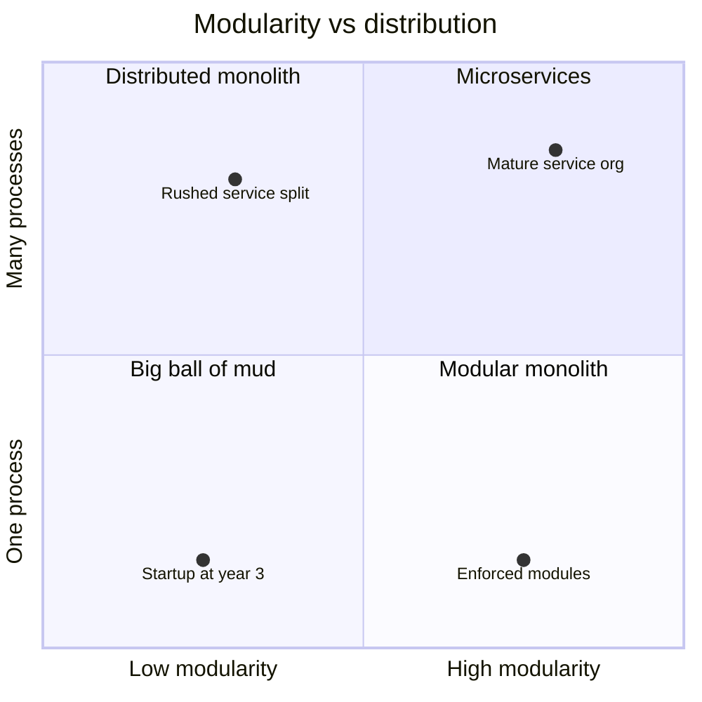
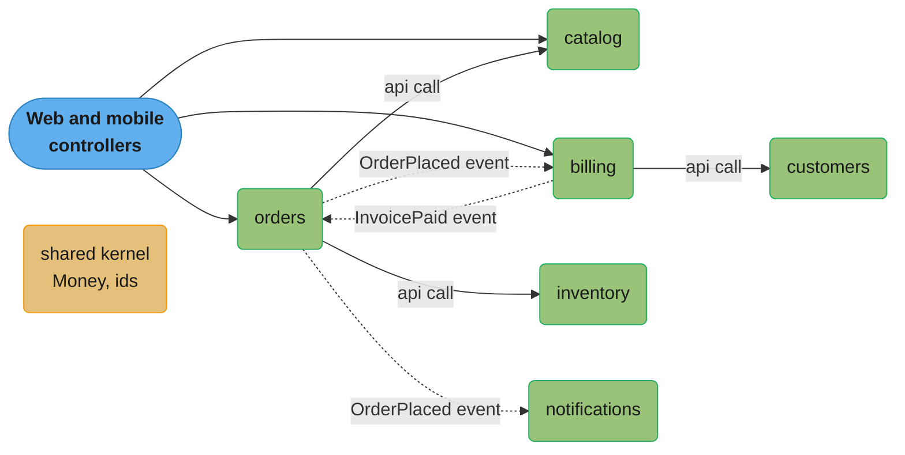
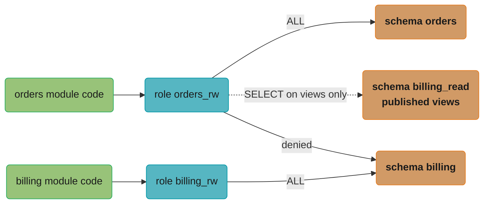
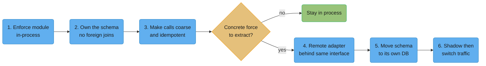

# Modular Monolith and Service Boundaries

---

## 1. Concept Overview

A **service boundary** is the line around a piece of business capability that decides three things at once: which code may change it, which data it alone may write, and which contract other code must go through to use it. A **deployment unit** is a separate decision: how many processes you ship that code in. Most architecture arguments mix the two. "Should this be a microservice?" is really two questions: "is this a real boundary?" and "does this boundary need its own process?" The first answer is often yes. The second is often no.

A **modular monolith** answers "yes, no". It is one deployable application whose code is split into modules with enforced boundaries: each module owns its tables, exposes a small public API, hides everything else, and depends on other modules only through that API, in an acyclic graph. It keeps the operational simplicity of one process (one build, one deploy, in-process calls, local transactions when you truly need them) and gains most of the design benefit people want from microservices (local reasoning, team ownership, replaceable parts).

This module owns the **boundary** half of the problem:

- How to find a boundary, and how to tell a real one from a technical layer.
- How to enforce it inside one codebase, so it survives the second year of commits.
- Who owns which data, and how other modules read it without reaching into tables.
- How to compose several modules or services into one client response (API composition, BFF).
- When a boundary should become a separate service, and the extraction steps that keep it reversible.

**Not here.** Microservice decomposition basics, database-per-service, the strangler fig and the outbox are in [Microservices Fundamentals](../microservices_fundamentals/microservices_fundamentals.md). Spring's mechanics for modules (`@ApplicationModule`, the event publication registry, `@ApplicationModuleTest`) are in [Spring Modulith](../../spring/spring_modulith/spring_modulith.md). Gateway and BFF responsibilities are in [API Gateway Patterns](../api_gateway_patterns/api_gateway_patterns.md). Sam Newman's argument, chapter by chapter, is summarised in [Building Microservices](../../book/building_microservices/building_microservices.md), especially [chapter 3, Splitting the Monolith](../../book/building_microservices/03_splitting_the_monolith/03_splitting_the_monolith.md) and [chapter 15, Organizational Structures](../../book/building_microservices/15_organizational_structures/15_organizational_structures.md). A full migration program is the [microservices migration case study](../case_studies/design_microservices_migration/design_microservices_migration.md).

---

## 2. Intuition

**One-line analogy:** a modular monolith is an office building with locked departments. Everyone shares the lift, the power and the address, but you cannot walk into Finance and open their filing cabinet; you hand a form to the Finance desk. Microservices are separate buildings across town. Separate buildings help only if the departments really need different hours, security or landlords. They do not fix a company whose departments keep walking into each other's offices; they make those walks take a taxi.

**Mental model:** draw two independent axes. The horizontal axis is **modularity** (how well the code respects boundaries). The vertical axis is **distribution** (how many deployable processes). A big ball of mud is low modularity, one process. A distributed monolith is low modularity, many processes: the worst corner, because it pays the network cost and still cannot change one part alone. A modular monolith is high modularity, one process. Microservices are high modularity, many processes. **You can only move up the distribution axis safely after you have moved right on the modularity axis.**

**Why it matters:** the expensive mistakes in backend architecture are boundary mistakes, not technology mistakes. A wrong boundary inside one process costs a refactor that the compiler and the test suite help with. The same wrong boundary between two services costs a versioned API change, a data migration across two databases, coordinated deploys and a month of dual-writes.

**Key insight:** the boundary is defined by **data ownership and the rate of change**, not by code layout. If two pieces of code always change in the same pull request and both write the same table, they are one module regardless of what the package names say.

---

## 3. Core Principles

**Boundary first, deployment second.**
Decide the module map and enforce it in one process. Extraction to a service is a later, separate, reversible decision driven by a concrete force (independent scaling, a different runtime, a regulatory isolation need, or a team that is blocked by the shared release train).

**One writer per table.**
Every table has exactly one owning module. Only that module's code issues `INSERT`, `UPDATE` or `DELETE` against it. Other modules read through the owner's API, or from a read model the owner publishes. This single rule is what makes later extraction possible; without it, a "service" extraction is really a database split under load.

**Small public API, large private interior.**
A module exposes a handful of interfaces and DTOs (data transfer objects) in an `api` package. Entities, repositories and helpers stay internal. The public surface is the contract; everything else may change in any commit.

**Acyclic dependencies.**
If `orders` depends on `billing` and `billing` depends on `orders`, neither can be understood, tested, released or extracted alone. Break cycles with events (the dependent side publishes, the other subscribes) or by moving the shared concept into the module that owns it.

**Enforced, not documented.**
A boundary that lives only in a wiki is gone in six months. Encode it as a failing build: a module system, separate build modules, or architecture tests that run in CI.

**Conway's Law cuts both ways.**
Melvin Conway's paper "How Do Committees Invent?" (Datamation, April 1968) states that an organization designs systems that copy its communication structure. So align module ownership with teams. A module that three teams edit every week has no owner; a team that owns slices of six modules has no focus.

**Cheap reversibility.**
Prefer the boundary decision you can undo. Merging two modules in one repo is a refactor. Merging two services is a project.

---

## 4. Types / Architectures / Strategies

### 4.1 The architecture spectrum

| Shape | Modularity | Deploy units | What it costs | Where it is right |
|---|---|---|---|---|
| Big ball of mud | none | 1 | every change touches unknown code; onboarding is slow | nowhere on purpose; it is what "no architecture" decays into |
| Layered monolith | by technical layer (controller, service, repository) | 1 | a feature change crosses every layer; layers do not stop domain coupling | small apps, under 10 engineers |
| **Modular monolith** | by business capability, enforced | 1 | discipline and tooling; one shared release train; one failure domain | most products from 10 to roughly 100 engineers |
| Macroservices / "a few services" | by capability, a handful of deploy units | 3-10 | per-service pipelines; some cross-service calls | a monolith plus 1-3 extracted modules with a concrete reason |
| Microservices | by capability, enforced by the network | tens to hundreds | per-service ops, distributed data, versioned APIs, tracing | many autonomous teams with independent release needs |
| Distributed monolith | low, hidden behind HTTP | many | every cost of microservices, none of the independence | nowhere; this is the failure mode |

The engineer counts are rules of thumb, not thresholds. The deciding input is how often teams block each other, not headcount.

### 4.2 Ways to enforce a boundary inside one codebase

| Mechanism | How it enforces | Strength | Cost |
|---|---|---|---|
| Package convention + code review | humans | weak; decays | free |
| Architecture tests (ArchUnit) | a unit test fails on a forbidden dependency | strong for what you write rules for | rules must be written and maintained |
| Build modules (Gradle or Maven multi-module) | the compiler cannot see an undeclared module | strong | more build files, slower IDE indexing |
| Java Platform Module System (`module-info.java`) | `exports` controls which packages are visible | strongest in the JVM, including reflection | friction with frameworks that use deep reflection |
| Spring Modulith | verifies package-based modules, generates docs, tests one module alone | strong, Spring-native | Spring-specific; see [Spring Modulith](../../spring/spring_modulith/spring_modulith.md) |
| Packwerk (Ruby) | static analysis of constant references between packages | strong for Rails | Ruby only |

Use two layers: build modules or JPMS for the coarse "cannot compile" barrier, and ArchUnit rules for the finer ones (no `internal` access, no cycles, no entity in a public API).

### 4.3 Data ownership models inside a monolith

| Model | Description | Isolation | Extraction cost later |
|---|---|---|---|
| Shared schema, convention | all modules use one schema; ownership is a comment | none | high: find every cross-module join first |
| Shared schema, owner tags + checks | table prefix per module, CI fails on cross-prefix SQL | medium | medium |
| **Schema per module, one database** | `billing.*`, `orders.*`; one DB role per module with grants only on its schema | strong; the database refuses the cross-access | low: the schema moves as a unit |
| Database per module | separate logical databases on one server | strongest | lowest; but no local cross-module transaction |

Schema per module is the sweet spot: one PostgreSQL instance, one backup, but the database itself rejects a query from `orders` code into `billing` tables.

### 4.4 Communication between modules

| Style | In a modular monolith | After extraction |
|---|---|---|
| Synchronous query | call the owner's API interface in-process (nanoseconds) | becomes an HTTP or gRPC call (hundreds of microseconds to milliseconds, can fail) |
| Command | call the owner's API; owner decides | becomes an RPC or a message |
| Domain event | in-process publish; listener in the other module, ideally after commit | becomes a broker message via an outbox |
| Read model | owner maintains a projection table another module may read | becomes a replicated store or a CDC-fed table |

Design every in-process call **as if it might become remote**: coarse-grained, idempotent where it changes state, no entity objects across the line, no lazy-loading proxies leaking out.

### 4.5 Composing data for a client

| Pattern | Where composition happens | Use when |
|---|---|---|
| Module facade | one module's API calls two others in-process | a single backend, a single client type |
| API composition | a composer calls several owners and joins in memory | read paths that span owners; low fan-out (2-5 calls) |
| BFF (backend for frontend) | a thin per-client backend shapes responses for one UI | mobile and web need different shapes and release cadences |
| CQRS read model | owners publish events; a view store is pre-joined | high-traffic screens that join many owners |
| GraphQL federation | a gateway plans queries across subgraphs | many teams, many clients, a schema-first culture |

The gateway and BFF mechanics are in [API Gateway Patterns](../api_gateway_patterns/api_gateway_patterns.md), and CQRS read models in [Event Sourcing and CQRS](../event_sourcing_and_cqrs/event_sourcing_and_cqrs.md). The boundary rule here is simpler: **composition code holds no business rules**. A BFF that decides discount eligibility has become a second, unowned billing module.

---

## 5. Architecture Diagrams

### 5.1 Two axes, four corners


*Moving straight up from the bottom-left lands in the distributed monolith. The safe path goes right first (enforce modules in one process), then up only for the modules that need it.*

### 5.2 A module map with an acyclic dependency graph


*Solid arrows are compile-time dependencies on another module's public API and must form a DAG. Dashed arrows are events, which invert the dependency: `billing` reacts to `OrderPlaced` without `orders` knowing `billing` exists, and `orders` reacts to `InvoicePaid` without a cycle. The shared kernel holds only value types, never services.*

### 5.3 Schema per module: the database enforces ownership


*Each module connects with its own role. A stray `JOIN billing.invoice` from orders code fails with `permission denied for schema billing` in the first test run, not in a production incident two years later. The owner publishes a stable read view if other modules need its data.*

### 5.4 The extraction path for one module


*Steps 1-3 are useful on their own and cost little; most modules should stop at "stay in process". Step 4 swaps the in-process implementation of the same Java interface for an HTTP or gRPC client, so callers do not change.*

### 5.5 The co-change matrix (visual intuition)

```
Commits in the last 6 months that touched BOTH folders (illustrative counts)

               orders  billing  catalog  inventory  customers  notif
orders           -       212       31        148        12        40
billing         212       -         4          2       171         9
catalog          31       4         -         96         0         2
inventory       148       2        96          -         0         1
customers        12     171         0          0         -        22
notif            40       9         2          1        22         -

Reading: orders<->billing (212) and billing<->customers (171) change together far more
often than any other pair. Either the boundary between them is in the wrong place, or one
concept (a "charge"?) is split across both. orders<->inventory (148) is the next suspect.
```
*Folders that change in the same commits are coupled no matter what the package diagram says. A high count across a planned service boundary predicts a distributed monolith. Section 6.6 shows how to compute this matrix from `git log`.*

---

## 6. How It Works — Detailed Mechanics

### 6.1 Module layout in Java

One module, one top-level package. Only the `api` package is visible to other modules.

```
com.acme.shop
├── orders
│   ├── api            <- public: OrderApi, OrderSummary, OrderPlaced (event record)
│   └── internal       <- private: Order entity, OrderRepository, pricing logic
├── billing
│   ├── api            <- public: BillingApi, InvoiceView, InvoicePaid
│   └── internal
├── catalog
│   ├── api
│   └── internal
└── shared             <- value types only: Money, CustomerId, OrderId
```

The public API exchanges immutable records and identifiers, never entities:

```java
package com.acme.shop.billing.api;

import com.acme.shop.shared.CustomerId;
import com.acme.shop.shared.Money;
import com.acme.shop.shared.OrderId;
import java.util.List;
import java.util.Optional;

public interface BillingApi {

    /** Idempotent: a second call with the same orderId returns the existing invoice. */
    InvoiceView openInvoice(OrderId orderId, CustomerId customerId, Money amount);

    Optional<InvoiceView> findByOrder(OrderId orderId);

    /** Batch read: one call for a page of orders, never one call per row. */
    List<InvoiceView> findByOrders(List<OrderId> orderIds);

    record InvoiceView(String invoiceId, OrderId orderId, Money amount, String status) {}
}
```

Three design choices make this interface survive a later extraction: it is **idempotent** on the business key (`orderId`), it offers a **batch** read so callers do not loop, and it returns **records**, not JPA entities with lazy collections that only work inside one persistence context.

### 6.2 Enforcing the boundary with architecture tests

ArchUnit rules run as ordinary JUnit tests, so a violation fails CI with the offending class and line:

```java
package com.acme.shop;

import com.tngtech.archunit.junit.AnalyzeClasses;
import com.tngtech.archunit.junit.ArchTest;
import com.tngtech.archunit.lang.ArchRule;

import static com.tngtech.archunit.lang.syntax.ArchRuleDefinition.noClasses;
import static com.tngtech.archunit.library.dependencies.SlicesRuleDefinition.slices;

@AnalyzeClasses(packages = "com.acme.shop")
class ModuleBoundaryTest {

    // 1. No code outside billing may reach into billing's internal package.
    //    Repeat for each module (or generate the rules from a list of module names).
    @ArchTest
    static final ArchRule billingInternalsArePrivate = noClasses()
            .that().resideOutsideOfPackage("com.acme.shop.billing..")
            .should().dependOnClassesThat().resideInAPackage("com.acme.shop.billing.internal..")
            .because("billing internals are not part of its contract");

    // 2. The module graph must stay acyclic.
    @ArchTest
    static final ArchRule noModuleCycles = slices()
            .matching("com.acme.shop.(*)..")
            .should().beFreeOfCycles();

    // 3. Public APIs must not leak persistence types.
    @ArchTest
    static final ArchRule apisHaveNoEntities = noClasses()
            .that().resideInAPackage("..api..")
            .should().dependOnClassesThat().areAnnotatedWith(jakarta.persistence.Entity.class);
}
```

Spring Modulith's verifier derives the same rules from the package structure if the application is on Spring. On a legacy codebase, wrap each rule in ArchUnit's `FreezingArchRule.freeze(rule)`: it records today's violations as a baseline and fails only on **new** ones, so the boundary stops getting worse on day one while the team pays down the existing debt.

For the coarse barrier, put each module in its own Gradle subproject and declare only API dependencies:

```kotlin
// orders/build.gradle.kts
dependencies {
    implementation(project(":billing-api"))   // interfaces and records only
    implementation(project(":catalog-api"))
    // no dependency on :billing (the implementation); the compiler cannot see it
}
```

The application project (`:app`) is the only one that depends on every implementation, to wire them together.

### 6.3 Data ownership in PostgreSQL

```sql
-- One schema and one role per module.
CREATE SCHEMA orders;
CREATE SCHEMA billing;
CREATE SCHEMA billing_read;      -- published, stable views for other modules

CREATE ROLE orders_rw  LOGIN PASSWORD 'from-vault';
CREATE ROLE billing_rw LOGIN PASSWORD 'from-vault';

GRANT USAGE, CREATE ON SCHEMA orders  TO orders_rw;
GRANT USAGE, CREATE ON SCHEMA billing TO billing_rw;

-- billing publishes a narrow read contract instead of exposing its tables.
CREATE VIEW billing_read.invoice_status AS
    SELECT order_id, status, paid_at
    FROM billing.invoice;
GRANT USAGE ON SCHEMA billing_read TO orders_rw;
GRANT SELECT ON billing_read.invoice_status TO orders_rw;

-- orders_rw has no USAGE on schema billing, so this fails:
--   SELECT * FROM billing.invoice;
--   ERROR: permission denied for schema billing
```

Each module gets its own connection pool configured with its own role. With HikariCP that is one `DataSource` bean per module; the pool sizes add up, so a monolith with 6 modules and 10 connections each holds 60 connections per instance, and 20 instances hold 1,200. Size them with the formula in [Connection Pooling](../connection_pooling_deep_dive/connection_pooling_deep_dive.md), and use a shared pooler such as PgBouncer when the total approaches the server's `max_connections`.

The published view is a **contract**: version it like an API (`invoice_status_v2` next to `invoice_status`), and drop the old one only after no reader remains. Migrations for it follow the expand-contract rules in [Database Migrations](../database_migrations/database_migrations.md).

### 6.4 Replacing a cross-module join

The most common boundary violation is a report or screen that joins two modules' tables. There are three replacements, in order of preference:

| Replacement | How | Cost | Pick when |
|---|---|---|---|
| Batch API call + in-memory join | load 50 orders, call `billing.findByOrders(ids)` once, join in a map | one extra call per page | list screens, pages of 20-200 rows |
| Owner-published read view | owner exposes a view or table with the fields others need | owner maintains a contract | many readers, simple shape |
| Read model fed by events | the consumer keeps its own projection updated from `InvoicePaid` | eventual consistency (typically sub-second in-process) | high-traffic screens, complex filters across owners |

```java
// Composition in the orders module, using billing's batch API.
public List<OrderRow> orderPage(CustomerId customer, int limit) {
    List<Order> orders = orderRepository.findRecentByCustomer(customer, limit);      // 1 query
    Map<OrderId, BillingApi.InvoiceView> invoices = billingApi
            .findByOrders(orders.stream().map(Order::id).toList())                   // 1 call
            .stream()
            .collect(Collectors.toMap(BillingApi.InvoiceView::orderId, v -> v));
    return orders.stream()
            .map(o -> new OrderRow(o.id(), o.total(),
                    Optional.ofNullable(invoices.get(o.id()))
                            .map(BillingApi.InvoiceView::status).orElse("NOT_INVOICED")))
            .toList();
}
```

Two queries instead of one `JOIN`. The cost is real but small, and it is the exact cost this screen will pay if `billing` is ever extracted, so there are no surprises later.

### 6.5 Events between modules

In-process events break dependency cycles and keep side effects out of the main transaction:

- **Publish after commit.** A listener that runs inside the publisher's transaction couples both modules' failure: a bug in `notifications` rolls back an order. Run listeners after commit (Spring: `@TransactionalEventListener(phase = AFTER_COMMIT)` or Modulith's `@ApplicationModuleListener`).
- **Persist the publication.** An after-commit listener in memory is lost if the process dies between commit and dispatch. Record the event in the same transaction as the state change (an outbox table, or Spring Modulith's event publication registry) and redeliver on restart.
- **Make listeners idempotent.** Redelivery means at-least-once. Key the side effect on the event id.

These are the same rules as cross-service messaging, which is the point: a module whose events are already outbox-backed and idempotent becomes a service by swapping the in-process dispatcher for a broker. The outbox itself is covered in [Messaging Patterns](../messaging_patterns/messaging_patterns.md).

### 6.6 Finding boundaries from evidence: change coupling

Package diagrams show intended structure. Version control shows actual coupling. Count how often two top-level folders change in the same commit:

```bash
#!/usr/bin/env bash
# co_change.sh: pairs of modules that changed together in the last 6 months.
# Usage: ./co_change.sh src/main/java/com/acme/shop
root="$1"
git log --since="6 months ago" --name-only --pretty=format:'--%H' -- "$root" |
awk -v root="$root/" '
  function flush(   a, b) {
      for (a in mods) for (b in mods) if (a < b) pairs[a " <-> " b]++
      delete mods
  }
  /^--/ { flush(); next }
  index($0, root) == 1 {
      rest = substr($0, length(root) + 1)
      split(rest, parts, "/")
      mods[parts[1]] = 1
  }
  END { flush(); for (p in pairs) if (pairs[p] >= 20) print pairs[p], p }
' | sort -rn | head -20
```

How to read the output (section 5.5 shows the same signal as a matrix):

- A pair above about 10% of either module's commit count is a coupling signal. Look at a sample of those commits.
- If the shared commits touch the same concept in both folders, the concept is split across a boundary: move it to one owner.
- If they touch an API and its single caller, the API is too fine-grained: make it coarser.
- Do not extract a module whose top co-change partner is above roughly 30%: you would turn every one of those commits into a two-service, two-deploy change.

The 10% and 30% cut-offs are working heuristics, not published standards. Tools such as CodeScene compute the same signal ("change coupling") with history weighting; the shell version is enough to start.

### 6.7 The cost of a boundary crossing

| Call type | Typical latency | Failure modes | Transaction |
|---|---|---|---|
| In-process method call | nanoseconds | exceptions only | can share the caller's transaction |
| Same-host IPC | tens of microseconds | process down | separate |
| Same-zone RPC | roughly 0.2-1 ms per hop plus serialization | timeout, partial failure, retries, version skew | separate; needs saga or outbox |
| Cross-region RPC | tens of milliseconds | all of the above, plus partition | separate |

The figures are order-of-magnitude guides; measure your own network. The arithmetic that matters: a page that makes 8 sequential module calls costs microseconds in-process and roughly 2-8 ms as same-zone RPCs, before any server work, and its availability becomes the product of 8 dependencies' availability. At 99.9% each, 8 serial hops give 0.999^8, about 99.2%. Budgeting across hops is covered in [Latency Budgets and SLO Math](../latency_budgets_and_slo_math/latency_budgets_and_slo_math.md).

### 6.8 Extraction, step by step

When a concrete force appears, extract one module at a time:

1. **Confirm the force.** Write it down as a number: "search needs 32 GB of heap per node and the monolith runs on 4 GB pods", "payments must be in a PCI-scoped network segment", "the data team wants to ship 15 times a day and the monolith ships twice".
2. **Confirm the module is already clean.** Zero ArchUnit violations, own schema, no cross-module joins, idempotent commands, outbox-backed events. If not, finish that work in-process first; it is cheaper there.
3. **Introduce the remote adapter behind the same interface.** `BillingApi` gets a second implementation, `HttpBillingApi`, with timeouts, retries on idempotent calls, and a circuit breaker (see [Fault Tolerance Patterns](../fault_tolerance_patterns/fault_tolerance_patterns.md)). A feature flag chooses the implementation.
4. **Deploy the new service reading the same schema.** Still one database; the service holds the schema's only write role.
5. **Shadow, then switch.** Send a copy of traffic to the remote path and compare results; then route 1%, 10%, 100% through it. The flag is the rollback.
6. **Move the data.** Copy the schema to its own database with logical replication or CDC, cut writes over, then remove the old grants.
7. **Delete the in-process implementation** once the remote path has run a full business cycle (a month-end, a peak).

Each step is reversible until step 6, and step 6 is easy because ownership was already exclusive. Contract tests between the remaining monolith and the new service (see [Backend Testing Strategies](../backend_testing_strategies/backend_testing_strategies.md)) replace the compiler as the guard on the interface.

### 6.9 BFF and API composition rules

A BFF earns its keep when two clients need materially different shapes or release cadences (a mobile app that waits days for store review and a web app deployed 20 times a day). Keep it thin:

- **No business rules.** Formatting, field selection, pagination shape and aggregation of owner responses only. The test: if the rule would still apply to a third client, it belongs in a module.
- **Parallel fan-out with a deadline.** Call owners concurrently, give each a budget that sums under the client deadline, and degrade per field (show "price unavailable" rather than fail the page).
- **Owned by the client team.** The mobile team owns the mobile BFF; that is the reason it exists. A central team that owns every BFF recreates the mega-gateway.
- **Inside a modular monolith, a BFF can be a module.** It is a package of controllers that depends on other modules' APIs and owns no tables. Extract it to its own process only if its scaling or release cadence differs.

---

## 7. Real-World Examples

**Shopify: componentization of a Rails monolith.** Kirsten Westeinde's post "Deconstructing the Monolith" (Shopify Engineering, 21 February 2019) describes one of the largest Rails codebases, worked on by more than a thousand developers. Shopify judged that microservices would bring separate pipelines, network latency and harder cross-service refactors, and chose a modular monolith instead. The team listed around 6,000 Ruby classes in a spreadsheet, labelled each with a component, and moved the files in one large pull request. They then built an internal tool, Wedge, that hooked Ruby tracepoints during CI to build a call graph and score each component on boundary violations. The post reports a concrete payoff: isolating dependencies made it possible to replace a legacy tax engine with a new tax calculation system. Shopify later open-sourced Packwerk, a static checker for package boundaries in Ruby.

**Segment: 140 services back to one.** Alexandra Noonan's "Goodbye Microservices" (Segment blog, 10 July 2018) describes a pipeline that forwarded events to over 100 destination types. To stop one slow destination from blocking the others, Segment had created a service and queue per destination. Over time this grew to over 140 services with shared libraries that drifted to different versions per service, and three full-time engineers spent most of their time keeping the system alive. Segment consolidated the destinations into one service in one repo with a single version of each of 120 unique dependencies. The post reports 32 improvements to the shared libraries in 2016 under microservices and 46 in the following year, and lists the trade-off openly: fault isolation became harder because a bug in one destination could crash the service for all.

**Amazon Prime Video: a monitoring service moved to one process.** A Prime Video Tech post of 22 March 2023 describes an audio and video defect-monitoring service built from distributed components orchestrated by AWS Step Functions, with frames passed between components through Amazon S3. The design hit a hard scaling limit at around 5% of the expected load, and the orchestration and S3 transfer costs were too high. The team moved the components into a single process deployed on Amazon EC2 and Amazon ECS and reported that infrastructure cost fell by over 90%. The lesson is narrow and useful: this was one service whose internal steps exchanged large data at high volume, which is exactly where an in-process boundary beats a network one.

**Martin Fowler, "Monolith First" (3 June 2015).** Fowler reports that almost all successful microservice stories he heard started with a monolith that got too big and was broken up, and that almost all systems built as microservices from scratch ended up in serious trouble. His second reason is the one this module is built on: services only work with good, stable boundaries, and those are hard to get right at the start.

---

## 8. Tradeoffs

### 8.1 Modular monolith vs microservices

| Dimension | Modular monolith | Microservices |
|---|---|---|
| Deploy | one pipeline, one artifact | one pipeline per service |
| Cross-module call | in-process, nanoseconds, cannot partially fail | network, milliseconds, can time out |
| Transactions | local ACID available (use sparingly across modules) | sagas, outbox, compensations |
| Refactoring a boundary | IDE refactor plus tests | versioned API change, data migration |
| Independent scaling | no; scale the whole process | yes, per service |
| Fault isolation | weak; one memory leak or bad deploy affects all modules | stronger, if timeouts and bulkheads exist |
| Technology choice | one runtime | per service |
| Release independence | shared train; one team's red build blocks all | per team |
| Operational load | one service to observe | tracing, service discovery, per-service on-call |
| Enforcement of boundaries | tooling you must add | the network enforces them (badly, if the boundary is wrong) |

### 8.2 Boundary enforcement mechanisms

| Mechanism | Catches | Misses | Adoption cost |
|---|---|---|---|
| ArchUnit | forbidden imports, cycles, layering | runtime reflection, SQL across schemas | low |
| Gradle or Maven modules | any undeclared compile dependency | anything inside one module | medium |
| JPMS | compile and reflective access to non-exported packages | SQL across schemas | medium to high |
| Schema-per-module grants | cross-module SQL | in-code coupling | low |
| Spring Modulith | package-based module rules, event wiring, docs | non-Spring code | low in Spring apps |

### 8.3 Composition patterns

| Pattern | Latency | Consistency | Ownership risk |
|---|---|---|---|
| Batch API + in-memory join | 1 extra call per owner | fresh | low |
| Owner-published view | 1 query | fresh | owner must version the view |
| Event-fed read model | 1 query | eventual | consumer owns a copy; schema drift |
| BFF | fan-out in parallel | fresh | logic creep into the BFF |
| GraphQL federation | query planner overhead | fresh | needs schema governance |

---

## 9. When to Use / When NOT to Use

**Use a modular monolith when:**
- The product has a handful to roughly 15 teams that ship on a shared cadence without blocking each other badly.
- Domain boundaries are still moving (a young product, a pivot, a new market).
- The workload scales roughly uniformly; no module needs 10x the hardware of the others.
- You have a big ball of mud and want to improve it without a rewrite.
- Operational maturity for distributed systems (tracing, on-call per service, contract testing) is not there yet.

**Extract a service from it when (at least one, with a number attached):**
- One module's resource profile differs sharply (GPU, 32 GB heap, bursty batch).
- One module needs a different failure domain or security zone (PCI, tenant isolation, a third-party code sandbox).
- A team is measurably blocked by the shared release train (lead time, queue for the deploy slot).
- One module must use a different runtime or language.

**Do not use a modular monolith when:**
- Teams are already autonomous services with clean data ownership and independent release needs. Merging them back is churn.
- Strict fault isolation between tenants or features is a hard requirement and one process cannot provide it (see [Multi-Tenancy and Isolation](../multi_tenancy_and_isolation/multi_tenancy_and_isolation.md)).

**Do not split into services when:**
- The co-change matrix shows the planned services change together in more than about 30% of commits.
- The "service" would read or write another service's tables.
- The motivation is a résumé, a conference talk, or "it is the modern way".

---

## 10. Common Pitfalls

### 10.1 The entity that crossed the boundary

```java
// BROKEN: orders holds a JPA association into billing's entity.
@Entity
@Table(schema = "orders", name = "orders")
class Order {
    @Id UUID id;

    @OneToOne(fetch = FetchType.LAZY)
    @JoinColumn(name = "invoice_id")
    com.acme.shop.billing.internal.Invoice invoice;   // billing's private entity
}
// Every change to Invoice's mapping can break orders. A lazy load outside the
// transaction throws LazyInitializationException in the orders controller.
// Extraction is impossible: the ORM joins across what should be a network.
```

```java
// FIX: hold the identifier; ask the owner through its API.
@Entity
@Table(schema = "orders", name = "orders")
class Order {
    @Id UUID id;
    @Column(name = "invoice_id") String invoiceId;    // a value, not a relationship
}
// Reads go through BillingApi.findByOrders(...). ArchUnit rule 1 in section 6.2
// and the schema grants in section 6.3 make the BROKEN version fail in CI.
```

### 10.2 The "common" module that became the real monolith

A team creates `common` for "shared code". Within a year it holds `CustomerService`, `PricingUtils` and half the domain logic, every module depends on it, and every change to it redeploys and retests everything. **Fix:** allow only a small shared kernel of value types (`Money`, identifiers, time abstractions). Anything with behaviour or state goes to the module that owns the concept. Track the shared kernel's size; if it grows past a few hundred lines of logic, something moved in that should not have.

### 10.3 Extracting a service but keeping the shared database

The team moves `billing` code into its own service but leaves both it and the monolith writing `billing.invoice`. Now schema changes need both deploys, locking and isolation bugs span two codebases, and nobody can say who owns a row. **Fix:** ownership before extraction (section 6.8, step 2). If a shared database is unavoidable for a transition, give exactly one deployable the write role and a deadline to remove the other's access.

### 10.4 The distributed monolith from synchronous chains

A checkout request calls `orders`, which calls `pricing`, which calls `catalog`, which calls `inventory`, all synchronously over HTTP. Each hop has a 99.9% availability target, so the chain is at best about 99.6%, and a slow `inventory` makes every upstream thread pool fill. **Fix:** collapse chatty hops back into one module, use events for things that do not need an answer now, and give every remaining hop a deadline and a fallback.

### 10.5 Boundaries drawn by technical layer

Splitting into `api-service`, `logic-service` and `data-service` puts every feature change across three deploys. **Fix:** split by business capability, so one feature usually changes one module. Layering inside a module (hexagonal, clean) is still fine; see [Architecture Patterns](../../lld/architecture_patterns/architecture_patterns.md).

### 10.6 The BFF that grew a billing department

A mobile BFF starts computing discounts "because the mobile team needed it fast". The web client computes them differently in its own BFF. Customers see different prices on two devices. **Fix:** the composition-has-no-rules test (section 6.9). Move the rule into the owning module; both BFFs call it.

### 10.7 Boundary enforcement added, then muted

ArchUnit is introduced, fails with 1,400 violations, and someone adds `@Disabled`. **Fix:** `FreezingArchRule` baselines the existing violations and blocks only new ones; publish the remaining count per module each sprint so it trends to zero.

---

## 11. Technologies & Tools

| Tool | Purpose |
|---|---|
| ArchUnit | Java library that checks package and class dependencies as unit tests; supports slices, cycle checks and frozen baselines |
| Spring Modulith | Spring Boot support for package-based modules: verification, module-scoped tests, event publication registry, generated docs |
| Java Platform Module System | `module-info.java` with `exports` and `requires`; compiler and runtime enforce package visibility |
| Gradle | multi-project builds; `implementation` dependencies keep internals off consumers' compile classpath |
| Maven | multi-module builds with explicit module dependencies |
| jMolecules | annotations and types that express DDD and architecture concepts in code, with ArchUnit integration |
| Packwerk | Shopify's static checker for package boundaries in Ruby on Rails applications |
| CodeScene | behavioural code analysis, including change coupling between files and folders from version-control history |
| Structurizr | C4-model diagrams as code, useful for keeping the module map in the repository |
| PostgreSQL | schema-per-module ownership with roles and grants |
| PgBouncer | connection pooler for when per-module pools multiply connection counts |

---

## 12. Interview Questions with Answers

**Q: What is a distributed monolith and why is it worse than a plain monolith?**
**Short:** Services that cannot change or deploy independently; you pay network latency, partial failure and versioning costs and get no autonomy back.

A distributed monolith is a set of separately deployed services that still share data, call each other synchronously in long chains, or must be released together. It keeps every cost of distribution (network latency, partial failure, versioned contracts, distributed tracing, sagas instead of transactions) while losing the main benefit (changing one part alone). A plain monolith at least has in-process calls and local transactions. The usual cause is splitting on technical layers or on guessed boundaries before measuring coupling. The practical test: if most features need coordinated deploys of two or more services, you have one.

**Q: What makes a module boundary real rather than a folder name?**
**Short:** Exclusive data ownership, a small public API, an acyclic dependency graph, and enforcement that fails the build on violations.

A real boundary has four properties: one module is the only writer of its tables; other modules use only its published API; dependencies between modules form a directed acyclic graph; and a tool (build modules, JPMS, ArchUnit, Spring Modulith, schema grants) fails CI when someone crosses it. Folders with none of these are naming, not architecture. Of the four, data ownership matters most, because it is the property that is hardest to add later and the one extraction depends on.

**Q: When should a module in a modular monolith become a separate service?**
**Short:** When a measurable force needs a separate process: different scaling or hardware, a separate failure or security domain, a different runtime, or a team blocked by the release train.

Extraction is justified by a force you can state as a number, such as a 32 GB memory footprint in an otherwise 4 GB service, a PCI scope you want to shrink, a GPU dependency, or a team whose lead time is dominated by waiting for the shared deploy. "Cleaner design" is not one of those forces; a modular monolith already gives clean design. Before extracting, the module should already have zero boundary violations, its own schema and idempotent commands, so that the extraction is a transport change rather than a redesign.

**Q: How does Conway's Law affect where you draw service boundaries?**
**Short:** Systems copy their organization's communication structure, so boundaries that cut across team lines produce constant cross-team coordination.

Conway's 1968 observation is that a design organization produces a system whose structure mirrors its communication structure. In practice, a module edited weekly by three teams has no clear owner and accumulates conflicting changes, while a team spread across six modules cannot focus. Align each module with one owning team, and when you want a different architecture, consider changing the team structure first (often called the inverse Conway manoeuvre). The limit: re-organizing is expensive and slow, so use the existing team map as a strong input, not as the only input.

**Q: Two modules keep appearing in the same pull requests. What does that tell you and what do you do?**
**Short:** They are coupled whatever the package diagram says; either a concept is split across them or the API between them is too fine-grained.

High change coupling is evidence, measured from version control, that the boundary is in the wrong place. Sample the shared commits. If both sides change the same business concept, move that concept to one owner. If one side is always an API and the other its only caller, make the API coarser or merge the modules. Never extract either module into a service while the coupling stays high, because every one of those commits would become a two-service change with coordinated deploys.

**Q: How do you replace a SQL join across two modules' tables?**
**Short:** Use a batch API call and an in-memory join, an owner-published read view, or an event-fed read model in the consumer.

For list screens, load a page from your own tables, then call the owner once with all the identifiers and join in a map: two round trips instead of one, and the same cost the screen will pay after any extraction. For many readers with a simple shape, the owner publishes a stable, versioned view. For high-traffic screens or filters across owners, the consumer maintains its own projection from the owner's events and accepts eventual consistency. All three keep exactly one writer per table.

**Q: Why should module APIs return records or DTOs instead of entities?**
**Short:** Entities expose internal mapping and lazy-loading behaviour, so callers couple to persistence details and the API cannot become remote.

A JPA entity carries its mapping, its lazy proxies and its persistence-context lifecycle. A caller that receives one can navigate into the owner's internals, trigger lazy loads outside the transaction (`LazyInitializationException`), and break whenever the owner changes a column. A record is a plain snapshot that is serializable as is, so the same interface can later be served over HTTP or gRPC without touching callers. An ArchUnit rule that forbids `@Entity` types in `api` packages enforces this.

**Q: What is the cheapest way to start enforcing boundaries in a large legacy codebase?**
**Short:** Add architecture tests with a frozen baseline so existing violations are recorded and only new ones fail the build.

Turning on strict rules against a big ball of mud produces thousands of failures and gets the rule disabled within a week. ArchUnit's `FreezingArchRule` stores the current violations and fails only on new ones, so the boundary stops eroding on day one. Pair it with a per-module violation count published each sprint and paid down deliberately. Add schema-per-module grants next, because cross-module SQL is the coupling that most blocks later extraction.

**Q: How do you break a dependency cycle between two modules?**
**Short:** Invert one direction with an event, or move the shared concept into the module that truly owns it.

If `orders` calls `billing` to open an invoice and `billing` calls `orders` to mark the order paid, the two cannot be built, tested or released apart. Keep the direct call in the direction where the caller needs an answer now (`orders` to `billing`), and replace the other with an event: `billing` publishes `InvoicePaid` and `orders` listens. Events invert compile-time dependencies, because the publisher does not know who listens. If both sides really manipulate one concept, the cycle is a sign the concept is split; move it.

**Q: What does a BFF own, and what must it never own?**
**Short:** A BFF owns client-specific shaping and aggregation; it must never own business rules or data.

A backend for frontend exists because one client needs a different response shape or release cadence from another, for example a mobile app on store review cycles. It selects fields, aggregates owner responses in parallel, and adapts pagination and errors for its client. It must not decide prices, eligibility or state transitions; once it does, two BFFs drift into two different implementations of one business rule. The test is whether the rule would still apply to a third client: if yes, it belongs in the owning module.

**Q: Why is "one writer per table" the most important rule for future extraction?**
**Short:** Exclusive write ownership lets the schema move as a unit; shared writers force a live database split and coordinated deploys.

If only `billing` writes `billing.*`, extracting billing means moving a schema and changing who connects to it. If three modules write `billing.invoice`, you must first discover every writer, redesign their flows around an API or events, and then perform a data split under live traffic. Enforce the rule early with one database role per module and grants only on its schema, so the database rejects a stray `UPDATE` in testing.

**Q: Can modules in a modular monolith share a database transaction?**
**Short:** They can, but treat it as a deliberate exception, because a cross-module transaction is a seam you cannot extract without a saga.

One process and one database make it possible to commit changes in two modules atomically, and occasionally that is the right call, for example during an early phase when the boundary is still moving. Every such transaction, however, is a hidden contract: extracting either module turns it into a saga with compensation. Prefer a single-module transaction plus an outbox-backed event to the other module, and list the remaining cross-module transactions as known debt.

**Q: How do in-process module events differ from broker messages, and how do you make them extraction-ready?**
**Short:** They skip the network, but they need the same after-commit dispatch, durable publication and idempotent listeners to survive a crash.

An in-process event dispatched synchronously inside the publisher's transaction couples both modules' failures and can roll back the publisher. An event held only in memory after commit is lost if the process dies before dispatch. Make them extraction-ready by recording the event in the same transaction (an outbox table or Spring Modulith's event publication registry), dispatching after commit, retrying on restart, and making listeners idempotent on the event id. A module built that way becomes a service by swapping the dispatcher for a broker.

**Q: What latency and availability do you lose when an in-process call becomes a network call?**
**Short:** A nanosecond call becomes a sub-millisecond to millisecond hop that can time out, and serial hops multiply their availability.

An in-process call costs nanoseconds and fails only with exceptions. A same-zone RPC costs roughly 0.2 to 1 millisecond plus serialization and can time out, partially succeed or hit a version mismatch. Eight serial hops therefore add several milliseconds before any work, and eight dependencies at 99.9% each give about 99.2% for the chain. That arithmetic is why chatty boundaries should stay in one process, and why every remaining remote hop needs a deadline, a retry policy for idempotent calls and a fallback.

**Q: What is the shared kernel, and how do you stop it becoming a second monolith?**
**Short:** A small set of value types every module may use; keep it free of services, state and business logic.

DDD's shared kernel is the deliberately shared part of a model, such as `Money`, identifiers and time abstractions. It turns into a hidden monolith when people put services, utilities with domain rules or entities in it, because every module then depends on it and every change to it is a change to everything. Allow only immutable value types with no outbound dependencies, review every addition, and track its size over time.

**Q: How would you migrate a big ball of mud to a modular monolith without a rewrite?**
**Short:** Map classes to target modules, move files mechanically, freeze current violations, then remove them module by module, starting with data ownership.

Shopify's 2019 componentization followed this order: label every class with a component (around 6,000 classes in a spreadsheet), move the files in one mechanical change backed by tests, then measure boundary violations with tooling and drive them down. In a JVM codebase, the equivalent is a package move, an ArchUnit frozen baseline, schema-per-module grants, and a sprint-by-sprint violation budget per team. The first visible win is usually being able to replace one module's implementation, as Shopify did with its tax engine.

**Q: Segment moved from more than 140 microservices back to one service. What did it gain and what did it give up?**
**Short:** It gained velocity and simpler operations from one repo and one dependency set, and gave up per-destination fault isolation.

Segment's 2018 post describes per-destination services whose shared libraries drifted across versions, with three engineers mostly keeping the system alive. Consolidating into one service with one version of each of 120 dependencies let one engineer deploy in minutes and raised shared-library improvements from 32 in 2016 to 46 the next year. The post also names the cost: a bug in one destination could now crash the service for every destination. The general lesson is that per-unit isolation is worth its operational price only when the units really change and fail independently.

**Q: How do you decide the size of a module?**
**Short:** Size it so one team owns it, most features change only it, and its public API stays small compared with its internals.

Good modules match a business capability that one team can own, change mostly within themselves (low change coupling to neighbours), and expose a small API relative to their internal code. Too small, and every feature crosses several modules and the APIs become chatty. Too large, and the module has several owners and its interior becomes a ball of mud again. Re-check sizes against the co-change matrix every few months, because good boundaries drift as the product changes.

---

## 13. Best Practices

- Write the module map down as code: package structure, Gradle subprojects, and an ArchUnit test class that fails on violations.
- Give each module its own schema and database role from day one; it costs nothing early and is expensive to add later.
- Design every module API as if it were remote: coarse-grained, idempotent commands keyed on business ids, batch reads, records instead of entities.
- Use events for reactions and direct API calls only where the caller needs an answer now; keep the call graph acyclic.
- Persist module events in the same transaction as the state change and make listeners idempotent.
- Measure change coupling from version control before drawing any service boundary, and re-measure every quarter.
- Keep the shared kernel to value types; review every addition.
- Keep composition layers (BFFs, aggregators) free of business rules; assign them to the client team that needs them.
- Extract a service only for a written, numeric reason, one module at a time, behind the same interface and a feature flag.
- Baseline existing violations with a frozen rule rather than disabling enforcement.
- Keep scheduled and batch work inside its owning module too; a nightly job that reads five modules' tables is a boundary violation on a timer (see [Batch Processing and Scheduling](../batch_processing_and_scheduling/batch_processing_and_scheduling.md)).

---

## 14. Case Study

### A 90-engineer SaaS monolith that was about to become 25 microservices

**Context (illustrative).** A B2B scheduling product: one Spring Boot application, 1.1 million lines of Java, 90 engineers in 11 teams, one PostgreSQL primary with 2 replicas, 30 application pods. Lead time from merge to production was 3 days because every team waited for one shared release train, and a typical sprint had 4-6 incidents traced to "a change in another team's area". Leadership had approved a plan to split into 25 microservices over 18 months.

**What the evidence showed.** Before starting, the platform team ran the co-change script (section 6.6) over 6 months of history and a query log analysis over one week:

| Finding | Number |
|---|---|
| Planned service pairs with co-change above 30% | 9 of the 25 planned services involved |
| Distinct tables written by more than one planned service | 61 of 340 |
| Cross-planned-service `JOIN`s in production SQL | 1,870 distinct statements |
| Synchronous call chains longer than 4 hops if split as planned | 14 user-facing endpoints |

Splitting as planned would have produced a distributed monolith on day one.

**The broken starting point.** The scheduling code held a JPA relationship into billing's entity and re-implemented a billing rule:

```java
// BROKEN: scheduling reaches into billing's private model and its table.
@Entity
class Booking {
    @Id UUID id;
    @ManyToOne(fetch = FetchType.LAZY)
    com.acme.billing.Subscription subscription;     // billing's entity

    boolean canBook() {
        // A billing rule implemented in scheduling; billing has its own copy.
        return subscription.getStatus().equals("ACTIVE")
                && subscription.getSeatsUsed() < subscription.getSeatLimit();
    }
}
```

```java
// FIX: scheduling asks billing a question through billing's API.
@Entity
class Booking {
    @Id UUID id;
    @Column(name = "account_id") UUID accountId;     // an identifier, not a relationship
}

public interface EntitlementApi {                    // in billing.api
    record Entitlement(UUID accountId, boolean canBook, int seatsRemaining) {}
    Entitlement entitlementFor(UUID accountId);       // one owner of the seat rule
}
```

**What they did instead (12 months).**

1. **Modules, not services.** The 25 planned services were merged into 9 modules wherever co-change exceeded 30%. Each module got a package, a Gradle API subproject and an owning team.
2. **Enforcement with a frozen baseline.** ArchUnit rules from section 6.2 started with 4,212 recorded violations. Each team got a monthly target. After 9 months the count was 380.
3. **Schema per module.** Tables moved into 9 schemas with one role each. The 61 multi-writer tables were resolved by assigning one owner and replacing the other writers with API calls or events; this took the longest (5 months).
4. **Report rewrite.** A five-way nightly join became an event-fed reporting read model owned by the analytics team.
5. **One real extraction.** The search module needed 32 GB of heap for its index against 4 GB for everything else. It was extracted behind its existing `SearchApi` interface with an HTTP adapter, shadowed for two weeks and switched with a flag.

**Results after 12 months (illustrative).**

| Metric | Before | After |
|---|---|---|
| Deployable units | 1 | 2 (monolith + search) |
| Merge-to-production lead time | 3 days | 4 hours (trunk-based, module-scoped test suites) |
| CI time for a one-module change | 48 min full suite | 11 min module tests + 6 min contract tests |
| Incidents from "another team's change" per sprint | 4-6 | 0-1 |
| Pod memory | 30 pods x 36 GB | 30 pods x 6 GB + 6 search pods x 40 GB |
| Planned migration avoided | 25 services over 18 months | 1 extraction in 3 months |

**What the team would tell the next one.** The architectural win came from the boundaries, not from the processes. Nine enforced modules in one deployable fixed the coordination problem that 25 services were supposed to fix; the one extraction was chosen because a number (32 GB vs 4 GB) demanded it. The modules are now extraction-ready, and the team has not needed to extract another.
