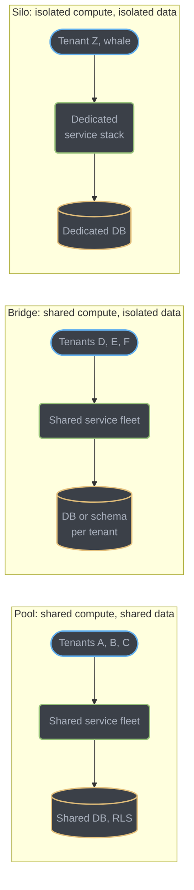
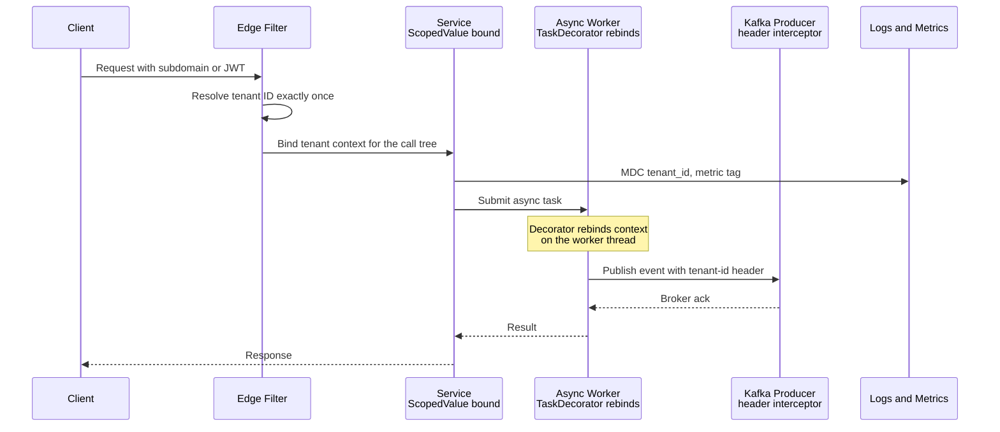
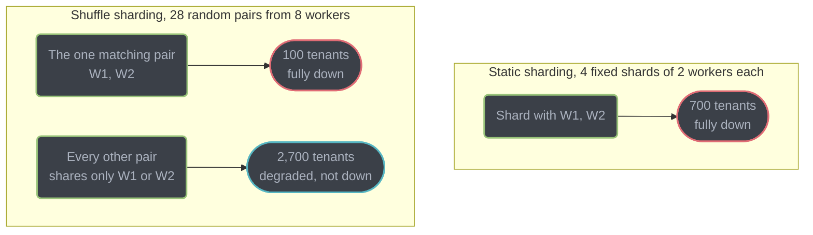
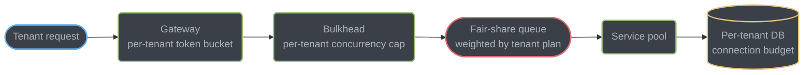

# Multi-Tenancy and Isolation

Multi-tenancy is the decision to let more than one customer share one running system. This
module covers the **application and service tier** of that decision: how a request's tenant
identity is resolved once and carried correctly through threads, async boundaries, and
message queues; how one tenant's traffic is stopped from degrading every other tenant's
experience; how per-tenant cost and health are observed without melting the metrics backend;
and how a tenant is onboarded, upgraded, and deleted without leaking its data into another
tenant's response. The **data tier** — schema-per-tenant vs. shared-schema, row-level
security, per-tenant backup and migration — is a separate, already-covered decision; see the
scope note in §1.

---

## 1. Concept Overview

Multi-tenancy is one system instance serving multiple customers ("tenants"), each of whom
must be unaware the others exist. The engineering problem splits cleanly into two tiers, and
conflating them is the single most common design-review mistake:

- **Data tier** — where does tenant B's row live relative to tenant A's row, and what
  mechanism stops a query from crossing that boundary? Fully owned by
  [Design a Multi-Tenant SaaS Database](../../database/case_studies/design_multitenant_saas_database/design_multitenant_saas_database.md),
  which builds a three-tier (shared schema + RLS / schema-per-tenant / database-per-tenant)
  PostgreSQL platform end to end, including connection pooling math, zero-downtime migration,
  GDPR erasure per tier, and backup/restore per tier. **This module does not re-derive any of
  that** — the one-table summary below exists only so the app-tier decisions in §4 have
  something concrete to sit next to.
- **Application / service tier** — how does the *code path* know which tenant it is serving,
  how is that fact carried correctly across every thread hop and network call in the request,
  and how is one tenant's load stopped from starving another's. **This is what this module
  owns**, and almost nothing else in the repo covers it directly — scattered mentions exist
  in [`serving_ai_workloads`](../serving_ai_workloads/serving_ai_workloads.md) (per-tenant
  token budgets), [`rate_limiting_in_depth`](../rate_limiting_in_depth/rate_limiting_in_depth.md)
  (Slack's per-workspace tiers), and
  [`auth_and_authorization_systems`](../auth_and_authorization_systems/auth_and_authorization_systems.md)
  (deriving `tenantId` from a JWT), but none of them treat tenant context propagation,
  noisy-neighbor containment, or tenant lifecycle as the subject.

| | Data tier (owned elsewhere) | Application tier (owned here) |
|---|---|---|
| Question | Where does the row physically live? | Which tenant does this request/thread/message belong to? |
| Mechanism | RLS policy, schema boundary, dedicated instance | Context propagation, quotas, bulkheads |
| Failure mode | A query returns another tenant's row | A stale/forged tenant ID serves the wrong data, or one tenant's spike degrades everyone |
| Owning doc | `design_multitenant_saas_database` case study | This module |

---

## 2. Intuition

> **One-line analogy**: a multi-tenant service is a shared taxi dispatch system, not a fleet
> of private cars. Every rider (tenant) gets picked up by whichever car is free — the car
> doesn't belong to them — but the dispatcher must never mix up two riders' destinations, and
> one rider booking twenty cars at once cannot be allowed to leave everyone else standing on
> the curb.

**Mental model**: isolation is not one switch, it is two independent dials — how much
*compute* a tenant shares, and how much *data* a tenant shares — and every real platform sets
both dials differently for different tenants, not once for the whole system.

**Why it matters**: the two failure modes are asymmetric in cost. Under-isolating is a
security incident (tenant A sees tenant B's data) discovered by a support ticket, not a
dashboard. Over-isolating is a bill (paying for N dedicated stacks when three would do)
discovered by finance, not an alert. The engineering job is putting each tenant on the
cheapest dial setting that still makes the first failure mode structurally impossible for it.

**Key insight**: tenant identity must be resolved exactly **once**, as close to the edge as
possible, from a source the client cannot forge — and then threaded through every subsequent
hop as an opaque, already-validated value. Re-deriving it anywhere downstream (a second header
read, a second JWT parse against a different claim) is not redundancy, it is a second place
the resolution logic can disagree with the first and silently split which tenant a request is
actually served as.

---

## 3. Core Principles

- **Resolve once, propagate everywhere.** Tenant ID is computed at the edge (gateway or the
  first filter inside the service) from a trusted source, then carried as an immutable value
  through every thread, async task, outbound call, log line, and metric — never re-derived.
- **Never trust a client-supplied tenant ID.** A header, query parameter, or request body
  field named `tenantId` is an attacker's input, not a fact — the only trustworthy sources are
  ones the client cannot alter after authentication: a validated JWT claim, the resolved
  subdomain, or the client certificate's SAN.
- **Isolation is a spectrum with a price tag, applied per tenant, not per system.** The right
  answer is almost never "everyone gets the same isolation" — it is a tiered model where most
  tenants share infrastructure and a minority pay for (or require) a dedicated slice.
  Cross-references the identical principle already established for the data tier in
  [`design_multitenant_saas_database`](../../database/case_studies/design_multitenant_saas_database/design_multitenant_saas_database.md)
  §5.
  A production platform moves individual tenants across tiers as they grow, without a rewrite
  (§4.3).
- **Bound blast radius combinatorially, not just by fixed partitioning.** A static shard
  reduces blast radius linearly (1/N shards); randomized shuffle sharding reduces it
  combinatorially for the same hardware (§6.7) — the cheapest lever in this module.
- **A global limit does not protect any individual tenant.** Every quota, rate limit, and
  concurrency cap that matters for noisy-neighbor containment must be keyed by tenant, not by
  the system as a whole (§6.8, cross-link
  [`rate_limiting_in_depth`](../rate_limiting_in_depth/rate_limiting_in_depth.md)).
- **Isolation failures are silent by default.** A cross-tenant leak returns HTTP 200 with the
  wrong body; a cardinality bomb degrades a dashboard nobody is staring at until it pages. Both
  need an explicit test or alert to surface at all (§10, §12).

---

## 4. Types / Architectures / Strategies

### 4.1 The pool / bridge / silo model, as an application decision

The data tier's shared-schema / schema-per-tenant / database-per-tenant spectrum has a direct
application-tier analogue, and the two do not have to move together — a tenant can sit on a
dedicated database while still sharing the application fleet, or vice versa.

| Model | Compute | Data | What breaks tenant A when tenant B has a bad day | Marginal cost/tenant |
|-------|---------|------|-----------------------------------------------------|------------------------|
| **Pool** | Shared service fleet | Shared (RLS) | B's traffic spike, a slow deploy, a bad release — everyone rides the same fleet | Lowest — amortized across every tenant on the fleet |
| **Bridge** | Shared service fleet | Isolated (schema/DB per tenant) | B's traffic spike and bad deploys still reach A; B's data incidents do not | Data isolation cost only — see the case study's §5 cost table |
| **Silo** | Dedicated service stack | Isolated | Nothing — separate deploy pipeline, separate autoscaling group, separate on-call page | Highest — a full stack (compute, network egress, on-call load) per tenant |

The compute axis is what this module adds to the data-tier picture: a **pooled deploy** means
one bad release, one memory leak, one thread-pool exhaustion event is shared by every tenant
on that fleet regardless of how isolated their data is. A tenant paying for schema-per-tenant
isolation (bridge) still goes down when a pooled service crashes from an unrelated tenant's
malformed payload — data isolation buys nothing against a compute-tier incident.

**Where pooling stops making sense.** Pooled compute is the right default until one of three
things happens: (1) a single tenant's traffic is large enough that its normal variance alone
threatens the SLO of every other pooled tenant (roughly: one tenant approaching 10-20% of
fleet capacity), (2) a compliance requirement mandates network- or process-level isolation
that a shared fleet cannot provide (HIPAA, FedRAMP, a contractual "no shared infrastructure"
clause), or (3) the tenant's own release cadence needs to diverge from everyone else's (a
canary-averse enterprise customer who wants deploys gated behind their own change window).
Any one of the three is sufficient on its own to justify silo; none of the three individually
justifies moving *every* tenant there.

### 4.2 The hybrid is the default, not an edge case

Almost no real platform picks one point on the spectrum for its whole customer base. The
normal shape is **pooled by default, with a silo tier sold or provisioned for the tenants who
need it** — Salesforce's core multi-org platform stays pooled at extreme scale while its
"Hyperforce" dedicated-region offering exists for regulated customers; Shopify's Pods keep the
vast majority of shops on shared pods while its Plus tier gets dedicated infrastructure
provisions; this module's own §14 case study is exactly this pattern in miniature. The
practical reason a hybrid wins over "isolate everyone" or "pool everyone": the tenant
population in almost every B2B SaaS follows a power law — a handful of accounts generate the
majority of both revenue and load, and only that handful's economics justify a dedicated
stack (§7's Salesforce/Shopify numbers make this concrete).

### 4.3 Migrating one tenant from pool to silo, without a rewrite

The interview question is never "design a multi-tenant system" in the abstract — it is "your
biggest customer just signed a contract requiring dedicated infrastructure; how do you move
them without downtime or a rewrite." The move only stays cheap if the tenant-context
propagation from §6 was done correctly from day one:

1. **Provision the dedicated stack** — a new deployment (or namespace) of the exact same
   service image, pointed at a dedicated database (already covered by the data-tier
   migration in the case study's §4.11) or, for the compute-only case, a dedicated read
   replica and connection pool.
2. **Add a routing rule** at the tenant-resolution layer (§6.1) that maps this one tenant ID
   to the new stack's endpoint — nothing downstream of tenant resolution needs to know a
   routing decision happened, because every service already treats tenant ID as an opaque,
   already-resolved value, never re-derived.
3. **Dual-run and shift traffic** — canary a percentage of the tenant's own traffic to the
   new stack (never mixed with other tenants' traffic, since it is already dedicated),
   watching the tenant's own SLO dashboard (§6.9).
4. **Cut over fully**, then decommission the old routing rule. The tenant's `tenantId` never
   changes, so every downstream system (cache keys, log queries, audit trails) keeps working
   without a migration of its own.

The cost of this move is proportional to how many places re-derived tenant identity or
hard-coded a shared connection pool instead of reading it from context — which is exactly why
§6's propagation discipline is the centerpiece of this module, not a side detail.

---

## 5. Architecture Diagrams



*Compute and data isolation are independent axes — a tenant can be pooled on compute while
isolated on data (bridge), which is where most "we bought the enterprise plan" tenants
actually sit.*



*Tenant identity is resolved once at the filter and re-bound, never re-derived, at every
thread and process boundary downstream — the async worker and the Kafka producer both receive
a value that was already validated at the edge.*



*Same 8-worker fleet, same double-worker failure. Static sharding puts 25% of tenants (one
whole fixed shard) fully down; shuffle sharding's 28 possible pairs put only the 1-in-28
tenants who share the exact failed pair fully down — the arithmetic is in §6.7.*



*Four independent enforcement points on one request path — a limiter that only exists at the
gateway does nothing to stop a burst that is already inside the service pool and queueing
behind a fair-share scheduler that has no visibility into the gateway's own decision.*

---

## 6. How It Works — Detailed Mechanics

### 6.1 Resolving tenant identity at the edge

Four common trusted sources, in order of how common they are in practice:

| Source | Mechanism | Caveat |
|--------|-----------|--------|
| Subdomain | `acme.saasapp.com` → `tenantId = "acme"` | Requires a lookup from subdomain to internal ID (never trust the string itself as the ID — a rename must not break foreign keys) |
| JWT claim | `tenantId` embedded in a signed, validated access token | The claim must be set by the auth server at token-issue time from its own tenant record, never copied from a client-supplied value at login |
| Request header from a trusted gateway | An internal service mesh sets `X-Tenant-Id` after its own resolution | Safe **only** inside the trust boundary — the public-facing edge must strip any client-supplied value with this name before it reaches the mesh |
| mTLS client certificate SAN | The certificate's Subject Alternative Name encodes the tenant | Strongest option for service-to-service or partner-integration traffic; the CA issuing tenant certs must be the only source of truth |

```java
// BROKEN: trusts whatever the client sends
@GetMapping("/api/orders")
public List<Order> orders(@RequestHeader("X-Tenant-Id") String tenantId) {
    return orderService.findAll(tenantId);   // any caller can pass any tenant's ID
}
```

Nothing here is a bug in the usual sense — it compiles, it works for the honest caller, and it
passes every functional test written from the honest caller's point of view. The defect is
that `X-Tenant-Id` is attacker-controlled: a caller authenticated as tenant A's user simply
sets the header to tenant B's ID and reads tenant B's orders. The fix removes the header
entirely as a trust source and derives the value from the token the gateway already validated:

```java
// FIXED: tenant ID comes from the validated JWT, never a request parameter
@GetMapping("/api/orders")
public List<Order> orders(@AuthenticationPrincipal Jwt jwt) {
    String tenantId = jwt.getClaimAsString("tenantId");   // set by the auth server, not the client
    return orderService.findAll(tenantId);
}
```

See
[`auth_and_authorization_systems`](../auth_and_authorization_systems/auth_and_authorization_systems.md)
§12 for the full JWT-claim-based tenant isolation pattern and its Q&A — this module does not
repeat the token-validation mechanics, only the propagation that follows resolution.

### 6.2 The centerpiece bug: a `ThreadLocal` tenant context that does not survive a thread-pool hop

This is the single most dangerous mistake available in this module, for the same reason the
database case study calls out its `SET` vs. `SET LOCAL` bug as the most dangerous one on the
data side: it fails silently, and the failure is a cross-tenant data leak, not a crash.

**BROKEN:**

```java
public final class TenantContext {
    private static final ThreadLocal<String> CURRENT = new ThreadLocal<>();
    public static void set(String id) { CURRENT.set(id); }
    public static String get() { return CURRENT.get(); }
    public static void clear() { CURRENT.remove(); }
}

@RestController
class ReportController {

    private final ThreadPoolTaskExecutor reportExecutor;   // a fixed, reused worker pool

    @GetMapping("/reports/summary")
    public CompletableFuture<Report> summary() {
        // Resolved correctly on the request thread by the edge filter (§6.1) — this part is fine.
        String tenantId = TenantContext.get();

        // The lambda below runs on a DIFFERENT, pooled thread. TenantContext.set() was never
        // called on that thread, so TenantContext.get() inside it does not return null and
        // fail loudly — it returns whatever the LAST task that ran on that specific reused
        // worker thread happened to leave behind.
        return CompletableFuture.supplyAsync(() -> reportService.buildSummary(), reportExecutor);
    }
}

@Service
class ReportService {
    Report buildSummary() {
        String tenantId = TenantContext.get();     // reads the WORKER thread's stale value
        return reportRepo.findAllByTenant(tenantId);
    }
}
```

Walk the failure precisely: tenant A's request sets `TenantContext` on the *request* thread,
then hands work to `reportExecutor`. `reportExecutor` is a small, reused pool — say 8 threads
serving every tenant's async report requests. Some earlier task, serving tenant X, called
`TenantContext.set("tenant-x")` on worker thread #3 and then either threw before reaching a
`finally { TenantContext.clear(); }`, or the code simply never called `clear()` at all because
nobody remembered a pooled thread needs it. The next report request — tenant A's — happens to
land on worker thread #3. `TenantContext.get()` inside `buildSummary()` returns `"tenant-x"`,
not tenant A's ID. `reportRepo.findAllByTenant("tenant-x")` runs, succeeds, and returns tenant
X's report data in a response tenant A's browser renders. No exception, no log line, no
monitoring signal — a cross-tenant leak that looks, from every system's point of view, like a
completely normal successful request.

**FIXED — `ScopedValue` (JDK 25, finalized under JEP 506) rebound by a `TaskDecorator`:**

```java
public final class TenantContext {
    public static final ScopedValue<String> TENANT_ID = ScopedValue.newInstance();
    private TenantContext() {}
}

// Edge filter: resolves once, binds for the entire downstream call tree.
public class TenantResolvingFilter extends OncePerRequestFilter {
    @Override
    protected void doFilterInternal(HttpServletRequest req, HttpServletResponse res,
                                     FilterChain chain) throws ServletException, IOException {
        String tenantId = resolveTenantId(req);   // §6.1 — subdomain, JWT claim, or SAN
        try {
            ScopedValue.where(TenantContext.TENANT_ID, tenantId).call(() -> {
                chain.doFilter(req, res);
                return null;
            });
        } catch (Exception e) {
            if (e.getCause() instanceof ServletException se) throw se;
            if (e.getCause() instanceof IOException ie) throw ie;
            throw new ServletException(e);
        }
    }
}

// TaskDecorator: captures the binding on the SUBMITTING thread, re-establishes it on the
// WORKER thread before the task body runs.
public class TenantAwareTaskDecorator implements TaskDecorator {
    @Override
    public Runnable decorate(Runnable task) {
        String tenantId = TenantContext.TENANT_ID.orElse(null);
        return () -> {
            if (tenantId == null) {
                task.run();
            } else {
                ScopedValue.where(TenantContext.TENANT_ID, tenantId).run(task);
            }
        };
    }
}

@Bean
ThreadPoolTaskExecutor reportExecutor() {
    ThreadPoolTaskExecutor exec = new ThreadPoolTaskExecutor();
    exec.setTaskDecorator(new TenantAwareTaskDecorator());
    exec.setCorePoolSize(8);
    exec.initialize();
    return exec;
}
```

`ReportService.buildSummary()` now reads `TenantContext.TENANT_ID.get()` and gets tenant A's
ID, correctly, every time. The structural fix is not "remember to call `clear()`" — it is that
`ScopedValue` has no `clear()` to forget: the binding exists only for the dynamic extent of the
`run()`/`call()` block and is torn down automatically, including on an exception, when that
block returns. There is no code path that leaves a stale value on a reused thread, because
there is nowhere for a stale value to persist between bindings. The same decorator pattern
applies unchanged if `spring.threads.virtual.enabled=true` switches `reportExecutor` to a
virtual-thread-per-task executor — Spring still routes every submitted `Runnable` through the
configured `TaskDecorator` regardless of what kind of thread ultimately runs it.

### 6.3 Propagating tenant context into a Kafka message

A tenant-scoped event that loses its tenant ID crossing into an async, decoupled consumer is
the same class of bug in a different transport — carry it as a message header, never as a
field the consumer has to remember to read correctly:

```java
public class TenantHeaderProducerInterceptor implements ProducerInterceptor<String, Object> {

    @Override
    public ProducerRecord<String, Object> onSend(ProducerRecord<String, Object> record) {
        String tenantId = TenantContext.TENANT_ID.orElse(null);
        if (tenantId == null) {
            // Fail loudly here — a tenant-less event silently published is worse than one
            // rejected at the producer, because nothing downstream can recover the ID later.
            throw new IllegalStateException("Publishing without a bound tenant context: " + record.topic());
        }
        record.headers().add("tenant-id", tenantId.getBytes(StandardCharsets.UTF_8));
        return record;
    }

    @Override public void onAcknowledgement(RecordMetadata m, Exception e) {}
    @Override public void close() {}
    @Override public void configure(Map<String, ?> configs) {}
}

// Consumer side: rebind context for the whole handler call tree, exactly like the
// TaskDecorator does for a thread-pool hop — nothing downstream needs its own tenant plumbing.
@KafkaListener(topics = "order-events")
public void onOrderEvent(ConsumerRecord<String, OrderEvent> record) {
    Header header = record.headers().lastHeader("tenant-id");
    if (header == null) {
        throw new IllegalStateException("order-events record missing tenant-id header, offset="
            + record.offset());
    }
    String tenantId = new String(header.value(), StandardCharsets.UTF_8);
    ScopedValue.where(TenantContext.TENANT_ID, tenantId).run(() -> orderEventHandler.handle(record.value()));
}
```

### 6.4 Into logs and metrics

```java
ScopedValue.where(TenantContext.TENANT_ID, tenantId).run(() -> {
    MDC.put("tenant_id", tenantId);
    try {
        chain.doFilter(req, res);
    } finally {
        MDC.remove("tenant_id");   // MDC is a plain ThreadLocal under the hood — this one DOES need clearing
    }
});
```

`MDC` (SLF4J's Mapped Diagnostic Context) is itself backed by a `ThreadLocal`, not a
`ScopedValue` — logging frameworks have not moved to the new primitive — so it is the one place
in this pipeline that still needs an explicit, guaranteed `remove()`. Placing it inside a
`try/finally` nested directly under the `ScopedValue.where(...).run()` block ties its lifetime
to the same dynamic scope, which is the closest a `ThreadLocal` can get to the leak-proof
behavior `ScopedValue` gives everywhere else. Metric tagging is covered separately in §6.5,
because a raw `tenantId` is safe in a *log line* (unbounded cardinality is fine for logs) and
dangerous in a *metric label* (unbounded cardinality is not).

### 6.5 Metric cardinality control

```java
@Component
public class TenantMetricTagger {

    private final MeterRegistry registry;
    private final TopTenantTracker topTenants;   // top-N by request volume, refreshed every 5 min

    public void recordRequest(String tenantId, String method, int statusClass, long durationMs) {
        String tag = topTenants.isTopN(tenantId) ? tenantId : "other";
        registry.timer("app.request.duration",
                "tenant", tag, "method", method, "status_class", String.valueOf(statusClass))
            .record(Duration.ofMillis(durationMs));
        // Full-cardinality attribution for anyone outside the top N lives in traces
        // (Micrometer Tracing exemplars), sampled, never in the metric label itself.
    }
}
```

The arithmetic behind why this matters is in §6.6.

### 6.6 The cardinality bomb, computed

Take one histogram metric — request duration — with three ordinary dimensions and Micrometer's
default histogram buckets:

```
http_method (5 values) x status_class (5 values) x endpoint (30 values) x histogram buckets (11)
  = 5 x 5 x 30 x 11 = 8,250 time series
```

That is a perfectly ordinary series count for one metric. Now add a raw, unbucketed `tenant_id`
tag across 5,000 tenants:

```
8,250 x 5,000 tenants = 41,250,000 time series — from ONE histogram metric
```

A single metric now dwarfs the total series budget most Prometheus/VictoriaMetrics/Mimir
deployments plan for across their *entire* fleet. The mitigation from §6.5 — tag only the top
50 tenants by traffic by name and bucket everyone else as `"other"` — changes the multiplier
from 5,000 to 51:

```
8,250 x 51 = 420,750 time series — a 98.98% reduction, same metric, same buckets
```

The long tail does not disappear from observability, it moves to a system built for high
cardinality: a trace exemplar attached to each histogram bucket, or a log-based query, both of
which handle a `tenant_id = "acme-corp-42"` filter without pre-declaring it as a label.

### 6.7 Shuffle sharding, computed

Take an 8-worker fleet and assign each tenant a shard of **2** workers, chosen (pseudo-)randomly
per tenant rather than by a fixed partition formula. The number of distinct 2-worker shards
available is a combination, not a permutation — order within the pair does not matter:

```
C(8, 2) = 8! / (2! x 6!) = 28 distinct shards
```

Now compare two failure scenarios on the identical 8-worker fleet, with 2,800 tenants spread
evenly:

**Static sharding** — 4 fixed shards of 2 workers, 700 tenants per shard. If a poison-pill
request from one tenant takes down both workers in its shard, all 700 tenants on that shard are
fully down: **25% of tenants, fully down.**

**Shuffle sharding** — 28 possible pairs, 2,800 / 28 = 100 tenants per exact pair. If the same
poison-pill request takes down the same two workers, only the tenants whose shard is *exactly*
that pair go fully down: **100 tenants, or 1/28 ≈ 3.57%, fully down.** Every other tenant whose
shard includes exactly one of those two workers — the other 27 pairs each share a worker with
the bad pair — loses half their capacity (one working worker remains) but stays up in
degraded mode, because losing one of two assigned workers is not the same as losing both.

Same hardware, same failure, a **7x reduction** in the fully-down population — the entire gain
comes from randomizing the worker assignment rather than fixing it, at zero additional
infrastructure cost. AWS's Route 53 Infima library and API Gateway both use this technique
under this name; the general form scales the reduction with the binomial coefficient — a
larger `M` (fleet size) or smaller `K` (shard size) drives the blast radius down further, at
the cost of less redundancy per tenant if `K` gets too small.

### 6.8 Per-tenant rate limiting and bulkheads

Cross-links, not restatements: token bucket, sliding window, and the Redis Lua
check-and-increment pattern are covered in full in
[`rate_limiting_in_depth`](../rate_limiting_in_depth/rate_limiting_in_depth.md); semaphore vs.
thread-pool bulkhead tradeoffs are covered in
[`fault_tolerance_patterns`](../fault_tolerance_patterns/fault_tolerance_patterns.md). What
changes at the tenant boundary is only the **key**:

```java
@Component
public class TenantRateLimiter {

    private final ProxyManager<String> proxyManager;   // Bucket4j's Redis-backed proxy manager

    public boolean tryConsume(String tenantId, TenantPlan plan) {
        Supplier<BucketConfiguration> config = () -> BucketConfiguration.builder()
            .addLimit(Bandwidth.builder()
                .capacity(plan.burstCapacity())
                .refillGreedy(plan.sustainedRequestsPerSecond(), Duration.ofSeconds(1))
                .build())
            .build();
        Bucket bucket = proxyManager.builder().build("tenant-quota:" + tenantId, config);
        return bucket.tryConsume(1);
    }
}

@Component
public class TenantBulkheads {

    private final Map<String, Bulkhead> byTenant = new ConcurrentHashMap<>();

    public Bulkhead forTenant(String tenantId, TenantPlan plan) {
        return byTenant.computeIfAbsent(tenantId, id -> Bulkhead.of("tenant-" + id,
            BulkheadConfig.custom().maxConcurrentCalls(plan.maxConcurrentRequests()).build()));
    }
}
```

A **global** limiter or a **single, shared** bulkhead does not solve noisy-neighbor at all: it
caps total system load, but a tenant sending 90% of a shared limiter's traffic still consumes
90% of the headroom every other tenant needed, because the limiter has no concept of "whose"
request it is throttling. Keying the same primitives by `tenantId` is the entire fix — no new
algorithm, only a different partition of the counter. §6.9 covers the queueing-discipline half
of the same problem: a per-tenant cap stops one tenant from *exceeding* its share, but a plain
FIFO queue behind that cap can still let one tenant's burst delay another tenant's single
request that arrived after it (see `serving_ai_workloads` §4.3 for the queueing-order half of
this, cross-referenced rather than repeated here).

### 6.9 Admission control and fair queueing under a tenant spike

A per-tenant rate limiter rejects or delays *new* requests once a tenant's budget is spent —
that alone does not stop requests already admitted from queueing behind each other unfairly. A
**weighted fair-share queue**, keyed by tenant, interleaves dequeue order across tenants rather
than serving strictly in arrival order, so a burst of 500 requests from tenant A does not push
a single request from tenant B behind all 500 of them:

```java
public class WeightedFairTenantQueue {

    private final Map<String, Deque<Runnable>> perTenant = new ConcurrentHashMap<>();
    private final Map<String, Integer> weights;   // e.g. free=1, paid=4, enterprise=8
    private final Iterator<String> roundRobin;    // weighted round-robin cursor over tenant IDs

    public void submit(String tenantId, Runnable task) {
        perTenant.computeIfAbsent(tenantId, id -> new ConcurrentLinkedDeque<>()).add(task);
    }

    // Called by worker threads: picks the next tenant by weighted round-robin, dequeues
    // ONE task from that tenant's own queue, and returns to the back of the rotation — so
    // a tenant with weight 8 gets roughly 8x the dequeue turns of weight-1, but never
    // monopolizes every turn.
    public Optional<Runnable> nextTask() { /* weighted round-robin over perTenant.keySet() */ return Optional.empty(); }
}
```

Admission control is the layer above both: when the *fleet*, not any single tenant, is near
saturation, shed load from the lowest-priority tenants first (free tier before paid, paid
before enterprise) rather than degrading every tenant's latency equally — the same
priority-shedding idea `serving_ai_workloads` applies to token budgets, generalized to any
resource.

### 6.10 A repository-layer guard, and a test that proves it

Defense-in-depth against the missing-`WHERE`-clause class of bug (§10) has three independent
layers: RLS in the database (owned by the case study's §4.2), a repository-layer guard that
refuses to build a query without a tenant predicate, and a test that asserts the *absence* of
that predicate fails:

```java
public interface TenantScopedRepository<T> {
    // Every finder method requires tenantId as an explicit parameter — there is no
    // findAll() overload without one, so a missing filter is a compile error, not a runtime one.
    List<T> findAllByTenant(String tenantId);
}

// Hibernate multi-tenancy SPI: resolves the tenant discriminator from the SAME bound
// context every other layer uses, so a JPQL query without an explicit tenantId still
// gets filtered by Hibernate's own multi-tenant session handling.
public class ScopedValueTenantIdentifierResolver implements CurrentTenantIdentifierResolver<String> {
    @Override
    public String resolveCurrentTenantIdentifier() {
        return TenantContext.TENANT_ID.orElse("unresolved");
    }
    @Override
    public boolean validateExistingCurrentSessions() { return true; }
}
```

```java
// The test: assert that a query built WITHOUT going through the tenant-scoped repository
// interface cannot compile or, for a dynamic query builder, throws at build time.
@Test
void queryBuilder_refusesToBuildWithoutTenantPredicate() {
    assertThatThrownBy(() -> queryBuilder.select(Order.class).build())
        .isInstanceOf(IllegalStateException.class)
        .hasMessageContaining("tenant predicate is required");
}
```

For the row-level-security half of this stack — `FORCE ROW LEVEL SECURITY`, the `SET LOCAL`
vs. plain `SET` correctness trap under PgBouncer transaction pooling, and why the leading
column of every index on a shared table must be the tenant ID — see the case study's §4.2–§4.4,
which owns that mechanic in full.

---

## 7. Real-World Examples

**Salesforce** enforces per-tenant compute governance directly in its execution engine, not
just its schema: an Apex transaction gets 10,000ms of CPU time synchronously (60,000ms
asynchronously) and a cap of 100 SOQL queries per synchronous transaction (200 async),
enforced per org, per transaction. This is the application-tier analogue of the case study's
data-tier statement-timeout rows — the same "one tenant cannot consume more than its share"
principle, enforced one layer up the stack, at the language runtime rather than the database
role.

**Shopify** pairs its Pods data-isolation architecture (case study §6) with an
application-tier admission-control mechanism called the **checkout throttle**: under
exceptional load on a shard, writes from specific merchants are queued rather than processed
immediately, so one merchant's flash-sale traffic spike cannot degrade checkout latency for
every other merchant sharing that pod's stateless application tier. Shared resources —
job workers, app servers, load balancers — only ever talk to one pod at a time, so there is no
cross-pod compute contention to begin with; the throttle handles contention *within* a pod.

**Slack** enforces its published API rate limits per method, per workspace, per app — not per
user account — so a busy workspace cannot starve a different workspace calling the same app.
Full detail (tier structure, `Retry-After` behavior, the Redis Lua atomic counter pattern) is
already covered in
[`rate_limiting_in_depth`](../rate_limiting_in_depth/rate_limiting_in_depth.md) §7 and not
repeated here — it is the clearest published example of keying a limiter on the tenant
boundary that actually needs protecting.

**Atlassian** resolves a tenant context — the cloud ID — exactly once per request and threads
it through every downstream service call for Jira and Confluence Cloud, the same
resolve-once-propagate-everywhere discipline §3 and §6 build in Java terms; see the case
study's §6 for the citation and its migration-scale framing (moving from single-tenant,
per-customer instances to shared multi-tenant infrastructure as one of the largest
re-architectures in the company's history).

---

## 8. Tradeoffs

### Pool vs. bridge vs. silo, application tier

| Model | Deploy blast radius | On-call load | Cost driver | Fits |
|-------|----------------------|---------------|-------------|------|
| Pool | Every tenant on the fleet, every deploy | One rotation for everyone | Amortized across all tenants | The bulk of a tenant base |
| Bridge | Same as pool (compute still shared) | Same as pool | Data isolation cost only | Tenants that need data isolation but not compute isolation |
| Silo | That tenant only | A dedicated (or shared, tenant-tagged) rotation | Full stack per tenant | The handful of tenants whose contract, compliance, or scale requires it |

### Queueing discipline under tenant load

| Discipline | Isolation | Complexity | Wastes capacity when a tenant is idle? |
|------------|-----------|------------|-------------------------------------------|
| Plain FIFO, single queue | None — a burst from one tenant delays every other tenant's requests behind it | Lowest | No, but isolation is zero |
| Per-tenant hard concurrency cap | Strong — a tenant literally cannot exceed its slice | Medium | Yes — an idle tenant's unused capacity sits unused rather than being lent out |
| Weighted fair-share queue, single pool | Strong — proportional, not absolute | Highest — needs per-tenant accounting and a scheduler pass | No — idle tenants' unused turns go to whoever else has work |

### Global limiter vs. per-tenant limiter

| | Global limiter | Per-tenant limiter |
|---|---|---|
| Stops total system overload | Yes | Only incidentally |
| Stops one tenant starving another | **No** — the limiter has no concept of whose request it is throttling | Yes — that is the entire point of keying it |
| Operational cost | One counter | One counter per tenant, or a sharded counter keyed by tenant |

---

## 9. When to Use / When NOT to Use

**Use pool (shared compute, shared or bridged data)**: for the majority of a SaaS tenant base —
free tier, self-serve, SMB. Marginal cost per tenant must stay low because per-tenant revenue
is low; the case study's own numbers make this concrete (7,000 SMB tenants at ~$0.01-0.05/mo
marginal database cost).

**Use bridge (shared compute, isolated data)**: when a tenant needs a real data-isolation
guarantee or schema customization but does not generate enough load, or pay enough, to justify
a dedicated compute stack — mid-market tenants who need `ALTER TABLE`-level customization
(case study §5) without enterprise-tier infrastructure spend.

**Use silo (isolated compute and data)**: when at least one of three triggers fires — (1)
compliance mandates isolation a shared fleet structurally cannot provide, (2) a single tenant's
load is large enough that its normal traffic variance threatens every co-tenant's SLO, or (3)
per-tenant revenue clears the fully-loaded cost of a dedicated stack with margin to spare. The
case study's enterprise tier (500 tenants, 95% of the platform's database spend) is exactly
this calculus playing out at the data-tier level; the same arithmetic governs the compute-tier
decision independently.

**Do NOT silo a tenant just because it is "important."** Importance without one of the three
triggers above is a sales narrative, not an engineering requirement — a mid-size but
enthusiastic customer does not need a dedicated Kubernetes namespace; it needs the bridge
tier's data isolation and, if anything, a higher-weight fair-share queue slot (§6.9).

**Do NOT build shuffle sharding before a static shard or a shared pool has actually shown a
blast-radius problem.** The combinatorial win in §6.7 is real, but it adds an indirection layer
(random assignment, a lookup table mapping tenant → shard) that a small fleet gains nothing
from — the technique pays for itself once a single shard's failure would take out a customer-
visible chunk of the tenant base, not before.

---

## 10. Common Pitfalls

**`ThreadLocal` tenant context leaking across a reused worker thread.** Symptom: a support
ticket, not an alert — "I can see another company's data" — surfacing minutes to hours after
the leak begins, because nothing about the query looks wrong to any system involved. Root
cause: exactly the pattern walked through in §6.2 — a pooled executor reuses a thread whose
last task never cleared its `ThreadLocal`, and the next task, serving a different tenant,
silently inherits it. Fix: replace `ThreadLocal` tenant context with `ScopedValue` rebound by a
`TaskDecorator` on every executor the application submits work to, so there is no cleanup step
to forget.

**Trusting a client-supplied tenant header.** Symptom: a security audit or, worse, an actual
incident finds that `X-Tenant-Id` (or a `tenantId` query parameter) was read directly off the
inbound request rather than derived from a validated JWT claim or resolved subdomain — an
authenticated user of tenant A can view tenant B's data simply by editing a request header
(§6.1). Fix: strip any client-supplied header with a tenant-identity-shaped name at the public
edge, and derive tenant identity exclusively from a source the client cannot forge after
authentication.

**A metric label built from raw `tenant_id`, taking down the metrics backend.** Symptom: a
Prometheus/Mimir/VictoriaMetrics instance's ingestion latency and memory climb until it starts
dropping scrapes or falls over, traced back to a single histogram metric responsible for tens
of millions of active series (§6.6's arithmetic). Root cause: a well-intentioned "let's see
per-tenant latency" change added `tenant_id` as a label on a high-cardinality metric without
bucketing. Fix: tag only the top-N tenants by traffic, bucket the rest as `"other"`, and use
sampled traces or log-based queries for per-tenant visibility on the long tail — this is a
correctness bug, not a tuning knob, because it can take down observability for every tenant at
once, not just the one whose ID triggered it.

**A single tenant's bulk operation saturating a shared resource pool.** Symptom: p99 latency
across every tenant on a pooled service degrades sharply for the duration of one tenant's bulk
import or report generation. Root cause: no per-tenant concurrency cap existed ahead of the
shared pool, so one tenant's dozens of concurrent requests consumed a share of the pool wildly
disproportionate to their fraction of the tenant base — the identical pattern the database
case study documents on the data tier (§2's noisy-neighbor arithmetic, 0.07% of data consuming
42% of query capacity), recurring independently at the application tier because a database-side
`statement_timeout` does nothing to cap application-tier thread or connection consumption. Fix:
a per-tenant `Bulkhead` (§6.8) ahead of the shared pool, plus routing bulk operations through a
separate, lower-priority worker pool entirely.

**A background job that iterates without a tenant filter.** Symptom: a scheduled job — a
nightly digest, a data-export batch, a cache-warming sweep — written against a "get all
records" query with no tenant scoping at all, because the developer was thinking about the job
as a platform-level operation rather than one that touches tenant-owned data. It either leaks
data across tenants in its output, or (in the less severe but still wrong case) simply wastes
resources processing every tenant's data on every run when it should be partitioned and
schedulable per tenant. Fix: every batch job iterates the tenant list explicitly and processes
one tenant's data per unit of work, using the same `TenantScopedRepository` interface (§6.10)
request-handling code paths use — a background job is not exempt from the propagation
discipline just because it has no HTTP request to resolve context from.

**A search index or cache key missing the tenant boundary.** Symptom: a full-text search
result, or a cached response, returned to tenant A actually belongs to tenant B, discovered
the same way as the `ThreadLocal` leak — a support ticket. Root cause: an Elasticsearch/
OpenSearch query built without a tenant-scoped filter clause, or a Redis cache key built from a
resource ID alone (`cache:order:12345`) rather than a tenant-qualified one
(`cache:tenant:acme:order:12345`) — two different tenants' resource `12345` collide in the same
cache slot. Fix: a tenant-scoped filter is mandatory on every search query the same way a
`WHERE tenant_id = ?` predicate is mandatory on every SQL query, and every cache key is
namespaced by tenant ID as its first segment, enforced by a shared key-building helper rather
than left to each call site.

**Forgetting to delete tenant data outside the primary database on offboarding.** Symptom: a
GDPR erasure request is marked complete because the primary database rows are gone (the case
study's §8 runbook), but the tenant's data is still recoverable from Redis (a cache entry with
a long TTL), an S3 bucket (uploaded attachments never covered by the deletion job), or a search
index (a stale document that was never re-indexed after the source row's deletion). Fix: an
offboarding checklist — not just a database migration — that explicitly walks every store a
tenant's data can land in: cache invalidation by tenant-prefixed key pattern, object-storage
prefix deletion, search-index delete-by-query scoped to the tenant, and a signed-off audit
confirming each step ran, not just the database `DELETE`/`DROP SCHEMA` step (§13's checklist
makes this explicit).

---

## 11. Technologies & Tools

| Tool | Role | Notes |
|------|------|-------|
| `ScopedValue` (JDK 25, JEP 506) | Immutable, leak-proof tenant context propagation within a thread and across explicitly rebound thread hops | Finalized (non-preview) as of JDK 25 — the correct primitive going forward, not `ThreadLocal` |
| Spring `TaskDecorator` / `ThreadPoolTaskExecutor` | Rebinds context on the worker thread for `@Async` and any custom executor | Applies identically whether the executor uses platform or virtual threads |
| Bucket4j (Redis-backed `ProxyManager`) | Per-tenant token-bucket rate limiting, distributed across instances | Algorithm internals in [`rate_limiting_in_depth`](../rate_limiting_in_depth/rate_limiting_in_depth.md) |
| Resilience4j `Bulkhead` | Per-tenant concurrency caps, semaphore or thread-pool variant | Full tradeoffs in [`fault_tolerance_patterns`](../fault_tolerance_patterns/fault_tolerance_patterns.md) |
| Kafka `ProducerInterceptor` / `ConsumerInterceptor` | Attaches and reads the `tenant-id` message header | Fails the publish loudly if no tenant context is bound (§6.3) |
| Hibernate multi-tenancy SPI (`CurrentTenantIdentifierResolver`) | Resolves the tenant discriminator for ORM queries from the same bound context every other layer uses | Complements, does not replace, database-level RLS (case study §4.2) |
| Micrometer (1.17+) | Metric tagging with a bounded, top-N tenant label plus an `"other"` bucket | Raw `tenant_id` as a label is the cardinality bomb in §6.6 |
| OPA / Cerbos | Tenant-scoped policy evaluation for cross-tenant authorization checks | Cross-link [`auth_and_authorization_systems`](../auth_and_authorization_systems/auth_and_authorization_systems.md) for RBAC/ABAC internals |
| ArchUnit | An architecture test that fails the build if a repository method builds a query without a tenant predicate | The automated form of the §6.10 defense-in-depth test |

---

## 12. Interview Questions with Answers

**Q: Why does a `ThreadLocal` tenant context silently serve tenant A's data to tenant B after a thread-pool hop?**
**Short:** A reused pooled thread keeps a previous request's tenant value if it was never cleared, and the next tenant inherits it.
`ThreadLocal.set()` on the request thread never reaches the pooled worker thread a `CompletableFuture.supplyAsync()` or `@Async` call actually runs on — that worker thread has its own `ThreadLocal` storage. If an earlier task on that specific reused thread called `set()` and never reached a `finally { clear() }` (an exception, a missed cleanup path), the next task to land on the same thread reads the stale value with no error at all. The fix is `ScopedValue` (JDK 25) rebound by a `TaskDecorator`: the binding is torn down automatically at the end of its `run()`/`call()` block, so there is no cleanup step to forget in the first place.

**Q: Why is deriving tenant ID from a request header like `X-Tenant-Id` unsafe, even for an authenticated request?**
**Short:** A client-supplied header is attacker-controlled input, not a validated fact about which tenant the caller belongs to.
Authentication proves who the caller is; it says nothing about what the caller typed into a header. If tenant identity is read directly from `X-Tenant-Id`, an authenticated user of tenant A can set that header to tenant B's ID and read or write tenant B's data — the server never independently checks that the header matches the authenticated principal's actual tenant. The fix is to derive `tenantId` only from a source the client cannot alter after authentication: a signed JWT claim set by the auth server, a resolved subdomain, or an mTLS certificate's SAN — and to strip any client-supplied header with that name at the public edge before it can even reach application code.

**Q: What structurally prevents `ScopedValue` from having the same leak class as `ThreadLocal`?**
**Short:** `ScopedValue` has no `clear()` to forget — its binding exists only for the dynamic extent of one `run()`/`call()` block.
`ThreadLocal` requires the programmer to remember to call `remove()`, on every code path including exceptional ones, or the value persists on that thread indefinitely and can be read by a completely unrelated later task on a reused pooled thread. `ScopedValue.where(VALUE, x).run(task)` binds `x` only for the duration of `task`'s execution and automatically un-binds it when `run()` returns, including via an exception — there is no window where the binding outlives the block that created it, and no thread-reuse scenario where a stale value can leak into a different task's execution.

**Q: How do you carry tenant context across an `@Async` call or a custom thread pool without losing it?**
**Short:** A `TaskDecorator` captures the context on the submitting thread and re-binds it inside the `Runnable` on the worker thread.
Set `ThreadPoolTaskExecutor.setTaskDecorator(...)` to a decorator that reads the current `ScopedValue` (or, in a `ThreadLocal`-based codebase, the current thread-local) on the thread that calls `execute()`/`submit()`, then wraps the submitted task so that value is re-established as the very first thing the task does on whatever worker thread actually runs it. This applies identically to `@Async` methods, `CompletableFuture.supplyAsync(..., executor)`, and a virtual-thread-per-task executor — Spring routes every submitted task through the same configured decorator regardless of thread type.

**Q: What breaks if a tenant-scoped event is published to Kafka without its tenant ID attached?**
**Short:** The consumer has no reliable way to recover which tenant the event belongs to, and may process it under the wrong tenant's context.
Unlike an HTTP request, a Kafka message has no caller identity attached automatically — if the producer does not explicitly write the tenant ID into a message header, a consumer processing that event later, possibly on a different service entirely, has nothing to rebind its own tenant context from. The fix is a `ProducerInterceptor` that writes a `tenant-id` header (and fails the publish loudly if no tenant context is bound at publish time, rather than shipping a tenant-less event) and a consumer that reads that header and rebinds context for its handler's entire call tree before processing the payload.

**Q: Why does MDC (SLF4J's logging context) still need an explicit `remove()` even after migrating to `ScopedValue`?**
**Short:** MDC is itself implemented with a plain `ThreadLocal`, not `ScopedValue`, so it did not inherit the automatic cleanup.
Logging frameworks predate `ScopedValue` and have not adopted it internally — `MDC.put()`/`MDC.remove()` still operate on a conventional `ThreadLocal`. The safest pattern nests the `MDC.put()`/`try/finally { MDC.remove() }` block directly inside the `ScopedValue.where(...).run()` block that binds the tenant context, so both lifetimes are tied to the same dynamic scope even though only one of the two mechanisms enforces that automatically.

**Q: Why doesn't a single, global rate limiter solve the noisy-neighbor problem in a multi-tenant service?**
**Short:** A global limiter caps total load but has no concept of which tenant's requests it is throttling, so a heavy tenant still crowds out light ones.
Once total request volume exceeds a global limiter's threshold, requests get rejected or delayed regardless of which tenant they belong to — a tenant sending 90% of the traffic near that threshold consumes 90% of the remaining headroom, leaving the other tenants starved even though each individually is far under any reasonable per-tenant budget. The fix is keying the limiter (and any bulkhead or concurrency cap) by `tenantId`, so each tenant's budget is independent of every other tenant's traffic pattern.

**Q: How does shuffle sharding reduce blast radius compared to static sharding, using the identical hardware?**
**Short:** Randomizing worker assignment turns a linear 1/N blast radius into a combinatorial 1/C(M,K) one, with no extra infrastructure.
With M=8 workers and a shard size of K=2 assigned per tenant at random, there are C(8,2)=28 distinct possible shards. If a bad request takes down both workers in one tenant's shard, only tenants whose shard is exactly that same pair — 1/28 ≈ 3.57% of the tenant base — go fully down; every other tenant sharing just one of the two failed workers is merely degraded, not down. A static partition into 4 fixed shards of 2 workers puts a full 25% of tenants (one whole fixed shard) fully down for the identical failure — shuffle sharding is a roughly 7x reduction using the same 8 workers, purely from randomizing the assignment.

**Q: What is the difference between rate limiting and admission control at the tenant boundary?**
**Short:** Rate limiting bounds one tenant's own request rate; admission control decides whether the whole fleet has room to accept more work at all.
A per-tenant rate limiter enforces that tenant's individual budget in isolation — it says nothing about whether the fleet as a whole is near saturation. Admission control operates at the fleet level: when aggregate load approaches a capacity limit, it sheds load selectively, typically by priority (free tier before paid, paid before enterprise) rather than degrading every tenant's latency equally. Both are needed together — rate limiting stops one tenant from exceeding its own share, admission control decides who gets shed first when the shared pool itself is under pressure.

**Q: How do you enforce fairness across tenants sharing one queue, instead of plain FIFO?**
**Short:** A weighted fair-share queue interleaves dequeue order by tenant weight instead of strict arrival order.
Plain FIFO processes requests in the order they arrive regardless of tenant, so a burst of hundreds of requests from one tenant pushes a single request from a different tenant, arriving a moment later, far back in line — even if neither tenant is anywhere near a hard rate limit. A weighted fair-share (or round-robin) queue keyed by tenant dequeues one task per tenant per rotation, weighted by plan tier, so a heavy tenant's burst cannot monopolize every dequeue turn; an idle tenant's unused turns pass to whichever tenant has work, unlike a hard per-tenant concurrency cap which wastes that capacity outright.

**Q: How do you size a per-tenant concurrency limit (bulkhead) differently across a free, paid, and enterprise tier?**
**Short:** Weight the bulkhead's capacity by plan tier so heavier-paying tenants get proportionally more concurrent capacity, not equal shares.
An equal per-tenant cap wastes capacity on light tenants and starves genuinely heavy ones regardless of what they are paying for; a weighted allocation (e.g., free=2 concurrent, paid=10, enterprise=50) both protects the pool from any single tenant and reflects what each tier's SLA actually promises. The cap is enforced with a `Bulkhead` (semaphore variant for non-blocking code, thread-pool variant when full isolation from a hung downstream call matters — see `fault_tolerance_patterns`) keyed by `"tenant-" + tenantId`, sized from a per-tenant `TenantPlan` record rather than a single global constant.

**Q: Why does an unbucketed `tenant_id` metric label risk taking down the metrics backend entirely?**
**Short:** Metric label combinations multiply, so an unbounded tenant count turns one histogram into tens of millions of time series.
A histogram with a handful of ordinary dimensions (method, status class, endpoint, bucket count) might sit around 8,000 time series — perfectly normal. Adding a raw `tenant_id` tag across 5,000 tenants multiplies that to over 41 million series from a single metric, which can exceed the storage and query budget most metrics backends are provisioned for across their entire fleet, degrading or crashing ingestion for every tenant's observability at once. The fix is tagging only the top-N tenants by traffic by name and bucketing the rest as `"other"`, with per-tenant visibility on the long tail coming from sampled traces or log queries instead.

**Q: How do you find the tenant responsible for the majority of your platform's load or cost?**
**Short:** Attribute cost or request volume per tenant using the same top-N tagging used for metrics, then rank and sum.
Emit a per-tenant counter (request count, compute-seconds, or a metered cost unit) tagged only for the top-N tenants by traffic with everyone else bucketed as `"other"` (§6.6 avoids the cardinality bomb this would otherwise create), then rank that counter over a trailing window. In practice this distribution is almost always a power law — Salesforce's and Shopify's enterprise tiers each represent under 10% of tenant count but the large majority of load and infrastructure spend (§7) — so the "which single tenant is 60% of load" question is not hypothetical, it is the normal shape of a B2B SaaS tenant base once it has any scale at all.

**Q: What does GDPR right-to-erasure actually require for a tenant, beyond deleting its database rows?**
**Short:** Every store the tenant's data can land in — cache, object storage, and search indexes — needs its own explicit deletion step.
A database-level erasure (`DELETE ... WHERE tenant_id = ?` or `DROP SCHEMA`, per the case study's §8 runbook) only covers the primary datastore. A cache entry with a long TTL, an S3-stored attachment never covered by the database migration, and a stale search-index document that was never re-indexed after the source row's deletion can all outlive the "completed" erasure and remain recoverable. A correct offboarding runbook is a checklist across every store a tenant's data touches, each step confirmed independently, not a single database migration marked done.

**Q: How do you decide between the pool, bridge, and silo models for a given tenant?**
**Short:** Silo only when compliance, scale, or revenue specifically require it; bridge for data isolation without a compute rewrite; pool otherwise.
Pool (shared compute, shared or RLS-scoped data) is the right default for the majority of a tenant base where per-tenant revenue and load are both low. Bridge (shared compute, isolated data — a schema or database per tenant) fits a tenant that needs real data isolation or schema customization but not a dedicated compute stack. Silo (both isolated) is justified only when at least one of three triggers fires: a compliance requirement a shared fleet cannot satisfy, a single tenant's traffic large enough to threaten every co-tenant's SLO, or per-tenant revenue that clears a dedicated stack's fully-loaded cost with margin — "the customer is important" alone is not one of the three.

**Q: Walk through moving one tenant from the pooled tier to a dedicated silo without downtime or a rewrite.**
**Short:** Provision the dedicated stack, add a routing rule for that one tenant, canary its own traffic, then cut over fully.
Because every service in a correctly built system already treats `tenantId` as an opaque, already-resolved value (§6), the migration is purely a routing change: provision a dedicated deployment (and, per the case study's §4.11, a dedicated database), add a rule at the tenant-resolution layer mapping that one tenant's ID to the new endpoint, canary a percentage of that tenant's own traffic (never mixed with any other tenant's, since the new stack is already dedicated) while watching its own SLO dashboard, then cut over fully and decommission the old routing rule. No downstream cache key, log query, or audit trail needs to change, because the tenant's ID never changes — only where the request is routed to.

**Q: Why do most real multi-tenant platforms end up as a hybrid rather than picking one isolation model for everyone?**
**Short:** Tenant load and revenue follow a power law, so only a small minority of tenants' economics justify full isolation.
Isolating every tenant fully (silo everyone) is prohibitively expensive because the fully-loaded cost of a dedicated stack only makes sense for tenants whose revenue or compliance requirements justify it; pooling every tenant (pool everyone) fails the moment one tenant's scale or compliance needs exceed what a shared fleet can safely provide. In practice a handful of tenants generate the majority of load and revenue — Salesforce's dedicated-region offering and Shopify's Plus infrastructure both exist specifically for that minority while the bulk of the tenant base stays pooled (§7) — so a hybrid is not a compromise, it is the shape the tenant population itself imposes on the architecture.

---

## 13. Best Practices

- **Resolve tenant identity exactly once, at the edge, from a source the client cannot forge**
  — a validated JWT claim, a resolved subdomain, or an mTLS SAN — and never re-derive it
  downstream.
- **Use `ScopedValue`, not `ThreadLocal`, for new tenant-context code.** It removes the entire
  class of leak-by-forgotten-`clear()` bugs structurally, not by convention.
- **Every executor the application submits work to needs a `TaskDecorator`** that rebinds
  tenant context on the worker thread — this includes `@Async` pools, `CompletableFuture`
  executors, and scheduled-task pools, not just the obvious request-handling path.
- **Every outbound async boundary carries tenant identity explicitly** — a Kafka message
  header, an outbox event's payload field, a webhook's signed body — never assumed recoverable
  from context that does not survive the transport.
- **Key every rate limiter, bulkhead, and fair-share queue by tenant ID**, never rely on a
  global limit to contain one tenant's impact on another.
- **Tag metrics with a bounded set of tenant identities** (top-N plus `"other"`), and push
  full-cardinality per-tenant visibility to sampled traces or logs instead.
- **Treat a background job the same as a request handler** — it must resolve or receive tenant
  context explicitly and iterate tenants one at a time, never "all records" without a filter.
- **Offboarding is a checklist across every datastore, not a single database migration** — cache,
  object storage, and search indexes each need their own explicit deletion step.
- **Write the negative test**: a query, cache key, or search filter built without a tenant
  predicate should fail a test or an architecture rule, not merely "happen to be correct" in
  the cases anyone thought to check.
- **Silo a tenant only for one of three reasons** — compliance, scale, or revenue that clears
  the cost — never for "importance" alone.

---

## 14. Case Study

*Illustrative composite, not a single reported incident — the pattern below is assembled from
the well-documented shapes in §7 (Salesforce's per-org governance, Shopify's Pods and checkout
throttle) rather than one company's specific migration.*

A B2B analytics SaaS platform runs 4,000 tenants pooled on a shared application fleet and a
shared, RLS-protected PostgreSQL database — the pool tier from §4.1. One customer, a large
retail chain, signs an enterprise contract that both roughly 40x's their query volume overnight
(from a new integration ingesting their full point-of-sale stream) and contractually requires
dedicated infrastructure for SOC 2 scope reasons.

**The trigger.** Within the first week on the new integration, the retailer's ingestion traffic
alone approaches 15% of the shared fleet's total request volume — well past the "single tenant
threatening every co-tenant's SLO" line from §4.1 — and their contract's isolation clause makes
the decision non-optional regardless of the load question. Both of the three silo triggers from
§9 fire simultaneously.

**Why the migration stays cheap.** The platform's tenant context has been propagated correctly
since day one: every service reads `TenantContext.TENANT_ID` (§6.2) rather than re-deriving
identity, every cache key and search-index filter is tenant-prefixed (§6.10, §10), and the
tenant-resolution layer already sits behind one routing decision per request. Moving this one
tenant requires no code change to any downstream service — only a new deployment and a new
routing rule.

```java
@Service
public class TenantTierMigrationService {

    public void promoteToSilo(String tenantId) {
        // 1. Provision a dedicated deployment of the identical service image,
        //    plus a dedicated database (case study §4.11's six-step data migration).
        String siloEndpoint = infraProvisioner.provisionDedicatedStack(tenantId);

        // 2. Canary: route a small percentage of THIS TENANT'S OWN traffic to the new
        //    stack — never mixed with any other tenant's traffic, since the endpoint
        //    is already fully dedicated.
        tenantRouter.setCanaryPercentage(tenantId, siloEndpoint, 5);
        canaryMonitor.watch(tenantId, Duration.ofMinutes(30));   // tenant's own SLO dashboard, §6.9

        // 3. Ramp to 100% once the canary window is clean.
        tenantRouter.setCanaryPercentage(tenantId, siloEndpoint, 100);

        // 4. Decommission the pooled-tier routing entry. tenantId itself never changes,
        //    so every cache key, log query, and audit record stays valid unmodified.
        tenantRouter.removePooledRoute(tenantId);
        redis.deleteByPattern("cache:tenant:" + tenantId + ":*");   // pooled-tier cache entries only
    }
}
```

**Outcome.** The cutover completes with under a second of write unavailability (the same order
of magnitude as the case study's own tier-promotion step 5) because only the routing flip, not
any data or code migration, sits on the critical path — the data migration itself runs the
case study's §4.11 procedure independently and in parallel. The remaining 3,999 pooled tenants
see no change in latency or availability during the entire migration, because the retailer's
traffic was already contained by the per-tenant bulkhead (§6.8) that had been protecting the
pooled fleet from exactly this kind of spike since before the contract was signed — the
bulkhead is what buys the time to do the silo migration properly instead of under incident
pressure.

**What this proves.** The cost of moving one tenant between isolation tiers is not a function
of how many tenants exist — it is a function of how disciplined tenant-context propagation was
from the start. A platform that re-derived tenant identity in three different places, or built
cache keys without a tenant prefix, would face a multi-service audit and rewrite here instead
of a routing change; this module's centerpiece bug (§6.2) and its fixes exist specifically so
this case study's cutover stays this boring.
