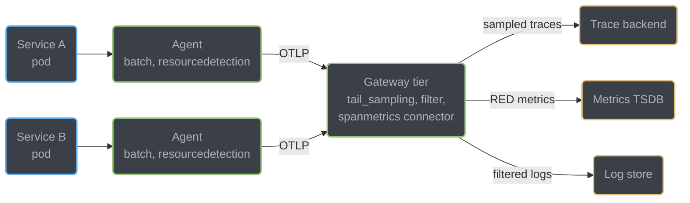
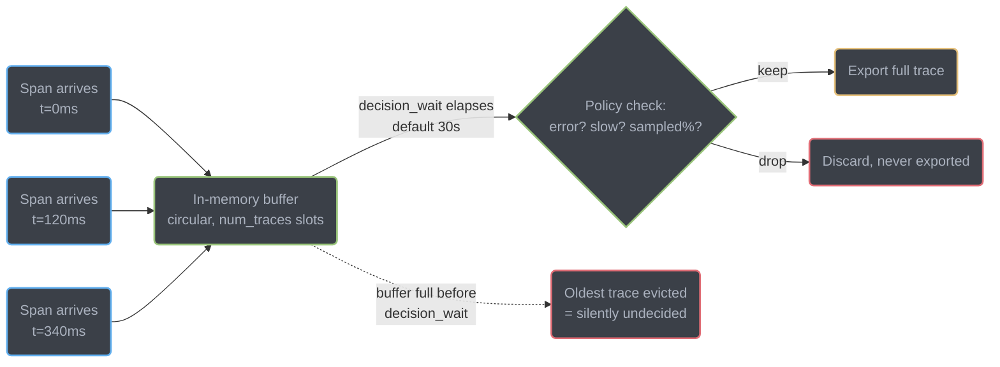

# Modern OTel Stack — Exemplars, Semantic Conventions, and the Fourth Signal

The parent module covers native histograms, direct OTLP ingest into Prometheus, head-vs-tail
sampling, burn-rate alerting, and Grafana Alloy — this file does not repeat any of that. It
covers the four things the current OpenTelemetry stack adds on top: exemplars (the jump from a
percentile to the one request that caused it), semantic-convention stability tiers (why a minor
agent bump can empty a dashboard), the profiling signal and eBPF-based zero-code profiling (the
fourth pillar), and collector topology as the place cost control actually lives.

---

## 1. Concept Overview

An aggregated p99 tells you a number; it never tells you which request produced it. Exemplars
close that gap by attaching a real trace ID to a specific point on a histogram, so a Grafana panel
becomes clickable — click the dot, land on the trace, see the exact request. Semantic conventions
are the shared vocabulary (`http.request.method`, `db.system.name`, …) that make one team's spans
readable in another team's dashboards; OpenTelemetry ships them with an explicit stability tier so
consumers know which attribute names are safe to build a permanent panel on and which can still
change. Profiling is OpenTelemetry's fourth signal — a stream of sampled stack traces answering
"which code, not which service" — and eBPF-based continuous profiling gets you that signal on
unmodified binaries with no SDK in the deployment at all.

**Backend/devops split.** This file, and the parent module, cover what backend owns:
instrumentation choices, span/metric authorship, SLI definitions, semantic-convention adoption in
your own code. Running the Prometheus fleet, the Collector fleet, Alloy, and long-term storage is
devops's platform — see
[`../../devops/observability_tracing_and_otel/opentelemetry_deep_dive.md`](../../devops/observability_tracing_and_otel/opentelemetry_deep_dive.md)
and
[`../../devops/observability_metrics_prometheus/observability_metrics_prometheus.md`](../../devops/observability_metrics_prometheus/observability_metrics_prometheus.md)
for the operational side of the same stack. Native histograms, direct OTLP ingest, head/tail
sampling basics, and multiwindow burn-rate alerting live in the parent,
[`observability_and_monitoring.md`](observability_and_monitoring.md).

---

## 2. Intuition

A percentile is a photograph of a crowd — you can see that someone in the back is much taller
than average, but you cannot tap them on the shoulder. An exemplar is the tap: a pointer from one
bucket on the histogram straight to the one trace that landed there, so "p99 is 4 seconds" becomes
"here is the actual 4-second request, and here is its span waterfall."

Semantic conventions are a shared naming contract, and a stability tier is the fine print on that
contract. A `Stable` attribute is a promise — the name will not change under you. A `Development`
attribute is a working draft — useful today, but an agent upgrade may rename or drop it, and your
dashboard's `WHERE` clause has no idea the ground moved.

Continuous eBPF profiling is like being handed a building's power meter instead of asking every
tenant to self-report their usage: it sees every process on the host, in every language, with
nothing installed inside any of them — at the cost of seeing electricity, not which appliance
someone forgot to turn off. It sees CPU cycles by stack frame; it does not see the user ID or the
business operation that stack frame was serving, unless something else correlates the two.

**Key insight**: exemplars, semantic conventions, and profiling are all the same move applied to a
different axis — attach a durable pointer (a trace ID, a stable name, a span context) to a cheap
aggregate, so the aggregate stops being a dead end.

---

## 3. Core Principles

- **Exemplars ride on top of aggregation, they do not replace it.** The histogram bucket is still
  the cheap thing you query at scale; the exemplar is a small, bounded set of sample points
  attached to it — you are not paying full per-request storage to get per-request drill-down.
- **A stability tier is a promise about the name, not about the data.** `Stable` means the
  attribute key and semantics will not change; it says nothing about whether the underlying
  behavior it measures is mature.
- **Cost is a product, not a single knob.** Observability spend is driven by
  `cardinality × retention × sample rate`, and moving any one of the three ten years back to
  its origin — cardinality at the collector, retention at the storage tier, sample rate at the
  root — is cheaper than moving it after the fact at the query layer.
- **The collector is the enforcement point, not the application.** An app should emit rich,
  unfiltered telemetry; a `filter`/`transform`/attribute-redaction processor at the collector is
  what turns that into what you're willing to pay to store, and it can change without a service
  redeploy.
- **eBPF profiling sees mechanism, application tracing sees meaning.** Correlating "this stack was
  hot" with "for this tenant, in this span" needs both signals wired together — profiling alone
  gives you the *what*, tracing gives you the *why*.

---

## 4. Types / Architectures / Strategies

**Exemplar mechanisms**
- Prometheus classic-histogram exemplars: one sampled `(value, trace_id, timestamp)` triple stored
  per bucket, exposed only in the **OpenMetrics** exposition format — a classic-format scrape never
  carries them, independent of whether the histogram itself is classic or native.
- Native-histogram exemplars: the same idea, attached to the sparse sketch instead of a fixed
  bucket set — see the parent module for native histograms themselves.
- Wiring is done through a span-context supplier: the metrics client asks "is there an active span
  right now?" at record time and, if so, stamps the sample with its trace/span ID.

**Semantic convention stability tiers** (from the OpenTelemetry specification's own stability
model): `development` → `alpha` → `beta` → `release_candidate` → `stable`, with an attribute
independently marked `Development`, `Release Candidate`, or `Stable`. The rule that makes the tier
meaningful: **group stability can only move forward — a `stable` group can never revert to a lower
tier**, and a deprecated group is never deleted, only marked so legacy instrumentation still
generates against it. That asymmetry is what makes "stable" worth building a dashboard on: it is a
one-way door.

**Migration mechanism** — `OTEL_SEMCONV_STABILITY_OPT_IN`: instrumentation that has stabilized a
convention domain (HTTP, then the same pattern for database, RPC, and messaging conventions) ships
with this variable accepting a domain value like `http` or `database`. Unset, it keeps emitting the
pre-stabilization attribute names for backward compatibility. `http/dup` (and the equivalent `/dup`
suffix for other domains) emits **both** old and new names simultaneously so dashboards can be
migrated one panel at a time before the old names are dropped in a later major version.

**Profiling signal formats and status** — OpenTelemetry Profiles reached **public alpha** (the
Profiling SIG's own March 2026 announcement, requiring Collector v0.148.0+). Its wire format is the
OTLP Profiles data model, deliberately co-designed with the `pprof` maintainers so that data can be
**round-trip converted to and from pprof with no information loss** — it is not a from-scratch
format competing with pprof, it is pprof's data model carried over OTLP transport with the same
resource/attribute model as the other three signals. The SIG's own release note: *"the signal
should not be used for critical production workloads"* — treat 2026 as the evaluation window before
beta and GA, the same posture you'd take toward any alpha dependency.

**eBPF continuous profiling** — a kernel-level sampling profiler (Grafana Pyroscope's eBPF
profiler, Polar Signals' Parca, and OpenTelemetry's own eBPF profiler, donated by Elastic) attaches
to the Linux kernel and periodically samples the call stack of **every process on the host**,
across process and language boundaries, with **no agent inside the application** and no
recompilation. The OTel eBPF profiler currently covers Go, Node.js (V8, including ARM64), .NET 9
and 10, Ruby, and early BEAM (Erlang/Elixir) support, alongside native/compiled binaries generally.

**Collector deployment topology** — agent (sidecar/daemonset, one per node or per pod, does
lightweight batching and resource-detection close to the workload) vs gateway (a smaller
centralized fleet doing the expensive work — tail sampling, cross-service enrichment, fan-out to
backends). The two are not exclusive: the common shape is agents at the edge forwarding to a
gateway tier, because tail sampling specifically needs every span of a trace to land on the *same*
collector instance, which an agent tier — one collector per node, spans from one trace scattered
across many nodes — cannot guarantee on its own.

---

## 5. Architecture Diagrams

**Agent vs Gateway Collector Topology**

Agents run beside every workload doing cheap local work; a smaller gateway tier does the expensive,
trace-complete work that requires seeing every span of a trace on one process.



*Tail sampling needs every span of a trace on the same collector instance — agents cannot make that
decision alone when a trace's spans arrive at different nodes, so the decision moves to the gateway
tier that all agents forward into.*

**Exemplar Drill Path: Metric → Trace → Profile**

A p99 spike is a starting point, not an answer — the exemplar is what turns it into one.

```mermaid
flowchart LR
    classDef src fill:#3b4048,stroke:#61afef,stroke-width:2px,color:#abb2bf
    classDef proc fill:#3b4048,stroke:#98c379,stroke-width:2px,color:#abb2bf
    classDef store fill:#3b4048,stroke:#e5c07b,stroke-width:2px,color:#abb2bf
    classDef bad fill:#3b4048,stroke:#e06c75,stroke-width:2px,color:#abb2bf
    classDef ext fill:#3b4048,stroke:#c678dd,stroke-width:2px,color:#abb2bf
    classDef note fill:#3b4048,stroke:#56b6c2,stroke-width:2px,color:#abb2bf

    Panel("Grafana panel<br/>p99 = 4.1s spike") -->|"dot on the curve<br/>= an exemplar"| Ex("Exemplar<br/>trace_id=a1b2c3")
    Ex -->|"jump"| Trace("Trace waterfall<br/>which span was slow")
    Trace -->|"span context<br/>correlation"| Prof("Profile at that<br/>time window")
    Prof --> Line("Exact function<br/>burning CPU")

    class Panel store
    class Ex proc
    class Trace proc
    class Prof ext
    class Line bad
```



*Three hops, three signals: the aggregate metric names the moment, the exemplar's trace ID names
the request, and the profile — correlated by the same span context — names the line of code.*

**Tail-Sampling Decision Buffering**

The processor cannot decide until it has seen the whole trace, so every open trace sits in memory
for the full decision window.



*Every span of every open trace sits in RAM for the whole `decision_wait` window — raising
`num_traces` or lowering `decision_wait` to reduce evictions both raise memory pressure, which is
the direct cause of the tail-sampling OOM in §10.*

---

## 6. How It Works — Detailed Mechanics

### Micrometer Exemplar Wiring (Spring Boot 4.1 / Micrometer 1.17+)

Exemplars require two things: an active span at the moment a metric is recorded, and a
`SpanContext` implementation registered with the Prometheus registry so it can stamp samples.
Spring Boot's Actuator auto-configures the metrics registry but does **not** wire the tracing
bridge into it automatically — that link is what you add:

```java
import io.micrometer.tracing.Tracer;
import io.prometheus.metrics.tracer.common.SpanContext;
import org.springframework.boot.actuate.autoconfigure.metrics.export.prometheus.PrometheusMeterRegistryCustomizer;
import org.springframework.context.annotation.Bean;
import org.springframework.context.annotation.Configuration;

@Configuration
public class ExemplarConfig {

    // Bridges Micrometer Tracing's current span into the Prometheus client's exemplar sampler.
    // Without this bean, histogram buckets carry no trace_id/span_id and the Grafana panel
    // has no dot to click.
    @Bean
    SpanContext prometheusSpanContext(Tracer tracer) {
        return new SpanContext() {
            @Override
            public String getCurrentTraceId() {
                var span = tracer.currentSpan();
                return span != null ? span.context().traceId() : null;
            }

            @Override
            public String getCurrentSpanId() {
                var span = tracer.currentSpan();
                return span != null ? span.context().spanId() : null;
            }

            @Override
            public boolean isCurrentSpanSampled() {
                var span = tracer.currentSpan();
                return span != null; // sampled-out spans are never "current" here
            }

            @Override
            public void markCurrentSpanAsExemplar() {
                // no-op: Micrometer Tracing has no "mark as exemplar" concept to forward
            }
        };
    }
}
```

```yaml
# application.yaml — Prometheus scrape must request OpenMetrics, or exemplars never appear
management:
  metrics:
    distribution:
      percentiles-histogram:
        http.server.requests: true
```

```bash
# The default Prometheus text scrape silently drops exemplars — request OpenMetrics explicitly
curl -H 'Accept: application/openmetrics-text; version=1.0.0' http://order-service:8080/actuator/prometheus
```

### Semantic Convention Opt-In (HTTP and Database Domains)

```bash
# HTTP: emit BOTH old (http.method) and new (http.request.method) attributes during migration
OTEL_SEMCONV_STABILITY_OPT_IN=http/dup

# Once every dashboard, alert, and recording rule is confirmed on the new names, cut over fully:
OTEL_SEMCONV_STABILITY_OPT_IN=http

# The same opt-in pattern now covers database conventions independently — a service can be
# mid-migration on HTTP and not yet started on database, or vice versa
OTEL_SEMCONV_STABILITY_OPT_IN=database/dup,http
```

### OTel Collector: Cardinality Control Before It Reaches Storage

```yaml
# otel-collector-gateway.yaml
receivers:
  otlp:
    protocols:
      grpc: {}
      http: {}

processors:
  batch: {}

  # Drop the raw, unrouted request path before it can explode span/metric cardinality.
  # http.route (a template like "/orders/{id}") is what should reach spanmetrics — the raw
  # url.path with real IDs in it never should.
  transform/route_template:
    trace_statements:
      - context: span
        statements:
          - delete_key(attributes, "url.path") where attributes["http.route"] != nil

  # Drop entire spans that are noise for cost purposes (health checks) before tail sampling
  # even has to buffer them.
  filter/drop_health_checks:
    traces:
      span:
        - 'attributes["http.route"] == "/healthz"'

  tail_sampling:
    decision_wait: 10s          # shorter window = less memory, more risk of premature eviction
    num_traces: 50000           # circular buffer capacity; sizing drives collector RAM directly
    expected_new_traces_per_sec: 500
    policies:
      - name: always-sample-errors
        type: status_code
        status_code: { status_codes: [ERROR] }
      - name: always-sample-slow
        type: latency
        latency: { threshold_ms: 1000 }
      - name: baseline-sample
        type: probabilistic
        probabilistic: { sampling_percentage: 2 }

connectors:
  # Generates RED metrics FROM the spans the collector already has, so a Timer does not have
  # to be hand-instrumented in every service just to get request-rate/error/duration dashboards.
  spanmetrics:
    histogram:
      explicit:
        buckets: [50ms, 100ms, 250ms, 500ms, 1s, 2.5s, 5s]
    dimensions:
      - name: http.route
      - name: http.response.status_code

exporters:
  otlp/tempo:
    endpoint: tempo:4317
  prometheusremotewrite:
    endpoint: http://prometheus:9090/api/v1/write

service:
  pipelines:
    traces:
      receivers: [otlp]
      processors: [transform/route_template, filter/drop_health_checks, tail_sampling, batch]
      exporters: [otlp/tempo, spanmetrics]
    metrics:
      receivers: [otlp, spanmetrics]
      processors: [batch]
      exporters: [prometheusremotewrite]
```

### eBPF Zero-Code Profiling (Grafana Alloy + Pyroscope)

```river
// alloy config fragment — profiles every process on the host, no SDK in any of them
pyroscope.ebpf "instance" {
  forward_to = [pyroscope.write.backend.receiver]
}

pyroscope.write "backend" {
  endpoint {
    url = "http://pyroscope:4040"
  }
}
```

No application code changes, no redeploy of the profiled services — the profiler attaches at the
kernel level and samples stacks for every process on the node, which is exactly why it cannot see
"this stack belongs to tenant 4471's checkout request": that context lives in the application, not
the kernel, and only reaches the profile if something correlates PID/TID to an active span.

---

## 7. Real-World Examples

- **Elastic** donated its whole-system eBPF profiler to the OpenTelemetry Collector as an official
  component, the implementation backing the OTel Profiles public alpha and its Go/Node.js/.NET/
  Ruby/BEAM runtime support.
- **Polar Signals (Parca)** built a CNCF sandbox eBPF profiler around the same zero-instrumentation
  principle, with a Prometheus-native storage and query model — the pattern of "profile everything
  on the host for free, correlate to code paths that matter" predates the OTel signal and is one of
  its direct inputs.
- **Grafana Labs (Pyroscope)** ships eBPF profiling as a first-class Alloy component
  (`pyroscope.ebpf`), positioning continuous profiling as the fourth pillar alongside its existing
  Mimir/Loki/Tempo metrics/logs/traces stack.
- **Google Cloud Managed Service for Prometheus** documents exemplar support explicitly as a
  supported query-time feature on histogram data, confirming exemplars are treated as
  production-standard tooling by a major managed Prometheus vendor, not an experimental add-on.

---

## 8. Tradeoffs

| Approach | Pros | Cons |
|----------|------|------|
| Agent-only collector topology | Lowest latency to the workload, simple to reason about per-node | Cannot do tail sampling correctly — a trace's spans can land on different agents |
| Agent + gateway topology | Tail sampling, cross-service enrichment, centralized cost control | Extra network hop; gateway tier is a new capacity-planning problem |
| Exemplars | Near-zero storage cost, jumps straight from aggregate to one real request | Bounded sample count per bucket — not every anomalous request gets one; OpenMetrics-only |
| eBPF continuous profiling | Zero code change, every language on the host, always-on | No application semantics without extra correlation; kernel/host-level access required |
| SDK-based (in-process) profiling | Rich application context out of the box | Per-language agent to install and keep current; misses processes it wasn't added to |
| `http/dup` semconv opt-in | Old and new dashboards both work during migration | Doubles attribute volume on every span/metric until cutover |
| Collector-side cardinality control (`transform`/`filter`) | Fixes cost without touching or redeploying the app | Adds a processing hop; a bad OTTL statement can silently drop wanted data |

---

## 9. When to Use / When NOT to Use

**Wire up exemplars** once you already have percentile histograms and distributed tracing —
they're the connective tissue between the two, not a replacement for either. Skip them if you
scrape only the Prometheus text format and have no plan to request OpenMetrics; the wiring does
nothing until the scrape asks for it.

**Adopt eBPF continuous profiling** when you need visibility across a fleet running many languages
and cannot instrument all of them, or want profiling data from processes nobody remembers to
instrument (a cron job, a legacy binary). Prefer SDK-based profiling when you specifically need
per-request or per-tenant attribution and already have the application-level tracing to correlate
against.

**Opt into new semantic conventions (`OTEL_SEMCONV_STABILITY_OPT_IN`)** deliberately and on a
schedule you control — start with `/dup` so nothing breaks while you migrate dashboards, and set a
date to drop the old names. **Do NOT** let an agent auto-update silently flip this for you; pin the
instrumentation agent version the same way you pin any other dependency.

**Do NOT** treat OpenTelemetry Profiles as production-load-bearing yet — it is public alpha as of
2026, and the SIG's own guidance is not to put it on critical paths. Use it for investigation and
evaluation, keep an existing profiler (async-profiler, a vendor APM) as the production source of
truth until it reaches beta or GA.

---

## 10. Common Pitfalls

**A minor agent bump silently emptied every HTTP dashboard.** A team pinned
`opentelemetry-javaagent` to `latest` in their base Docker image. A routine rebuild picked up a
version that had stabilized HTTP semantic conventions and began emitting `http.request.method`
instead of `http.method`. No alert fired — the agent didn't error, the spans still exported
successfully, they just carried different attribute names. Every Grafana panel and every
`http_method` PromQL selector kept running, silently matching zero series, and showed flat "no
data" that three different engineers individually dismissed as a quiet night before someone finally
diffed the raw span attributes against the dashboard queries. Fix: pin the instrumentation agent
version explicitly, and set `OTEL_SEMCONV_STABILITY_OPT_IN=http/dup` deliberately during any
planned migration so both names exist while every consumer is updated on a known schedule.

**A tail-sampling collector OOM'd during a traffic spike.** `num_traces` was sized for steady-state
volume; a marketing push tripled request rate without tripling `expected_new_traces_per_sec`, so
the circular buffer filled faster than `decision_wait` (30s) could drain it. Spans kept arriving,
old undecided traces got silently evicted before their decision — meaning some error traces were
dropped instead of kept — and collector memory climbed until the gateway pods hit their limit and
were OOMKilled, taking the whole tail-sampling pipeline down mid-spike (the worst possible time to
lose trace data). Fix: size `num_traces` from peak, not average, throughput, alert on collector
memory and on the processor's own dropped-trace metric, and put resource *requests* (not just
limits) on the gateway pods so the scheduler doesn't co-locate them into contention right when
traffic is highest.

**Exemplars configured but never appearing.** A team added the `SpanContext` bean, confirmed spans
were flowing, and still saw no exemplar dots in Grafana. The scrape endpoint was still being hit
with the default `Accept: text/plain` — exemplars are an OpenMetrics-only feature and are silently
omitted from the classic text exposition with no warning anywhere in the pipeline. Fix: confirm the
scraper (Prometheus config or `curl` test) explicitly requests
`application/openmetrics-text; version=1.0.0`.

---

## 11. Technologies & Tools

| Tool | Purpose |
|------|---------|
| Micrometer `SpanContext` / `SpanContextSupplier` | Bridges an active trace span into a metric sample as an exemplar |
| Prometheus OpenMetrics exposition | The only exposition format that carries exemplars over a scrape |
| OpenTelemetry semantic conventions spec | Defines attribute names and their `development`/`alpha`/`beta`/`release_candidate`/`stable` tiers |
| `OTEL_SEMCONV_STABILITY_OPT_IN` | Per-domain (`http`, `database`, `rpc`, `messaging`) migration switch, `<domain>` or `<domain>/dup` |
| OpenTelemetry Profiles | The fourth signal — pprof-interoperable stack samples over OTLP; public alpha, Collector v0.148.0+ |
| OTel eBPF profiler | Kernel-level, zero-instrumentation continuous profiler donated by Elastic; Go/Node.js/.NET/Ruby/BEAM |
| Grafana Pyroscope | Continuous profiling backend + `pyroscope.ebpf` Alloy component |
| Parca (Polar Signals) | CNCF sandbox eBPF continuous profiler, Prometheus-native storage model |
| OTel Collector `tail_sampling` processor | Buffers whole traces (`decision_wait`, `num_traces`) and composes keep/drop policies |
| OTel Collector `filter` processor | Drops whole telemetry items (spans/metrics/logs) matching an OTTL condition, before they cost anything downstream |
| OTel Collector `transform` processor | Rewrites/redacts attributes with OTTL — the tool for collapsing high-cardinality values into templates |
| `spanmetrics` connector | Derives RED metrics directly from spans already flowing through the collector, avoiding duplicate app-side instrumentation |

---

## 12. Interview Questions with Answers

**Q: What is an exemplar and what problem does it solve that percentiles cannot?**
**Short:** An exemplar attaches a real trace ID to a histogram bucket, turning an aggregate percentile into a link to one actual request.

A percentile tells you a distribution shape but discards every individual data point that produced it — you know p99 is 4 seconds, but not which request took 4 seconds or why. An exemplar is a sampled `(value, trace_id, timestamp)` triple attached directly to a histogram bucket, so a dashboard can render a clickable dot on the histogram that jumps straight into that request's distributed trace. It rides on top of the existing histogram rather than replacing it, so it adds close to nothing to storage cost while closing the gap between "the aggregate looks bad" and "here is the one request to investigate."

**Q: Why do exemplars sometimes not appear even though a `SpanContext` bean is registered correctly?**
**Short:** Exemplars are emitted only in the OpenMetrics exposition format, never in classic Prometheus text format.

The wiring on the application side can be entirely correct — active span present, `SpanContext` bean stamping trace/span IDs — and exemplars will still be silently absent if the scraper requests the default Prometheus text exposition. Exemplars are an OpenMetrics-only feature; the classic text format has no field for them, and nothing in the pipeline errors or warns when they're dropped. Fix by confirming the scrape explicitly requests `application/openmetrics-text; version=1.0.0`, either in the Prometheus scrape config or a manual `curl -H 'Accept: ...'` test against the metrics endpoint.

**Q: What happened when a team let their OpenTelemetry Java agent auto-update past a semantic-convention stabilization?**
**Short:** The agent silently renamed `http.method` to `http.request.method`, and every dashboard querying the old name went quietly blank.

The agent didn't error and spans kept exporting successfully — they just carried a different attribute key once HTTP conventions stabilized. Every panel and alert built on `http_method` matched zero series and rendered as flat "no data," which is far more dangerous than an error because it looks like a quiet night rather than a broken pipeline. The fix is prevention, not detection: pin the instrumentation agent version like any other dependency, and when you do migrate, set `OTEL_SEMCONV_STABILITY_OPT_IN=<domain>/dup` deliberately so both attribute names coexist while every consumer updates on a schedule you control, instead of finding out from a silent gap in the data.

**Q: What do the OpenTelemetry semantic-convention stability tiers actually guarantee?**
**Short:** Stable groups can never revert to a lower tier and their attribute names are locked; unstable tiers can still rename or drop attributes.

The spec defines five group-level tiers — `development`, `alpha`, `beta`, `release_candidate`, `stable` — with the rule that group stability can only move forward: a `stable` group must never be demoted, and even a `deprecated` group is never removed outright, only marked so legacy instrumentation still generates correctly against it. Individual attributes carry their own `Development`/`Release Candidate`/`Stable` marking too. The practical guarantee for a consumer: a dashboard, alert, or recording rule built against a `Stable` attribute name will not break out from under you on a routine agent upgrade; one built against a `Development` attribute might, and that risk is the whole reason to check the tier before wiring something load-bearing to it.

**Q: How do you migrate a service from old to new HTTP semantic conventions without breaking dashboards mid-flight?**
**Short:** Set `OTEL_SEMCONV_STABILITY_OPT_IN=http/dup` to emit both attribute sets, migrate consumers, then cut to `http` alone.

Unset, an OpenTelemetry HTTP instrumentation keeps emitting the pre-stabilization attribute names (`http.method`, `http.status_code`) for backward compatibility. Setting `OTEL_SEMCONV_STABILITY_OPT_IN=http/dup` makes it emit both the old and new (`http.request.method`, `http.response.status_code`) names simultaneously — every dashboard, alert, and recording rule keeps working on the old names while you update them on your own schedule to the new ones. Once every consumer is confirmed migrated, flip to `OTEL_SEMCONV_STABILITY_OPT_IN=http` alone to drop the old names and stop paying double attribute volume. The same domain-scoped opt-in pattern (comma-separated: `database/dup,http`) now covers database, RPC, and messaging conventions independently, so different domains can be mid-migration on different schedules.

**Q: What is OpenTelemetry's profiling signal, and is it safe to depend on in production today?**
**Short:** Profiles is OTel's fourth signal — pprof-compatible sampled stack traces over OTLP — currently public alpha, not for production-critical paths.

Profiling captures where an application spends CPU (and other resources) at the stack-frame level, complementing metrics/traces/logs by answering "which code," not "which service." It reached public alpha per the Profiling SIG's own announcement, requiring OTel Collector v0.148.0 or newer, and its wire format — OTLP Profiles — was co-designed with the `pprof` maintainers so data round-trips losslessly to and from pprof. The SIG's explicit guidance is that the signal "should not be used for critical production workloads" at this stage; treat it as an evaluation and investigation tool through 2026 and keep an existing production profiler as the source of truth until it reaches beta or GA.

**Q: What can an eBPF continuous profiler see, and what can it never see on its own?**
**Short:** eBPF profiling sees every process's call stacks on a host with zero code changes, but has no idea what business request a stack belongs to.

An eBPF profiler attaches at the kernel level and periodically samples the call stack of every process on the host — any language, no SDK installed, no redeploy, no recompilation. That is exactly why it cannot see application semantics: a hot stack frame is just a stack frame to the kernel, with no notion of which tenant, user, or business operation it was serving. Getting that context back requires an explicit correlation step — matching the sampled process/thread ID to an active span's context — which is precisely what the "metric → trace → profile" drill path wires together; the profiler alone gives you mechanism, not meaning.

**Q: Why does tail sampling need a gateway collector tier rather than working entirely at the agent?**
**Short:** Tail sampling needs every span of a trace on one process before it can decide, which an independent per-node agent tier cannot guarantee.

A tail-sampling decision — keep this trace because it errored or was slow, drop it otherwise — can only be made once all of a trace's spans have arrived somewhere. An agent tier deployed one-per-node has no such guarantee: a single trace's spans, generated by services scattered across many pods and nodes, can land on many different agent instances with no single one seeing the whole trace. The standard fix is a two-tier topology — lightweight agents doing local batching and resource detection forward everything to a smaller, centralized gateway tier, and it's the gateway that runs `tail_sampling`, because it's the only place guaranteed to eventually see every span of every trace.

**Q: Why does buffering whole traces for tail sampling create a memory-sizing problem, and how do you size for it?**
**Short:** The processor holds every open trace's spans in a circular buffer for the full `decision_wait` window, so memory scales with in-flight trace volume, not average.

`num_traces` sets the circular buffer's capacity and `decision_wait` (default 30s) sets how long a trace's spans sit in memory before a policy decision fires; every span of every currently-open trace occupies RAM for that whole window. If arrival rate exceeds what the buffer can hold before `decision_wait` elapses, the oldest undecided traces are evicted silently — meaning traces that would have been kept (an error, a slow request) can be dropped simply because the buffer filled first. Size `num_traces` and `expected_new_traces_per_sec` from peak traffic, not steady-state average, and alert on the processor's own dropped/evicted-trace metric rather than discovering the gap after an incident review finds a trace that should exist and doesn't.

**Q: How do you stop paying twice for the same telemetry — once for spans, once for hand-instrumented request metrics?**
**Short:** Use the `spanmetrics` connector to derive RED metrics directly from spans already flowing through the collector.

Many services separately instrument request-rate/error/duration counters and timers in application code even though every request already produces a span carrying the same information (route, status, duration). The `spanmetrics` connector in the OTel Collector reads spans passing through a pipeline and emits aggregated RED metrics from them — no second instrumentation point, no risk of the hand-written metric and the span disagreeing about what happened. It's a collector-level architectural choice, not an app change: point the traces pipeline at the `spanmetrics` connector as an additional exporter, and consume its output as a metrics pipeline receiver.

**Q: How do you reduce metric or span cardinality without touching or redeploying application code?**
**Short:** Use collector-side `transform`/`filter` processors with OTTL to template or drop high-cardinality attributes before they reach storage.

Cardinality is created at the point an attribute like a raw, un-templated URL path (`/orders/58231/items` instead of `/orders/{id}/items`) or a user ID reaches a metric label or gets fed into the `spanmetrics` connector. A `transform` processor using OTTL can rewrite or delete such attributes in-flight — collapsing raw paths down to their route template, dropping a redundant high-cardinality field entirely — and a `filter` processor can drop whole spans that add cost without value (health-check pings) before they're even buffered for tail sampling. Because this happens at the collector, the fix ships as a config change to a shared component, not a code change and redeploy across every service that was over-tagging.

**Q: What's the practical difference between eBPF-based and SDK-based (in-process) continuous profiling?**
**Short:** eBPF profiles every process on a host with zero code changes but no built-in application context; an SDK profiler has rich context but must be installed per-service.

eBPF profiling attaches at the kernel and samples every process's stack regardless of language, with nothing added to the deployed binary — ideal for a heterogeneous fleet or for catching processes nobody remembered to instrument. An in-process SDK profiler (a per-language agent) runs inside the application, so it can natively tag samples with request or tenant context, but it has to be added, kept current, and deployed to every service individually — miss one, and that process has no profiling data at all. Many teams run both: eBPF for fleet-wide coverage and gap-filling, SDK-based profiling where per-request attribution matters most.

**Q: Why is `http/dup` strictly better than jumping straight to the new semantic-convention names?**
**Short:** `/dup` keeps every existing dashboard and alert working while consumers migrate, instead of breaking them all at the exact moment of cutover.

Jumping directly to the new attribute names is a hard cutover: the instant the agent restarts with the new names, every existing PromQL selector, dashboard variable, and alert rule built on the old names stops matching, all at once, with no transition window. `/dup` (or the equivalent per-domain suffix) emits both attribute sets simultaneously for as long as needed, so migration becomes "update this dashboard, verify it, move to the next" instead of "update every consumer before the next deploy or go dark." The only cost is doubled attribute volume on each span/metric during the overlap — worth paying deliberately, on your own schedule, rather than as an emergency response to a broken dashboard.

**Q: A team's tail-sampling gateway OOM'd during a traffic spike. What's the actual fix, not just "add more memory"?**
**Short:** Size `num_traces` and `expected_new_traces_per_sec` for peak load, set pod resource requests (not just limits), and alert on the processor's dropped-trace metric.

Bumping memory limits treats the symptom; the underlying issue is that `num_traces` was sized for steady-state throughput while `decision_wait` held the buffer open for a fixed 30 seconds regardless of arrival rate, so a 3x traffic spike filled the circular buffer faster than decisions could drain it. The durable fix has three parts: size the buffer parameters from measured peak traffic rather than average, set Kubernetes resource *requests* (not just limits) on the gateway pods so the scheduler doesn't pack them into contention exactly when load is highest, and alert on the tail-sampling processor's own eviction/drop metric so a silent data-loss event during the next spike is caught immediately rather than discovered during a later incident review.

**Q: What is the `filter` processor for, and how is it different from tail sampling?**
**Short:** `filter` makes an unconditional drop decision per item using OTTL; tail sampling makes a trace-wide keep/drop decision after buffering the whole trace.

The `filter` processor evaluates an OTTL condition against each telemetry item independently — drop every span matching `attributes["http.route"] == "/healthz"` — with no buffering and no need to see related spans; it's cheap and immediate. Tail sampling is a different kind of decision entirely: it has to see every span belonging to one trace before it can decide whether that whole trace is interesting, which is why it needs the buffer and the gateway topology. In practice they compose: run `filter` first to cheaply discard obvious noise (health checks, synthetic monitors) before it ever reaches the more expensive, memory-buffered tail-sampling stage.

**Q: Why does OpenTelemetry's profiling data format matter for adoption, versus inventing something new?**
**Short:** OTLP Profiles was co-designed with pprof's maintainers so data round-trips losslessly, protecting years of existing pprof tooling investment.

A brand-new profiling wire format would have orphaned every existing pprof-based tool — flamegraph viewers, `go tool pprof`, language-specific profilers that already emit pprof. OpenTelemetry avoided that by building the OTLP Profiles data model in collaboration with pprof's own maintainers, explicitly guaranteeing lossless round-trip conversion between the two formats. Practically, that means a team already invested in pprof tooling doesn't have to choose between keeping it and adopting OTel's cross-signal correlation (linking a profile to the trace and span it occurred during) — the translator lets both coexist.

---

## 13. Best Practices

- Register the `SpanContext` bridge bean explicitly — Actuator does not wire tracing into
  exemplars automatically even when both Micrometer Tracing and Micrometer Metrics are present.
- Confirm exemplars end-to-end with a manual OpenMetrics-format `curl` before trusting a Grafana
  panel's absence of dots as "no data" instead of "wrong exposition format."
- Pin the OpenTelemetry instrumentation agent version exactly, the same as any other dependency —
  a semantic-convention stabilization landing in a routine `latest` bump is a silent, dashboard-wide
  outage with no error anywhere in the pipeline.
- When migrating a convention domain, start with the `/dup` opt-in and set a calendar date to cut
  over to the single new name — an open-ended dual-emission period just becomes permanent doubled
  cardinality.
- Size `tail_sampling`'s `num_traces` and `expected_new_traces_per_sec` from measured peak traffic,
  not steady-state average, and alert on its own dropped-trace metric.
- Put cardinality-reducing `transform`/`filter` processors ahead of `tail_sampling` and
  `spanmetrics` in the pipeline — cheaper decisions first, expensive buffering last.
- Treat OpenTelemetry Profiles as an alpha dependency in 2026: fine for investigation, not yet the
  sole source of truth for a production incident.
- Start eBPF profiling fleet-wide before deciding where SDK-based, context-rich profiling is worth
  the per-service install — it tells you which hosts are worth the extra instrumentation effort.

---

## 14. Case Study

**Problem** (illustrative composite, arithmetic derived from the mechanisms above — not a reported
vendor figure). A platform team ran the `spanmetrics` connector at their collector gateway to
derive RED metrics from spans instead of hand-instrumenting every service. Their `http.route`
attribute was inconsistently populated: 25 real endpoint templates existed, but roughly 500
distinct raw, un-templated request paths (real IDs left in the URL, e.g. `/orders/58231/items`)
were also present in span attributes and were being fed into `spanmetrics`'s dimension set
alongside the route template.

**The arithmetic.** With the raw path attribute included, `spanmetrics` was generating one metric
series per unique `(path, method, status_class)` combination: `500 raw paths × 4 methods ×
6 status classes = 12,000` series from a single connector, for 25 logical endpoints. Adding a
`transform` processor ahead of `spanmetrics` to drop the raw `url.path` attribute wherever
`http.route` was already populated (the config in §6) left only the 25 real templates in the
dimension set: `25 templates × 4 methods × 6 status classes = 600` series. That is a
`12,000 / 600 = 20×` reduction in active series from this one connector, achieved entirely at the
collector — zero application code changed, zero services redeployed.

**Result.** Because cardinality dropped at the source rather than at the query layer, retention and
sample-rate decisions downstream (how long to keep the metric, how aggressively to sample the
matching traces) now operate on the intended 600-series shape instead of the accidental 12,000, and
the fix shipped as one collector config change rather than a coordinated multi-service rollout. The
general lesson generalizes past this one connector: cost is `cardinality × retention × sample rate`,
and the cardinality term is cheapest to fix at the collector, where one config change reaches every
service, instead of at the application, where the same fix means N separate code changes and N
separate deploys.

---
