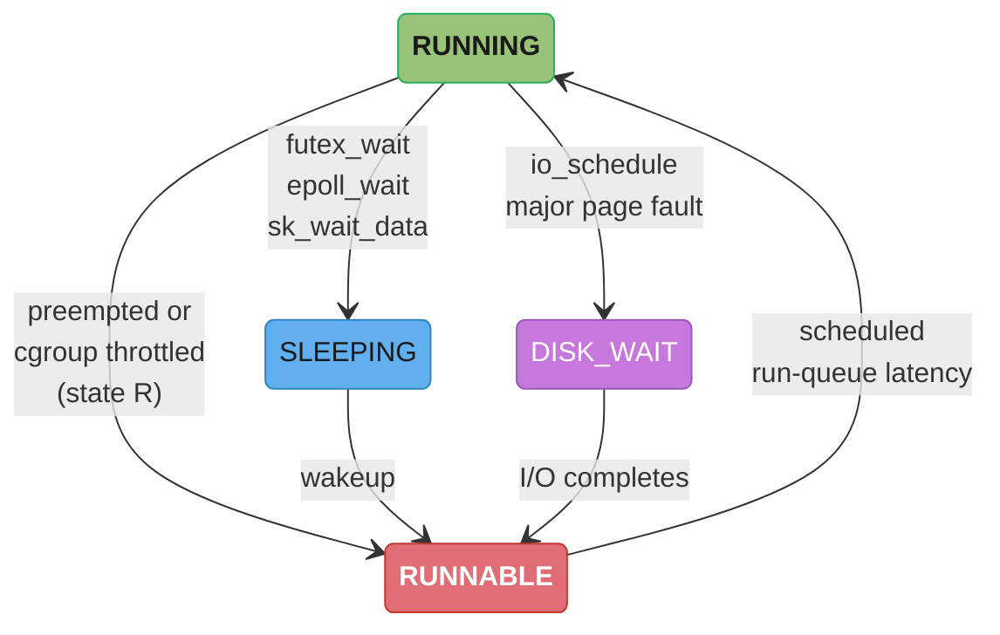
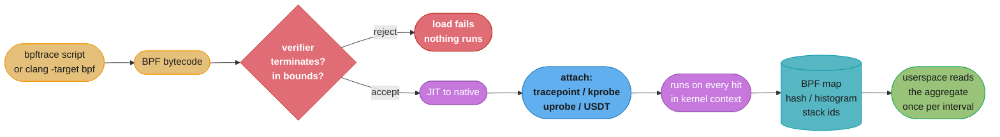

# Off-CPU Analysis and eBPF

> A CPU profiler answers "what is burning cycles." It has no opinion at all about a thread that is burning nothing and still taking 800 milliseconds.

---

## 1. Concept Overview

A service is at 3% CPU across the fleet and its p99 is 800ms. Every sampling CPU profiler you attach agrees: nothing is hot. The flame graph is a thin, unremarkable sliver, and the widest frame in it accounts for maybe 4ms of the 800. This is not a profiler bug. It is the profiler correctly reporting on the 4ms the thread spent **on-CPU** and structurally declining to report on the 796ms it spent **off-CPU** — descheduled, blocked, waiting, throttled, or parked.

**Off-CPU analysis** is the discipline of measuring that second term. Instead of a timer interrupting a running thread, you instrument the **scheduler** itself: when the kernel switches a thread off a core, record the stack that got it there; when it switches the thread back on, subtract the timestamps and attribute the delta to that stack. The output is an off-CPU flame graph whose width is *blocked nanoseconds*, not CPU nanoseconds — the same rendering, a completely different measurement.

**eBPF** is the mechanism that makes this affordable in production. It is a verified, JIT-compiled, sandboxed virtual machine inside the Linux kernel: you attach a small program to a kernel function, a tracepoint, or a userspace symbol, it runs on every hit, it aggregates into a kernel-resident hash map, and userspace reads the aggregate rather than a firehose of events. That aggregation-in-kernel property is why `offcputime` on a busy host costs single-digit percent instead of drowning the box in trace records.

**What this file is not.** [Continuous Profiling](../../hld/observability/continuous_profiling.md) owns flame-graph reading, differential flame graphs, safepoint bias, sampling-overhead budgets, and pprof — it explicitly defers eBPF to a companion, and this is that companion. [Performance Profiling](../performance_profiling/performance_profiling.md) owns on-CPU JVM tooling: async-profiler, JFR, heap dumps, GC logs. [Async I/O and Event Loops](../../cs_fundamentals/processes_threads_and_context_switching/async_io_and_event_loops.md) owns `epoll` and `io_uring` as *design* choices for a runtime. This file owns one thing: **where the blocked time went, and the kernel-level instrument that tells you.**

---

## 2. Intuition

> **One-line analogy**: A CPU profiler is a camera pointed at the stage that only records while an actor is under the spotlight. It produces a perfect record of the performance and no record whatsoever of the ninety minutes the lead spent stuck in the wings waiting for a costume change — which is what the audience actually experienced as the delay.

**Mental model**: A thread's wall-clock time is an exact two-term sum.

```
wall_time = on_cpu_time + off_cpu_time
```

There is no third term and no overlap. A CPU profiler measures the first term with high fidelity and reports zero for the second. An off-CPU profiler measures the second term. Run both, add them, and the total must reconcile with the request duration your tracing system already recorded — if it does not, one of the two profiles is scoped wrong (wrong thread set, wrong time window, wrong process).

**Why it matters**: The overwhelming majority of production latency in a typical service backend is off-CPU. A request that calls a database, waits on a connection pool, contends on a lock, or gets throttled by its own cgroup spends nearly all of its life not running. Teams that only own a CPU profiler reach the end of their tooling at "the profile is flat, there's nothing to optimize" and then guess — which is how a serialization function gets optimized for a week while the actual defect is a connection pool sized at 10 against 200 request threads.

**Key insight — off-CPU time is trivially easy to measure and viciously hard to *filter*.** Every idle worker in a 400-thread pool is off-CPU 99.99% of the time, parked in `epoll_wait` or `futex_wait`. An unfiltered off-CPU profile is 99% "threads correctly doing nothing," and the 800ms you care about is a rounding error inside it. The entire skill is in the filters: restrict to the threads serving the request, restrict to the blocking states that represent involuntary waits, set a minimum block duration, and exclude the idle stacks by name. Getting the measurement is a one-liner; getting the signal is the job.

---

## 3. Core Principles

**1. Wall-clock decomposes exactly; measure both halves or you are guessing about one.**
`wall = on-CPU + off-CPU` holds per thread, per request, always. Any statement of the form "there's nothing to optimize, CPU is flat" is a statement about one term of a two-term sum, and is only a conclusion if the second term was also measured and also came back small.

**2. Off-CPU profiling is event-driven, not sampled.**
On-CPU sampling fires on a timer and asks "what is running." Off-CPU tracing fires on a **scheduler event** and asks "what stopped, and for how long." The cost model is therefore completely different: sampling cost scales with the sampling rate you chose, off-CPU tracing cost scales with the host's **context-switch rate**, which you did not choose. A box doing 200,000 switches/sec is expensive to trace and a box doing 2,000 is free.

**3. Attribution comes from the switch-out stack; duration comes from the switch-in.**
The stack captured at `sched_switch` (or at `finish_task_switch`) is the *reason* the thread blocked — the `futex_wait`, the `read`, the page-fault handler. The blocked duration is only known later, when the same task is scheduled back in. An off-CPU tracer therefore keeps a per-task map of `{tid -> (timestamp, stack_id)}` and emits a record only on the wakeup side.

**4. eBPF is safe by proof, not by convention.**
Before a program is allowed to load, the in-kernel **verifier** walks every reachable path and rejects anything it cannot prove terminates and stays in bounds: unbounded loops, out-of-range memory access, unchecked pointer dereference, exceeding the complexity budget. A program that loads cannot panic the kernel by construction. This is the entire reason a company will let you run tracing code in the kernel of a production host, when it would never let you load a custom kernel module there.

**5. Aggregate in the kernel; move summaries, not events.**
The naive tracer emits one record per event to userspace. At 200,000 context switches per second that is a firehose that costs more than what it measures. eBPF's answer is the **map**: a kernel-resident hash or histogram the program updates in place, which userspace reads once per second (or once at exit). `runqlat` does not ship you 200,000 latency values, it ships you 24 bucket counters.

**6. Run-queue latency is the one component of off-CPU time that is never the application's fault.**
Lock waits, I/O waits, and condition-variable waits are all consequences of what the code asked for. **Run-queue latency** — the interval between a task becoming *runnable* and actually *running* — is pure supply-side starvation: the CPU was not available. It is the signal that separates "my code is slow" from "my container was not given a CPU," and it is invisible to every profiler that lives inside the process.

---

## 4. Types / Architectures / Strategies

### 4.1 The Taxonomy of Blocked Time

Off-CPU time is not one thing. Telling the seven kinds apart is most of the diagnostic value, and the switch-out stack usually names the kind on its own.

| Blocked reason | Kernel state | Signature in the switch-out stack | Tell it apart with | Who fixes it |
|---|---|---|---|---|
| **Lock contention** (mutex, monitor) | `TASK_INTERRUPTIBLE` | `futex_wait`, `__lll_lock_wait`, JVM `ObjectMonitor::enter` | `offcputime` filtered on `futex`, or a lock profiler (`async-profiler -e lock`) | Application — shard the lock, shrink the critical section |
| **Disk I/O** | `TASK_UNINTERRUPTIBLE` (D state) | `io_schedule`, `submit_bio`, `wait_on_page_bit` | `biolatency`, `biosnoop` | Storage or query shape |
| **Network wait** (downstream call) | `TASK_INTERRUPTIBLE` | `sk_wait_data`, `inet_csk_accept`, `tcp_recvmsg` | Tracing spans already show it; `tcpretrans` if it smells like loss | Downstream service or the network |
| **Major page fault** | `TASK_UNINTERRUPTIBLE` | `do_swap_page`, `filemap_fault` -> `io_schedule` | `/proc/<pid>/stat` majflt, `perf stat -e major-faults` | Memory sizing, THP, swap |
| **Involuntary preemption** | `TASK_RUNNING` on switch-out | *any* stack — the thread was running, not blocked | `runqlat`, `runqslower`; switch-out state is R, not S/D | Capacity — too many runnable threads |
| **cgroup CPU throttle** | `TASK_RUNNING`, throttled | *any* stack; correlates with `cpu.stat` `nr_throttled` | `cpu.stat` deltas, `container_cpu_cfs_throttled_periods_total` | Limits, or thread count |
| **Condition-variable / idle park** | `TASK_INTERRUPTIBLE` | `epoll_wait`, `futex_wait` from a pool's idle loop, `poll_schedule_timeout` | It is the *majority* of any unfiltered profile — filter it out | Nobody. This is correct behaviour |

The single most important row is the last one. An off-CPU profile that has not excluded idle parking is not a profile, it is a census of your thread pools.

**The state field disambiguates preemption from blocking.** A thread switched out in state `R` (runnable) did not block on anything — it was *taken off* a core it still wanted. That is preemption or throttling, and its stack is meaningless as an explanation. A thread switched out in `S` or `D` blocked deliberately, and its stack is the whole answer.

### 4.2 Ways to Measure Off-CPU Time

| Approach | Mechanism | Resolution | Overhead driver | Sees kernel stacks | Best for |
|---|---|---|---|---|---|
| **`offcputime` (eBPF)** | kprobe on `finish_task_switch` or the `sched_switch` tracepoint | Exact, per switch | Context-switch rate of the whole host | Yes | Whole-host, any language, precise attribution |
| **Wall-clock sampling** (`async-profiler -e wall`) | Timer samples every thread regardless of state | Statistical | Sampling rate x thread count | Java frames only | JVM services where you also want on-CPU in the same tool |
| **Thread-state sampling** (repeated `jstack`, `py-spy --idle`) | Poll each thread's state on an interval | Coarse, seconds | Poll frequency; safepoint pauses for `jstack` | No | Last resort when you cannot load eBPF |
| **Scheduler tracing** (`perf sched record`) | Records every scheduler event to a file | Exact, per switch | Very high — writes raw events to disk | Yes | Short, offline, deep scheduler investigations |
| **PSI** (`/proc/pressure/*`) | Kernel-computed stall percentages | Aggregate, per resource | Free (always on, kernel 4.20+) | No | Cheap always-on "is this host starved" signal |

`offcputime` and wall-clock sampling are complements, not competitors. The eBPF version sees below the runtime (kernel frames, the actual `futex_wait`), works on a Go binary and a Python process and a JVM identically, and needs no agent in the process. The wall-clock sampler sees managed-language frames the kernel cannot symbolize, and lives in the same tool as the CPU profile so the two are directly comparable.

### 4.3 eBPF Attach Points

An eBPF program is inert until it is attached. Where you attach determines what you can see, how much it costs, and how badly it breaks on the next kernel upgrade.

| Attach point | Attaches to | Stability | Approx cost per hit | Notes |
|---|---|---|---|---|
| **kprobe / kretprobe** | Any kernel function by symbol | **Unstable** — a kernel refactor renames or inlines it | ~0.5-1.5 us | Universal reach, zero API guarantee. `kretprobe` is roughly twice a `kprobe`, since it plants a return trampoline |
| **tracepoint** | Static, named kernel instrumentation points | **Stable ABI** — the kernel maintains them | ~0.3-0.8 us | Always prefer over a kprobe when one exists (`sched:sched_switch`, `block:block_rq_issue`) |
| **fentry / fexit** (BPF trampolines) | Kernel function entry/exit, via a direct trampoline | Unstable like kprobe, but far cheaper | ~0.1-0.3 us | Requires kernel 5.5+ (x86-64) and BTF. `fexit` sees function arguments *and* the return value, which `kretprobe` cannot |
| **uprobe / uretprobe** | Any userspace function by symbol or file offset | Depends on your binary | **~1-3 us** | Traps from userspace into the kernel on every hit. Several times a kprobe. Do not put one on a function called a million times a second |
| **USDT** | Statically declared user-space probe points | Stable — you declare the contract | ~1-3 us when enabled, ~0 when not | Compiled as a `nop`; enabling it patches in a uprobe. The right way to expose your own service's internals |
| **perf_event** | Sampling on a hardware/software counter | Stable | Per-sample | The mechanism behind CPU sampling and `perf`-driven stack collection |
| **XDP / tc** | Packet ingress/egress | Stable-ish | Nanoseconds | Networking, not tracing — the same VM, a different world (Cilium, Katran) |

**The rule of thumb**: tracepoint > fentry > kprobe for kernel work, and USDT > uprobe for application work. Reach for the least stable option only when the stable one does not exist.

### 4.4 What eBPF Actually Is

Five pieces, and the safety story lives entirely in the second one.

1. **A bytecode VM in the kernel.** Eleven 64-bit registers, a 512-byte stack, a restricted instruction set. Programs are written in C (compiled by clang to BPF bytecode) or in bpftrace's own DSL, which compiles to the same thing.
2. **The verifier.** On `bpf(BPF_PROG_LOAD)`, the kernel simulates every reachable path. It rejects unbounded loops, out-of-bounds memory access, dereference of a pointer that was not null-checked, reads of uninitialized stack, and any program exceeding the complexity budget (1 million instructions analysed, since kernel 5.2). Bounded loops became legal in 5.3; before that everything had to be unrolled. **A program that loads is proven to terminate and proven memory-safe.** This is the entire basis for running it in production.
3. **JIT compilation.** After verification the bytecode is compiled to native instructions, so the per-hit cost is a native function call plus map access, not an interpreter loop.
4. **Maps.** Kernel-resident data structures shared between the BPF program and userspace: `BPF_MAP_TYPE_HASH`, `PERCPU_HASH` (no atomics needed on the fast path), `STACK_TRACE` (deduplicated stacks addressed by an id), `RINGBUF` (5.8+, for streaming events efficiently), `LRU_HASH`. Aggregation happens here, which is why the tool ships a histogram and not a firehose.
5. **CO-RE and BTF.** *Compile Once, Run Everywhere.* Kernel struct layouts differ between versions, so a program that reads `task->se.sum_exec_runtime` compiled against one kernel would read garbage on another. **BTF** (BPF Type Format, in `/sys/kernel/btf/vmlinux`, requires `CONFIG_DEBUG_INFO_BTF=y` and kernel 5.2+) publishes the running kernel's type layout, and libbpf **relocates** field offsets at load time against it. This is what turned eBPF tooling from "requires kernel headers and a compiler on every production host" (the old bcc model) into "ship one static binary."

### 4.5 Run-Queue Latency and Why Load Average Lies

**Run-queue latency** is the interval between a task entering the run queue (becoming runnable — a wakeup, an I/O completion, a timer) and actually getting a CPU. It is `sched_wakeup` timestamp subtracted from `sched_switch`-in timestamp, and it is what `runqlat` measures.

Load average is frequently reached for instead and is the wrong instrument, for two independent reasons. First, Linux's load average famously counts tasks in `TASK_UNINTERRUPTIBLE` (D state, blocked on disk) as well as runnable ones — a 1993 patch that has never been reverted — so a box with load 40 may have zero CPU contention and forty threads stuck on a slow NFS mount. Second, it is an exponentially damped 1/5/15-minute average, which smooths away exactly the sub-second bursts that produce a p99. **Run-queue latency has neither problem**: it measures only the runnable-but-not-running interval, and it reports a distribution rather than a mean.

**PSI** (Pressure Stall Information, kernel 4.20+) is the cheap always-on complement: `/proc/pressure/cpu` reports the percentage of wall time in which at least one task was runnable but starved, and `cpu.pressure` exists per cgroup. Use PSI as the alert and `runqlat` as the drill-down.

---

## 5. Architecture Diagrams

### 5.1 Where the 800ms Went — the Two-Term Sum Made Visible

```
  One request, 800ms wall clock, measured two ways:

  CPU PROFILE (what a sampling CPU profiler reports)
  |####|                                                         4 ms
   ^ 0.5% of the request. Widest frame: JSON serialization, 1.8 ms.
     Correct. Useless.

  OFF-CPU PROFILE (same request, scheduler-instrumented)
  |    |############################################|#####|###|    796 ms
        \__________ 640 ms __________/  \_ 96 ms _/  \_ 60 ms _/
         futex_wait                       io_schedule   sk_wait_data
         (connection pool semaphore)      (WAL fsync)   (downstream)

  WALL = ON-CPU + OFF-CPU
   800 =    4    +   796           <- reconciles with the trace span

  The CPU profiler was never wrong. It was answering a different question,
  and 99.5% of this request's life was outside its domain.
```

*The two profiles are not competing views of the same measurement — they are two disjoint halves of one sum. Any conclusion drawn from only the left bar is a conclusion drawn from 0.5% of the evidence.*

### 5.2 Thread State Machine — Every Exit From RUNNING Is a Different Bug



*Three distinct exits from RUNNING, three distinct owners. The red path (RUNNING to RUNNABLE, state `R`) is capacity: the thread wanted a CPU and was denied one, and its stack explains nothing. The blue and purple paths are the application's own choices, and their stacks explain everything.*

### 5.3 The eBPF Pipeline — From One-Liner to Histogram



*The map is the load-bearing box. Without it the tool would ship one event per hit to userspace and cost more than the thing it measures; with it, 200,000 scheduler events per second collapse into 24 bucket counters read once a second.*

### 5.4 A Real `runqlat` Distribution — Starved vs Healthy

```mermaid
xychart-beta
    title "Run-queue latency distribution, same service, two hosts"
    x-axis ["2-4us", "4-8us", "8-16us", "16-32us", "32-64us", "0.5-1ms", "1-2ms", "2-4ms", "4-8ms", "8-16ms"]
    y-axis "events in bucket (thousands)" 0 --> 90
    bar [82, 61, 24, 7, 2, 0, 0, 0, 0, 0]
    bar [11, 9, 6, 5, 4, 9, 14, 21, 17, 6]
```



*The first series is an unthrottled host: essentially every wakeup gets a CPU inside 16 microseconds. The second is the same binary in a CPU-limited pod during a throttled period — a fat second mode out at 1-8 milliseconds, which is the throttle stall showing up as scheduling delay. No in-process profiler can see the second distribution at all, because from inside the process nothing happened.*

---

## 6. How It Works — Detailed Mechanics

### 6.1 `offcputime` — the Whole Mechanism in Twelve Lines

The tool is conceptually tiny. This is the shape of it, in bpftrace, so the mechanism is legible rather than hidden inside a bcc tool:

```c
#include <linux/sched.h>

// switch-out side: remember WHEN and WHY this task stopped
tracepoint:sched:sched_switch
{
    // args->prev_state != 0 means it blocked; == 0 (TASK_RUNNING) means preempted
    if (args->prev_state != 0) {
        @start[args->prev_pid] = nsecs;
        @stack[args->prev_pid] = kstack;
    }
    // switch-in side: the task now running was started at @start[...]
    $begin = @start[args->next_pid];
    if ($begin) {
        @blocked_us[@stack[args->next_pid]] = sum((nsecs - $begin) / 1000);
        delete(@start[args->next_pid]);
        delete(@stack[args->next_pid]);
    }
}
```

Three facts fall out of this that explain every quirk of the real tool:

- **The stack is captured on switch-out, the duration on switch-in.** So a thread that blocks and never wakes contributes nothing — an off-CPU profile of a deadlocked thread is empty, which is exactly backwards from what you want. Use a thread dump for deadlock, not `offcputime`.
- **`prev_state` is the filter that separates blocking from preemption.** State 0 (`TASK_RUNNING`) on switch-out means the task was preempted or throttled, and its stack is not an explanation.
- **Everything is keyed by the stack, aggregated in-kernel.** Ten million switches over the same twelve stacks produce twelve map entries.

The production invocation, from bcc:

```bash
# 30 seconds, one process, user+kernel stacks, only blocks between 1ms and 10s,
# and only threads that were actually blocked (not preempted)
sudo offcputime-bpfcc -df -p $(pgrep -n java) --state 1 -m 1000 -M 10000000 30 \
  > /tmp/offcpu.folded

# render with the same flamegraph.pl used for on-CPU graphs
flamegraph.pl --title "Off-CPU Time" --countname us --colors=io \
  /tmp/offcpu.folded > /tmp/offcpu.svg
```

The four flags that matter, and why omitting them ruins the output:

| Flag | Effect | What goes wrong without it |
|---|---|---|
| `-m 1000` | minimum block 1000 us | Millions of sub-microsecond futex blips swamp the graph |
| `-M 10000000` | maximum block 10 s | One idle thread parked for the whole 30s window becomes 30 seconds of width and dwarfs everything real |
| `--state 1` | only `TASK_INTERRUPTIBLE` | Mixes voluntary sleeps with preemption; ask for one state at a time |
| `-p <pid>` | scope to one process | Whole-host output is dominated by whatever else is on the box |

### 6.2 Reading an Off-CPU Flame Graph — the Two Differences

Flame-graph *reading* is taught in [Continuous Profiling §6.4](../../hld/observability/continuous_profiling.md). Two things differ here and only two:

**Width is blocked microseconds, not CPU microseconds.** The unit changes and so does the intuition: a wide box in an on-CPU graph means "optimize this code"; a wide box in an off-CPU graph means "this code is *waiting* — go look at what it is waiting for," which is usually a different system entirely.

**Total width can exceed wall-clock time, by a lot.** An on-CPU flame graph over a 30-second window on an 8-core box tops out at 240 core-seconds. An off-CPU graph over the same window on a 400-thread process tops out at 12,000 thread-seconds, because every thread accumulates blocked time simultaneously. Percentages in an off-CPU graph are therefore percentages *of total blocked time*, not of wall clock, and the number that matters is the absolute microsecond count on the specific threads serving requests — not the share.

The corollary is the filtering discipline from §2: an unfiltered off-CPU graph of a 400-thread service is ~99% `epoll_wait` and idle `futex_wait`, and the correct reaction is to exclude those stacks by name and re-render, not to conclude that your service's problem is `epoll`.

### 6.3 `runqlat` — Proving a Container Is Starved

```bash
# -m = millisecond buckets; "10 1" = one 10-second histogram, printed once
sudo runqlat-bpfcc -m 10 1
```

```
     msecs               : count     distribution
         0 -> 1          : 14322    |****************************************|
         2 -> 3          : 1041     |**                                      |
         4 -> 7          : 3907     |**********                              |
         8 -> 15         : 6120     |*****************                       |
        16 -> 31         : 2884     |********                                |
        32 -> 63         : 311      |                                        |
```

**How to read this in one sentence**: of 28,585 wakeups, 14,263 — roughly 50% — waited more than 2 milliseconds for a CPU that was, by the container's own metrics, only 40% utilized. That combination is a contradiction unless something is withholding CPU, and the two candidates are (a) the host is oversubscribed and other tenants are winning the scheduler, or (b) this cgroup exhausted its CFS quota and was frozen for the rest of the period. Check `cpu.stat` to decide:

```bash
cat /sys/fs/cgroup/cpu.stat
# nr_periods 10000
# nr_throttled 1980          <- 19.8% of periods hit the quota wall
# throttled_usec 94500000    <- 94.5 seconds of forced stall in 1000 seconds
```

`nr_throttled / nr_periods` at 19.8% with average utilization at 40% is the fingerprint of the burst-throttle pattern — the full arithmetic is in [OS and I/O Performance §6.7](../os_and_io_performance/os_and_io_performance.md). If `nr_throttled` is near zero and `runqlat` still shows a fat tail, the problem is the host, not your limit, and it is the platform team's.

`runqslower` is the low-noise variant for an alert path: it prints only individual events above a threshold, so it can run continuously.

```bash
sudo runqslower-bpfcc 10000    # only wakeups that waited > 10ms
# TIME     COMM             TID     LAT(us)
# 09:41:22 java             28841     41902
# 09:41:22 java             28855     41880
```

Two threads of the same process, waiting 41.9ms apiece, at the same instant: that is not scheduler noise, that is a shared stall — a throttle period, or a GC pause holding a safepoint.

### 6.4 Syscall Latency Histograms with bpftrace

The general-purpose tool. Any syscall, any process, one line, aggregated in kernel:

```bash
# Latency histogram of every read(2) issued by PID 28841, log2 buckets, in us
sudo bpftrace -e '
  tracepoint:syscalls:sys_enter_read /pid == 28841/ { @t[tid] = nsecs; }
  tracepoint:syscalls:sys_exit_read  /@t[tid]/ {
      @us = hist((nsecs - @t[tid]) / 1000);
      delete(@t[tid]);
  }'
```

```
@us:
[1]                 4102 |@@@@@@@@@@@@@@@@@@@@@@@@@@@@@@@@@@@@@@@@|
[2, 4)              1988 |@@@@@@@@@@@@@@@@@@@@                    |
[4, 8)               610 |@@@@@@                                  |
[8, 16)               94 |                                        |
[512, 1K)             12 |                                        |
[1K, 2K)             203 |@@                                      |    <- 1-2 ms
[2K, 4K)              71 |                                        |    <- 2-4 ms
```

The bimodality is the finding. Most reads are page-cache hits at 1-8 microseconds; a distinct second mode spanning 1-4 milliseconds holds 203 + 71 = 274 reads that actually went to storage. Nothing about the aggregate mean would have shown you two populations.

**The generalization** — sort every syscall this process makes by total time, which is where to start when you have no hypothesis at all:

```bash
sudo bpftrace -e '
  tracepoint:raw_syscalls:sys_enter /pid == 28841/ { @t[tid] = nsecs; @n[probe] = count(); }
  tracepoint:raw_syscalls:sys_exit  /@t[tid]/ {
      @total_us[ksym(*(kaddr("sys_call_table") + args->id * 8))] =
          sum((nsecs - @t[tid]) / 1000);
      delete(@t[tid]);
  }
  interval:s:10 { exit(); }'
```

For most purposes the simpler, portable answer is `strace -c -f -p <pid>` for a few seconds — far higher overhead (`ptrace` stops the process on every syscall, commonly 10-100x on a syscall-heavy workload) but zero setup. Use `strace -c` on a dev box, bpftrace in production, and never `strace` a latency-sensitive production process.

### 6.5 The Standard Toolkit — Real Invocations, Real Output Shapes

**`biolatency`** — block-device I/O latency, below the filesystem, so it is the ground truth about your storage no matter what the database claims:

```bash
sudo biolatency-bpfcc -D 10 1        # -D: split by disk
```

```
disk = nvme0n1
     usecs               : count     distribution
        32 -> 63         : 8842     |****************************************|
        64 -> 127        : 3011     |*************                           |
       128 -> 255        : 402      |*                                       |
disk = nvme1n1
     usecs               : count     distribution
       256 -> 511        : 41       |                                        |
      2048 -> 4095       : 1877     |****************************************|
      4096 -> 8191       : 903      |*******************                     |
```

Two NVMe devices behind the same filesystem, one at 32-127us and one at 2-8ms. That is a 60x difference between devices that are supposedly identical — a failing drive, a different queue depth, or (most often in cloud) one is genuinely local NVMe and the other is network-attached storage wearing an NVMe device name.

**`tcpretrans`** — every TCP retransmission with the socket four-tuple and state:

```bash
sudo tcpretrans-bpfcc -l          # -l also shows tail-loss probes
```

```
TIME     PID    IP LADDR:LPORT          T> RADDR:RPORT           STATE
09:12:04 0      4  10.4.19.22:44118     R> 10.4.31.9:5432        ESTABLISHED
09:12:04 0      4  10.4.19.22:44118     R> 10.4.31.9:5432        ESTABLISHED
09:12:05 0      4  10.4.19.22:44120     R> 10.4.31.9:5432        ESTABLISHED
```

Repeated retransmits to one destination port 5432 is a network path problem to the database, not a database problem — and a single retransmit costs a minimum RTO of **200ms on Linux** (`TCP_RTO_MIN`), which is why three of them in a request explain a 600ms p99 all by themselves.

**`execsnoop`** — every `exec()` on the host, which catches short-lived processes no sampling tool or `ps` loop will ever see:

```bash
sudo execsnoop-bpfcc -T
```

```
TIME     PCOMM            PID    PPID   RET ARGS
09:33:01 sh               41022  1      0   /bin/sh -c /usr/local/bin/health.sh
09:33:01 curl             41023  41022  0   /usr/bin/curl -sf http://localhost:8080/health
09:33:01 jq               41024  41022  0   /usr/bin/jq -e .status
```

Three processes per health check, every second, on every pod. On a 500-pod fleet that is 1,500 forks a second consuming real CPU that shows up in no application profile because it is not the application. This is the classic `execsnoop` finding.

**`opensnoop`, `filelife`, `ext4slower`/`xfsslower`** round out the same family: file opens (catches a config file re-read per request), short-lived file churn, and filesystem operations slower than a threshold.

### 6.6 A Custom uprobe on Your Own Function

A uprobe attaches to a userspace symbol without recompiling, restarting, or instrumenting anything. For a compiled binary with symbols:

```bash
# List traceable symbols in the binary
sudo bpftrace -l 'uprobe:/opt/app/bin/api-server:*' | grep -i settle

# Time one function's latency, per call, in a histogram
sudo bpftrace -e '
  uprobe:/opt/app/bin/api-server:main.settleInvoice  { @t[tid] = nsecs; }
  uretprobe:/opt/app/bin/api-server:main.settleInvoice /@t[tid]/ {
      @latency_us = hist((nsecs - @t[tid]) / 1000);
      @calls = count();
      delete(@t[tid]);
  }'
```

Arguments are readable too, with the ABI caveat that you are reading registers:

```bash
# arg0 as a string (C ABI, x86-64: first arg in %rdi)
sudo bpftrace -e '
  uprobe:/opt/app/lib/libpay.so:charge_card {
      printf("%s charging %d cents\n", str(arg0), arg1);
  }'
```

**Three constraints that bite immediately.**

*Cost.* A uprobe is a `int3` trap from userspace into the kernel: roughly **1-3 microseconds per hit**, several times a kprobe. On a function called 500,000 times a second that is 0.5-1.5 core-seconds per second — you have just consumed a core measuring one function. Put uprobes on request-rate functions, not instruction-rate ones, and always check the call rate first (`@calls = count()` for five seconds) before you leave it running.

*Symbols.* A stripped binary has nothing to attach to by name; you are down to file offsets. Go binaries keep symbols by default but **`uretprobe` on Go is unsafe on some toolchain versions** because Go's stack copying moves the return address the uretprobe trampoline patched — prefer instrumenting entry only, or use Go's own `runtime/trace`.

*Managed runtimes.* There is no `uprobe` for a Java method or a Python function, because those are not symbols in a binary — they are interpreted or JIT-compiled at runtime. You can uprobe the *interpreter* (`PyEval_EvalFrameDefault`, `JVM_...`) but not the application function. For those, use the runtime's own instrumentation, or its USDT probes.

### 6.7 USDT — Instrumenting Your Own Service Properly

A **USDT** (Userland Statically Defined Tracing) probe is a probe point you declare in your own source. It compiles to a single `nop` instruction plus an ELF note describing the argument locations, so the cost when nobody is tracing is one no-op. When a tracer attaches, the kernel patches that `nop` into a uprobe trap.

```c
#include <sys/sdt.h>   /* systemtap-sdt-devel / systemtap-sdt-dev */

void settle_invoice(const char *invoice_id, int64_t amount_cents, int retry) {
    DTRACE_PROBE3(payments, settle_start, invoice_id, amount_cents, retry);

    int rc = do_settlement(invoice_id, amount_cents);

    DTRACE_PROBE2(payments, settle_done, invoice_id, rc);
}
```

```bash
# The probes are now discoverable and self-documenting
sudo bpftrace -l 'usdt:/opt/app/bin/payments:*'
# usdt:/opt/app/bin/payments:payments:settle_start
# usdt:/opt/app/bin/payments:payments:settle_done

# Latency by retry count -- a question no metric was exported for
sudo bpftrace -e '
  usdt:/opt/app/bin/payments:payments:settle_start { @t[tid] = nsecs; @r[tid] = arg2; }
  usdt:/opt/app/bin/payments:payments:settle_done /@t[tid]/ {
      @us[@r[tid]] = hist((nsecs - @t[tid]) / 1000);
      delete(@t[tid]); delete(@r[tid]);
  }'
```

**Why bother, when you already export metrics?** Because a USDT probe is a *stable, zero-cost, always-present* extension point. You cannot predict at design time which dimension an incident will need sliced — "latency by retry count" is not a metric anyone would have exported in advance, and adding it means a code change, a review, a deploy, and a wait. A USDT probe lets the question be asked at 3am against the binary already running, at the cost of one `nop` the rest of the time.

Runtimes ship their own: the JVM has ~500 USDT probes under `--enable-dtrace-probes` (`hotspot:gc__begin`, `hotspot:method__entry`, `hotspot:thread__start`), CPython built `--with-dtrace` exposes `python:function__entry`, and glibc, MySQL, PostgreSQL, and Node all ship probe sets.

### 6.8 What This Actually Costs

The one number nobody publishes and everybody needs. Overhead for an event-based tracer is `event_rate x cost_per_event`, so measure the rate first.

```
  offcputime on a busy application server
    context switches/sec (from `vmstat 1`, the `cs` column) : 48,000
    cost per sched_switch handler (tracepoint + 2 map ops)  : ~0.8 us
    overhead = 48,000 x 0.8us                               = 38.4 ms/sec
             = 3.8% of ONE core

  On a 16-core host that is 0.24% of total capacity. Acceptable.

  Same tool on a host doing 400,000 switches/sec (heavy IPC, small pods):
    overhead = 400,000 x 0.8us = 320 ms/sec = 32% of one core.
    Now it is a load-bearing cost -- and worse, tracing raises the switch
    rate slightly, which is a mild positive feedback loop.

  uprobe on a hot function
    call rate                                                : 500,000/sec
    cost per uprobe hit                                      : ~2 us
    overhead = 500,000 x 2us = 1,000 ms/sec = ONE FULL CORE.
```

**Always measure the event rate before attaching.** `vmstat 1` for context switches, a five-second `count()` probe for a function's call rate. The tool that is free on one host is a 30% tax on another, and nothing about the command line tells you which you are on.

**`perf` at high frequency is a different cost model and a nastier one.** `perf record` writes raw samples to a file rather than aggregating in kernel:

```
  perf record -F 999 -a -g -- sleep 60      on a 64-core host
    samples = 999 Hz x 64 cores x 60 s      = 3,836,160 samples
    with call-graph stacks, ~100-200 bytes/sample after compression
    -> roughly 400 MB - 800 MB written to disk in 60 seconds

  At -F 49999 (a "let's get more resolution" reflex) that is 50x:
    ~190 million samples, tens of GB, and the write itself perturbs
    the disk latency you may be trying to measure.
```

Use `perf record -F 99` (or 97/997 — a prime, to avoid lock-stepping with periodic application timers) for whole-system sampling, and reach for eBPF-based tooling when you want a histogram rather than a raw event log.

### 6.9 Continuous Profiling as the Productionised Form

Everything above is an interactive, incident-time posture: notice a problem, ssh to a host, attach a tool, read output. The productionised form is a fleet-wide eBPF profiler running permanently as a DaemonSet, sampling every process on every node with no application changes, storing pprof-shaped profiles that any point in the past can be queried against — which is exactly what [Continuous Profiling](../../hld/observability/continuous_profiling.md) covers in full, including the storage model, the trace-correlation mechanism, and the vendor overhead figures. The relationship is worth stating plainly: the tools in this file are what you reach for when you have a *specific* question about a *specific* host right now, and continuous profiling is what you reach for when the question is "was this happening last Tuesday too, on all 400 pods."

---

## 7. Real-World Examples

- **Netflix** ran the original large-scale case for off-CPU analysis. Brendan Gregg's off-CPU flame graph work there established the technique and the `wall = on-CPU + off-CPU` framing, and Netflix's fleet-wide use of `perf` and later eBPF tooling is where much of the current bcc toolkit was hardened. His "Off-CPU Analysis" and "The PMCs of EC2" writeups remain the primary references for the method.
- **Meta** runs eBPF-based profiling and tracing across its fleet and is one of the largest upstream contributors to BPF itself — the BPF trampolines behind `fentry`/`fexit`, `BPF_MAP_TYPE_RINGBUF`, and much of the verifier's modern capability came out of that work. `bpftrace` itself began at Netflix (Alastair Robertson, with Gregg) and is now maintained under the Linux Foundation's IO Visor project.
- **Cilium and Pixie** are the two clearest demonstrations that eBPF outgrew tracing. Cilium implements Kubernetes networking, load balancing, and network policy entirely as eBPF programs on `tc`/XDP hooks, replacing `iptables`; Pixie (CNCF) auto-instruments HTTP, gRPC, MySQL and Postgres traffic on a cluster with eBPF and no application changes at all. See [Cilium](../../technologies/cilium/cilium.md) for the networking side.
- **Grafana Pyroscope's `pyroscope.ebpf`, Parca (Polar Signals), and the OpenTelemetry eBPF profiler donated by Elastic** are the productionised whole-machine profilers — a DaemonSet that profiles every process on the node, including the ones nobody instrumented and the ones written in a language with no profiler at all.
- **bcc and bpftrace** are themselves the artifact of a decade of this work: bcc's `tools/` directory is roughly 100 production-tested programs (`offcputime`, `runqlat`, `biolatency`, `execsnoop`, `tcpretrans`, `opensnoop`, `funclatency`), and reading their source is the fastest path from "I can run the tool" to "I can write the tool."

---

## 8. Tradeoffs

### Off-CPU Tracing vs Wall-Clock Sampling

| Dimension | eBPF off-CPU tracing (`offcputime`) | Wall-clock sampling (`async-profiler -e wall`) |
|---|---|---|
| Measurement | Exact — every switch, real durations | Statistical — a stack every N ms regardless of state |
| Cost driver | Host context-switch rate (not yours to choose) | Sampling rate x thread count (yours to choose) |
| Language reach | Any process on the host, including stripped binaries | One runtime, needs an in-process agent |
| Frames visible | Kernel + native; managed frames need a symbolizer | Managed frames natively; kernel frames not at all |
| Deployment | Privileged, kernel version constraints | A JVM flag or an attach |
| Blind spot | A thread that blocks and never wakes contributes nothing | Blocks shorter than the sampling interval are noise |

### kprobe vs tracepoint vs fentry

| Dimension | kprobe | tracepoint | fentry / fexit |
|---|---|---|---|
| Stability across kernel upgrades | None — symbol may be renamed or inlined away | **Stable ABI**, maintained by the kernel | None, same as kprobe |
| Cost per hit | ~0.5-1.5 us | ~0.3-0.8 us | **~0.1-0.3 us** |
| Coverage | Every non-inlined kernel function | Only where a tracepoint was declared | Every BTF-visible kernel function |
| Return values | `kretprobe`, roughly 2x the cost, no access to args | Whatever the tracepoint declares | `fexit` sees args **and** return in one probe |
| Kernel requirement | Ancient | Ancient | 5.5+ (x86-64) with BTF |
| When to pick it | Nothing else reaches the function | **Default choice** whenever one exists | Hot path where kprobe cost matters, modern kernel |

### eBPF Tooling vs Language-Level Profilers

| Dimension | eBPF (kernel-level) | Language profiler (in-process) |
|---|---|---|
| Sees | Syscalls, scheduler, block I/O, network, every process | Application frames, allocations, locks, GC |
| Requires | Kernel version + privileges; no app change | An agent/flag in the process; nothing from the kernel |
| Managed-language frames | Needs a symbolizer or runtime cooperation | Native |
| Business context (trace/span, tenant, endpoint) | **Not available** — the kernel has no notion of a span | Free, from thread-local context |
| Works on a process you cannot change | Yes — a vendor binary, a sidecar, a legacy daemon | No |
| Blast radius of a mistake | Verifier-bounded; a bad program fails to load | An agent bug is an in-process bug |

---

## 9. When to Use / When NOT to Use

### Drop Below the Runtime When

- **The CPU profile is flat and the service is slow.** This is the canonical trigger and it is unambiguous: on-CPU accounts for a small single-digit percentage of the request, so by `wall = on-CPU + off-CPU` the answer is in a term nothing you have measured yet. Go straight to `offcputime`.
- **The latency does not reproduce outside production.** Off-CPU time is overwhelmingly environmental — pool sizes, neighbours on the host, cgroup limits, real storage, real network. It is exactly the class of problem that is absent on a laptop by construction.
- **The suspect is not your code.** A vendor sidecar, the container runtime, a kernel-side effect, a library you have no source for. eBPF attaches from outside; nothing else does.
- **You need to know whether the CPU was even available.** `runqlat` plus `cpu.stat` is the only way to separate "my code is slow" from "my container was frozen," and no in-process instrument can tell the difference because from inside the process, nothing happened.
- **You need a dimension nobody exported.** Latency by retry count, by tenant id, by SQL statement shape. A USDT probe or a uprobe answers it against the running binary in minutes.

### Do NOT Reach For It When

- **A trace already answers the question.** If distributed tracing shows the 700ms is a downstream HTTP call, that is the answer. Off-CPU analysis would confirm `sk_wait_data` and tell you nothing new.
- **The problem is on-CPU.** A service at 95% CPU has an on-CPU problem; use the CPU profiler. Off-CPU tooling on a CPU-saturated box mostly reports run-queue latency, which is a symptom of the CPU problem you already found.
- **You are debugging a deadlock.** `offcputime` emits a record on *wakeup*, so threads that never wake contribute nothing. Use a thread dump.
- **You cannot get the privileges.** On a fully managed platform (see the limits in §10 and §13), the answer may simply be no, and the effort belongs in the in-process profiler instead.

### Caution

- **Never attach a uprobe to an unmeasured function.** Count the call rate for five seconds first. A 500k/sec function costs a full core.
- **Never `strace` a production latency-sensitive process.** `ptrace` stops it on every syscall — commonly 10-100x overhead on syscall-heavy work. `bpftrace` answers the same question at a fraction of a percent.
- **Never run `perf record` at a high frequency on a many-core host "for better resolution."** See the arithmetic in §6.8: 50x the rate is 50x the bytes to disk, and the write perturbs the thing you are measuring.

---

## 10. Common Pitfalls

**War Story 1 — 3% CPU, 800ms p99, and a Connection Pool of 10**

A payments API ran at a steady 3-4% CPU across 60 pods with a p99 of 820ms against a 200ms SLO. Two weeks of on-CPU profiling with async-profiler had produced nothing actionable: the widest frame in a 60-second CPU profile was Jackson serialization at 1.8ms of a ~4ms on-CPU total. Three separate optimizations shipped against that profile (a Jackson `ObjectMapper` reuse, a switch to a faster JSON codec, and a caching layer on a lookup) and moved p99 by roughly 6ms combined — because they were optimizing 0.5% of the request.

`offcputime -p <pid> --state 1 -m 1000 30` rendered to a flame graph produced a single box at **78% of total blocked time**, and the stack under it was unambiguous:

```
java/util/concurrent/locks/LockSupport.park
com/zaxxer/hikari/util/ConcurrentBag.borrow
com/zaxxer/hikari/pool/HikariPool.getConnection
```

The HikariCP pool was at its default `maximumPoolSize=10` against a Tomcat thread pool of 200. At the offered load, 190 request threads were queueing on a 10-permit semaphore. Every request paid an average 640ms waiting for a connection, and the database itself was answering in 4ms. **`db_query_duration` was green on every dashboard**, because that metric was instrumented around the query — inside the connection, after the wait.

*Fix*: the pool sized from Little's Law rather than from a default or an upward guess. At 4,200 rps across the fleet and a 4ms query, `L = 4200 x 0.004 = 17` connections are needed *fleet-wide*, so **4 per pod** — 240 across 60 pods — is already more than an order of magnitude of headroom, with `connection-timeout` set so a burst sheds load instead of queueing. The `connections = cores x 2 + effective_spindles` heuristic that gets reached for here sizes the **database's** total connection budget, not one app pod's slice of it; applying it per pod is how 60 pods end up demanding 2,400 connections from a database that needs 17. The wait itself was also instrumented (`hikaricp_connections_acquire_seconds`, which Micrometer exposes and nobody had scraped). **p99 fell from 820ms to 71ms.** The three weeks of serialization work were not wrong, they were 0.5% of the problem, and the CPU profiler could never have said so.

**What it means.** "A CPU profiler reporting nothing hot is evidence about on-CPU time and evidence about nothing else — treating it as evidence that the service is fine inverts its meaning."

| Symbol | What it is |
|---|---|
| on-CPU share | `4ms / 820ms` = 0.5% — the entire domain of the tool being used |
| blocked share on the pool | 78% of all off-CPU time, one stack |
| pool size vs request threads | `10` permits against `200` threads |
| the metric that stayed green | `db_query_duration`, instrumented **inside** the connection |
| p99 before / after | `820ms` -> `71ms` |

**Walk one example.** Why the green dashboard was consistent with a 640ms wait:

```
  request thread timeline (measured, one p99 request):
    [ 640 ms ] waiting for a pool permit   <- NOT instrumented, invisible
    [   4 ms ] the query itself            <- db_query_duration = 4ms, GREEN
    [ 176 ms ] the rest (other calls, work)
    ------------
      820 ms total

  The dashboard was accurate. It was measuring the 4ms and reporting 4ms.
```

**War Story 2 — The Off-CPU Profile That Was 99% Correct Behaviour**

The same team, on the next incident, ran `offcputime -p <pid> 30` with no filters on a service with a 400-thread Netty event loop group plus a 512-thread blocking executor. The resulting flame graph was 11 MB of SVG in which **`epoll_wait` occupied 94% of the width** and the entire real finding — a 40ms `fsync` in an audit-log writer — was 0.4% and one pixel wide. The initial reading was "our event loop is the bottleneck," which produced a proposal to re-architect the transport layer.

Nothing was wrong with the measurement. 912 threads over a 30-second window can accumulate up to 27,360 thread-seconds of blocked time, and threads that are correctly idle are blocked essentially all of it. The 12 seconds of real, request-blocking `fsync` time was competing for width against 25,000 seconds of "doing nothing, as designed."

*Fix*: re-run with `-m 1000 -M 5000` (block between 1ms and 5s — idle parks are 30 seconds and got excluded by the max, sub-millisecond blips by the min) and `--state 1`, then filter the folded stacks for the request-serving thread name prefix before rendering. The `fsync` moved to 61% of the filtered graph and the transport re-architecture was cancelled.

**The generalizable rule**: in an off-CPU flame graph, **percentages are shares of total blocked time, not of wall clock**, and total blocked time on a many-threaded process is an enormous number dominated by correct idleness. Filter first, render second, and never read a share without knowing the denominator.

**War Story 3 — A uprobe That Cost a Full Core**

An engineer debugging a serialization hot path attached a `uprobe`/`uretprobe` pair to `encodeField`, left it running, and went to lunch. `encodeField` was called roughly 640,000 times per second across the process. At ~2us per uprobe hit and two probes per call, the tracing consumed **~2.5 core-seconds per second** on a 4-core pod: throughput fell 55%, the pod started CFS-throttling, and the resulting `runqlat` tail was misdiagnosed for twenty minutes as a node problem.

*Fix*: the discipline, not the tool. Count first, always:

```bash
# five seconds, count only -- costs nothing, tells you everything
sudo bpftrace -e '
  uprobe:/opt/app/bin/api:encodeField { @ = count(); }
  interval:s:5 { exit(); }'
# @: 3204118        -> 640,823/sec. A uprobe here costs ~1.3 cores. Do not.
```

The right instrument for a 640k/sec function is a **sampling** profiler (it is on-CPU work, and async-profiler will find it for a fraction of a percent), or a USDT probe at the *request* boundary rather than the field boundary. Tracing cost is per event; sampling cost is per unit time. Choose by event rate.

---

## 11. Technologies & Tools

| Category | Tools | Notes |
|---|---|---|
| eBPF front-ends | **bpftrace**, **bcc** (`tools/`), **libbpf + CO-RE** | bpftrace for one-liners and ad-hoc questions; bcc's ~100 tools for the standard answers; libbpf/CO-RE for a shipped binary that runs on any kernel without headers |
| Off-CPU | `offcputime`, `offwaketime`, `wakeuptime`, `async-profiler -e wall` | `offwaketime` adds the *waker's* stack, which answers "who is holding the lock" rather than just "we are waiting on a lock" |
| Scheduler | `runqlat`, `runqslower`, `runqlen`, `cpudist`, PSI (`/proc/pressure/cpu`) | PSI is free and always on — use it as the alert, `runqlat` as the drill-down |
| Storage | `biolatency`, `biosnoop`, `biotop`, `ext4slower` / `xfsslower` / `btrfsslower`, `cachestat` | `biolatency` is below the filesystem, so it is ground truth about the device |
| Network | `tcpretrans`, `tcpconnect`, `tcpconnlat`, `tcplife`, `tcptop`, `sockstat` | `tcplife` gives one line per closed connection with duration and bytes — excellent for connection-churn findings |
| Syscalls / processes | `execsnoop`, `opensnoop`, `syscount`, `funclatency`, `argdist`, `trace` | `execsnoop` catches short-lived processes nothing else sees |
| Application probes | **USDT** (`sys/sdt.h`, `systemtap-sdt-dev`), JVM `--enable-dtrace-probes`, CPython `--with-dtrace` | A `nop` when unattached; the correct way to expose your own internals |
| Continuous / fleet | **Grafana Pyroscope `pyroscope.ebpf`**, **Parca**, **OpenTelemetry eBPF profiler** | The productionised form — see [Continuous Profiling](../../hld/observability/continuous_profiling.md) |
| Non-tracing eBPF | **Cilium** (networking/policy), **Pixie** (auto-instrumented protocol tracing), **Falco** (runtime security) | Same VM, different hooks — evidence the platform outgrew observability |
| Sampling (the other half) | `perf record -F 99 -g`, **async-profiler**, **JFR** | On-CPU is [Performance Profiling](../performance_profiling/performance_profiling.md)'s subject, not this file's |

**Kernel and privilege requirements, in one place.** eBPF tracing needs kernel 4.9+ as a floor, but the modern toolchain assumes **5.4+** and CO-RE assumes **5.2+ with `CONFIG_DEBUG_INFO_BTF=y`** (Ubuntu 20.10+, RHEL 8.2+, Amazon Linux 2023, and current COS/Bottlerocket all ship it). `fentry`/`fexit` need 5.5+ on x86-64. Privileges: `CAP_BPF` + `CAP_PERFMON` (5.8+) or `CAP_SYS_ADMIN` before that, plus `CAP_SYS_RESOURCE` for larger map limits on older kernels.

---

## 12. Interview Questions with Answers

**Q: A service is at 3% CPU and its p99 is 800ms. Every CPU profile you take is flat. What is happening and what do you run next?**
**Short:** The request is almost entirely off-CPU, so a CPU profiler is reporting accurately on 3% of it; run an off-CPU profile against the scheduler.

A: Wall-clock time decomposes exactly into on-CPU plus off-CPU time, and a sampling CPU profiler measures only the first term. At 3% CPU essentially the whole request is in the second term — blocked on a lock, a connection pool, disk, a downstream call, or frozen by a cgroup throttle — and no amount of CPU profiling will ever show it, because there is nothing running to sample. The next command is `offcputime -p <pid> --state 1 -m 1000 -M 10000000 30`, rendered as an off-CPU flame graph whose width is blocked microseconds rather than CPU microseconds. In practice the top stack is a `futex_wait` under a connection-pool `borrow`, an `io_schedule` under an `fsync`, or an `sk_wait_data` under a downstream client. Run `runqlat` alongside it: if the blocked time is actually run-queue latency, the problem is that the container was not given a CPU, and no application change will fix it.

**Q: Why does an unfiltered off-CPU flame graph on a 400-thread service tell you almost nothing?**
**Short:** Idle threads parked in epoll_wait or futex_wait are off-CPU nearly 100% of the time, so correct idleness dominates the width.

A: Off-CPU time accumulates on every thread simultaneously, so a 30-second window on a 900-thread process has up to 27,000 thread-seconds of blocked time available — and threads sitting correctly idle in an event loop or a thread pool contribute almost all of it. The real finding, say 12 seconds of request-blocking `fsync`, competes for width against 25,000 seconds of doing nothing as designed, and renders as a sliver. The fix is filtering, not a different tool: set a minimum block duration (`-m 1000`) to drop sub-millisecond blips, set a maximum (`-M 5000`) so a thread parked for the whole window is excluded, restrict to one blocking state (`--state 1`), scope to one PID, and filter the folded stacks by request-serving thread name before rendering. The general trap is reading a percentage without knowing its denominator: in an off-CPU graph the denominator is total blocked time, which is not wall-clock time and is usually far larger.

**Q: What is run-queue latency, and why is load average a bad substitute for it?**
**Short:** Run-queue latency is the delay between becoming runnable and actually running; load average conflates that with disk-blocked tasks and averages over minutes.

A: Run-queue latency is the interval between a task being woken (made runnable) and actually being scheduled onto a CPU — `runqlat` measures it by differencing the `sched_wakeup` and `sched_switch`-in timestamps, and reports a histogram. It is the only signal that cleanly separates "my code is slow" from "my container was denied a CPU," because from inside the process nothing happened during the wait. Load average fails as a substitute twice over: on Linux it counts tasks in uninterruptible sleep (blocked on disk) as well as runnable ones, so a load of 40 may reflect forty threads stuck on slow storage and zero CPU contention; and it is a 1/5/15-minute exponentially damped average, which smooths away exactly the sub-second bursts that create a p99. PSI (`/proc/pressure/cpu`, kernel 4.20+) is the cheap always-on middle ground — use it to alert and `runqlat` to drill in.

**Q: Why is it safe to run eBPF programs in a production kernel when it would never be safe to load a custom kernel module?**
**Short:** The in-kernel verifier proves every path terminates and stays in bounds before the program is allowed to load, so a loaded program cannot panic the kernel.

A: A kernel module is native code with full privileges — a null dereference in it panics the host. An eBPF program is bytecode submitted to the kernel, and before it is accepted the verifier statically simulates every reachable path: it rejects unbounded loops, out-of-bounds memory access, dereference of a pointer that was not null-checked, reads of uninitialized stack, and any program exceeding the analysis complexity budget (1 million instructions since kernel 5.2; bounded loops became legal in 5.3). Only after passing is the bytecode JIT-compiled to native code. So the safety property is a proof obligation discharged at load time, not a convention the author is trusted to follow — which is precisely why an organization will allow eBPF tracing on production hosts. The remaining risks are performance, not correctness: an expensive program on a hot path is still expensive, and the verifier says nothing about that.

**Q: You want to trace one of your application's functions. Why might a uprobe be a terrible idea, and how do you decide?**
**Short:** A uprobe costs roughly 1-3 microseconds per hit, so on a function called 500,000 times a second it consumes a full CPU core.

A: A uprobe traps from userspace into the kernel on every hit, which is several times the cost of a kprobe — call it 1-3 microseconds. Tracing cost is per *event*, so it scales with the function's call rate, which is a property of the workload and not of your command line. Multiply before attaching: 500,000 calls/sec at 2us is 1.0 core-second per second, and with a `uretprobe` for latency that doubles. On a 4-core pod that is a throughput collapse plus CFS throttling, and the resulting scheduling tail gets misdiagnosed as a node problem. The discipline is to count first with a five-second `count()` probe, which is nearly free, then decide: a request-rate function (thousands/sec) is fine to uprobe; an instruction-rate function is not, and the right instrument there is a sampling profiler, whose cost is per unit time rather than per event. Two more uprobe constraints: a stripped binary gives you nothing to attach to by name, and there is no uprobe for a Java or Python method, since those are not symbols in a binary.

**Q: What is a USDT probe and why would you add one to your own service?**
**Short:** A USDT probe is a statically declared trace point that compiles to a single nop, costing nothing until a tracer patches it into a uprobe.

A: A USDT (Userland Statically Defined Tracing) probe is declared in your source with `DTRACE_PROBEn(...)` from `sys/sdt.h`, and compiles to one `nop` instruction plus an ELF note recording where the arguments live. When nobody is tracing, that is the entire cost. When a tracer attaches, the kernel patches the `nop` into a uprobe, and you get named, self-documenting probe points with typed arguments — discoverable with `bpftrace -l 'usdt:/path/to/binary:*'`. The reason to add them is that you cannot predict at design time which dimension an incident will need. "Settlement latency broken down by retry count" is not a metric anyone exports in advance, and adding it normally means a code change, a review, a deploy, and a wait. A USDT probe makes that question answerable against the binary already running in production, at 3am, for the price of a no-op the rest of the time. The JVM (`--enable-dtrace-probes`), CPython (`--with-dtrace`), glibc, MySQL and Postgres all ship probe sets on this exact reasoning.

**Q: How do you tell lock contention apart from disk I/O apart from CPU throttling in an off-CPU profile?**
**Short:** The switch-out stack names the reason and the task state distinguishes blocking from preemption, since a task switched out in state R never blocked at all.

A: Two fields do all the work. The **switch-out stack** identifies the mechanism: `futex_wait` or `__lll_lock_wait` is lock contention, `io_schedule` under `submit_bio` is disk I/O, `sk_wait_data` or `tcp_recvmsg` is a network wait, `do_swap_page` or `filemap_fault` into `io_schedule` is a major page fault, and `epoll_wait` from a pool's idle loop is a thread correctly doing nothing. The **task state at switch-out** separates a different category entirely: a task switched out in `TASK_RUNNING` (state `R`) did not block on anything — it was preempted or its cgroup ran out of CFS quota — and its stack is not an explanation, it is wherever the code happened to be. When you see `R`-state switch-outs, stop reading stacks and go read `cpu.stat` for `nr_throttled` and run `runqlat`; the answer is capacity or limits, not code.

**Q: What does an off-CPU flame graph show that an on-CPU flame graph does not, given they look identical?**
**Short:** The width is blocked nanoseconds rather than CPU nanoseconds, so a wide box means this code is waiting, not this code is expensive.

A: The rendering is the same and the reading rules are the same — width is proportion, vertical position is stack depth, horizontal position means nothing. What changes is the unit and therefore the action. A wide box in an on-CPU graph says "this code burns cycles, optimize the code." A wide box in an off-CPU graph says "this code is waiting on something else," and the fix is almost always in a different system: resize the pool, fix the query, add an index, raise the limit, move the fsync off the request path. The second difference is that total off-CPU width can vastly exceed wall-clock time, because every thread accumulates blocked time simultaneously — so the meaningful number in an off-CPU graph is the absolute microsecond count on the threads that actually serve requests, not the percentage of the graph.

**Q: What is BTF and CO-RE, and what problem did they solve?**
**Short:** BTF publishes the running kernel's type layout so libbpf can relocate struct field offsets at load time, letting one binary run on any kernel.

A: An eBPF program that reads a kernel struct field compiles that field's byte offset into the instruction stream, and struct layouts change between kernel versions — so a program built against one kernel would silently read the wrong bytes on another. The old bcc answer was to ship the C source and compile it on every host at runtime, which meant kernel headers, clang, and roughly 100+ MB of toolchain on every production node, plus seconds of startup latency. **BTF** (BPF Type Format) is compact type information for the running kernel, exposed at `/sys/kernel/btf/vmlinux` when built with `CONFIG_DEBUG_INFO_BTF=y` (kernel 5.2+). **CO-RE** (Compile Once, Run Everywhere) is libbpf using it: the compiler emits relocations for every field access, and libbpf patches the correct offsets at load time against the local BTF. The result is a single statically linked binary that runs across kernel versions, which is what made fleet-wide eBPF agents practical.

**Q: When would you prefer a tracepoint over a kprobe, and what is fentry?**
**Short:** A tracepoint is a stable kernel ABI and is cheaper, so prefer it whenever one exists; fentry is a much faster trampoline-based attach for arbitrary functions.

A: A kprobe attaches to any kernel function by symbol, which is total reach with zero stability guarantee — a refactor can rename the function or inline it away, and your tool breaks silently on the next kernel upgrade. A tracepoint is a static instrumentation point the kernel maintains as an ABI (`sched:sched_switch`, `block:block_rq_issue`), so it survives upgrades, and it is cheaper per hit (roughly 0.3-0.8us against 0.5-1.5us) because there is no breakpoint trap involved. **fentry/fexit** (kernel 5.5+ on x86-64, requires BTF) use BPF trampolines to attach directly at a kernel function's entry or exit at roughly 0.1-0.3us — the cheapest option — and `fexit` uniquely sees both the arguments and the return value in one probe, which `kretprobe` cannot. The ordering for kernel work is therefore tracepoint first, fentry when you need a function without a tracepoint on a modern kernel, kprobe when nothing else reaches it.

**Q: What is the actual overhead of running offcputime in production, and what determines it?**
**Short:** Overhead is the host's context-switch rate times roughly 0.8 microseconds per event, which you do not control and must measure first.

A: Off-CPU tracing is event-driven rather than sampled, so the cost is `event_rate x cost_per_event` and the event rate is the host's context-switch rate — a property of the workload, not a knob you set. At a typical 48,000 switches/sec and roughly 0.8us per `sched_switch` handler (tracepoint plus two map operations), that is 38ms of CPU per second, or 3.8% of one core, which on a 16-core host is 0.24% of capacity and entirely acceptable. On a host doing 400,000 switches/sec — heavy IPC, many small containers — the same tool costs 320ms/sec, 32% of a core, and tracing itself nudges the switch rate up slightly. So the first command is always `vmstat 1` to read the `cs` column, then multiply. This is the fundamental difference from sampling, where you choose the rate and the cost is bounded by construction.

**Q: What can you not do with eBPF inside a managed container platform, and what are the options?**
**Short:** eBPF needs CAP_BPF and CAP_PERFMON plus a modern kernel you can see, which fully managed serverless platforms do not grant at all.

A: Loading a BPF program requires `CAP_BPF` plus `CAP_PERFMON` (kernel 5.8+) or `CAP_SYS_ADMIN` before that, which means a privileged container, and reading kernel symbols and BTF requires access to `/sys/kernel/btf/vmlinux` and often `/proc` from the host namespace. On self-managed Kubernetes (EKS, GKE Standard, AKS, on-prem) the normal pattern is a privileged **DaemonSet with `hostPID: true`** that profiles every process on the node — this is exactly how Pyroscope, Parca, Pixie and Cilium deploy. On restricted platforms it degrades or disappears: GKE Autopilot and similar constrain privileged workloads, and on fully managed serverless compute (Fargate, Cloud Run, App Runner, Lambda) you have no host access and eBPF is simply unavailable. The fallback there is in-process instrumentation: a wall-clock sampling profiler in the runtime (`async-profiler -e wall`, `py-spy --idle`), explicit timing around suspected blocking calls, and the pool/queue metrics your libraries already expose but nobody scrapes. Also note the kernel floor: modern tooling assumes 5.4+, and CO-RE needs 5.2+ with `CONFIG_DEBUG_INFO_BTF=y`.

**Q: Why does perf record at a high sampling frequency become a problem, when eBPF tools at similar event rates do not?**
**Short:** perf record writes raw samples to disk while eBPF aggregates into a kernel map, so perf's cost scales with bytes written rather than counters updated.

A: `perf record` streams every sample, with its call stack, into a ring buffer that is written to a `perf.data` file. On a 64-core host, `-F 999 -a -g` for 60 seconds is 999 x 64 x 60 = roughly 3.8 million samples and several hundred megabytes on disk; raising the frequency to 49999 "for resolution" multiplies both by 50, into tens of gigabytes, and the write traffic itself perturbs the disk latency you may have been trying to measure. An eBPF tool at the same event rate updates a counter in a kernel-resident map and userspace reads the aggregate once per interval, so 200,000 events per second collapse into a couple of dozen bucket counters and nothing is written to disk at all. The practical guidance: use `perf record -F 99` (or a prime like 97 or 997, to avoid lock-stepping with periodic application timers) for whole-system sampling, and reach for a bcc/bpftrace histogram whenever the question is distributional rather than "give me every sample."

**Q: Your off-CPU profile of a hung service is empty. Why, and what does that tell you?**
**Short:** offcputime emits a record only when the task wakes up, so a thread that blocks and never wakes contributes nothing to the profile.

A: The mechanism is a per-task map: on switch-out the tool stores a timestamp and a stack id, and on switch-in it computes the delta and adds it to the histogram. The record is emitted on the *wakeup* side, so a thread that blocks and never resumes — a deadlock, a lock nobody will release, a socket read with no timeout against a peer that vanished — never produces an entry, no matter how long you trace. An empty off-CPU profile on a service that is visibly stuck is therefore a positive finding, not a failed measurement: it says the threads are not cycling through blocked states, they are permanently parked. Switch instruments: a thread dump (`jstack`, `py-spy dump`, `gdb thread apply all bt`) shows current state including deadlock detection, `offwaketime` shows the waker's stack for threads that do wake, and `/proc/<pid>/task/*/stack` shows kernel stacks for stuck tasks directly.

**Q: How would you decide between an eBPF whole-machine profiler and an in-process language profiler?**
**Short:** eBPF sees every process and everything below the runtime but no business context; an in-process profiler sees managed frames and trace context but only its own process.

A: They answer different questions and the choice follows from which one you have. An eBPF profiler needs nothing from the application — no agent, no restart, no source — so it covers vendor sidecars, legacy binaries, the container runtime, and languages with no profiler at all, and it sees syscalls, scheduler events, block I/O and kernel stacks that no in-process tool can reach. What it structurally cannot see is meaning: the kernel has no notion of a trace id, a tenant, or an endpoint, so correlating a sample to a request requires an external join by PID/TID and timestamp. An in-process profiler gets that for free from thread-local context, sees managed-language frames natively, and is trivial to deploy as a flag — but only for the one process it lives in, and only for what the runtime exposes. In practice a mature setup runs both: an eBPF DaemonSet for fleet-wide, zero-instrumentation coverage, and an in-process profiler in the services that matter, for trace-correlated, business-context-aware profiles.

**Q: What does offwaketime give you that offcputime does not?**
**Short:** offwaketime also captures the stack of the thread that performed the wakeup, so it names who was holding the resource rather than only that you waited.

A: `offcputime` answers "what stack was I blocked in and for how long," which for a lock contention finding gives you `futex_wait` under your own `borrow()` call — true, and only half the story, because the interesting party is whoever held the lock. `offwaketime` additionally records the stack of the waking thread at the moment of `sched_wakeup` and renders the two stacks joined back-to-back in one flame graph: your blocked stack growing upward, the waker's stack growing downward from the top. That turns "we spend 640ms waiting on the pool semaphore" into "we spend 640ms waiting for the semaphore that this specific stack releases," which typically names the slow query or the long-held connection directly. It costs more than `offcputime` (it instruments wakeups as well as switches, and holds more per-task state) and its stack cardinality is the product of two stack sets, so scope it tightly and use it as the second command, not the first.

**Q: What is the relationship between this kind of ad-hoc eBPF analysis and continuous profiling?**
**Short:** Ad-hoc tracing answers a specific question on a specific host right now; continuous profiling stores the same class of data fleet-wide so the past is queryable.

A: They are the same measurement at two different operating postures. Ad-hoc analysis is incident-shaped: notice a problem, ssh to a host, attach `offcputime` or `runqlat`, read the output, form a hypothesis. It is precise, arbitrarily deep, and can ask questions nobody anticipated — but only about that host and only while you are attached. Continuous profiling productionises it as a permanently running eBPF DaemonSet that samples every process on every node, stores pprof-shaped profiles, and correlates them to trace context, so questions like "was this happening last Tuesday" and "which of our 400 pods is the outlier" become queries instead of investigations. Neither replaces the other: continuous profiling has a bounded, fixed set of things it collects at a rate chosen for permanent operation, and a deep question — the latency distribution of one syscall, one function's arguments, one device's I/O — still needs the ad-hoc tool. The full treatment of the continuous form, including storage and correlation, is in [Continuous Profiling](../../hld/observability/continuous_profiling.md).

**Q: Your on-CPU and off-CPU profiles do not add up to the request duration your tracing shows. What went wrong?**
**Short:** The identity wall equals on-CPU plus off-CPU holds exactly per thread, so a mismatch means one profile was scoped to the wrong threads, process, or window.

A: The decomposition is exact and has no third term, so a reconciliation failure is a scoping bug, not a measurement subtlety. The usual causes, in order of frequency: the two profiles cover different time windows, so a burst falls inside one and outside the other; the off-CPU profile was taken across all threads while the request is served by a subset, inflating the off-CPU side by every idle worker; the request spans multiple threads (an async handoff to an executor, or a reactive pipeline) so no single thread's timeline covers it and per-thread accounting undercounts; or a container boundary — the profiler was attached in a different PID namespace and is watching a different process than the one being traced. Fix the scope and re-measure before reasoning about the numbers. A useful sanity check is that on-CPU total across a window can never exceed `cores x window`, and off-CPU total can never exceed `threads x window`; a profile violating either is measuring something other than what you think.

---

## 13. Best Practices

**1. Measure the event rate before you attach anything event-driven.** `vmstat 1` for context switches, a five-second `count()` probe for a function's call rate. Overhead is `rate x cost_per_event`, and the rate is the workload's property, not your command line's (§6.8, §10).

**2. Filter an off-CPU profile before you read it.** Minimum block duration, maximum block duration, one task state, one PID, and a thread-name filter on the folded output. Unfiltered, a many-threaded service's off-CPU graph is a census of idle thread pools (§6.1, §10).

**3. Check the switch-out state before you believe a stack.** A task switched out in state `R` was preempted or throttled — its stack is where the code happened to be, not why it stopped. That finding routes to `cpu.stat` and `runqlat`, not to a code change (§4.1).

**4. Prefer tracepoints to kprobes and USDT to uprobes.** The stable option survives kernel and binary changes; the unstable one breaks silently on the next upgrade. Reach past a stable probe only when it genuinely does not exist (§4.3).

**5. Run `runqlat` alongside every off-CPU investigation.** It is the only instrument that distinguishes "my code is slow" from "my container was not given a CPU," and it costs almost nothing to add (§4.5, §6.3).

**6. Add USDT probes at your service's meaningful boundaries while writing the code.** They are a `nop` when unused, and they are the difference between answering an unanticipated question in ten minutes and answering it in a deploy cycle (§6.7).

**7. Never `strace` a production latency-sensitive process, and never `perf record` at a high frequency on a many-core host.** `ptrace` stops the process on every syscall; `perf record` writes gigabytes and perturbs the disk latency you are measuring. bpftrace answers the same questions for a fraction of a percent (§6.4, §6.8).

**8. Deploy fleet-wide eBPF as a privileged DaemonSet with `hostPID: true`, and know your kernel floor.** 5.4+ for the modern toolchain, 5.2+ with `CONFIG_DEBUG_INFO_BTF=y` for CO-RE, 5.5+ for `fentry`. On fully managed serverless compute the answer is that eBPF is unavailable, and the effort belongs in the in-process wall-clock profiler instead (§11, §12).

---

## 14. Case Study

### The Order-Ingest Service That Was "Not CPU Bound, So Not Optimizable"

**Context.** An order-ingest service, 48 pods on EKS, each `resources.limits.cpu: "4"` and `limits.memory: 4Gi`, running a Java 25 Spring Boot 4.1 application behind a Tomcat pool of 200 threads. Traffic 3,200 requests/sec. SLO: p99 under 250ms. Actual p99: 1,140ms, with a fat, unexplained tail that appeared roughly every 8-12 seconds and lasted about 100ms.

**Where six weeks went.** The team's dashboards said the service was healthy: average CPU 41% of limit, heap steady at 55%, GC pause p99 at 18ms with ZGC, `db_query_duration` p99 at 6ms, and every downstream client's own latency metric green. A 60-second async-profiler CPU flame graph showed the widest frame at 3.1% (protobuf decoding) and nothing above it. Three optimization passes against that profile — a decoder swap, an object-pool for the request DTO, and a caching layer — moved p99 by 40ms combined.

**BROKEN — the diagnosis from CPU data alone**

```
  p99 request: 1,140 ms
  on-CPU time in that request (async-profiler, wall of the same span): 34 ms
  => 3.0% of the request was measured by six weeks of profiling work.

  Conclusion drawn: "not CPU bound, nothing to optimize, need more pods."
  Action taken: scaled 48 -> 72 pods. p99 moved to 1,090 ms.
                Cost went up 50%. The tail did not move.
```

The scale-out is the tell. Adding capacity to a service that is 3% CPU-utilized and 97% *waiting* buys you almost nothing, because the constraint was never throughput.

**The off-CPU pass, in four commands.**

```bash
# 1. What is the shape of the blocked time? Filter hard: request threads only,
#    blocks between 1ms and 5s, interruptible sleep only.
sudo offcputime-bpfcc -df -p $(pgrep -n java) --state 1 -m 1000 -M 5000000 30 \
  | grep -E '^http-nio' > /tmp/offcpu.folded
flamegraph.pl --countname us --colors=io /tmp/offcpu.folded > /tmp/offcpu.svg

# 2. Was the CPU even available during the tail?
sudo runqlat-bpfcc -m 10 1

# 3. Is this cgroup being frozen?
cat /sys/fs/cgroup/cpu.stat

# 4. What is the storage actually doing, below the filesystem?
sudo biolatency-bpfcc -D 10 1
```

**What came back.** The filtered off-CPU flame graph split cleanly in two:

```
  61%  LockSupport.park <- ConcurrentBag.borrow <- HikariPool.getConnection
        -> 690 ms/request average waiting for a DB connection.
           maximumPoolSize = 10 (the HikariCP default), Tomcat threads = 200.

  27%  <no useful stack, state R at switch-out>
        -> not blocking. preemption or throttle. runqlat confirmed:
           50% of wakeups waited > 2ms while "CPU utilization" read 41%.

  cpu.stat:
     nr_periods    128,400
     nr_throttled   24,120     (18.8% of periods)
     throttled_usec 1,182,000,000   (1,182 s of forced stall)
```

Two independent defects, each invisible to every dashboard the team had.

**Defect 1 — the pool.** `maximumPoolSize` was never set, so it was the HikariCP default of 10, against 200 request threads. 190 threads queued on a 10-permit semaphore while the database answered in 6ms. `db_query_duration` was accurate and green because it was instrumented *inside* the connection, after the wait — a textbook case of the war story in §10.

**Defect 2 — the throttle.** The pod was limited to 4 CPUs (`cpu.max = 400000 100000`). The JVM, however, sized its pools from the *node's* 16 cores in several places the container limit did not reach, so a periodic batch flush put 14 threads on-CPU simultaneously. Fourteen threads burn the 400ms period quota in roughly 29ms of wall time, and the cgroup is then frozen for the remaining 71ms of the period. That is the 8-12 second tail: it was the flush interval, and every request unlucky enough to land in a frozen period paid up to 71ms of pure stall on top of everything else. Average utilization stayed at 41% of the limit precisely because the pod spent most periods idle — the arithmetic is worked in full in [OS and I/O Performance §6.7](../os_and_io_performance/os_and_io_performance.md).

**FIXED**

The sizing is Little's Law, not a guess and not a heuristic borrowed from the
database's own tuning guide:

```
  L_db = lambda x W_db = 3,200 rps x 0.006 s = 19.2 connections
                                               FLEET-WIDE, at peak

  over 40 pods that is 0.5 concurrent connections per pod.
  Set 4 -> 160 fleet-wide, roughly 8x headroom for bursts and slow queries.

  The number that was nearly shipped: 40 per pod x 40 pods = 1,600
  connections against a database whose steady-state demand is 19.
```

The `cores x 2 + effective_spindles` heuristic that gets quoted in this situation
sizes the **database server's** total connection budget — it is not a per-pod
number, and applying it per pod is exactly how an app tier scales out beautifully
and drives its database past its own knee
([Queueing Theory for Capacity §6.6](../queueing_theory_for_capacity/queueing_theory_for_capacity.md), step 8).

```properties
# 1. Pool sized from Little's Law against measured fleet demand, with the
#    acquire timeout — not a bigger pool — as the answer to a burst.
spring.datasource.hikari.maximum-pool-size=4
spring.datasource.hikari.minimum-idle=4           # no ramp-up stall on a burst
spring.datasource.hikari.connection-timeout=2000  # fail fast instead of queueing
```

Four permits against 200 Tomcat threads reads like the original bug repeated, and it is not: at 80 rps per pod and a 6ms query the pool sits at 12% utilization, so a permit is free on arrival. The 2-second `connection-timeout` is what makes that safe — a genuine burst now sheds load at the pool boundary instead of parking 190 threads on a semaphore, which is the behaviour you want and the one the default never gave.

```yaml
# 2. Make every JVM-internal pool see the cgroup limit, not the node.
env:
  - name: JAVA_TOOL_OPTIONS
    value: >-
      -XX:ActiveProcessorCount=4
      -XX:MaxRAMPercentage=75.0
      -Djava.util.concurrent.ForkJoinPool.common.parallelism=3
# 3. The flush was a batch job on the request path's cgroup. Moved to its own
#    deployment with its own limit, so a flush can no longer freeze request serving.
```

```properties
# 4. Instrument the wait itself, so this class of defect is never invisible again.
management.metrics.enable.hikaricp=true
# hikaricp_connections_acquire_seconds  -> alert at p99 > 10ms
# container_cpu_cfs_throttled_periods_total / container_cpu_cfs_periods_total
#                                       -> alert at > 1%
```

**Result.**

| Metric | Before | After |
|---|---|---|
| p99 latency | 1,140 ms | 96 ms |
| p99 connection-acquire wait | 690 ms (unmeasured) | 3 ms |
| Throttled period share | 18.8% | 0.4% |
| Run-queue latency p99 | 14 ms | 0.3 ms |
| Pods required | 72 (after the failed scale-out) | 40 |
| On-CPU time per request | 34 ms | 33 ms — **unchanged** |

The last row is the point of the whole exercise. Six weeks of CPU profiling correctly measured 34ms and correctly left it at 34ms. The other 1,106ms was in a term nobody had instrumented, and two off-CPU commands found both halves of it in under an hour.

**Verification.** Run the same four commands after the change and confirm the numbers moved, rather than trusting the dashboard that was green throughout the incident:

```bash
sudo offcputime-bpfcc -df -p $(pgrep -n java) --state 1 -m 1000 -M 5000000 30 \
  | grep -c 'HikariPool.getConnection'     # was the dominant stack; expect near zero
cat /sys/fs/cgroup/cpu.stat                 # nr_throttled / nr_periods must be < 1%
sudo runqlat-bpfcc -m 10 1                  # the 2-16ms mode must be gone
```
