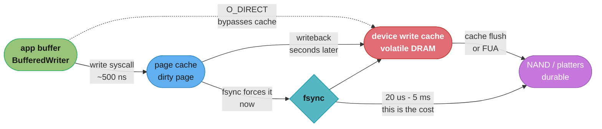
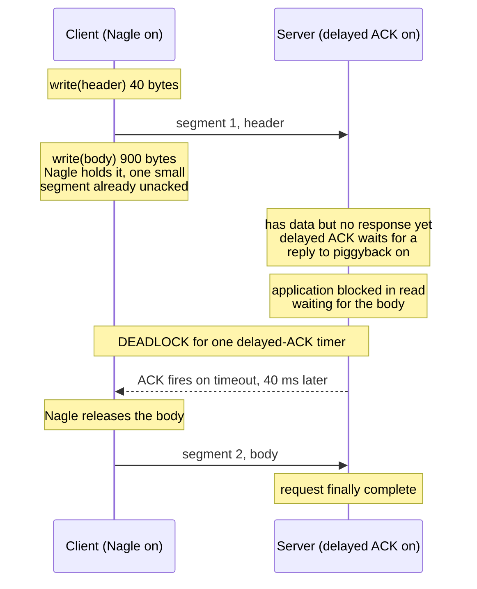

# OS and I/O Performance

> Every millisecond your service spends was bought from a price list. Most latency bugs are somebody paying 40,000 times the list price for a thing they thought was a memory access.

---

## 1. Concept Overview

A service's latency budget is spent almost entirely at boundaries it does not own: the syscall boundary, the page cache, the block device, the network stack, and the cgroup that decides when it is allowed to run at all. **This module is cost accounting at those boundaries** — what each one charges, how to measure the charge on the box you actually have, and which of them are silently overcharging you.

The framing matters because the same material is taught two ways. [Computer Architecture and Memory Hierarchy](../../cs_fundamentals/computer_architecture_and_memory_hierarchy/computer_architecture_and_memory_hierarchy.md) and [Processes, Threads and Context Switching](../../cs_fundamentals/processes_threads_and_context_switching/processes_threads_and_context_switching.md) teach the *theory*: what a cache line is, what a context switch does to the TLB, how the scheduler works. [Async I/O and Event Loops](../../cs_fundamentals/processes_threads_and_context_switching/async_io_and_event_loops.md) teaches `epoll` and `io_uring` as *design choices for a runtime*. [Linux and OS Fundamentals](../../devops/linux_and_os_fundamentals/linux_and_os_fundamentals.md) teaches namespaces, cgroup mechanics, and the OOM killer as *platform primitives*.

This file asks a narrower, more operational question: **your service is 40ms slower than it should be — which of these boundaries took the 40ms, and what is the number that proves it.** That means a latency table you have memorised well enough to do arithmetic with in a meeting, the actual cost of a syscall on a post-Spectre CPU, the reason your benchmark is lying to you about disk, the reason your Kubernetes pod stalls at 40% CPU, and the reason a perfectly healthy TCP connection sometimes inserts exactly 40 milliseconds of nothing.

**Everything here is measurable.** Nothing in this module should be believed on authority, including the numbers in it — every section names the command that produces the figure on your own hardware, because cloud instance types, kernel versions, CPU mitigation settings and storage classes move these numbers by an order of magnitude.

---

## 2. Intuition

> **One-line analogy**: Latency debugging is reading a restaurant bill. You know roughly what a coffee costs, so a 400-dollar line item labelled "coffee" is not something you need a forensic accountant to flag — you need to have memorised the price of coffee.

**Mental model**: Every operation your code performs has a **physics price** — the irreducible cost imposed by the speed of light, the memory bus, the flash controller, the syscall trap. The latency table in §4.1 is that price list. When a measurement exceeds the list price by less than about 3x, you are looking at normal overhead. When it exceeds it by 10x or more, you are not looking at physics at all — you are looking at **queueing**, and something is waiting in line behind something else.

That single distinction resolves most latency investigations:

```
measured / list_price  <  3x     -> physics. Accept it or do less of it.
measured / list_price  > 10x     -> queueing. Find the queue.
```

A "cache lookup" measured at 4ms against a DRAM list price of 100ns is 40,000x. It is not a memory access. It is a network hop, a lock, a connection pool, or a cgroup freeze — and the ratio told you that before you opened a profiler.

**Why it matters**: An engineer who has memorised the list price does capacity math in their head during design review and catches the defect before it ships. "We'll do one Redis GET per item, 500 items per request" is 500 x 250us same-rack RTT = 125ms of pure network wait, and the design dies in the meeting rather than in production. An engineer who has not memorised it ships the loop and finds out from a p99 alert eight weeks later.

**Key insight — the defaults were tuned for hardware that no longer exists, and nobody reset them.** Nagle's algorithm dates from 1984 and interacts with delayed ACK to insert exactly 40ms of dead air. `vm.dirty_ratio` at 20% was sane when hosts had 4 GiB of RAM and is a 50-gigabyte writeback bomb on a 256 GiB host. `vm.swappiness=60` was designed for desktops. HikariCP's default pool of 10 is a safe library default and a catastrophic service default. **Every one of the war stories in §10 is a default that was correct in a world that ended.**

---

## 3. Core Principles

**1. Know the price list well enough to divide by it.** The value of the latency table is not the numbers, it is the *ratio* you compute against them. Physics is within 3x; queueing is 10x and up. This one check routes an investigation correctly in seconds.

**2. The syscall boundary charges a fixed toll, so amortize it over bytes rather than paying it per byte.** A syscall costs roughly the same whether it moves 1 byte or 1 megabyte. Every batching mechanism in the kernel — `writev`, `sendmmsg`, `io_uring` submission batching, buffered stdio — exists to divide one toll across many operations.

**3. Durability is a property of your storage, not of your database.** No configuration makes a commit faster than the `fsync` underneath it. A database's floor commit latency is its storage's `fsync` latency, and the only lever that moves throughput without moving that floor is **group commit** — amortizing one `fsync` across many transactions.

**4. The page cache makes every unprepared benchmark a lie.** The second run of a benchmark reads from RAM at 100ns and reports a storage system that does not exist. Any I/O measurement not preceded by a cache drop or `O_DIRECT` measures your RAM.

**5. A CPU limit is a time budget per window, not a speed limit.** Exhaust the budget and the cgroup is *frozen* until the window rolls, regardless of how idle the host is. This decouples average utilization from latency completely: a pod can sit at 40% average CPU and still stall for 50ms out of every 100.

**6. Tail latency is made of stalls, not of slowness.** A p50 is built from list prices. A p99 is built from the events that are not in the price list at all: a throttle freeze, a writeback stall, a major page fault, a THP compaction pause, a 40ms Nagle stall, a 200ms TCP retransmission timeout. Optimizing the mean and optimizing the tail are different projects with different targets.

---

## 4. Types / Architectures / Strategies

### 4.1 The Latency Numbers Table (2026)

Memorise the order of magnitude, not the digits. The right-hand column scales every duration by one billion — one nanosecond becomes one second — which is the only way most people retain the relative distances.

| Operation | Typical (2026) | Human scale (1 ns = 1 s) |
|---|---|---|
| L1 cache reference | 1 ns (~4 cycles) | 1 second |
| Branch mispredict | 3-5 ns | 4 seconds |
| L2 cache reference | 4 ns (~14 cycles) | 4 seconds |
| L3 cache reference (shared, same socket) | 15-25 ns | 20 seconds |
| Uncontended mutex lock + unlock | 15-25 ns | 20 seconds |
| `clock_gettime()` via vDSO (no syscall) | 20-25 ns | 22 seconds |
| Main memory, local NUMA node | 80-100 ns | 1.5 minutes |
| Main memory, remote NUMA node | 140-200 ns | 3 minutes |
| **Syscall entry + exit** (mitigations on) | **250-600 ns** | **7 minutes** |
| Syscall entry + exit (mitigations off / fixed silicon) | 60-150 ns | 2 minutes |
| Compress 1 KiB with LZ4 or Snappy | ~1 us | 17 minutes |
| Minor page fault (page already in page cache) | 1-3 us | 35 minutes |
| Context switch, direct cost only | 1-3 us | 35 minutes |
| Contended mutex (futex sleep + wake) | 2-5 us | 1 hour |
| `fsync` on datacenter NVMe with power-loss protection | 20-100 us | 6-28 hours |
| Read 4 KiB from local NVMe | 20-80 us | 6-22 hours |
| Read 1 MiB sequentially from RAM (single thread) | 50-100 us | 1 day |
| Major page fault (fault + NVMe read) | 50-150 us | 1.5 days |
| Read 4 KiB from SATA SSD | 100-150 us | 1.3 days |
| Read 1 MiB sequentially from local NVMe | 150-250 us | 2.5 days |
| **TCP round trip, same rack** | **100-250 us** | **2 days** |
| TCP round trip, same AZ | 0.25-0.5 ms | 5 days |
| Read 4 KiB from EBS gp3 (network-attached) | 0.5-1 ms | 9 days |
| `fsync` on EBS gp3 | 0.5-1.5 ms | 12 days |
| **TCP round trip, cross-AZ (same region)** | **0.5-2 ms** | **15 days** |
| S3 Express One Zone, GET first byte | 3-8 ms | 1-3 months |
| Spinning disk seek + rotational latency (7200 rpm) | 8-10 ms | 3 months |
| S3 Standard, GET first byte | 20-60 ms | 8 months to 2 years |
| **Cross-region RTT (us-east-1 to us-west-2)** | **60-70 ms** | **2 years** |
| Cross-continent RTT (New York to London) | 70-90 ms | 2.5 years |
| Round-the-world RTT | 150-250 ms | 6 years |

**Six anchors worth actually memorising**, because everything else can be interpolated from them:

```
   memory     100 ns          |  local NVMe     50 us   (500x memory)
   syscall    500 ns  (5x)    |  cross-AZ        1 ms   ( 20x NVMe)
   same rack  200 us (400x)   |  cross-region   65 ms   ( 65x cross-AZ)
```

**How to use it as a sanity check.** Take any measured duration, divide by the list price for what the code claims to be doing, and read the ratio:

```
  "In-memory cache lookup" measured at 4 ms
     4 ms / 100 ns = 40,000x
     -> not a memory access. It is a network call, a lock, a pool,
        or a cgroup freeze. Do not profile the hash function.

  "Local disk read" measured at 900 us
     900 us / 50 us = 18x
     -> not local NVMe. It is network-attached storage wearing a
        /dev/nvme* device name, or the queue is deep.

  "Same-region service call" measured at 68 ms
     68 ms / 1 ms = 68x, and 68 ms is exactly the cross-region anchor
     -> you are not calling the endpoint you think you are calling.
```

That last one is a real failure mode: an SDK defaulting to a global endpoint, or a service discovery record resolving to another region. The ratio catches it before anything else does.

### 4.2 The Syscall Boundary

A syscall is a controlled trap into the kernel: `syscall` instruction, privilege transition, register save, kernel entry path, the actual work, and the whole thing in reverse. The *transition* costs 250-600 ns on a typical mitigated x86-64 server today, against 60-80 ns before 2018.

**Why it got 4-8x more expensive.** The Spectre and Meltdown families are speculative-execution attacks, and the software mitigations sit precisely on the user/kernel boundary:

| Mitigation | Defends against | Cost on the boundary |
|---|---|---|
| **KPTI** (kernel page-table isolation) | Meltdown | Full page-table switch on every entry *and* exit — the dominant cost. Much cheaper with PCID, which avoids a full TLB flush |
| **Retpoline / IBRS / eIBRS** | Spectre v2 (branch target injection) | Indirect-branch overhead throughout the kernel |
| **MDS / TAA / MMIO buffer clears** | Microarchitectural data sampling | `VERW` buffer flush on kernel exit |
| **Retbleed, SRSO, and successors** | Return-stack attacks | Additional entry/exit sequences on affected parts |

Newer silicon removes some of these costs, and the two vendors are not in the same position. Intel fixed Meltdown in hardware from Ice Lake onward, so KPTI — the dominant term — is no longer enabled there. **AMD parts were never Meltdown-affected at all**, so KPTI has never applied to them and they have never paid that toll; their bill is entirely on the Spectre and speculative-return side, which newer generations make cheaper (Automatic IBRS from EPYC 9004 onward). Either way, the same code on a newer instance type can be 2-4x cheaper per syscall with no change on your side. Read the machine rather than assuming — the vulnerabilities directory says exactly what applies:

```bash
grep . /sys/devices/system/cpu/vulnerabilities/*
# .../meltdown:Mitigation: PTI        <- on AMD this line reads "Not affected"
# .../spectre_v2:Mitigation: Enhanced IBRS, IBPB: conditional, RSB filling
# .../mds:Not affected
```

**The fix is never "turn off mitigations" on a multi-tenant host.** It is to make fewer syscalls: batch, buffer, and use the interfaces designed to amortize the toll (§6.3).

### 4.3 The Storage Ladder

Five layers between `write()` and durable bytes, each with a different failure mode.

| Layer | What it does | Latency | Survives process crash | Survives power loss |
|---|---|---|---|---|
| Application buffer | Your `BufferedWriter`, stdio | ~0 | **No** | No |
| **Page cache** (`write()` returns here) | Kernel RAM copy, marked dirty | ~1-2 us per 4 KiB | Yes | **No** |
| Writeback | Kernel flushes dirty pages on its own schedule | seconds later | Yes | No |
| **Device write cache** | Volatile DRAM on the drive | ~10 us | Yes | **No**, unless the drive has power-loss protection |
| **`fsync()` / FUA** | Forces page cache down *and* flushes the device cache | 20 us - 5 ms | Yes | **Yes** |

**`write()` returning is not durability.** It means "the kernel has your bytes in RAM." Only `fsync()` (or `O_SYNC`, or a write with FUA) makes the claim you actually want, and that is where the milliseconds live. `O_DIRECT` bypasses the page cache entirely but **does not** flush the device cache — `O_DIRECT` without `fsync` is not durable either, a distinction that has produced real data-loss bugs.

### 4.4 cgroup v2 Controls That Create Latency

| Control | File | What it does when exceeded | The trap |
|---|---|---|---|
| CPU quota | `cpu.max` = `<quota> <period>` | **Freezes** the cgroup until the period rolls | Average utilization can be far below the limit while individual periods still freeze (§6.7) |
| CPU weight | `cpu.weight` | Relative share under contention only | Not a limit — no freezing, and usually what you actually wanted |
| Memory limit | `memory.max` | cgroup-local OOM kill | Kills the *biggest* process in the cgroup, not the guilty one |
| Memory high | `memory.high` | Throttles allocation and reclaims aggressively | A soft ceiling that produces stalls instead of kills — often preferable |
| I/O limits | `io.max` | Throttles block I/O by IOPS or bytes | Throttling a writeback flush stalls every writer via `balance_dirty_pages` |
| Pressure | `cpu.pressure`, `io.pressure`, `memory.pressure` | Read-only PSI stall percentages | The best always-on signal, and almost nobody scrapes it |

Full cgroup mechanics, the OOM scoring formula, and the namespace model are in [Linux and OS Fundamentals](../../devops/linux_and_os_fundamentals/linux_and_os_fundamentals.md). What this module adds is the *latency* consequence of each and how to detect it from inside a service.

### 4.5 The Network Stack's Latency Defaults

| Default | Value | Latency effect | Fix |
|---|---|---|---|
| Nagle's algorithm | on | Holds a small write until the previous one is ACKed | `TCP_NODELAY` |
| Delayed ACK | on, up to 40 ms on Linux (`TCP_DELACK_MIN`) | Withholds the ACK Nagle is waiting for | `TCP_QUICKACK` (not sticky), or fix the write pattern |
| `TCP_RTO_MIN` | 200 ms | One lost packet costs a minimum 200 ms | Not tunable per socket without `ip route ... rto_min` |
| `tcp_rmem` max | ~6 MiB | Caps throughput on long fat networks (§6.9) | Raise `net.core.rmem_max` and `tcp_rmem` |
| Initial congestion window | 10 MSS (~14 KiB) | A 50 KiB response needs multiple RTTs | Usually correct — do not raise it casually |
| Congestion control | `cubic` (BBR available) | Loss-based, backs off hard on any loss | `net.ipv4.tcp_congestion_control=bbr` on lossy long paths |

### 4.6 NUMA, in One Paragraph

On a multi-socket server, memory is physically attached to a specific socket. A core reading memory attached to *its own* socket pays roughly 80-100 ns; reading memory attached to the *other* socket pays 140-200 ns and consumes interconnect bandwidth, so a process whose threads and memory land on different sockets can lose 20-40% of its memory throughput for reasons invisible to every application-level metric. Check with `numactl --hardware` and `numastat -p <pid>`; pin with `numactl --cpunodebind=0 --membind=0` for latency-critical single-socket workloads; and note that most cloud instances smaller than roughly 32 vCPUs are single-socket, which makes this a large-instance and bare-metal concern rather than a universal one. The architecture underneath — cache coherence, MESI, false sharing, and why interleaved allocation is sometimes better than binding — belongs to [Computer Architecture and Memory Hierarchy](../../cs_fundamentals/computer_architecture_and_memory_hierarchy/computer_architecture_and_memory_hierarchy.md) and is not repeated here.

---

## 5. Architecture Diagrams

### 5.1 The Latency Ladder — Distance in Decades

```
  Each row is 10x the row above. Where your code spends its time
  determines which decade its p50 lives in.

  1 ns    |#                        L1 cache
 10 ns    |##                       L3 cache, uncontended mutex, vDSO clock
100 ns    |####                     main memory (DRAM)
  1 us    |########                 syscall (2x), context switch, minor fault
 10 us    |################         contended lock wakeup, device write cache
100 us    |################################          local NVMe read, fsync(PLP)
  1 ms    |##################################        same-AZ RTT, EBS read/fsync
 10 ms    |####################################      cross-AZ (low end), disk seek
100 ms    |######################################    cross-region RTT, S3 GET

           ^                                    ^
           |                                    |
      everything below here is                everything above here is
      YOUR CPU and YOUR RAM.                   SOMEBODY ELSE'S MACHINE.
      Optimizing it = writing                  Optimizing it = making
      better code.                             FEWER CALLS.

  The line between 1 us and 100 us is the most important boundary in the
  chart: below it, code quality is the lever. Above it, call COUNT is the
  only lever that matters, and a 2x faster serializer buys you nothing.
```

*Two decades separate "make the code faster" from "make fewer calls," and almost every wasted optimization sprint is an engineer working on the wrong side of that line. The 500-item loop that does one same-rack Redis GET each is 125ms of pure RTT that no amount of code tuning touches.*

### 5.2 The Write Path — Where "Written" Stops Meaning "Durable"



*The two red-adjacent boxes are the ones that lose your data. A `write()` that returned successfully lives in the page cache and dies with the machine; bytes sitting in the device's volatile DRAM cache die with the power. Only the path through `fsync` reaches the purple box, and the 20us-to-5ms on that edge is the entire commit-latency budget of every database you will ever operate.*

### 5.3 Nagle Meets Delayed ACK — 40 Milliseconds of Nothing



*Neither side is malfunctioning. Nagle correctly refuses to send a second small segment while one is unacknowledged, and delayed ACK correctly waits up to 40 ms to piggyback the ACK on a response the server cannot produce because it is still waiting for the body. The result is a hard 40 ms floor on any write-write-read exchange, and it appears in a latency histogram as a spike at exactly 40 ms with nothing on either side of it.*

### 5.4 CFS Throttling — Identical CPU Consumption, One Pod Stalls

```mermaid
xychart-beta
    title "CPU consumed per 10ms slice, cpu.max = 400000 100000 (4 cores)"
    x-axis ["s1", "s2", "s3", "s4", "s5", "s6", "s7", "s8", "s9", "s10"]
    y-axis "core-milliseconds consumed in the slice" 0 --> 90
    bar [80, 80, 80, 80, 80, 0, 0, 0, 0, 0]
    bar [40, 40, 40, 40, 40, 40, 40, 40, 40, 40]
```



*Both series consume exactly 400 core-milliseconds over the 100 ms period — identical total CPU, identical average utilization, both exactly at the 4-core limit. The first is 8 runnable threads burning 8 core-ms per wall-ms: it exhausts the period's entire quota in 50 ms and is then **frozen for the remaining 50 ms**. The second is 4 threads at 4 core-ms per wall-ms, which paces exactly to the quota and never throttles. Thread count, not CPU consumption, decides whether a pod stalls.*

---

## 6. How It Works — Detailed Mechanics

### 6.1 Measuring Syscall Cost on the Box You Actually Have

The table's 250-600 ns is a range across CPU generations and mitigation settings. Measure yours:

```c
/* syscost.c -- cc -O2 syscost.c -o syscost */
#include <stdio.h>
#include <time.h>
#include <unistd.h>
#include <sys/syscall.h>

int main(void) {
    struct timespec a, b;
    const long N = 5000000;
    /* raw syscall(), not getpid() -- glibc has cached getpid() in the past */
    clock_gettime(CLOCK_MONOTONIC, &a);
    for (long i = 0; i < N; i++) syscall(SYS_getpid);
    clock_gettime(CLOCK_MONOTONIC, &b);
    double ns = ((b.tv_sec - a.tv_sec) * 1e9 + (b.tv_nsec - a.tv_nsec)) / N;
    printf("syscall entry+exit: %.1f ns\n", ns);

    /* the same loop through the vDSO, which never enters the kernel */
    struct timespec t;
    clock_gettime(CLOCK_MONOTONIC, &a);
    for (long i = 0; i < N; i++) clock_gettime(CLOCK_MONOTONIC, &t);
    clock_gettime(CLOCK_MONOTONIC, &b);
    ns = ((b.tv_sec - a.tv_sec) * 1e9 + (b.tv_nsec - a.tv_nsec)) / N;
    printf("vDSO clock_gettime: %.1f ns\n", ns);
    return 0;
}
```

```
# Representative output, mitigated x86-64 cloud instance:
syscall entry+exit: 412.6 ns
vDSO clock_gettime:  23.1 ns
```

The 18x gap between the two lines *is* the syscall boundary, isolated: both loops do trivial work, one traps into the kernel and one reads a page the kernel keeps updated in userspace. `perf bench syscall basic` measures the same thing if you have `perf` installed.

**The operational consequence.** A service issuing 200,000 syscalls/sec at 412 ns spends 82 ms of CPU per second — 8.2% of a core — on transitions alone, doing no work. Count yours before assuming it is small:

```bash
sudo bpftrace -e 'tracepoint:raw_syscalls:sys_enter /pid == '"$(pgrep -n java)"'/
                  { @ = count(); } interval:s:5 { exit(); }'
```

### 6.2 Batching Away the Toll

The toll is per call, not per byte, so the entire fix is fewer calls.

**`writev` / `readv` — scatter-gather in one syscall:**

```c
struct iovec iov[3];
iov[0].iov_base = header;  iov[0].iov_len = 40;
iov[1].iov_base = body;    iov[1].iov_len = 900;
iov[2].iov_base = trailer; iov[2].iov_len = 8;
writev(fd, iov, 3);        /* ONE syscall, one TCP segment, and no Nagle stall */
```

**`sendmmsg` / `recvmmsg` — many datagrams in one syscall:**

```c
struct mmsghdr msgs[64];
/* ... fill 64 messages ... */
sendmmsg(sock, msgs, 64, 0);   /* 1 syscall instead of 64 */
```

**The arithmetic, for a service writing 1,000 small records:**

```
  1,000 x write()                    : 1,000 x 412 ns = 412 us of pure toll
  1,000 records in 1 x writev()      :     1 x 412 ns =  0.4 us
  1,000 records via io_uring, 32/SQE :    32 x 412 ns =  13 us
                                          (or ~0 with IORING_SETUP_SQPOLL)

  saving on the syscall boundary alone: 411 us per 1,000 records.
  At 50,000 records/sec that is 20.5 ms of CPU per second reclaimed.
```

`io_uring`'s submission batching is the general case of the same idea — write N submission-queue entries into shared memory, then one `io_uring_enter()` to submit all of them. The design of that interface, its rings, and its security posture are covered in [Async I/O and Event Loops](../../cs_fundamentals/processes_threads_and_context_switching/async_io_and_event_loops.md); what matters here is only that it is the mechanism with the lowest per-operation toll available on Linux.

### 6.3 Context Switch Cost — the Direct Cost Is the Small Part

```bash
perf bench sched pipe -l 200000
# Total time: 1.043 [sec]
#     5.216 usecs/op          <- 2 context switches per op, so ~2.6 us each
#   191,750 ops/sec
```

That 2-3 us is the **direct** cost: save registers, switch page tables, scheduler bookkeeping, restore. The **indirect** cost is larger and does not appear in any switch counter:

```
  A thread with a 2 MiB working set is switched out. Another thread runs
  and evicts its lines from L2/L3. When the first thread resumes:

    2 MiB / 64 B per line = 32,768 cache lines to re-fetch
    at ~80 ns each from DRAM, with memory-level parallelism giving
    maybe 8-16 concurrent misses:

      32,768 x 80 ns / 12  ~=  218 us of cache refill

  Direct switch cost : ~2.6 us
  Indirect refill    : ~218 us       (~84x the direct cost)
```

The classic measurement of this — Li, Ding and Shen, "Quantifying the cost of context switch" (2007) — found the indirect cost dominating by one to two orders of magnitude once working sets exceed the cache, and the ratio has only widened as caches grew slower relative to cores. **The practical consequence is that switch *counts* understate the damage**, and the fix is fewer runnable threads rather than a faster scheduler.

**Voluntary vs involuntary is the diagnostic split:**

```bash
grep ctxt_switches /proc/<pid>/status
# voluntary_ctxt_switches:      1841203     <- the thread blocked (I/O, lock, sleep)
# nonvoluntary_ctxt_switches:     29118     <- the thread was PREEMPTED, it wanted to run
```

A high **voluntary** count is an I/O or locking pattern: the thread keeps choosing to wait, and the fix is in the application. A high **involuntary** count is a capacity or thread-count problem: more runnable threads than cores, or CFS throttling, and the fix is fewer threads or more quota. Watching the two ratios move is often faster than any profiler.

### 6.4 The Page Cache — and Why Your Benchmark Lied

Linux caches every file page it reads in free RAM, with no size limit other than memory pressure, and **reads ahead**: on detecting sequential access it fetches beyond what you asked for, defaulting to 128 KiB.

```bash
blockdev --getra /dev/nvme0n1     # 256  -> 256 x 512 B = 128 KiB readahead
cat /sys/block/nvme0n1/queue/read_ahead_kb   # 128
```

**The benchmark lie, made explicit:**

```bash
# Run 1 -- cold. Actually measures the device.
sync && echo 3 | sudo tee /proc/sys/vm/drop_caches
time cat 4gb-dataset.bin > /dev/null
# real  0m6.812s     -> 4 GiB / 6.81 s = 601 MiB/s  (this is your disk)

# Run 2 -- warm. Measures your RAM and reports it as your disk.
time cat 4gb-dataset.bin > /dev/null
# real  0m0.402s     -> 4 GiB / 0.40 s = 9.95 GiB/s (this is not your disk)

# 17x faster. Same command, same file, same hardware.
```

Every capacity plan built on run 2 is wrong by 17x, and it fails the first time the working set exceeds RAM — which is exactly when traffic is highest. **Any storage benchmark must either drop caches between runs or use `O_DIRECT`.** Confirm what is actually cached with `cachestat` (bcc) or `vmtouch`:

```bash
sudo cachestat-bpfcc 1
# HITS   MISSES  DIRTIES HITRATIO   BUFFERS_MB  CACHED_MB
# 88214      12       40   99.99%          412      31804
```

A 99.99% hit ratio means you are not testing storage at all.

**Telling the kernel what you know** — `posix_fadvise` for file descriptors, `madvise` for mappings:

```c
posix_fadvise(fd, 0, 0, POSIX_FADV_SEQUENTIAL);  /* double the readahead window */
posix_fadvise(fd, 0, 0, POSIX_FADV_RANDOM);      /* disable readahead: it is pure waste
                                                    on random access, and it evicts
                                                    pages you actually wanted */
posix_fadvise(fd, off, len, POSIX_FADV_DONTNEED);/* drop these pages: the right call
                                                    after streaming a huge file you
                                                    will never re-read, so it does not
                                                    evict your hot working set */
madvise(addr, len, MADV_SEQUENTIAL);
madvise(addr, len, MADV_DONTNEED);
```

`POSIX_FADV_DONTNEED` after a backup or a bulk export is the highest-value one-liner in this list: without it, a nightly 200 GiB dump evicts the entire hot working set and your p99 is bad for an hour every morning for reasons no application metric explains.

### 6.5 Dirty-Page Writeback Stalls

Dirty pages accumulate until the kernel decides to write them back. Two thresholds govern it, and their defaults are dangerous on large-memory hosts:

```bash
sysctl vm.dirty_background_ratio   # 10  -> background writeback starts at 10% of memory
sysctl vm.dirty_ratio              # 20  -> WRITERS ARE BLOCKED at 20%
sysctl vm.dirty_expire_centisecs   # 3000 -> a page is "old" after 30 s
sysctl vm.dirty_writeback_centisecs # 500 -> the flusher wakes every 5 s
```

Crossing `dirty_ratio` does not queue anything — it makes the *writing process itself* do the writeback synchronously, inside `balance_dirty_pages()`. On a big host that is a multi-second stall inside a `write()` call that normally returns in a microsecond:

```
  Host with 256 GiB RAM, backing store sustaining 500 MB/s:

    dirty_ratio 20%  ->  up to 51.2 GiB of dirty pages allowed
    flushing 51.2 GiB at 500 MB/s = 102 SECONDS

  A single write() that happens to cross the threshold blocks the caller
  until enough of that backlog drains. In a request thread, that is a
  102-second p100 and a cascade of timeouts behind it.
```

**The fix is to express the limits in bytes, not percentages**, so they stop scaling with RAM:

```bash
# Cap the backlog at what the device can flush in a couple of seconds
sysctl -w vm.dirty_background_bytes=$((512 * 1024 * 1024))   # 512 MiB
sysctl -w vm.dirty_bytes=$((1024 * 1024 * 1024))             # 1 GiB
# setting the _bytes form zeroes the corresponding _ratio, and vice versa
```

Watch it live in `/proc/meminfo`: `Dirty` is the current backlog, `Writeback` is what is in flight right now.

### 6.6 `fsync` Latency and Group Commit

```bash
# Ground truth for your storage, from the fio package
fio --name=fsynctest --rw=write --bs=4k --size=64m --fdatasync=1 \
    --filename=/var/lib/db/testfile --output-format=normal | grep -A3 'fsync'
```

Representative figures, and the spread is the point:

| Storage | `fsync` latency | Implied max serial commits/sec |
|---|---|---|
| Datacenter NVMe with power-loss protection | 20-100 us | 10,000 - 50,000 |
| Consumer NVMe, no PLP (must flush volatile cache) | 0.4 - 2 ms | 500 - 2,500 |
| AWS EBS gp3 | 0.5 - 1.5 ms | 700 - 2,000 |
| AWS EBS io2 Block Express | 0.25 - 0.6 ms | 1,600 - 4,000 |
| Synchronously replicated across AZs | + 0.5 - 2 ms of RTT | 300 - 1,000 |

**This is why commit latency is a storage property.** No index, no query plan, no connection pool setting makes a durable commit faster than the `fsync` beneath it. A database advertising 50,000 writes/sec on a device that fsyncs in 1 ms is not doing 50,000 fsyncs — it is doing group commit.

**Group commit** batches N transactions behind one `fsync`. The trade is exact:

```
  Serial commit (one fsync per transaction), fsync = 1 ms:
      throughput = 1 / 0.001 s        =  1,000 txn/sec       (hard ceiling)
      commit latency per txn          =  1 ms

  Group commit, 64 transactions per fsync:
      throughput = 64 / 0.001 s       = 64,000 txn/sec       (64x)
      commit latency per txn          =  1 ms + up to the group window
                                         (the wait for the group to fill)

  Throughput scales with group size. Latency does NOT improve, and gets
  slightly worse by the batching window. Group commit is a THROUGHPUT
  mechanism that costs a little latency -- never a latency fix.
```

The knobs, per engine:

```sql
-- PostgreSQL: let a committer wait briefly for company
SET commit_delay = 100;      -- microseconds to wait before flushing
SET commit_siblings = 5;     -- only if at least 5 other transactions are active
-- The durability escape hatch, for data you can afford to lose:
SET synchronous_commit = off;  -- commit returns before the WAL is flushed.
                               -- Bounded loss (wal_writer_delay), NOT corruption.
```

```ini
# MySQL / InnoDB
innodb_flush_log_at_trx_commit = 1   # fsync every commit. Fully durable, slowest.
                                     # = 2: write to OS page cache, fsync once/sec.
                                     #      Survives a mysqld crash, not a power loss.
binlog_group_commit_sync_delay = 100 # microseconds to accumulate a binlog group
```

The durability decision is genuinely a business decision, and the honest framing is: `synchronous_commit=off` and `innodb_flush_log_at_trx_commit=2` risk **losing the last fraction of a second of committed transactions on power loss**, without risking corruption. For a metrics ingest pipeline that is free throughput. For a ledger it is unacceptable. Decide it explicitly, not by inheriting a default.

### 6.7 CFS Quota Throttling — the Number-One Hidden Latency Source in Kubernetes

A Kubernetes CPU *limit* becomes a cgroup quota. `resources.limits.cpu: "4"` becomes:

```bash
cat /sys/fs/cgroup/cpu.max
# 400000 100000     -> 400,000 us of CPU per 100,000 us period = 4 cores
```

The critical property: **quota is consumed by all runnable threads in parallel.** With T threads all running, quota burns at T core-microseconds per wall-microsecond.

```
  quota      = 400 ms of CPU per 100 ms period
  T threads  -> burn rate = T core-ms per wall-ms
  wall time until the quota is exhausted = 400 / T milliseconds

     T =  4   ->  quota lasts 100 ms  ->  never throttles (paces exactly)
     T =  8   ->  quota lasts  50 ms  ->  FROZEN for 50 ms of every period
     T = 16   ->  quota lasts  25 ms  ->  FROZEN for 75 ms of every period
     T = 40   ->  quota lasts  10 ms  ->  FROZEN for 90 ms of every period
```

**Why average utilization stays low while the pod stalls.** Take the classic case: 8 runnable threads, bursty arrival, over a 1-second window of ten periods.

```
  2 periods carry a burst (a GC cycle, a batch flush, a traffic spike):
      8 threads x 50 ms of wall time = 400 ms of quota  -> EXHAUSTED
      throttled for the remaining 50 ms of each period
      CPU consumed: 400 ms per period, 800 ms total

  8 periods are quiet:
      CPU consumed: 100 ms per period, 800 ms total

  Over the full second:
      CPU consumed  = 1,600 core-ms = 1.6 cores
      limit         = 4 cores
      AVERAGE UTILIZATION vs the limit = 1.6 / 4 = 40%

      nr_throttled / nr_periods = 2 / 10 = 20% of periods froze
      every request landing in a frozen window ate up to 50 ms of stall
```

**40% average CPU and a 50 ms tail from the same pod, at the same time.** Both numbers are correct. The dashboard showing 40% is not lying; it is answering a question about the mean while the incident is about the tail.

**Detecting it** — cgroup v2:

```bash
cat /sys/fs/cgroup/cpu.stat
# usage_usec 1600000000
# nr_periods 128400
# nr_throttled 24120           <- 18.8% of periods hit the wall
# throttled_usec 1182000000    <- 1,182 seconds of forced stall
```

cgroup v1 uses the same file with `nr_throttled` and `throttled_time` (in nanoseconds). From Prometheus with cAdvisor:

```promql
# Alert above ~1%. Anything above 5% is actively shaping your p99.
rate(container_cpu_cfs_throttled_periods_total[5m])
  / rate(container_cpu_cfs_periods_total[5m])
```

**The three fixes, and when each is right:**

| Fix | How | Right when |
|---|---|---|
| **Raise the limit** | `limits.cpu: "8"` | The workload genuinely bursts wider than the limit and the node has headroom |
| **Lower the thread count** | Make every pool see the cgroup, not the node | The pod is sizing pools from the node's core count — the common case |
| **Remove the limit** | Set `requests.cpu` only, no `limits.cpu` | Latency-sensitive service on a node you control, with requests set honestly |

Making pools see the cgroup is the fix people miss, because runtimes disagree about how well they detect it:

```yaml
env:
  # JVM: modern JDKs read cgroup quota, but several pools are still sized from
  # availableProcessors() in ways that surprise. Set it explicitly.
  - name: JAVA_TOOL_OPTIONS
    value: "-XX:ActiveProcessorCount=4 -XX:MaxRAMPercentage=75.0"
  # Go: GOMAXPROCS defaults to the NODE's core count, ignoring the cgroup entirely,
  # until Go 1.25 made it cgroup-aware. Pin it, or use automaxprocs.
  - name: GOMAXPROCS
    value: "4"
```

**Removing the limit entirely is legitimate and often correct.** CPU *requests* already guarantee a share under contention via `cpu.weight`; the *limit* only adds the ability to freeze you when the node has idle cores sitting right there. For a latency-sensitive service, trading a hard cap for a tail-latency win is usually the right call — with the caveat that you then depend on honest requests and on neighbours behaving, which is a scheduling and capacity discipline rather than a free lunch.

**One historical trap worth knowing.** Before Linux 5.4, the CFS bandwidth controller distributed quota in 5 ms per-CPU slices that could expire unused, so a multi-threaded process on a many-core machine leaked quota and throttled at as little as 30% of its limit. This was a genuine kernel bug, fixed in 5.4 (`de53fd7aedb1`). If you are on an older kernel and the arithmetic above does not explain your throttling, that is why — and the fix is the upgrade, not the config.

### 6.8 Memory Pressure — Swap, THP, and the Cliff

**Swap.** `vm.swappiness` (default 60) biases the kernel between reclaiming page cache and swapping anonymous pages. For a database or a JVM, swapping heap is catastrophic: a garbage collector touching a swapped-out page pays a major fault, and a GC pass over a swapped heap can take minutes instead of milliseconds.

```bash
sysctl -w vm.swappiness=1     # 1, not 0. 0 disables swap-based reclaim entirely and
                              # makes the OOM killer likelier. 1 means "only under
                              # real pressure", which is what you actually want.
```

Kubernetes disables swap on nodes by default (swap support reached beta in 1.30 and remains opt-in), so in a cluster this is usually a node-level setting you inherit rather than one you tune.

**Transparent huge pages.** THP maps 2 MiB pages instead of 4 KiB ones, cutting TLB pressure — a real win for large sequential-access workloads. Databases turn it off anyway, and the reason is the *allocation path*, not the pages:

```bash
cat /sys/kernel/mm/transparent_hugepage/enabled
# [always] madvise never
cat /sys/kernel/mm/transparent_hugepage/defrag
# always defer defer+madvise [madvise] never
```

With `enabled=always`, a page fault that cannot immediately find a free 2 MiB block triggers **synchronous memory compaction** inside the faulting thread — hundreds of milliseconds of stall on a fragmented host, appearing in your latency histogram as an unexplained multi-hundred-millisecond spike. `khugepaged` adds background compaction stalls on top. And for `fork`-based persistence (Redis `BGSAVE`), copy-on-write granularity becomes 2 MiB: writing **one byte** copies 2 MiB, which both spikes latency and can multiply memory usage far past what was planned for.

```bash
# What MongoDB, Redis, Oracle and Couchbase all document:
echo never | sudo tee /sys/kernel/mm/transparent_hugepage/enabled
echo never | sudo tee /sys/kernel/mm/transparent_hugepage/defrag
# 'madvise' is the nuanced middle: THP only where the application asks for it.
```

**cgroup memory limits.** `memory.max` is a hard wall producing a cgroup-local OOM kill; `memory.high` throttles allocation and reclaims hard instead, which turns a kill into a stall — often what you want for a service that can shed load. The OOM scoring model, and why the *biggest* process gets killed rather than the guilty one, is in [Linux and OS Fundamentals](../../devops/linux_and_os_fundamentals/linux_and_os_fundamentals.md). The latency-relevant part is the approach to the wall: as a cgroup nears `memory.max` the kernel reclaims ever more aggressively, so **latency degrades badly before anything is killed**, and `memory.pressure` (PSI) sees that ramp while `memory.current` alone does not.

### 6.9 Network Stack Latency

**The 40 ms stall, broken and fixed.** This is the single most common "the network is mysteriously slow" bug in production.

```java
// BROKEN -- write-write-read on a Nagle-enabled socket.
// Each write() is a separate small segment. Nagle holds the second until the
// first is ACKed; the peer's delayed ACK holds that ACK for up to 40 ms
// because it has no response to piggyback on. Hard 40 ms floor per request.
Socket sock = new Socket(host, port);
OutputStream out = sock.getOutputStream();
out.write(header);      // 40 bytes  -> goes out immediately
out.write(body);        // 900 bytes -> HELD BY NAGLE
out.flush();
InputStream in = sock.getInputStream();
byte[] response = in.readNBytes(expectedLen);   // ~40 ms later
```

```java
// FIXED -- two independent fixes, apply both.
Socket sock = new Socket(host, port);
sock.setTcpNoDelay(true);                 // TCP_NODELAY: disable Nagle outright

// AND fix the write pattern, so there is only ever one segment to hold:
OutputStream out = new BufferedOutputStream(sock.getOutputStream(), 8192);
out.write(header);
out.write(body);
out.flush();                              // ONE write() -> ONE segment -> no stall
```

**Why both.** `TCP_NODELAY` removes the interaction, and it is what every RPC framework sets by default (gRPC, Netty, and most HTTP clients set it for you — which is why you meet this bug on hand-rolled protocol code, not on gRPC). Buffering into a single write is the deeper fix: it is one syscall instead of two, one segment instead of two, and it is correct even against a peer you do not control. The kernel-level equivalent of the buffering fix is `writev` (§6.2).

**The signature in a histogram is unmistakable**: a spike at exactly 40 ms, with a bimodal distribution and nothing between the fast mode and the spike. Physics does not produce a mode at a round number; a timer does. Confirm it:

```bash
sudo tcpdump -i any -nn 'tcp port 8080' -ttt | head -40
#  00:00:00.000012 IP 10.0.1.5.51234 > 10.0.2.9.8080: Flags [P.], length 40
#  00:00:00.039981 IP 10.0.2.9.8080 > 10.0.1.5.51234: Flags [.], ack 41   <- 40 ms
#  00:00:00.000018 IP 10.0.1.5.51234 > 10.0.2.9.8080: Flags [P.], length 900
```

**Socket buffer sizing on long paths.** Throughput on a TCP connection is bounded by `window / RTT`, so a fat, long path needs a large window:

```
  BDP (bandwidth-delay product) = bandwidth x RTT
     10 Gbit/s x 60 ms = 75 MB in flight to saturate the link

  Linux default autotuning ceiling:
     net.ipv4.tcp_rmem = "4096 131072 6291456"   -> max 6 MiB
     achievable throughput = 6 MiB / 0.060 s = 100 MB/s = 800 Mbit/s

  You are using 8% of a 10 Gbit link, and every tool reports the network
  as healthy, because it is. The window is the limit, not the wire.
```

```bash
sysctl -w net.core.rmem_max=134217728
sysctl -w net.core.wmem_max=134217728
sysctl -w net.ipv4.tcp_rmem="4096 131072 134217728"
sysctl -w net.ipv4.tcp_wmem="4096 65536 134217728"
# On long paths with any loss, also consider BBR, which does not collapse
# its window on a single loss the way loss-based cubic does:
sysctl -w net.ipv4.tcp_congestion_control=bbr
```

This matters for cross-region replication and bulk transfer and essentially nowhere else — on a same-AZ path with a 0.4 ms RTT, the BDP is 500 KB and the defaults are ample.

**Connection setup cost.** Establishing a connection is pure RTT, and it is charged before a single byte of your payload moves:

```
  TCP handshake                    : 1 RTT
  TLS 1.3 full handshake           : 1 RTT      (TLS 1.2 was 2)
  -----------------------------------------------
  time to first byte, new conn     : 2 RTT

  same-AZ    (0.4 ms RTT)   ->   0.8 ms      -- noise
  cross-AZ   (1.5 ms RTT)   ->   3.0 ms      -- noticeable
  cross-region (65 ms RTT)  -> 130 ms        -- larger than most SLOs,
                                                before any work is done
```

Plus server-side crypto: an ECDHE key exchange on P-256 is roughly 50-100 us and an RSA-2048 signature roughly 0.5-1 ms of CPU, which is why a connection storm is a CPU event as well as a latency event.

**The fix is always to not do it**: connection pooling with generous keep-alive, HTTP/2 or HTTP/3 multiplexing over one connection, and TLS session resumption (TLS 1.3 0-RTT gets a resumed handshake back to 1 RTT total, with the replay caveats that make it safe only for idempotent requests). A pool that closes idle connections after 30 seconds against a downstream you call every 45 seconds pays the full 130 ms cross-region setup on *every single request*, and looks in every metric like a slow downstream.

---

## 7. Real-World Examples

- **Jeff Dean's "Numbers Everyone Should Know"** (Google, 2009, from a talk on building large-scale systems) is the origin of the table in §4.1, and the reason a generation of engineers can do this arithmetic in their heads. Colin Scott's "Latency Numbers Every Programmer Should Know" interactive page extended it with hardware-trend projections. The values in §4.1 are the 2026 shape: cache and DRAM barely moved in fifteen years, disk was replaced wholesale by NVMe (a 100x improvement), the syscall got 4-8x *worse* from CPU mitigations, and network latency is pinned by the speed of light and has not improved at all.
- **The Nagle and delayed-ACK interaction** has been rediscovered continuously since John Nagle's RFC 896 in 1984 — Nagle himself has repeatedly pointed out that the pathological case is the *interaction* with delayed ACK, not his algorithm. It has produced documented 40 ms floors in Ruby's Net::HTTP, early Node.js, MongoDB drivers, Riak, and countless internal RPC layers. Every modern RPC framework sets `TCP_NODELAY` by default because of this history.
- **CFS throttling in Kubernetes** is one of the most widely written-up production traps in the ecosystem, with the definitive early accounts from Zalando and Omio; Dave Chiluk's 2019 kernel work (`de53fd7aedb1`, in 5.4) fixed the per-CPU quota-slice expiry bug that made it far worse than the arithmetic predicted. The current consensus among latency-sensitive operators — visible in Kubernetes' own issue history and in the long-running debate over the `cpu-cfs-quota` kubelet flag — is to set CPU requests and omit CPU limits entirely for latency-critical services.
- **Transparent huge pages** are disabled by explicit documented recommendation in MongoDB, Redis, Oracle Database, Couchbase, and most Cassandra deployments — a rare case of an entire industry segment agreeing that a kernel default is wrong for them. Redis's documentation is the clearest on the mechanism: 2 MiB copy-on-write granularity during `fork`-based persistence turns a one-byte write into a 2 MiB copy.
- **PostgreSQL's deliberate reliance on the page cache** is the counterexample to "always use `O_DIRECT`." PostgreSQL accepts double buffering (shared_buffers plus page cache) rather than managing all caching itself, on the reasoning that the kernel's readahead and eviction are good and the complexity is not worth owning. PostgreSQL 18 (2025) added asynchronous I/O with `io_method` supporting `worker` and `io_uring`, while remaining buffered by default — an evolution of the I/O path, not an abandonment of the design choice.

---

## 8. Tradeoffs

### Buffered I/O vs `O_DIRECT`

| Dimension | Buffered (page cache) | `O_DIRECT` |
|---|---|---|
| Re-read of hot data | Free, from RAM | Full device latency every time |
| Readahead | Automatic, sequential detection | None — you implement it |
| Memory accounting | Kernel-owned, elastic, invisible | Yours, explicit, bounded |
| Double buffering | Yes, if you also cache | None |
| Alignment constraints | None | Buffer, offset and length must be block-aligned (`posix_memalign`) |
| Durability | Still needs `fsync` | **Still needs `fsync`** — `O_DIRECT` skips the cache, not the device cache |
| Right for | Applications without their own cache, mixed workloads, PostgreSQL | Databases with their own buffer pool that know their access pattern (InnoDB, Oracle) |

### Durability Settings

| Setting | Loss window on power failure | Throughput | Right for |
|---|---|---|---|
| `fsync` per commit (`innodb_flush_log_at_trx_commit=1`, `synchronous_commit=on`) | Zero | Bounded by `fsync` latency | Ledgers, payments, anything with an auditor |
| Group commit | Zero | N x, with a small latency cost | **The default answer** for most OLTP |
| `synchronous_commit=off` / `flush_log_at_trx_commit=2` | Sub-second of committed transactions | Much higher | Metrics, events, logs, anything replayable |
| No durability (`=0`, or an in-memory store) | Everything since the last checkpoint | Highest | Caches, derived data, recomputable state |

### CPU Limits in Kubernetes

| Approach | Tail latency | Node utilization | Noisy-neighbour risk | Right when |
|---|---|---|---|---|
| Requests + limits, limits tight | **Worst** — freezes at low average CPU | Predictable, often poor | Lowest | Batch, multi-tenant untrusted, cost caps |
| Requests + limits, limits generous | Good, if the headroom is honest | Moderate | Low | The pragmatic default |
| **Requests only, no CPU limit** | **Best** | Highest | Depends on honest requests | Latency-critical services on a node you control |

### Where a Latency Millisecond Can Be Bought Back

| Lever | Typical win | Cost |
|---|---|---|
| `TCP_NODELAY` on a write-write-read protocol | Up to 40 ms per request | None. Do it |
| Connection pooling on a cross-region call | ~130 ms per request | Pool complexity, idle connections |
| Batching syscalls (`writev`, `io_uring`) | 0.4 ms per 1,000 ops | Code complexity |
| Removing a CPU limit | 10-90 ms of tail | Requires honest requests |
| Group commit | N x write throughput | Slightly worse commit latency |
| `THP=never` on a database | Removes multi-hundred-ms spikes | Slightly more TLB pressure |
| Faster serializer | Microseconds | Days of work — check §5.1 first |

---

## 9. When to Use / When NOT to Use

### Do This Accounting When

- **A measured duration is more than 10x its list price.** That ratio is a queue, and finding the queue is faster than profiling the code (§2, §4.1).
- **The tail is bad and the mean is fine.** Means are made of list prices, tails are made of stalls — throttle freezes, writeback stalls, THP compaction, Nagle, retransmission timeouts. A tail investigation is a stall hunt, and this module is the catalogue of stalls.
- **A latency spike sits at a suspiciously round number.** 40 ms is Nagle plus delayed ACK. 200 ms is `TCP_RTO_MIN`. 100 ms and its multiples are a CFS period. 30 s is a connection or DNS timeout. Physics does not produce round numbers; timers do.
- **The service is slow in production and fast on a laptop.** Almost every item in this file is environmental — cgroup limits, real storage, real RTT, real memory pressure, neighbours on the node. That gap is the signature.
- **You are sizing capacity or reviewing a design.** The 500-item loop at 250 us per same-rack call is 125 ms, and catching it in review costs nothing.

### Do NOT Reach For It When

- **A trace or a profiler has already localized the problem to your code.** If a CPU profile shows 60% of the time in one function, fix the function; syscall accounting is not the lever.
- **The service is CPU-saturated.** At 95% CPU the constraint is compute. Use the on-CPU profiler ([Performance Profiling](../performance_profiling/performance_profiling.md)) first, and come back here only if the profile is flat ([Off-CPU Analysis](../off_cpu_and_ebpf_analysis/off_cpu_and_ebpf_analysis.md) is the bridge).
- **The numbers you have are within 2-3x of the list price.** That is physics. The fix is doing less of it — fewer calls, less data — not tuning the thing you are doing.
- **You have not measured on the actual hardware.** Every number in this file moves by an order of magnitude across instance types, kernel versions, mitigation settings, and storage classes. Quoting the table in an incident without measuring is how a 900 us "local disk read" gets accepted as normal.

### Caution

- **Never tune `sysctl` on a shared host without knowing what else runs there.** `vm.dirty_bytes`, `swappiness` and socket buffers are node-wide and affect every workload on the box.
- **Never disable CPU mitigations to buy back syscall cost on multi-tenant infrastructure.** The fix is fewer syscalls.
- **Never conclude "the disk is fast" from a warm-cache benchmark.** Drop caches or use `O_DIRECT`, every time (§6.4).
- **Never trade durability without writing the loss window down.** `synchronous_commit=off` has a specific, bounded, statable loss window — state it, get it agreed, and record where.

---

## 10. Common Pitfalls

**War Story 1 — 40 Milliseconds That Cost Six Weeks and a Rewritten Client**

A logistics platform's internal route-optimization service had a p50 of 3 ms and a p99 of 47 ms. The latency histogram was unmistakably bimodal: a tight mode at 2-4 ms, nothing at all between 5 and 38 ms, and a hard second mode at exactly 41 ms holding 12% of requests. Six weeks went into the wrong end of it — the optimizer's inner loop was rewritten, a caching layer was added in front of the geometry service, and the JVM was moved to ZGC. p99 moved from 47 ms to 46 ms.

The tell was ignored for six weeks: **physics does not produce a spike at a round number.** A 40 ms mode with a gap on either side is a timer, and there is exactly one 40 ms timer in the Linux TCP stack.

```bash
sudo tcpdump -i any -nn 'host 10.4.31.9 and port 9090' -ttt | head
#  00:00:00.000021 IP client.51234 > svc.9090: Flags [P.], length 62      <- header
#  00:00:00.039987 IP svc.9090 > client.51234: Flags [.], ack 63          <- 40 ms ACK
#  00:00:00.000014 IP client.51234 > svc.9090: Flags [P.], length 1188    <- body
```

The client was a hand-rolled binary protocol over a raw `Socket`, written before the team standardized on gRPC. It wrote a 62-byte header and then the body as two separate `write()` calls on a socket with Nagle enabled. Nagle held the body because the header was unacknowledged; the server's delayed ACK held the ACK for the full 40 ms `TCP_DELACK_MIN` because the server application was blocked reading the body it had not received and therefore had no response to piggyback on. Two correct algorithms, one deadlock, resolved only by a timer.

The 12% figure was the other clue nobody read. Requests whose header happened to fill the previous segment, or that followed closely enough to ride an existing ACK, escaped — so it was not every request, which is exactly why "it's the network" was dismissed early.

*Fix*: one line, plus the deeper one.

```java
sock.setTcpNoDelay(true);   // the one line

// and the write pattern, which is correct regardless of the peer's settings:
OutputStream out = new BufferedOutputStream(sock.getOutputStream(), 8192);
out.write(header);
out.write(body);
out.flush();                // one write(), one segment, nothing for Nagle to hold
```

**p99 fell from 46 ms to 4 ms in the time it took to deploy.** The six weeks of optimizer work was real work on the 3 ms mode, and it was never going to touch the 41 ms one.

**What it means.** "A bimodal histogram with a gap and a round-numbered second mode is a timer, not a workload — and the workload is where everybody looks first."

| Symbol | What it is |
|---|---|
| the two modes | `2-4 ms` (real work) and `41 ms` (a timer), with nothing between |
| share affected | `12%` of requests — enough to own p99, low enough to look random |
| the timer | Linux `TCP_DELACK_MIN` = **40 ms** |
| six weeks of work | Correctly optimized the 3 ms mode. Moved p99 by 1 ms |
| the fix | `setTcpNoDelay(true)`, plus buffering two writes into one |

**War Story 2 — The Pod That Stalled at 32% CPU**

A Node.js 24 catalog-metadata API on EKS: 30 pods, `limits.cpu: "2"`, average CPU 32% of the limit on every dashboard, and a p99 of 112 ms against a 50 ms SLO with a tail that recurred every 3 seconds like a metronome. Capacity was the obvious answer, so the deployment was scaled from 30 to 42 pods. **p99 moved by 4 ms and the monthly bill went up 40%.**

The cgroup told a different story than the dashboard:

```bash
cat /sys/fs/cgroup/cpu.stat
# nr_periods 61200
# nr_throttled 12240           <- 20.0% of periods
# throttled_usec 1071000000    <- 1,071 s of forced stall
```

A catalog refresh ran every 3 seconds, fanning its gzip and hashing out over a `worker_threads` pool sized — as every worker-pool library defaults to sizing it — from `os.availableParallelism()`. That call is `uv_available_parallelism()` underneath, which reads the CPU **affinity mask** and knows nothing about cgroup quota, so on this node it returned 16. Nobody chose 16; nobody had to. The refresh put all 16 threads on-CPU at once against a 2-core limit. The arithmetic from §6.7, with this pod's numbers:

```
  limits.cpu: "2"  ->  cpu.max = 200000 100000  ->  200 ms of CPU per 100 ms

  16 threads burn quota at 16 core-ms per wall-ms
      200 / 16 = 12.5 ms of wall time until the quota is gone
      -> FROZEN for the remaining 87.5 ms of that period

  The refresh spanned 6 consecutive periods out of every 30 (3 seconds):
      6 busy periods   x 200 core-ms (full quota)  = 1,200 core-ms
     24 quiet periods  x  30 core-ms               =   720 core-ms
     --------------------------------------------------------------
      1,920 core-ms consumed against a 2-core limit over 3 s (6,000)
      AVERAGE UTILIZATION = 1,920 / 6,000 = 32%
      nr_throttled / nr_periods = 6 / 30 = 20% of periods froze

  p99 request = 25 ms of real work + up to 87 ms of freeze = 112 ms
```

Every number on the dashboard was correct. The 32% was the mean over thirty periods; the 112 ms was one request landing in one of the six frozen ones, and the 3-second beat was the refresh interval, not a workload property.

Scaling out made it marginally worse per pod: more pods meant the same refresh on each, and the per-pod thread count was unchanged.

*Fix*:

```yaml
env:
  # Pin every pool to the cgroup limit rather than to availableParallelism().
  - name: UV_THREADPOOL_SIZE
    value: "2"
  - name: WORKER_POOL_SIZE      # read by the app instead of availableParallelism()
    value: "2"
# plus: the catalog refresh moved to its own Deployment with its own limits, so
# it can no longer freeze the cgroup that serves requests.
```

```promql
# and the alert that should have existed from day one
rate(container_cpu_cfs_throttled_periods_total[5m])
  / rate(container_cpu_cfs_periods_total[5m])  > 0.01
```

**p99 112 ms -> 27 ms. Throttled period share 20% -> 0.3%. Pods 42 -> 28.** Average CPU utilization, before and after: 32% and 34%. The metric everyone was watching never moved, because it was never the metric.

**War Story 3 — A Nightly Backup That Broke Every Morning's p99**

A payments service ran a `pg_dump` of a 180 GiB database to local disk at 02:00. The dump itself was fine. From 02:00 to roughly 03:15 every morning, the *API's* p99 rose from 40 ms to 600 ms, and it recovered on its own — which is why it survived four months as "a known nightly thing."

Two mechanisms, both from §6.4 and §6.5, compounding:

```
  1. Streaming 180 GiB through the page cache evicted the entire hot
     working set. Every query that had been a 100 ns RAM hit became a
     ~700 us EBS gp3 read. The 75-minute recovery was the cache
     re-warming from live traffic, one page at a time.

  2. Host had 256 GiB RAM, vm.dirty_ratio = 20 -> up to 51 GiB of dirty
     pages allowed before balance_dirty_pages() forces the WRITER to do
     synchronous writeback. Backing store sustained ~500 MB/s, so an
     unlucky write() blocked for multiple seconds inside the syscall.
```

*Fix*, three lines and no application change:

```bash
# 1. Do not let the dump poison the page cache: drop each chunk after writing it.
pg_dump ... | dd of=/backup/dump.sql oflag=direct bs=1M
# (or POSIX_FADV_DONTNEED over the output file after each flush; `nocache` from
#  the util package wraps this for arbitrary commands)

# 2. Cap the dirty backlog in BYTES so it stops scaling with RAM.
sysctl -w vm.dirty_background_bytes=$((512 * 1024 * 1024))
sysctl -w vm.dirty_bytes=$((1024 * 1024 * 1024))

# 3. Give the backup its own I/O budget so it cannot starve the request path.
systemd-run --scope -p IOWeight=10 -p CPUWeight=10 pg_dump ...
```

**Morning p99 went from 600 ms to 44 ms, and the 75-minute recovery window disappeared entirely.** The backup got about 20% slower and nobody noticed, because nothing was waiting on it.

**The generalizable rule**: any process that streams more data than you have RAM is a **page-cache eviction event** for everything else on the host, and the kernel has no idea your bulk job is less important than your request path. Say so explicitly — `O_DIRECT`, `POSIX_FADV_DONTNEED`, or an I/O cgroup weight.

---

## 11. Technologies & Tools

| Category | Tools | Notes |
|---|---|---|
| Latency histograms | `bpftrace`, `funclatency`, `biolatency`, `runqlat` | Distributional answers with in-kernel aggregation — see [Off-CPU Analysis](../off_cpu_and_ebpf_analysis/off_cpu_and_ebpf_analysis.md) |
| Syscall counting | `strace -c -f` (dev only), `perf trace`, `syscount`, `bpftrace` on `raw_syscalls` | `strace` is 10-100x overhead — never on a production latency-sensitive process |
| Syscall / switch microbenchmarks | `perf bench syscall basic`, `perf bench sched pipe`, `perf bench mem memcpy` | The fastest way to characterize an unfamiliar instance type |
| Storage benchmarking | `fio` (`--fdatasync=1` for commit latency), `ioping`, `dd oflag=direct` | `fio` with `--fdatasync=1` is the ground truth for a database's commit floor |
| Page cache inspection | `cachestat`, `vmtouch`, `/proc/meminfo` (`Dirty`, `Writeback`), `free -m` | `vmtouch -v <file>` shows exactly which pages of a file are resident |
| I/O below the filesystem | `biolatency`, `biosnoop`, `iostat -x 1`, `blktrace` | `iostat`'s `await` and `aqu-sz` distinguish device latency from queueing |
| CPU pressure and throttling | `/sys/fs/cgroup/cpu.stat`, PSI (`/proc/pressure/*`), `cAdvisor`, `runqlat` | PSI is free, always on, and almost never scraped |
| Network | `tcpdump -ttt`, `ss -tmi`, `tcpretrans`, `tcplife`, `mtr`, `iperf3` | `ss -tmi` shows per-socket RTT, cwnd, retransmits, and buffer occupancy |
| NUMA | `numactl --hardware`, `numastat -p <pid>`, `lscpu` | Mostly a large-instance and bare-metal concern |
| Kernel tunables | `sysctl -a`, `/sys/kernel/mm/transparent_hugepage/*`, `/sys/block/*/queue/*` | Persist in `/etc/sysctl.d/`; in Kubernetes via a privileged init container or node config |
| Memory pressure | `/sys/fs/cgroup/memory.pressure`, `memory.high`, `vmstat 1` | `memory.high` turns an OOM kill into a stall, which is often preferable |

---

## 12. Interview Questions with Answers

**Q: A client and server exchange small messages and every request takes almost exactly 40ms. What is happening?**
**Short:** Nagle's algorithm on the sender is deadlocked against delayed ACK on the receiver, and the receiver's 40ms ACK timer is what breaks it.

A: The client is doing write-write-read: two small `write()` calls followed by a read. Nagle refuses to send the second small segment while the first is still unacknowledged. The receiver has the first segment but its application is blocked waiting for the rest of the message, so it has no response to piggyback an ACK onto, and delayed ACK holds the bare ACK for up to `TCP_DELACK_MIN`, which is 40ms on Linux. Neither algorithm is malfunctioning — the deadlock is in their interaction, and it resolves only when the timer fires. The signature is unmistakable in a histogram: a spike at exactly 40ms with a clean gap below it, because physics does not produce round numbers and timers do. The fix is `TCP_NODELAY` on the socket, plus coalescing the two writes into one (a buffered stream, or `writev`) so there is only one segment and nothing for Nagle to hold. Modern RPC frameworks set `TCP_NODELAY` by default, which is why this bug lives almost exclusively in hand-rolled protocol code.

**Q: Why does a syscall cost 300-500 nanoseconds today when it was 60-80 nanoseconds before 2018, and what do you do about it?**
**Short:** Spectre and Meltdown mitigations sit exactly on the user/kernel boundary, and the fix is to make fewer syscalls rather than to disable them.

A: The dominant cost is KPTI, kernel page-table isolation, which mitigates Meltdown by switching page tables on every kernel entry *and* exit — expensive even with PCID avoiding a full TLB flush. Spectre v2 mitigations (retpoline, IBRS, eIBRS) add indirect-branch overhead throughout the kernel, and the MDS family adds a `VERW` buffer clear on exit. Together that is roughly 4-8x on the transition. Newer silicon removes some of it: Intel fixed Meltdown in hardware from Ice Lake onward so KPTI is no longer enabled there, and AMD was never Meltdown-affected in the first place, so it has never run KPTI at all and pays only on the Spectre side. That means the same binary on a newer instance type can be 2-4x cheaper for free — check `/sys/devices/system/cpu/vulnerabilities/*` to see what your kernel actually enabled rather than assuming the 4-8x applies to you. Disabling mitigations is not the answer on multi-tenant infrastructure. The answer is amortizing the toll: `writev` instead of N writes, `sendmmsg` instead of N sends, buffered I/O, and `io_uring` submission batching, which can drive the per-operation syscall count toward zero. Measure first — a service doing 200,000 syscalls/sec at 412ns is burning 8% of a core on transitions alone.

**Q: A Kubernetes pod shows 40% average CPU utilization and yet has a 50ms latency tail. How is that possible?**
**Short:** CFS quota is consumed by all runnable threads in parallel, so a burst can exhaust the whole period's budget in half the period and freeze the cgroup for the rest.

A: A CPU limit becomes a quota per period — `limits.cpu: "4"` is `cpu.max = 400000 100000`, meaning 400ms of CPU per 100ms window. That quota is burned by every runnable thread simultaneously, so with 8 threads running it drains at 8 core-ms per wall-ms and is gone after 50ms, and the cgroup is then *frozen* for the remaining 50ms regardless of how idle the node is. If bursts land in only 2 of every 10 periods, total consumption is 1.6 cores against a 4-core limit — 40% average utilization — while 20% of periods froze and every request landing in one ate up to 50ms of pure stall. Both numbers are correct; the dashboard answers a question about the mean while the incident is about the tail. Confirm with `nr_throttled / nr_periods` in `/sys/fs/cgroup/cpu.stat`, or the cAdvisor equivalent, and note that thread count rather than CPU consumption is what decides whether a pod stalls.

**Q: How do you detect CFS throttling, and what are the three fixes?**
**Short:** Read nr_throttled over nr_periods from cpu.stat, then either raise the limit, cut the thread count, or remove the limit entirely.

A: Detection is one file: `/sys/fs/cgroup/cpu.stat` gives `nr_periods`, `nr_throttled`, and `throttled_usec`, and the ratio `nr_throttled / nr_periods` is the number that matters — alert above about 1%, and above 5% it is actively shaping your p99. In Prometheus that is `rate(container_cpu_cfs_throttled_periods_total[5m]) / rate(container_cpu_cfs_periods_total[5m])`. The three fixes, in the order they usually apply: **lower the thread count** so the pod's pools are sized from the cgroup rather than the node's core count (`-XX:ActiveProcessorCount`, `GOMAXPROCS`, explicit pool sizes) — this is the most common real defect; **raise the limit** if the workload genuinely bursts wider than it and the node has headroom; or **remove the CPU limit entirely**, keeping only requests, which is increasingly the recommended posture for latency-critical services since requests already guarantee a share under contention via `cpu.weight` while limits only add the ability to freeze you next to idle cores. One historical note: before kernel 5.4 a per-CPU quota-slice expiry bug caused throttling at as little as 30% of the limit, fixed in 5.4.

**Q: You benchmark a query and it takes 40ms the first time and 2ms every time after. What did you measure?**
**Short:** The first run measured storage and every run after measured the page cache, so the fast number describes your RAM rather than your disk.

A: Linux caches every file page read in free memory with no fixed size limit, and reads ahead on sequential access, so the second run of any I/O benchmark is served from RAM at roughly 100ns per access instead of 50-800us from the device. The ratio is routinely 10-20x, and a capacity plan built on the warm number is wrong by that factor — and fails precisely when the working set outgrows RAM, which is when traffic is highest. Fix the measurement: `sync && echo 3 > /proc/sys/vm/drop_caches` before each run for cold numbers, or open with `O_DIRECT` to bypass the cache entirely, and use `cachestat` or `vmtouch` to confirm what is actually resident. The corollary in production is that a benchmark showing a 99.99% cache hit ratio is not testing storage at all — and the inverse trap is a nightly bulk job streaming more data than you have RAM, which evicts the entire hot working set and degrades everything else for as long as the cache takes to re-warm.

**Q: Why is a database's commit latency a property of its storage rather than of the database?**
**Short:** A durable commit requires an fsync, and no database configuration makes an fsync faster than the device beneath it.

A: `write()` returning means the kernel holds your bytes in RAM as a dirty page — it survives a process crash and not a power failure. Durability requires `fsync()`, which forces the page cache down to the device *and* flushes the device's own volatile write cache. That cost is a property of the hardware: 20-100us on a datacenter NVMe with power-loss protection, 0.4-2ms on a consumer NVMe that must genuinely flush its DRAM cache, 0.5-1.5ms on EBS gp3, and add a cross-AZ RTT on top for synchronous replication. A single fsync per transaction therefore sets a hard serial ceiling — at 1ms, that is 1,000 transactions per second, full stop, no matter how the query planner behaves. `O_DIRECT` does not help: it skips the page cache, not the device cache, so `O_DIRECT` without `fsync` is not durable either, a distinction that has caused real data-loss bugs. Measure your floor with `fio --fdatasync=1` before believing any throughput claim.

**Q: What is group commit and what does it actually trade?**
**Short:** Group commit amortizes one fsync across many transactions, multiplying throughput while leaving per-transaction commit latency slightly worse.

A: If each transaction issues its own `fsync`, throughput is capped at `1 / fsync_latency` — 1,000/sec on a 1ms device. Group commit collects N transactions and flushes them with a single `fsync`, so throughput becomes `N / fsync_latency`, a linear win: 64 per group on the same device is 64,000/sec. What does not improve is latency. Each transaction still waits the full `fsync` plus however long the group took to fill, so per-transaction commit latency is unchanged at best and slightly worse in practice. Group commit is a throughput mechanism that costs a little latency, and pitching it as a latency fix is the common misunderstanding. The knobs are `commit_delay`/`commit_siblings` in PostgreSQL and `binlog_group_commit_sync_delay` in MySQL. The genuinely different lever is relaxing durability — `synchronous_commit=off` or `innodb_flush_log_at_trx_commit=2` — which improves both throughput and latency at the price of a bounded loss window of recently committed transactions on power failure. That is a business decision, and it should be written down rather than inherited from a default.

**Q: When is O_DIRECT the right choice, and when is it a mistake?**
**Short:** O_DIRECT is right when the application maintains its own buffer pool and knows its access pattern, and wrong for everything else.

A: `O_DIRECT` bypasses the page cache, so every read goes to the device and every write skips the kernel's buffering. That is correct when the application already caches better than the kernel can, because it knows what is hot: InnoDB with its own buffer pool, Oracle, and most storage engines with explicit page management set it to avoid double buffering, where the same data occupies both the engine's pool and the page cache. It is a mistake when you have no cache of your own, because you lose readahead, you lose free re-read of hot data, and you inherit strict alignment requirements — buffer address, file offset and length must all be block-aligned, which means `posix_memalign` and careful arithmetic. PostgreSQL is the deliberate counterexample: it accepts double buffering rather than owning all caching, on the judgment that the kernel's readahead and eviction are good and the complexity is not worth it. Two things `O_DIRECT` does *not* do: it does not make writes durable (you still need `fsync` to flush the device cache), and it does not reduce syscall count.

**Q: Why do database vendors tell you to disable transparent huge pages?**
**Short:** The problem is the allocation path, not the pages: THP triggers synchronous memory compaction inside a faulting thread, stalling it for hundreds of milliseconds.

A: THP maps 2MiB pages instead of 4KiB, which genuinely reduces TLB pressure. The damage is in how those pages are obtained. With `enabled=always`, a fault that cannot find a free 2MiB block triggers synchronous compaction in the faulting thread — hundreds of milliseconds of stall on a fragmented host, appearing as unexplained multi-hundred-millisecond spikes that no application metric attributes to anything. `khugepaged` adds background compaction stalls on top. There is a second, sharper mechanism for `fork`-based persistence: copy-on-write granularity becomes 2MiB, so Redis writing a single byte during a `BGSAVE` copies 2MiB, which spikes latency and can multiply memory far past what was planned. MongoDB, Redis, Oracle and Couchbase all document `never` for both `enabled` and `defrag`; `madvise` is the nuanced middle, giving huge pages only where the application explicitly asks.

**Q: What is the real cost of a context switch?**
**Short:** The direct cost is 1-3 microseconds, but the cache and TLB refill afterwards is commonly one to two orders of magnitude larger and appears in no counter.

A: The direct cost — register save, page-table switch, scheduler bookkeeping, restore — is measurable at roughly 2-3us per switch with `perf bench sched pipe`. The indirect cost is the damage: the incoming thread evicts the outgoing thread's cache lines and TLB entries, and when the original thread resumes it re-faults all of it back. A thread with a 2MiB working set has about 32,768 cache lines to refetch at roughly 80ns each from DRAM, which even with good memory-level parallelism is a couple of hundred microseconds — roughly 80x the direct cost. The classic measurement (Li, Ding and Shen, 2007) found the indirect cost dominating by one to two orders of magnitude once working sets exceed the cache. Two practical consequences: switch *counts* dramatically understate the damage, and the lever is fewer runnable threads rather than a cheaper scheduler. The `voluntary_ctxt_switches` and `nonvoluntary_ctxt_switches` fields in `/proc/<pid>/status` split the diagnosis — high voluntary is an I/O or locking pattern in the application, high involuntary is too many runnable threads or CFS throttling.

**Q: How do you use a latency numbers table in practice, rather than just having memorised it?**
**Short:** Divide the measured duration by the list price for what the code claims to do, and read the ratio: under 3x is physics, over 10x is queueing.

A: The value is the ratio, not the digits. A "memory cache lookup" measured at 4ms against a DRAM list price of 100ns is 40,000x, which means it is categorically not a memory access — it is a network hop, a lock, a connection pool, or a cgroup freeze, and you know that before opening a profiler. A "local disk read" at 900us against a 50us NVMe price is 18x, which usually means network-attached storage wearing an NVMe device name, or a deep queue. A "same-region call" at 68ms is 68x the cross-AZ price and lands exactly on the cross-region anchor, which usually means an SDK defaulting to a global endpoint. The second use is design review: a 500-item loop doing one same-rack call each is 500 x 250us = 125ms of pure RTT, and that arithmetic kills the design in the meeting instead of in a p99 alert eight weeks later. Six anchors carry the whole table: memory 100ns, syscall 500ns, same-rack 200us, local NVMe 50us, cross-AZ 1ms, cross-region 65ms.

**Q: Your 10 Gbit cross-region transfer runs at 800 Mbit/s and every network tool says the link is healthy. Why?**
**Short:** TCP throughput is window over RTT, and Linux's default receive-buffer ceiling of about 6MiB caps a 60ms path far below line rate.

A: The bandwidth-delay product is what must be in flight to saturate a link: 10 Gbit/s over a 60ms RTT is 75MB. Linux autotunes the receive window up to the maximum in `net.ipv4.tcp_rmem`, which defaults to about 6MiB, so the achievable throughput is `6MiB / 0.060s` = about 100MB/s = 800Mbit/s — 8% of the link, with no loss, no errors and nothing for a network tool to report, because the network is genuinely fine and the window is the constraint. Fix by raising `net.core.rmem_max`/`wmem_max` and the third value of `tcp_rmem`/`tcp_wmem` to comfortably exceed the BDP, and on a long path with any loss consider switching congestion control to BBR, since loss-based cubic collapses its window on a single loss. This matters for cross-region replication and bulk transfer and essentially nowhere else: on a same-AZ 0.4ms path the BDP is around 500KB and the defaults are ample. Check a live socket's actual window and retransmits with `ss -tmi`.

**Q: What does connection setup actually cost, and why does a connection pool sometimes not help?**
**Short:** A new TLS 1.3 connection costs two round trips before any payload moves, which is 130ms cross-region, and a pool with a short idle timeout pays it on every request anyway.

A: TCP's handshake is one RTT and a full TLS 1.3 handshake is another, so time-to-first-byte on a new connection is 2 RTT before your request is even transmitted: about 0.8ms same-AZ, 3ms cross-AZ, and roughly 130ms cross-region — larger than most SLOs, spent doing nothing. Server-side crypto adds real CPU on top: roughly 50-100us for an ECDHE P-256 exchange and 0.5-1ms for an RSA-2048 signature, which is why a connection storm is a CPU event as well as a latency one. The fix is not to establish connections: pooling with generous keep-alive, HTTP/2 or HTTP/3 multiplexing over a single connection, and TLS session resumption. The trap is a pool whose idle timeout is *shorter than your call interval* — a 30-second idle eviction against a downstream called every 45 seconds means every single request pays the full setup cost, while looking in every metric exactly like a slow downstream. Check the pool's connection-creation rate: if it tracks the request rate, the pool is not pooling.

**Q: A write() call that normally returns in a microsecond occasionally blocks for seconds. What is going on?**
**Short:** Dirty pages crossed vm.dirty_ratio, so the kernel made the writing thread perform writeback synchronously inside balance_dirty_pages.

A: The kernel allows dirty pages to accumulate up to `vm.dirty_ratio`, defaulting to 20% of memory. Crossing that threshold does not queue work — it forces the *writing process itself* to do writeback synchronously, blocking inside the `write()` call until enough of the backlog drains. On a 256GiB host, 20% is up to 51GiB of dirty pages, and flushing that to a device sustaining 500MB/s is 102 seconds; even a fraction of that inside a request thread is a p100 catastrophe with a cascade of timeouts behind it. The defaults are percentages, so they get more dangerous as hosts get larger — which is exactly backwards. The fix is to express the limits in bytes so they stop scaling with RAM: set `vm.dirty_background_bytes` and `vm.dirty_bytes` to roughly what the device can flush in a couple of seconds, for example 512MiB and 1GiB. Watch `Dirty` and `Writeback` in `/proc/meminfo` to see the backlog live, and give bulk writers their own I/O cgroup weight so they cannot build the backlog that stalls the request path.

**Q: What is the difference between a major and a minor page fault, and why does the distinction matter for latency?**
**Short:** A minor fault is satisfied from memory in a couple of microseconds while a major fault waits on storage, so they differ by roughly fifty times.

A: A minor fault means the page is already in physical memory — in the page cache, or shared with another process — and the kernel only has to install a page-table entry, costing 1-3us. A major fault means the page must be read from storage: from the filesystem on first access to a mapped file, or from swap, costing 50-150us on NVMe and far more on network-attached storage. The ratio makes major faults a genuine tail-latency source, especially in two situations: a JVM or database whose heap has been partially swapped out, where a garbage collector touching swapped pages turns a millisecond pause into a multi-second one, and a memory-mapped file whose working set exceeds RAM. Measure with `perf stat -e minor-faults,major-faults -p <pid>` or the `majflt` field in `/proc/<pid>/stat`. The mitigations are to keep the working set resident (`mlock`, or sizing the host), to set `vm.swappiness=1` rather than 0 on database hosts, and in Kubernetes to note that swap is disabled on nodes by default, so major faults there come from file-backed pages rather than swap.

**Q: How do you tell whether a slow operation is bounded by physics or by queueing?**
**Short:** Compare it to the list price for that class of operation: within about 3x is physics, ten times or more means something is waiting in line.

A: Physics costs — cache latency, DRAM latency, flash read time, speed of light over a fibre — are stable and knowable, and they are what the latency table gives you. Queueing costs are unbounded and grow non-linearly with utilization, which is why they own the tail rather than the mean. The ratio test routes an investigation in seconds. Beyond the ratio, three signals confirm queueing directly: a bimodal or long-tailed distribution rather than a tight one, since queues produce tails and physics produces a narrow mode; latency that grows disproportionately as load rises, which is the classic `1/(1-utilization)` shape and means you are near saturation on some resource; and a latency spike sitting on a round number, which is always a timer rather than a workload — 40ms is Nagle plus delayed ACK, 200ms is `TCP_RTO_MIN`, multiples of 100ms are CFS periods. The instruments differ too: physics is measured with a microbenchmark, queueing is found with `iostat`'s `await` and `aqu-sz`, `ss -tmi`, `cpu.stat`, pool metrics, and off-CPU profiling.

**Q: What is the practical difference between a CPU request and a CPU limit in Kubernetes?**
**Short:** A request sets a relative share used only under contention, while a limit is a hard per-period budget that freezes the cgroup once spent.

A: A request becomes `cpu.weight`, a proportional share the scheduler applies only when cores are actually contended — a pod with a 1-core request can freely use 8 cores on an idle node, and is guaranteed roughly its share when the node is busy. A limit becomes `cpu.max`, a quota of microseconds per 100ms period; exhaust it and the cgroup is descheduled until the period rolls, even if the node is completely idle. That asymmetry is why limits are the latency risk and requests are not: requests can only make you wait for a genuinely busy CPU, while limits make you wait for a clock. The scheduler also uses requests for placement, so honest requests are what keep nodes from being oversubscribed in the first place. The emerging posture for latency-critical services is requests without CPU limits, accepting that you depend on neighbours' requests being honest, and keeping limits for batch work, untrusted multi-tenancy, and hard cost caps. Memory is different and the analogy does not carry: memory cannot be reclaimed from a process on demand, so a memory limit is a genuine necessity rather than an optional cap.

**Q: What single lever most often buys back a millisecond, and what most often does not?**
**Short:** Reducing the number of cross-machine calls buys milliseconds, while making local code faster buys microseconds you will not notice.

A: The latency ladder has a hard boundary between roughly 1us and 100us: below it you are inside your own CPU and RAM, where code quality is the lever; above it you are on somebody else's machine, where the only lever is call *count*. A loop making 500 same-rack calls at 250us each is 125ms of pure round-trip time, and no serializer, no allocation reduction and no algorithmic tweak touches a single millisecond of it — batching those 500 calls into one is a 125ms win in an afternoon. The same reasoning gives the highest-yield fixes in this module: `TCP_NODELAY` on a write-write-read protocol (up to 40ms, one line), connection pooling on a cross-region call (about 130ms per request), removing a CPU limit that is throttling (10-90ms of tail), and `THP=never` on a database (removes multi-hundred-millisecond spikes). What almost never pays is a faster serializer or a micro-optimized inner loop on a service whose profile is already flat — that is optimizing the wrong side of the boundary, and §10's first war story is six weeks of exactly that.

**Q: How would you approach a service that is fast on a laptop and slow in production, with identical code?**
**Short:** Every difference is environmental, so enumerate the environment: cgroup limits, real storage, real RTT, real memory pressure, and neighbours on the node.

A: Identical code plus different latency means the difference is in what the code is running *on*, and there is a short list. Check CFS throttling first (`nr_throttled / nr_periods` in `cpu.stat`) since it is the most common and the most invisible — a laptop has no quota. Check storage: the laptop has local NVMe at 50us, production may have network-attached storage at 900us, an 18x difference on every read, measurable with `fio` and `biolatency`. Check the network: a laptop's dependencies are on localhost at 50us, production's are cross-AZ at 1-2ms and possibly cross-region at 65ms, and any per-item loop multiplies that difference. Check memory: the laptop is not near a `memory.max`, so it never sees the reclaim ramp that degrades latency long before anything is OOM-killed. Check page cache: the laptop's dataset fits in RAM and production's does not, which is a 10-20x difference that a warm local benchmark actively hides. Check neighbours: production shares a node, so run-queue latency and PSI are real there and zero locally. Each of these has a one-command check, and running all six takes minutes.

---

## 13. Best Practices

**1. Memorise six anchors and divide by them.** Memory 100ns, syscall 500ns, local NVMe 50us, same-rack 200us, cross-AZ 1ms, cross-region 65ms. Within 3x is physics, above 10x is a queue. This routes an investigation in seconds and kills bad designs in review (§4.1).

**2. Treat a round-numbered latency spike as a timer, never as a workload.** 40ms is Nagle plus delayed ACK, 200ms is `TCP_RTO_MIN`, multiples of 100ms are CFS periods, 30s is a connection or DNS timeout. Physics does not produce round numbers (§6.9, §10).

**3. Set `TCP_NODELAY` on every request-response socket, and coalesce writes into one.** Both, not either: `TCP_NODELAY` removes the interaction and one write removes the cause. The kernel-level form of the second is `writev` (§6.2, §6.9).

**4. Alert on `nr_throttled / nr_periods` above 1% for every pod that has a CPU limit.** Average CPU utilization cannot see throttling and never will — the two numbers answer different questions, and the incident is always about the second one (§6.7).

**5. Size every thread pool from the cgroup, never from the node.** `-XX:ActiveProcessorCount`, `GOMAXPROCS`, explicit executor sizes. Runtimes have historically disagreed about cgroup detection, so set it explicitly rather than trusting the default (§6.7).

**6. Never publish an I/O benchmark that did not drop caches or use `O_DIRECT`.** The warm number is 10-20x the cold one and describes your RAM. And give any bulk job that streams more than RAM an explicit `POSIX_FADV_DONTNEED`, `O_DIRECT`, or I/O cgroup weight, so it stops evicting the hot working set of everything else (§6.4, §10).

**7. Express `vm.dirty_*` in bytes rather than percentages.** The percentage defaults get more dangerous as hosts get larger, which is backwards. Cap the backlog at what the device flushes in a couple of seconds (§6.5).

**8. Measure your storage's `fsync` latency with `fio --fdatasync=1` before believing any write-throughput claim.** It is the hard floor on durable commits, and group commit is the only lever that raises throughput without moving it. Write the durability trade down explicitly instead of inheriting a default (§6.6).

**9. Set `THP=never` and `vm.swappiness=1` on any database or large-heap JVM host.** Both are well-documented vendor recommendations, both remove multi-hundred-millisecond stalls that appear in no application metric, and neither costs anything measurable (§6.8).

**10. Scrape PSI (`/proc/pressure/*` and the per-cgroup `*.pressure` files).** It is free, always on, kernel-computed, and directly answers "is this workload being starved of CPU, I/O or memory" — and almost nobody collects it (§4.4).

---

## 14. Case Study

### The Order-Export Service That Was Slow for Four Unrelated Reasons

**Context.** A B2B order-export service on EKS: 24 pods, `limits.cpu: "2"`, `limits.memory: 4Gi`, Java 25 on Spring Boot 4.1, writing gzipped CSV exports to a Postgres-backed job table and streaming results to S3. Nightly peak of 900 exports/hour. SLO: 95% of exports complete within 20 seconds. Actual: p95 at 74 seconds, p99 at 210 seconds, and a nightly window from 02:00 to 03:20 where nothing met SLO at all.

**BROKEN — the state before anyone did the arithmetic**

```
  Reported symptoms, all true, none actionable on their own:
    - "Postgres is slow at night"        (pg_stat_statements: p99 unchanged)
    - "S3 is throttling us"              (no 503s in CloudTrail)
    - "We need bigger pods"              (scaled 24 -> 40, p95 moved 74s -> 71s)
    - "The CSV writer needs optimizing"  (CPU profile: flat, 4% of wall time)
```

Four hypotheses, four teams, one shared mistake: nobody had divided a measured number by a list price.

**The accounting pass.** One export, instrumented end to end, and every leg compared against the table in §4.1:

| Leg | Measured | List price | Ratio | Verdict |
|---|---|---|---|---|
| Fetch 40,000 order rows | 3.1 s | ~2 s at this row count | 1.5x | Physics. Fine |
| CSV encode + gzip | 2.4 s | ~2 s of CPU | 1.2x | Physics. Fine |
| **Write 4,200 progress rows** | **51 s** | 4,200 x 1 ms fsync = 4.2 s | **12x** | **Queue** |
| **Upload 180 MiB to S3** | **17 s** | 180 MiB at 100 MB/s = 1.8 s | **9.4x** | **Queue** |
| Job bookkeeping | 0.4 s | - | - | Fine |

Two legs at 12x and 9.4x. Both were queues, and each turned out to be two defects stacked.

**Defect 1 — one `fsync` per progress row, plus CFS throttling on top.**

The exporter wrote a progress row every 10 rows exported, each in its own transaction, each therefore its own `fsync`:

```bash
fio --name=f --rw=write --bs=4k --size=64m --fdatasync=1 \
    --filename=/pgdata/t --output-format=terse | cut -d';' -f 81-83
# fsync p50: 980 us   p99: 2.1 ms      <- EBS gp3. This is the floor.
```

4,200 sequential commits at ~1 ms is 4.2 seconds of irreducible `fsync`, and they were measuring 51. The extra 47 seconds was the second defect:

```bash
cat /sys/fs/cgroup/cpu.stat
# nr_periods 84200
# nr_throttled 31150            <- 37% of periods
# throttled_usec 2416000000
```

The pod was limited to 2 cores. The JVM sized its ForkJoinPool, GC threads and the S3 SDK's transfer manager from the **node's 8 cores**, producing roughly 11 runnable threads during an upload. Eleven threads burn a 200 ms quota in about 18 ms of wall time, freezing the cgroup for the other 82 ms of every period.

**Defect 2 — a nightly backup evicting the page cache, plus a dirty-page stall.**

The 02:00-03:20 window matched a `pg_dump` of a 210 GiB database on the same node, streamed to local disk. Two mechanisms, both from §6.4 and §6.5:

```
  1. Streaming 210 GiB through the page cache evicted Postgres's hot
     working set. Every index probe that had been a ~100 ns RAM hit
     became a ~700 us EBS read. That is the "Postgres is slow at night"
     report, and pg_stat_statements could not see it because the
     QUERIES were unchanged -- only the pages under them were.

  2. Host: 128 GiB RAM, vm.dirty_ratio = 20 -> up to 25.6 GiB of dirty
     pages before balance_dirty_pages() makes the WRITER do synchronous
     writeback. At ~450 MB/s that backlog is 57 seconds, and an unlucky
     write() blocked inside the syscall for multiple seconds.
```

**FIXED — four changes, none of them in the CSV writer**

```java
// 1. Batch the progress writes: one fsync per 500 rows instead of per 10.
//    4,200 commits -> 84 commits. 4.2 s of fsync -> 0.08 s.
@Transactional
public void recordProgress(long jobId, List<ProgressRow> batch) {
    jdbc.batchUpdate("INSERT INTO export_progress (job_id, row_no, ts) VALUES (?,?,?)",
                     batch, 500, (ps, r) -> { /* ... */ });
}
```

```sql
-- 2. Progress rows are recomputable from the job's own row_no on restart, so
--    they do not need synchronous durability at all. This is the explicit,
--    written-down trade: on power loss we lose at most wal_writer_delay of
--    progress rows and recompute them. Never applied to the job table itself.
SET LOCAL synchronous_commit = off;
```

```yaml
# 3. Make every pool see the cgroup, not the node.
env:
  - name: JAVA_TOOL_OPTIONS
    value: "-XX:ActiveProcessorCount=2 -XX:MaxRAMPercentage=75.0"
  - name: AWS_MAX_CONCURRENCY          # S3 transfer manager, was defaulting wide
    value: "4"
```

```bash
# 4. Stop the backup poisoning the page cache, and cap the dirty backlog in
#    bytes so it no longer scales with the host's RAM.
pg_dump ... | dd of=/backup/dump.sql oflag=direct bs=1M
sysctl -w vm.dirty_background_bytes=$((512 * 1024 * 1024))
sysctl -w vm.dirty_bytes=$((1024 * 1024 * 1024))
systemd-run --scope -p IOWeight=10 -p CPUWeight=10 pg_dump ...
```

**Result.**

| Metric | Before | After |
|---|---|---|
| p95 export duration | 74 s | 9.1 s |
| p99 export duration | 210 s | 14 s |
| Progress-write leg | 51 s | 0.9 s |
| S3 upload leg | 17 s | 2.4 s |
| Throttled period share | 37% | 0.6% |
| Nightly 02:00-03:20 degradation | Total SLO miss | None measurable |
| Pods required | 40 (after the failed scale-out) | 18 |
| CPU time per export | 2.4 s | 2.4 s — **unchanged** |

The last row is the lesson. The service's actual computation was 2.4 seconds before and after; it was never the problem, and the CPU profile said so from the beginning. The other 71 seconds were four queues, and every one of them was found by dividing a measured number by a list price and asking why the ratio was not 1.

**Verification — re-run the same commands and confirm, rather than trusting the dashboard that was green throughout:**

```bash
cat /sys/fs/cgroup/cpu.stat | awk '/nr_throttled|nr_periods/'   # ratio must be < 1%
sudo cachestat-bpfcc 5 1                                        # hit ratio during backup
cat /proc/meminfo | grep -E '^(Dirty|Writeback):'               # backlog under 1 GiB
psql -c "SELECT count(*) FROM pg_stat_activity WHERE wait_event_type='IO'"
grep . /proc/pressure/io                                        # some avg10 near zero
```
