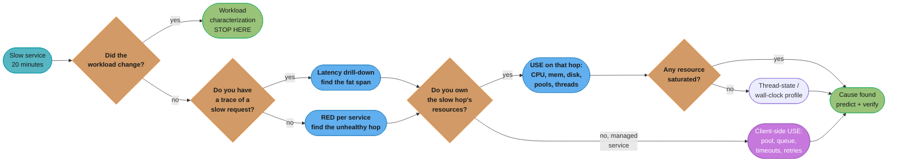
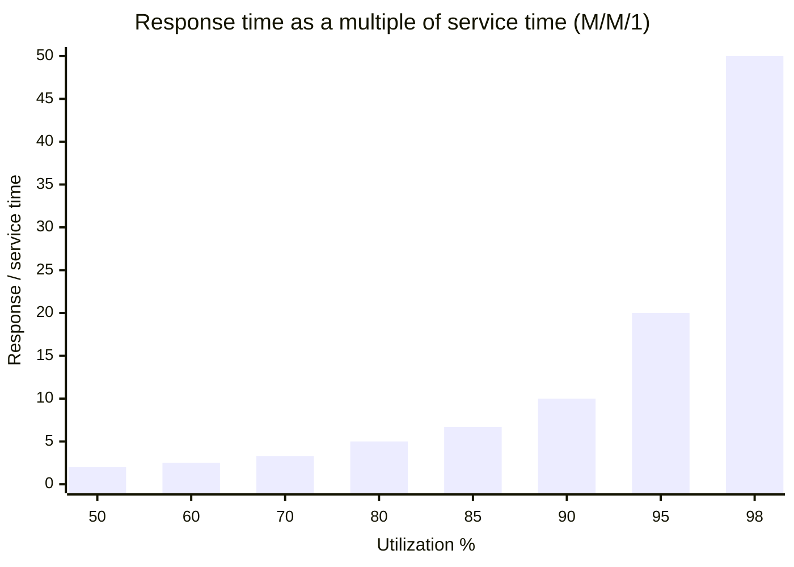
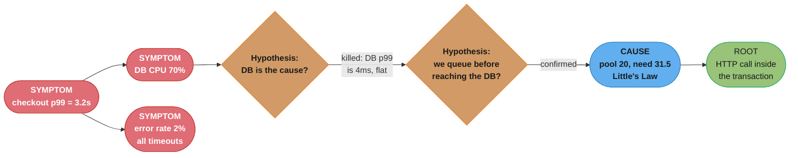

# Performance Engineering Method

## 1. Concept Overview

Every backend engineer eventually stands in front of a slow service with a pager going off and twenty minutes of patience from the room. The thing that separates a senior engineer from a junior one at that moment is not tool knowledge — both know how to run `top`, both can read a flamegraph. It is having a **method**: a procedure that says what to measure first, what the answer eliminates, and when to stop.

A method is two rules bolted together. An **ordering rule** says which measurement comes next given what you already know. A **stopping rule** says when the current answer is actionable enough that descending further costs more than it returns. Without the ordering rule you wander; without the stopping rule you end up reading assembly for a problem that was a missing index.

This module is about the discipline, not the tools. [`performance_profiling`](../performance_profiling/performance_profiling.md) covers async-profiler, JFR, flamegraph anatomy, safepoint bias and GC log reading — the instruments. [`observability_and_monitoring`](../observability_and_monitoring/observability_and_monitoring.md) covers what to graph continuously. This module covers what you *do* with those things, in what order, and on what evidence you stop. It is the entry point to the section's Performance Engineering phase: read it before you reach for a profiler, because the most expensive profiling session is the one aimed at the wrong process.

---

## 2. Intuition

> **One-line analogy**: An anti-method is a mechanic who replaces the part he happens to have in the van. A method is a differential diagnosis — a list of causes you can *eliminate*, in an order chosen so each test kills the largest number of remaining candidates.

**Mental model**: every real method is a **complete enumeration over some domain**. USE enumerates *resources* — for every resource, check utilization, saturation, errors. RED enumerates *request signals* — for every service, check rate, errors, duration. Workload characterization enumerates *who is asking and for what*. Thread-state analysis enumerates *what every thread in the process is currently doing*. Completeness is what makes a method terminate: when you have walked the whole list and found nothing, that is a real result, not a failure. An ad-hoc checklist never terminates because it has no theory of what it left out.

**Why it matters**: the cost of a bad method is not a wrong answer, it is a *plausible* answer. The database really is slow — it is downstream of everything, so it absorbs every upstream stall and shows up hot on almost every dashboard. Acting on that plausible answer buys a bigger RDS instance, the p99 does not move, and two weeks are gone. A method's job is to make you prove the causal direction before you spend money.

**Key insight**: **you are always looking at a symptom.** "Checkout p99 is 3 seconds" is a symptom. "DB CPU is 70%" is also a symptom. The entire craft is the descent from symptom to a *cause* — something whose change provably moves the symptom. Every measurement is worth exactly what it eliminates.

---

## 3. Core Principles

- **Start from the workload, not the machine.** A resource can only be slow relative to what is being asked of it. Doubling traffic and blaming the CPU is not a diagnosis.
- **Every step must be falsifiable.** State the hypothesis as a prediction with a number ("if it is GC, pause time in the slow window exceeds 400ms"), then look. A hypothesis that no observation could kill is a belief.
- **Symptom metrics correlate, cause metrics control.** A cause metric is one where you can name the mechanism *and* predict the direction and rough magnitude of the symptom's response to changing it.
- **The bottleneck moves.** Fixing one always exposes the next. "Done" means the SLO is met with margin, not that no bottleneck exists.
- **Measurement costs something.** Overhead, safepoints, log volume, sampling bias, and — the biggest one — the wall-clock of the engineer taking it. Budget it like any other resource.
- **Prefer the measurement that eliminates the most.** One 30-second wall-clock thread dump partitions the entire problem into CPU-bound / lock-bound / IO-bound. That is worth more than a perfect measurement of one component.
- **Confirm the direction of causality before spending money.** Upstream stalls make downstream metrics look guilty.
- **Reproduce the metric you promised to fix.** If the complaint was p99 latency, the before/after must be p99 latency on the same population, not a benchmark of the changed function.

---

## 4. Types / Architectures / Strategies

### 4.1 The Anti-Methods

These are not strawmen. Every one of them is what a competent engineer does under time pressure without a method, and each fails in a characteristic way.

| Anti-method | What it looks like | Why it feels right | How it fails |
|---|---|---|---|
| **Streetlight** | Open the tool you know best. Java person opens a profiler, DBA opens `pg_stat_statements`, SRE opens the Grafana board they built. | You get data fast, and the data is real. | The tool defines the search space. A CPU profiler cannot see a 900ms IO wait, so an IO-bound service profiles as "60% in Jackson" and you spend a sprint on serialization. |
| **Blame someone else** | "It is the database." "It is the network." "It is the client retrying." Ticket moves to another team. | It is often *true* — 30-40% of the time it really is the datastore. | Latency is transitive: an upstream thread-pool stall inflates every downstream timing. The receiving team measures, finds nothing, bounces it back. Mean time to resolution goes up by the round-trip time of the org chart, typically 2-5 days per hop. |
| **Ad-hoc checklist** | A runbook of 30 things somebody once found. "Check heap. Check pool. Check disk. Check DNS." | It is written down, so it feels rigorous. | It has no theory of coverage, so it cannot tell you what it *did not* check. It also decays — the list is a fossil record of last year's outages, and its ordering is by memorability, not by discriminating power. |
| **Drill-down without a hypothesis** | Start at the top metric, expand the widest bar, repeat. Nine levels later you are reading `Unsafe.park`. | Feels like progress; each click reveals something new. | The widest bar is not the causal one — it is usually just where the work legitimately happens. Without a hypothesis there is no stopping rule, so you descend until you run out of time and report "it is in the JDBC driver", which is true and useless. |
| **Tool-first tuning** | Change GC flags, bump the pool, raise `worker_connections`, redeploy, look at the graph. | Sometimes it works, and it is fast. | It is A/B testing against noise. With no model, a coincidental traffic dip reads as a win, and you have permanently added a flag nobody can justify. Every legacy service's flag soup was built this way. |

The common failure mode across all five: **none of them can tell you what they ruled out.** That is the definition of not having a method.

### 4.2 The Real Methods

| Method | Domain enumerated | Question it answers | Precondition | Cost to run |
|---|---|---|---|---|
| **Workload characterization** | Callers, operations, arguments, arrival pattern | "Is the system slow, or is it being asked to do more/different work?" | Request-level telemetry with dimensions | Minutes |
| **RED** (Rate, Errors, Duration) | Request-driven services | "Which service in the path is unhealthy?" | Per-service request metrics | Seconds — it is a dashboard |
| **USE** (Utilization, Saturation, Errors) | Physical and logical resources | "Which resource is the constraint?" | You must *own* or at least observe the resource | Minutes |
| **Four Golden Signals** | Latency, traffic, errors, saturation | "Should a human be paged?" | Same as RED plus one saturation signal | Seconds |
| **Thread-state analysis** | Every thread in the process | "Is this CPU-bound, lock-bound, or waiting on something?" | Ability to take a wall-clock profile or thread dumps | 30-60 seconds |
| **Drill-down analysis** | A layered stack, top to bottom | "Which layer owns the time?" | A hypothesis at each level, or it degenerates into the anti-method | Hours |
| **Latency drill-down** | One slow request's time, decomposed | "Where did *this* 3 seconds go?" | Distributed tracing with the slow request captured | Minutes if traced, hours if not |
| **Off-CPU / wall-clock analysis** | Time threads spend *not* running | "What are we blocked on?" | Wall-clock profiler (`async-profiler -e wall`) | Minutes |

RED and USE are counterparts and the pairing is the whole point: **RED gives you the symptom, USE gives you the cause.** "Checkout duration p99 is 3.2s" (RED) and "the HikariCP pool is at 100% utilization with 40 threads in the acquire queue" (USE) are the same incident seen from the two ends. The Four Golden Signals are Google's four-signal framing of the same idea with saturation promoted to first class; treat them as RED plus saturation rather than as a competing framework. See [`hld/observability`](../../hld/observability/observability.md) §4.1-4.2 for the metric definitions themselves — here we care only about *when to reach for which*.

### 4.3 Symptom Metrics vs Cause Metrics

The single most common analytical error is treating a correlated metric as a cause.

| Metric | Usually a | Because |
|---|---|---|
| Request p99 latency | **Symptom** | It is the sum of everything, by construction |
| Error rate | **Symptom** | Errors are usually timeouts, i.e. latency in a costume |
| CPU utilization | **Ambiguous** | 95% CPU with a run queue of 40 is a cause; 95% CPU on a batch job is the goal |
| Connection pool wait time | **Cause-ish** | Names a specific queue; you can compute the required pool size and test the prediction |
| GC pause time | **Cause** | Directly stops threads. Falsifiable: pauses in the slow window, or not |
| Lock acquire time on a named monitor | **Cause** | Names the exact contended object |
| Allocation rate | **Cause of GC**, symptom of a code path | Two levels: it causes pauses, and it is caused by an allocation site |
| Disk `%util` | **Trap** | On NVMe, `%util` from `iostat` is meaningless — it saturates at 100% while the device is nowhere near capacity. Use latency and queue depth (`aqu-sz`, `await`) instead |
| Network bandwidth | **Rarely either** | Almost never the constraint inside a datacentre; packet loss and RTT are |

**The test for a cause metric**: can you state a mechanism *and* a quantitative prediction? "The pool has 20 connections, each request holds one for 280ms, we serve 112 rps per node, so Little's Law says we need 31.5 — we are 11.5 short, and queueing at that shortfall explains ~2.4s of the 3.2s." That is a cause. "DB CPU is high" is not, because it predicts nothing.

### 4.4 The Depth Ladder — and Where to Stop

```
Layer                       Question it answers            Typical time to measure
─────────────────────────────────────────────────────────────────────────────────
0  User / client            Is it everyone or one cohort?             2 min
   └─ 1  Request path       Which hop owns the time?                  5 min   <- trace
      └─ 2  Service         Which endpoint, which caller?             5 min   <- RED
         └─ 3  Runtime      GC, threads, pools, locks                10 min   <- USE
            └─ 4  Process   Which code path burns/waits?             30 min   <- profiler
               └─ 5  OS     Syscalls, scheduler, page cache           2 hr    <- bpftrace
                  └─ 6  HW  Cache lines, false sharing, NUMA        1-5 days  <- perf ctrs

STOP at the first layer where the fix is cheaper than the next measurement.
Roughly 85% of production performance work terminates at layer 2 or 3.
```

Each rung costs roughly 3-10x the one above it, and the population of problems shrinks faster than that. That asymmetry *is* the stopping rule: descend only when the layer above has produced a specific, falsified-elsewhere hypothesis that points down.

**The hardware rule.** Going to layer 6 — cache line behaviour, false sharing, NUMA locality — is correct only when **all three** hold:

1. The service is genuinely CPU-bound (a wall-clock profile shows threads on-CPU, not parked), and
2. Adding cores makes throughput *worse* or flat, which is the fingerprint of contention rather than capacity, and
3. Hardware counters already show the anomaly — `perf stat` reporting an L3 miss rate or `LLC-load-misses` far above the baseline for the same code, or a cross-socket traffic spike.

If you cannot show all three, layer 6 is a very expensive form of the streetlight anti-method. When you do get there, the mechanics — MESI coherence, false sharing on adjacent fields, NUMA remote-node penalties, and the padding and layout fixes — are covered in [`cs_fundamentals/computer_architecture_and_memory_hierarchy`](../../cs_fundamentals/computer_architecture_and_memory_hierarchy/computer_architecture_and_memory_hierarchy.md). Read it there; the point *here* is only the entry condition. In a decade of backend work you will meet a genuine false-sharing bug perhaps twice, and both times a lock-contention profile will have pointed at it first.

---

## 5. Architecture Diagrams

### 5.1 The Twenty-Minute Decision Procedure



The first branch is the one people skip. Half of "the service got slow" incidents are "the service got asked to do 3x the work by one caller", and no amount of profiling will surface that — the profile of a healthy service under 3x load looks exactly like the profile of a healthy service.

### 5.2 Why Headroom Lies — Utilization vs Response Time



`R = S / (1 - rho)`. At 50% utilization a request takes 2x its service time; at 90% it takes 10x; at 98% it takes 50x. This is why "we have 20% headroom" is not a defence, and why a 10% traffic increase can double p99 with no code change and no alert firing. It is also why capacity planning targets 60-70% steady-state, not 90%.

### 5.3 Symptom-to-Cause Descent



Note the shape: the DB metric was real, correlated, and completely innocent. Killing that hypothesis with a *number* (DB p99 4ms, unchanged across the incident) is what makes the next step legitimate.

---

## 6. How It Works — Detailed Mechanics

### 6.1 The Twenty-Minute Triage, in Order

Minute-by-minute, with the elimination each step buys.

```bash
# 0-2 min — Is it real, and is it everyone?
#   Compare the SLI over the same window last week. Slice by client version,
#   tenant, region, endpoint. If ONE dimension carries all of it, you are done
#   with the general search and have a specific search instead.
#   Eliminates: "the whole system is degraded" for ~40% of incidents.

# 2-5 min — Did the workload change?
#   rate(http_requests_total[5m]) by (route, caller)  -- compare to 7d ago
#   Look for: new caller, new route, changed argument distribution
#   (page size, date range, batch size), retry storm.
#   Eliminates: everything, if it changed. Do not skip this to go profile.

# 5-8 min — Did WE change?
#   Deploy timeline overlaid on the SLI. Config pushes and feature-flag
#   flips count as deploys. A flag flip is the single most under-checked
#   cause because it leaves no deploy marker.

# 8-13 min — Which hop owns the time?
#   Pull 20 traces above p99. Not the median trace -- the median trace is
#   healthy by definition and tells you nothing.
#   If no tracing: RED per service, find the one whose duration moved
#   BEFORE its callers' did.

# 13-18 min — USE on the guilty hop
for r in cpu memory disk network conn_pool thread_pool queue; do
  : "utilization?  saturation?  errors?"
done
#   Saturation is the one that matters. Utilization tells you how busy,
#   saturation tells you how much work is WAITING -- run queue length,
#   pool acquire queue depth, socket accept backlog, GC allocation stall.

# 18-20 min — If USE is clean, take a wall-clock profile
async-profiler -d 30 -e wall -t -f /tmp/wall.html <pid>
#   Wall-clock, not CPU. A clean USE with a bad latency means threads are
#   blocked on something the resource list did not cover.
```

The ordering is not arbitrary. Each step is placed by **discriminating power per minute**: workload comparison eliminates the most for the least effort, profiling eliminates the least for the most.

### 6.2 Workload Characterization — The Five Questions

Answer these before touching a profiler. Every one of them is answerable from request telemetry you should already have.

| Question | Where to look | What a bad answer looks like |
|---|---|---|
| **Who** is calling? | `by (caller, client_version, tenant)` | One tenant went from 2% to 61% of traffic |
| **Why** are they calling? | Route + operation dimensions | A new retry loop in a client shipped Tuesday |
| **What** are they asking for? | Argument distribution — page size, date range, batch size, result cardinality | `limit` p99 went from 50 to 5000 |
| **How much**, and in what shape? | Rate plus burstiness (peak-to-mean) | Same daily total arriving in 4 one-minute spikes |
| **How is it changing?** | Same metric, 7 and 28 days back | Steady 4%/week growth crossed the knee of the queueing curve |

The classic finding here is the **fifth** one combined with §5.2: nothing changed, growth was linear, and utilization crossed 80%. Response time is not linear in load; the incident is the arithmetic, not a bug.

### 6.3 USE, Made Concrete

USE only works if you actually enumerate. Here is the list for a JVM service on Linux, with the saturation metric — the one people omit — called out.

| Resource | Utilization | **Saturation** | Errors |
|---|---|---|---|
| CPU | `%usr + %sys` (`mpstat 1`) | run queue length `> ncpu` (`vmstat 1`, col `r`) | throttled periods (`cpu.stat` `nr_throttled` in cgroup v2) |
| Memory | RSS / limit | swap in/out, cgroup `memory.pressure` | OOM kills (`dmesg`) |
| Disk | `await` and IOPS, **not** `%util` on NVMe | `aqu-sz` (`iostat -x 1`) | `/sys/block/*/device/ioerr_cnt` |
| Network | bytes/s vs link speed | `netstat -s` retransmits, `ss -ti` cwnd collapse | drops in `ip -s link` |
| **Connection pool** | active / max | **acquire wait queue depth and wait time** | `SQLTransientConnectionException` (Hikari timeout) |
| **Thread pool** | active / max | **queue depth** (`ThreadPoolExecutor.getQueue().size()`) | `RejectedExecutionException` count |
| **Heap** | used after full GC / max | **allocation stall time**, GC pause total per minute | `OutOfMemoryError` |
| Socket accept | — | accept backlog overflow (`netstat -s \| grep -i listen`) | connection resets |

For a JVM service, the last four rows find the problem far more often than the first four. Kernel-level saturation is rare in a containerized 2026 stack; *logical* resource saturation — pools, queues, semaphores, rate limiters — is the daily bread.

The Hikari saturation signal specifically:

```java
// Micrometer already exposes these; alert on the second, not the first.
// hikaricp_connections_active / hikaricp_connections_max   <- utilization
// hikaricp_connections_pending                             <- SATURATION
// hikaricp_connections_acquire_seconds (histogram)         <- the cost of saturation
```

A pool at 100% utilization with `pending = 0` is a correctly sized pool doing its job. A pool at 100% with `pending = 40` is the incident. Reporting the first as a finding is how "we increased the pool and nothing happened" tickets get written. See [`connection_pooling_deep_dive`](../connection_pooling_deep_dive/connection_pooling_deep_dive.md) for sizing.

### 6.4 Thread-State Analysis and Little's Law

The cheapest single measurement that partitions the whole problem space:

```bash
# Wall-clock profile: shows time threads spend NOT running, which a CPU
# profile cannot see. -t splits by thread.
async-profiler -d 30 -e wall -t -f /tmp/wall.html <pid>

# Poor-man's version, no agent required, works on any JVM:
for i in $(seq 1 10); do jcmd <pid> Thread.print >> /tmp/dumps.txt; sleep 1; done
grep -c 'java.lang.Thread.State: RUNNABLE'      /tmp/dumps.txt
grep -c 'java.lang.Thread.State: BLOCKED'       /tmp/dumps.txt
grep -c 'java.lang.Thread.State: WAITING'       /tmp/dumps.txt
grep -c 'java.lang.Thread.State: TIMED_WAITING' /tmp/dumps.txt
```

The interpretation is a three-way fork, and it is worth more than any single number on a dashboard:

- **Mostly RUNNABLE, on-CPU** → CPU-bound. Now a CPU profile is the right next step.
- **Mostly BLOCKED** → lock contention. Read the monitor names in the dump; the same lock will appear repeatedly.
- **Mostly WAITING/TIMED_WAITING inside socket reads** → you are waiting on someone else. Go back up to the trace; a profiler will tell you nothing.

Then apply **Little's Law** to turn that into an actionable number. `L = lambda x W` — the number of items in a system equals arrival rate times time in system.

```
Concurrency needed = throughput x latency

  900 rps across 8 nodes         = 112.5 rps/node
  mean time holding a worker     = 0.28 s
  L = 112.5 x 0.28               = 31.5 threads busy on average

  Tomcat max-threads = 200  -> not the constraint
  Hikari maximumPoolSize = 20 -> IS the constraint, if each request
                                 holds a connection for that 0.28 s
```

This is the arithmetic that decides *add capacity* vs *fix latency*. If `L` exceeds the pool, you have two levers and they are not equal: raising the pool multiplies load on the downstream resource (often the database, which has its own limit); shrinking `W` reduces `L` for free. **Always try to shrink `W` first** — it is the only one of the two that does not push the problem downstream.

### 6.5 Forming and Killing a Hypothesis

A hypothesis worth stating has four parts. Write them down — literally, in the incident channel — because the act of writing the *prediction* is what stops you from post-hoc rationalizing whatever you see.

```
HYPOTHESIS   GC pauses are causing the p99.
MECHANISM    Mixed GC stops all application threads; a request unlucky
             enough to span a pause pays the full pause.
PREDICTION   In the 14:02-14:07 window, total GC pause per minute > 3s,
             AND individual pauses > 400ms, AND the pause timestamps
             correlate with the slow-request timestamps.
KILL TEST    If total pause per minute is < 500ms, this is dead.
             No amount of "but GC is still high" survives that.
```

Rules that make this work in practice:

- **Predict a number, not a direction.** "GC will be high" is unkillable. "Pause per minute above 3s" is a coin flip you can lose.
- **Prefer the test that kills the most hypotheses at once.** A wall-clock profile simultaneously tests CPU-bound, lock-bound and IO-bound.
- **Kill your favourite first.** The hypothesis you most want to be true is the one whose evidence you will read most charitably.
- **A killed hypothesis is a result.** Say it out loud: "not GC, pauses were 180ms/min through the incident." Half the value of a method is the eliminations it publishes, so the next engineer does not redo them.
- **Two survivors means you need a discriminating test**, not a coin flip. Design a measurement whose outcome differs between them.

### 6.6 Measurement Overhead and the Observer Effect

Every measurement perturbs. The question is whether the perturbation is smaller than the effect you are chasing.

| Instrument | Typical overhead | Perturbs what | Safe in prod? |
|---|---|---|---|
| Metrics counter increment | 5-20 ns | Nothing measurable | Always |
| Micrometer `Timer` with histogram | ~50-150 ns + memory for buckets | Nothing at request scale | Always |
| `System.nanoTime()` | 20-30 ns (`CLOCK_MONOTONIC` via vDSO) | Nothing | Always |
| Structured log line, async appender | 1-3 us | Log volume, disk, egress cost | Yes, at bounded rate |
| Structured log line, **sync** appender | 2-8 us **plus lock contention** | Serializes all logging threads | **No** |
| JFR default profile | 1-2% | Slight | Yes, continuous |
| async-profiler `-e cpu` @ 10ms | < 1% | Slight | Yes |
| async-profiler `-e wall -t` @ 10ms | 1-5%, scales with thread count | Noticeable above ~2000 threads | Targeted runs |
| async-profiler `-e alloc` | 2-10% | Allocation path | Targeted runs |
| Full heap dump | **Full STW, 1-10s per GB** | Everything. Trips health checks | Emergency only, drain first |
| 100% trace sampling | 3-15% + network + backend cost | CPU, egress, tracing backend | No — use tail sampling |
| Instrumentation (bytecode) profiler | 20-200% | Inlining decisions, so the *shape* changes | Never |

Two observer effects deserve names because they produce confidently wrong answers rather than merely expensive ones:

1. **Instrumentation changes JIT decisions.** A bytecode profiler adds method entry/exit calls, which pushes methods over the inlining size threshold. The profile then shows time in methods that, uninstrumented, do not exist as call frames. This is why sampling profilers won.
2. **Coordinated omission.** A load generator that waits for a response before sending the next request stops sending during a stall, so the stall is never sampled. Reported p99 can be an order of magnitude better than reality. Covered in [`load_and_performance_testing`](../load_and_performance_testing/load_and_performance_testing.md) — the methodological point here is that your *measurement design* can manufacture the conclusion.

**The rule**: measure at the cheapest instrument that can resolve the effect. If p99 moved by 2 seconds, a metrics dashboard resolves it. Do not reach for a heap dump to explain a 2-second regression — you will take a 6-second STW pause to explain it.

---

## 7. Real-World Examples

**Brendan Gregg / Netflix — USE.** Gregg formalized USE at Joyent and popularized it at Netflix precisely because the ad-hoc checklist did not scale to thousands of instances: the checklist told you what somebody had thought of, USE told you what you had not checked. Netflix's internal practice pairs it with flame graphs and their `FlameScope` tooling for spotting sub-second variance that a 1-minute metric average hides entirely.

**Google — Four Golden Signals.** The SRE book's contribution was less the four signals than the *paging rule* attached to them: page on symptoms (latency, errors) that users feel, not on causes (CPU, disk) that may be benign. That separation is exactly the symptom/cause distinction in §4.3, applied to alerting instead of to debugging.

**Tom Wilkie / Weaveworks — RED.** Coined in 2015 as the request-side counterpart to USE for microservices, where the interesting resources are logical (pools, queues, quotas) rather than physical. Its practical value is uniformity: every service gets the same three panels, so an engineer can read a service they have never seen.

**The "it's the database" statistic.** Across published incident retrospectives the datastore genuinely is the proximate cause roughly a third to 40% of the time — it is the shared, stateful, hardest-to-scale tier, so it is the natural constraint. That base rate is exactly what makes it a bad *first* answer: a guess that is right 40% of the time is wrong 60% of the time, and each wrong guess costs a database upgrade and a fortnight. Methods exist to beat base rates.

**The Amazon and Google latency-revenue results.** Amazon's often-cited experiment put every additional 100ms of latency at roughly 1% of sales; Google's found a 500ms delay cut searches per user by ~20%. They are old numbers and the exact figures should not be quoted as current, but they are the reason performance work is funded at all, and the reason the method needs to be fast: the cost is accruing while you investigate.

---

## 8. Tradeoffs

| Method | Time to first signal | Coverage | Fails when | Best used |
|---|---|---|---|---|
| Workload characterization | 2-5 min | Total, for load-driven causes | The workload genuinely did not change | Always first |
| RED | Seconds (dashboard) | Every service in the path | The path is not instrumented uniformly | Locating the hop |
| USE | 5-15 min | Every resource you own | Managed services hide the resource | After the hop is known |
| Four Golden Signals | Seconds | Paging decisions | Too coarse to localize | Alerting, not debugging |
| Thread-state / wall-clock | 30-60 s | The whole process at once | Thousands of threads make it noisy | Partitioning CPU/lock/IO |
| Latency drill-down | Minutes with tracing | One request, end to end | Sampling missed the slow requests | When you have a trace |
| Drill-down analysis | Hours | Deep but narrow | No hypothesis at each level | Last resort, with a hypothesis |
| CPU profiling | 1-5 min run, 30 min to read | On-CPU time only | The service is IO-bound | Confirmed CPU-bound only |

**The meta-tradeoff**: cheap methods have broad coverage and low resolution; expensive ones have high resolution and narrow coverage. Run them in that order, and stop as soon as the resolution is sufficient to act.

---

## 9. When to Use / When NOT to Use

**Use the full method** when the problem is in production, is costing something, and you do not already know the answer. Also use it when you *think* you know the answer — the 20-minute triage is cheap insurance against the streetlight, and confirming a hunch with a prediction is exactly as valuable as killing it.

**Skip straight to a tool** when you have a *reproducible* problem in a controlled environment with a hypothesis already in hand — a benchmark regression bisected to one commit does not need workload characterization.

**Do not run the method during an active outage where mitigation is available.** Roll back, fail over, shed load, then investigate. Diagnosis and mitigation are different activities and mitigation wins; the method is for the post-mitigation investigation and for degradations too small to trigger a rollback.

**Do not descend past layer 3** without a falsified-elsewhere hypothesis pointing down. Do not descend to layer 6 (hardware) without the three entry conditions in §4.4.

**Do not apply this to a capacity question.** "Can we handle Black Friday?" is load testing plus queueing arithmetic, not a debugging method. See [`load_and_performance_testing`](../load_and_performance_testing/load_and_performance_testing.md).

---

## 10. Common Pitfalls

**The instrumentation became the bottleneck (real, 40k rps order service).** A team added timing logs around every DAO call to "get visibility" into a latency problem. p99 got *worse*, from 240ms to 610ms. The timer itself was free; the log line was not.

```java
// BROKEN: measured the thing by making it slower.
public List<Order> findByUser(long userId) {
    long t0 = System.nanoTime();                          // ~25 ns, fine
    List<Order> out = jdbc.query(SQL, MAPPER, userId);
    log.info("findByUser took {} ms user={} rows={}",     // ~5 us formatted,
             (System.nanoTime() - t0) / 1_000_000,        // on a SYNCHRONOUS
             userId, out.size());                         // appender: a global lock
    return out;
}
// 40,000 calls/s x 5 us = 0.2 CPU-seconds per second = 20% of a core burned,
// and every worker thread serialized on the appender's monitor. Thread dumps
// showed 140 of 200 Tomcat threads BLOCKED on ch.qos.logback...OutputStreamAppender.
```

```java
// FIXED: a pre-aggregated histogram. Constant work per call, no lock, no I/O.
private final Timer daoTimer = Timer.builder("dao.find_by_user")
        .publishPercentileHistogram()      // buckets, so p99 is computable
        .register(registry);               // server-side, across all instances

public List<Order> findByUser(long userId) {
    return daoTimer.record(() -> jdbc.query(SQL, MAPPER, userId));
}
// ~90 ns per call. p99 returned to 240ms, and the metric was BETTER --
// aggregatable across instances, unlike a log line nobody greps.
```

**Impact**: 20% of a core per node across 8 nodes, p99 inflated 2.5x, and three days spent investigating a regression the investigation had caused.

**Averaged away the incident.** A payments team's dashboard graphed `avg(response_time)` at 1-minute resolution. A 4-second stall every 30 seconds — affecting roughly 1.5% of requests — showed as a 60ms bump on a 45ms average. Users saw a 4-second checkout hang; the graph said everything was fine. It went unnoticed for **eleven weeks** and was found only when a customer sent a screen recording. Percentiles from histogram buckets, at 10-second resolution, made it obvious in one panel. An average is a summary of the requests you do not care about.

**Blamed the database, bought the database (real, ~$14k/month).** Checkout p99 3.2s, DB CPU 70%, so the team resized RDS from `db.r6g.2xlarge` to `db.r6g.8xlarge`. DB CPU fell to 22%. **p99 did not move.** The DB was serving every query in under 4ms the whole time; the 3.2s was queueing in the application's connection pool, upstream of the database (this is §14). The upgrade ran for four months before anyone reverted it. **Causality has a direction, and a busy downstream is the *expected* consequence of an upstream stall, not evidence of its cause.**

**Profiled the wrong process.** An engineer profiled the JVM at 90% CPU on a node where the *actual* latency came from the sidecar proxy's TLS handshakes. The JVM was busy because it was healthy and doing work. Rule: confirm the guilty process from the trace before profiling anything, and remember that in a mesh, `container` is not `pod`.

**Fixed the widest bar.** A flame graph showed 34% of on-CPU time in JSON serialization. Two engineers spent a sprint moving to a binary codec. Serialization time dropped 70%; end-to-end p99 improved by 2.9%. Serialization was 34% of *CPU*, and CPU was 11% of *wall-clock latency*, so the ceiling on the entire sprint was `0.34 x 0.11 = 3.7%` — 89% of the request was spent waiting. **Amdahl's law is a stopping rule: the ceiling on any optimization is the fraction of the metric you promised to fix that it actually occupies.** Compute that fraction *before* the sprint, not after.

**Never wrote down what was ruled out.** A recurring p99 spike was investigated by four different engineers across six months. Three of them independently checked GC, and three independently found it innocent. Nobody recorded it. Roughly 20 engineer-hours re-spent on the same eliminated hypothesis. A three-line "ruled out" note in the incident doc is the highest-leverage artifact the method produces.

---

## 11. Technologies & Tools

| Tool | Layer | What it is for in this method |
|---|---|---|
| Grafana + Prometheus | 1-3 | RED/USE dashboards, the 7-day comparison, burn rate |
| OpenTelemetry + Jaeger / Tempo | 1-2 | Latency drill-down; tail sampling to actually capture slow requests |
| Micrometer | 2-3 | `Timer` with `publishPercentileHistogram()` — the correct cheap instrument |
| `jcmd Thread.print` / `jstack` | 3 | Free thread-state analysis, no agent, works everywhere |
| async-profiler (`-e wall`, `-e cpu`, `-e lock`) | 3-4 | Wall-clock is the one that partitions the problem |
| JDK Flight Recorder + JMC | 3-4 | Continuous ring buffer; the recording you wish you had started |
| `vmstat` / `mpstat` / `iostat -x` / `ss -ti` | 5 | USE on kernel resources; run queue and queue depth, not `%util` |
| `bpftrace` / `bcc` | 5 | Syscall and scheduler latency when layer 3-4 is clean |
| `perf stat` / `perf c2c` | 6 | Cache miss and false-sharing counters — the layer-6 entry evidence |
| `pg_stat_statements`, `EXPLAIN (ANALYZE, BUFFERS)` | 2-3 | Proving the DB innocent or guilty with a number |
| k6 / Gatling | — | Reproducing under control; watch for coordinated omission |

---

## 12. Interview Questions with Answers

**Q: You are told a service is slow and you have twenty minutes — what do you do first?**
**Short:** Compare the workload to the same window last week before touching a profiler, because roughly half of these incidents are a load or argument change, not a code problem.

Not open a profiler. First, confirm the symptom against a baseline — the same SLI in the same window seven days ago — and slice it by caller, tenant, region, endpoint and client version, because if one dimension carries the whole regression the search space collapses immediately. Second, characterize the workload: rate by caller and route versus a week ago, and the distribution of expensive arguments like page size and date range. Third, overlay the deploy and feature-flag timeline. Only then locate the hop with traces or RED, and only then run USE on that hop. The ordering is by discriminating power per minute — profiling eliminates the least per minute spent, which is why it is last, not first.

**Q: Why is "it's the database" a bad first answer even though it is often right?**
**Short:** The datastore absorbs every upstream stall, so a busy database is the expected consequence of a slowdown as often as it is the cause.

The datastore genuinely is the proximate cause maybe a third to 40% of the time, since it is the shared, stateful, hardest-to-scale tier. That base rate is the problem: a guess right 40% of the time is wrong 60% of the time, and acting on it costs an instance resize and weeks. Latency is transitive — if a thread pool upstream stalls, every downstream timing inflates, so the database looks guilty for a problem entirely above it. The discriminating test is cheap: look at the database's own served-query latency, not its CPU. If queries return in 4ms throughout the incident, the database is innocent no matter how busy it is. Prove the causal direction with a number before you spend money.

**Q: What is the difference between a symptom metric and a cause metric?**
**Short:** A cause metric comes with a mechanism and a quantitative prediction of how the symptom responds, while a symptom metric only correlates.

Request p99 latency and error rate are symptoms by construction — they are sums of everything. CPU utilization is ambiguous: 95% on a batch job is the goal, 95% with a run queue of 40 is a cause. Connection pool wait time, GC pause duration and lock acquire time on a named monitor are causes because each names a specific mechanism. The test is whether you can state a prediction that could fail: "the pool holds 20, each request holds a connection 280ms, we serve 112 rps per node, Little's Law needs 31.5, so we are 11.5 short" is a cause, because measuring an acquire wait of zero would kill it. "DB CPU is high" predicts nothing and therefore cannot be wrong, which is why it is useless.

**Q: When do you reach for USE and when for RED?**
**Short:** RED tells you which service is unhealthy, USE tells you which resource inside it is the constraint, so you run RED first and USE second.

RED — rate, errors, duration — enumerates request signals and is the right tool for locating the unhealthy hop in a request path, because every service has the same three panels and you can read a service you have never seen. USE — utilization, saturation, errors — enumerates resources and is the right tool once you know which hop, because it tells you which resource is the constraint. They are counterparts on the same incident: "checkout duration p99 is 3.2s" is the RED view and "the pool is at 100% with 40 pending" is the USE view. USE requires that you can observe the resource, so it is much weaker against a managed service, where you fall back to client-side USE on your own pools, queues and timeouts.

**Q: What is the streetlight anti-method and how do you catch yourself doing it?**
**Short:** The streetlight anti-method is reaching for the tool you know best, which quietly limits the search space to whatever that tool can see.

It is named for the drunk searching for keys under the streetlight because the light is better there. A JVM engineer opens a profiler, a DBA opens `pg_stat_statements`, an SRE opens the dashboard they built. The data is real, which is what makes it convincing — a CPU profiler on an IO-bound service faithfully reports "60% in Jackson" and a sprint disappears into serialization. The tell is that you chose the instrument before stating the hypothesis. The counter is to write down the question first and then pick the cheapest instrument that answers it, and to prefer measurements that partition the whole space: a wall-clock thread profile tests CPU-bound, lock-bound and IO-bound at once, so it cannot leave a whole category unlit.

**Q: How do you form a hypothesis you can actually kill?**
**Short:** State a numeric prediction whose failure would end the hypothesis, and write the kill threshold down before you look at the data.

A usable hypothesis has four parts: the claim, the mechanism, a numeric prediction, and the kill test. "GC is causing the p99" is unkillable. "If GC is the cause, total pause per minute in the 14:02-14:07 window exceeds 3 seconds with individual pauses above 400ms, correlated with slow-request timestamps — and if pause per minute is under 500ms this is dead" is a coin flip you can lose. Write the threshold before you look, because after you look every number can be rationalized. Kill your favourite hypothesis first, since it is the one whose evidence you will read most charitably. A killed hypothesis is a result worth publishing: it stops the next engineer redoing the elimination.

**Q: What does saturation mean, and why is it more useful than utilization?**
**Short:** Saturation measures the work queued and waiting for a resource, which is what actually creates latency, while utilization only says how busy it is.

Utilization is the fraction of time the resource is busy; saturation is the amount of work waiting because it was busy. A connection pool at 100% utilization with zero pending acquires is a correctly sized pool doing exactly its job. The same pool at 100% with 40 threads in the acquire queue is the incident. Saturation is where latency comes from, and it is the signal people omit: run queue length rather than CPU percent, `aqu-sz` and `await` rather than disk `%util`, `hikaricp_connections_pending` rather than `_active`, executor queue depth rather than active thread count. On NVMe, `%util` is actively misleading — it pins at 100% while the device is far from capacity — which is one more reason to alert on the queue, not the busyness.

**Q: Why does latency explode at 80% utilization when there is still 20% headroom?**
**Short:** Queueing makes response time scale as service time divided by one minus utilization, so it is 5x at 80% utilization and 10x at 90%.

For an M/M/1 queue, `R = S / (1 - rho)`. At 50% utilization a request takes twice its service time, at 80% five times, at 90% ten times, at 98% fifty times. The curve has a knee, and "20% headroom" describes a distance along the x-axis while the pain lives on the y-axis. This is why a 10% traffic increase can double p99 with no code change and no alert firing, why steady growth eventually produces an incident that looks sudden, and why capacity planning targets 60-70% steady-state rather than 90%. Real systems are worse than M/M/1 because arrivals are bursty, so treat the formula as an optimistic lower bound on how bad it gets.

**Q: What is workload characterization and why does it come before profiling?**
**Short:** Workload characterization asks who is calling, for what, how much and how it is changing, and it is first because a profile cannot show that the work itself changed.

The five questions are who is calling (by caller, tenant, client version), why (route and operation), what they are asking for (the distribution of page sizes, date ranges, batch sizes), how much and in what burst shape, and how it is trending against 7 and 28 days. It comes first because the profile of a healthy service under 3x load is identical to the profile of a healthy service, so profiling structurally cannot detect the most common cause. The classic finding is that nothing changed at all: traffic grew 4% a week for a quarter and crossed the knee of the queueing curve. The incident is arithmetic, and no code inspection will ever find it.

**Q: How do you know when you have descended far enough?**
**Short:** Stop at the first layer where the cost of the fix is lower than the cost of the next measurement, which for most production problems is the runtime layer.

Each layer down — request path, service, runtime, process, OS, hardware — costs roughly three to ten times the one above, while the fraction of problems living there shrinks faster than that. Around 85% of production performance work terminates at the service or runtime layer: a pool size, a missing index, a retry storm, an N+1. The stopping rule is economic, not intellectual. If you can already name a change that moves the SLI by enough, take it; going deeper to satisfy curiosity is a cost the incident is paying. The complementary check is Amdahl: before optimizing anything, compute what fraction of the metric you promised to fix it actually occupies, because that fraction is your ceiling.

**Q: When is it correct to go all the way down to cache lines and NUMA?**
**Short:** Only when the service is provably CPU-bound, adding cores makes throughput flat or worse, and hardware counters already show an anomalous miss rate.

All three conditions must hold. CPU-bound must be established by a wall-clock profile showing threads on-CPU rather than parked. Throughput going flat or backwards as you add cores is the fingerprint of contention rather than capacity — under capacity limits, throughput rises. And `perf stat` must already show an L3 or `LLC-load-misses` rate well above baseline for the same code, or cross-socket traffic on a NUMA box. Without all three, layer six is the streetlight anti-method with expensive tooling. In practice you will meet a genuine false-sharing bug perhaps twice in a decade of backend work, and a lock-contention profile will have pointed at it first. The mechanics live in the computer architecture module; the discipline here is only the entry condition.

**Q: What is the observer effect in performance work and how do you bound it?**
**Short:** Measurement perturbs the system, so choose the cheapest instrument that can resolve the effect you are chasing.

A metrics counter costs 5-20ns and a Micrometer timer around 90ns — free at request scale. A structured log line costs 1-3 microseconds on an async appender and 2-8 plus lock contention on a synchronous one, which at 40k rps burns a fifth of a core and serializes every worker. A full heap dump is a stop-the-world pause of one to ten seconds per gigabyte and will trip your health checks. Two effects produce confidently wrong answers rather than merely expensive ones: bytecode instrumentation changes JIT inlining, so the profile shows frames that do not exist uninstrumented, and coordinated omission in a load generator hides exactly the stalls you are hunting. If p99 moved by two seconds, a dashboard resolves it — do not take a six-second pause to explain it.

**Q: What does thread-state analysis tell you that a CPU profile cannot?**
**Short:** It shows time threads spend blocked or waiting, which is invisible to a CPU profiler and is where most backend latency actually lives.

A CPU profiler samples on-CPU time only, so a service spending 900ms per request waiting on a socket read profiles as if that time did not exist. Wall-clock sampling (`async-profiler -e wall -t`) or ten thread dumps a second apart from `jcmd Thread.print` partitions the process three ways in under a minute: mostly RUNNABLE means CPU-bound and a CPU profile is now the right next step; mostly BLOCKED means lock contention and the dump names the contended monitor; mostly WAITING inside socket reads means you are waiting on someone else and no profiler will help. That single fork is the highest-value-per-second measurement available, and it needs no agent, which matters when you cannot attach one to a running production pod.

**Q: How does Little's Law help you decide between adding threads and fixing latency?**
**Short:** Little's Law gives required concurrency as throughput times latency, showing that halving hold time halves the resource need without pushing load downstream.

`L = lambda x W`. At 112 rps per node holding a connection for 280ms, you need 31.5 connections busy on average — so a pool of 20 is the constraint and a Tomcat pool of 200 is not. That single calculation identifies which of your many pools is actually binding. The two levers are not equivalent: raising the pool multiplies concurrent load on whatever is downstream, usually the database, which has its own connection ceiling and will simply move the queue. Shrinking `W` reduces `L` for free. Always attack `W` first — get the remote call out of the transaction, add the index, drop the payload — and treat raising the pool as the fallback you take only when the hold time is irreducible.

**Q: What are the Four Golden Signals and how do they differ from RED?**
**Short:** The Four Golden Signals are RED plus saturation, and their real contribution is the rule to page on symptoms rather than on causes.

Latency, traffic, errors and saturation. The first three map onto RED's duration, rate and errors; saturation is the addition, and it is what tells you how close to a cliff you are running rather than merely how you are doing right now. The more important part is the alerting doctrine attached to them: page on symptoms that users feel, alert or dashboard on causes that may be benign. High CPU is not worth waking someone for — it might be a healthy batch job — while elevated user-visible latency always is. That is the symptom/cause distinction applied to paging instead of debugging, and it is the reason golden-signal alerting produces far fewer false pages than resource-threshold alerting.

**Q: Every service dashboard is green but users report the app is slow — how do you proceed?**
**Short:** Green dashboards usually mean the metric is aggregated wrong, the slow population is a small cohort, or the latency is outside your measured span.

Three candidates, in order of likelihood. First, aggregation is hiding it: an average at one-minute resolution can hide a four-second stall every thirty seconds affecting 1.5% of requests, and averaging p99s across instances is mathematically meaningless. Recompute from histogram buckets at ten-second resolution. Second, the slow population is a cohort your dashboards aggregate away — one tenant, one region, one client version, one endpoint — so slice by every dimension you have. Third, the latency is outside your spans entirely: DNS, TLS handshake, TCP connect, CDN, client-side rendering, or queueing in a load balancer before your first span opens. Real user monitoring, or simply comparing gateway-measured to service-measured duration, closes that gap.

**Q: How do you prove a fix actually worked?**
**Short:** Show the same SLI on the same population before and after, at the same load, rather than a microbenchmark of the code you changed.

The measurement must be the metric you promised to fix. A microbenchmark showing serialization got 70% faster is not evidence that p99 improved — one real case had exactly that and moved end-to-end p99 by 2.9%, because serialization was 34% of CPU and CPU was 11% of wall-clock, capping the whole gain at 3.7%. Compare like for like: the same percentile, the same endpoints, the same traffic mix, ideally the same weekday and hour, and ideally with a canary carrying real traffic so both arms see the same load. State the predicted magnitude before deploying, so a small improvement caused by a coincidental traffic dip does not get claimed as the fix. And record what you ruled out — the eliminations are the durable artifact.

**Q: What is drill-down analysis and what is the trap in it?**
**Short:** Drill-down descends layer by layer, and the trap is that the widest bar at each level is usually where work legitimately happens, not the cause.

Done properly, you start at a high-level symptom, form a hypothesis about which layer owns the time, test it, and descend only into the layer that survives. The anti-method version skips the hypothesis and just expands the widest thing at each level. That fails because width measures where the work is, not where the *excess* is — a healthy service also has a widest bar. Without a hypothesis there is no stopping rule either, so you descend until the clock runs out and report something true and unactionable like "it is in the JDBC driver". The fix is to require, at every level, a prediction that the next measurement could falsify, plus a comparison against a healthy baseline so you are looking at the delta rather than the absolute.

**Q: What is the blame-someone-else anti-method and what does it cost?**
**Short:** It is routing the ticket to another team on a plausible correlation, which adds days per hop because latency is transitive across service boundaries.

"It is the database", "it is the network", "it is the client retrying" are all frequently true, which is what keeps the anti-method alive. The structural problem is that an upstream stall inflates every downstream timing, so the evidence pointing at the next team downstream is produced by the incident itself regardless of cause. The receiving team measures their own service, correctly finds it healthy, and bounces it back — typically two to five days per round trip, and organizational trust degrades each time. The discipline is to hand over only with a discriminating measurement attached: not "your service looks slow" but "your service's own served latency rose from 4ms to 900ms starting at 14:02, here are ten trace IDs". If you cannot produce that, you have not finished your half.

**Q: How do you pick a method when you do not own the resource, as with a managed cloud service?**
**Short:** Run USE on the client side instead, treating your connection pool, request queue, timeouts and retries as the resources you can observe.

You cannot see the run queue inside DynamoDB or a managed Kafka broker, so resource-side USE is unavailable. What you can always observe is your own edge of the interaction: pool utilization and pending acquires, client-side request queue depth, in-flight request count against any concurrency limiter, timeout and retry rates, and the served-latency distribution the client observes. Add whatever the provider exposes — throttling counters, provisioned-capacity consumption, `ConsumedCapacity` or equivalent — because throttling is the managed-service analogue of saturation. The common finding is that the managed service is fine and your client is the constraint: too few connections, a shared HTTP client with a default connection cap, or retries multiplying load during a brief blip.

**Q: How do you investigate a performance problem you cannot reproduce?**
**Short:** Stop trying to reproduce it and instead capture it, using tail-based trace sampling, a continuous JFR ring buffer and high-resolution histograms.

Non-reproducible usually means low-frequency and load-dependent, which is exactly the profile of a queueing or contention problem that only appears above a utilization threshold. Build capture rather than repro: tail-based sampling so the slow traces are kept rather than sampled away, a continuous JFR ring buffer you can dump after the fact, histogram-backed percentiles at ten-second resolution so short stalls survive aggregation, and an automatic thread dump triggered when latency crosses a threshold. Then characterize the occurrences — do they cluster by instance, by hour, by tenant, by time since deploy, by proximity to a batch job? Clustering by instance often means one bad node; clustering by hour usually means a cron job or a cache expiry; clustering by time since restart means a leak or a warmup effect.

**Q: A CPU profile shows one method taking 34% — should you optimize it?**
**Short:** Only after computing what fraction of the latency you promised to fix that method occupies, since that fraction is the hard ceiling on your gain.

34% of the CPU profile means 34% of on-CPU time, and on-CPU time may be a small slice of wall-clock latency. In one real case serialization was 34% of CPU while CPU was 11% of request duration, so the theoretical ceiling on the whole optimization was `0.34 x 0.11 = 3.7%` — and a sprint of work delivered 2.9%, just under it. Amdahl's law is a stopping rule, not a piece of theory: compute the ceiling before committing the work. Get the fraction from a wall-clock profile or a trace-span breakdown, not from a CPU profile, because the CPU profile's denominator is the wrong quantity. If the ceiling is under about 10% of the SLI, the effort is almost always better spent on the thing occupying the other 89%.

**Q: Your service p99 got worse but nothing in your service changed — where do you look?**
**Short:** Look at what changed around you: a caller's traffic shape, a dependency's latency, a noisy neighbour, or your own position on the queueing curve.

Four candidates. A caller changed its workload — new client version, new retry policy, larger page sizes, a batch job that now overlaps your peak. A dependency got slower, which you detect by comparing your span durations against the dependency's own reported latency. Infrastructure moved underneath you — a node with a noisy neighbour, a rebalanced partition, a resized instance class, a full disk, a degraded AZ; check whether the regression is uniform across instances or concentrated on a few. Or nothing changed except load, and you crossed the knee: at 80% utilization you are already at 5x service time, so a 10% traffic increase can double p99 with no discrete cause at all. Check that last one first, because it is the cheapest to confirm and the most commonly missed.

---

## 13. Best Practices

- **Write the hypothesis and its kill threshold down before you look at the data.** In the incident channel, timestamped. It is the difference between a test and a rationalization.
- **Record eliminations, not just the conclusion.** "Ruled out: GC (180ms pause/min through the window), DB (served p99 4ms, flat)". This is the artifact that stops the next four engineers redoing your work.
- **Always compare against a baseline.** Same metric, same slice, seven days ago. An absolute number is nearly uninterpretable; a delta is not.
- **Alert on saturation, dashboard on utilization.** Pending acquires, queue depth and run queue length page; percent-busy does not.
- **Never let an average be an SLI.** Percentiles from histogram buckets, at ten-second resolution or finer.
- **Take the wall-clock thread profile early.** Thirty seconds of `-e wall -t`, or ten `jcmd Thread.print` samples, partitions the entire problem space and needs no prior hypothesis.
- **Compute the Amdahl ceiling before optimizing anything.** If the component is under 10% of the SLI you promised to move, decline the work.
- **Hand off across teams only with a discriminating measurement attached** — the dependency's own served latency plus trace IDs, never "your service looks slow".
- **Mitigate first, diagnose second.** Roll back, fail over or shed load, then investigate with the pressure off.
- **Keep a continuous JFR ring buffer running on every production JVM.** The recording you wish you had started is the one you cannot start after the fact.

---

## 14. Case Study

### Checkout p99 of 3.2s, and the $14k/month that did not fix it

**Symptom.** A checkout service, 8 nodes, ~900 rps at peak, p99 latency 3.2s against a 400ms SLO. p50 was 95ms and healthy. Error rate 2%, all of them client-side timeouts at 3s. The on-call dashboard showed RDS CPU at 70%, up from a baseline of 45%.

**The anti-method attempt.** The first response was the streetlight plus blame-downstream: RDS CPU was the most visibly abnormal number on the dashboard, so the instance was resized from `db.r6g.2xlarge` to `db.r6g.8xlarge` (+$14k/month). DB CPU dropped to 22%. **p99 did not move.** That is the shape of a symptom metric: it responded to the intervention exactly as predicted, and the user-facing metric did not care.

**Applying the method.**

*Minutes 0-5 — workload.* Rate by caller was flat versus 7 days ago. Argument distributions unchanged. No new client version. Deploy timeline clean for 6 days, but a feature flag `fraud_check_inline` had been flipped to 100% eight days earlier — the last change before the regression, and the only one with no deploy marker.

*Minutes 5-13 — locate the hop.* Twenty traces above p99 (not median traces — the median trace was healthy and uninformative). Every slow trace had the same shape: a **2.4-second gap before the first database span opened.** The database spans themselves were 3-5ms. Time was being spent before the DB was ever contacted.

*Minutes 13-18 — USE on the application tier.*

```
CPU utilization ............ 34%       (not it)
Heap after full GC ......... 41%       (not it)
GC pause per minute ........ 190 ms    HYPOTHESIS "GC" KILLED
Tomcat threads active ...... 61 / 200  (not saturated)
hikaricp_connections_active  20 / 20   utilization 100%
hikaricp_connections_pending 38        <-- SATURATION
hikaricp_acquire p99 ....... 2,380 ms  <-- matches the 2.4s trace gap
```

*The arithmetic.* Little's Law on the pool:

```
per-node throughput  = 900 rps / 8 nodes            = 112.5 rps
mean connection hold = 0.28 s   (from the acquire-to-release span)
connections needed   = 112.5 x 0.28                 = 31.5
pool size            = 20
shortfall            = 11.5  ->  a permanent queue, growing under any burst
```

*Why the hold time was 280ms.* The flag had moved the fraud check inline, and it had been placed **inside** the `@Transactional` boundary — so every checkout held a database connection open across a remote HTTP call whose p99 was 1.8s.

**Root cause and fix.**

```java
// BROKEN: a database connection is pinned for the whole remote call.
// Hold time = DB work (12ms) + fraud HTTP p99 (1800ms). The pool is a
// 20-slot semaphore, so this caps checkout throughput at 20/1.812 = 11 rps
// per node against an offered load of 112.
@Transactional
public Order placeOrder(Cart cart) {
    Order order = orderRepo.save(Order.from(cart));   // connection acquired here
    FraudResult fr = fraudClient.check(order);        // 1.8s p99, connection STILL HELD
    order.setFraudScore(fr.score());
    return orderRepo.save(order);                     // released at method exit
}
```

```java
// FIXED: the remote call happens outside any transaction. Two short
// transactions instead of one long one. No API change, no new dependency.
public Order placeOrder(Cart cart) {
    Order order = txTemplate.execute(s -> orderRepo.save(Order.from(cart)));  // ~6ms held

    FraudResult fr = fraudClient.check(order);   // 1.8s, holding NO connection

    return txTemplate.execute(s -> {             // ~6ms held
        Order fresh = orderRepo.getReferenceById(order.getId());
        fresh.setFraudScore(fr.score());
        return orderRepo.save(fresh);
    });
}
```

**Predicted before deploying** (this is the part that matters): hold time falls from 280ms to ~12ms, so `L = 112.5 x 0.012 = 1.35` connections — the pool of 20 stops being the constraint with a margin of 15x, `pending` goes to 0, and p99 becomes roughly the fraud call's own p99 plus DB time, around 1.85s. Since 1.85s is still over the 400ms SLO, a second change was queued in the same plan: make the fraud check asynchronous with a 150ms inline budget and a fallback to post-hoc review.

**Result.** After the transaction fix: `pending` 38 → 0, acquire p99 2,380ms → 1.4ms, checkout p99 3.2s → 1.79s. After the async fraud change: p99 → **180ms**, inside SLO. The RDS instance was reverted to `r6g.2xlarge`, recovering $14k/month, with DB CPU settling at 47% — five points above the original baseline, all of it legitimate growth.

**What the method bought.** The database was never the cause and never even looked at a query it could not serve in 4ms. Every metric that pointed at it was real and correlated; none of them was causal. The step that broke the case was the cheapest one in the whole investigation — reading twenty slow traces and noticing a gap *before* the first span, which cost about four minutes and eliminated the entire downstream tier. The step that made the fix defensible was Little's Law, because it produced a prediction (`1.35` connections needed) that the deploy could have falsified and did not.

**Eliminations recorded in the postmortem**: GC (190ms pause/min, flat through the window), CPU (34%), heap (41% after full GC), Tomcat thread pool (61/200), database served latency (p99 4ms, unchanged before, during and after the RDS resize). Three months later a similar spike hit a sibling service; the on-call engineer read that list, skipped straight to `hikaricp_connections_pending`, and closed it in nine minutes.
