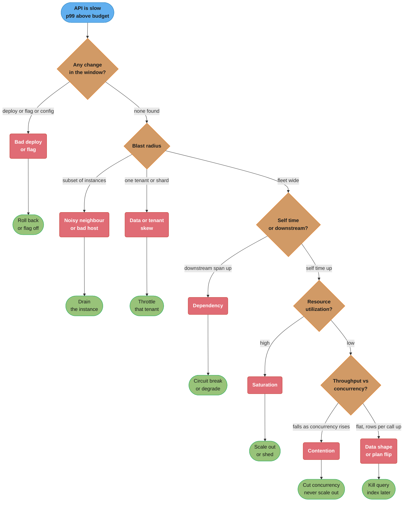
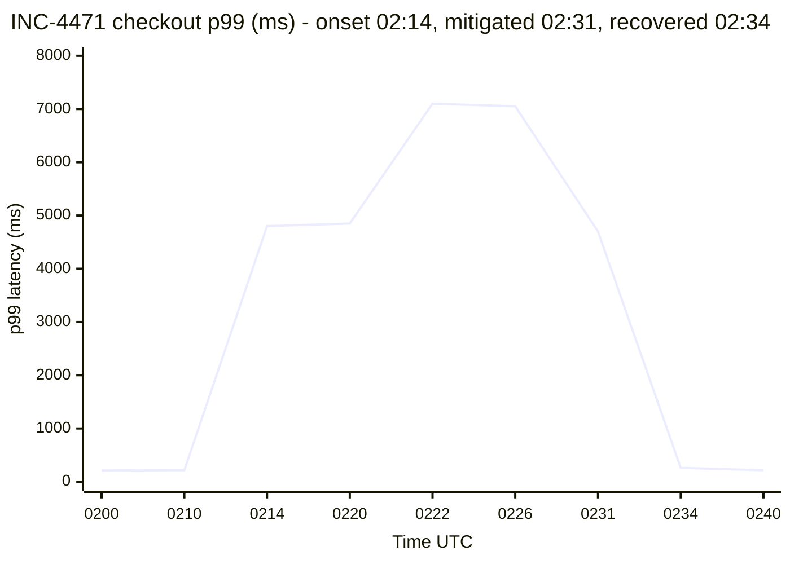

# Performance Incident Playbook

> Nothing is down. Every health check is green, every pod is `Running`, the error rate is
> 0.3%, and p99 checkout latency just went from 210 milliseconds to 4.8 seconds. There is no
> stack trace to grep and no crashed process to restart. This is the incident that a
> troubleshooting instinct built on outages handles badly, and it is the one this file is for.

---

## 1. Concept Overview

A latency incident has a different shape from an outage. An outage announces itself — a process is dead, a dependency returns 503, a certificate expired — and the investigation is a search for the broken thing. A latency incident has no broken thing. Every component is working; some of them are working slowly, and the slowness composes down a call graph until it exits as a user-visible number. The search is not for a failure but for a **constraint**, and constraints hide inside metrics that look normal in isolation.

This file is the applied procedure. Three neighbours own the parts it deliberately does not repeat:

| Owned elsewhere | Where | What it covers |
|-----------------|-------|----------------|
| Incident **process** | [`devops/incident_management_and_oncall`](../../devops/incident_management_and_oncall/incident_management_and_oncall.md) | severity levels, Incident Commander and Comms roles, escalation policy, the blameless postmortem template, MTTD/MTTR math |
| The **method** | [`performance_engineering_method`](../performance_engineering_method/performance_engineering_method.md) | the ordering rule and the stopping rule as a discipline, independent of any incident |
| The **instruments** | [`performance_profiling`](../performance_profiling/performance_profiling.md), [`off_cpu_and_ebpf_analysis`](../off_cpu_and_ebpf_analysis/off_cpu_and_ebpf_analysis.md) | async-profiler, JFR, flame graphs, `offcputime`, eBPF mechanics |

What this file owns is the **execution under time pressure**: the first ten minutes, the ordered mitigation menu, a triage tree that terminates in a named subsystem, six failure signatures each with the one metric that distinguishes it from the other five, the tool order and what each step eliminates, the stopping rule that separates *resolved* from *root-caused*, and what a performance postmortem must contain that a general one does not.

It is written to be followed at 03:00 by someone who has been awake for four minutes. That constraint drives every design choice in it: fixed order, explicit elimination at each step, and a bias toward actions that reduce impact over actions that increase understanding.

---

## 2. Intuition

**One-line analogy:** an emergency room triages before it diagnoses — stop the bleeding, then find out why the patient is bleeding, and never in the other order.

**Mental model.** Two clocks run during a latency incident and they are independent. The **impact clock** counts user-seconds of degradation and only mitigation stops it. The **understanding clock** counts progress toward a cause and only investigation advances it. The single most common failure at 3am is running the understanding clock while the impact clock is still ticking — an engineer 25 minutes into a flame graph while a one-command rollback was available at minute two. The second most common is the reverse: stopping the impact clock and then going back to bed, so the same incident recurs on the next deploy with nothing learned.

**Why it matters.** Latency incidents are the majority of what a mature service actually pages for, because the crash-shaped failures get engineered out first — health checks, restarts, retries and circuit breakers all convert would-be outages into slowness. The result is a service whose remaining failure mode is almost entirely "slow", handled by engineers whose instincts were formed on "down".

**Key insight.** Under time pressure, the value of an action is not how much it explains but **how much it eliminates**. A step that halves the space of possible causes in 90 seconds beats a step that would fully explain the problem in 40 minutes, because the first one can be followed by another halving and the second one cannot be followed by anything. Every rung of the triage tree below is chosen to eliminate, not to explain.

---

## 3. Core Principles

**1. Mitigate before you diagnose — but capture before you mitigate.** A rollback ends the impact and destroys the evidence in the same instant. Twelve seconds of capture (thread dump, `pg_stat_activity` snapshot, one trace exemplar, the current dashboard time range pinned) preserves the ability to root-cause later at a cost that does not move MTTR.

**2. Every action must either eliminate a hypothesis or reduce impact.** If a proposed step does neither, it is curiosity, and curiosity is a daylight activity. This is the rule that stops the 3am flame graph.

**3. "What changed" outranks "what is slow".** Most performance incidents are correlated with a change, and the change is far cheaper to find than the mechanism. But *change* is not *deploy* — it includes feature-flag ramps, config pushes, schema migrations, data growth crossing a threshold, a dependency's own deploy, and a traffic-mix shift. A team that only checks deploys will confidently rule out a change that happened.

**4. Blast radius before cause.** Whether the degradation is on all instances, one AZ, one endpoint, one tenant or one customer's shard eliminates entire branches of the tree before any deep tool is opened, and it takes one dashboard.

**5. Resolved and root-caused are different endpoints, and you must say which one you reached.** Both are legitimate outcomes of a night shift. Declaring the first while implying the second is how the same incident recurs three weeks later.

**6. Timebox every layer.** If ten minutes at a layer eliminates nothing, the layer is wrong or you lack the instrumentation. Escalate, or mitigate harder and continue in daylight. Grinding is the failure mode that turns a 40-minute incident into a four-hour one.

**7. Match the mitigation to the signature.** Scaling out is correct for saturation and actively harmful for contention — it adds concurrency to a queue whose service rate is fixed and makes the incident worse. The signature table in §4.1 exists to prevent exactly this.

---

## 4. Types / Architectures / Strategies

### 4.1 The six signatures, and the one metric that separates each

This is the core of the file. Every latency incident is one of these six, or a compound of two. The **discriminating metric** column is the single measurement that distinguishes that signature from the other five.

| Signature | Symptom | Discriminating metric | Confirm with | Correct mitigation |
|-----------|---------|----------------------|--------------|--------------------|
| **Saturation** | latency rises with load, resource utilization high | **utilization of the constrained resource** — run queue, pool `active/total`, disk `%util`, queue depth | USE on the named tier: utilization, saturation, errors | scale out, shed load |
| **Contention** | latency high while utilization is **low**; throughput flat or *falling* as concurrency rises | **throughput as a function of concurrency** — it decreases | thread dump `BLOCKED` count, `pg_stat_activity.wait_event_type = 'Lock'` | reduce concurrency, revert whatever lengthened the critical section — **never scale out** |
| **Dependency** | your self-time is flat, a downstream span's p99 is up | **client-observed p99 minus the dependency's server-reported p99** | trace waterfall on a slow exemplar | circuit-break, degrade, tighten the timeout |
| **Data-shape change** | step change on one endpoint, no infra or deploy change | **rows examined or bytes scanned per request** | `pg_stat_statements` rows/call delta, plan diff | kill the query, add the index in daylight |
| **Bad deploy** | step change coincident with a rollout; canary and baseline diverge | **latency series split by `version` label** | compare the two series directly | roll back |
| **Noisy neighbour** | a *subset* of instances degraded, the rest fine | **per-instance p99 distribution** — bimodal across instances | CPU steal time, node-level metrics | drain or cordon the bad instance |

Three of these are frequently misread as saturation because saturation is the mental default. Contention presents with **low** CPU and is the most dangerous misread, because the reflex mitigation makes it worse. Dependency slowness presents as your own latency because your thread is blocked in a call you own. Noisy neighbour presents as a fleet-wide average moving, because an average over 40 instances rises when 4 of them are 10x slower.

### 4.2 The mitigation menu, ordered

Ordered by time-to-effect for the cases where each applies. Read the whole table once in daylight, so at 3am you are choosing from a known list rather than inventing.

| Mitigation | Time to effect | Reversible | Risk | Use when |
|------------|---------------|------------|------|----------|
| **Roll back the deploy** | 30–120 s | yes | schema-incompatible rollbacks corrupt data; check migrations | change is deploy-correlated |
| **Disable the feature flag** | 5–30 s | yes | very low; the fastest lever you have | change is flag-correlated |
| **Revert the config push** | 15–90 s | yes | low, if config is versioned | change is config-correlated |
| **Drain / cordon an instance** | 20–60 s | yes | reduces capacity by `1/N` | degradation is on a subset |
| **Scale out** | 60 s – 5 min | yes | **worsens contention**; may exhaust a downstream connection limit | signature is confirmed saturation |
| **Shed load** — rate limit, queue-depth reject, priority drop | 10–40 s | yes | rejects real users; needs a fairness policy | demand exceeds capacity and no faster lever exists |
| **Circuit-break a dependency** | 10–30 s | yes | degrades a feature to protect the whole | dependency signature confirmed |
| **Raise a limit** — pool size, timeout, queue bound | 30–120 s | partly | often makes it worse by deepening a queue | only with the arithmetic in hand |
| **Kill the offending query or session** | 5 s | no | rolls back that transaction | one query is holding a lock or scanning |
| **Failover a region or replica** | 2–10 min | expensive | large blast radius, replication lag risk | infrastructure-localized fault |

**Two warnings that belong on the same card as the menu.** *Raising a limit* is the most-reached-for and least-often-correct lever: enlarging a connection pool in front of a saturated database converts a fast rejection into a slow queue and increases latency, exactly as `R = S / (1 - ρ)` predicts — see [`queueing_theory_for_capacity`](../queueing_theory_for_capacity/queueing_theory_for_capacity.md). And a **mitigated incident is still an incident**: the flag is off, the impact clock stopped, and you now have an unshipped feature, an unexplained mechanism, and a mitigation with no expiry date. Keep the incident open.

### 4.3 Onset shape tells you what kind of cause to look for

| Shape | Typical cause class | First question |
|-------|--------------------|----------------|
| **Step** — flat, then a new flat level within one scrape interval | deploy, flag, config, plan flip | what changed at that timestamp |
| **Ramp** — steady rise over minutes to hours | leak, cache decay, queue growth, table growth | what accumulates |
| **Sawtooth** — rises then drops sharply, repeating | GC, cache eviction cycle, periodic job, restart loop | what is the period |
| **Spike and recover** | burst, thundering herd, retry storm | what is synchronized |
| **Bimodal** — two latency populations | subset of instances, cache hit vs miss, one tenant, one shard | what splits the population |

Onset shape is free — it is on the graph you are already looking at — and it eliminates more than most engineers give it credit for. A step change is never a memory leak, and a ramp is never a deploy.

---

## 5. Architecture Diagrams

### 5.1 The triage tree



Every diamond is a question you can answer from an existing dashboard in under 90 seconds. The tree is not a description of how systems fail; it is an *elimination order* chosen so the cheapest, highest-yield question comes first.

### 5.2 Onset shapes as they appear on the graph

The first thing on screen is a latency time series. Its shape is diagnostic before any
other tool is opened.

```
p99 (ms)     STEP                      RAMP                     SAWTOOTH
5000 |            ___________     |              _____    |    /|   /|   /|
4000 |           |                |          ___/         |   / |  / |  / |
3000 |           |                |      ___/             |  /  | /  | /  |
2000 |           |                |  ___/                 | /   |/   |/   |
 200 |___________|                |_/                     |/    '    '    '
     +---------------------      +--------------------    +--------------------
        02:14                      over 90 min                period = 6 min
     deploy / flag / plan flip   leak / growth / decay     GC / eviction / cron

             SPIKE + RECOVER              BIMODAL (two populations)
5000 |         /\                    |  o o   o  o o   o     <- 4 of 40 pods
4000 |        /  \                   |
3000 |       /    \                  |
2000 |      /      \                 |
 200 |_____/        \______          | ####################  <- the other 36
     +--------------------           +----------------------
       burst / herd / retry storm      subset: host, tenant, shard
```

A step is never a leak. A ramp is never a deploy. A bimodal spread across instances is
never a fleet-wide cause. Reading the shape costs three seconds and deletes whole branches
of §5.1.

### 5.3 The two clocks

```mermaid
flowchart LR
    classDef io      fill:#61afef,stroke:#2e86c1,color:#1a1a1a,font-weight:bold
    classDef frozen  fill:#c678dd,stroke:#9b59b6,color:#fff
    classDef train   fill:#98c379,stroke:#27ae60,color:#1a1a1a
    classDef mathOp  fill:#d19a66,stroke:#e67e22,color:#1a1a1a,font-weight:bold
    classDef lossN   fill:#e06c75,stroke:#c0392b,color:#fff,font-weight:bold
    classDef req     fill:#56b6c2,stroke:#0097a7,color:#1a1a1a
    classDef base    fill:#e5c07b,stroke:#f39c12,color:#1a1a1a

    page([Page fires]) --> assess(Assess<br/>blast radius + timeline)
    assess --> capture(Capture evidence<br/>12 seconds)
    capture --> mitigate(Mitigate<br/>impact clock stops)
    mitigate --> verify{Impact ended<br/>for 10 min?}
    verify -->|"no"| mitigate
    verify -->|"yes"| diagnose(Diagnose<br/>understanding clock)
    diagnose --> stop{Mechanism<br/>explained?}
    stop -->|"no, and it is 04:00"| handoff([Hand off<br/>to daylight])
    stop -->|"yes"| pm([Performance<br/>postmortem])
    handoff --> pm

    class page io
    class assess,verify,stop mathOp
    class capture base
    class mitigate lossN
    class diagnose req
    class handoff frozen
    class pm train
```



The `capture` box is 12 seconds long and it is the box teams skip. Skipping it converts
every mitigated incident into an unexplained one.

---

## 6. How It Works — Detailed Mechanics

### 6.1 The first ten minutes

Four questions, in this order. Answer all four before opening any deep tool.

| # | Question | Where the answer is | Time | What it eliminates |
|---|----------|--------------------|------|--------------------|
| 1 | **What changed?** | deploy log, flag audit log, config repo, dependency status | 60 s | roughly half of all incidents resolve here |
| 2 | **When did it start?** | latency graph — the exact minute, not "tonight" | 30 s | anything that changed outside the window |
| 3 | **Who is affected?** | RED split by endpoint, version, AZ, tenant, instance | 120 s | whole branches of §5.1 |
| 4 | **Is it getting worse?** | slope over the last 5 minutes; error-budget burn rate | 30 s | sets the urgency and the mitigation aggressiveness |

**Why "what changed" comes first.** It has the highest yield per second of any question available, and its answer is a rollback rather than an investigation. But it is only useful if "change" is defined properly:

```bash
# The change window: 30 minutes before onset. ALL of these are changes.
ONSET="2026-08-28T02:14:00Z"

kubectl rollout history deployment/checkout                       # our deploys
argocd app history checkout                                       # GitOps syncs
launchdarkly-cli audit --since "$ONSET-30m"                       # FLAG RAMPS
git -C ops/config log --since "$ONSET-30m" --oneline              # config pushes
psql -c "SELECT * FROM schema_migrations ORDER BY applied_at DESC LIMIT 5;"
curl -s https://status.stripe.com/api/v2/summary.json | jq .status # third parties
# ...and the changes nobody logs:
#   - a table crossing a size threshold that flips a query plan
#   - a tenant onboarding that shifted the traffic mix
#   - a client app release changing the endpoint ratio
```

A team that checks only `kubectl rollout history` and finds nothing will say "no changes" and go looking for a mechanism. In the §14 incident, the change was a feature-flag ramp at 02:00, which no deploy log records.

**Establish the timeline before touching anything.** Pin the dashboard to a window starting 30 minutes before onset and ending now, and write the onset timestamp in the incident channel. Everything after this point is interpreted relative to that timestamp, and the single most common source of wasted incident time is two engineers looking at different time ranges.

### 6.2 Capture before you mitigate

Twelve seconds, scripted, kept in the runbook so nobody composes it at 3am.

```bash
#!/usr/bin/env bash
# capture.sh - run BEFORE any rollback, restart, or scale action.
set -euo pipefail
INC="${1:?usage: capture.sh <incident-id>}"
OUT="/tmp/$INC"; mkdir -p "$OUT"

POD=$(kubectl get pod -l app=checkout -o name | head -1)

# 1. JVM state: threads (BLOCKED counts = contention), heap, GC.
kubectl exec "$POD" -- jcmd 1 Thread.print          > "$OUT/threads.txt" 2>&1 &
kubectl exec "$POD" -- jcmd 1 GC.heap_info          > "$OUT/heap.txt"    2>&1 &

# 2. Database state: who is waiting, and on what. Perishable - gone after mitigation.
psql -qAt -c "SELECT now(), pid, state, wait_event_type, wait_event,
                     now()-xact_start AS xact_age, left(query,120)
              FROM pg_stat_activity
              WHERE state <> 'idle' ORDER BY xact_age DESC LIMIT 50;" > "$OUT/pg_activity.txt" &

# 3. Pool + queue depths at this instant.
kubectl exec "$POD" -- curl -s localhost:8080/actuator/metrics/hikaricp.connections.pending \
                                                     > "$OUT/pool.json" 2>&1 &

# 4. One slow trace exemplar - the single most useful artifact for a latency incident.
curl -s "$TEMPO/api/search?tags=service.name=checkout&minDuration=3s&limit=5" \
                                                     > "$OUT/slow_traces.json" &
wait
echo "captured to $OUT - now mitigate"
```

Everything in that script is **perishable**. A rollback restarts the JVM and the thread dump is gone. Killing the blocking session empties `pg_stat_activity`. Scaling out changes the pool statistics. Post-incident, the difference between "root cause: lock contention on `inventory`, confirmed by 214 sessions on `wait_event = transactionid`" and "root cause: unknown, rolled back the flag" is usually these twelve seconds.

### 6.3 Walking the triage tree

Each rung, with the concrete query and what a negative result eliminates.

**Rung 1 — split by `version`.** If a deploy is in the window, this settles it in one panel:

```promql
histogram_quantile(0.99,
  sum by (le, version) (rate(http_server_duration_seconds_bucket{service="checkout"}[2m])))
```

Two separated series means bad deploy — roll back and stop. One series, or both moving together, eliminates the deploy even if a deploy happened, which is a result worth having because "there was a deploy" is otherwise an irresistible false lead.

**Rung 2 — blast radius.** Three panels, same query with different `by` clauses:

```promql
# by instance - bimodal spread means noisy neighbour or one bad host
histogram_quantile(0.99, sum by (le, instance) (rate(http_server_duration_seconds_bucket[2m])))
# by tenant  - one tenant means skew or a fairness bug
histogram_quantile(0.99, sum by (le, tenant_tier) (rate(http_server_duration_seconds_bucket[2m])))
# by route   - one route means a code path, not infrastructure
histogram_quantile(0.99, sum by (le, http_route) (rate(http_server_duration_seconds_bucket[2m])))
```

Uniform across all three eliminates the entire right-hand side of §5.1 and forces the investigation into the shared path: a dependency, a shared resource, or a shared lock.

**Rung 3 — self time versus downstream.** Take one slow trace exemplar and read the waterfall. The question is whether the parent span's duration is explained by its children:

```
checkout.POST /v2/checkout              4,812 ms  <- total
  |- auth.verify                            8 ms
  |- inventory.reserve                  4,769 ms  <- 99.1% of the total
  |    |- db.query SELECT..FOR UPDATE   4,741 ms  <- and 99.4% of that
  |    |- recommendations.forSku           12 ms
  |- payment.authorize                     31 ms
```

That waterfall names the subsystem in ten seconds. The trap is a *missing* child span: if the parent is 4,800ms and its children sum to 40ms, the time is either in un-instrumented code or in **waiting to start** — queueing in the thread pool before the handler ran — and the latter is invisible to tracing unless you instrument the accept-to-handler gap. A 4,760ms unexplained gap with 12% CPU is queueing until proven otherwise.

**Rung 4 — USE on the named tier.** Now, and only now, look at the resource:

```bash
# Utilization, saturation, errors on the tier the trace named.
psql -qAt -c "SELECT count(*) FILTER (WHERE state='active')  AS active,
                     count(*) FILTER (WHERE wait_event_type='Lock') AS lock_waiters,
                     count(*)                                 AS total
              FROM pg_stat_activity;"
# 'active' high + CPU high      -> saturation
# 'lock_waiters' high + CPU LOW -> contention
```

**Rung 5 — the contention discriminator.** Utilization is low, latency is high. The distinguishing measurement is throughput as a function of concurrency:

```promql
# If this RATIO falls while concurrency rises, it is contention, not saturation.
sum(rate(http_server_requests_total[1m])) / sum(hikaricp_connections_active)
```

Under saturation, throughput plateaus as concurrency rises. Under contention it **decreases**, because every additional concurrent request adds queueing on the serialized section without adding service capacity. That inversion is the cleanest signal in the whole playbook, and it is the one that tells you scaling out will make things worse.

On the JVM the same finding comes from the thread dump you already captured:

```bash
# How many threads are blocked, and on which monitor?
awk '/java.lang.Thread.State: BLOCKED/{b++} /waiting to lock/{print $NF}' \
    /tmp/$INC/threads.txt | sort | uniq -c | sort -rn | head
#   187 <0x00000006c2a41f80>   <- 187 of 200 threads on ONE monitor
```

187 of 200 threads on one monitor is not a subtle finding. If your capture script ran, you have this before you mitigated.

### 6.4 The tools, in order, and what each rules out

| Order | Tool | Time | Rules out | Cost |
|-------|------|------|-----------|------|
| 1 | Change log — deploys, flags, config, migrations, vendor status | 60 s | ~50% of incidents end here | free |
| 2 | RED dashboard split by version, instance, route, tenant | 2 min | infrastructure-localized and code-path-localized causes | free |
| 3 | Trace waterfall on a slow exemplar | 3 min | self-time vs downstream; names the subsystem | free if sampled |
| 4 | USE on the named tier — pool, CPU, disk, queue depth | 3 min | saturation vs not | free |
| 5 | Lock and wait state — `pg_stat_activity`, thread dump | 4 min | contention vs everything else | 1–2% pause for `Thread.print` |
| 6 | **Off-CPU profile** — `offcputime`, JFR wall-clock | 10 min | where the blocked time actually goes | 1–5% overhead, needs a host |
| 7 | **CPU profile** — async-profiler, `perf` | 15 min | which code is burning cycles | 1–3%, but useless at low CPU |

**When a profile is a waste of the outage — four cases, all common:**

1. **CPU is at 12% and the symptom is latency.** A CPU profiler samples running threads. If nothing is running, the flame graph is a thin sliver with the widest frame accounting for 4ms of an 800ms request. Reach for an off-CPU profile instead — see [`off_cpu_and_ebpf_analysis`](../off_cpu_and_ebpf_analysis/off_cpu_and_ebpf_analysis.md).
2. **The change is already identified.** A profile of a system you are about to roll back explains code that will not be running in 90 seconds. Roll back, then profile the candidate in staging.
3. **The symptom is localized to a subset of instances.** Drain one, keep it alive for forensics, and profile it in daylight. Profiling during the incident does not shorten the incident.
4. **You do not already know how to read the output for this service.** An unfamiliar flame graph at 3am costs 20 minutes and produces a plausible-looking wrong answer, because the widest frame is almost never the answer without a baseline to diff against.

The corollary: a profile *is* the right tool when CPU is genuinely saturated, self-time dominates the trace, and you have a baseline profile to diff against. That combination is real, and rarer than the reflex to profile suggests.

### 6.5 Knowing when to stop

Two distinct endpoints. Reaching either one is a success; conflating them is not.

**Resolved** means the impact clock has stopped:

- The user-facing metric is inside its budget and has been for at least 10 minutes, or two full scrape-and-alert intervals, whichever is longer.
- The mitigation in place is understood, including what it costs — a disabled feature, reduced capacity, a rejected class of request.
- Recurrence risk is stated: will this re-fire on the next deploy, at the next peak, at midnight?

**Root-caused** means the understanding clock has stopped:

- The mechanism is explained end to end — not "the database was slow" but "a 12ms RPC was moved inside a `SELECT FOR UPDATE` on a hot row, raising lock hold time from 3.1ms to 15.4ms, which caps that row's throughput at 65/s against 180/s of demand."
- The explanation **predicts** the observations you have, including the ones that were confusing: why CPU was low, why scaling out made it worse, why only checkout was affected.
- You can state what would have to be true for the explanation to be wrong, and it is not.

If it is 04:10 and you are resolved but not root-caused, **hand off**. That is a correct decision, not a failure, and it needs an artifact:

```markdown
# HANDOFF - INC-4471 - resolved 02:34, not root-caused

MITIGATION IN PLACE: flag `checkout.addon_recs` at 0% (was ramping to 25% at 02:00).
  Cost: feature disabled for all users. Expiry: MUST be re-decided by 2026-08-29 17:00.
  Re-fires if: anyone re-ramps the flag. Guard rail added: flag locked in LaunchDarkly.

HYPOTHESES:
  [KILLED] bad deploy      - last deploy 12:07, 14h before onset; version series identical
  [KILLED] DB saturation   - CPU 31%, disk 12% util, no plan changes in pg_stat_statements
  [KILLED] dependency      - recommendations p99 12ms server-side, flat all night
  [KILLED] noisy neighbour - all 40 pods across 3 AZs degraded identically
  [KILLED] traffic spike   - RPS 2,900 flat, actually 4% DOWN during the incident
  [OPEN]   lock contention - 214 sessions on wait_event=transactionid at 02:20 (captured)

ARTIFACTS: /tmp/INC-4471/{threads.txt,pg_activity.txt,slow_traces.json,pool.json}
  Grafana: https://grafana/d/checkout?from=1756347240000&to=1756351800000
  Trace exemplar: 7f3a91c2e0 (4,812ms, 99% in inventory.reserve)

NEXT STEP FOR DAYLIGHT: diff the flag-on code path for work inside the FOR UPDATE
  transaction. Start at InventoryService.reserve().
```

That document is 20 lines and it is the entire difference between a night shift that produced knowledge and one that produced only relief.

### 6.6 The performance postmortem

The general blameless-postmortem template — impact, timeline, five whys, action items with owners — is in [`devops/incident_management_and_oncall`](../../devops/incident_management_and_oncall/incident_management_and_oncall.md). A performance postmortem needs **six additional sections**, and their absence is why performance incidents recur more than outages do.

**1. The budget that was violated.** Not "latency was high" but which SLO, by how much, for how long, and how much error budget it consumed. If the service has a per-hop latency budget from [`latency_budgets_and_slo_math`](../latency_budgets_and_slo_math/latency_budgets_and_slo_math.md), name the hop that overspent and by what multiple. "The inventory hop's allocation is 40ms; it spent 4,769ms, 119x its budget" is a sentence a general postmortem never produces.

**2. The signal that should have caught it, and why it did not.** Every performance incident is a detection failure as well as a reliability one. Was there no metric? A metric with no alert? An alert with a threshold above the failure point? An alert on a *mean* that a p99 failure never moved? In the §14 incident the answer was: the p99 alert existed and fired correctly at 02:17, and the flag ramp had no automated canary analysis at all, so a change that a 5-minute automated comparison would have caught went to 25% of traffic unwatched.

**3. Whether the load model could ever have produced this.** Ask whether the workload shape that triggered it was in any test. Usually it was not — a hot key, a tenant skew, a specific concurrency level. That gap is an action item against the load model, not against the code: see [`workload_characterization_and_load_modelling`](../workload_characterization_and_load_modelling/workload_characterization_and_load_modelling.md).

**4. The regression test that now exists.** The strongest action item a performance postmortem can produce is a test that fails on the reverted change. Concretely: a benchmark asserting lock hold time under `reserve()` stays under 5ms, wired into the detection system in [`performance_regression_detection`](../performance_regression_detection/performance_regression_detection.md) so it is checked on every commit rather than remembered. An action item that is "be careful about locks" is not an action item.

**5. The mitigations that were wrong, and why.** Record them explicitly. In §14, scaling from 40 to 72 pods at 02:22 made p99 worse — 4.8s to 7.1s — because it added concurrency to a contended lock. Writing "scaling out is the wrong mitigation for contention; the discriminator is throughput-vs-concurrency" into the runbook is worth more than the root cause itself, because the next incident will be different and the wrong reflex will be the same.

**6. Mitigation half-life.** Every temporary mitigation gets an owner and a date. A flag left at 0% for nine months is a feature nobody shipped and a config nobody understands; a pool size raised during an incident and never revisited is a landmine for the next capacity exercise.

---

## 7. Real-World Examples

**Google SRE — mitigate first, institutionalized.** Google's published incident practice separates the goal of *stopping user impact* from the goal of *understanding the failure*, and explicitly instructs responders to prefer the former, including reverting to a known-good state before the cause is understood. The mechanism that makes it safe is that rollback is a rehearsed, one-command operation, which is what converts "mitigate first" from advice into a procedure.

**Amazon — the retry-amplification pattern.** Amazon's engineering writing on timeouts, retries and backoff documents the specific way a partial slowdown becomes a full outage: clients retry, retries multiply load on an already-slow dependency, and the system settles into a stable congested state that persists after the original trigger is gone. The operational consequence for a responder is that once retry amplification has started, removing the trigger is not sufficient — you must also shed the retry load, which is why "circuit-break and shed" appears in the mitigation menu above "wait for it to recover."

**Netflix — canary analysis as the detection layer.** Netflix's automated canary analysis compares a canary against a baseline on statistical grounds before a change reaches full traffic. The performance-incident lesson is the one in §6.6 item 2: most severe latency regressions are changes that reached production unwatched, and the durable fix is at the release layer rather than in faster incident response.

**The lock-contention profile in database operations.** Postgres exposes precisely the discriminator this playbook depends on — `pg_stat_activity.wait_event_type` and `wait_event`, which name whether a backend is running, waiting on a lock, on I/O, or on a client. A responder who queries wait events rather than CPU distinguishes contention from saturation in one query, and this is the single highest-yield operational query for a slow-database incident.

**The "add more capacity" antipattern in queueing practice.** Capacity-planning literature consistently documents that adding servers in front of a serialized bottleneck does not increase throughput and does increase queueing — Amdahl's argument applied to operations. Every responder who has scaled a fleet during a lock incident and watched latency rise has rediscovered it at 3am.

---

## 8. Tradeoffs

### 8.1 Mitigate-first versus diagnose-first

| | Mitigate first | Diagnose first |
|---|---|---|
| User impact | ends in 30 s – 5 min | continues for the length of the investigation |
| Evidence | destroyed unless captured | fully preserved |
| Root-cause probability | high **if** capture ran, low if not | high |
| Recurrence risk | high without follow-through | lower |
| When it is right | almost always | the mitigation itself is risky, or impact is genuinely minor |

The tradeoff is real but the resolution is not a compromise: capture, then mitigate. Twelve seconds buys back nearly all of the diagnose-first column.

### 8.2 Choosing a mitigation

| Mitigation | Time to effect | Blast radius | Reversibility | Fails badly when |
|------------|---------------|--------------|---------------|------------------|
| Flag off | 5–30 s | just that feature | instant | the flag does not gate the real change |
| Rollback | 30–120 s | whole service | needs a compatible schema | a migration ran forward |
| Drain instance | 20–60 s | `1/N` of capacity | instant | the problem is fleet-wide, and you just removed capacity |
| Scale out | 1–5 min | whole service | instant | signature is contention, or a downstream connection limit is near |
| Shed load | 10–40 s | rejected users | instant | no fairness policy, so you shed your best customer |
| Raise a limit | 30–120 s | whole service | partly | it deepens a queue in front of a saturated resource |
| Failover | 2–10 min | region | expensive and slow | replication lag makes the target stale |

### 8.3 Depth of investigation versus time of night

| Situation | Right depth | Reasoning |
|-----------|------------|-----------|
| Mitigated, 02:40, cause unclear | stop, hand off | judgment degrades and the artifacts keep |
| Mitigated, 14:00, cause unclear | continue 60–90 min | daylight, and the whole team is available |
| Not mitigated, no lever found | escalate at 15 min | a second responder halves the hypothesis space |
| Recurring, mitigated three times | stop responding, start engineering | the incident is a symptom of a missing control |

---

## 9. When to Use / When NOT to Use

**Use this playbook when:**

- A latency SLI is out of budget while the service is functionally up — no crashes, no elevated 5xx, just slow.
- The symptom is "some requests are slow" and the affected population is not yet identified.
- You are on call for a service with real dependencies, a database, and a connection pool — which is to say, almost any backend service.
- You are writing a runbook, and want the technical branch that sits under the process runbook.

**Do NOT use it when:**

- **The service is actually down.** A crash loop, a failed deploy that will not start, an expired certificate — those are outages, and the process runbook in [`devops/incident_management_and_oncall`](../../devops/incident_management_and_oncall/incident_management_and_oncall.md) is the right entry point.
- **You are not on an incident.** A slow endpoint discovered on a Tuesday afternoon deserves the unhurried method in [`performance_engineering_method`](../performance_engineering_method/performance_engineering_method.md), which optimizes for correctness of conclusion rather than time to elimination.
- **The regression came from a known commit.** Bisect it — that is a detection and attribution problem, covered in [`performance_regression_detection`](../performance_regression_detection/performance_regression_detection.md), not an incident.
- **The question is "how much capacity do we need."** That is capacity planning: [`queueing_theory_for_capacity`](../queueing_theory_for_capacity/queueing_theory_for_capacity.md) and [`workload_characterization_and_load_modelling`](../workload_characterization_and_load_modelling/workload_characterization_and_load_modelling.md).

**The honest limitation:** this playbook assumes instrumentation. It assumes RED metrics split by version, instance, route and tenant; distributed traces with a queryable slow-exemplar search; a change log covering flags and config, not just deploys; and database wait-event visibility. Without those, the tree in §5.1 has no answerable questions and you will fall back to guessing and restarting. If you have no budget for both, build the instrumentation before you memorize the playbook — see [`observability_and_monitoring`](../observability_and_monitoring/observability_and_monitoring.md).

---

## 10. Common Pitfalls

**Pitfall 1 — Restarting the pods before capturing anything.** The most common 3am reflex. A payments service restarted 40 pods at 01:52, recovered for 11 minutes, and degraded again at 02:03 because the cause — a leaked connection under a specific error path — refilled the pool. Three restart cycles, 94 minutes total, and zero artifacts. The fourth cycle finally captured a thread dump showing 198 of 200 threads in `getConnection`.

```bash
# BROKEN - the reflex. Impact pauses for 11 minutes, evidence is gone, it comes back.
kubectl delete pod -l app=payments

# FIXED - 12 seconds of capture, THEN the restart. Same MTTR, root cause available.
POD=$(kubectl get pod -l app=payments -o name | head -1)
kubectl exec "$POD" -- jcmd 1 Thread.print > /tmp/INC/threads.txt
kubectl exec "$POD" -- curl -s localhost:8080/actuator/metrics/hikaricp.connections.pending \
                                                       > /tmp/INC/pool.json
psql -qAt -c "SELECT pid,state,wait_event_type,left(query,120) FROM pg_stat_activity
              WHERE state <> 'idle';"                  > /tmp/INC/pg.txt
kubectl delete pod -l app=payments
```

**Pitfall 2 — Scaling out into a lock.** A checkout service at 4.8s p99 with 31% database CPU was scaled from 40 to 72 pods. p99 went to 7.1 seconds and throughput fell 9%, because the bottleneck was a row lock whose service rate is fixed and the extra pods only deepened the queue. Four minutes of the incident were spent at 72 pods, plus five more recovering after scaling back down. The discriminator — throughput per unit of concurrency, which was *falling* — was on an existing dashboard the whole time.

**Pitfall 3 — "No changes" because only deploys were checked.** The same incident: `kubectl rollout history` showed the last deploy 14 hours earlier, so the responder ruled out change and started looking for a mechanism. The actual trigger was a feature flag ramping to 25% at 02:00, fourteen minutes before onset. Ten minutes lost. **A change window must cover deploys, flags, config, migrations, dependency deploys and vendor status.**

**Pitfall 4 — Profiling at 12% CPU.** A responder attached async-profiler to a service with an 800ms p99 and 12% CPU, spent 22 minutes collecting and reading, and found the widest frame at 4ms — because a CPU profiler structurally cannot see time a thread spends off-CPU. The time was in `epoll_wait` on a dependency socket. An off-CPU profile or, faster, a single trace waterfall would have named it in three minutes.

**Pitfall 5 — Averaging the incident away.** A dashboard showing fleet mean latency moved from 240ms to 275ms throughout an incident in which 1 of 40 pods served every request in 1.6 seconds. That is all one bad pod in forty can do to an average — `0.025 x (1600 - 240) = 34ms` — and a 35ms move sits inside normal day-to-day variation. The p99 told the truth the whole time: 2.5% of requests were slow, so the slowest 1% were all on that pod and the fleet p99 sat at 1,600ms, four times the 400ms SLO. The team debated whether an incident was even happening for 14 minutes. **Split by instance and look at p99, never a fleet mean.**

**Pitfall 6 — Raising the pool size.** With `hikaricp.connections.pending` climbing, a responder raised the pool from 20 to 60 per instance across 30 instances. That is 1,800 connections against a Postgres `max_connections` of 500, so connection establishment began failing outright and a latency incident became an availability incident. The queue simply moved from the application to the database, and got worse on the way. Pool sizing arithmetic belongs in daylight — [`connection_pooling_deep_dive`](../connection_pooling_deep_dive/connection_pooling_deep_dive.md).

**Pitfall 7 — Declaring resolved when it was only mitigated.** A flag was disabled, latency recovered, the incident was closed as resolved and the postmortem recorded "feature flag caused latency". Three weeks later the flag was re-ramped by a different team who had no reason not to, and the identical incident recurred at 21:40 on a Friday. Nothing had been root-caused, so nothing had been fixed and no guard rail existed.

**Pitfall 8 — Two responders on different time ranges.** One engineer was looking at the last 6 hours, another at the last 30 minutes, and they disagreed for 9 minutes about whether the latency was a step or a ramp. Pin the window, post the link in the channel, and make everyone use it.

**Pitfall 9 — Retry amplification treated as the cause.** A dependency slowed from 20ms to 300ms; client retries with no budget tripled its offered load and drove it to 4 seconds. The responder investigated the dependency's 4-second latency as the problem. It was the *consequence*. Removing the retry load with a circuit breaker dropped it back to 340ms in 40 seconds, after which the original 300ms regression was a daylight problem. **When load rose during the incident rather than before it, suspect amplification before you suspect the dependency.**

---

## 11. Technologies & Tools

| Tool | Role in the playbook | Note |
|------|---------------------|------|
| **Grafana / PromQL** | RED split by version, instance, route, tenant | build the four panels in advance; nobody writes PromQL at 3am |
| **Tempo / Jaeger** | slow-trace exemplar search (`minDuration`) | the fastest path from "slow" to a named subsystem |
| **`pg_stat_activity`** | `wait_event_type` and `wait_event` — the contention discriminator | one query separates lock waits from I/O from CPU |
| **`pg_stat_statements`** | rows/call and mean-time deltas across the onset | detects a plan flip without an `EXPLAIN` |
| **`jcmd Thread.print`** | `BLOCKED` counts and the contended monitor | ~1–2% pause; safe during an incident |
| **`jcmd GC.heap_info`, GC logs** | rules the sawtooth in or out in 20 seconds | pairs with the onset shape in §5.2 |
| **async-profiler** | CPU flame graph — step 7, rarely step 1 | needs a baseline to diff against to be useful |
| **`offcputime` (bcc/bpftrace)** | where blocked time goes when CPU is idle | see [`off_cpu_and_ebpf_analysis`](../off_cpu_and_ebpf_analysis/off_cpu_and_ebpf_analysis.md) |
| **LaunchDarkly / OpenFeature audit log** | the change source that deploy logs miss | put it in the change-window script |
| **Argo CD / `kubectl rollout history`** | deploy and GitOps sync timeline | `rollout undo` is the fastest rollback |
| **Envoy / Istio outlier detection** | ejects a slow instance automatically | turns noisy-neighbour incidents into non-events |
| **Resilience4j circuit breaker** | the dependency mitigation, pre-wired | see [`fault_tolerance_patterns`](../fault_tolerance_patterns/fault_tolerance_patterns.md) |
| **PagerDuty / incident.io** | declares the incident and starts the timeline | process layer, not technical |

---

## 12. Interview Questions with Answers

**Q: The API is slow, nothing is down, and you have just been paged. What are your first four questions?**
**Short:** What changed, when did it start, who is affected, and is it getting worse — in that order, before any deep tool.

"What changed" comes first because it has the highest yield per second of any available question and its answer is a rollback rather than an investigation. "When did it start" pins the change window and stops two responders from looking at different time ranges. "Who is affected" — split by version, instance, route and tenant — eliminates entire branches of the triage tree from one dashboard. "Is it getting worse" sets how aggressive the mitigation should be. All four are answerable in under four minutes from dashboards that should already exist, and roughly half of incidents end at the first one.

**Q: Why is "what deployed" the highest-yield first question, and how does that question mislead people?**
**Short:** Most regressions correlate with a change, but a change log that only covers deploys will report "nothing changed" when a flag ramped.

Correlation with a change is both the most common situation and the cheapest thing to check, and it yields an immediate mitigation instead of a mechanism. The failure mode is defining change too narrowly: feature-flag ramps, config pushes, schema migrations, a dependency's own deploy, a vendor incident, a table crossing a size threshold that flips a query plan, and a client release that shifted the traffic mix are all changes, and none appear in a deployment history. One measured incident lost ten minutes because the responder ran `kubectl rollout history`, saw the last deploy 14 hours earlier, and concluded nothing had changed while a flag was ramping to 25%. Script the change window across all the sources so the answer takes 60 seconds and cannot be partial.

**Q: You have a one-command rollback available and no idea what is wrong. Do you take it?**
**Short:** Yes, after roughly twelve seconds of scripted evidence capture, because the impact clock and the understanding clock are independent.

Mitigation ends user impact and investigation does not, so the two should never compete for the same minutes. The reason people hesitate is real — a rollback destroys the thread dump, empties the wait-event view and resets the pool statistics, and without those you may never explain what happened. The resolution is not to choose but to sequence: a pre-written capture script that grabs a thread dump, a `pg_stat_activity` snapshot, pool depths and one slow trace exemplar costs about twelve seconds and does not measurably move MTTR. Then roll back. Composing that script during the incident is what does not work, so it lives in the runbook.

**Q: CPU is at 30%, disk is nearly idle, and p99 is twenty times normal. What signature is that?**
**Short:** Contention — high latency with low utilization is the signature no other failure mode produces.

Saturation raises latency by raising utilization, so low utilization eliminates it. A dependency would show its time inside a child span rather than in your own resource picture. The confirming measurement is throughput as a function of concurrency: under saturation throughput plateaus as concurrency rises, but under contention it actually *decreases*, because each additional concurrent request adds queueing on a serialized section without adding any service capacity. Confirm with `pg_stat_activity.wait_event_type = 'Lock'` or a thread dump's `BLOCKED` count, and mitigate by reducing concurrency or reverting whatever lengthened the critical section.

**Q: Why can scaling out make a latency incident worse?**
**Short:** Because it adds concurrency to a serialized bottleneck whose service rate is fixed, which deepens the queue without raising throughput.

If the constraint is a lock on a hot row, a leader-only write path, or a single downstream connection limit, more instances mean more requests arriving at the same serialized section per second and a longer queue in front of it. One measured incident scaled a checkout service from 40 to 72 pods and watched p99 go from 4.8 to 7.1 seconds with throughput falling 9%, then spent five more minutes scaling back down. Scaling out is correct only when the signature is confirmed saturation, which is why the discriminating metric must be read before the lever is pulled. The version of this that hurts most is scaling out into a downstream connection limit, where a latency incident becomes an availability one.

**Q: A responder wants to raise the connection-pool size because pending acquisitions are climbing. What do you say?**
**Short:** Almost certainly no, because a larger pool in front of a saturated database converts a fast rejection into a slower queue.

Pending acquisitions mean demand exceeds the pool's throughput, but the pool is rarely the constraint — it is usually the visible symptom of a database that cannot go faster. Enlarging it pushes the same queue one layer down, where it is less visible and where each waiting request now also holds a database backend. There is a hard ceiling too: raising a pool from 20 to 60 across 30 instances requests 1,800 connections against a `max_connections` of 500, so connection establishment starts failing outright. If the pool genuinely is the constraint, the arithmetic to prove it takes longer than the incident allows, so do it in daylight.

**Q: How do you tell a dependency problem from your own service being slow?**
**Short:** Compare the client-observed p99 of the call against the dependency's own server-reported p99 for the same window.

A trace waterfall on one slow exemplar answers this in about ten seconds: if a child span accounts for 99% of the parent's duration, the subsystem is named. The subtle case is when the two numbers disagree — the client sees 800ms and the dependency reports 20ms server-side — which means the time is in the network, in connection acquisition to that dependency, or in your own client-side queueing before the request was issued, and the dependency is innocent. The other subtle case is a *missing* child: if the parent is 4,800ms and its children sum to 40ms, the time is in un-instrumented code or in waiting to start, and thread-pool queueing before the handler ran is invisible to tracing unless you instrument the accept-to-handler gap.

**Q: When is running a CPU profiler during an incident a waste of time?**
**Short:** Whenever CPU is low, since a sampling CPU profiler cannot observe a thread that is blocked rather than running.

At 12% CPU with an 800ms p99, a flame graph is a thin sliver whose widest frame accounts for a few milliseconds, because the profiler is correctly reporting on the small fraction of time spent on-CPU and structurally declining to report the rest. Three other cases waste the outage too: when the change is already identified and a rollback is 90 seconds away, when the symptom is confined to a subset of instances that you can simply drain and forensically examine later, and when you have no baseline profile to diff against, since the widest frame is rarely the answer on its own. A profile is right when CPU is genuinely saturated, self-time dominates the trace, and a baseline exists — and when it is not, an off-CPU profile or a trace waterfall gets there faster.

**Q: What is the difference between an incident being resolved and being root-caused?**
**Short:** Resolved means user impact has stopped and stayed stopped, while root-caused means the mechanism is explained well enough to predict the observations.

Resolved requires the SLI back inside budget for at least ten minutes, a mitigation you understand including what it costs, and a stated recurrence risk. Root-caused requires an explanation specific enough to be falsifiable — not "the database was slow" but a mechanism that also accounts for why CPU was low, why scaling out hurt, and why only one endpoint was affected. Both are legitimate places to stop, and at 04:00 stopping at resolved is usually the right call. What is not legitimate is declaring the first while implying the second, because a mitigated-but-unexplained incident has no guard rail and recurs the moment someone re-applies the change.

**Q: You are mitigated at 02:34 but have no cause and it is 04:10. What do you produce before going to bed?**
**Short:** A handoff document listing the mitigation and its expiry, every hypothesis with its status, the captured artifacts, and one concrete next step.

The mitigation entry must name what is in place, what it costs, when it must be re-decided, and what would cause it to re-fire — a flag left at 0% with no owner becomes a permanent mystery. The hypothesis list is the highest-value part: recording that a bad deploy, database saturation, a dependency and a noisy neighbour were each killed, and by which evidence, saves the daylight engineer from re-running all four. Link the artifact paths and a pinned dashboard URL with explicit epoch timestamps, because relative time ranges are meaningless six hours later. The whole document is about twenty lines, and it is what separates a night shift that produced knowledge from one that produced only relief.

**Q: What must a performance postmortem contain that a general postmortem does not?**
**Short:** The specific budget that was violated, the signal that should have caught it, and the regression test that now exists.

Naming the budget turns a vague "latency was high" into "the inventory hop's 40ms allocation spent 4,769ms, 119x over", which makes the design implication obvious. The detection question — no metric, no alert, a threshold above the failure point, or an alert on a mean that a tail failure never moved — treats every performance incident as a detection failure too, which it is. The regression test is the strongest possible action item because it converts a lesson into something checked on every commit rather than remembered. Two more belong there: the mitigations that were *wrong* and why, since the next incident will differ but the wrong reflex will not, and an expiry date on every temporary mitigation.

**Q: The latency graph shows a clean step at 02:14. What does that shape eliminate?**
**Short:** Everything that accumulates — leaks, cache decay, table growth and queue buildup all produce ramps, not steps.

A step within a single scrape interval means something switched, which narrows the candidates to a deploy, a flag, a config push, a query-plan flip, a failover, or a dependency's own change. Reading the shape costs three seconds on a graph you already have open and it is one of the cheapest eliminations available. The other shapes carry equal information: a sawtooth points at something periodic like GC or a cache eviction cycle and its period is a clue, a spike-and-recover points at synchronization such as a thundering herd or a retry storm, and a bimodal spread across instances points at a subset rather than at any fleet-wide cause.

**Q: How do you spot a noisy-neighbour or bad-host problem quickly?**
**Short:** Plot the latency percentile grouped by instance and look for a bimodal distribution across the fleet.

A fleet mean rises when a handful of instances are badly degraded, which reads as a service-wide problem and sends the investigation down the wrong branch. Grouping by instance immediately shows whether all instances moved together or a few separated — one measured incident had 1 of 40 pods at 1.6 seconds while 39 stayed at 240ms, and the fleet mean moved only 35ms while the p99 sat at 1,600ms. Confirm with node-level metrics and CPU steal time, then mitigate by draining or cordoning the affected instances, which costs a fraction of capacity and takes under a minute. Keep one bad instance alive and out of rotation for forensics rather than deleting all of them.

**Q: During the incident, offered load to a dependency tripled. Is that the cause or a consequence?**
**Short:** Almost certainly a consequence — retry amplification, where clients retry a slow dependency and multiply its load into a self-sustaining congested state.

The ordering is the tell: if the load rose *after* the latency did, the retries are downstream of the original regression rather than upstream of it. A dependency that slowed from 20ms to 300ms can be driven to 4 seconds purely by unbudgeted client retries, and investigating the 4-second number as the problem is investigating the symptom. Shed the retry load first — a circuit breaker or a retry budget typically restores it within a minute — and only then treat the original regression, which is now a daylight-sized problem. This is also why removing the original trigger is sometimes not enough: the congested state persists on retry load alone.

**Q: What instrumentation must exist for this playbook to be usable at all?**
**Short:** RED metrics split by version, instance, route and tenant, traces with slow-exemplar search, a full change log, and database wait-event visibility.

Every question in the triage tree is answerable only if the corresponding split exists, so a service with a single aggregate latency series cannot answer "who is affected" and falls straight through to guessing and restarting. Trace search filtered by minimum duration is what converts "the API is slow" into a named subsystem in three minutes rather than thirty. The change log must span flags and config, not only deploys, or the highest-yield question returns a false negative. And wait-event visibility is what separates contention from saturation in one query — without it, the most dangerous misread in the whole taxonomy is undetectable. If the choice is between memorizing the playbook and building this, build this.

**Q: Two responders disagree about whether the latency is a step or a ramp. What is going on?**
**Short:** They are almost certainly looking at different time ranges, which is the most common source of wasted minutes in a shared investigation.

A 30-minute window makes a slow ramp look like a step, and a 6-hour window makes a step look like a ramp with a steep leading edge. Fix it procedurally rather than by argument: pin the window from 30 minutes before onset to now, post the URL with explicit epoch timestamps in the incident channel, and make it the shared reference for everyone including anyone who joins later. The same discipline matters after the incident, since a dashboard link with a relative range is worthless in the postmortem. Writing the onset timestamp into the channel as the first message is a two-second habit that prevents this entirely.

**Q: When should you escalate rather than continue investigating?**
**Short:** When ten minutes at one layer of the tree has eliminated nothing, or when no mitigation lever has been found within fifteen minutes.

The purpose of a layer is elimination, so a layer that eliminates nothing means either the layer is wrong or the instrumentation to answer it does not exist, and grinding on it is what turns a 40-minute incident into a four-hour one. A second responder roughly halves the hypothesis space by bringing different priors, and escalation is cheap compared to the impact still accruing. Escalate on the impact clock, not on your confidence — a responder who feels close to an answer is the exact person least able to judge how close they are. Say what has been eliminated when you escalate, so the new person starts from your position rather than from the beginning.

**Q: How should the incident change your load testing afterwards?**
**Short:** Ask whether the workload shape that triggered it could ever have appeared in a test, and fix the model when the answer is no.

Performance incidents are usually triggered by a workload property the load model omitted — a hot key, a tenant skew, a concurrency level, an error-path share, a cold cache after a deploy. That is an action item against the load model rather than against the code, and it belongs in the postmortem alongside the code fix. Concretely: add the triggering shape to the model, re-run the fidelity check, and wire the specific assertion the incident implies into the regression suite so it is checked on every commit. Without that step the same class of incident is one modelling gap away from recurring on a different endpoint.

**Q: Your mitigation was a feature flag set to 0%. What must happen before the incident is closed?**
**Short:** The flag needs an owner, an expiry date, and a guard rail preventing anyone from re-ramping it without the fix.

A mitigation with no expiry becomes permanent configuration nobody understands, and a flag left off for nine months is a feature that was never shipped and never decided against. The guard rail matters more than the date: one measured incident recurred three weeks later at 21:40 on a Friday because a different team re-ramped the same flag, having no record of why it was at zero. Lock the flag, annotate it with the incident id, and record the removal criteria — usually "after the fix ships and the regression test passes." Track it as an action item with the same rigor as a code change, because that is what it is.

**Q: What is the single highest-value artifact to capture before mitigating, and why?**
**Short:** One slow trace exemplar, because it names the subsystem in seconds and it is the only artifact that survives every mitigation cleanly.

A thread dump is superb for contention but only if the JVM you dumped is representative, and it is destroyed by a restart. A `pg_stat_activity` snapshot is decisive for lock waits but empties the moment the blocking session ends. A trace, by contrast, is already stored, is tied to a specific request, and shows the full call-graph distribution of time, so it answers "self time or downstream" without any further tooling. Capture all four when the script exists, but if there is time for exactly one thing, take the trace id of a slow request and write it into the incident channel.

---

## 13. Best Practices

- **Pre-write the capture script** and keep it in the runbook, executable with one argument. Nobody composes twelve seconds of `jcmd` and `psql` at 3am.
- **Pre-build the four RED panels** — by version, instance, route, tenant — as a single dashboard row. The triage tree is only fast if its questions are one click each.
- **Script the change window** across deploys, GitOps syncs, flags, config, migrations and vendor status. Partial change data produces confident false negatives.
- **Write the onset timestamp into the channel as your first message**, and pin the dashboard link with explicit epoch timestamps.
- **Read the onset shape before opening any tool.** Step, ramp, sawtooth, spike, bimodal — three seconds, and it deletes branches.
- **Check the signature before choosing a mitigation.** Scaling out into contention is the most expensive reflex in this file.
- **Never raise a limit during an incident** without the arithmetic. Pool sizes, timeouts and queue bounds are daylight decisions.
- **Timebox each layer to ten minutes.** No elimination in ten minutes means escalate or mitigate harder.
- **Keep one degraded instance alive and out of rotation** when the problem is instance-local. It is a free forensic sample.
- **State explicitly whether you reached resolved or root-caused.** Never let the first imply the second.
- **Hand off with a hypothesis list, not a narrative.** Killed hypotheses and their evidence are the most reusable thing a night shift produces.
- **Give every temporary mitigation an owner, an expiry, and a guard rail.** A flag at 0% with no lock will be re-ramped.
- **Put the wrong mitigations in the postmortem.** The next incident differs; the wrong reflex does not.
- **Convert every performance postmortem into one regression assertion** wired into [`performance_regression_detection`](../performance_regression_detection/performance_regression_detection.md). "Be careful about locks" is not an action item.
- **Rehearse the playbook in a GameDay.** A rollback that has never been practised takes eleven minutes, not ninety seconds — see [`chaos_engineering`](../chaos_engineering/chaos_engineering.md).

---

## 14. Case Study

### INC-4471 — checkout p99 210ms to 4.8s, narrated end to end

**System.** A checkout service: 40 pods across 3 AZs, 2,900 RPS steady overnight, PostgreSQL 18 primary with two replicas, HikariCP pool of 20 per pod, p99 SLO of 400ms with a 40ms allocation for the inventory hop.

#### Timeline



**02:00** — Feature flag `checkout.addon_recs` begins a scheduled ramp from 0% to 25%. No deploy. No entry in any deployment history.

**02:17** — Alert `CheckoutLatencyBudgetBurn` fires: p99 over 400ms for 3 consecutive minutes — 02:14, 02:15 and 02:16 — burn rate 14x. On-call acknowledges at 02:18.

**02:18** — Responder pins the dashboard from 01:48 to now. Onset is a clean **step** at 02:14, 210ms to 4,800ms in one scrape interval. Shape eliminates leaks, growth and cache decay (§5.2). Error rate 0.3%, essentially unchanged — this is a latency incident, not an availability one.

**02:19 — Q1, what changed.** `kubectl rollout history deployment/checkout` shows the last deploy at 12:07 the previous day, 14 hours earlier. Responder records **"no changes"** — which was wrong, and cost ten minutes. The flag audit log was not in the change-window script.

**02:19 — Q3, blast radius.** Three panels:

| Split | Result | Eliminates |
|-------|--------|-----------|
| by `version` | one series, no divergence | **bad deploy** |
| by `instance` | all 40 pods identical, no bimodality | **noisy neighbour, bad host** |
| by `http_route` | only `POST /v2/checkout`; `/v2/cart` and `/v2/search` flat at 180ms | infrastructure-wide causes |

One route, all instances. The investigation is now inside the checkout code path.

**02:20 — Q4, getting worse?** RPS is 2,900 and flat — in fact 4% *down*, because slow checkouts mean fewer completed sessions. **Traffic spike eliminated.** Error budget burning at 14x; at that rate the monthly budget is gone in 51 hours.

**02:20 — capture ran.** `capture.sh INC-4471` — thread dump, `pg_stat_activity`, pool metrics, five slow traces. Twelve seconds. This is what makes the rest of the story possible.

**02:21 — trace waterfall.** Exemplar `7f3a91c2e0`, 4,812ms:

```
checkout.POST /v2/checkout            4,812 ms
  |- auth.verify                          8 ms
  |- inventory.reserve                4,769 ms   <- 99.1%
  |    |- db SELECT..inventory FOR UPDATE 4,741 ms
  |    |- recommendations.forSku         12 ms
  |- payment.authorize                   31 ms
```

Named subsystem in one minute. `recommendations` at 12ms **eliminates the dependency signature** — and note it was on the trace all along, which matters later.

**02:21 — USE on the database.** CPU 31%, disk `%util` 12%, no plan changes in `pg_stat_statements`, replication lag 40ms. **Database saturation eliminated.** High latency with low utilization is the contention signature (§4.1) — but the responder did not read it that way yet.

**02:22 — the wrong mitigation.** With the database "not saturated", the responder concluded the application was under-provisioned and scaled 40 to 72 pods. p99 peaked at **7,100ms** and throughput fell 9%. More pods meant more concurrent transactions queueing on the same lock.

**02:26 — scale back to 40.** p99 is back to 4,700ms by 02:31. Four minutes at 72 pods, plus five recovering. This became the most valuable line in the postmortem.

**02:27 — the captured evidence gets read.** From `/tmp/INC-4471/pg_activity.txt`:

```
 pid  | state  | wait_event_type | wait_event    | xact_age | query
 8841 | active | Lock            | transactionid | 00:00:04 | SELECT..inventory..FOR UPDATE
 8842 | active | Lock            | transactionid | 00:00:04 | SELECT..inventory..FOR UPDATE
 ... 214 rows, all wait_event = transactionid, all the same statement ...
 9107 | active | ClientRead      |               | 00:00:00 | SELECT..inventory..FOR UPDATE
```

**214 sessions waiting on one transaction id**, and the *holder* is in `ClientRead` — waiting on the network, inside its transaction, while holding the lock. That single row is the entire root cause visible in advance of understanding it: the lock holder is doing network I/O.

**02:29 — the change is found.** Searching for anything that could put a network call inside that transaction, the responder checks the flag audit log and finds `checkout.addon_recs` ramped at 02:00. Fourteen minutes before onset, and the step at 02:14 is the point where the ramp reached enough traffic to matter.

**02:31 — mitigate.** Flag to 0%. p99 begins falling within 20 seconds.

**02:34 — resolved.** p99 at 260ms, then 215ms. Held under 400ms for 10 minutes; **resolved declared at 02:44**.

**03:10 — root-caused.** Code review of the flagged path.

#### The root cause

**BROKEN — a 12ms RPC inside a `SELECT FOR UPDATE`:**

```java
@Transactional
public Reservation reserve(String sku, int qty, String cartId) {
    // Row lock acquired here, held until this method returns.
    Inventory inv = inventoryRepo.lockForUpdate(sku);           // SELECT ... FOR UPDATE

    // Added behind checkout.addon_recs. 12ms p50 - fast, and catastrophic HERE.
    List<Addon> addons = recommendations.forSku(sku);           // network call, LOCK HELD

    inv.decrement(qty);
    cartRepo.attachAddons(cartId, addons);
    return Reservation.of(inv, addons);
}
```

**The arithmetic that makes it an incident.** A row lock serializes all transactions touching that row, so that row's throughput ceiling is `1 / lockHoldTime`:

| | Before flag | After flag |
|---|---|---|
| Lock hold time on `inventory(sku)` | 3.1 ms | 15.4 ms |
| Ceiling for that row (`1 / hold`) | 323 reservations/s | **65 reservations/s** |
| Demand on the top SKU (a promoted item) | 180/s | 180/s |
| Utilization `ρ` of that row | 0.56 | **2.77** |

At `ρ = 2.77` the queue is unstable — it grows without bound until requests time out. That is why the incident was a step and not a ramp: the flag reaching ~25% of traffic pushed demand on the hot row past a hard ceiling, and past a ceiling there is no graceful region. It also explains every confusing observation: CPU was low because the transactions were *waiting*, not working; scaling out hurt because it added arrivals to a queue with a fixed service rate; only checkout was affected because only checkout takes that lock.

**FIXED — move the RPC outside the transaction:**

```java
public Reservation reserve(String sku, int qty, String cartId) {
    // Fetch BEFORE the transaction. Recommendations are advisory, so a failure
    // degrades the response instead of failing the reservation.
    List<Addon> addons = recommendations.forSkuOrEmpty(sku, Duration.ofMillis(50));
    return txTemplate.execute(status -> {
        Inventory inv = inventoryRepo.lockForUpdate(sku);   // lock held 3.1 ms again
        inv.decrement(qty);
        cartRepo.attachAddons(cartId, addons);
        return Reservation.of(inv, addons);
    });
}
```

Measured after the fix: lock hold time 3.2ms, hot-row ceiling 312/s against 180/s of demand (`ρ = 0.58`), checkout p99 at 100% flag rollout **228ms** — 18ms above the pre-flag baseline, which is the honest cost of the feature and inside the 400ms SLO.

#### Postmortem, performance-specific sections

**Budget violated.** The inventory hop's allocation is 40ms of a 400ms p99 SLO. It spent 4,769ms — **119x its allocation**. Duration 20 minutes at 14x burn, consuming 0.65% of the monthly error budget in a single incident (`14 x 20 / 43,200`).

**The signal that should have caught it.** The p99 alert worked correctly and fired at 02:17, 3 minutes after onset — that part was fine. The gap was upstream: the flag ramp had **no automated canary analysis**, so a change reached 25% of production traffic with nothing comparing flag-on to flag-off latency. A 5-minute automated comparison at 5% would have caught it before the top SKU crossed its ceiling.

**Could the load model have produced it?** No, and this was the second action item. The load test used uniform random SKUs over a 50,000-SKU catalogue, so no single row ever saw more than 0.06 reservations/s and a lock ceiling of 65/s was unreachable by construction. The production trigger was a promoted SKU taking 180/s. Fix: model SKU access as the fitted Zipf distribution measured from production, per [`workload_characterization_and_load_modelling`](../workload_characterization_and_load_modelling/workload_characterization_and_load_modelling.md). The re-modelled test reproduces the failure in 90 seconds.

**The regression test that now exists.**

```java
@Test
void lockHoldTimeStaysUnderBudget() {
    var stats = benchmarkLockHold(() -> service.reserve("SKU-HOT", 1, "cart-1"), 2000);
    // 5ms ceiling -> 200/s per row, above the 180/s observed peak with margin.
    assertThat(stats.p99Millis()).isLessThan(5.0);
}
```

Wired into the change-point detection pipeline in [`performance_regression_detection`](../performance_regression_detection/performance_regression_detection.md), so lock hold time is a tracked time series rather than a remembered lesson. A static assertion additionally forbids any network call inside a `@Transactional` method holding a `FOR UPDATE`, enforced by an ArchUnit rule.

**The wrong mitigation, recorded.** Scaling 40 to 72 pods at 02:22 raised p99 from 4.8s to 7.1s and cost nine minutes — four at 72 pods, five recovering after the scale-back. Runbook now states: *low utilization with high latency is contention; the discriminator is throughput per unit concurrency, which falls; do not scale out.* The three panels needed to make that call in 30 seconds were added to the checkout dashboard.

**Mitigation half-life.** The flag was locked at 0% with the incident id annotated, owner assigned, and removal criteria "fix merged and the lock-hold regression test green." Re-ramped 5 days later at 5%, then to 100% over 48 hours with automated canary analysis watching. No recurrence.

**Detection improvements shipped.** The change-window script now covers the flag audit log — the ten-minute miss at 02:19 was the single largest avoidable cost of the incident, and it cost one line of shell.

**Cross-links.** The contention arithmetic is developed in [`queueing_theory_for_capacity`](../queueing_theory_for_capacity/queueing_theory_for_capacity.md); the budget decomposition that made "119x its allocation" a computable statement is in [`latency_budgets_and_slo_math`](../latency_budgets_and_slo_math/latency_budgets_and_slo_math.md); the reason the `ClientRead` wait state was the decisive observation is developed in [`off_cpu_and_ebpf_analysis`](../off_cpu_and_ebpf_analysis/off_cpu_and_ebpf_analysis.md); the ordering discipline behind the whole triage sequence is [`performance_engineering_method`](../performance_engineering_method/performance_engineering_method.md); and the process layer — who was IC, how comms ran, how severity was assigned — is [`devops/incident_management_and_oncall`](../../devops/incident_management_and_oncall/incident_management_and_oncall.md).
