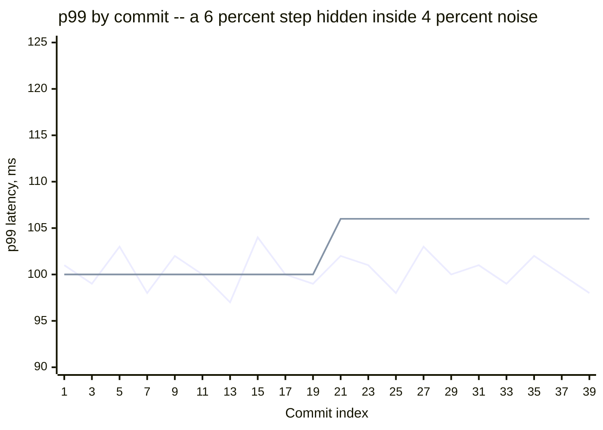
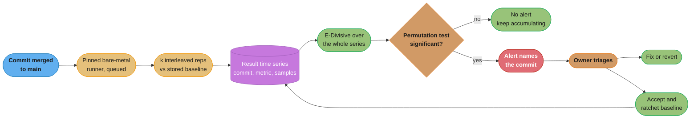
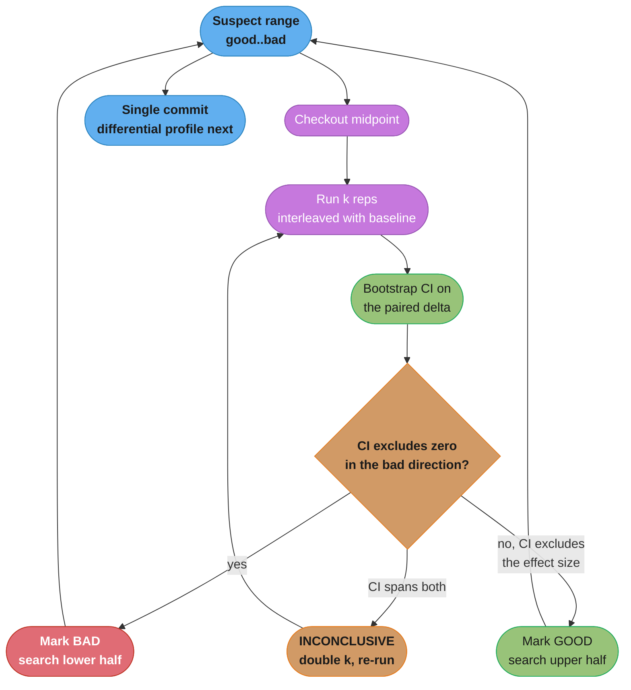

# Performance Regression Detection

> **A perf gate that fires on clean commits will be disabled within a month, and the
> disabling is rational.**
> The failure mode is not "we missed a regression". It is "we built an alarm that cried
> wolf twice a day, everyone learned to click through it, and then we missed a regression
> *and* had a red build". A gate nobody believes is strictly worse than no gate, because it
> costs the same and buys negative trust.

---

## 1. Concept Overview

Performance regression detection is the problem of noticing that your service got slower —
ideally at the commit that did it, ideally before customers do — when every individual
measurement is noisy enough to hide the change you are looking for.

The naive design is a threshold: run a benchmark in CI, fail the build if p99 exceeds
some ceiling. That design is covered as a starting point in
[`performance_and_load_testing.md`](../../devops/performance_and_load_testing/performance_and_load_testing.md) §6.5,
which shows a k6 threshold gate wired into GitHub Actions. This module starts where that
ends, because a fixed threshold has an arithmetic problem that no amount of tuning fixes:
**the threshold that catches a 5% regression also fires on roughly 5% of clean commits**,
and the threshold that never fires on clean commits cannot catch anything you care about.

The replacement is to stop asking "is this run over the line?" and start asking "**has the
level of this time series stepped?**" — a question you answer with change-point detection
over the entire history of results, not with a comparison between two adjacent runs. That
reframing is the core of this module, and it is what production systems at MongoDB,
Chromium and Mozilla converged on independently.

**Prerequisite:** everything in
[`benchmarking_methodology.md`](../benchmarking_methodology/benchmarking_methodology.md) —
the A/A noise floor, the `n ≈ 16(σ/δ)²` sample-size relationship, and why a mean is the
wrong statistic. Detection is applied measurement, and a detection system built on an
unmeasured harness inherits every one of its defects, amplified by running thousands of
times.

**What this module covers:**

| Topic | Section |
|-------|---------|
| Why fixed thresholds flake, with the arithmetic | §3, §6.1 |
| Change-point detection (E-Divisive) as the replacement | §4.2, §6.2 |
| Storing results as a durable time series | §6.3 |
| Cadence: per-commit vs nightly vs release gate | §4.3 |
| Dedicated hardware and noise-reduction levers | §6.4 |
| Bisecting a *statistical* signal | §6.5 |
| Canary analysis for the regression CI never caught | §6.7 |
| Ownership, triage, and the ratchet | §6.8, §13 |

---

## 2. Intuition

**One-line analogy:** a threshold gate is a smoke alarm mounted above the toaster. It is
not broken — it is correctly reporting smoke — and it will be on the floor with its battery
out by Thursday.

**Mental model.** Picture your benchmark's p99 plotted against commit order over six
months: a few thousand points, jittering within a band a few percent wide. A real
regression is a **step** in the level of that band. A threshold gate looks at one point at
a time and asks whether it crossed a line, which throws away every other point in the
series — including the hundred points before it that would tell you what "normal" is right
now, and the twenty points after it that would tell you whether the level actually moved or
one run got unlucky.

Change-point detection looks at the whole series and asks where you would cut it to
maximise the difference between the segments. That question has an answer even when the
step is *smaller than the noise*, because a persistent 3% shift across 40 subsequent points
is overwhelming evidence, while a single 3% excursion is nothing.

**Why it matters.** The economics are brutal and asymmetric. A false positive costs an
engineer half a day and one unit of trust in the system. Trust is not recoverable at the
rate it is spent — after a dozen false alarms the gate is bypassed by policy, and from that
moment the system has negative value: it costs CI minutes and maintenance while catching
nothing.

**Key insight.** **A single run is a hypothesis test with almost no power. A time series is
a hypothesis test with all the power you need.** The measurement did not get better; you
stopped throwing away the history you had already paid to collect.

---

## 3. Core Principles

**1. Never gate on a single run against a fixed number.** Its false-positive rate is set by
your noise floor, not by your intentions, and you cannot tune it to be both sensitive and
quiet. The arithmetic is in §6.1.

**2. Store every result forever, as a time series, keyed by commit.** Pass/fail throws away
the only asset that makes detection possible. A benchmark result is data, not a verdict.

**3. Detect on the series, alert on the commit.** Change-point detection outputs *where*
the level moved, which is a commit. That is what makes an alert routable to a person who
can act on it — a threshold gate can only tell you which PR happened to be running.

**4. Lower the noise floor before you tighten the detector.** Every statistical technique
buys you resolution at a cost that scales with the square of the noise. Pinning cores and
turning off turbo is cheaper than any algorithm.

**5. Detection latency and detection sensitivity trade against each other.** A change point
becomes confident as points accumulate after it. Alerting on the first post-change point is
fast and noisy. Waiting for ten is slow and certain. Pick per benchmark.

**6. A confirmed regression has exactly three valid outcomes.** Fixed, reverted, or
**accepted with the baseline explicitly ratcheted** by a named person. "Ignored" is not on
the list, and an un-ratcheted acceptance means the alert fires forever until someone mutes
the benchmark.

**7. Some regressions only exist in production.** Real traffic mix, real data volumes, real
cache states, real neighbours. Canary analysis is the second detector, not a nice-to-have.

**8. Someone owns each benchmark by name.** An unowned red gate is a gate that will be
disabled by whoever is unlucky enough to be blocked by it at 6pm on a Friday.

---

## 4. Types / Architectures / Strategies

### 4.1 The four detector topologies

| Topology | What it compares | Detects | False-positive behaviour | Cost |
|----------|------------------|---------|--------------------------|------|
| **Fixed threshold** | One run vs a constant | Large blowups (> 20%) | Set by your noise floor. Untunable to both sensitive and quiet | Cheapest |
| **Adjacent-run comparison** | This run vs the previous run | Sudden steps | Worst of all — combines the noise of *two* single runs | Cheap |
| **Sliding-window comparison** | Mean of last k vs mean of previous k | Steps larger than roughly σ/√k | Better, but the window size hard-codes the change size you can see | Moderate |
| **Change-point detection** | The entire series, segmented optimally | Steps well below single-run noise, and multiple changes | Controlled by a permutation test, tunable independently of sensitivity | Highest compute, trivial at these data volumes |

The progression is monotone: each row uses more of the data you already collected.

### 4.2 Change-point detection, specifically E-Divisive

**The question it asks:** given a series of n measurements, is there an index k such that
the distribution before k differs from the distribution after k more than chance would
produce? And if so, recurse into both halves to find further changes.

**Why it is the right shape for this problem:**

- It is **non-parametric** — no normality assumption, which matters because latency data is
  right-skewed (see the methodology module).
- It finds **multiple change points**, which is what a real six-month series contains:
  three regressions, one improvement, and two infrastructure migrations.
- Its significance test is a **permutation test**, so its false-positive rate is something
  you set directly rather than something you inherit from your noise.
- It is **retrospective**, meaning it re-evaluates history as new points arrive. A change
  that was ambiguous at the time becomes obvious a week later and the detector will find it
  then — which is a feature, not a lag.

**E-Divisive** (Matteson & James, 2014) uses an energy statistic built from mean pairwise
distances within and between candidate segments; **E-Divisive with Means (EDM)** is the
variant that replaces the full pairwise computation with a mean-based approximation to get
the cost down. MongoDB's performance team adopted this family for their continuous
performance testing (Daly et al., ICPE 2020) after threshold-based alerting proved
untriageable, and it is the design most subsequent systems copy.

**What it does not do:** it does not tell you *why*, and it does not run on a PR before
merge. Change-point detection is inherently a post-merge, series-level technique. That
constraint shapes the whole architecture — see §4.3.

### 4.3 Cadence — the cost/latency/attribution triangle

| Cadence | Detection latency | Attribution | Machine cost | Best for |
|---------|-------------------|-------------|--------------|----------|
| **Pre-merge (per PR)** | Minutes | Perfect (one PR) | Highest — every PR, including the 60% that touch no hot path | Catching catastrophic, obvious regressions only. Threshold-style, wide bounds |
| **Per-commit post-merge** | Minutes to hours | Perfect (one commit) | High but bounded by merge rate, not PR rate | The main line of defence. Change-point detection lives here |
| **Nightly** | Up to 24 h | A batch of 10–80 commits, needing bisection | Low — one run per benchmark per day | Expensive benchmarks, or teams below a few merges per day |
| **Release gate** | Weeks | A whole release, hopeless without bisection | Lowest | Final backstop and sign-off, never the primary detector |
| **Production canary** | Minutes after deploy | The deploy, not the commit | Cost of the canary fleet | Regressions that only exist under real traffic |

The dominant real-world design is **wide-bounds pre-merge + change-point detection
per-commit post-merge + canary analysis at deploy**. Pre-merge catches the 40% blunder
before it lands. Post-merge catches the 3% creep. Canary catches what neither could see.

**The creep argument for per-commit.** Twelve merges each adding 0.4% — every one of them
individually undetectable at any noise floor you can afford — compound to 4.9% over a
quarter. Nightly with 80 commits per batch cannot attribute any of them. Per-commit
change-point detection can, because it does not need any single commit's effect to exceed
the noise; it needs the *level* to have moved, and it accumulates evidence across every
subsequent run.

### 4.4 Where each detector sits in the pipeline

| Stage | Detector | Signal quality | Action on fire |
|-------|----------|----------------|----------------|
| Pre-merge CI | Threshold, wide (e.g. 25%) | Low resolution, high confidence | Block the PR |
| Post-merge, dedicated host | Change-point over the series | High resolution | Open a ticket against the named commit |
| Nightly, expensive macro benchmarks | Change-point, sparser series | Medium | Trigger a statistical bisect |
| Canary deploy | Mann-Whitney canary vs concurrent baseline | Real traffic, short window | Roll back automatically |
| Production SLO | Burn-rate alert | Real, but far too late for attribution | Page |

---

## 5. Architecture Diagrams

### 5.1 The same data, two questions



*The jagged line is the raw measurement, which happens to be flat here so the second line
is visible: the step line is what a change-point detector reports after segmenting the
series at commit 21. No individual point after the step is obviously out of family — the
step is 6% and the run-to-run spread is 4% — but the persistence of the shift across ten
subsequent points is decisive. A threshold at 106 would have fired on commits 8, 14 and 18
before the regression even landed.*

### 5.2 The detection pipeline



*The store is the centre of gravity. Everything else is replaceable — the detector, the
runner, even the benchmark — but a system that discards results into a pass/fail can never
be upgraded to any of this.*

### 5.3 Adjacent-run vs whole-series, drawn

```
  ADJACENT-RUN COMPARISON -- what a naive gate sees
      only these two points are ever compared
                              v  v
      o   o     o   o    o   o  X     o    o   o     o   o
      +---+-----+---+----+---+--+-----+----+---+-----+---+-->
                                 ^ fires here, and on any pair
                                   whose gap exceeds the bound

  CHANGE-POINT DETECTION -- what the same data supports
      |<--------- segment 1, mean 100.2 -------->|<-- segment 2, mean 106.1 -->
      o   o     o   o    o   o  o                O    O   O     O   O
      +---+-----+---+----+---+--+----------------+----+---+-----+---+-->
                                 ^ split maximising between-segment divergence
                                   significance from a permutation test over
                                   the FULL series, not from those two points

  The adjacent comparison has two noisy samples of evidence.
  The segmentation has all forty.
```

*Why the same measurement supports a 3% detection in one framing and not in the other: the
evidence is the number of points, and one framing throws 38 of them away.*

### 5.4 Bisecting a statistical signal



*The critical arm is the third one. Plain `git bisect` has no `inconclusive` outcome, which
is precisely why it breaks on noisy signals — it forces a coin flip and then commits to the
wrong half irrevocably.*

---

## 6. How It Works — Detailed Mechanics

### 6.1 Why the fixed threshold flakes — the arithmetic

Assume a per-run relative standard deviation of 3% (a good dedicated cloud VM; a shared
runner is worse) and a gate set 5% above baseline.

```text
  z = threshold / sigma = 5 / 3 = 1.67
  P(a clean run exceeds the gate) = P(Z > 1.67) = 4.8%
```

**What the formula is telling you.** "The false-alarm rate of a threshold gate is fixed by
the ratio of your threshold to your noise. It is not a policy choice — it is a consequence."

| Symbol | What it is |
|--------|------------|
| `sigma` | Per-run relative standard deviation, from your A/A test. Not a guess |
| `threshold` | The relative gate margin above baseline |
| `z` | How many standard deviations of headroom the gate has |
| `P(Z > z)` | One-sided normal tail. The per-run false-failure probability |

**Walk it out on a real repository.** 40 merges a day:

```text
  BROKEN -- gate at baseline + 5%, sigma = 3%
    per-run false failure   = 4.8%
    false failures per day  = 40 x 0.048 = 1.9
    false failures per week = 13
    time to team disables it: about three weeks, empirically

  "Fix" that teams reach for -- widen the gate to +10%
    z = 10 / 3 = 3.33
    per-run false failure   = 0.043%
    false failures per week = 0.12   (one every two months -- quiet!)
    BUT: minimum detectable regression is now 10%.
         The 3% creep this gate was built for is invisible.
         You bought quiet by making the gate useless.

  FIXED -- change-point detection over the series, same sigma
    no per-run threshold at all
    false-alarm rate set by the permutation test's alpha, e.g. 0.05
      per SEGMENTATION, not per run
    minimum detectable step ~ 1.5% with 20 points after the change
    alerts per week: single digits, and each one names a commit
```

That table is the entire argument. There is no threshold value that is both quiet and
sensitive, because a threshold only ever sees one sample.

### 6.2 E-Divisive, in enough code to understand it

The production implementations are library code — do not hand-roll this for real use — but
the mechanism is short enough to read:

```python
# edivisive.py -- single change point via the energy statistic, plus a permutation test.
import random, statistics

def _energy(left, right):
    """Divergence between two segments: between-group distance minus within-group.
    Larger means the two segments look less like samples from one distribution."""
    n, m = len(left), len(right)
    if n < 2 or m < 2:
        return 0.0
    between = sum(abs(x - y) for x in left for y in right) / (n * m)
    within_l = sum(abs(a - b) for i, a in enumerate(left) for b in left[i + 1:]) / (n * (n - 1) / 2)
    within_r = sum(abs(a - b) for i, a in enumerate(right) for b in right[i + 1:]) / (m * (m - 1) / 2)
    # Scaled so segment sizes are accounted for -- long segments carry more weight.
    return (n * m / (n + m)) * (2 * between - within_l - within_r)

def best_split(series, min_seg=5):
    """Index maximising the energy statistic, and its value."""
    best_k, best_q = None, 0.0
    for k in range(min_seg, len(series) - min_seg):
        q = _energy(series[:k], series[k:])
        if q > best_q:
            best_k, best_q = k, q
    return best_k, best_q

def is_significant(series, observed_q, min_seg=5, permutations=1000, alpha=0.05):
    """Permutation test: how often does shuffled data produce a split this good?
    This is what makes the false-positive rate a knob you set, not one you inherit."""
    shuffled = list(series)
    hits = 0
    for _ in range(permutations):
        random.shuffle(shuffled)
        _, q = best_split(shuffled, min_seg)   # same min_seg as the observed statistic
        if q >= observed_q:
            hits += 1
    return (hits + 1) / (permutations + 1) < alpha

def change_points(series, min_seg=5, depth=0):
    """Binary segmentation -- find one change, then recurse into both halves."""
    if len(series) < 2 * min_seg or depth > 4:
        return []
    k, q = best_split(series, min_seg)
    if k is None or not is_significant(series, q, min_seg):
        return []
    left  = change_points(series[:k], min_seg, depth + 1)
    right = [k + i for i in change_points(series[k:], min_seg, depth + 1)]
    return sorted(left + [k] + right)
```

Three properties worth naming. The statistic uses only pairwise **distances**, so it is
distribution-free — no normality, and it reacts to a change in spread as well as in
location. The permutation test is what decouples the alarm rate from the noise level: you
declare the alpha you are willing to live with. And binary segmentation is what finds
multiple changes, which any six-month series contains.

The naive `best_split` above is **O(n³) per level** — `_energy` is O(n²) in the segment
sizes and it is evaluated at roughly n candidate splits — and `is_significant` pays that
whole cost 1,000 more times to build the permutation null. Measured on this exact code, `best_split`
costs 2.7ms at n = 60, 24ms at n = 120 and 185ms at n = 240 — a clean cube — so a full
`change_points` on a 60-point series takes about 3 seconds, and at n = 1,000 a single
significance test is roughly 10¹² Python operations, about four hours. Not seconds. EDM's mean-based
reformulation computes the identical statistic incrementally and is what production
implementations use to stay cheap at series lengths of 10⁴+. Read the code above for the
mechanism; run a library in anger.

### 6.3 Storing results as a time series, not a verdict

This is the schema decision that determines whether your system can ever be improved.

```sql
-- One row per (benchmark, commit, metric). Samples kept, not just a summary.
CREATE TABLE bench_result (
    id              BIGSERIAL PRIMARY KEY,
    benchmark       TEXT        NOT NULL,   -- 'order_service.checkout_p99'
    commit_sha      CHAR(40)    NOT NULL,
    commit_time     TIMESTAMPTZ NOT NULL,   -- order by this, NOT by run time
    metric          TEXT        NOT NULL,   -- 'latency_ns', 'allocated_bytes', 'cpu_ns'
    samples         DOUBLE PRECISION[] NOT NULL,  -- every rep, not the median
    median          DOUBLE PRECISION NOT NULL,    -- denormalised for fast series reads
    iqr             DOUBLE PRECISION NOT NULL,
    -- Environment fingerprint: a change here invalidates comparability.
    runner_id       TEXT        NOT NULL,   -- 'metal-bench-03'
    env_hash        TEXT        NOT NULL,   -- hash of kernel, runtime, flags, image
    steal_pct       REAL        NOT NULL,   -- assert < 0.5 or discard the run
    run_at          TIMESTAMPTZ NOT NULL DEFAULT now()
);

CREATE INDEX ON bench_result (benchmark, metric, commit_time DESC);

-- Explicitly recorded baselines: the ratchet. Nothing is implicit.
CREATE TABLE bench_baseline (
    benchmark    TEXT        NOT NULL,
    metric       TEXT        NOT NULL,
    commit_sha   CHAR(40)    NOT NULL,
    value        DOUBLE PRECISION NOT NULL,
    accepted_by  TEXT        NOT NULL,   -- a human name. Never a service account
    reason       TEXT        NOT NULL,   -- 'accepted 4.1% for TLS 1.3 rollout, JIRA-4412'
    accepted_at  TIMESTAMPTZ NOT NULL DEFAULT now(),
    PRIMARY KEY (benchmark, metric, commit_sha)
);
```

Four details that are load-bearing:

- **`samples` as an array, not just a median.** You cannot bootstrap, rank-test, or
  re-analyse from a scalar. Disk is free; re-running six months of history is not.
- **Order by `commit_time`, never by `run_at`.** Re-runs, backfills and retries arrive out
  of order and will inject phantom change points into a series ordered by wall clock.
- **`env_hash`.** A base-image bump changes the level of every series on that runner. If
  you cannot see the environment change in the data, you will spend a day bisecting a
  kernel upgrade. Treat an `env_hash` change as a known change point and seed the detector
  with it.
- **`steal_pct` recorded per run**, so a contaminated run can be excluded retroactively
  rather than quietly widening your noise band.

### 6.4 Buying resolution: dedicated hardware and the noise levers

Recall from the methodology module that repetitions scale as `16(σ/δ)²`. Halving σ quarters
your machine bill for the same sensitivity. These are the levers, in order of return:

| Lever | Typical σ reduction | How | Cost |
|-------|---------------------|-----|------|
| Leave shared CI for a dedicated host | 6% → 2% | Any fixed-performance instance you do not share | One instance |
| Never use burstable instances | removes a 2–10x cliff | Fixed-performance or metal family | None |
| Disable turbo | 2% → 1.2% | `echo 1 > /sys/devices/system/cpu/intel_pstate/no_turbo` | ~15% lower absolute throughput, which does not matter for a relative comparison |
| Pin the governor | 1.2% → 1.0% | `cpupower frequency-set -g performance` | None |
| CPU pinning + core isolation | 1.0% → 0.6% | `isolcpus=4-7 nohz_full=4-7` at boot, then `taskset -c 4-7` | Those cores unavailable to the OS |
| cgroup v2 isolation for the runner | 0.6% → 0.5% | `cpuset.cpus` + `memory.max` on the benchmark slice | Setup only |
| IRQ affinity away from the bench cores | small but removes rare spikes | `/proc/irq/*/smp_affinity` | Setup only |
| Bare metal instead of a VM | 0.5% → 0.3% | Metal instance or an owned box | Higher unit cost, or a machine under a desk |
| Interleaved A/B instead of sequential | 1.5–3x effective | Alternate baseline and candidate within one run | None. Do this first |

```bash
#!/usr/bin/env bash
# prep-bench-host.sh -- run once at boot on the dedicated runner. Idempotent.
set -euo pipefail

cpupower frequency-set -g performance >/dev/null
echo 1 > /sys/devices/system/cpu/intel_pstate/no_turbo    # Intel; AMD: cpb=0
echo 0 > /proc/sys/kernel/randomize_va_space              # stable layout, stated in the report
echo 0 > /proc/sys/kernel/nmi_watchdog
systemctl stop unattended-upgrades packagekit || true

# Assert the environment before every run. A contaminated run is worse than a missing one.
# vmstat prints 17 columns: r b swpd free buff cache si so bi bo in cs us sy id wa st
# so steal is $17. $16 is iowait -- a classic off-by-one that silently gates on the
# wrong signal. vmstat reports whole percent, so -lt 1 is the integer form of the
# "steal_pct < 0.5" assertion recorded per run in the 6.3 schema.
steal=$(vmstat 1 5 | tail -1 | awk '{print $17}')
[ "$steal" -lt 1 ] || { echo "steal=${steal}% -- refusing to run"; exit 75; }
```

**What you buy with a pinned bare-metal runner**, stated plainly: a shared CI runner at a
6–8% noise floor cannot detect a 3% regression at any repetition count you would tolerate
(`16 × (6/3)² = 64` reps per side, several hours per commit). A pinned metal box at 0.5%
needs 1 rep to resolve 3% and 2 reps to resolve 1.5% (`16 × (0.5/1.5)² = 1.8`; at the
0.6% of a pinned VM it is 3). One machine converts a class of
regressions from undetectable to detected-per-commit. That is the whole pitch, and it is
usually one instance against several engineer-days a quarter of missed-regression
archaeology.

### 6.5 Bisecting a statistical regression

**Why plain `git bisect` breaks.** It assumes the predicate is deterministic. With a noisy
signal every step has some misclassification probability ε, and a single wrong answer sends
the search into the half that does not contain the culprit — after which every remaining
step is wasted and the final answer is confidently wrong.

```text
  P(correct final commit) = (1 - eps) ^ steps

  512 commits -> 9 steps
    eps = 0.20 (naive single-run compare on a noisy box)  ->  0.8^9  = 13%
    eps = 0.10                                            ->  0.9^9  = 39%
    eps = 0.02 (k reps + CI predicate on a quiet box)     ->  0.98^9 = 83%
```

**The fix is to change the predicate, not the search.** Instead of "is this run slower than
that run", the predicate becomes a confidence-interval test with a third outcome:

```python
# bisect_predicate.py -- exit codes git bisect run understands:
#   0 = good, 1 = bad, 125 = skip (git treats as untestable), 128+ = abort
import subprocess, sys
from bootstrap_delta import median_delta_ci   # from the methodology module

GOOD_REF      = "bisect/known-good"   # the last-good end of the range the detector named
EFFECT_PCT    = 6.0     # the regression size the change-point detector reported
MAX_REPS      = 64

def bench(ref):
    """Build ref and measure it once. Returns that run's median."""
    subprocess.check_call(["./build.sh", ref])
    return float(subprocess.check_output(["./bench.sh", "--json-median"]))

def run_reps(k):
    """Interleave candidate and baseline builds so drift cancels.
    A/B/B/A ordering: any monotonic drift across the run cancels to first order.
    Both sides are measured HERE -- comparing against a baseline recorded last
    week is the sequential anti-pattern in benchmarking_methodology 6.6."""
    base, cand = [], []
    for i in range(k):
        order = ("HEAD", GOOD_REF) if i % 2 == 0 else (GOOD_REF, "HEAD")
        for ref in order:
            (cand if ref == "HEAD" else base).append(bench(ref))
    return base, cand

k = 8
while k <= MAX_REPS:
    base, cand = run_reps(k)
    point, lo, hi = median_delta_ci(base, cand)

    if lo > EFFECT_PCT / 2:          # clearly regressed
        sys.exit(1)                   # BAD
    if hi < EFFECT_PCT / 2:          # clearly not regressed
        sys.exit(0)                   # GOOD
    k *= 2                            # CI straddles the decision line: buy more data
    print(f"inconclusive, CI [{lo:+.2f}, {hi:+.2f}] -- doubling to k={k}", file=sys.stderr)

sys.exit(125)                         # give up on this commit, let git skip it
```

Four things make this work. The decision line sits at **half the known effect size**, so
"good" and "bad" are both positive assertions rather than one being the absence of the
other. Repetitions **escalate adaptively** — cheap when the answer is obvious, expensive
only near the boundary, which is where the culprit commit actually is. And `125` gives git
a legitimate `skip`, so a genuinely untestable commit (build broken, flaky dependency) does
not poison the search. And **both sides are built and measured inside the same step**,
alternating A/B/B/A, so a runner that drifts warmer over fourteen hours of bisecting cannot
slowly turn every remaining commit "bad" — a baseline file recorded last week would.

**The cost arithmetic, which you should do before starting:**

```text
  range        512 commits          -> ceil(log2(512)) = 9 steps
  reps         k = 8 typical, 32 near the boundary -> average ~12 per side
  interleaved  2 sides               -> 24 runs per step
  runtime      4 min per run
  --------------------------------------------------------------
  9 steps x 24 runs x 4 min = 14.4 hours of machine time
```

Levers, in order of payoff: **narrow the range first** (the change-point detector already
did — if it named a 40-commit window, that is 6 steps not 9, and 40 commits is often small
enough to bisect by inspection instead), **lower σ** (halving it quarters k), and **run the
sides of each step in parallel** on two identical hosts if you have them, which halves wall
time without changing machine cost.

### 6.6 Once bisect names a commit — differential profiling

A named commit is not a diagnosis. A 400-line commit tells you where to look, not what
happened, and a one-line commit that changed a config default can be the most confusing of
all.

The follow-up is a **differential profile**: capture a CPU profile from the commit before
and the commit after, then diff them so the visualisation shows only what *changed* — the
frames that grew get one colour, the frames that shrank get another, and everything
unchanged disappears. That collapses a 3,000-frame flame graph down to the dozen frames
that moved.

The mechanics, the capture, and how to read the result are covered in
[`continuous_profiling.md`](../../hld/observability/continuous_profiling.md) — differential
flame graphs are its subject and this module does not repeat them. For getting a profile
out of a running JVM or process at all, see
[`performance_profiling.md`](../performance_profiling/performance_profiling.md). The
detection-side point is only this: **capture the two profiles under the same conditions you
ran the benchmark under**, on the same pinned host, or the diff will be dominated by
environmental differences rather than by the commit.

### 6.7 The regressions CI never sees — canary analysis

CI benchmarks run on synthetic load against a fixed dataset on a quiet machine. Production
has a traffic mix that shifts hourly, a dataset that grew 8% this month, caches with real
hit rates, and neighbours. A regression that only manifests at a 62% cache hit rate, or
only on the 1% of requests carrying a 14 KB payload, is invisible to every detector so far.

**Automated canary analysis** is the production-side detector. Its central design decision
is what to compare against:

| Comparison | Confounded by | Verdict |
|------------|---------------|---------|
| Canary vs **yesterday** | Day-of-week traffic, dataset growth, a neighbouring deploy | Useless |
| Canary vs the **existing production fleet** | Age. Production instances have warm JITs, full connection pools, warm caches. The canary has none of these and will look worse regardless | Systematically biased against every canary |
| Canary vs a **concurrently deployed baseline running the OLD code** | Nothing much. Both are freshly started, both take the same live traffic slice, both are the same age | **This is the design** |

The three-way deploy — old code on a fresh baseline group, new code on a fresh canary
group, and the untouched production fleet — is what Netflix's Kayenta popularised and what
Spinnaker's automated canary analysis implements. The statistics are the same ones from
§6.2 and the methodology module: for each metric, a Mann-Whitney-style rank comparison of
the canary's samples against the baseline's over the same window, aggregated into a score.

```yaml
# Canary judgment config -- the shape, not any one vendor's schema.
canary:
  baselineGroup: { version: current, instances: 3, freshlyDeployed: true }
  canaryGroup:   { version: candidate, instances: 3, freshlyDeployed: true }
  trafficSplit:  { baseline: 5%, canary: 5% }   # the other 90% untouched
  warmupMinutes: 10          # discard: cold JIT, empty pools, cold caches
  analysisWindow: 45m
  metrics:
    - name: request_latency_p99
      direction: increase-is-bad
      weight: 40
    - name: error_rate
      direction: increase-is-bad
      weight: 40
      criticality: fail-fast      # any significant increase aborts immediately
    - name: cpu_seconds_per_request
      direction: increase-is-bad
      weight: 20
  scoring:
    pass: 75          # >= 75 -> promote
    marginal: 50      # 50-74 -> hold for a human
    # < 50 -> automatic rollback
```

The `warmupMinutes` field is the one people omit and then spend a week debugging. Every
freshly deployed instance is slow for its first several minutes — cold JIT, empty
connection pool, cold local cache. Including that window makes every canary look like a
regression. It is the same steady-state problem from the methodology module, wearing a
deployment hat.

### 6.8 The organisational half

The statistics are the easy part. These are the decisions that determine whether the system
survives its first quarter.

**Who owns a red gate.** The team that owns the code path, named in a `CODEOWNERS`-style
mapping from benchmark to team — not "the performance team", who will become a permanent
triage queue and a bottleneck. Change-point detection makes this workable because it alerts
on a *commit*, so routing is mechanical: the commit has an author and the author has a
team.

**Time-boxed triage with a default.** An alert gets an owner within one business day and a
verdict within three: fixed, reverted, or accepted-and-ratcheted. If nothing happens within
the box, the default must be **revert**, not mute. A default of "mute" is how a detection
system dies, one benchmark at a time.

**The ratchet.** When a regression is *accepted* — a security fix that costs 4%, a
correctness fix that costs 2%, a deliberate feature trade — someone must record the new
baseline with their name and a reason. Three reasons this is non-negotiable:

- Without it, the alert re-fires on every subsequent run and the only way to stop it is to
  mute the benchmark, which silently disables detection for that path forever.
- With it, you get an auditable ledger of every performance point you have deliberately
  spent. Quarter-over-quarter, that ledger is the only honest answer to "why is the service
  30% slower than last year".
- It forces the acceptance to be a decision by a person rather than an absence of action.

The ratchet is one-directional by policy: baselines move up only through an explicit
accepted record, and move down automatically whenever a sustained improvement is detected —
so an optimisation immediately becomes the new bar to defend rather than headroom for the
next regression to eat quietly.

---

## 7. Real-World Examples

**MongoDB — from untriageable thresholds to change-point detection.** MongoDB's performance
team ran continuous performance testing against thresholds and found the alert volume
unmanageable: real regressions were buried among alarms produced by ordinary run-to-run
variance, and the humans stopped reading them. They moved to E-Divisive change-point
detection over the full historical series (Daly et al., ICPE 2020), which let them detect
shifts smaller than single-run noise while cutting the alert stream to something a rotating
owner could triage. The published design — durable result storage, retrospective detection
over history, alerts keyed to commits, and an explicit human triage workflow — is the
reference architecture that most subsequent systems copy.

**Chromium's perf sheriff rotation.** Chromium runs thousands of performance metrics per
commit and pairs automated regression detection with a **named human rotation** whose job
is triaging the resulting alerts, plus automated bisection to attribute a detected change
to a specific revision. The lesson is organisational as much as technical: at that alert
volume, "the system files a bug" is not a workflow. Somebody owns the queue, and the
bisection is automated because otherwise nobody would do it.

**Mozilla's Perfherder.** Firefox's performance data lives in a queryable time-series store
with alerts raised on detected changes and a triage state machine attached to each alert
(untriaged, investigating, confirmed, wontfix, backed out). The explicit state machine is
the piece teams building their first system always skip and always need by month three.

**Rust's `perf.rust-lang.org`.** Compile-time and runtime benchmarks run on a dedicated,
consistently-configured machine — not shared CI — for exactly the resolution reasons in
§6.4, and results are kept as a long series so a small persistent shift is visible against
history. The project's convention of marking which changes are statistically significant,
rather than reporting every delta as news, is the reporting discipline that keeps the
signal readable.

**Netflix's Kayenta and automated canary analysis.** Netflix built canary judgment around
comparing a canary against a **concurrently deployed baseline of the previous version**
rather than against the running production fleet, precisely because a fresh instance and a
week-old instance are not comparable. The scoring aggregates per-metric statistical
comparisons into a single number with pass, marginal and fail bands, which is what makes
automated rollback safe enough to enable.

**The counter-example everyone has lived.** The most common real-world architecture is a
k6 threshold gate added enthusiastically in month one, bypassed with a
`skip-perf-check` label by month three, and deleted in a cleanup PR by month nine — with
the commit message "flaky, never caught anything". It never caught anything because
nobody kept the results, so there was never a series to detect against.

---

## 8. Tradeoffs

| Dimension | Option A | Option B | Choose A when | Choose B when |
|-----------|----------|----------|---------------|---------------|
| Detector | Fixed threshold | Change-point detection | Pre-merge, wide bounds, catching blunders | Post-merge, resolving small persistent shifts |
| Detector | Sliding window | Change-point detection | You need a trivially explainable rule | You need sensitivity below single-run noise |
| Cadence | Per-commit | Nightly | Merge rate is manageable and attribution matters | Benchmark costs hours, or merges are few |
| Gate placement | Pre-merge blocking | Post-merge alerting | The regression would be catastrophic | Anything requiring statistical resolution |
| Hardware | Shared CI runner | Pinned bare metal | Effects > 10%, budget is zero | Anything below 5%. This is most real work |
| Alert timing | First point after the change | Wait for k points | Fast feedback matters more than precision | You value a quiet queue over minutes of latency |
| Bisect predicate | Single run comparison | k reps + CI test | Effect is far above noise (> 5x sigma) | Anything near the noise floor |
| Acceptance | Mute the benchmark | Ratchet the baseline | Never | Always |
| Prod detection | Compare to yesterday | Canary vs concurrent baseline | Never | Always |
| Result storage | Pass/fail | Full sample arrays | Never — this is the decision that closes every future door | Always |

| Investment | What it buys | What it costs |
|------------|--------------|---------------|
| Keeping results as a time series | Every technique in this module becomes possible later | A table and a few GB a year |
| One dedicated bare-metal runner | 6% floor → 0.5%: a whole class of regressions becomes visible | One machine, ~1 day of setup |
| Change-point detection | Alert volume down an order of magnitude at higher sensitivity | A few hundred lines, or a library |
| Automated statistical bisect | Hours of engineer archaeology → hours of machine time | 14 h machine time per invocation |
| Canary analysis | Catches what synthetic benchmarks structurally cannot | A canary fleet and a deploy-pipeline integration |

---

## 9. When to Use / When NOT to Use

**Build regression detection when:**

- The service has a latency or throughput SLO that anyone is accountable for.
- The codebase has enough merge traffic that nobody can hold the performance history in
  their head — practically, more than a few merges a day.
- You have already been surprised once. The second occurrence is not bad luck.
- Performance is a product feature (a database, a compiler, a runtime, a proxy, an
  inference server) — here it is not optional, it is the test suite.
- You are about to spend engineer-months on an optimisation and need to defend the gain
  from being eaten back over the following two quarters.

**Do NOT build it when:**

- **You have not measured your noise floor.** A detection system on an unmeasured harness
  industrialises false alarms. Start at
  [`benchmarking_methodology.md`](../benchmarking_methodology/benchmarking_methodology.md).
- **You will only run it on shared CI runners and will not fund anything better.** At a
  6–8% floor you can detect blowups and nothing else. Build a wide-bounds threshold gate
  for blowups, be honest that that is all it is, and skip the statistics.
- **Nobody will own the alerts.** An unowned detector is a machine for generating ignored
  tickets. The ownership question is a prerequisite, not a follow-up.
- **The workload has no stable definition.** If the benchmark's input distribution changes
  every sprint, every change point is a data change and the detector is measuring your test
  fixtures.
- **You cannot re-run a benchmark at an arbitrary historical commit.** Bisection is then
  impossible and detection degrades to "something got slower this quarter".
- **The service is not performance-sensitive.** An internal admin tool with 12 users does
  not need this. The honest answer is often no gate at all rather than a gate nobody reads.

---

## 10. Common Pitfalls

**Pitfall 1 — The gate that was disabled in six weeks. (Quantified: 78 false failures, 0
real regressions caught, then deleted.)**

A team added a k6 threshold gate at baseline + 5% on shared GitHub runners whose measured
A/A floor was 7.9%. Over six weeks it failed 78 builds. Every failure was investigated at
least briefly; none reproduced. In week seven the team added a `skip-perf` label, in week
nine the label was applied by default in the PR template, and in month four the job was
deleted. Cost: roughly **nine engineer-days of triage**, plus a real 11% regression that
shipped in month five past a gate that was by then bypassed by default.

```text
  BROKEN
    detector:   single run vs baseline * 1.05
    runner:     shared CI, measured A/A floor 7.9%
    storage:    pass/fail only -- results discarded after the build
    ownership:  none. Alerts went to a channel
    outcome:    78 false failures, gate deleted, real regression missed

  FIXED
    detector:   E-Divisive over the full commit series, permutation alpha 0.05
    runner:     one dedicated metal box, turbo off, cores 4-7 isolated (floor 0.6%)
    storage:    every sample array retained, keyed by commit_sha and commit_time
    ownership:  benchmark -> owning team map, 3-day triage box, default action REVERT
    pre-merge:  a SEPARATE wide gate at +25% purely for catastrophic blunders
    outcome:    4 alerts in the first quarter, 3 of them real (2.9%, 6.1%, 4.4%
                -- every one of them smaller than the old gate could ever have seen),
                1 ratcheted as an accepted TLS change
```

The diagnostic detail: the old gate could not have caught any of the three real regressions
it was replaced to catch. All three were smaller than its threshold.

**Pitfall 2 — Bisecting a 4% regression with a single run per step. (Quantified: 11 hours
to a confidently wrong commit.)**

An engineer ran `git bisect run ./bench.sh --fail-if-slower` over 380 commits. Each step
did one run and compared to a fixed number. The per-step misclassification rate on that
noise floor was around 20%, so the probability the 9-step search landed on the right commit
was `0.8^9 ≈ 13%`. It landed on a documentation-only commit. The engineer spent another
half-day reading a diff that touched three Markdown files before concluding the tooling was
broken. It was not — it was a coin-flip search executed faithfully. Re-run with the
CI-predicate from §6.5 at k=8 escalating to 32, it took 6 hours of machine time and named a
commit that changed a serializer's default buffer size.

**Pitfall 3 — Ordering the series by run time instead of commit time. (Quantified: 3
phantom change points in one quarter.)**

Backfills and retried jobs wrote rows whose `run_at` was days after their `commit_time`.
The dashboard and the detector both ordered by `run_at`, so a backfill of forty old commits
appeared as a block of "recent" results at a lower level, and the detector dutifully
reported a change point at the boundary. Three separate investigations were opened against
innocent commits before someone noticed the series was not in commit order. Order by
`commit_time`; treat `run_at` as metadata only.

**Pitfall 4 — A base-image bump read as a code regression. (Quantified: 2 engineer-days
bisecting a kernel.)**

The runner's AMI was updated as part of routine patching. Every benchmark on that host
stepped 3–5% simultaneously. The detector correctly reported change points in eleven
unrelated series at the same commit index, and the on-call engineer bisected one of them
for two days. The tell was in the data the whole time: **eleven unrelated benchmarks
stepping at the same point is never eleven regressions.** Record an `env_hash` per run,
alert when it changes, and seed the detector with it as a known change point so it segments
there by construction instead of by discovery.

**Pitfall 5 — Comparing the canary to the production fleet. (Quantified: every canary
scored as a 15% regression.)**

The first canary implementation compared new instances against the existing production
fleet. Production instances had been up for days: warm JITs, full connection pools, warm
local caches. The canary had been up for four minutes. Every deploy, including no-op
deploys, scored as a regression of 12–18% and the automated rollback fired every time,
which meant it was switched to advisory-only within a week. Fix: deploy a **concurrent
baseline group running the old code**, freshly started alongside the canary, and discard
the first 10 minutes of both. No-op deploys then scored in the 90s.

**Pitfall 6 — Muting instead of ratcheting. (Quantified: 9 of 14 benchmarks silently
disabled over a year.)**

Every accepted regression was handled by adding the benchmark to an `ignore` list, because
that was the fastest way to make the alert stop. After a year, 9 of 14 benchmarks were on
the list and the system detected nothing. Nobody had made a decision to stop detecting —
the list grew one reasonable exception at a time. An explicit `bench_baseline` row with a
name and a reason takes the same thirty seconds, keeps detection alive, and produces the
ledger that answers "what did we spend performance on this year".

**Pitfall 7 — Alerting on the first point after a change. (Quantified: 4x the alert
volume for 20 minutes of extra speed.)**

A team configured their detector to declare a change point as soon as it became
statistically nominal, which with a permutation test on very short post-change segments
meant a lot of premature calls. Requiring 5 points after the candidate change point before
alerting cut alert volume by roughly 4x at the cost of about 20 minutes of additional
detection latency. On a per-commit cadence, 20 minutes is nothing and a quiet queue is
everything. Detection latency is almost always the cheaper thing to spend.

---

## 11. Technologies & Tools

| Tool | Role | Notes |
|------|------|-------|
| **`signal-processing` (MongoDB)** | Change-point detection | The E-Divisive implementation behind the ICPE 2020 work. Reference implementation of the whole approach |
| **`ruptures`** | Change-point detection | General-purpose Python library — binary segmentation, PELT, dynamic programming, multiple cost functions. The practical starting point |
| **`changepoint` (R)** | Change-point detection | PELT and binary segmentation; useful for offline analysis and validating your detector against a known-good implementation |
| **`hyperfine`** | Benchmark runner | `--export-json` output feeds straight into a result store. Warm-up and outlier detection built in |
| **Criterion.rs / JMH / pyperf** | Language harnesses | Emit JSON per run. Store the samples, not the summary |
| **k6 / Gatling** | Service-level load | Threshold gates for the *wide* pre-merge check. See [`load_and_performance_testing.md`](../load_and_performance_testing/load_and_performance_testing.md) |
| **TimescaleDB / Prometheus + long-term store / ClickHouse** | Result time series | Any of these works. Retention is the requirement, not the engine. Do not put this in an ephemeral CI artifact store |
| **Grafana** | Series visualisation | Overlay detected change points and ratcheted baselines on the raw series. The overlay is what makes triage fast |
| **`git bisect run`** | Attribution | Only with a statistical predicate and a working `125` skip path (§6.5) |
| **Spinnaker / Kayenta** | Automated canary analysis | Concurrent-baseline comparison with statistical scoring |
| **Argo Rollouts / Flagger** | Progressive delivery | Kubernetes-native canary with metric-based analysis and automatic rollback |
| **Parca / Grafana Pyroscope** | Continuous profiling | The differential-profile follow-up. See [`continuous_profiling.md`](../../hld/observability/continuous_profiling.md) |
| **`cpupower`, `taskset`, `cset`, cgroup v2** | Noise reduction | The cheapest sensitivity you will ever buy (§6.4) |

---

## 12. Interview Questions with Answers

**Q: Why does a fixed p99 threshold gate in CI get disabled within a month?**
**Short:** Its false-alarm rate is fixed by the ratio of threshold to noise, so a gate sensitive enough to be useful fires on several clean commits a week.

With a 3% per-run standard deviation and a gate 5% above baseline, the gate sits 1.67 standard deviations out, so about 4.8% of clean runs exceed it. At 40 merges a day that is roughly two false failures daily and thirteen a week. Engineers correctly learn that a red perf gate usually means nothing, add a skip label, and eventually delete the job. Widening the gate to 10% quiets it to one false alarm every two months but raises the minimum detectable regression to 10%, which is far above the 2–6% creep the gate existed to catch. There is no threshold value that is both quiet and sensitive, because a threshold only ever examines one sample.

**Q: What is change-point detection and why does it beat comparing two adjacent runs?**
**Short:** It segments the entire history of results to find where the level stepped, so evidence accumulates across every point instead of just two noisy ones.

An adjacent-run comparison has exactly two samples of evidence and inherits the noise of both. Change-point detection asks where you would cut the whole series to maximise the difference between the resulting segments, and tests that split for significance against the full history. A persistent 3% shift across forty subsequent points is overwhelming evidence even when the run-to-run spread is 4% and no individual point looks unusual. It also finds multiple change points, which any six-month series contains, and it is retrospective, so an ambiguous change becomes obvious as more data arrives.

**Q: What does the E-Divisive algorithm actually compute?**
**Short:** For each candidate split it computes an energy statistic from pairwise distances, picks the best split, and validates it with a permutation test before recursing.

For a candidate split it measures the mean pairwise distance between the two segments against the mean pairwise distances within each, scaled by segment sizes so longer segments carry more weight. The index maximising that divergence is the candidate change point. Significance comes from a permutation test: shuffle the series many times and see how often chance produces a split that good. Then recurse into both halves via binary segmentation to find further changes. Because it uses only distances it is fully non-parametric — no normality assumption, which matters for skewed latency data — and it reacts to changes in spread as well as in level.

**Q: Why is the permutation test the important part rather than the energy statistic?**
**Short:** It makes the false-alarm rate a value you choose, instead of one you inherit from however noisy your machine happens to be.

With a fixed threshold, the alarm rate is determined by your noise: change the runner and the rate changes, with no visible edit anywhere. The permutation test asks how often randomly shuffled data would produce a split as good as the observed one, and you accept the split only if that fraction falls below an alpha you set — typically 0.05. Noise level affects sensitivity, meaning how small a change you can find, but no longer affects the false-alarm rate. That decoupling is what makes an alert queue stay quiet as you add benchmarks and change hardware.

**Q: Why must benchmark results be stored as a durable time series rather than pass/fail?**
**Short:** Every detection technique worth having reads the history, so discarding results into a verdict permanently forecloses all of them.

Change-point detection, bisect baselines, ratcheted acceptance records, and any retrospective re-analysis all require the historical measurements. A pass/fail result throws them away at the moment they are cheapest to keep. Store the full sample array per run, not just the median, so you can bootstrap and rank-test later. Key rows by commit SHA and order the series by commit time, never by run time, since backfills and retries arrive out of order and will inject phantom change points. Also record an environment fingerprint and the observed steal time per run so contaminated runs can be excluded retroactively.

**Q: Why is ordering a benchmark series by run time instead of commit time a real bug?**
**Short:** Backfills and retried jobs land out of order, so a block of old results appears as recent data at a different level and the detector reports a change that never happened.

A re-run of a two-week-old commit writes a row whose run timestamp is today. Ordered by run time, forty backfilled results appear as a contiguous recent block sitting at whatever level that older code had, and the change-point detector correctly identifies a step at the boundary — a step that exists only in your ordering. One team opened three investigations against innocent commits before noticing. Order the series by commit time and treat run time as metadata for debugging the pipeline.

**Q: Why can a shared CI runner not detect a 3% regression?**
**Short:** Its noise floor is typically 6–8%, and the repetitions needed scale with the square of the noise-to-effect ratio, making it prohibitively slow.

Required repetitions per side are approximately sixteen times the square of sigma over delta. At 6% noise chasing a 3% effect that is sixty-four repetitions per side; interleaved, at ninety seconds each, over three hours of machine time for one commit. That is not viable per-commit, and it assumes the noise is well-behaved, which on a shared runner with co-resident jobs and hypervisor steal it is not. A pinned bare-metal host at 0.5% needs a single repetition to resolve 3% and two to resolve 1.5%, since sixteen times the square of 0.5 over 1.5 is 1.8. One machine converts a whole class of regressions from undetectable to detected per commit.

**Q: What concretely do you change on a host to lower a benchmark noise floor?**
**Short:** Leave shared and burstable instances, disable turbo, pin the governor, isolate and pin cores, and confine the runner to a cgroup.

In order of return: move off shared CI to a fixed-performance instance, which typically takes 6% to 2%; never use burstable families, which removes a 2–10x credit-exhaustion cliff; disable turbo so the clock does not ramp down mid-run, taking 2% to roughly 1.2%; pin the frequency governor to performance; isolate cores at boot and pin the benchmark to them, reaching around 0.6%; add cgroup CPU and memory limits for the runner slice; move interrupts off the benchmark cores. Bare metal instead of a virtual machine gets to roughly 0.3%. Separately, interleaving the two sides of every comparison is free and worth a factor of two to three on its own.

**Q: Why does plain `git bisect` break on a noisy performance signal?**
**Short:** It assumes a deterministic predicate, so one misclassified step sends the search into the wrong half and every subsequent step is wasted.

Bisect's correctness rests on each step's answer being right. With a noisy measurement each step has a misclassification probability, and the probability of reaching the correct commit is that per-step accuracy raised to the number of steps. Over 512 commits, nine steps at a 20% error rate gives about a 13% chance of the right answer — and the search still terminates and still names a commit, confidently and wrongly. One engineer bisected onto a documentation-only commit this way and spent half a day reading three Markdown files. Reduce the per-step error to 2% and the same nine steps succeed 83% of the time.

**Q: How do you define the predicate for a statistical bisect?**
**Short:** Run k repetitions interleaved against the known-good build, bootstrap a confidence interval on the delta, and decide against a line at half the known effect size.

Mark the commit bad when the interval's lower bound clears half the effect size the change-point detector reported, and good when the upper bound falls below it. Both answers are then positive assertions rather than one being the absence of the other. When the interval straddles that line, do not guess — double k and re-run, escalating from about 8 repetitions to 32 or 64 only near the boundary, which is where the culprit actually lives. If it is still inconclusive at the cap, exit 125 so git records a legitimate skip. That third outcome is exactly what plain bisect lacks and why it fails here.

**Q: How do you cost out a statistical bisect before starting it?**
**Short:** Multiply log2 of the commit range by the repetitions per step, by two for interleaving, by the runtime per repetition.

For 512 commits that is nine steps; at an average of twelve repetitions per side with adaptive escalation, interleaved, and four minutes per run, you get nine times twenty-four times four minutes, or about 14.4 hours of machine time. Do this arithmetic first, because the levers are obvious once you see it. Narrowing the range pays most — the change-point detector usually names a window, and a 40-commit window is six steps rather than nine and is often small enough to inspect by hand instead. Lowering sigma pays quadratically through the repetition count. Running the two sides of each step on two identical hosts halves wall time at no extra machine cost.

**Q: Once bisect names a commit, what is the next step?**
**Short:** Take a differential profile between the commit before and after, so the visualisation shows only the frames whose cost changed.

A named commit is a location, not a diagnosis, especially when it is a 400-line change or a one-line config default. Capture a CPU profile on each side and diff them, which collapses a three-thousand-frame flame graph to the dozen frames that actually moved and separates growth from shrinkage. The critical constraint on the detection side is to capture both profiles under the same conditions as the benchmark, on the same pinned host, or the diff is dominated by environmental differences rather than the commit. The reading and capture mechanics belong to the continuous-profiling material.

**Q: What should a canary be compared against, and why not production?**
**Short:** Against a concurrently deployed baseline running the old code, because a fresh instance and a week-old instance are not comparable.

Existing production instances have warm just-in-time compilation, full connection pools, and warm local caches. A canary started four minutes ago has none of those, so comparing the two scores every deploy — including no-op deploys — as a 12–18% regression, and the automatic rollback fires every time until someone switches it to advisory. Comparing against yesterday is worse, since it confounds day-of-week traffic mix and dataset growth. The correct design deploys a fresh baseline group on the current version alongside the fresh canary group on the candidate, sends both the same small slice of live traffic, discards the first ten minutes of each, and compares them statistically over the same window.

**Q: What does automated canary judgment actually compute?**
**Short:** A per-metric rank-based comparison of canary against baseline samples over the same window, weighted and aggregated into a score with pass, marginal and fail bands.

For each configured metric it compares the two groups' samples over the analysis window using a non-parametric rank test, since the data is skewed and outlier-prone, and converts each comparison into a per-metric verdict with a direction and a weight. Those combine into a single score — typically promote at 75 or above, hold for a human between 50 and 74, roll back automatically below 50. Error-rate metrics usually carry fail-fast criticality so any significant increase aborts immediately rather than waiting out the window. The warm-up exclusion is the field people omit and then spend a week debugging.

**Q: What is the ratchet pattern and why is muting a benchmark the wrong alternative?**
**Short:** Ratcheting records an accepted regression as a new baseline with a name and reason, so detection stays alive instead of being silently switched off.

Some regressions are accepted deliberately — a security fix costing 4%, a correctness fix costing 2%. Without an explicit acceptance record the alert re-fires forever and the only way to stop it is to mute the benchmark, which disables detection on that path permanently. One team muted nine of fourteen benchmarks over a year, one reasonable exception at a time, and nobody ever decided to stop detecting. An explicit baseline row with an accepting person and a reason takes the same thirty seconds, keeps the detector running against the new level, and produces an auditable ledger of every performance point deliberately spent — which is the only honest answer to why the service is slower than last year.

**Q: Who should own a red performance gate?**
**Short:** The team owning the code path, routed automatically from the commit the detector named, with a time-boxed triage whose default action is revert.

Routing to a central performance team creates a permanent triage queue and a bottleneck, and routing to a chat channel means nobody owns it. Change-point detection makes per-team routing mechanical, because it alerts on a specific commit and a commit has an author who has a team — this is a concrete operational advantage over a threshold gate, which can only say which pull request happened to be running. Give the alert an owner within one business day and a verdict within three: fixed, reverted, or accepted and ratcheted. The default when the box expires must be revert, because a default of mute is how the whole system dies.

**Q: Per-commit, nightly, or release-gate — how do you choose the cadence?**
**Short:** Per-commit gives perfect attribution at the highest machine cost, nightly trades attribution for cost by batching, and a release gate is a backstop rather than a detector.

Per-commit post-merge detects within minutes and names exactly one commit, which is what makes routing and bisection cheap; the cost is bounded by merge rate rather than pull-request rate. Nightly runs one job per benchmark, but a batch of ten to eighty commits means every alert requires bisection to attribute. A release gate offers no attribution at all. The strongest argument for per-commit is performance creep: twelve merges each adding 0.4%, none individually detectable, compound to 4.9% a quarter, and change-point detection catches that because it needs the level to have moved, not any single commit's effect to exceed the noise.

**Q: Should a pre-merge perf gate exist at all if change-point detection is post-merge?**
**Short:** Yes, but only as a wide-bounds check for catastrophic blunders, deliberately too coarse to be affected by ordinary noise.

Change-point detection is inherently retrospective — it needs points after the change — so it cannot run before merge. That leaves a real gap for the accidental nested loop or the removed cache that makes something 40% slower, which is worth blocking rather than reverting. Set that gate very wide, at 25% or more, so its false-alarm rate is negligible on any runner, and be explicit that it catches blunders only. The mistake is setting one gate at 5% and asking it to serve both purposes: it is simultaneously too tight to be quiet and too loose to catch creep.

**Q: A change-point alert fires simultaneously on eleven unrelated benchmarks. What is your first hypothesis?**
**Short:** The environment changed, not the code — a runner image, kernel, or runtime upgrade shifted the level of every series on that host.

Eleven unrelated benchmarks stepping at the same index is never eleven regressions. Routine patching of the runner's machine image, a kernel upgrade, or a runtime version bump moves everything on that host by a few percent at once. One team bisected a kernel change for two days before noticing the correlation. The structural fix is to record an environment fingerprint hash with every run, alert when it changes, and feed known environment changes to the detector as seeded change points so it segments there by construction rather than reporting them as findings. Cross-benchmark correlation is the cheapest triage signal you have.

**Q: Why alert several points after a detected change rather than immediately?**
**Short:** Confidence in a change point grows as points accumulate after it, so a short wait cuts alert volume dramatically for a small amount of detection latency.

A permutation test on a very short post-change segment has little power and produces premature calls. Requiring roughly five points after the candidate change point before alerting cut one team's alert volume by about four times at a cost of about twenty minutes of extra detection latency on a per-commit cadence. That trade is almost always right: twenty minutes is nothing next to a queue people actually read. Tune it per benchmark — a fast, cheap benchmark can afford more points, an expensive nightly one has to alert sooner because the points arrive slowly.

---

## 13. Best Practices

- **Measure the A/A noise floor before writing any detector**, and re-measure whenever the
  runner image, hardware, or harness config changes. Every design decision below depends on
  that number, and a base-image bump can double it invisibly.

- **Store the full sample array per run, keyed by commit SHA, ordered by commit time.** This
  is the one decision that is expensive to reverse: a system that discards results into a
  pass/fail can never be upgraded to change-point detection without a year of waiting.

- **Run two gates with different jobs.** A wide pre-merge threshold (25%+) that blocks
  catastrophic blunders, and post-merge change-point detection that finds everything real.
  One gate cannot do both jobs.

- **Buy the dedicated host before tuning the algorithm.** Halving sigma quarters the
  repetitions you need. No detector recovers resolution that the machine threw away.

- **Interleave the sides of every comparison and randomise the order.** Free, and worth two
  to three times on effective sample size against any source of drift within a run.

- **Record an environment fingerprint per run and seed it into the detector as a known
  change point.** Otherwise a kernel patch costs you two days of bisecting.

- **Assert on steal time and thermal state inside the harness and discard runs that
  violate them.** A contaminated run that quietly enters the series is worse than a missing
  one, because it widens the band and lowers sensitivity for everything after it.

- **Map every benchmark to an owning team by name, and time-box triage to three days with
  a default of revert.** Not mute. The default action is the single most important line of
  the policy.

- **Ratchet accepted regressions with a person's name and a reason. Never mute.** The
  ledger this produces is the only honest quarter-over-quarter account of what you spent
  performance on.

- **Ratchet downward automatically on sustained improvements.** An optimisation should
  immediately become the new bar to defend, or the next regression eats it silently and
  nothing ever fires.

- **Use the change-point detector's window to narrow a bisect before starting one.** Nine
  steps become six, and a 40-commit window is often small enough to read instead of search.

- **Deploy a concurrent baseline for every canary, and discard the first ten minutes.**
  Comparing to the running fleet biases against every canary; comparing to yesterday
  confounds traffic mix and data growth.

- **Overlay detected change points and ratcheted baselines on the raw series in your
  dashboard.** Triage speed is dominated by how fast a human can see the shape, and a bare
  scatter of points is not that.

---

## 14. Case Study

### From a Deleted k6 Gate to Detecting a 2.9% Regression Per Commit

**Context.** A payments API with a 250 ms p99 SLO, about 40 merges a day, and roughly 90
engineers. Latency had drifted from 165 ms to 214 ms over four quarters with no single
identifiable cause. The team's original perf gate had been deleted eight months earlier.

**Step 1 — Why the old gate failed, measured rather than assumed.** The deleted job was a
k6 run on shared GitHub runners with `p(99)<200` as a threshold. Before rebuilding
anything, the team ran the A/A test from the methodology module on those same runners:

```text
  A/A deltas      n=20
    median        +0.42%
    95% spread    -7.60% .. +8.30%
    NOISE FLOOR   8.30%
```

The gate had been operating with a 5% margin against an 8.3% floor. Its false-failure rate
per run was about 27%. It had produced 78 failures in six weeks, none reproducible. Nobody
had done anything wrong except believe a number.

**Step 2 — Lower the floor before choosing an algorithm.** One dedicated bare-metal
instance, prepared with the script from §6.4:

```text
  Shared GitHub runner                 NOISE FLOOR  8.30%
  Dedicated metal, turbo off,
    isolcpus=4-7, quiet, cgroup-bound  NOISE FLOOR  0.55%
```

Fifteen times the resolution, for one machine and a day of setup. At 0.55%, detecting a 3%
effect needs a single repetition rather than the 123 per side the old runner would have
demanded.

**Step 3 — The BROKEN design and the FIXED one.**

```text
  BROKEN -- what was deleted
    detector    single k6 run, threshold p(99) < 200ms
    runner      shared GitHub runner, A/A floor 8.3%
    storage     none. Pass/fail, artifacts expired in 14 days
    ownership   posted to #perf-alerts, unowned
    cadence     every PR
    outcome     78 false failures / 6 weeks, skip-label by week 7,
                deleted month 4, real 11% regression shipped month 5

  FIXED -- what replaced it
    pre-merge   k6 threshold at p(99) < 320ms  (SLO + 28%)
                deliberately coarse: catches blunders, never noise
    post-merge  every merge -> queued on metal-bench-01
                8 interleaved reps vs the stored baseline build
                full sample arrays written to a Timescale hypertable,
                keyed by commit_sha, ordered by commit_time,
                tagged with env_hash and measured steal_pct
    detector    E-Divisive over the trailing 400 commits, alpha 0.05,
                alert withheld until 5 points exist after the candidate
    routing     benchmark -> owning team, alert names the commit
                and its author, 3-day triage box, default REVERT
    ratchet     bench_baseline row required for any acceptance,
                with a human name and a JIRA reference
    canary      3 fresh baseline + 3 fresh canary instances at 5%
                traffic each, 10-minute warm-up discarded, rank-based
                scoring, auto-rollback below 50
```

**Step 4 — First quarter of results.**

| Alert | Detected step | What it was | Outcome |
|-------|---------------|-------------|---------|
| Week 2 | +2.9% p99 | A new authorization check added a synchronous Redis round trip on the hot path | Fixed — batched into an existing pipeline call |
| Week 5 | +6.1% p99 | Serializer default buffer size dropped from 16 KB to 4 KB in a dependency bump | Reverted the pin |
| Week 7 | +4.1% p99 | TLS 1.3 rollout with a stricter cipher policy | **Accepted and ratcheted** — named owner, reason recorded |
| Week 9 | −3.4% p99 | Connection-pool sizing change | Improvement. Baseline auto-ratcheted downward |
| Week 11 | +4.4% p99 | Kafka consumer poll interval change causing rebalance churn | Fixed |

Four real regressions, one real improvement, **zero false alarms** in thirteen weeks. Note
that the old gate could not have detected any of the four: every one of them was smaller
than its threshold, and three were smaller than its noise floor.

**Step 5 — The one that needed a bisect.** The week-5 alert named a merge commit that
pulled in 47 upstream commits. The change-point detector had narrowed the search to that
merge, so instead of a 512-commit range the bisect was six steps:

```text
  range     47 commits          -> 6 steps
  predicate k=8 reps escalating to 32, bootstrap CI, decision line at 3.05%
            (half the detected 6.1% step)
  runtime   4 min per run, 2 sides interleaved
  actual    6 steps, 3 of them escalated to k=32 near the boundary
            total 4h 40m of machine time, unattended overnight
  result    named the serializer buffer-size commit
```

A differential profile between the two sides then showed the change concentrated in
`ByteBuffer.allocate` and the surrounding copy loop, which made the fix a one-line pin.

**Step 6 — The one CI could never have caught.** In week 8 a change passed every CI
benchmark and then scored 41 in canary analysis, triggering an automatic rollback nine
minutes into the deploy. The cause was a cache key change that dropped the production hit
rate from 71% to 44%. No CI benchmark could have detected it: the CI dataset was 500
entries with a 100% hit rate, so the miss path — a database round trip — was never
executed on either side. This is the structural argument for canary analysis as a second
detector rather than an optional extra.

**Outcome after one year.** p99 was 171 ms, down from 214 ms, with the entire drift
reversed and no new drift accumulated. The `bench_baseline` table held four accepted
regressions totalling 7.8%, each with a name and a reason — which was the first time anyone
could answer "what did we deliberately spend performance on this year" with a query instead
of an argument.

**What this case study is actually about.** Nothing here required a novel algorithm. The
three decisions that mattered were: measure the noise floor before building anything, keep
the results forever, and make the default action on an unactioned alert *revert* rather
than *mute*. The statistics were a library call.
