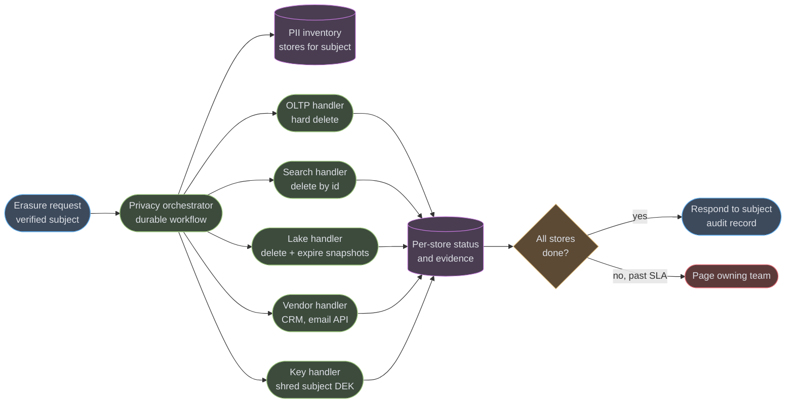
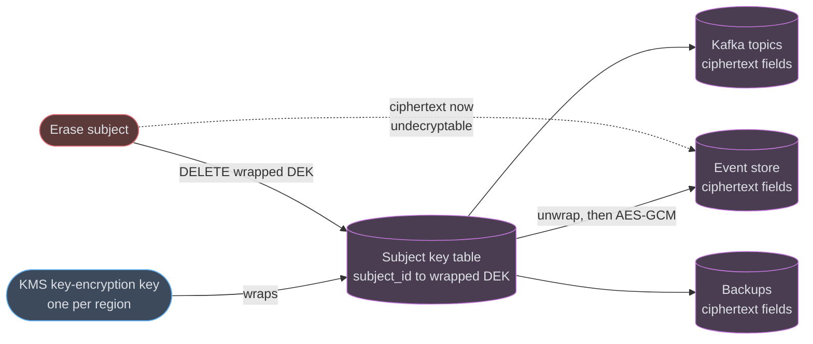
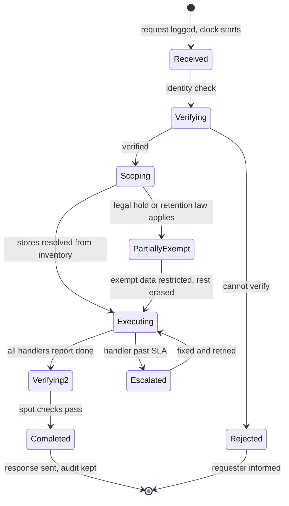

# Privacy Engineering & Data Lifecycle

> Legal facts checked 2026-11-25 against primary texts: Regulation (EU) 2016/679 (GDPR) as published in the Official Journal (EU Publications Office), India's Digital Personal Data Protection Act, 2023 (No. 22 of 2023, Gazette of India, 11 August 2023), the California Consumer Privacy Act as amended (statute text effective 2026-01-01 and CCPA Regulations effective 2026-01-01, both from cppa.ca.gov), and the CPPA's CPI-adjusted monetary thresholds effective 2025-01-01. Platform facts (AWS KMS, Google Cloud deletion, Kafka, S3 Object Lock) checked the same day. This page is an engineering view, not legal advice; it covers the EU, India and California only.

Privacy law tells you what a person may ask of you: show me my data, fix it, delete it, stop selling it, stop using it for that. Privacy engineering is the work of building systems where those requests are cheap, provable and complete, across a primary database, 11 other stores, three vendors, a data lake, a Kafka cluster, six months of backups and a log pipeline nobody owns. Most organizations discover their personal-data footprint the day they receive their first erasure request. This module is about discovering it before then and designing every store so that "delete this person" is a routine operation, not an incident.

---

## 1. Concept Overview

Personal data does not live in one place. A single user signup typically writes to: the primary OLTP database, a search index, a cache, an analytics event stream, a data warehouse, a CRM or email vendor, an object store (avatars, uploads), application logs, traces, a feature store, and the backups of all of the above. Each copy was created by a different team for a different purpose, with a different retention, and usually with no record that it holds personal data at all.

Three regimes shape most backend designs that serve Europe, India and California:

| | GDPR (EU) | DPDP Act 2023 (India) | CCPA as amended by CPRA (California) |
|---|---|---|---|
| Who is regulated | Controllers and processors | Data Fiduciaries and Data Processors | "Businesses" meeting a threshold, plus service providers and contractors |
| Person protected | Data subject | Data Principal | Consumer (California resident) |
| Scope of data | Personal data, any form | Digital personal data | Personal information |
| Response deadline for rights | One month, extendable by two further months (Art. 12(3)) | Prescribed by rules under the Act | 45 days, extendable once by another 45 days (§1798.130) |
| Erasure duty | Art. 17 grounds and exceptions | s.8(7) and s.12(3), plus causing processors to erase | §1798.105, plus notifying service providers, contractors and third parties |
| Maximum penalty | EUR 20M or 4% of worldwide annual turnover, whichever is higher (Art. 83(5)) | Up to INR 250 crore for failing to take reasonable security safeguards (Schedule) | USD 2,663 per violation or USD 7,988 per intentional violation, as CPI-adjusted from 2025-01-01 (§1798.155) |

The engineering consequences are the same across all three, and they are the subject of this module:

1. **Inventory.** You cannot erase or export what you cannot find. A PII inventory (data map) records every store, field, purpose, legal basis, retention and downstream recipient.
2. **Rights pipelines.** Access (export), correction and erasure requests fan out across every store and every processor, with verifiable completion within a statutory deadline.
3. **Erasure techniques that work on immutable systems.** Logs, event stores, Kafka topics, backups and WORM storage cannot delete one row. Crypto-shredding, field-level encryption with per-subject keys, and keeping identifiers out of immutable stores are the answers.
4. **Retention as code.** Every data category has a retention period enforced by automation (TTLs, partition drops, lifecycle rules), not by a policy PDF.
5. **Pseudonymisation and minimisation.** Store less, and store most of it under tokens whose mapping lives in one controlled place.
6. **Consent and purpose enforcement.** Consent and opt-out state is data with its own ledger, and it is checked at the point of use.
7. **Audit.** Prove what was requested, what was done, and when, without the audit trail becoming a new copy of the personal data.

**Not here.** Database-level controls (row-level security, `pgAudit`, transparent data encryption, the SQL of a single-database erasure) are in [Database Security & Compliance](../../database/database_security_and_compliance/database_security_and_compliance.md). LLM-specific privacy (training data, prompt logs, vector-store deletion) is in [Privacy & Data Governance for LLMs](../../llm/llm_security/privacy_and_data_governance.md), and GDPR Art. 22, the EU AI Act and DPIAs for AI systems are in [AI Regulations & Compliance](../../llm/ai_regulations_and_compliance/ai_regulations_and_compliance.md). Where bytes may physically live is in [Multi-Region & Data Residency](../../hld/multi_region_and_data_residency/multi_region_and_data_residency.md). Differential privacy and federated learning are in [Privacy-Preserving ML](../../ml/privacy_preserving_ml/privacy_preserving_ml.md). The ethics argument is in DDIA 2e's [Doing the Right Thing](../../book/ddia_2e/14_doing_the_right_thing/14_doing_the_right_thing.md). Uploaded media and its renditions are produced by the pipeline in [File Upload & Media Handling](../file_upload_and_media_handling/file_upload_and_media_handling.md).

> **See also:** [Design a GDPR Erasure Pipeline](../case_studies/design_gdpr_erasure_pipeline/design_gdpr_erasure_pipeline.md) for the end-to-end erasure pipeline across 12 stores.

---

## 2. Intuition

> **One-line analogy:** Personal data is like glitter. It is easy to bring into the house and almost impossible to get out of every corner later. Privacy engineering is deciding, before the glitter comes in, which rooms it may enter and how each room gets vacuumed.

**Mental model:** every copy of a person's data is a liability with three properties: **where** it is, **why** it is there (purpose and legal basis) and **until when** it may stay (retention). A system is privacy-engineered when those three properties are recorded for every copy and enforced by machines.

**Why it matters:** the regulations attach deadlines and fines, but the operational pain comes first. A team that handles erasure by hand spends days per request, misses the backups and the vendor, and cannot prove completion when the regulator or the customer asks. At 50 requests a month that is a full-time job; at 5,000 it is impossible without automation.

**Key insight:** deletion is a distributed transaction across systems you do not control, with no rollback and a legal deadline. Treat it like one: a durable orchestrator, idempotent per-store handlers, a status record per store, retries with alerting, and a verification step. And design immutable stores so that deletion is a key deletion, not a rewrite.

---

## 3. Core Principles

- **Data minimisation first.** Data you never collect needs no erasure. GDPR Art. 5(1)(c) requires personal data to be "adequate, relevant and limited to what is necessary"; DPDP s.6(1) limits consent to "such personal data as is necessary for such specified purpose".
- **Storage limitation is a TTL.** GDPR Art. 5(1)(e) requires data to be kept in identifiable form "for no longer than is necessary"; CCPA §1798.100(a)(3) requires businesses to disclose how long they retain each category and not to keep it longer than reasonably necessary. Both become a retention period per category, enforced by a job.
- **One subject identifier, everywhere.** Every store that holds personal data keys it (directly or by lookup) on a stable internal subject id, so a rights request can be routed without fuzzy matching on names and emails.
- **Pseudonymise by default.** Analytics, logs and downstream services see a token, not an email address. The token-to-identity mapping lives in one store with tight access, so erasing the mapping disconnects the rest.
- **Immutable stores hold ciphertext or no PII.** Event logs, Kafka topics, backups and WORM buckets either contain no direct identifiers or contain them encrypted under a per-subject key that can be destroyed.
- **Rights are pipelines, not tickets.** Access, correction and erasure run through an orchestrator with per-store handlers, status tracking and evidence.
- **Processors are part of the blast radius.** GDPR Art. 28(3)(g) requires a processor to delete or return personal data at the end of the service; CCPA §1798.105(c) requires notifying service providers and contractors to delete. Vendors need an API call in the erasure pipeline, not an email.
- **Audit the request, not the person.** Audit records prove what happened using the subject id or a keyed hash, never a copy of the deleted data.

---

## 4. Types / Architectures / Strategies

### 4.1 The identification spectrum

| State | Definition | Still personal data? | Example |
|---|---|---|---|
| Identified | Directly names or identifies a person | Yes | `email = ana@example.com` |
| Pseudonymised | Cannot be attributed to a person "without the use of additional information", which is kept separately and protected (GDPR Art. 4(5); near-identical wording in CCPA §1798.140(aa)) | **Yes.** GDPR Recital 26 says pseudonymised data "should be considered to be information on an identifiable natural person" | `user_token = 7f3a...` with a mapping table elsewhere |
| De-identified (CCPA) | Cannot reasonably be linked to a consumer, plus the business takes reasonable measures, publicly commits not to re-identify and contractually binds recipients (§1798.140(m)) | No, under CCPA, if all conditions hold | Aggregated, coarsened records with a public commitment |
| Anonymous (GDPR) | Does not relate to an identified or identifiable person, judged by "all the means reasonably likely to be used" (Recital 26) | No | Counts per region per week with small cells suppressed |

The most common engineering mistake in this whole field is treating pseudonymised data as anonymous. Hashing an email address with SHA-256 is pseudonymisation at best: anyone with a list of candidate emails can hash them and match. Under GDPR it is still personal data and still in scope for access and erasure.

### 4.2 Deletion techniques

| Technique | What it does | Where it works | Where it fails |
|---|---|---|---|
| Hard delete | Removes rows or objects | OLTP databases, object stores, search indexes | Backups, logs, append-only stores; the data stays in old snapshots until they expire |
| Soft delete (`deleted_at`) | Hides the row from reads | Undo windows, referential integrity | It is not erasure; the data is all still there |
| Tombstone + compaction | Writes a delete marker that compaction later applies | Kafka compacted topics, LSM stores, Cassandra | Time-retention topics; data remains until compaction runs |
| Anonymise in place | Overwrites identifying fields, keeps the row | Financial records you must keep, aggregates | Free-text fields, rare combinations that still re-identify |
| Crypto-shredding | Destroys the per-subject key that encrypts the data | Backups, event stores, logs, any immutable copy | Copies made in plaintext before encryption, or keys that leaked into backups |
| Expiry (TTL / lifecycle) | Deletes everything older than N days | Logs, caches, analytics events | Data you must keep longer for legal reasons |

### 4.3 Rights by regime

| Right | GDPR | DPDP Act 2023 | CCPA |
|---|---|---|---|
| Access / know | Art. 15: confirmation, information and a copy; electronic copy for electronic requests | s.11: a summary of personal data processed and processing activities, identities of other fiduciaries and processors it was shared with | §1798.110 and §1798.115: categories and specific pieces collected and disclosed |
| Correction | Art. 16 | s.12(1)-(2): correction, completion, updating | §1798.106 |
| Erasure | Art. 17 | s.12(3): erase on request unless retention is necessary for the specified purpose or by law | §1798.105 |
| Restriction | Art. 18 | - | Limit use of sensitive personal information (§1798.121) |
| Portability | Art. 20: "structured, commonly used and machine-readable format" | - | Access responses "in a readily useable format" that lets the consumer transmit the data to another entity without hindrance (§1798.130) |
| Object / opt out | Art. 21 | Withdraw consent "with the ease of doing so being comparable to the ease with which such consent was given" (s.6(4)) | Opt out of sale or sharing (§1798.120), honouring opt-out preference signals (Regs §7025) |
| Grievance / nominate | Complaint to a supervisory authority | s.13 grievance redressal, s.14 nomination | Complaint to the CPPA or Attorney General |

### 4.4 Inventory architectures

- **Spreadsheet data map:** a list of systems and fields maintained by hand. Out of date within a quarter.
- **Schema annotations:** columns and event fields carry tags (`@PII(category=CONTACT, retention=P2Y)`), checked in CI so a new column without a tag fails the build. The inventory is generated from code.
- **Discovery scanning:** tools sample stores and classify content (emails, phone numbers, national ids) to find PII that annotations missed, such as free-text fields and log lines.
- **Lineage:** CDC and pipeline metadata record which downstream tables derive from which sources, so an erasure in the source knows where the derived copies are.

Production systems use annotations as the source of truth and scanning as the audit.

---

## 5. Architecture Diagrams

### 5.1 The erasure fan-out



The orchestrator reads the inventory to learn which stores hold data for this subject, calls one idempotent handler per store, and records a status row per store. The key handler covers every immutable copy (backups, events, logs) in one step by destroying the subject's data key.

### 5.2 Crypto-shredding key hierarchy



Data is encrypted under a per-subject data-encryption key (DEK). The DEK is stored only in wrapped form, encrypted by a key-encryption key (KEK) in a KMS. Deleting the subject's wrapped DEK makes every ciphertext copy, in every backup and topic, unreadable. The subject key table itself must have short-lived backups, or the DEK survives in them.

### 5.3 Where the copies hide

```
One user's email address, 30 days after signup (illustrative inventory)

store                   | copies | per-record delete | default retention | erasure method
------------------------+--------+-------------------+-------------------+-------------------------
users (Postgres)        |   1    | yes               | account life      | hard delete
users WAL archive       |  many  | no                | 14 days           | expiry
nightly backups         |  35    | no                | 35 days           | crypto-shred or expiry
search index            |   1    | yes               | account life      | delete by id
Redis session cache     |   1    | yes               | 30 min TTL        | expiry
Kafka user-events       | ~400   | no (time topic)   | 7 days            | expiry, or encrypt field
data warehouse          |  ~60   | yes (by id)       | 2 years           | delete + snapshot expiry
CRM vendor              |   1    | via API           | vendor default    | vendor delete API
app logs                | ~900   | no                | 30 days           | redact at source + expiry
traces                  | ~200   | no                | 14 days           | redact at source + expiry
------------------------+--------+-------------------+-------------------+-------------------------
total                   | ~1,600 copies plus WAL across 10 stores; 5 cannot delete one record
```

The point of the table is the last column. Five of ten stores cannot delete one record, so the design must either keep the email out of them (redaction, tokens), make the copy unreadable (crypto-shredding), or rely on an expiry that is shorter than the regulatory response window.

### 5.4 Rights-request lifecycle



The clock starts at `Received`, not at `Verifying`. GDPR Art. 12(3) runs one month "of receipt of the request"; CCPA §1798.130 states that determining whether the request is verifiable does not extend the 45-day duty.

---

## 6. How It Works — Detailed Mechanics

### 6.1 The PII inventory as code

Tag personal data where it is declared, and generate the inventory from the tags:

```java
import java.lang.annotation.*;

@Retention(RetentionPolicy.RUNTIME)
@Target({ElementType.FIELD, ElementType.RECORD_COMPONENT})
public @interface Personal {
    Category category();
    String retention();          // ISO-8601 period, e.g. "P2Y"
    String purpose();            // e.g. "account", "billing", "marketing"
    boolean direct() default true; // direct identifier vs quasi-identifier

    enum Category { CONTACT, IDENTITY, FINANCIAL, LOCATION, DEVICE, CONTENT, SENSITIVE }
}

public record Customer(
        String id,
        @Personal(category = Personal.Category.CONTACT, retention = "P2Y", purpose = "account") String email,
        @Personal(category = Personal.Category.IDENTITY, retention = "P2Y", purpose = "account") String fullName,
        @Personal(category = Personal.Category.LOCATION, retention = "P90D", purpose = "fraud", direct = false) String lastIp,
        String plan) {}
```

A CI check scans every entity, event schema and table migration and fails the build when a column whose name or sample content looks personal (`email`, `phone`, `ip`, `address`, `dob`) has no tag. The generated inventory joins tags with deployment metadata (which service, which database, which region, which vendor receives it) and becomes the routing table for rights requests. For SQL stores, the same tags live as column comments or a catalog table:

```sql
CREATE TABLE pii_catalog (
  store        text NOT NULL,        -- 'pg.users', 'es.customers', 'vendor.crm'
  field        text NOT NULL,
  category     text NOT NULL,
  purpose      text NOT NULL,
  legal_basis  text NOT NULL,        -- 'contract', 'consent', 'legal_obligation', 'legitimate_interest'
  retention    interval NOT NULL,
  subject_key  text NOT NULL,        -- column or lookup that maps a row to subject_id
  erase_method text NOT NULL CHECK (erase_method IN
                 ('hard_delete','anonymise','crypto_shred','expiry','vendor_api')),
  owner_team   text NOT NULL,
  PRIMARY KEY (store, field)
);
```

GDPR Art. 30 requires most controllers to keep records of processing activities. Art. 30(5) exempts organisations with fewer than 250 employees, but not when the processing is likely to result in a risk, is not occasional, or includes special categories. In practice almost every online service processes customer data routinely, so the exemption rarely applies. A generated catalog like this is the engineering substrate for that record.

### 6.2 The erasure orchestrator

Model erasure as a durable workflow (see [Durable Execution & Workflows](../durable_execution_and_workflows/durable_execution_and_workflows.md)): it runs for days, it calls external systems that fail, and it must never lose a step.

```java
import java.time.*;
import java.util.*;

public final class ErasureOrchestrator {
    private final PiiCatalog catalog;
    private final Map<String, StoreHandler> handlers;   // keyed by store name
    private final ErasureLedger ledger;

    public ErasureOrchestrator(PiiCatalog c, Map<String, StoreHandler> h, ErasureLedger l) {
        this.catalog = c; this.handlers = h; this.ledger = l;
    }

    /** Idempotent: safe to call again after a crash; finished stores are skipped. */
    public void run(String requestId, String subjectId, Instant receivedAt) {
        Instant due = receivedAt.plus(Duration.ofDays(30));      // internal SLA well inside one month
        for (String store : catalog.storesHolding(subjectId)) {
            if (ledger.isDone(requestId, store)) continue;
            Optional<Hold> hold = ledger.activeHold(subjectId, store); // litigation hold, AML record duty
            if (hold.isPresent()) {
                handlers.get(store).restrict(subjectId);              // block processing, keep data
                ledger.markExempt(requestId, store, hold.get().basis());
                continue;
            }
            try {
                EraseResult r = handlers.get(store).erase(subjectId, requestId); // must be idempotent
                ledger.markDone(requestId, store, r.evidence());       // row counts, vendor ticket id, key id
            } catch (RetryableException e) {
                ledger.markRetry(requestId, store, e.getMessage());   // workflow engine retries with backoff
                throw e;
            } catch (Exception e) {
                ledger.markFailed(requestId, store, e.getMessage());
                if (Instant.now().isAfter(due.minus(Duration.ofDays(7)))) ledger.page(store);
                throw e;
            }
        }
        ledger.complete(requestId);
    }
}

interface StoreHandler {
    EraseResult erase(String subjectId, String requestId) throws Exception; // delete or shred, idempotent
    void restrict(String subjectId);                                        // GDPR Art. 18-style freeze
}
```

Three properties make this survive production:

- **Idempotent handlers.** Every handler is safe to run twice: `DELETE ... WHERE subject_id = ?` returns 0 rows the second time; a vendor delete with the request id as idempotency key does not create a second ticket.
- **Per-store status.** "The request is 90% done" is useless; "the warehouse handler failed with a permission error on 2026-11-20" is actionable. The ledger is also the evidence you show a regulator.
- **Holds are first-class.** Some data must be kept despite an erasure request: GDPR Art. 17(3)(b) exempts processing needed to comply with a legal obligation, CCPA §1798.105(d)(8) exempts complying with a legal obligation, and DPDP s.8(7) and s.12(3) keep data whose retention is "necessary for compliance with any law". Financial records are the common case; see [Regulatory Reporting & Audit Trails](../../fintech/regulatory_reporting_and_audit_trails/regulatory_reporting_and_audit_trails.md) for record-keeping periods. A hold restricts processing and erases everything else.

### 6.3 Crypto-shredding in practice

```java
import javax.crypto.*;
import javax.crypto.spec.GCMParameterSpec;
import java.nio.ByteBuffer;
import java.security.SecureRandom;

public final class SubjectCrypto {
    private static final SecureRandom RNG = new SecureRandom();
    private final SubjectKeyStore keys;   // subject_id -> DEK wrapped by a KMS key (never stored in plaintext)

    public SubjectCrypto(SubjectKeyStore keys) { this.keys = keys; }

    public byte[] encrypt(String subjectId, byte[] plaintext) throws Exception {
        SecretKey dek = keys.getOrCreate(subjectId);          // unwraps via KMS, caches briefly in memory
        byte[] iv = new byte[12];
        RNG.nextBytes(iv);
        Cipher c = Cipher.getInstance("AES/GCM/NoPadding");
        c.init(Cipher.ENCRYPT_MODE, dek, new GCMParameterSpec(128, iv));
        c.updateAAD(subjectId.getBytes(java.nio.charset.StandardCharsets.UTF_8)); // bind ciphertext to subject
        byte[] ct = c.doFinal(plaintext);
        return ByteBuffer.allocate(12 + ct.length).put(iv).put(ct).array();
    }

    /** Returns empty when the subject was shredded: callers render "[erased]". */
    public java.util.Optional<byte[]> decrypt(String subjectId, byte[] blob) throws Exception {
        var dek = keys.find(subjectId);
        if (dek.isEmpty()) return java.util.Optional.empty();
        Cipher c = Cipher.getInstance("AES/GCM/NoPadding");
        c.init(Cipher.DECRYPT_MODE, dek.get(), new GCMParameterSpec(128, blob, 0, 12));
        c.updateAAD(subjectId.getBytes(java.nio.charset.StandardCharsets.UTF_8));
        return java.util.Optional.of(c.doFinal(blob, 12, blob.length - 12));
    }

    public void shred(String subjectId) { keys.deleteWrappedKey(subjectId); }  // the erasure
}
```

Design decisions that decide whether crypto-shredding is real:

- **Per-subject DEKs live in your database, wrapped by a few KMS keys.** One KMS key per user is impractical at millions of users, and AWS KMS will not delete a key immediately anyway: it requires a waiting period of 7 to 30 days (default 30), during which the key is "Pending deletion" and unusable for cryptographic operations. That waiting period is a feature for the KEK and a problem for per-subject erasure, so the per-subject key is a row you can delete now.
- **The key table's backups must expire faster than the data's.** If the wrapped DEK is in a 35-day backup of the key table, the subject is not shredded until that backup expires. Keep key-table backups short (for example 7 days) and replicate the key table for availability instead of relying on long backups.
- **Encrypt before the first write.** Crypto-shredding covers only ciphertext. A Kafka producer that writes the plaintext email first and an enricher that encrypts it later leaves plaintext in the topic for its whole retention.
- **Do not encrypt what you must query.** You cannot index or join on ciphertext. Keep a pseudonymous token (HMAC of the email under a key in the vault) for lookups, and encrypt the value itself.
- **Make the erased state readable.** After shredding, reads must degrade gracefully (`[erased]`) instead of throwing on every replay of the event store.

### 6.4 Immutable and append-only stores

| Store | Problem | Practical erasure |
|---|---|---|
| Event store (event sourcing) | Events are immutable by design | Keep PII out of events (reference a subject id, store PII in a mutable projection) or encrypt PII fields per subject and shred. See [Event Sourcing & CQRS](../event_sourcing_and_cqrs/event_sourcing_and_cqrs.md) |
| Kafka, time-based retention | No per-record delete | Retention shorter than your response deadline, or per-subject field encryption |
| Kafka, compacted topic | A key's value persists until replaced | Produce a tombstone (same key, `null` value). Compaction removes older values; the tombstone itself is kept for `delete.retention.ms` (default 24 hours, so consumers reading from offset 0 can see the delete). See [Kafka Deep Dive](../kafka_deep_dive/kafka_deep_dive.md) |
| Table formats (Iceberg, Delta) | A `DELETE` writes a new snapshot; old snapshots still reference the data files | Delete, then expire snapshots and remove orphan files within the response window. See [Lakehouse & Table Formats](../../database/lakehouse_and_table_formats/lakehouse_and_table_formats.md) |
| PostgreSQL | `DELETE` leaves dead tuples until `VACUUM`; WAL archives and base backups keep the old row | Delete, let `VACUUM` reclaim, and age out WAL archives and backups on a fixed schedule |
| Search (Lucene-based) | A delete marks the document; bytes remain in the segment until merge | Delete by id; merges reclaim over time; snapshots need the same expiry rule as backups |
| S3 Object Lock, compliance mode | A locked object version cannot be overwritten or deleted by any user, including the root user, for the retention period | Do not put erasable personal data under compliance-mode locks, or store it there only as per-subject ciphertext |
| Backups | Rewriting a backup to delete one person is impractical | Short, fixed backup retention plus crypto-shredding. CCPA Regulations §7022(d) allow a business to delay deletion on archived or backup systems until that data is restored to an active system or next accessed or used for a sale, disclosure or commercial purpose |

The backup row deserves the most attention because it is where designs quietly fail. The defensible pattern: backups are encrypted; backup retention is fixed and documented (for example 35 days); a restore pipeline replays the erasure ledger against restored data before it becomes active again, so an erased subject cannot come back from a restore. See [Backup, Recovery & DR](../../database/backup_recovery_and_disaster_recovery/backup_recovery_and_disaster_recovery.md).

```sql
-- After any restore, re-apply every erasure completed since the backup was taken.
-- Runs before the restored database accepts traffic.
DELETE FROM users u
 USING erasure_ledger e
 WHERE e.subject_id = u.subject_id
   AND e.completed_at >= :backup_taken_at;
DELETE FROM subject_keys k
 USING erasure_ledger e
 WHERE e.subject_id = k.subject_id
   AND e.completed_at >= :backup_taken_at;
```

### 6.5 Soft delete done right

`deleted_at` is an undo window, not erasure. Use it for a short grace period, then hard-delete:

```sql
-- Soft delete: hidden from reads, still personal data.
UPDATE users SET deleted_at = now(), purge_after = now() + interval '14 days'
 WHERE subject_id = :sid AND deleted_at IS NULL;

-- Unique constraints must ignore soft-deleted rows, or a returning user cannot re-register.
CREATE UNIQUE INDEX users_email_live ON users (email) WHERE deleted_at IS NULL;

-- Purge job: the actual erasure.
DELETE FROM users WHERE purge_after < now();
```

Google Cloud documents the same shape at platform scale: after a deletion request, data is typically marked for deletion within a maximum of 24 hours, an internal recovery period of up to 30 days may apply, and Google commits to delete customer data within a maximum period of about six months (180 days), backups included. The pattern (mark fast, short recovery window, bounded completion including backups) is the one to copy; the specific numbers are a product decision bounded by the regulatory window.

### 6.6 Pseudonymisation and tokenization

```java
import javax.crypto.Mac;
import javax.crypto.spec.SecretKeySpec;
import java.util.HexFormat;

/** Deterministic token for joins and lookups. The key lives in the vault, not with the data. */
public final class Pseudonymizer {
    private final byte[] key;   // fetched from a secrets manager; rotated with a versioned key id
    public Pseudonymizer(byte[] key) { this.key = key.clone(); }

    public String token(String normalizedEmail) throws Exception {
        Mac mac = Mac.getInstance("HmacSHA256");
        mac.init(new SecretKeySpec(key, "HmacSHA256"));
        byte[] h = mac.doFinal(normalizedEmail.getBytes(java.nio.charset.StandardCharsets.UTF_8));
        return "v1_" + HexFormat.of().formatHex(h, 0, 16);   // 128-bit token, key version prefix
    }
}
```

An HMAC with a secret key resists the dictionary attack that breaks a plain hash: without the key, an attacker cannot compute tokens for candidate emails. It is still pseudonymisation, not anonymisation, because the key holder can re-identify. Two operational rules: keep the key in a secrets manager (see [HashiCorp Vault](../../technologies/hashicorp_vault/hashicorp_vault.md)) and never in the analytics environment, and remember that a token derived from an email is personal data for the person behind it, so erasure must remove token-keyed rows too.

A tokenization vault is the stronger variant: random tokens (not derived from the value) plus a mapping table. Erasing the mapping row disconnects every token-keyed record from the person, and no key can re-derive it.

### 6.7 Retention enforcement

Retention policy belongs in the catalog (§6.1) and is enforced by mechanisms matched to the store:

| Store | Mechanism | Example |
|---|---|---|
| Postgres, time-series data | Range partitions dropped by a scheduler | `DROP TABLE events_2024_10;` is instant and leaves no dead tuples |
| Postgres, entity data | Purge job on `purge_after` or last-activity date | Delete accounts inactive for 3 years after notice |
| Object storage | Lifecycle expiration rules per prefix | `logs/` expire after 30 days |
| Kafka | `retention.ms` per topic | 7 days for raw clickstream |
| Redis | TTL on every key that holds personal data | Sessions 30 minutes |
| Warehouse | Scheduled `DELETE` plus snapshot expiry | Raw events 13 months, aggregates indefinitely |
| Logs and traces | Index lifecycle policies | 30 days hot, then delete |

DPDP adds a retention trigger worth designing for explicitly: s.8(7) requires a Data Fiduciary to erase personal data when consent is withdrawn "or as soon as it is reasonable to assume that the specified purpose is no longer being served, whichever is earlier", and s.8(8) deems the purpose no longer served when the Data Principal has not approached the fiduciary or exercised her rights for a period to be prescribed. That is an inactivity-based purge, so the system must track last meaningful activity per subject and per purpose. The Act leaves the period, and several other numbers, to rules made under it; take those values from the notified rules for your class of fiduciary, not from a blog post.

### 6.8 Consent and opt-out as data

Consent is an append-only ledger, not a boolean column:

```sql
CREATE TABLE consent_events (
  subject_id   text        NOT NULL,
  purpose      text        NOT NULL,   -- 'marketing_email', 'analytics', 'sale_or_share'
  granted      boolean     NOT NULL,
  notice_id    text        NOT NULL,   -- the exact notice text version the person saw
  source       text        NOT NULL,   -- 'web_banner', 'app_settings', 'gpc_header', 'support'
  recorded_at  timestamptz NOT NULL DEFAULT now(),
  PRIMARY KEY (subject_id, purpose, recorded_at)
);

-- Current state per purpose: the latest event wins.
CREATE VIEW consent_current AS
SELECT DISTINCT ON (subject_id, purpose) subject_id, purpose, granted, recorded_at
  FROM consent_events
 ORDER BY subject_id, purpose, recorded_at DESC;
```

Why a ledger: GDPR Art. 7(1) requires the controller to "be able to demonstrate" consent, and the notice version proves what the person agreed to. Withdrawal must be as easy as giving consent (GDPR Art. 7(3); DPDP s.6(4)), so the withdrawal path is the same one click, recorded the same way.

Enforce purpose at the point of use, not at collection only:

```java
// BROKEN: consent checked once at signup; the nightly marketing export ignores later withdrawals.
List<Customer> audience = customers.findAll();
crm.uploadAudience(audience);

// FIX: every purpose-bound read filters on current consent, and the export is re-derived each run.
List<Customer> audience = customers.findAllWithConsent("marketing_email");  // joins consent_current
crm.replaceAudience("newsletter", audience);    // replace, not append, so withdrawn users are removed downstream
```

For California, a business that sells or shares personal information must treat a qualifying opt-out preference signal as a valid opt-out request; CCPA Regulations §7025 give "an HTTP header field or JavaScript object" as examples of the format. The W3C Global Privacy Control specification defines such a header, `Sec-GPC`. Record it as a `consent_events` row with `source = 'gpc_header'` against the identified user when you can link the browser to an account.

### 6.9 Access and portability exports

An access request is the erasure fan-out in read mode: the orchestrator calls each store's `export(subjectId)` handler and assembles a package. GDPR Art. 15(3) requires a copy in "a commonly used electronic form" for electronic requests; Art. 20 requires a "structured, commonly used and machine-readable format" for data the person provided. JSON per store plus a manifest is the usual answer:

```json
{ "requestId": "dsar_2026_11_25_0042", "subject": "sub_8c1f", "generatedAt": "2026-11-25T10:02:11Z",
  "sections": [
    { "store": "pg.users", "purpose": "account", "records": 1, "file": "users.json" },
    { "store": "pg.orders", "purpose": "contract", "records": 37, "file": "orders.json" },
    { "store": "vendor.crm", "purpose": "support", "records": 4, "file": "crm_tickets.json" } ],
  "recipients": ["Payment processor (contract)", "Email delivery provider (processor)"] }
```

Two traps. First, the export is itself a bundle of personal data: deliver it through an authenticated download that expires, never as an email attachment. Second, Art. 15(4) says the right to a copy "shall not adversely affect the rights and freedoms of others", so support tickets and shared documents need redaction of other people's data before export.

### 6.10 Audit logging without re-creating the data

```java
// BROKEN: the audit log is now the most complete copy of the person you just erased.
audit.info("Erased user email={} name={} address={}", u.email(), u.fullName(), u.address());

// FIX: log the request and the outcome, keyed by the internal subject id or a keyed hash.
audit.info("erasure.store_done request={} subject={} store={} rows={} method={}",
        requestId, subjectId, "pg.users", rowsDeleted, "hard_delete");
```

CCPA Regulations §7101 require a business to keep records of consumer requests and how it responded for at least 24 months, with the date of request, nature of request, manner in which it was made, date and nature of the response, and the basis for any denial. Those fields need no personal data beyond the subject reference. Application logs are the opposite problem: redact at the source (structured logging with a deny-list of fields, see [Observability & Monitoring](../observability_and_monitoring/observability_and_monitoring.md)) because a log pipeline that ingests raw request bodies cannot be cleaned afterwards.

### 6.11 Breach notification clocks

| Regime | Clock | Engineering need |
|---|---|---|
| GDPR Art. 33(1) | Notify the supervisory authority "without undue delay and, where feasible, not later than 72 hours" after becoming aware, unless the breach is unlikely to result in a risk | Know within hours which subjects and which data categories a compromised store held: the PII inventory is the input |
| DPDP s.8(6) | Intimate the Data Protection Board and each affected Data Principal, in the form and manner prescribed | Per-subject contact data and a bulk-notification path |
| CCPA §1798.150 | Private right of action for certain breaches of unencrypted and unredacted personal information, statutory damages adjusted to USD 107 to USD 799 per consumer per incident from 2025-01-01 | Encryption at rest and redaction reduce exposure directly |

---

## 7. Real-World Examples

- **Google Cloud** documents its deletion pipeline publicly: a deletion request is typically marked within a maximum of 24 hours, an internal recovery period of up to 30 days may apply, and Google commits to delete customer data within a maximum period of about six months (180 days), with backup systems retiring copies "after a limited window of time". It is the clearest published example of soft-delete, recovery window and bounded backup expiry as one design.
- **AWS KMS** enforces a 7 to 30 day waiting period (default 30) before deleting a KMS key and makes data encrypted under a deleted key unrecoverable. That is why crypto-shredding designs keep per-subject keys in an application table wrapped by a small number of KMS keys.
- **Apache Kafka** removes a key's older values in compacted topics when a tombstone arrives and keeps the tombstone for `delete.retention.ms`, 24 hours by default; time-retention topics cannot delete individual records at all.
- **Amazon S3 Object Lock** compliance mode prevents any user, including the account root user, from deleting a locked object version during its retention period. It is built for record-keeping rules, and it collides with erasure if personal data is stored there in plaintext.
- **The California Privacy Protection Agency** publishes the CPI-adjusted CCPA thresholds every odd-numbered year; from 2025-01-01 the "business" revenue threshold is USD 26,625,000 (§1798.140(d)(1)(A)), alongside the 100,000 consumers or households and 50%-of-revenue-from-selling-or-sharing tests.

---

## 8. Tradeoffs

### 8.1 Deletion strategy per store type

| Store | Hard delete | Crypto-shred | Expiry only |
|---|---|---|---|
| OLTP | Default | Unnecessary overhead | Wrong; entity data outlives any fixed TTL |
| Event store | Breaks immutability | Default | Wrong for long-lived streams |
| Kafka time topic | Impossible | When retention exceeds your response window | When retention is shorter than the window |
| Backups | Impractical | Best | Acceptable with short, documented retention and restore-time replay |
| Logs | Impractical | Rarely worth it | Default, with redaction at source |
| Vendor SaaS | Via API | Not available | Vendor-defined; check the contract |

### 8.2 Pseudonymisation approaches

| | Plain hash (SHA-256 of email) | Keyed HMAC | Random token + vault |
|---|---|---|---|
| Dictionary attack | Trivial | Requires the key | Impossible without the vault |
| Deterministic joins | Yes | Yes | Only through the vault |
| Erasure | Delete every hashed row | Delete rows, or rotate the key for the whole dataset | Delete one mapping row |
| Operational cost | None | Key management | A highly available vault on the hot path |

### 8.3 Centralized privacy platform vs per-team handlers

| | Central orchestrator + per-store handlers | Each team handles requests |
|---|---|---|
| Completeness | Measurable per store | Unknown |
| Deadline tracking | One clock per request | Many inboxes |
| Team effort | Write one handler per store, once | Every request, forever |
| Failure mode | Orchestrator bug affects all requests | Silent misses |

### 8.4 Keep data for analytics vs minimise

| | Keep raw events long | Aggregate early and drop raw |
|---|---|---|
| Analytics flexibility | High | Limited to pre-defined aggregates |
| Erasure cost | High; every request touches the warehouse | Low; aggregates with suppressed small cells are not personal |
| Breach impact | Large | Small |

---

## 9. When to Use / When NOT to Use

**Build the inventory and rights pipeline** as soon as you hold personal data of people in the EU, India or California at any volume, and before your second data store. Retrofitting subject ids into 12 stores costs far more than adding one to the first schema.

**Use crypto-shredding** for immutable or append-only stores (event stores, long-retention Kafka topics, backups you cannot shorten) and for data replicated to places you cannot reach with a `DELETE`.

**Do not use crypto-shredding** for ordinary OLTP rows you can delete directly; it adds key lookups to every read and a new failure mode (lost keys) for no gain.

**Use soft delete** only as a short undo window with a scheduled hard purge. Never describe a `deleted_at` flag as erasure.

**Do not anonymise by hashing.** If the output can be recomputed from a guessed input, it is pseudonymous and still personal data.

**Do not store erasable personal data in compliance-mode WORM storage**, unless it is ciphertext under a key you can destroy.

---

## 10. Common Pitfalls

**The restore that resurrected 1,400 deleted users.** A team restored a 30-day-old Postgres backup after a bad migration. Every user erased in those 30 days came back, received the next marketing email and complained. Fix: an erasure ledger outside the restored database, replayed against any restore before it serves traffic (§6.4), plus a restore runbook step that blocks traffic until replay reports zero remaining subjects.

**SHA-256 "anonymised" analytics.** An analytics pipeline replaced emails with `sha256(email)` and the team declared the warehouse out of scope for erasure. A data-protection review computed hashes for the customer list and matched 96% of rows in minutes. Fix: treat hashed identifiers as personal data, switch to keyed HMAC tokens with the key outside analytics, and add the warehouse to the erasure fan-out.

```java
// BROKEN: unkeyed hash. Anyone with the customer list can rebuild the mapping.
String id = HexFormat.of().formatHex(MessageDigest.getInstance("SHA-256").digest(email.getBytes(UTF_8)));

// FIX: keyed HMAC, key held in the vault and not readable from the analytics environment.
String id = pseudonymizer.token(email.trim().toLowerCase(java.util.Locale.ROOT));
```

**Erasure that missed the vendor.** The in-house pipeline deleted from all internal stores, but the CRM vendor kept the contact, and the vendor's next sync re-created the user in the internal marketing table. Fix: vendor handlers call the vendor's delete API with the request id, record the vendor's confirmation, and the sync job checks a suppression list of erased subject ids before inserting.

**Logs as the largest PII store.** Request-body logging at `DEBUG` was enabled during an incident and never turned off. Six weeks of logs held full names, addresses and tokens for every request. Erasure could not reach them, and the logs were readable by 300 engineers. Fix: structured logging with a field deny-list enforced in the logging library, a CI test that fails if a known PII field name appears in a log statement, and log retention shorter than the response window.

**Consent checked at collection, ignored at use.** A user withdrew marketing consent in settings, but the weekly export to the email platform appended new opt-ins and never removed withdrawals. The user kept receiving email for four months. Fix: purpose filtering at every read, and replace-not-append audience syncs (§6.8).

**Kafka topic with 365-day retention and plaintext emails.** A "user-events" topic kept a year of events for replay. Each erasure request triggered a debate about rewriting the topic. Fix: encrypt identifying fields per subject before produce, so erasure is a key deletion; move replay to a compacted, keyed topic where a tombstone removes the subject's state.

**Clock started at verification, not receipt.** The support tool started the deadline timer only after identity verification, which took up to two weeks. Responses went out at day 40 against a one-month GDPR window. Fix: start the clock when the request is received (Art. 12(3) runs from "receipt of the request"), and alert at day 20.

---

## 11. Technologies & Tools

| Tool | Purpose |
|---|---|
| AWS KMS | Key-encryption keys for wrapping per-subject data keys; scheduled key deletion with a 7 to 30 day wait |
| Google Cloud KMS | Managed key-encryption keys on Google Cloud |
| HashiCorp Vault | Secrets for HMAC pseudonymisation keys; Transit engine for encryption as a service |
| Amazon Macie | Discovery and classification of sensitive data in S3 |
| Google Cloud Sensitive Data Protection | Discovery, classification and de-identification of sensitive data on Google Cloud |
| Microsoft Purview | Data catalog, classification and lineage across Azure and other sources |
| Fides | Open-source privacy engineering platform from Ethyca: data map annotations and request orchestration |
| OneTrust | Commercial privacy management: consent, data mapping and rights-request workflow |
| Transcend | Commercial rights-request orchestration and consent management with per-system integrations |
| Temporal | Durable workflow engine for long-running erasure and export orchestration |
| Debezium | CDC to propagate deletes and build lineage from source databases |
| Apache Kafka | Compacted topics with tombstones for keyed, erasable state |

---

## 12. Interview Questions with Answers

**Q: Is hashing an email address with SHA-256 enough to make analytics data anonymous?**
**Short:** No; an unkeyed hash can be recomputed from a list of candidate emails, so it is pseudonymisation at best and stays personal data.

Anyone holding a customer list can hash every entry and join, so the "anonymous" id maps straight back to people. GDPR Recital 26 treats pseudonymised data as information about an identifiable person, judged by the means reasonably likely to be used. Use a keyed HMAC with the key held outside the analytics environment, or random tokens with a vault, and keep the warehouse in the erasure fan-out either way.

**Q: Why is a deleted_at column not erasure?**
**Short:** A soft-deleted row is hidden from reads but every byte is still stored, replicated and backed up, so it remains personal data you hold.

Soft delete is useful as an undo window and for referential integrity, but nothing has been erased. Pair it with a `purge_after` timestamp and a job that hard-deletes after a short grace period (for example 14 days), make unique indexes partial (`WHERE deleted_at IS NULL`) so returning users can re-register, and count the purge, not the flag, as the completion of an erasure request.

**Q: What is crypto-shredding and when is it the right erasure technique?**
**Short:** Encrypt each person's data under a per-subject key and destroy the key; every ciphertext copy, including backups and logs, becomes unreadable at once.

It is the right tool where records cannot be deleted individually: event stores, time-retention Kafka topics, backups and replicated archives. Keep per-subject data keys in an application table wrapped by a few KMS keys, delete the wrapped key to erase, make sure the key table's own backups expire quickly, and encrypt before the first write, because plaintext copies made earlier are not covered.

**Q: How do backups interact with a right-to-erasure request?**
**Short:** Backups usually cannot be edited, so use short fixed retention, encryption and restore-time replay of the erasure ledger so erased people never come back.

Rewriting backups for one person is impractical. The defensible design is documented backup retention (for example 35 days), per-subject encryption where feasible, and a restore procedure that re-applies every erasure completed since the backup before the restored system serves traffic. California's CCPA Regulations §7022(d) explicitly allow delaying deletion on archived or backup systems until the data is restored or next accessed or used for a sale, disclosure or commercial purpose.

**Q: How long do you have to answer a GDPR erasure or access request?**
**Short:** One month from receipt, extendable by two further months for complex or numerous requests, with the person told about the extension within the first month.

GDPR Art. 12(3) sets the clock at "one month of receipt of the request", so it starts when the request arrives, not when identity verification finishes. Build the pipeline to finish well inside that (for example an internal 30-day SLA with alerts at day 20), because extensions need reasons and notice. California's CCPA allows 45 days plus one 45-day extension with notice, and India's DPDP Act leaves the response timing to rules made under the Act.

**Q: Why should erasure be modelled as a durable workflow rather than a script?**
**Short:** It spans many stores and vendors over days, steps fail independently, and you must prove per-store completion, which needs durable state and retries.

A script that loops over stores loses its progress on the first crash and gives no evidence. A durable workflow records each store as a step with retries and backoff, skips finished steps when it resumes, escalates a step that misses its deadline, and leaves a per-store ledger (rows deleted, vendor confirmation, key id shredded) that you can show a regulator. Every store handler must be idempotent because the workflow will call it more than once.

**Q: How do you erase a person from an event-sourced system?**
**Short:** Keep personal data out of events and in a mutable projection, or encrypt PII fields per subject and shred the key; never rewrite the event log.

Events are the immutable source of truth, so editing them breaks replay and audit. The two workable designs are to store only a subject id in events and keep names, emails and addresses in a separate mutable store that can be deleted, or to encrypt those fields under a per-subject key so erasure is a key deletion and replay renders `[erased]`. Decide this at schema design time; retrofitting it means migrating every historical event.

**Q: How do you delete a user's data from Kafka?**
**Short:** In a compacted topic, produce a tombstone for the key; in a time-retention topic you cannot delete one record, so rely on short retention or field encryption.

Compaction removes older values for a key after a tombstone (same key, `null` value) arrives, and Kafka keeps the tombstone itself for `delete.retention.ms`, 24 hours by default, so consumers reading from offset 0 can observe the delete. Time-based topics have no per-record delete, so either their retention is shorter than your response window or identifying fields are encrypted per subject before they are produced.

**Q: What must happen to a processor or vendor when a person asks for erasure?**
**Short:** The vendor must delete too: CCPA requires notifying service providers and contractors, and GDPR contracts oblige processors to delete or return data.

CCPA §1798.105(c) requires the business to notify service providers and contractors to delete, and to notify third parties to whom it sold or shared the data unless that is impossible or disproportionate. GDPR Art. 19 requires communicating erasure to each recipient of the data, and Art. 28(3)(g) requires processors to delete or return data at the end of the service. Engineering-wise, each vendor gets a handler that calls its delete API with an idempotency key and stores the confirmation, and inbound syncs check a suppression list so the vendor cannot re-create the person.

**Q: When can you refuse or limit an erasure request?**
**Short:** When retention is required by law or another exemption applies, for example records you must keep, but you restrict that data and erase the rest.

GDPR Art. 17(3) exempts processing needed for legal obligations, legal claims, public-interest health, archiving and research, and freedom of expression. CCPA §1798.105(d) lists exceptions including completing the transaction, security and integrity, and complying with a legal obligation. DPDP s.8(7) and s.12(3) keep data whose retention is required by law. The system should model these as holds on specific stores and purposes, restrict processing of the held data, erase everything else, and tell the person what was kept and why.

**Q: What is the difference between pseudonymised and anonymous data?**
**Short:** Pseudonymised data can be re-linked with separately kept information and is still personal data; anonymous data cannot reasonably be linked to anyone at all.

GDPR Art. 4(5) defines pseudonymisation as processing so that data cannot be attributed to a person without additional information kept separately under protective measures. Recital 26 keeps it in scope and places only anonymous information outside the Regulation, judged by all means reasonably likely to be used, including cost and time. Aggregates with small cells suppressed can be anonymous; per-user rows with a token never are.

**Q: How do you build a PII inventory that stays current?**
**Short:** Generate it from code: tag fields at declaration, fail CI on untagged personal-looking fields, and use discovery scanning as an audit, not the source.

Hand-maintained spreadsheets decay within a quarter. Annotate entity fields and event schemas with category, purpose, retention and erase method, generate the catalog in the build, and join it with deployment metadata so it knows which service, database, region and vendor hold each field. Run classification scanners periodically to find free-text and log fields the annotations missed, and treat a scanner hit as a bug in the annotations.

**Q: How should consent be stored and enforced?**
**Short:** As an append-only ledger of grants and withdrawals with the notice version shown, enforced by filtering on current consent at every purpose-bound read.

GDPR Art. 7(1) requires the controller to demonstrate consent, so you need when, how and against which notice text it was given. Withdrawal must be as easy as giving consent (GDPR Art. 7(3), DPDP s.6(4)). Derive current state from the latest event per purpose, filter every marketing or analytics read on it, and sync audiences to vendors by replacement so withdrawn users are removed downstream rather than left behind by append-only exports.

**Q: What does a California opt-out preference signal mean for a backend?**
**Short:** A business that sells or shares personal information must treat a qualifying signal, such as an HTTP header, as a valid opt-out of sale or sharing.

CCPA Regulations §7025 require processing a qualifying opt-out preference signal as a valid request to opt out of sale/sharing and give an HTTP header field or JavaScript object as example formats; the W3C Global Privacy Control specification defines the `Sec-GPC` request header for this. Read it at the edge, record it as a consent event, link it to the account when the browser is authenticated, and make every sale or sharing integration filter on it.

**Q: Why are application logs one of the hardest privacy problems?**
**Short:** Logs copy whatever code prints, at high volume, into append-only stores that many people can read and that cannot delete one person's lines.

A single debug statement that prints a request body puts names, emails and tokens into every log line for its retention period. Logs cannot be selectively erased, so prevention is the only control: structured logging with a field deny-list in the logging library, CI checks for known PII field names in log calls, redaction at the collector, retention shorter than your response window, and narrow access to raw logs.

**Q: How do you produce a GDPR access export without creating a new risk?**
**Short:** Run the erasure fan-out in read mode, assemble machine-readable files per store, redact third parties, and deliver through an expiring authenticated download.

Art. 15(3) requires a copy in a commonly used electronic form for electronic requests and Art. 20 a structured, machine-readable format for data the person provided, so JSON per store with a manifest of stores, purposes and recipients fits both. The package is concentrated personal data: never email it as an attachment, expire the link, log the download, and redact other people's data (support threads, shared documents) because Art. 15(4) protects their rights too.

**Q: What does India's DPDP Act change for retention design compared with GDPR?**
**Short:** DPDP adds an explicit erase-on-withdrawal-or-purpose-ended duty with an inactivity-based trigger whose period is set by rules, so track activity per purpose.

Section 8(7) requires erasure when consent is withdrawn or when it is reasonable to assume the specified purpose is no longer served, whichever is earlier, and requires the fiduciary to make its processors erase too. Section 8(8) deems the purpose ended when the Data Principal has not approached the fiduciary or exercised her rights for a prescribed period. Systems therefore need last-activity tracking per subject and purpose and a purge job driven by it, with the period taken from the notified rules for that class of fiduciary.

**Q: How do children's rules differ across GDPR, DPDP and CCPA?**
**Short:** GDPR sets 16 for online-service consent (states may lower to 13), DPDP treats under-18s as children needing parental consent, and CCPA bars selling under-16s' data without opt-in.

GDPR Art. 8(1) requires parental authorisation below 16 for information-society services relying on consent, and lets member states set a lower age not below 13. DPDP s.2(f) defines a child as under 18, s.9(1) requires verifiable parental consent, and s.9(3) bars tracking, behavioural monitoring and targeted advertising directed at children. CCPA §1798.120(c) forbids selling or sharing data of consumers the business knows are under 16 unless they (13 to 16) or a parent (under 13) affirmatively opted in. An age attribute and per-age purpose rules belong in the consent model.

**Q: What must an audit trail of privacy requests contain, and what must it not contain?**
**Short:** It records the request, dates, actions and outcome per store keyed by subject id, and never a copy of the personal data that was erased.

CCPA Regulations §7101 require keeping request records for at least 24 months, including the date and nature of the request, how it was made, the date and nature of the response, and the basis for any denial. None of that needs the person's email or address. Logging the erased values defeats the erasure and creates the most complete copy of the person in your company.

**Q: What breach-notification deadline drives incident tooling under GDPR?**
**Short:** Notify the supervisory authority without undue delay and, where feasible, within 72 hours of becoming aware, unless the breach is unlikely to result in risk.

GDPR Art. 33(1) sets the 72-hour target from awareness, so incident response needs to answer within hours which data categories and how many subjects a compromised store held. That answer comes from the PII inventory and per-store counts, which is another reason the inventory must be generated and current. India's DPDP s.8(6) requires intimation to the Board and each affected Data Principal in the prescribed form, so a bulk subject-notification path is part of the same tooling.

**Q: Why does storing personal data in S3 Object Lock compliance mode conflict with erasure?**
**Short:** Compliance mode stops anyone, even the root user, from deleting a locked version before retention ends, so plaintext personal data there cannot be erased in time.

Object Lock exists for record-keeping rules that demand immutability. If erasable personal data lands in a compliance-locked bucket in plaintext, an erasure request cannot be honoured until the lock expires. Either keep such data out of WORM storage, store it there only as ciphertext under per-subject keys you can destroy, or document the legal-hold basis that justifies keeping it.

---

## 13. Best Practices

- Assign every person one internal subject id and carry it (or a lookup to it) into every store that holds their data.
- Generate the PII inventory from annotations in code, fail CI on untagged personal fields, and audit with discovery scanners.
- Run access, correction and erasure through a durable orchestrator with idempotent per-store handlers and a per-store evidence ledger.
- Start the deadline clock at receipt; set an internal SLA well inside the shortest applicable window and alert early.
- Keep identifiers out of immutable stores, or encrypt them per subject and erase by destroying the key; keep the key table's backups short.
- Replay the erasure ledger after every restore before the restored system serves traffic.
- Enforce retention by machinery matched to each store: partition drops, TTLs, lifecycle rules, topic retention, snapshot expiry.
- Store consent as an append-only ledger with notice versions; filter on current consent at every purpose-bound read and sync audiences by replacement.
- Pseudonymise with keyed HMACs or vault tokens, never unkeyed hashes, and keep the keys out of the environments that use the tokens.
- Treat vendors as stores: call their delete APIs, store confirmations, and suppress erased subjects in inbound syncs.
- Log requests and outcomes, never the erased values; redact personal data at the logging source.

---

## 14. Case Study

**Problem.** A B2C subscription app with 9 million users in the EU, India and the US received about 1,200 erasure and 400 access requests per month. Erasure was a support runbook: an engineer ran a SQL script against the primary Postgres database, filed tickets for the search team and the data team, and emailed the CRM vendor. An internal audit sampled 50 completed requests and found personal data for 41 of them still present somewhere: 38 in the warehouse (the data team's ticket queue was 6 weeks behind), 27 in the CRM (vendor emails were never confirmed), all 50 in a 365-day Kafka `user-events` topic used for replay, and 9 users fully restored by a backup restore two months earlier. Median completion time was 47 days against GDPR's one-month window.

**Fix.** The team built the design in §5.1 in one quarter.

1. **Inventory.** Annotated 212 entity fields and 64 event schemas; the CI check found 31 untagged personal fields, including two free-text "notes" columns.
2. **Orchestrator.** A Temporal workflow per request with one handler per store (12 stores: Postgres, read replica cache, Elasticsearch, Redis, Kafka, warehouse, object storage for avatars, CRM, email provider, payment processor tokens, support desk, analytics vendor) and an `erasure_ledger` table with per-store evidence.
3. **Kafka.** Identifying fields in `user-events` are now encrypted per subject before produce; erasure deletes the subject's wrapped key. The replay use case moved to a compacted `user-state` topic where the handler produces a tombstone.
4. **Backups.** Postgres backups stayed at 35 days; the restore runbook now replays the erasure ledger before traffic is enabled. The subject-key table's backups are kept 7 days.
5. **Warehouse.** The handler deletes by subject id and the nightly maintenance expires table snapshots older than 7 days, so deleted rows leave the files within a week.
6. **Hold.** Payment records required for tax and anti-money-laundering record-keeping are placed under a hold: the handler anonymises names and emails in the billing projection and keeps amounts, dates and the transaction id.

```java
// BROKEN: fire-and-forget deletes, no evidence, the vendor call failure is swallowed,
// and the warehouse and Kafka are not even in the list.
void eraseUser(long userId) {
    jdbc.update("DELETE FROM users WHERE id = ?", userId);
    search.deleteAsync("customers", String.valueOf(userId));
    try { crm.deleteContact(userId); } catch (Exception ignored) { }
    log.info("deleted user {} {}", userId, userEmailCache.get(userId));   // and logs the email
}

// FIX: inventory-driven, idempotent handlers, per-store evidence, holds, no PII in logs.
void eraseSubject(String requestId, String subjectId, Instant receivedAt) {
    orchestrator.run(requestId, subjectId, receivedAt);    // §6.2: every store from the catalog
}

final class CrmHandler implements StoreHandler {
    public EraseResult erase(String subjectId, String requestId) throws Exception {
        String contactId = crmIds.lookup(subjectId).orElse(null);
        if (contactId == null) return EraseResult.nothingToDo();
        var resp = crm.deleteContact(contactId, /* idempotency key */ requestId);  // throws on failure
        suppression.add(subjectId);                       // inbound sync must not re-create the person
        return EraseResult.done("crm ticket " + resp.confirmationId());
    }
    public void restrict(String subjectId) { crm.setDoNotProcess(crmIds.lookup(subjectId).orElseThrow()); }
}
```

**Result.** Median completion dropped from 47 days to 3 days, and p99 to 11 days (the CRM vendor's own batch deletion window). A repeat audit of 50 requests found zero residual copies in the 12 stores; the Kafka topic now holds only ciphertext for erased users. Support engineering time on privacy requests fell from about 1.5 full-time engineers to roughly 2 hours a week of escalation handling. The first restore drill after the change brought back a 30-day-old database and the ledger replay removed 1,130 previously erased subjects before traffic was enabled. The same pipeline, run in read mode, produces access exports in under 10 minutes. (Figures in this case study are illustrative.)

For the database-level mechanics of one store (row-level security, `pgAudit`, the SQL of a single-database erasure), see [Database Security & Compliance](../../database/database_security_and_compliance/database_security_and_compliance.md). For tenant-level offboarding, where a whole customer's data must go, see [Design a Multi-Tenant SaaS Backend](../case_studies/design_multi_tenant_saas_backend/design_multi_tenant_saas_backend.md).
