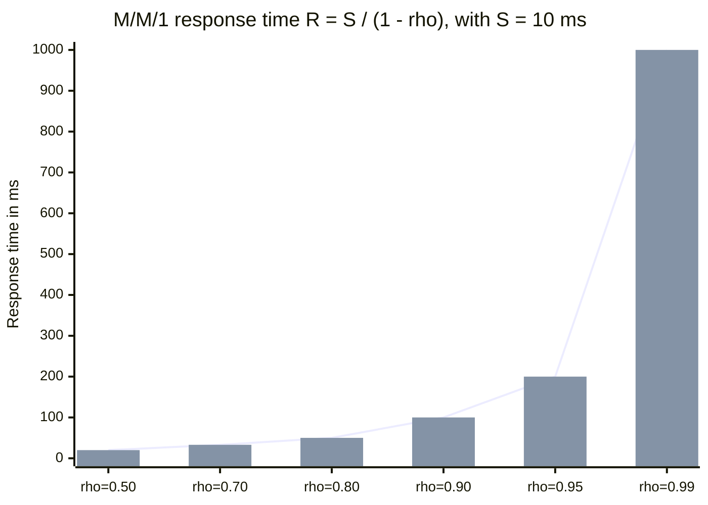
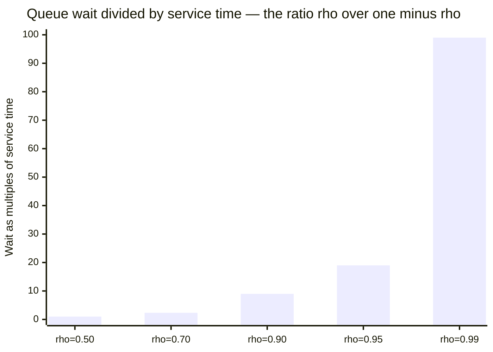
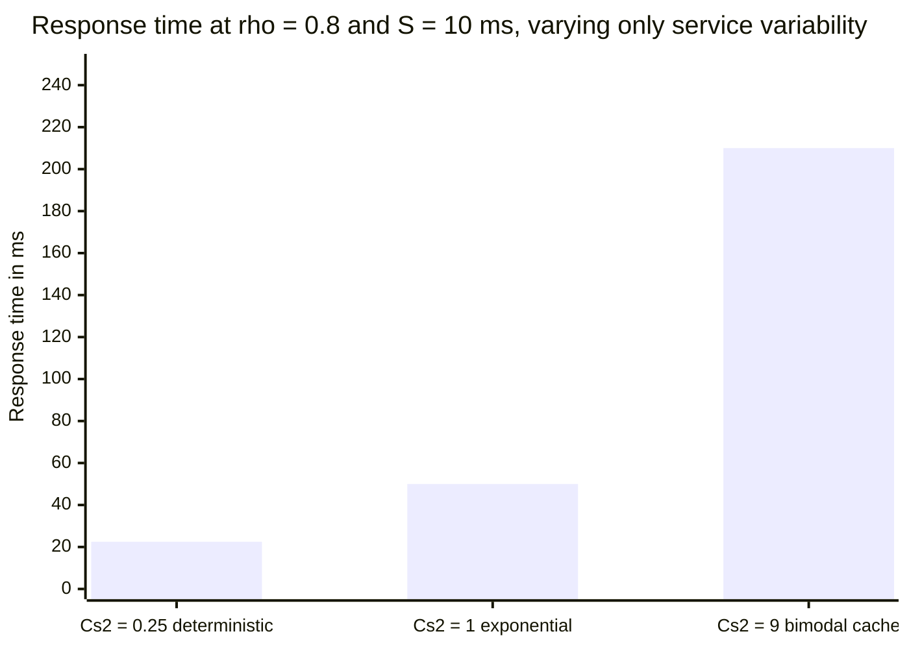
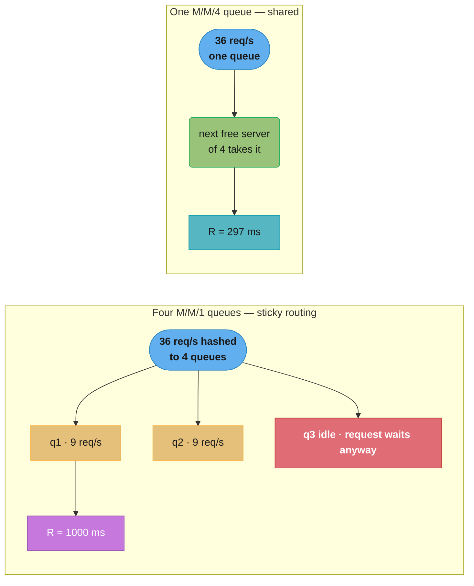
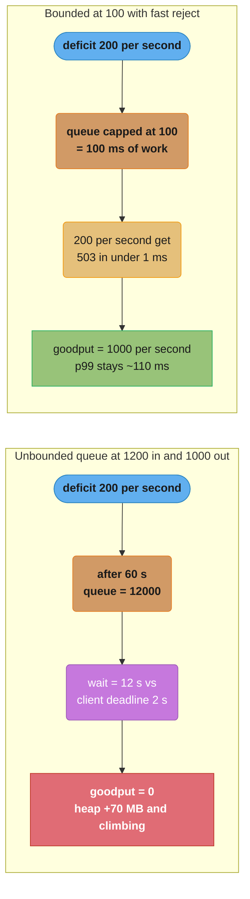

# Queueing Theory for Capacity

## 1. Concept Overview

Capacity planning is usually performed as division: "we need 12,000 requests per second, one instance does 400, so we need 30 instances." That arithmetic is wrong in a specific and expensive way — it computes the number of instances at which the system is exactly 100% busy, which is the number at which response time is infinite.

Capacity is a **queueing** question. A server is not a pipe with a fixed throughput; it is a queue, and the defining property of a queue is that waiting time explodes non-linearly as utilization approaches one. The whole discipline follows from three results:

- **The utilization law**, `ρ = λ × S / c`, which tells you how busy the system is.
- **Little's Law**, `L = λ × W`, which converts between concurrency, arrival rate and latency — and which, applied to *servers* rather than to load generators, tells you how many requests are in flight and therefore how many threads, connections and instances you need.
- **The response-time curve**, `R = S / (1 - ρ)` for M/M/1, which says that going from 50% to 95% utilization multiplies your response time by ten while saving less than half your fleet.

Then there is the term nobody budgets: **variability**. Kingman's approximation, `Wq ≈ (ρ/(1-ρ)) × ((Ca² + Cs²)/2) × S`, says waiting time is the product of three independent factors — a utilization factor, a variability factor, and the service time. Two systems at identical utilization and identical mean service time can differ by 5x in response time purely because one has a bimodal service-time distribution (cache hit versus cache miss) and the other does not. Teams tune the first and third factors relentlessly and typically never measure the second.

**Little's Law appears elsewhere in this repo framed as load-generator sizing** — how many virtual users a k6 or Gatling run needs to sustain an arrival rate, and why a closed model under-applies load. That framing is worked in [Load and Performance Testing §5](../load_and_performance_testing/load_and_performance_testing.md) and [DevOps Performance and Load Testing §5](../../devops/performance_and_load_testing/performance_and_load_testing.md). This module points the same equation the other way: at the server, deciding instance counts, thread pools, connection pools, queue bounds and autoscaling signals.

For applying these capacity models to GPU inference replicas and their autoscaling signals, see [Inference Autoscaling and Capacity Planning](../../mlops/inference_autoscaling_and_capacity_planning/inference_autoscaling_and_capacity_planning.md) in `mlops/`.

---

## 2. Intuition

**One-line analogy:** a supermarket checkout. One till serving one customer every minute handles 60 customers an hour on paper — but if customers arrive at 59 an hour, the line is enormous, because arrivals are not evenly spaced and some baskets are much bigger than others.

**Mental model:** utilization is not "how much of the resource you are using." It is "the probability that a new arrival finds the server busy." At ρ = 0.9, nine out of ten arrivals must wait for someone else to finish before they can start. The queue is not a sign that the machine is undersized; it is the arithmetic consequence of the machine being 90% busy.

**Why it matters:** the difference between running at 70% and running at 95% is a 40% saving on hardware and a **10x** increase in response time. The 40% shows up on the invoice next month; the 10x shows up as a page at 03:00 when a routine traffic bump moves you from 95% to 98% and response time triples again. Every capacity conversation is this trade, and the reason it goes wrong is that the cost side is legible and the latency side is a curve nobody has plotted.

**Key insight:** the response-time curve has a **knee** — a region where the slope changes from gentle to vertical. Below it, extra load costs you almost nothing. Above it, a 3% traffic increase costs you 3x latency. Capacity planning is the discipline of choosing where on that curve to live, and then defending that position with admission control so a traffic spike cannot drag you past it.

---

## 3. Core Principles

- **Utilization is a probability, not a fuel gauge.** `ρ = λS/c` is the fraction of time the server is busy, which is the chance an arrival finds it busy and must queue.
- **Little's Law holds for any stable system**, with no assumption about arrival or service distributions: `L = λW`. It is a conservation law, and it applies to every nested queue independently — the whole service, one thread pool, one connection pool.
- **Response time is non-linear in utilization** and the non-linearity is a division by `(1 - ρ)`. Every capacity intuition that assumes linearity is wrong near the knee.
- **Variability costs exactly as much as utilization does.** Kingman's three factors multiply; halving the service-time coefficient of variation is worth as much as a large utilization reduction, and is usually cheaper.
- **Pooling beats partitioning.** One queue feeding `c` servers strictly outperforms `c` queues of one server at the same total utilization, because idle capacity anywhere is available to a waiting request.
- **Unbounded queues do not add capacity, they add latency.** A queue converts an overload into a delay; if the delay exceeds the client's deadline, it converts capacity into waste.
- **Capacity must survive the loss of a failure domain and a deploy.** The number you size to is not peak QPS but peak QPS divided by target utilization, divided again by the fraction of the fleet that survives your worst tolerated failure.
- **The scaling signal must lead, not lag.** Utilization saturates at 100% and cannot express "we are 3x over capacity." Queue depth and arrival rate can.

---

## 4. Types / Architectures / Strategies

### Kendall notation and the models worth knowing

| Model | Arrivals / Service / Servers | Key result | Where it applies |
|-------|------------------------------|------------|------------------|
| M/M/1 | Poisson / exponential / 1 | `R = S / (1 - ρ)` | Single-threaded service, one DB connection, one partition |
| M/M/c | Poisson / exponential / c | Erlang C for `P(wait)`, then `Wq = C/(cμ - λ)` | A thread pool, a connection pool, a load-balanced fleet |
| M/M/c/K | ...with a queue bounded at K | Blocking probability; finite worst-case wait | Any correctly-built production queue |
| M/G/1 | Poisson / general service / 1 | Pollaczek–Khinchine: `Wq = ρS(1 + Cs²) / (2(1 - ρ))` | Realistic service times (bimodal cache) |
| G/G/1 | General / general / 1 | Kingman's approximation | What you actually have |
| M/D/1 | Poisson / deterministic / 1 | `Wq = ρS / (2(1 - ρ))` — exactly half of M/M/1 | Fixed-cost work: a hash, a fixed-size write |

The practical lesson from the last row: making service time *deterministic* halves the wait at every utilization, for free, without adding a single machine.

### Utilization targets by workload class

| Workload | Target ρ | Reasoning |
|----------|----------|-----------|
| Interactive, user-facing, tight SLO | 0.50–0.70 | `R` is 2S–3.3S; leaves room for a 40% spike before the knee |
| Interactive with autoscaling and admission control | 0.70–0.80 | `R` is 3.3S–5S; the controls buy you the extra 10 points |
| Internal RPC, generous SLO | 0.80 | `R = 5S` |
| Async / queue-driven, deadline in minutes | 0.90–0.95 | Nobody is waiting on a socket; goodput is what matters |
| Batch, no deadline | 0.95–0.99 | Maximise throughput; latency is irrelevant |

### Overload strategies

| Strategy | Mechanism | What it protects |
|----------|-----------|------------------|
| Bounded queue + fast reject | Fixed queue depth, immediate 503 beyond it | Bounds worst-case wait; preserves goodput |
| Load shedding by priority | Drop low-priority classes first | Keeps revenue traffic alive during a spike |
| Adaptive concurrency limiting | Infer the limit from observed latency (Netflix Gradient2, Envoy adaptive concurrency) | Finds the knee automatically as it moves |
| CoDel / adaptive LIFO | Bound *queue delay* rather than queue length; flip to LIFO past the target | Bounds wait when service time varies |
| Backpressure to the caller | Propagate the reject upstream instead of buffering | Stops the deficit accumulating anywhere |
| Autoscaling | Add servers | Only helps on a timescale of minutes; never the first line of defence |

---

## 5. Architecture Diagrams

### The response-time curve and its knee



*Same server, same 10ms of work per request. Between 50% and 80% busy the response time doubles; between 80% and 99% it multiplies by twenty. The knee sits between 0.80 and 0.90 — that is the whole reason "70% is a target and 95% is an outage."*

### Wait time as a multiple of service time



*At half-busy, a request waits exactly as long as it takes to serve. At 99% busy it waits ninety-nine times as long. The server is doing the same work throughout — the growth is entirely queueing.*

### Every queue on the path (and most of them are invisible)

```mermaid
flowchart LR
    classDef io      fill:#61afef,stroke:#2e86c1,color:#1a1a1a,font-weight:bold
    classDef frozen  fill:#c678dd,stroke:#9b59b6,color:#fff
    classDef train   fill:#98c379,stroke:#27ae60,color:#1a1a1a
    classDef mathOp  fill:#d19a66,stroke:#e67e22,color:#1a1a1a,font-weight:bold
    classDef lossN   fill:#e06c75,stroke:#c0392b,color:#fff,font-weight:bold
    classDef req     fill:#56b6c2,stroke:#0097a7,color:#1a1a1a
    classDef base    fill:#e5c07b,stroke:#f39c12,color:#1a1a1a

    cl(["Client"]) --> lbq["LB surge queue<br/>usually unbounded"]
    lbq --> ack["Kernel accept backlog<br/>somaxconn 4096"]
    ack --> tp["Thread-pool queue<br/>Tomcat accept 100"]
    tp --> wrk("Worker threads<br/>c servers")
    wrk --> cpq["Connection-pool queue<br/>Hikari timeout 30s"]
    cpq --> db[("Database<br/>its own queue")]
    db --> out(["Response"])

    class cl,out io
    class lbq,ack,tp,cpq lossN
    class wrk train
    class db base
```



*Five queues, four of them invisible to an application-level timer. Each one has its own `ρ`, its own bound (or lack of one), and its own contribution to `W`. "The service is fast" is a statement about the green box only — the red boxes are where a capacity failure actually shows up.*

### Kingman: identical utilization, different variability



*Three systems with the same arrival rate, the same mean service time and the same utilization. The only difference is the shape of the service-time distribution, and it is worth 9x. This is the term nobody puts in the capacity spreadsheet.*

### One queue of c servers beats c queues of one



*Identical hardware, identical 90% utilization, 3.4x difference in response time. Splitting the queue strands idle capacity: in the left diagram a request sits behind q1 while q3 is doing nothing, which cannot happen on the right.*

### Bounded queue plus fast reject versus the unbounded latency bomb



*Both systems are 20% over capacity and neither can serve everyone. The bounded one chooses who to disappoint in under a millisecond and keeps its full 1,000 req/s of useful output; the unbounded one serves everybody far too late and produces nothing anybody uses.*

---

## 6. How It Works — Detailed Mechanics

### 6.1 The utilization law and Little's Law, once, cleanly

```
  Utilization law:   rho  =  lambda * S / c
  Little's Law:      L    =  lambda * W
```

| Symbol | What it is | Units |
|--------|-----------|-------|
| `lambda` | Arrival rate — requests entering per second | req/s |
| `S` | Service time — how long one server takes on one request, excluding any waiting | s |
| `c` | Number of servers (threads, connections, instances) sharing the queue | count |
| `rho` | Utilization — fraction of time a server is busy; equivalently `P(arrival must wait)` | 0 to 1 |
| `W` | Response time — total time in system, `Wq + S` (also written `R`) | s |
| `Wq` | Queue wait — time spent waiting before service starts | s |
| `L` | Concurrency — requests inside the system at any instant | count |

Little's Law is a conservation law and holds for **any** stable system, with no assumption about the arrival or service distribution. That generality is what makes it useful: it applies independently to the whole service, to one thread pool, to one connection pool, and to the database behind it.

**Applied to a server rather than to a load generator.** A service takes 12,000 req/s and each request occupies a worker thread for 25ms end to end:

```
  L  =  lambda * W  =  12000 * 0.025  =  300 requests in flight

  -> you need >= 300 worker threads across the fleet, or 300 slots of async concurrency
  -> if 8 ms of that 25 ms is a DB call, the DB-side concurrency is
        L_db = 12000 * 0.008 = 96 connections in flight
     which is the number your connection pool must actually sustain
```

That second line is the correct way to size a connection pool: not "10 per instance because that is the Hikari default," but `λ × W_db`, measured. And it tells you the failure mode directly — if the pool holds fewer than 96 connections fleet-wide, the shortfall becomes a *new* queue in front of the pool, with its own `ρ` and its own response-time curve.

### 6.2 The response-time curve

For M/M/1 — one server, Poisson arrivals, exponential service:

```
  Wq  =  rho * S / (1 - rho)          queue wait
  R   =  S / (1 - rho)                total response time  =  Wq + S
  L   =  rho / (1 - rho)              requests in system
```

The ratio `Wq / S = rho / (1 - rho)` is the whole story:

| `rho` | `Wq / S` | Reading | `R` at S = 10ms | Fleet size vs ρ=0.5 |
|-------|----------|---------|-----------------|---------------------|
| 0.50 | **1x** | wait equals service time | 20ms | 100% |
| 0.70 | 2.33x | | 33ms | 71% |
| 0.80 | 4x | | 50ms | 63% |
| 0.90 | **9x** | | 100ms | 56% |
| 0.95 | **19x** | | 200ms | 53% |
| 0.99 | **99x** | | 1,000ms | 51% |

Read the last column against the fourth. Moving from 50% to 95% utilization cuts the fleet by **47%** and multiplies response time by **10**. Moving from 95% to 99% saves a further 2% of hardware and multiplies response time by 5 again. This is why 70% is a target and 95% is an outage: at 95% you have bought a rounding error of cost saving and sold your entire latency budget.

The **knee** is where the second derivative peaks — for M/M/1 the curve is visually gentle to about 0.8 and visually vertical after 0.9. Practically, the knee is defined by your SLO, not by the math: it is the `ρ` at which `S/(1-ρ)` first exceeds your latency budget. Compute it explicitly. With `S = 10ms` and a 60ms budget, `10/(1-ρ) = 60` gives `ρ = 0.833` — that is your ceiling, and your autoscaling target must sit meaningfully below it.

### 6.3 Kingman's VUT approximation — the third factor

Kingman's formula for G/G/1 decomposes queue wait into three independent multipliers, which is why it is taught as **V × U × T**:

```
  Wq  ~=  ( rho / (1 - rho) )  x  ( (Ca^2 + Cs^2) / 2 )  x  S
           \_____ U _______/      \______ V _________/     T

  U = Utilization factor    the same rho/(1-rho) as M/M/1
  V = Variability factor    mean of the squared coefficients of variation
  T = Time                  mean service time
```

| Symbol | What it is |
|--------|-----------|
| `Ca` | Coefficient of variation of *inter-arrival* times — `stddev / mean`. Poisson arrivals give `Ca = 1` |
| `Cs` | Coefficient of variation of *service* times. Exponential gives `Cs = 1`; deterministic gives `Cs = 0` |
| `Ca²`, `Cs²` | The squared values; `V` is their mean |

Set `Ca² = Cs² = 1` and `V = 1`, and Kingman collapses exactly to M/M/1. That is the assumption every capacity spreadsheet silently makes, and it is almost never true of service time.

**Where `Cs²` actually comes from — derive it from a real cache.** A read path serves 95% from cache in 2ms and 5% from the database in 100ms:

```
  mean  E[X]   = 0.95*2 + 0.05*100                    =   6.90 ms
        E[X^2] = 0.95*4 + 0.05*10000                  = 503.80
  var          = 503.80 - 6.90^2 = 503.80 - 47.61     = 456.19
  Cs^2         = 456.19 / 47.61                       =   9.58
```

A "95% cache hit rate" — which every dashboard calls excellent — is a `Cs²` of 9.58. Now price it at `ρ = 0.8`:

```
  With the M/M/1 assumption (Cs^2 = 1):
     Wq = 4 * 1.00 * 6.90                             =   27.6 ms   R =  34.5 ms
  With the real distribution (Cs^2 = 9.58):
     Wq = 4 * ((1 + 9.58)/2) * 6.90 = 4 * 5.29 * 6.90 =  146.0 ms   R = 152.9 ms

  the capacity model was wrong by 4.4x, and not conservatively
```

**Worked comparison — two systems, identical utilization, different variability.** Both run at `ρ = 0.8` with `S = 10ms`:

```
  System A — deterministic work (fixed-size hash + fixed-size write), Ca^2 = 1, Cs^2 = 0.25
     Wq = (0.8/0.2) * ((1 + 0.25)/2) * 10 = 4 * 0.625 * 10 =  25 ms    R =  35 ms

  System B — bimodal cache path, Ca^2 = 1, Cs^2 = 9
     Wq = (0.8/0.2) * ((1 + 9)/2)    * 10 = 4 * 5.0   * 10 = 200 ms    R = 210 ms

  Same lambda. Same S. Same rho. Same hardware.  6x the response time.
```

Nothing on a utilization dashboard distinguishes these two systems. Both read 80% CPU.

**And the lever this hands you.** Take the cache above and reduce the *miss penalty* from 100ms to 20ms — with the same 95% hit rate, by adding a second-level cache or a covering index:

```
  mean  E[X]   = 0.95*2 + 0.05*20                     =  2.90 ms
        E[X^2] = 0.95*4 + 0.05*400                    = 23.80
  var          = 23.80 - 8.41                         = 15.39
  Cs^2         = 15.39 / 8.41                         =  1.83

  Wq = 4 * ((1 + 1.83)/2) * 2.90 = 4 * 1.415 * 2.90   = 16.4 ms    R = 19.3 ms
```

Response time fell from **153ms to 19ms — 8x — at the same utilization, the same hit rate and zero added machines.** The mean service time only improved 2.4x; the rest came from the variability term. Reducing the *worst* path is worth more than improving the *average* path, and the capacity model is the only thing that tells you so.

Arrival variability matters the same way. Poisson traffic has `Ca² = 1`, but batched arrivals do not: a fleet of clients all firing a cron job at `:00` produces `Ca² >> 1`, which multiplies `V` and therefore `Wq`. Adding jitter to client schedules is a capacity intervention, not a cosmetic one.

### 6.4 M/M/c versus c separate M/M/1 queues

Take 4 servers, each with `S = 100ms` (so `μ = 10 req/s`), and a total arrival rate of `λ = 36 req/s`, giving `ρ = 0.9` either way.

**Four separate queues** (sticky sessions, hash routing, or per-shard state), 9 req/s each:

```
  R = S / (1 - rho) = 100 / 0.1 = 1000 ms
```

**One shared queue of 4 servers** — M/M/4. Offered load `a = λ/μ = 3.6`, `ρ = a/c = 0.9`. Erlang B by recurrence, then Erlang C:

```
  B(1) = 3.6 / (1 + 3.6)                  = 0.7826
  B(2) = 3.6*0.7826 / (2 + 3.6*0.7826)    = 0.5848
  B(3) = 3.6*0.5848 / (3 + 3.6*0.5848)    = 0.4124
  B(4) = 3.6*0.4124 / (4 + 3.6*0.4124)    = 0.2707

  C = B(4) / (1 - rho*(1 - B(4))) = 0.2707 / (1 - 0.9*0.7293) = 0.7877
      -> 78.8% of arrivals must wait at all

  Wq = C / (c*mu - lambda) = 0.7877 / (40 - 36) = 0.1969 s = 197 ms
  R  = Wq + S = 197 + 100                                  = 297 ms
```

```
  FOUR QUEUES OF ONE:  R = 1000 ms
  ONE QUEUE OF FOUR:   R =  297 ms      3.4x better, identical hardware
```

The mechanism is simple: in the split design a request can wait behind a busy server while a peer sits idle. Pooling makes idle capacity universally available, and the benefit grows with `c` — the same comparison at c=16 is larger still.

**Where pooling breaks, and it breaks often.** Sticky sessions pin a user to one server. Sharded state means only one server holds the data. Consistent-hash routing for cache locality deliberately partitions. Kafka consumer groups assign a partition to exactly one consumer. Every one of these is a decision to accept the `c × M/M/1` penalty in exchange for locality or ordering — which is a legitimate trade, but it must be a *priced* one. If you shard for cache locality and the hit rate improves 5% while your effective response time triples, you lost. The mitigation is finer partitioning (many more partitions than servers, so load balances by the law of large numbers) plus work stealing where the semantics allow it.

### 6.5 Why adding a server helps unequally

The marginal value of one more server is entirely determined by where you are on the curve. Take a fleet of 10 servers and add one:

```
  From rho = 0.50:  new rho = 0.50*10/11 = 0.4545  ->  R: 2.00S -> 1.83S    -8%
  From rho = 0.80:  new rho = 0.80*10/11 = 0.7273  ->  R: 5.00S -> 3.67S   -27%
  From rho = 0.95:  new rho = 0.95*10/11 = 0.8636  ->  R: 20.0S -> 7.33S   -63%
```

So near the knee, one server is enormously valuable and below it nearly worthless. The trap is the other direction — **past** the knee, where `λ` exceeds total capacity, there is no steady state at all and the queue grows without bound. Adding servers then has to do two jobs, and the second one takes time:

```
  Overloaded 60 s at lambda = 1200 vs capacity 1000:
     backlog accumulated              = (1200 - 1000) * 60      = 12,000 requests

  Scale out to capacity 1400 (a 40% fleet increase):
     drain rate                       = 1400 - 1200             =    200 req/s
     time to drain the backlog        = 12000 / 200             =     60 s

  For that full minute AFTER the fleet is healthy, latency is still terrible.
```

This is why autoscaling is never the first line of defence against a spike: even after the capacity arrives, the backlog must drain, and everything in it is probably past its deadline already. Shedding load *during* the spike is what keeps the backlog from forming.

**Amdahl and the Universal Scalability Law are the other half of this story** — they explain why `c` servers do not deliver `c` times the throughput at all, because of serialized work (`a`) and coherency cost (`b`), and why past a peak node count throughput actually *declines*. Both laws, the `C(N) = N / (1 + a(N-1) + bN(N-1))` formula and the worked numbers, are in [HLD Scalability](../../hld/scalability/scalability.md); they are not restated here. Read them together with this module: USL tells you how much capacity a server actually adds, and the response-time curve tells you what that capacity buys in latency.

### 6.6 Capacity planning, end to end

A worked plan for a user-facing JSON API with a 250ms p99 budget.

**1. Peak arrival rate.** Not the average. Take the busiest 5-minute window of the busiest day of the last quarter, plus expected growth:

```
  measured peak (Black Friday, 20:05-20:10)      = 9,800 req/s
  + 22% YoY growth                               = 11,956  ->  round to  12,000 req/s
```

**2. Service time from a profile, not a guess.** Measure on a warm instance under moderate load, and separate CPU time from wall time:

```
  wall time per request (mean)     W  = 25 ms
    of which CPU                   Sc = 20 ms   <- this is what consumes a core
    of which DB wait                  =  8 ms   (overlapped/blocking depending on model)
```

**3. Required concurrency, from Little's Law.**

```
  L      = lambda * W    = 12000 * 0.025 = 300 requests in flight fleet-wide
  L_db   = lambda * W_db = 12000 * 0.008 =  96 DB connections in flight fleet-wide
```

**4. Per-instance throughput at the target utilization.** An 8-vCPU instance, 20ms CPU per request:

```
  at rho = 1.0:   8 / 0.020                      = 400 req/s   (theoretical, never use)
  at rho = 0.70:  400 * 0.70                     = 280 req/s   <- the planning number
```

Check the target against the SLO before adopting it, and use `Sc` — the queue is for the CPU, and `W` is wall time that includes waiting elsewhere: `R = Sc/(1-ρ) = 20/(1-0.70) = 67ms` of mean CPU-side residence, plus the non-overlapped DB wait on top. Comfortably inside a 250ms p99 budget once the tail is added.

**5. Instance count for the happy path.**

```
  ceil(12000 / 280) = 43 instances
```

**6. Headroom for the failure domain.** Three AZs; the design must survive losing one, which is 1/3 of the fleet:

```
  surviving fraction               = 2/3
  N such that (2/3)*N*280 >= 12000
  N >= 12000 / (280 * 0.6667)      = 64.3   ->  66 instances (22 per AZ, evenly divisible)
```

**7. Headroom for deploys.** With 66 instances the AZ budget has no slack left, so the deploy strategy must not remove capacity: use **surge-first** rolling updates (`maxUnavailable: 0`, `maxSurge: 25%`), which add pods before removing any. If your platform cannot surge, add the deploy's unavailable fraction here instead: `66 / 0.9 = 74`.

**8. Sanity-check the downstream.** The DB must sustain `L_db = 96` concurrent connections at peak — and 96 across 66 instances is 1.45 per instance, so a per-instance pool of 4 with a fleet total of 264 is generous. Check that 264 is under the database's `max_connections` and under what its own queueing can absorb, or introduce PgBouncer. **This step is skipped more often than any other, and it is where capacity plans die:** the app tier scales out beautifully and drives the database past its own knee.

```
  FINAL: 66 instances, 8 vCPU, 22 per AZ, pool of 4, surge-first deploys,
         planning rho = 0.70, autoscale on concurrency (see 6.7), not CPU.
```

### 6.7 Autoscaling on a lagging proxy

**Why CPU is the wrong signal.** Three reasons, and the third is fatal.

*It compresses exactly where you need resolution.* Between the healthy zone and the knee, the signal barely moves while the thing you care about triples:

```
  rho = 0.70  ->  CPU reads 70%,  R = 3.33S
  rho = 0.90  ->  CPU reads 90%,  R = 10.0S

  signal change:  70 -> 90        = +29%
  latency change: 3.33S -> 10S    = +200%
```

*It lags.* Scrape interval (15–60s) plus HPA sync period (15s default) plus pod scheduling plus JVM warmup (30–120s) is routinely 2–4 minutes end to end. At `ρ = 0.95` a queue builds a great deal of backlog in four minutes.

*It saturates.* CPU is bounded at 100% by definition. At 3x over capacity it reads 100%; at 10x over capacity it reads 100%. **The signal cannot express the size of the deficit**, so the controller cannot know whether to add 2 pods or 40, and typically adds a fixed step and repeats — arriving several minutes late in several increments.

**What to scale on instead.** Signals that are unbounded and lead rather than lag:

| Signal | Why it works | Where to get it |
|--------|--------------|-----------------|
| In-flight requests per replica (`L`) | Little's Law: `L = λW`, so it rises when *either* load or latency rises. Unbounded | Envoy `cluster.upstream_rq_active`, app-level gauge |
| Requests per target | Directly proportional to `λ`, and `λ` is the leading term | ALB `RequestCountPerTarget` (a native HPA/ASG target) |
| Queue depth / queue delay | The literal quantity the response-time curve is about | Thread-pool queue size, SQS `ApproximateNumberOfMessages`, Kafka consumer lag |
| Backlog per replica | Expresses the deficit as a number, so the controller can compute the step | KEDA scalers do this natively |

```yaml
# HPA on concurrency: derived from Little's Law, not guessed.
# target L per pod = lambda_per_pod * W = 280 * 0.025 = 7 in-flight requests
apiVersion: autoscaling/v2
kind: HorizontalPodAutoscaler
spec:
  metrics:
    - type: Pods
      pods:
        metric: { name: http_inflight_requests }
        target: { type: AverageValue, averageValue: "7" }
  behavior:
    scaleUp:                  # react fast: the curve is steep on this side
      stabilizationWindowSeconds: 0
      policies: [{ type: Percent, value: 100, periodSeconds: 30 }]
    scaleDown:                # react slowly: scaling down into a spike is an outage
      stabilizationWindowSeconds: 300
      policies: [{ type: Percent, value: 10, periodSeconds: 60 }]
```

The asymmetric `behavior` block is not decoration. Scaling up late costs latency; scaling down early costs an outage, because you remove capacity right before the next arrival burst. Always scale up aggressively and down conservatively.

**And autoscaling is never the primary overload defence.** It operates on a timescale of minutes; the response-time curve operates on a timescale of the queue, which is seconds. Admission control is what holds the line until capacity arrives.

### 6.8 Overload: bounded queues, admission control, shedding

**Why an unbounded queue is a latency bomb.** A queue does not create capacity; it converts an arrival-rate deficit into wait time. With capacity 1,000 req/s, arrivals 1,200 req/s and a 2-second client deadline:

```
  deficit                              = 200 req/s
  after 60 s, queue depth              = 12,000
  wait for a request entering now      = 12000 / 1000 = 12 s
  client deadline                      = 2 s

  every dequeued request is 10 s past its deadline
  throughput on the dashboard          = 1,000 req/s     "healthy"
  goodput (answers anyone reads)       = 0
  plus: 12,000 queued objects at ~6 KB retained each, heap +70 MB and climbing
```

**Bounded queue plus fast reject.** Size the bound from Little's Law, not from intuition: the bound is the wait you are willing to accept, times the service rate.

```
  acceptable queue wait                = 100 ms
  service rate                         = 1,000 req/s
  queue bound = 0.100 * 1000           = 100 entries

  at 1,200 req/s arrivals:
     1,000 req/s served, wait bounded at ~100 ms, p99 ~110 ms
       200 req/s rejected with 503 + Retry-After, in under 1 ms each
     goodput                           = 1,000 req/s   (versus 0 above)
```

Rejecting 17% of traffic in 1ms is strictly better than serving 100% of it 10 seconds late, and it is better for the *client* too, which can fail over or retry against a healthy region instead of holding a socket open.

```java
// Bounded queue + fast reject + a caller-visible signal. Java 25.
// Bound = acceptable_wait * service_rate = 0.100 s * 1000 req/s = 100.
ThreadPoolExecutor pool = new ThreadPoolExecutor(
        64, 64, 0L, TimeUnit.MILLISECONDS,
        new ArrayBlockingQueue<>(100),                       // NEVER LinkedBlockingQueue()
        new ThreadPoolExecutor.AbortPolicy());               // throws, does not block

@PostMapping("/quote")
ResponseEntity<Quote> quote(@RequestBody Req r) {
    try {
        return ResponseEntity.ok(pool.submit(() -> price(r)).get());
    } catch (RejectedExecutionException e) {                 // queue full: shed, fast
        shedCounter.increment();
        return ResponseEntity.status(503)
                .header("Retry-After", "1")                  // tell the caller when
                .build();
    } catch (InterruptedException e) {
        Thread.currentThread().interrupt();                  // NEVER swallow the flag
        return ResponseEntity.status(503).build();
    } catch (ExecutionException e) {                         // price() itself threw
        throw new IllegalStateException(e.getCause());
    }
}
```

Three details that are routinely wrong: `LinkedBlockingQueue()` with no argument is **unbounded** and is the single most common cause of this failure; `CallerRunsPolicy` looks like graceful degradation but actually blocks the acceptor thread, converting a rejection into a slow accept loop and pushing the queue up into the kernel backlog where you cannot see it; and a rejection must be a *fast* 503 with `Retry-After`, not a timeout, so the caller learns something.

**Bound queue delay, not queue length, when service time varies.** With a bimodal service time a 100-entry queue can be 200ms deep or 3 seconds deep. CoDel measures the *minimum* queue delay over a sliding window (100ms interval, 5ms target in Facebook's deployment) and sheds when it exceeds the target, which is correct under any service-time distribution.

**Adaptive concurrency limiting** goes one step further and stops you having to pick the number at all. Netflix's Gradient2 tracks a long-term minimum RTT and a short-term average; when the short-term average rises relative to the minimum, the inferred limit shrinks. Envoy's adaptive concurrency filter implements the same idea at the proxy. This is the right default for a service whose knee moves as its dependencies change.

**Shed by priority, not at random.** Classify traffic on the way in — checkout above browse above analytics above crawlers — and drop the cheapest class first. A 17% uniform shed rejects 17% of checkouts; a prioritised shed at the same rate may reject zero.

---

## 7. Real-World Examples

**Google SRE's "The Non-Abstract Art of Distributed System Design"** teaches capacity as exactly this exercise: measure service time, apply Little's Law to derive concurrency, choose a utilization target below the knee, then multiply for failure domains. The SRE book's load-shedding chapter makes the goodput-versus-throughput distinction explicit and argues that a service without admission control has no defined behaviour under overload — which is the same statement as "an unbounded queue has no defined worst-case latency."

**Amazon's cell-based architecture** is a deliberate acceptance of the `c × M/M/1` penalty. Splitting a fleet into independent cells strands idle capacity across cell boundaries and measurably raises response time relative to one giant pool — and Amazon does it anyway, because it bounds the blast radius of a poison request or a bad deploy to one cell. The correct reading is that pooling is a *latency* optimisation and cells are an *availability* one, and the trade is priced, not accidental.

**Netflix concurrency-limits** ships the Gradient2 algorithm as a servlet filter, a gRPC interceptor and a standalone limiter. It exists because Netflix found static thread-pool sizes impossible to maintain: the correct limit moves whenever a dependency's latency moves, so it must be inferred continuously from observed RTT rather than configured.

**Facebook / Meta's overload control** publishes the adaptive-LIFO-plus-CoDel design: bound queue *delay* at 5ms, flip from FIFO to LIFO past the target, and reject beyond a hard bound. Their stated outcome is a large improvement in the fraction of requests served within the client deadline during overload, with total throughput unchanged — the definition of a goodput win.

**HikariCP's pool-sizing guidance** is Little's Law with the labels changed: connections `= λ × W_db`, plus the observation that a pool larger than the database can concurrently serve simply relocates the queue from your application into the database, where it is harder to observe and harder to bound. The PostgreSQL rule of thumb (`connections ≈ cores × 2 + effective_spindle_count`) is the same statement from the server side.

**Kubernetes HPA's default 15-second sync period plus a 15–60s metrics pipeline** is why the scale-up lag discussed in §6.7 is a real constraint rather than a theoretical one, and why KEDA's queue-length scalers — which express the deficit as a number — have displaced CPU targets for queue-driven workloads.

---

## 8. Tradeoffs

### Utilization target

| Target `ρ` | `R` (M/M/1) | Fleet cost | Spike tolerance before the knee | Verdict |
|-----------|-------------|-----------|--------------------------------|---------|
| 0.50 | 2.0 S | 100% | 60% headroom | Safe, often wasteful |
| 0.70 | 3.3 S | 71% | 28% headroom | **Default for user-facing** |
| 0.80 | 5.0 S | 63% | 12% headroom | OK with admission control |
| 0.90 | 10 S | 56% | 0 | Async workloads only |
| 0.95 | 20 S | 53% | negative | Batch only; an outage for interactive |

### Queue configuration

| Configuration | Worst-case wait | Behaviour at 20% overload | Observability |
|---------------|-----------------|---------------------------|---------------|
| Unbounded queue | Unbounded | Goodput -> 0, heap grows, GC death spiral | Throughput looks fine; that is the trap |
| Bounded, fixed length | `K / service_rate` | Sheds the excess in <1ms, goodput preserved | Reject rate is a first-class metric |
| Bounded by queue *delay* (CoDel) | The configured target | Correct under any service-time distribution | Queue delay is directly measured |
| Adaptive concurrency (Gradient2) | Self-tuning | Tracks a moving knee | Requires an RTT baseline; noisy at low traffic |
| `CallerRunsPolicy` | Unbounded, invisibly | Blocks the acceptor; the queue moves to the kernel | Worst of all — looks bounded, is not |

### Pooling versus partitioning

| Property | One M/M/c queue | c separate M/M/1 queues |
|----------|-----------------|-------------------------|
| Response time at ρ=0.9, c=4 | 297ms | 1,000ms |
| Cache locality | Poor | Excellent |
| Per-key ordering | Not preserved | Preserved |
| Blast radius of a bad request | Whole pool | One partition |
| Sensitivity to key skew | None | High |
| Sticky sessions possible | No | Yes |

### Autoscaling signal

| Signal | Leads or lags | Saturates? | Expresses deficit size? | Verdict |
|--------|---------------|-----------|-------------------------|---------|
| CPU utilization | Lags | Yes, at 100% | No | Adequate only for CPU-bound batch |
| Memory | Lags badly | Yes | No | Almost never correct for scaling |
| Requests per target (`λ`) | Leads | No | Yes | Good default for stateless HTTP |
| In-flight concurrency (`L`) | Leads | No | Yes | **Best** — responds to load *and* latency |
| Queue depth / lag | Leads | No | Yes | Best for queue-driven consumers |
| p99 latency | Lags | No | Partially | A guardrail, not a scaling signal |

---

## 9. When to Use / When NOT to Use

**Model the queue explicitly when:**
- You are sizing a fleet, a thread pool, a connection pool, or a queue bound
- Latency degraded without a corresponding throughput change — that is a `ρ` or a `Cs²` story
- You are choosing between "bigger instances" and "more instances"
- Someone proposes running at 90%+ utilization to save cost
- A dependency's latency changed and you need to know what it did to your concurrency requirement

**Do NOT reach for the model when:**
- The bottleneck is a hard resource limit, not queueing — a full disk, an exhausted IP range, an API quota. Those are cliffs, not curves
- The system is not stable: `λ > capacity` sustained means no steady state exists, and every steady-state formula returns nonsense. Fix the overload first
- The workload is a single long batch job. Queueing theory is about many small arrivals

**Prefer M/M/c over c×M/M/1 unless:**
- You need per-key ordering (Kafka partitions, event sourcing per aggregate)
- State is genuinely sharded and cannot be moved
- Blast-radius isolation is worth more than latency (cell-based architectures)
- Cache locality gains exceed the pooling penalty — **measure this, do not assume it**

**Run at 90%+ utilization when:**
- Nothing is waiting on a socket: batch, ETL, async consumers with deadlines in minutes
- You have adaptive admission control and a bounded queue, so a spike is shed rather than queued

**Never run at 90%+ when:**
- The workload is user-facing with a latency SLO
- The service has bimodal service times, because `Cs² = 9` at `ρ = 0.9` is `Wq = 9 × 5 × S = 45S`
- Your scale-up path takes minutes and your traffic can double in seconds

---

## 10. Common Pitfalls

**Pitfall 1: capacity by division, sized to 100% utilization.** A logistics API was sized as `peak QPS / measured max QPS per instance` — 14,000 / 500 = 28 instances, with a "20% buffer" added by hand for 34. The measured 500 req/s per instance had been taken at 99% CPU in a benchmark. In production the fleet ran at ρ = 0.93 and p99 sat at 1.9 seconds against a 400ms SLO. Two months of "the code must be slow" investigation produced a 12% improvement in mean service time and no SLO change, because at ρ = 0.93 the response time is 14.3× S and shaving S by 12% shaves R by 12% — still 1.7 seconds. Re-planning at ρ = 0.70, with the same two-of-three-AZ survival factor the original plan also lacked, required 60 instances — `14,000 / (500 × 0.70 × 2/3) = 60`, against 40 for the happy path alone; p99 fell to **215ms in a single deploy**. Quantified impact: 2 engineer-months wasted, SLO breached for 9 weeks, fixed by a spreadsheet.

```python
# BROKEN: sizes the fleet to the point where response time is infinite.
instances = math.ceil(peak_qps / max_qps_per_instance)     # 14000 / 500 = 28
instances = math.ceil(instances * 1.2)                     # "buffer" = 34
```

```python
# FIX: choose a utilization target from the SLO, then size for the failure domain.
TARGET_RHO   = 0.70                       # R = S/(1-rho) = 3.33*S, inside the budget
AZ_SURVIVING = 2/3                        # must serve peak with one of three AZs down

usable_qps_per_instance = max_qps_per_instance * TARGET_RHO       # 500 * 0.70 = 350
instances = math.ceil(peak_qps / (usable_qps_per_instance * AZ_SURVIVING))
#           ceil(14000 / (350 * 0.6667)) = 60   -> 60 instances, 20 per AZ
```

**Pitfall 2: an unbounded queue presented as resilience.** A pricing service used `new LinkedBlockingQueue<>()` — the no-argument constructor, which is unbounded at `Integer.MAX_VALUE` — because "rejecting requests looks bad to the client." During a 14-minute marketing spike at 1.6x capacity the queue reached 340,000 entries. Every dequeued request was 40+ seconds past the caller's 3-second deadline, so **goodput was zero for eleven of those fourteen minutes** while the throughput dashboard read a healthy 1,050 req/s. Heap grew 2.1GB — 340,000 queued requests retaining roughly 6KB each — and a full GC extended the incident. The bounded replacement (100 entries = 100ms of work) shed 37% of requests in under a millisecond each and held p99 at 118ms through the identical spike the following week. Rejecting a third of traffic instantly beat serving all of it 40 seconds late, and the callers agreed — their failover to a second region worked, which it could not do while the socket was held open.

**Pitfall 3: `CallerRunsPolicy` mistaken for graceful degradation.** The team above first tried `CallerRunsPolicy` on a bounded queue. It made things worse: when the pool is full the *acceptor* thread runs the task, so it stops accepting connections, and the queue relocates into the kernel accept backlog (`somaxconn`) where no application metric can see it. Connection-establishment time went from 0.4ms to 8 seconds while every in-application metric stayed green. Use `AbortPolicy` and return an explicit 503; degradation must be visible.

**Pitfall 4: autoscaling on CPU for a latency-bound service.** An API doing 80% of its wall time waiting on a downstream service was autoscaled on 70% CPU. When the downstream slowed from 20ms to 200ms, per-request wall time went from 25ms to 205ms, in-flight concurrency went from 300 to 2,460 by Little's Law, and every thread pool in the fleet filled. CPU *fell* — the pods were doing less work per second because they were blocked — so the HPA **scaled the fleet down** from 44 pods to 26, directly amplifying the incident. Impact: a downstream degradation became a full outage in under 4 minutes. Fix: scale on in-flight concurrency (`http_inflight_requests`, target 7 per pod), which rises when either `λ` or `W` rises, and add a `scaleDown` stabilization window of 300 seconds so the controller cannot remove capacity during a latency event.

**Pitfall 5: budgeting the mean and ignoring the variance.** A read API's capacity model used `S = 6.9ms` (its measured mean) and M/M/1, predicting `R = 34.5ms` at ρ = 0.8. Production sat at 153ms. The service time was bimodal — 95% cache hits at 2ms, 5% misses at 100ms — giving `Cs² = 9.58` and, through Kingman, a predicted 152.9ms that matched observation to within a millisecond. The team's first instinct was to add machines. The actual fix was to cut the *miss* penalty from 100ms to 20ms with a covering index, which left the hit rate untouched, moved the mean only from 6.9ms to 2.9ms, and took response time to **19.3ms — 8x, with zero new hardware.** Measure `Cs²`, not just the mean; it costs one extra aggregation over the latency histogram you already have.

**Pitfall 6: sizing the app tier and forgetting the database's own queue.** A checkout service scaled from 20 to 90 pods to handle a seasonal peak, each with the Hikari default pool of 10. Fleet-wide connection demand went from 200 to 900 against a PostgreSQL `max_connections` of 500. Beyond ~350 active connections the database's own scheduling overhead meant additional connections *reduced* total throughput, so the app tier's scale-out made checkout slower, and the last 40 pods spent their time in `connectionTimeout` waits. Impact: 26 minutes of degraded checkout at peak season. Fix: size the pool from `L_db = λ × W_db` (which was 96, not 900), set the per-pod pool to 4, and put PgBouncer in transaction mode in front so the app tier can scale independently of the database's connection ceiling. Every capacity plan must include the downstream's queue, because the app tier is very good at pushing its own problem one hop further down.

---

## 11. Technologies & Tools

| Tool | Version | Role in capacity work |
|------|---------|----------------------|
| HikariCP | 7.x | Connection pool with a bounded wait; `connectionTimeout` is the queue bound, `metrics` expose wait time |
| PgBouncer | 1.2x | Transaction-mode pooling so app-tier scale-out does not multiply database connections |
| Netflix concurrency-limits | 0.5.x | Gradient2 adaptive concurrency — infers the knee from observed RTT |
| Envoy | 1.3x | Adaptive concurrency filter, circuit breakers (`max_pending_requests` is the queue bound), `upstream_rq_active` |
| Resilience4j | 2.4+ | `Bulkhead` (semaphore or fixed thread pool) — bounded concurrency with an explicit wait budget |
| Kubernetes HPA | v2 | `Pods`/`External` metric targets plus asymmetric `behavior` policies |
| KEDA | 2.x | Queue-length and backlog-per-replica scalers that express the deficit as a number |
| Prometheus | 3.x | Native histograms for `Cs²` and quantiles; `rate()` for `λ`; recording rules for `ρ` |
| Micrometer | 1.17+ | `Timer` with percentile histograms, `ExecutorServiceMetrics` for queue depth and active threads |
| Grafana | 12.x | Plot `R` versus `ρ` for your own service and mark the knee where it crosses the SLO |
| Little's Law calculators / `queueing` (R), `queueing-tool` (Python) | — | Erlang C for M/M/c; useful for pool sizing where the closed form is tedious |
| async-profiler | 4.x | Wall-clock mode separates service time from queue wait — `S` versus `Wq` |
| JFR | Java 25 | `jdk.ThreadPark`, `jdk.JavaMonitorEnter` — where in-process queueing actually happens |
| k6 / Gatling | k6 1.x | Constant-arrival-rate executors to measure `R` as a function of `ρ` and find your real knee |

---

## 12. Interview Questions with Answers

**Q: Why is running a service at 95 percent utilization an outage rather than an efficiency win?**
**Short:** Response time is S divided by one minus rho, so 95 percent gives twenty times the service time while saving under half the fleet versus 50 percent.

For M/M/1, `R = S/(1-ρ)`. At ρ=0.5 that is 2S; at ρ=0.95 it is 20S; at ρ=0.99 it is 100S. The wait alone, `Wq/S = ρ/(1-ρ)`, is 1x at 50%, 9x at 90%, 19x at 95% and 99x at 99%. Meanwhile the fleet-size saving between 50% and 95% is only 47%, and between 95% and 99% it is a further 2%. So you buy a rounding error of cost and sell your entire latency budget. The second problem is spike tolerance: at 95% a 6% traffic increase pushes you past 100% and there is no steady state at all — the queue grows without bound. The interview answer names the target too: 70% for user-facing work (R = 3.33S with 28% headroom), 90–95% only for async or batch work where nobody is holding a socket open.

**Q: State Little's Law and use it to size a connection pool.**
**Short:** L equals lambda times W, so the connections you need is the arrival rate multiplied by the time each request holds a connection.

`L = λW` — concurrency equals arrival rate times time in system — and it holds for any stable system with no assumption about the arrival or service distribution, which is why it applies independently to the whole service, one thread pool and one connection pool. Sizing a pool: if the service takes 12,000 req/s and each request holds a database connection for 8ms, then `L_db = 12000 × 0.008 = 96` connections in flight fleet-wide. That is the number the pool must sustain — not "10 per instance because that is the Hikari default." Two consequences follow. If the pool is smaller than 96, the shortfall becomes a *new* queue in front of the pool with its own response-time curve, and requests wait up to `connectionTimeout` (30s by default) before failing. If the pool is much larger than what the database can concurrently serve, you have not added capacity, you have relocated the queue into the database where it is harder to observe.

**Q: Two services run at exactly 80 percent utilization with the same mean service time, and one has 6x the response time. Explain.**
**Short:** Service-time variability — Kingman's middle term — differs, and it multiplies queue wait just as directly as utilization does.

Kingman's approximation is `Wq ≈ (ρ/(1-ρ)) × ((Ca² + Cs²)/2) × S`: a utilization factor, a variability factor and the service time, multiplied. With `S = 10ms` and `ρ = 0.8`, a service with deterministic work (`Cs² = 0.25`) gets `Wq = 4 × 0.625 × 10 = 25ms`, so `R = 35ms`; a service with a bimodal cache path (`Cs² = 9`) gets `Wq = 4 × 5 × 10 = 200ms`, so `R = 210ms`. Same λ, same S, same ρ, same hardware, 6x the latency — and nothing on a utilization dashboard distinguishes them. `Cs²` is not exotic: a 95%-hit cache with 2ms hits and 100ms misses has `Cs² = 9.58` by direct calculation. The practical payoff is that reducing the *worst* path is often worth more than reducing the *average* path; cutting that miss penalty from 100ms to 20ms takes `R` from 153ms to 19ms at the same utilization and the same hit rate.

**Q: Why does one queue feeding four servers beat four queues of one server at the same utilization?**
**Short:** Splitting the queue strands idle capacity, so a request can wait behind a busy server while a peer sits doing nothing.

Concretely: four servers with `S = 100ms` each and 36 req/s total, `ρ = 0.9` in both designs. Four separate queues give `R = S/(1-ρ) = 1000ms` each. One shared M/M/4 queue gives, via Erlang C, `Wq = C/(cμ - λ) = 0.7877/4 = 197ms`, so `R = 297ms` — **3.4x better on identical hardware**, and the gap widens as `c` grows. The mechanism is that pooling makes every idle server available to every waiting request. This is why sticky sessions, consistent-hash routing for cache locality, sharded state and Kafka partition assignment all carry a latency cost that should be priced, not assumed away. When you must partition, mitigate with many more partitions than servers so load balances by the law of large numbers, and with work stealing where the semantics allow it.

**Q: Why is autoscaling on CPU a bad idea for a latency-sensitive service?**
**Short:** CPU is a lagging, saturating proxy for queue depth — it compresses the signal near the knee and cannot express how far over capacity you are.

Three failures. It compresses: going from ρ=0.7 to ρ=0.9 moves CPU from 70% to 90%, a 29% change in the signal, while response time goes from 3.33S to 10S, a 200% change — the controller barely notices the thing you care about most. It lags: scrape interval plus HPA sync period plus pod scheduling plus JVM warmup is routinely 2–4 minutes, during which a queue at ρ=0.95 accumulates a large backlog. And it saturates: CPU is bounded at 100%, so at 3x over capacity and at 10x over capacity it reads the same, and the controller cannot compute the right step size. Worse, for an I/O-bound service CPU moves the *wrong way* — when a downstream slows, threads block, CPU falls, and the HPA scales *down* mid-incident. Scale on in-flight concurrency instead (Little's Law makes it rise when either λ or W rises), on requests-per-target, or on queue depth, with an asymmetric behaviour policy: aggressive scale-up, a 300-second stabilization window on scale-down.

**Q: Why is an unbounded queue a latency bomb, and what should replace it?**
**Short:** A queue converts an arrival-rate deficit into wait time rather than into capacity, so an unbounded one has no defined worst-case latency.

With 1,000 req/s of capacity, 1,200 req/s arriving and a 2-second client deadline, the queue grows 200/s. After 60 seconds it is 12,000 deep and a request entering now waits 12 seconds — ten seconds past its deadline. Throughput on the dashboard still reads 1,000 req/s, which is the trap; **goodput is zero**, because nothing produced is still wanted. The heap grows with the queued objects and a full GC deepens the incident. The replacement is a bounded queue sized from Little's Law — `bound = acceptable_wait × service_rate`, so 100ms × 1,000/s = 100 entries — plus a fast 503 with `Retry-After` beyond it. That sheds 200 req/s in under a millisecond each while preserving the full 1,000 req/s of goodput and holding p99 near 110ms. Rejecting 17% instantly is strictly better than serving 100% ten seconds late, for the caller too: it can fail over instead of holding a socket.

**Q: Where is the knee of the response-time curve, and how do you find yours?**
**Short:** It is the utilization at which S over one minus rho first exceeds your latency budget, so it is defined by your SLO, not by a universal number.

The M/M/1 curve is visually gentle to about ρ = 0.8 and visually vertical past ρ = 0.9, which is where the folklore "80%" comes from. But compute it for your own service: with `S = 10ms` and a 60ms budget, `10/(1-ρ) = 60` gives `ρ = 0.833`, and that is a ceiling, not a target — the autoscaling target must sit meaningfully below it so a spike has somewhere to go. Two adjustments matter. If service time is variable, use Kingman rather than M/M/1, because a `Cs²` of 9 moves the knee far to the left. And validate empirically: run a constant-arrival-rate load test at increasing λ and plot measured `R` against measured `ρ`, because real systems have a sharper knee than the model (queues appear at several layers, and each has its own).

**Q: If a system is overloaded and you add 40 percent more capacity, how long until latency recovers?**
**Short:** Not immediately — the accumulated backlog must drain first, and drain time is backlog divided by the surplus, not by total capacity.

Suppose 60 seconds at λ = 1,200 against capacity 1,000: the backlog is `(1200 - 1000) × 60 = 12,000` requests. Scaling capacity to 1,400 gives a surplus of only `1400 - 1200 = 200` req/s, so draining 12,000 takes another **60 seconds** during which latency stays terrible even though the fleet is now healthy. And most of that backlog is past its client deadline, so the recovery period is spent producing answers nobody reads. This is the core argument that autoscaling is never the primary overload defence: it operates on a timescale of minutes (metrics lag, scheduling, JVM warmup) while queues build on a timescale of seconds. Admission control — a bounded queue with fast reject, or adaptive concurrency limiting — is what prevents the backlog from forming in the first place; autoscaling then restores headroom behind it.

**Q: What is the difference between throughput and goodput, and why does the distinction decide overload design?**
**Short:** Throughput counts responses produced, goodput counts responses a client is still waiting for — and under overload throughput can look healthy while goodput is zero.

A FIFO queue under sustained overload serves the *oldest* request first, which is the one most likely already abandoned. At 1,000 req/s of capacity with a 12-second queue and a 2-second client deadline, the service produces 1,000 responses per second — full throughput — and every one of them is discarded. Every overload control is really a goodput control: bounding the queue caps how stale a served request can be; adaptive LIFO (FIFO under a 5ms queue-delay target, LIFO above it) serves the freshest arrivals whose clients are still present; deadline propagation lets a server refuse work whose budget is already spent. Meta's published result for adaptive LIFO plus CoDel is exactly this shape — the fraction of requests served within the client deadline rose sharply while total throughput was unchanged. If your dashboards only show throughput, you cannot see the failure at all.

**Q: How do you turn a peak QPS number into an instance count?**
**Short:** Divide peak QPS by per-instance throughput at your target utilization, then divide again by the fraction of the fleet that survives losing a failure domain.

Six steps. Peak `λ` from the busiest five-minute window of the busiest day plus growth, not an average — say 12,000 req/s. Service time from a profile on a warm instance, separating CPU from wall time — 25ms wall, 20ms CPU. Concurrency from Little's Law, `L = 12000 × 0.025 = 300` in flight, which sizes threads and, via `W_db`, connections. Per-instance throughput at target utilization: an 8-vCPU box at 20ms CPU is 400 req/s at ρ=1.0 and **280 req/s at ρ=0.70**, which is the planning number. Happy-path count: `ceil(12000/280) = 43`. Then headroom: surviving one of three AZs means `(2/3) × N × 280 ≥ 12000`, so N = 66, and the deploy strategy must be surge-first (`maxUnavailable: 0`) because that budget has no slack left. Finally verify the downstream can take `L_db`; the step people skip is the one where the app tier scales beautifully and drives the database past its own knee.

**Q: What does Kendall notation mean and which models are worth knowing?**
**Short:** A/B/c describes arrival process, service distribution and server count — M/M/1, M/M/c, M/G/1 and G/G/1 cover essentially all practical capacity work.

`M` is Markovian (Poisson arrivals, exponential service), `D` deterministic, `G` general. M/M/1 gives the clean `R = S/(1-ρ)` and models a single-threaded server, one connection, or one partition. M/M/c models a thread pool, a connection pool or a load-balanced fleet, and needs Erlang C for `P(wait)`. M/M/c/K adds a queue bound `K`, which is what every correct production system actually is. M/G/1 relaxes the service distribution and gives Pollaczek–Khinchine, `Wq = ρS(1+Cs²)/(2(1-ρ))`. G/G/1 relaxes both and has no closed form, which is where Kingman's approximation comes in — and G/G/1 is what you have. One immediately useful result from the list: M/D/1 gives `Wq = ρS/(2(1-ρ))`, exactly **half** of M/M/1, so making service time deterministic halves the wait at every utilization without adding a machine.

**Q: What is `CallerRunsPolicy` and why is it a trap?**
**Short:** It makes the submitting thread execute the rejected task, which blocks the acceptor and relocates the queue into the kernel backlog where nothing can measure it.

It is sold as graceful degradation — "instead of rejecting, the caller does the work" — and it does apply backpressure, which is why it survives code review. The problem is *which* thread it blocks. In a web server the submitting thread is typically the acceptor or an I/O thread, so while it runs the task it stops accepting connections. The queue does not disappear; it moves into the kernel's accept backlog (`net.core.somaxconn`, commonly 4096), where no application metric sees it. One measured case: connection-establishment time went from 0.4ms to 8 seconds while every in-application latency metric stayed green. Use `AbortPolicy` on a bounded queue and return an explicit 503 with `Retry-After`. Degradation must be visible and attributable, and the caller must learn something it can act on.

**Q: How does queueing theory relate to Amdahl's Law and the Universal Scalability Law?**
**Short:** They answer different questions — the response-time curve says what a given capacity does to latency, while USL says how much capacity another server actually adds.

Queueing theory takes the service rate as given and tells you how latency behaves as `ρ` approaches 1. Amdahl's Law and Gunther's USL take the workload as given and tell you how *throughput* scales with node count, capped by serialized work (`a`) and, in USL, degraded by coherency cost (`b`) that grows quadratically and makes the curve turn over — past a peak node count, more nodes means less throughput. The two compose: USL tells you your fleet of 200 delivers only 18.3x a single node, and the response-time curve then tells you what latency that implies at your arrival rate. The full formula and worked numbers are in [HLD Scalability](../../hld/scalability/scalability.md). The practical consequence of putting them together is that "add servers" has two independent ceilings — one from coordination overhead and one from the fact that a queue past the knee cannot be fixed by capacity that arrives minutes later.

**Q: Your latency doubled but throughput and CPU are unchanged. What are you looking for?**
**Short:** A change in queueing — either a rise in service-time variability or a queue that grew somewhere you are not measuring.

Throughput unchanged means `λ` is the same, and CPU unchanged means `ρ` is roughly the same, so the utilization factor did not move. That leaves Kingman's other two terms and the possibility of a queue you cannot see. Check service-time variability first: a cache hit rate drop from 99% to 95%, or a new slow code path taken 5% of the time, raises `Cs²` sharply while barely moving mean CPU. Then enumerate every queue on the path — LB surge queue, kernel accept backlog, thread-pool queue, connection-pool wait, the database's own queue — and check each for a wait-time metric; four of the five are invisible to an application timer. A concrete tell: compare the in-process latency histogram against the load balancer's `target_processing_time`; the gap is pre-handler queueing. Also check whether the server *count* fell (a failed pod raises `ρ` on the survivors without changing aggregate throughput) and whether a shared queue was recently partitioned.

**Q: What is CoDel and why bound queue delay instead of queue length?**
**Short:** Queue length is a proxy for wait only when service time is constant, so with variable service time a fixed-length queue has an unpredictable worst-case wait.

A 100-entry queue in front of a service whose requests take 2ms is a 200ms wait; the same queue in front of a bimodal service averaging 20ms is a 2-second wait, and the bound you configured tells you nothing about which you have. CoDel (Controlled Delay, from Nichols and Jacobson's work on bufferbloat) instead measures the **minimum** queue delay over a sliding window — the minimum, because a transient burst is fine and only persistent standing queue is harmful — and sheds once it exceeds a target. Meta's production deployment uses a 5ms target over a 100ms interval, combined with adaptive LIFO so that past the target the freshest requests are served first. The result is a bound on the quantity the SLO actually cares about, correct under any service-time distribution, and self-adjusting when a dependency's latency changes.

**Q: When should you deliberately accept the c times M/M/1 penalty and partition anyway?**
**Short:** When ordering, sharded state, or blast-radius isolation is worth more than the latency pooling would give you — but the trade must be priced.

Four legitimate reasons. Per-key ordering: a Kafka partition or an event-sourced aggregate must be single-consumer by definition. Sharded state: only one node holds the data, so pooling is not available at any price. Blast radius: Amazon's cell-based architecture strands idle capacity across cell boundaries on purpose, because bounding a poison request or a bad deploy to one cell is worth more than the response time. Cache locality: consistent-hash routing can raise a hit rate enough to lower mean service time by more than the pooling penalty costs — but this is the one you must **measure**, because a 5% hit-rate gain against a 3.4x response-time penalty is a clear loss and teams routinely assume the opposite. Where you do partition, mitigate: use many more partitions than servers so load balances by the law of large numbers, add work stealing where semantics allow, and monitor per-partition utilization rather than the fleet mean, since the fleet mean hides a hot shard completely.

**Q: How do you measure the coefficient of variation of service time in production?**
**Short:** Take the mean and the second moment from the latency histogram you already export, then Cs squared is the variance divided by the mean squared.

`Cs² = Var(S)/E[S]²`. With a Prometheus native histogram or an HdrHistogram you have the full distribution, so both moments are directly available; with a classic histogram you can approximate from bucket midpoints. The one discipline that matters is measuring **service time, not response time** — `S` excludes queue wait, so instrument from the moment a worker picks the request up, not from when it arrived. Wall-clock profiling (`async-profiler -e wall`) separates the two. Sanity-check against known shapes: deterministic work gives `Cs²` near 0, exponential gives 1, and anything bimodal gives well above 1 — a 95%-hit cache with 2ms hits and 100ms misses computes to 9.58. Track it as a first-class metric alongside `ρ`, because a rising `Cs²` at constant utilization is a capacity regression that no other dashboard will show you.

**Q: Why should scale-down be slower than scale-up in an autoscaler?**
**Short:** The costs are asymmetric — scaling up late costs latency you can recover from, while scaling down early removes capacity right before the next burst.

Response time is `S/(1-ρ)`, so removing a server raises `ρ` and moves you up a curve that is steep on exactly the side you are moving toward: from ten pods at ρ=0.8 down to nine gives ρ=0.89 and nearly doubles `R`. If the metric dip that triggered the scale-down was transient — a lull, a scrape gap, or worst of all an I/O-bound service whose CPU fell *because* a downstream slowed — you have amplified an incident. Kubernetes defaults reflect this: no stabilization window on scale-up, 300 seconds on scale-down. Set the scale-up policy aggressively (100% growth per 30s is reasonable for a stateless service) and the scale-down policy conservatively (10% per 60s), and choose a scaling metric that does not fall during a latency event — in-flight concurrency rises when either λ or W rises, which is precisely why it is a better signal than CPU.

**Q: A service is at 100 percent CPU and adding instances made latency worse. What is happening?**
**Short:** Something shared is the real bottleneck, so the extra instances added contention rather than capacity — usually the database, a lock, or a coherency cost.

Three candidates, in order of likelihood. The downstream's queue: more app instances means more concurrent connections, and past the database's own knee additional connections *reduce* total throughput — a real case took a fleet from 20 to 90 pods with the Hikari default of 10 connections each, going from 200 to 900 connections against `max_connections = 500`, and made checkout slower. Serialization: Amdahl's ceiling is `1/a`, so with 3% serial work no fleet size exceeds 33x. Coherency: USL's `b` term grows quadratically and turns the curve over, so past `N* = sqrt((1-a)/b)` more nodes means *less* throughput — the retrograde region, where the correct capacity action is to remove nodes. Diagnose by checking whether per-instance throughput fell as instances were added; if it did, you are on the wrong side of one of these ceilings and the fix is to remove the serialization or the chatter, never to buy more machines. See [HLD Scalability](../../hld/scalability/scalability.md) for the USL arithmetic.

---

## 13. Best Practices

- **Never size a fleet by division.** `peak_qps / max_qps_per_instance` computes the fleet at ρ = 1.0. Always divide by a target utilization chosen from the SLO, then by the surviving fraction of your worst tolerated failure domain.
- **Derive the target `ρ` from the latency budget**, do not inherit it. Solve `S/(1-ρ) = budget` and treat the answer as a ceiling, then set the autoscaling target well below it.
- **Measure `Cs²` and track it as a first-class metric.** It is one aggregation over a histogram you already export, and a rising `Cs²` at constant utilization is a capacity regression no other dashboard shows.
- **Attack the worst path before the average path.** Kingman says variability multiplies wait exactly as utilization does; cutting a cache-miss penalty from 100ms to 20ms can beat doubling the fleet.
- **Bound every queue, and size the bound from Little's Law** — `bound = acceptable_wait × service_rate`. Never `new LinkedBlockingQueue<>()`; never `CallerRunsPolicy`.
- **Bound queue *delay* rather than length when service time varies.** CoDel with a 5ms target is correct under any distribution; a fixed length is only correct under a constant one.
- **Pool by default, partition deliberately.** Price the `c × M/M/1` penalty explicitly (3.4x at c=4, ρ=0.9) against what partitioning buys, and mitigate with many more partitions than servers.
- **Scale on concurrency or queue depth, never on CPU** for anything latency-sensitive. Set the target from `L = λW` per replica.
- **Make scale-up aggressive and scale-down conservative** — no stabilization window up, 300 seconds down, 10% per minute down.
- **Treat autoscaling as headroom restoration, not overload defence.** Admission control holds the line in seconds; autoscaling arrives in minutes and still has to drain the backlog.
- **Shed by priority, fast, with `Retry-After`.** A 1ms 503 lets the caller fail over; a 30-second timeout does not.
- **Always extend the capacity plan one hop downstream.** Compute `L_db = λ × W_db` and check it against the database's connection ceiling and its own knee before approving the app-tier number.
- **Validate the model against a load test.** Run a constant-arrival-rate ramp and plot measured `R` against measured `ρ`; real systems have a sharper knee than M/M/1 because several queues stack.
- **Publish the plan's assumptions with the plan** — peak `λ`, measured `S`, `Cs²`, target `ρ`, surviving fraction — so the next person can recompute rather than re-derive.

---

## 14. Case Study

### Re-planning a checkout API from a division to a queueing model

**Context.** A payments checkout API serves a retail platform. Peak is 12,000 req/s in the 20:00–20:15 window on promotion days. The SLO is p99 under 250ms. The service is deployed on 8-vCPU pods across three AZs, backed by one PostgreSQL primary. The original capacity plan was one line in a runbook.

**The starting state.**

```
  BROKEN PLAN, as written in the runbook:
     peak 12,000 req/s / 400 req/s per instance = 30 instances
     "+20% buffer"                              = 36 instances

  The 400 req/s per instance was measured in a benchmark at 99% CPU.
```

Production reality at 36 instances: ρ = 0.833 fleet-wide on a good day, and p99 of **1,340ms** — over five times the SLO. Every AZ-loss drill failed outright: with 24 instances surviving, ρ = 1.25, no steady state, and the queue grew until the pods OOMed. The team's standing theory was that the code was slow.

**Step 1 — measure `S` and `Cs²` honestly.** Wall-clock profiling on a warm pod under moderate load, separating service time from queue wait:

```
  wall time per request, mean        W     = 25 ms
    of which CPU                     Sc    = 20 ms
    of which DB wait                 W_db  =  8 ms

  service-time distribution (Prometheus native histogram, 24h):
    92% of requests   at   9 ms    (cart + price cached)
     8% of requests   at 210 ms    (cold cart, 3 sequential DB round trips)

    E[X]   = 0.92*9  + 0.08*210            =  25.08 ms
    E[X^2] = 0.92*81 + 0.08*44100          = 3602.5
    var    = 3602.5 - 629.0                = 2973.5
    Cs^2   = 2973.5 / 629.0                =   4.73
```

The mean matched the plan. Nobody had ever computed the second moment.

**Step 2 — the model explained the observation exactly.** At the fleet's actual `ρ = 0.833`:

```
  M/M/1 assumption (Cs^2 = 1):
     Wq = (0.833/0.167) * 1.00 * 25.08                 =  125 ms   R = 150 ms
  Kingman with the real Cs^2 = 4.73:
     Wq = (0.833/0.167) * ((1+4.73)/2) * 25.08
        = 4.988 * 2.865 * 25.08                        =  358 ms   R = 383 ms

  observed mean R = 371 ms   -> Kingman is within 3%, M/M/1 is off by 2.5x
```

The plan was not merely aggressive on utilization; it was using a model that under-predicted its own latency by 2.5x on top of that.

**Step 3 — attack variability before buying hardware.** The 8% cold-cart path did three sequential database round trips. Collapsing them into one query with a covering index took that path from 210ms to 46ms:

```
    92% at 9 ms,  8% at 46 ms
    E[X]   = 0.92*9  + 0.08*46             =  11.96 ms
    E[X^2] = 0.92*81 + 0.08*2116           = 243.8
    var    = 243.8 - 143.0                 = 100.8
    Cs^2   = 100.8 / 143.0                 =   0.70

  Wq at the SAME rho = 0.833:
     4.988 * ((1 + 0.70)/2) * 11.96 = 4.988 * 0.85 * 11.96  =  50.7 ms
     R = 62.7 ms      (was 383 ms)
```

**A 6x latency improvement at unchanged utilization and unchanged fleet size**, from one query rewrite. Mean service time only improved 2.1x; the variability term supplied the rest.

**Step 4 — re-plan the fleet properly.**

```
  1. peak lambda                                          = 12,000 req/s
  2. S (CPU) after the fix                                =  9.6 ms mean CPU
  3. per-instance at rho = 1.0:   8 / 0.0096              = 833 req/s
     per-instance at rho = 0.70:  833 * 0.70              = 583 req/s
     check the SLO: R = S/(1-rho) with Kingman's V = 0.85
        Wq = (0.70/0.30) * 0.85 * 11.96 = 23.7 ms  ->  R = 35.7 ms mean   OK
  4. happy path:      ceil(12000 / 583)                   = 21 instances
  5. survive one AZ of three: N >= 12000 / (583 * 0.6667) = 30.9  ->  33 (11 per AZ)
  6. deploys: maxUnavailable 0, maxSurge 25%              (budget has no slack)
  7. downstream: L_db = 12000 * 0.008                     = 96 connections in flight
        pool of 4 x 33 pods = 132 fleet-wide, under max_connections 500
        and under the measured PG knee of ~350 active     OK
```

The corrected plan needs **33 instances where the broken plan bought 36** — fewer machines, at less than half the utilization, because the variability fix raised per-instance throughput.

**Step 5 — replace the autoscaling signal and add admission control.** The HPA had targeted 70% CPU. During a downstream slowdown two months earlier it had scaled *down* from 34 pods to 19, because blocked threads consume no CPU. Replaced with:

```yaml
metrics:
  - type: Pods
    pods:
      metric: { name: http_inflight_requests }
      # L per pod = lambda_per_pod * W = 583 * 0.012 = 7
      target: { type: AverageValue, averageValue: "7" }
behavior:
  scaleUp:   { stabilizationWindowSeconds: 0,   policies: [{type: Percent, value: 100, periodSeconds: 30}] }
  scaleDown: { stabilizationWindowSeconds: 300, policies: [{type: Percent, value: 10,  periodSeconds: 60}] }
```

Plus a bounded executor sized from Little's Law — `0.100 s × 583 req/s ≈ 58` entries per pod — with `AbortPolicy`, a fast 503 carrying `Retry-After: 1`, and priority shedding that drops analytics and browse traffic before checkout.

**Results, measured across the following promotion peak.**

| Metric | Before | After | Change |
|--------|--------|-------|--------|
| Instances at peak | 36 | 33 | -8% |
| Fleet utilization at peak | 0.833 | 0.70 | -16pp |
| Mean response time | 371ms | 34ms | **-91%** |
| p99 | 1,340ms | 187ms | **-86%**, inside the 250ms SLO |
| `Cs²` | 4.73 | 0.70 | -85% |
| AZ-loss drill | fleet OOM | p99 241ms, no shedding | passes |
| DB connections fleet-wide | 360 | 132 | -63% |
| Autoscaler behaviour on a downstream slowdown | scaled **down** 34 -> 19 | scaled **up** 33 -> 51 | correct direction |
| Goodput during a 1.6x spike | ~0 (unbounded queue) | 100% of admitted, 11% shed in <1ms | bounded |

**What actually mattered, ranked.** The query rewrite that cut `Cs²` from 4.73 to 0.70 was worth 6x and cost one afternoon — it was invisible to every dashboard the team had, because it changed the *shape* of the distribution while barely moving the mean. Choosing ρ = 0.70 from the SLO instead of inheriting ρ = 0.833 from a division was worth the rest of the latency and, counter-intuitively, *saved* three instances. The autoscaling-signal change did not improve steady-state latency at all but converted one specific failure mode from an outage into a non-event. And the admission control changed nothing on a normal day, which is exactly the point: it is the thing that decides what happens on the day that is not normal.

**The one-line version for a design review:** capacity is `λ`, `S`, `Cs²` and a chosen `ρ` — and if your plan does not name all four, it is a division, not a plan.
