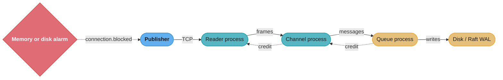

# RabbitMQ Operations

---

## 1. Concept Overview

This is the day-two operations content for RabbitMQ, split out of [`rabbitmq_deep_dive.md`](rabbitmq_deep_dive.md) so that page stays focused on the object model, delivery guarantees, and queue-type mechanics. What follows is the material an operator reaches for once the broker is designed and running: how policies interact with immutable queue arguments, how virtual hosts isolate (and fail to isolate) tenants, how credit-based flow control surfaces a slow downstream as a `flow` connection, how the memory and disk alarms protect the broker from itself, and how to shard a queue once its single Erlang process becomes the ceiling. Read the parent module first — this page assumes its vocabulary (exchanges, bindings, queue types, Raft replication) without re-explaining it.

---

## 2. Intuition

**One-line analogy.** A RabbitMQ node is a shared building: vhosts are locked flats with their own furniture, but every flat shares one water main (memory), one drain (disk), and one fire alarm (resource alarms).

**Mental model.** Every queue is one Erlang process, every setting is either baked in at declare time (an argument) or laid on top at runtime (a policy), and every protective mechanism in the broker works by slowing or stopping publishers so that consumers can drain.

**Why it matters.** The operational failures of a RabbitMQ cluster are rarely crashes. They are silent no-ops: a policy that never applied, a vhost that did not isolate, a `flow` state read as an error, a 50 MB disk limit that turns a slow fill into a hard stop.

**Key insight.** Backpressure is the broker's normal language. `flow`, `connection.blocked`, and a minority side that refuses writes are the broker working as designed; the operator's job is to find what is slow downstream, not to switch the protection off.

---

## 3. Core Principles

- **Queue arguments are immutable; policies are not.** Arguments (`x-message-ttl`, `x-max-length`) are fixed at declare time, and where an argument and a policy set the same key, the argument wins.
- **One policy per queue.** The matching policy with the highest `priority` applies; policies never merge.
- **`x-queue-type` cannot be changed.** Moving a classic queue to quorum is always declare-new, move consumers, move publishers, delete old.
- **One queue is one Erlang process.** A saturated queue is fixed by sharding across more queues, not by adding consumers.
- **Vhosts isolate names and permissions, not resources.** Memory, disk, file descriptors, and alarms are shared.
- **Resource alarms are cluster-wide and block only publishers.** Consumers keep draining, which is how an alarm clears.
- **Flow control is credit-based.** A `flow` connection means something downstream is slower; it is not an error.
- **Metadata needs a Raft majority.** With Khepri as the only metadata store in 4.3, a minority-side node cannot declare a queue, create a vhost, or change a policy.

---

## 4. Types / Architectures / Strategies

**Where a setting can live**

| Surface | Set with | Changes existing queues | Precedence |
|---------|----------|-------------------------|-----------|
| Queue argument | `queueDeclare(..., args)` | No, immutable | Beats a policy for the same key |
| Policy | `rabbitmqctl set_policy` | Yes, at runtime | Highest-`priority` match only |
| Operator policy | `rabbitmqctl set_operator_policy` | Yes, at runtime | Merged into the matching regular policy; limited to a few keys such as `max-length`, `message-ttl`, `expires`, and `delivery-limit` |
| Vhost default queue type | `--default-queue-type` on `add_vhost` / `update_vhost_metadata` | No, new queues only | Applies when the client does not set `x-queue-type` |
| Node config | `rabbitmq.conf` | On restart | Alarms, watermarks, listeners |

**Scaling a hot queue**

| Strategy | Mechanism | Ordering |
|----------|-----------|----------|
| More consumers | Competing consumers on one queue | Lost across consumers |
| `x-consistent-hash` exchange (plugin) | Hash routing key or header, pick a bound queue by weight | Per key |
| `x-modulus-hash` exchange (core since 4.3) | `hash(routing key) mod (number of bindings)` | Per key |
| Separate clusters | Split tenants or workloads across brokers | Per cluster |

---

## 5. Architecture Diagrams

Credit flows backwards along the chain from queue to socket. When the queue process stops granting credit, each upstream process stops in turn, and TCP backpressure reaches the publisher.



The dotted credit edges are the whole flow-control mechanism: a slow disk under a quorum queue shows up first as a `flow` state on the channel, then on the connection. The alarm edge is separate and blunter: it blocks every publishing connection in the cluster.

---

## 6. How It Works — Detailed Mechanics

### 6.1 Policies versus queue arguments, and which one wins

The same setting can be applied two ways, and the difference matters at 3am.

**Queue arguments** (`x-message-ttl`, `x-max-length`, `x-dead-letter-exchange`, …) are set at declare time and are **immutable**. Changing one means deleting and recreating the queue, which means draining it first.

**Policies** match queues by a name pattern and apply settings at runtime, to existing queues, without a redeclare:

```bash
rabbitmqctl set_policy dlx-all "^orders\." \
  '{"dead-letter-exchange":"orders.dlx","max-length":1000000,"overflow":"reject-publish"}' \
  --apply-to queues --priority 10
```

Note the naming: in a policy the key is `dead-letter-exchange`, without the `x-` prefix. Two rules decide the outcome when both exist:

1. **Only one policy applies to a queue** — the matching one with the highest `priority`. Policies do not merge. A second policy that matches the same queue with a lower priority contributes nothing, which is the most common "my policy is not working" cause.
2. **Where a queue argument and a policy set the same thing, the queue argument wins.** So a queue declared with `x-max-length: 1000` ignores a policy setting `max-length: 1000000` forever, silently.

And the setting that cannot be policied at all: **`x-queue-type`**. A queue's type is fixed at declaration. There is no policy, no `rabbitmqctl` command and no management-UI button that converts a classic queue to a quorum queue — the migration is always declare-new, move-consumers, move-publishers, delete-old. Setting `default_queue_type` on a vhost changes what *new* queues get when the client does not specify, which is worth doing on day one and does nothing for what already exists:

```bash
rabbitmqctl update_vhost_metadata / --default-queue-type quorum
```


### 6.2 Sharding a hot queue with a consistent-hash exchange

One queue is one Erlang process. When that process saturates, no number of consumers helps — the ceiling is the queue itself. The fix is to make more queues and route deterministically across them, which the consistent-hash exchange does while preserving per-key ordering:

```bash
rabbitmq-plugins enable rabbitmq_consistent_hash_exchange
```

```java
// The exchange hashes the routing key (or a header, with hash-header) and picks
// a bound queue by weight. Same key -> same queue -> ordering preserved per key.
Map<String, Object> exArgs = Map.of("hash-header", "customer-id");
channel.exchangeDeclare("orders.sharded", "x-consistent-hash", true, false, exArgs);

for (int i = 0; i < 8; i++) {
    Map<String, Object> qArgs = Map.of("x-queue-type", "quorum", "x-delivery-limit", 5);
    channel.queueDeclare("orders.shard." + i, true, false, false, qArgs);
    channel.queueBind("orders.shard." + i, "orders.sharded", "1");  // binding key = weight
}
```

The binding key is a **weight**, not a pattern — `"1"` on every binding means equal distribution, and `"2"` on one gives it twice the share. `x-modulus-hash`, which moved from the sharding plugin into core in 4.3, does the simpler thing: `hash(routing key) mod (number of bindings)`, ignoring weights, which is exactly Kafka's partition arithmetic.

The tradeoff is the one Kafka users already know, and it is worth naming before you build this: you have just introduced a partition count. Changing the number of shards later rehashes keys onto different queues, so in-flight per-key ordering breaks across the change. Pick a shard count with headroom, or accept a drain-and-cut-over migration when you grow.

### 6.3 Virtual hosts, permissions, and multi-tenancy

A vhost is a complete namespace: its own exchanges, queues, bindings, policies, and permissions. Two vhosts can both have an exchange called `orders` and they share nothing but the Erlang node. This is the unit of isolation for multi-tenancy, and for separating environments on one cluster.

```bash
rabbitmqctl add_vhost orders-prod --description "order pipeline" --default-queue-type quorum
rabbitmqctl add_user order-service '...'
rabbitmqctl set_permissions -p orders-prod order-service \
  "^orders\..*"      \
  "^orders\..*"      \
  "^orders\..*"
#  ^configure         ^write            ^read     -- three regexes, in that order
```

The three regexes are `configure` (declare and delete), `write` (publish to, and bind), and `read` (consume from, and bind). They are matched against **resource names**, so `write` on an exchange means "may publish to it" and `read` on a queue means "may consume from it" — which is why a service that only publishes still needs `write` on the exchange *and* nothing else, and a bind operation needs `write` on the destination plus `read` on the source.

Two operational notes. **A vhost is a Khepri-backed metadata object**, so creating one requires a metadata majority — you cannot provision a vhost on the minority side of a partition. And vhosts do not isolate *resources*: two vhosts on one node share the same memory watermark, the same disk, and the same alarm. A noisy tenant in vhost A blocks publishers in vhost B, because alarms are node- and cluster-wide. Real tenant isolation is separate clusters, not separate vhosts.

### 6.4 Flow control: credit between Erlang processes

Inside the broker, a message travels through a chain of Erlang processes — reader, channel, queue — and each link is **credit-based**. A sender starts with a fixed credit allowance, spends one per message, and stops when it runs out; the receiver grants more credit as it catches up. When a queue process cannot keep up, it stops granting credit to the channel, which stops granting credit to the reader, which stops reading from the socket. TCP backpressure does the rest.

The observable symptom is a connection in the **`flow`** state in the management UI or `rabbitmqctl list_connections`. The docs describe this as a connection that "is experiencing blocking and unblocking several times a second, in order to keep the rate of message ingress at one that the rest of the server ... can handle." That is *not* an error and *not* an alarm. It means exactly one thing: **something downstream of this connection is slower than the connection is fast.**

Diagnosing it is a matter of walking the chain: if channels are in flow but queues are not, the bottleneck is the channel process (often too many bindings, or a slow exchange type); if queue processes are the ones withholding credit, the bottleneck is the queue — disk for quorum queues, or a single overloaded queue process for classic ones. The fix for a saturated queue process is almost never "tune it"; it is to shard the work across more queues, because one queue is one Erlang process and that process is your ceiling.

### 6.5 Resource alarms: memory and disk

Two watermarks stop the broker from dying:

| Alarm | Default | Effect |
|-------|---------|--------|
| Memory high watermark | `vm_memory_high_watermark.relative = 0.6` — about **60% of available RAM** | Block all publishing connections cluster-wide |
| Free disk space | `disk_free_limit` = **50 MB** | Block all publishing connections cluster-wide |

Both alarms are **cluster-wide**: one node over the limit blocks publishers on every node. Both block only connections that publish; connections that merely consume keep receiving deliveries, which is the whole point — draining is how the alarm clears.

The 50 MB disk default is not a production value. The documented recommendation is to set `disk_free_limit.absolute` to roughly the amount of RAM installed, on the theory that a node under memory pressure can page that much to disk faster than your monitoring interval:

```ini
# rabbitmq.conf
vm_memory_high_watermark.relative = 0.6      # this is already the default
disk_free_limit.absolute = 32GB              # match installed RAM; 50MB default is far too low
```

The failure mode this prevents is worth stating: at the 50 MB default, a node can go from "healthy" to "disk full, Erlang VM cannot write, node down" inside a single 60-second scrape interval. You do not get an alarm you can act on; you get an outage with an alarm attached.

From the client's point of view, an alarm arrives as `connection.blocked` (AMQP 0-9-1 extension). Register a listener and *do something* with it — most clients let the publish call block on a full TCP buffer, which means a blocked broker turns into a stalled thread pool in your service with no log line to explain it.

```java
connection.addBlockedListener(
    reason -> log.error("PUBLISHER BLOCKED by broker alarm: {}", reason),
    () -> log.warn("publisher unblocked"));
```

---

## 7. Real-World Examples

**Multi-tenant SaaS on one cluster.** Teams give each tenant a vhost with `--default-queue-type quorum` and per-tenant permissions. It works for naming and access control, then fails the first time one tenant's backlog crosses the memory watermark and blocks publishers for every tenant. The usual end state is vhosts for small tenants and a dedicated cluster for any tenant whose traffic can trip an alarm.

**Order pipeline sharded by customer.** A single `orders` quorum queue reaches its per-process ceiling. An `x-consistent-hash` exchange keyed on a `customer-id` header spreads the work across 8 quorum queues while each customer's messages stay ordered. The shard count is chosen with headroom, because changing it rehashes keys.

**Disk alarm during a consumer outage.** A consumer deployment fails, messages back up into quorum queues, and the disk fills. With `disk_free_limit.absolute` set to installed RAM, the alarm fires with tens of gigabytes still free and publishers block while consumers are restored. With the 50 MB default, the node stops before a 60-second scrape can report it.

---

## 8. Tradeoffs

| Choice | Option A | Option B |
|--------|----------|----------|
| Setting a limit | Queue argument: explicit in code, reviewed with the service, but needs a redeclare to change | Policy: changeable at runtime by operators, but silently overridden by any argument on the same key |
| Tenant isolation | Vhost: cheap, one cluster, shared alarms | Separate cluster: real blast-radius isolation, more brokers to run |
| Sharding exchange | `x-consistent-hash`: weighted bindings, needs the plugin | `x-modulus-hash`: in core, equal shares only |
| Disk limit | 50 MB default: no wasted disk, no warning before failure | Installed RAM: disk reserved, time to act before the node stops |
| Alarm handling in clients | Default: publish call blocks on a full TCP buffer | `addBlockedListener`: explicit log and metric, can shed or buffer upstream |

---

## 9. When to Use / When NOT to Use

**Use a policy** for limits that operators tune over time (`max-length`, `message-ttl`, `dead-letter-exchange`) and for applying one setting across a name pattern. **Do not** also set the same key as a queue argument, or the policy is ignored.

**Use a queue argument** for settings that are part of the queue's contract and must never drift, and for `x-queue-type`, which only an argument can set.

**Shard with a hash exchange** when one queue process is saturated and per-key ordering matters. **Do not** shard to fix slow consumers; add consumers or raise prefetch first.

**Use vhosts** for namespaces, environments, and access control. **Do not** use them as the isolation boundary for tenants that can fill memory or disk.

---

## 10. Common Pitfalls

**Pitfall 1: The policy that never applied.** A team set `max-length: 1000000` by policy on `orders.*`, but the queues had been declared with `x-max-length: 1000`. The argument won, the policy did nothing, and messages were dropped at 1,000. Fix: declare without the argument and keep the limit in the policy, then confirm with `rabbitmqctl list_queues name policy effective_policy_definition arguments`.

**Pitfall 2: Two policies on one queue.** A second policy for a TTL matched the same queues at a lower `priority`, and the TTL never applied, because only the highest-priority policy applies. Fix: one policy per queue pattern carrying every key.

**Pitfall 3: The 50 MB disk limit.** A node went from healthy to disk full inside one 60-second scrape interval and stopped. Fix: `disk_free_limit.absolute` set to roughly installed RAM.

**Pitfall 4: Publishers stuck with no log line.** A memory alarm blocked publishing connections, the client's publish call blocked on a full TCP buffer, and the service's thread pool filled with no error. Fix: register `connection.addBlockedListener` and emit a log line and a metric.

**Pitfall 5: Resharding broke ordering.** Growing a consistent-hash topology from 8 to 12 queues moved keys between queues while messages were in flight, and per-customer ordering broke during the change. Fix: pick the shard count with headroom, or drain and cut over.

---

## 11. Technologies & Tools

- `rabbitmqctl`: policies (`set_policy`, `set_operator_policy`), vhosts, users, permissions, `list_queues`, `list_connections`.
- `rabbitmq-diagnostics`: health checks, including `check_if_node_is_quorum_critical` as a rolling-restart gate.
- `rabbitmq-plugins`: enables `rabbitmq_consistent_hash_exchange` and other plugins.
- `rabbitmq_prometheus`: `/metrics` for alerting on alarms, unacked growth, consumer count, and file descriptors.
- `rabbitmq_management`: web UI and HTTP API; shows `flow` and `blocked` connection states.
- `rabbitmq-perf-test`: the official load generator for measuring throughput on your own hardware.
- `rabbitmq_shovel` / `rabbitmq_federation`: moving messages between brokers and clusters.

---

## 12. Interview Questions with Answers

**Q: You set a policy on a queue and nothing changed. What are the two reasons?**
**Short:** A queue argument with the same setting always beats a policy, and only the single highest-priority matching policy applies since policies never merge.

Two independent causes, and both are silent. First, **a queue argument beats a policy** for the same setting: a queue declared with `x-max-length: 1000` ignores a policy setting `max-length: 1000000` forever, and arguments are immutable so the only fix is a redeclare. Second, **only one policy applies to a queue** — the matching one with the highest `priority` — because policies do not merge; a second matching policy at a lower priority contributes nothing at all. Diagnose with `rabbitmqctl list_queues name policy effective_policy_definition arguments`, which shows the applied policy alongside the arguments overriding it. And note the setting no policy can ever change: `x-queue-type` is fixed at declare time, so there is no way to convert a classic queue to a quorum queue in place.

**Q: Do virtual hosts isolate tenants?**
**Short:** They isolate namespaces and permissions, not resources — memory and disk alarms are node-wide, so a noisy tenant blocks publishers everywhere.

Only partly, and the gap is the part that causes incidents. A vhost gives each tenant its own exchanges, queues, bindings, policies and permissions, and two vhosts can both have an exchange called `orders` with no interaction. What a vhost does **not** isolate is resources: every vhost on a node shares the same memory watermark, the same disk, the same file descriptors, and the same alarms — and alarms are cluster-wide, so one tenant filling a queue blocks publishers in every other tenant's vhost. Vhosts are also Khepri-backed metadata objects, so provisioning one requires a metadata majority. Use vhosts for namespacing and access control; if the requirement is genuine blast-radius isolation between tenants, that means separate clusters.

**Q: Why is a four-node RabbitMQ cluster a worse choice than a three-node one?**
**Short:** Raft tolerates failures by majority, so both tolerate exactly one loss — the fourth node adds cost and replication traffic for nothing.

Because Raft availability is decided by majority, and the majority of four is three, exactly as the majority of three is two. Both clusters tolerate exactly one node failure; the four-node cluster costs an extra machine, an extra replica's worth of write traffic if you grow quorum queues onto it, and a marginally slower commit path. Even node counts are strictly dominated. The general rule is to size by how many simultaneous failures you must survive: three nodes for one, five for two, seven for three, and rarely more than that because Raft commit latency grows with the size of the majority you must reach. The same arithmetic applies at the queue level through `x-quorum-initial-group-size`, whose default of 3 is the right answer on almost every cluster.

**Q: Why does one node in the cluster sit at 80 percent CPU while the others idle?**
**Short:** Almost always quorum queue leader concentration — check `queue_leader_locator` and rebalance, since all writes go through the leader.

The most likely cause is leader concentration. Every write to a quorum queue goes through its Raft leader, so if most leaders live on one node, that node absorbs most of the write load while the followers do comparatively little. It happens naturally with `queue_leader_locator = client-local`, which places the leader wherever the declaring client was connected — and deployments tend to connect everything to the same node first. The default in 4.x is `balanced`, which picks the node hosting the fewest queues. Diagnose with `rabbitmq-queues quorum_status <queue>` per queue, or the management UI's node column, and rebalance. The other candidates worth ruling out are the management plugin's statistics aggregation on a large cluster, and a single hot queue whose Erlang process is simply saturated — one queue is one process, and no amount of hardware splits it.

**Q: Your DLQ is filling up with thousands of messages an hour. How do you diagnose it?**
**Short:** Read the `x-death` header first — it names which of the four dead-letter reasons fired, and three of the four are not handler bugs.

Start with the `x-death` header on a sample message, which records the reason, the source queue, the original routing key and a count. That single field distinguishes the four causes, and only one of them is a handler bug: `rejected` means your code called nack with `requeue=false`; `expired` means a TTL you configured elapsed before anyone consumed it; `maxlen` means the source queue hit a length or byte cap; `delivery_limit` means a quorum queue's `x-delivery-limit` was exhausted by repeated redelivery. A sudden DLQ flood is very often `expired` or `maxlen` — a consumer outage plus a TTL, or a producer spike plus a length cap — rather than anything wrong with the handler. Once you know the reason, also check that the DLQ itself has no dead-letter exchange of its own and has a length cap, because a DLX loop is the other way this counter runs away.

**Q: What happens to a RabbitMQ cluster during a network partition in version 4.3?**
**Short:** The minority side simply cannot commit — Khepri and quorum queues are Raft, so the old partition-handling strategies were removed as unnecessary.

Raft decides it, and there is nothing to configure. Metadata lives in Khepri, a Raft store that is the only metadata store as of 4.3, and quorum queues and streams are Raft too — so a minority side has no quorum, cannot commit, and goes read-only or unavailable while the majority keeps serving. The entire `cluster_partition_handling` family (`ignore`, `pause_minority`, `autoheal`, `pause_if_all_down`) existed because Mnesia could accept conflicting writes on both sides and then needed a reconciliation story; Raft cannot, so those strategies were removed. The keys are still accepted in `rabbitmq.conf` and have no effect, and the release notes recommend deleting them. The operational rule that remains is to run an odd node count, keep a majority reachable, and never stretch a cluster across a WAN.

**Q: How does RabbitMQ apply backpressure when the broker cannot keep up?**
**Short:** Credit-based flow control between internal Erlang processes stops the reader from reading the socket, and TCP backpressure does the rest.

Internally through credit. A message passes through a chain of Erlang processes — connection reader, channel, queue — and each link grants the one before it a bounded credit allowance. When a queue process falls behind it stops granting credit to the channel, which stops granting credit to the reader, which stops reading from the socket, at which point TCP backpressure reaches the publisher. The visible symptom is a connection in the `flow` state in the management UI or `rabbitmqctl list_connections`, which is not an error — it means something downstream of that connection is slower than the connection is fast. Diagnose by walking the chain: channels in flow but queues healthy points at the channel process, often too many bindings or an expensive exchange type; queues withholding credit points at disk for quorum queues or at a saturated single queue process, whose only real fix is sharding across more queues.

**Q: What are the memory and disk alarms, and what are their defaults?**
**Short:** Memory at 60% of available RAM and free disk at 50 MB; either one blocks every publishing connection cluster-wide while consumers keep running.

The memory high watermark defaults to `vm_memory_high_watermark.relative = 0.6`, about 60% of available RAM, and the free disk limit defaults to just 50 MB. Crossing either triggers a **cluster-wide** alarm that blocks all publishing connections while leaving consuming connections untouched, which is the point — draining is how the alarm clears. That 50 MB disk default is not a production value: the documented recommendation is `disk_free_limit.absolute` set to roughly the installed RAM, because a node under memory pressure can page that much to disk between two monitoring scrapes and go from healthy to hard-down inside one interval. On the client side an alarm arrives as `connection.blocked`; register a blocked listener and log it, otherwise a blocked broker shows up in your service as threads mysteriously stuck on a socket write with no explanation.

**Q: What is Khepri and why does it matter to an operator?**
**Short:** The Raft-based metadata store that replaced Mnesia — default for new clusters in 4.2, the only option in 4.3, and the reason partition strategies are gone.

Khepri is RabbitMQ's metadata store, holding vhosts, users, exchanges, queues, bindings, policies and feature flags. It became the default for new clusters in 4.2 and the only supported store in 4.3, when Mnesia was removed. Operationally it changes three things. First, metadata now requires an online majority — a minority-side node cannot declare a queue or change a policy. Second, the entire partition-handling-strategy configuration is gone, because Raft makes split-brain impossible rather than recoverable. Third, upgrading is gated: enable the `khepri_db` feature flag deliberately on a healthy 4.2 cluster rather than letting a 4.3 node run the Mnesia-to-Khepri migration during boot, inside your upgrade window, on a node not yet serving traffic.

**Q: What is the correct upgrade path from RabbitMQ 3.13 to 4.3?**
**Short:** Three hops through 4.1 and 4.2 with all feature flags enabled at each stop, and migrating off mirrored queues before leaving 3.13.

Not one jump. RabbitMQ 4.3 can only be upgraded to from 4.2.x, so a realistic path is 3.13.7 to the latest 4.1.x, then to the latest 4.2.x, then to 4.3.x, running `rabbitmqctl enable_feature_flag all` and verifying it at each stop. Before leaving 3.13 you must have migrated off classic mirrored queues, because 4.0 removes them. Before going to 4.3 you must have enabled `rabbitmq_4.2.0`, `khepri_db` and `quorum_queue_non_voters`, and enabling `khepri_db` deliberately on a healthy 4.2 cluster is much safer than letting a booting 4.3 node run the Mnesia-to-Khepri migration for you. Check the Erlang requirement at each hop too: 4.3.6 supports OTP 27.0 through 28.x, while 4.3.3 to 4.3.5 cap at 27.x and run OTP 28 only on brand-new clusters.

**Q: How do you migrate from classic mirrored queues to quorum queues without downtime?**
**Short:** Declare the quorum queues alongside, move consumers first so they drain, then move publishers, then delete the old queues at zero depth.

Run both side by side and cut over in the right order. Declare the new quorum queues with new names and bind them to the same exchange, then move **consumers** first so the new queues start being drained, then move publishers so new traffic lands in the new queues, then wait for the old mirrored queues to reach zero depth and delete them. Moving publishers first would strand messages in a queue nobody is reading. Two behavioural differences catch people mid-migration rather than at planning time: quorum queues reject non-durable, exclusive and server-named declares, so RPC reply queues and per-connection temporary queues have to stay classic; and quorum queues do not support global QoS, so a client library that sets `basic.qos` with `global=true` fails at consume time. Test the declare path and the consume path before the cutover, not the publish path alone.

**Q: How should you monitor RabbitMQ, and what should you alarm on?**
**Short:** Scrape rabbitmq_prometheus, not the management API, and alarm on unacked growth, consumer count zero, alarms firing, and quorum criticality.

Scrape `rabbitmq_prometheus` at `/metrics`, never poll the management plugin's `/api/queues` in a loop — on a large cluster that endpoint's aggregation can dominate broker CPU and has itself caused outages. The signals worth paging on are: any resource alarm active (memory or disk), a queue with zero consumers that is receiving messages, `messages_unacknowledged` growing while `messages_ready` is flat (consumers receiving and not finishing), file-descriptor and socket usage near their limits, and `rabbitmq-diagnostics check_if_node_is_quorum_critical` returning true. Queue depth alone is a poor alarm — a deep queue with healthy drain rate is fine and a shallow one with no consumers is not — so alarm on the *rate of change* and on consumer presence rather than on depth. Wire `check_if_node_is_quorum_critical` into your rolling-restart automation as a gate, because a fixed sleep between restarts is not a health check.

**Q: What is single active consumer and when do you need it?**
**Short:** A queue setting that lets only one registered consumer receive at a time, with automatic failover — it buys strict ordering with a hot standby.

`x-single-active-consumer` allows many consumers to register on a queue but delivers to only one at a time; when that one disconnects or is cancelled, another takes over automatically. You need it whenever strict processing order matters more than parallelism, because competing consumers are precisely what breaks FIFO. It gives you ordering plus a hot standby, without the failover gap you would get by running literally one consumer. On streams and super streams it does more work: it coordinates a named consumer group so exactly one consumer is active per partition, which is what makes super-stream ordering usable. The cost is obvious and should be stated when you choose it — throughput is capped at one consumer, so if the queue backs up, adding consumers does nothing by design.

**Q: How do you get a throughput number you can actually trust for RabbitMQ?**
**Short:** Run rabbitmq-perf-test on your own hardware with your own message size, queue type, ack mode and prefetch — published numbers without conditions are meaningless.

Measure it yourself with `rabbitmq-perf-test`, the official load generator, because a RabbitMQ throughput figure is meaningless without its conditions. The variables that move the number by an order of magnitude are message size, queue type, persistence, whether publisher confirms are on, whether consumers ack manually, prefetch, and the number of queues involved. For an anchor: RabbitMQ's documentation cites a quorum queue sustaining 30,000 msg/s with 1 KB messages while replicating to all three nodes of a cluster — durable, replicated, confirmed, on one queue. Treat vendor comparisons especially carefully; the widely-quoted Confluent OpenMessaging result of 605 MB/s Kafka against 38 MB/s RabbitMQ was run against **mirrored classic queues**, a queue type that no longer exists in any supported release.

**Q: What is the difference between Shovel and Federation?**
**Short:** A Shovel is a broker-side client moving messages point-to-point; Federation links exchanges or queues and propagates bindings so only wanted messages cross.

A Shovel is a broker-hosted AMQP client: it consumes from a source queue on one broker and republishes to an exchange on another, with its own acks and reconnection logic. It is a directional pipe you configure explicitly, which makes it right for draining a DLQ into a central cluster, migrating a queue during a cutover, or bridging a legacy broker; 4.2 added a "local" protocol for efficient intra-cluster moves. Federation links exchanges or queues across brokers and **propagates the topology** — a federated exchange recreates upstream bindings so only messages someone downstream actually wants cross the link. Rule of thumb: Shovel when you know both endpoints and the direction, Federation when you want the bindings to decide what crosses. Both are also the correct answer to cross-region, in place of stretching one Raft cluster across a WAN.

---

## 13. Best Practices

- Keep tunable limits in policies and keep the same keys out of queue arguments.
- Use one policy per queue pattern, and verify with `effective_policy_definition`.
- Set `default_queue_type` to `quorum` on every new vhost.
- Set `disk_free_limit.absolute` to roughly installed RAM; leave `vm_memory_high_watermark.relative` at 0.6 unless measured otherwise.
- Register a blocked listener on every publishing connection.
- Read a `flow` connection as a pointer to the slow downstream stage, and walk reader, channel, queue, disk.
- Shard a saturated queue with a hash exchange, and size the shard count with headroom.
- Use separate clusters, not vhosts, when tenants need resource isolation.
- Alarm on resource alarms, consumer count zero, and unacked growth, from `rabbitmq_prometheus`.

---

## 14. Case Study

**Scenario.** An order service publishes to one quorum queue, `orders`, at a rising rate. Operators set a policy for `max-length` and a dead-letter exchange, but the dashboard shows messages dropped at 1,000, a connection stuck in `flow`, and one publisher pod with a full thread pool.

**Diagnosis.** `rabbitmqctl list_queues name policy effective_policy_definition arguments` shows `x-max-length: 1000` as an argument, so the policy's `max-length` never applied. The `flow` state sits on the queue process, which is at its per-process ceiling. The stuck pod is waiting on a TCP write during a short memory alarm, with no blocked listener.

**Broken.** The limit lives in code, where no policy can change it:

```java
Map<String, Object> args = Map.of("x-queue-type", "quorum", "x-max-length", 1000);
channel.queueDeclare("orders", true, false, false, args);
```

**Fix.** Declare only what must never change, shard across 8 queues, and move limits to a policy:

```java
Map<String, Object> exArgs = Map.of("hash-header", "customer-id");
channel.exchangeDeclare("orders.sharded", "x-consistent-hash", true, false, exArgs);
for (int i = 0; i < 8; i++) {
    channel.queueDeclare("orders.shard." + i, true, false, false, Map.of("x-queue-type", "quorum"));
    channel.queueBind("orders.shard." + i, "orders.sharded", "1");
}
connection.addBlockedListener(
    reason -> log.error("publisher blocked: {}", reason),
    () -> log.warn("publisher unblocked"));
```

```bash
rabbitmqctl set_policy orders-limits "^orders\.shard\." \
  '{"max-length":1000000,"overflow":"reject-publish","dead-letter-exchange":"orders.dlx"}' \
  --apply-to queues --priority 10
```

**Result.** The policy applies to all 8 shards, per-customer ordering holds, the `flow` state clears as load spreads over 8 queue processes, and a memory alarm now shows up as a log line and a metric instead of a silent stall.
