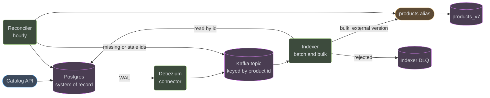
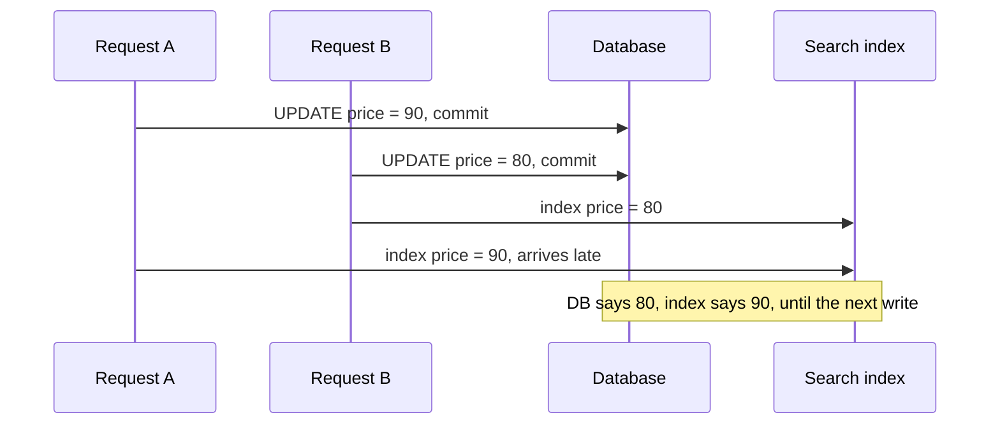
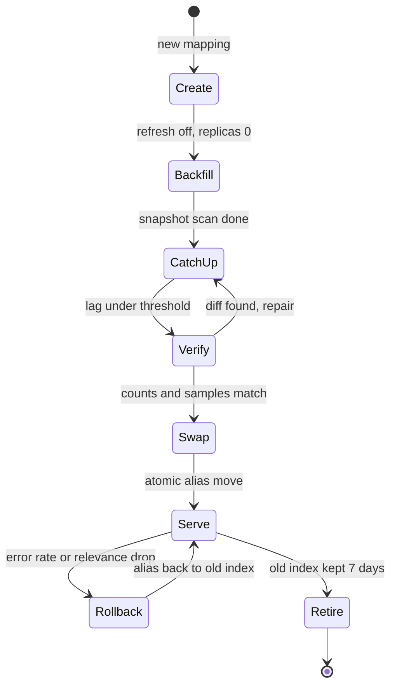
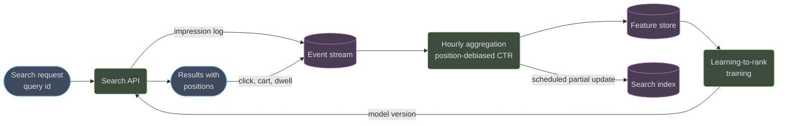

# Search Integration Patterns

> **Facts checked 2026-11-25.** Elasticsearch defaults (`index.refresh_interval` 1s, `index.search.idle.after` 30s, `index.gc_deletes` 60s, `index.max_result_window` 10,000, `index.mapping.total_fields.limit` 1,000, external versioning, `refresh=wait_for`, atomic `_aliases`) come from the Elasticsearch reference at elastic.co. The Debezium event `op` codes come from the Debezium PostgreSQL connector reference; the newest Debezium release on debezium.io on that date was 3.7.1.Final. Capacity figures in the worked examples are labelled as assumptions.

A search index is a second copy of your data that you shaped for one job: finding things. This module is about the backend engineering that keeps that copy correct. It covers how changes travel from the database to the index, how you rebuild the index without downtime, how you hide indexing lag from users, and how user behaviour flows back into ranking.

---

## 1. Concept Overview

Every product that has a search box has two stores. The **system of record** (Postgres, MySQL, DynamoDB) owns the truth and enforces constraints. The **search index** (Elasticsearch, OpenSearch, Solr, Typesense, Meilisearch, Algolia, Vespa) holds a denormalized projection of that truth, built so that a query like `"red running shoes" size:10 price<100` returns ranked results in tens of milliseconds. Nothing in the index is authoritative. Every field in it is a function of rows in the system of record, and the index can be thrown away and rebuilt from those rows.

That framing turns "search integration" into a classic derived-data problem with four questions:

1. **Propagation.** How does a committed write in the database reach the index? Dual write, transactional outbox, change data capture (CDC), or periodic batch rebuild.
2. **Ordering and idempotency.** Updates arrive late, twice, and out of order. How does the indexer guarantee the index converges on the latest version and never regresses?
3. **Rebuild.** Mappings change, analyzers change, a bug corrupts documents. How do you build a new index from scratch while the old one serves traffic, then cut over atomically?
4. **Consistency UX.** The index is seconds behind the database. What does the user who just edited a listing see when they search for it?

A fifth question closes the loop: **ranking feedback**. Clicks, add-to-carts and dwell time are signals that improve ranking, and getting them back into the index (or into a learning-to-rank model) is also a pipeline with its own failure modes.

**Boundary with other pages.** The inverted index, analyzers, BM25 and the ILM lifecycle are taught in [Search Engines](../../database/search_engines/search_engines.md). Lucene segments, refresh, translog, merges and per-shard scoring are taught in [Elasticsearch Internals](../../database/elasticsearch_internals/elasticsearch_internals.md). Cluster topology, query fan-out, typeahead versus full-text and system-level search architecture belong to [Search Systems](../../hld/search_systems/search_systems.md). Retrieval theory, NDCG and learning-to-rank models belong to [Information Retrieval and Search](../../ml/information_retrieval_and_search/information_retrieval_and_search.md). This page owns the backend plumbing between your service and the index: the sync pipeline, the reindex runbook and the API contract.

> **See also:** [Design a Search-Backed Catalog API](../case_studies/design_search_backed_catalog_api/design_search_backed_catalog_api.md) for the end-to-end catalogue search service.

---

## 2. Intuition

> **One-line analogy:** The database is the library's accession ledger. The search index is the card catalogue. Librarians write the ledger first, and a clerk keeps the catalogue in step. If the clerk files cards in the wrong order, the catalogue points at shelves that no longer hold the book.

**Mental model:** treat the index as a **materialized view that you maintain by hand**. A database materialized view is refreshed by the engine, inside its own transaction model. A search index is refreshed by your code, across a network, with no shared transaction. Everything in this module is a technique to recover the guarantees a real materialized view would have given you for free: atomic visibility, ordering, and a full rebuild path.

**Why it matters:** search bugs are silent. A missing document does not throw an exception. It just never appears in results, and nobody files a ticket for a product they never saw. Teams discover index drift months later, when a seller asks why their listing gets zero views.

**Key insight:** the only safe source of ordering is the database. Timestamps from application servers, Kafka arrival order and HTTP response order all lie. A monotonically increasing version taken from the row itself (a `version` column, or the log position of the change) is the one number that tells the index which write is newer.

---

## 3. Core Principles

- **The index is rebuildable.** If you cannot rebuild the whole index from the system of record with one command, you have made the index a second source of truth. Every design decision should keep the rebuild path alive and tested.
- **Never write the index in the request path as the only propagation channel.** A dual write (database commit, then index call) loses updates whenever the process dies between the two calls, and it races when two requests update the same row. Propagate from a durable log of committed changes instead.
- **Order by a version that comes from the database.** Use Elasticsearch external versioning (`version_type=external`) with a version the database assigns. The index then rejects stale writes for you.
- **Deletes are writes too.** A delete must carry a version and must survive reordering. Elasticsearch keeps a deleted document's version only for `index.gc_deletes` (60s default), so a stale index operation that arrives later than that can resurrect the deleted document.
- **Clients talk to aliases, never to concrete indices.** The alias is the indirection that makes zero-downtime reindexing and rollback a metadata operation.
- **Choose read-your-writes deliberately.** Most search traffic tolerates one or two seconds of lag. The few flows that do not (the editor who just saved a listing) get a targeted fix, not a cluster-wide `refresh=true`.
- **Search returns identifiers; the database returns truth.** For anything where staleness has a cost (price, stock, permissions), hydrate the final page of hits from the system of record or a cache in front of it.
- **Measure drift.** A reconciliation job that compares the database and the index is the only way to know the pipeline is correct.

---

## 4. Types / Architectures / Strategies

### 4.1 Propagation strategies

| Strategy | How the change reaches the index | Lost-update risk | Ordering | Operational cost |
|---|---|---|---|---|
| Synchronous dual write | Service commits to the DB, then calls the index API in the same request | High: crash between the two calls loses the index write; index failure either fails the request or silently drops | Request completion order, which races | Lowest to build, highest to debug |
| Async dual write | Service commits, then publishes an event to a broker | High: crash after commit and before publish loses the event | Broker order, not commit order | Low |
| Transactional outbox | Service writes the row and an outbox row in one DB transaction; a relay publishes the outbox | None for committed writes | Commit order per aggregate, if the relay preserves it | Medium: outbox table, relay, cleanup |
| Log-based CDC | A connector (Debezium) reads the WAL or binlog and publishes every committed row change | None for committed writes | Log order, partitioned by key | Medium to high: connector, Kafka, schema handling |
| Notify and re-read | The event carries only the entity id; the indexer reads the current row and indexes it | None if the event is durable | Irrelevant: the indexer always writes the latest state | Extra DB read per change |
| Periodic batch rebuild | A job scans the DB and rebuilds the index every N hours | Updates lag by up to N hours | Snapshot order | Cheapest when freshness does not matter |

Most production systems combine two of these: CDC or outbox for steady-state freshness, plus a batch rebuild for repair and for mapping changes. Outbox and CDC mechanics are taught in [Messaging Patterns](../messaging_patterns/messaging_patterns.md) and [Distributed Transactions and Consistency](../distributed_transactions_and_consistency/distributed_transactions_and_consistency.md). The CDC connector itself is taught in [Debezium Change Data Capture](../../technologies/debezium_change_data_capture/debezium_change_data_capture.md).

### 4.2 Event payload shapes

| Shape | Event carries | Indexer work | Main risk |
|---|---|---|---|
| Full row image | Every column after the change (Debezium `after`) | Map columns to the document | Out-of-order events, solved with external versioning |
| Changed fields only | A patch | Partial update | A lost patch leaves the document permanently wrong until the next full rebuild |
| Id only | `{"type":"product","id":42}` | Read the current row, build the document | Read load on the DB; a lagging replica can return an older row |

The id-only shape is the most forgiving. It makes ordering irrelevant, because the indexer always reads the newest committed state. Its cost is one database read per event, which you can batch (`WHERE id = ANY(?)`) and point at a replica if you accept replica lag.

### 4.3 Document shaping and denormalization fan-out

A search document is usually a join: a product plus its brand name, category path, seller rating and current price. Denormalization creates **fan-out**: renaming one category touches every product in it.

| Join source | Cardinality | Strategy |
|---|---|---|
| Owned columns (title, description) | 1 row to 1 doc | Index directly from the row change |
| Small parent (brand, category) | 1 parent to many docs | On parent change, enqueue affected doc ids into a rate-limited backfill queue |
| Fast-moving counters (views, stock) | Changes every second | Keep out of the document, or aggregate and write on a schedule; never one index write per counter change |
| Per-user data (wishlist, permissions) | Many users to 1 doc | Do not denormalize per user; filter at query time with access-list fields or in the service |

### 4.4 Reindex strategies

| Strategy | When | Downtime | Cost |
|---|---|---|---|
| `_update_by_query` in place | Add a field derived from existing `_source` | None | Rewrites every doc; cannot change field types |
| Elasticsearch `_reindex` into a new index, then alias swap | Mapping or analyzer change, data already complete in `_source` | None | Cluster-internal, cheap on the application |
| Rebuild from the system of record into a new index, then alias swap | Document shaping changed, or the old index is suspected corrupt | None | Full DB scan plus catch-up from the change stream |

The third strategy is the only one that repairs drift, because the first two copy whatever the old index already holds, including its bugs.

### 4.5 Consistency UX options

| Option | Mechanism | Cost | Use for |
|---|---|---|---|
| Accept lag | Default 1s refresh plus pipeline lag | None | Browse and search by other users |
| `refresh=wait_for` on the index write | Indexer write blocks until the next scheduled refresh includes it | Indexer latency up to the refresh interval | Synchronous indexing paths, admin tools |
| Client-side overlay | The UI merges the just-saved entity into the result list | Frontend logic | "My listings" after an edit |
| Database query for owner views | Owner-scoped lists query the DB, not the index | DB load for a small, indexed query | Dashboards where the result set is small |
| Pending badge | Show "processing, appears in search shortly" | Product copy | Marketplace listing creation |

---

## 5. Architecture Diagrams

### 5.1 CDC-based sync pipeline



The database is the only writer of truth. Kafka keys by product id, so every change for one product lands on one partition and keeps log order. The reconciler re-enqueues ids it finds missing or stale, so the same indexer code path repairs drift.

### 5.2 The dual-write race



Two requests commit in order A then B, but their index calls complete in order B then A. Nothing in the dual-write design detects this. The index stays wrong until the next write to that product.

### 5.3 External versioning makes reordering harmless

```
 time ->        t1            t2            t3            t4
 DB commits     v=17 price 90 v=18 price 80
 events arrive                              v=18 (80)     v=17 (90)  <- late duplicate
 index action                               write v18     REJECT: 17 <= 18 (409 conflict)
 index state    v16           v16           v18 price 80  v18 price 80   converged

 delete case
 DB commits     v=19 DELETE
 events arrive  v=19 delete   ... 70 s pass (gc_deletes 60s expired) ...   v=18 (80)
 index state    tombstone v19                                              doc v18 REBORN
```

Caption: external versioning turns an out-of-order write into a harmless 409 conflict, because the index compares the incoming version with the stored one. The bottom row is the exception: a delete's version is kept only for `index.gc_deletes` (60s default), so a stale write delayed past that window recreates a deleted document.

### 5.4 Zero-downtime rebuild lifecycle



Every arrow before `Swap` happens on an index no user queries. The only user-visible step is the alias move, and it is reversible with one more alias move.

### 5.5 Ranking feedback loop



Clicks never write the index directly. They are aggregated first, so one viral product produces one scheduled update per hour, not ten thousand partial updates per minute.

---

## 6. How It Works — Detailed Mechanics

### 6.1 A version column the database owns

The index needs a number that increases with every committed change to a row. Do not use `updated_at`: two transactions in the same millisecond tie, and clock steps on the application host can move it backwards. Use a counter the database increments inside the same statement.

```sql
CREATE TABLE product (
    id          bigint PRIMARY KEY,
    seller_id   bigint      NOT NULL,
    title       text        NOT NULL,
    price_cents bigint      NOT NULL CHECK (price_cents >= 0),
    category_id bigint      NOT NULL,
    status      text        NOT NULL DEFAULT 'active',
    version     bigint      NOT NULL DEFAULT 1,
    deleted_at  timestamptz
);

-- Every write bumps version in the same statement, so the version and the data commit together.
UPDATE product
SET    price_cents = 8000,
       version     = version + 1
WHERE  id = 42
RETURNING version;
```

Soft deletes (`deleted_at`) are easier to index than hard deletes, because the delete is just another versioned row change. If you must hard-delete, the CDC delete event still carries the `before` image, and the indexer can use the last known version plus one.

### 6.2 The transactional outbox variant

If you do not run CDC, write an outbox row in the same transaction. The relay publishes rows in sequence order and deletes them after acknowledgement.

```sql
CREATE TABLE search_outbox (
    seq         bigserial PRIMARY KEY,
    entity_type text   NOT NULL,
    entity_id   bigint NOT NULL,
    version     bigint NOT NULL,
    created_at  timestamptz NOT NULL DEFAULT now()
);

BEGIN;
UPDATE product SET price_cents = 8000, version = version + 1 WHERE id = 42;
INSERT INTO search_outbox (entity_type, entity_id, version)
SELECT 'product', id, version FROM product WHERE id = 42;
COMMIT;
```

The outbox row carries only the id and the version. The indexer re-reads the row (section 6.4), so the outbox stays small and the event never contains stale data.

### 6.3 Debezium change events

A Debezium change event has a `before` image, an `after` image, a `source` block with the connector position, and an `op` field. The documented `op` values are `c` (create), `u` (update), `d` (delete), `r` (read, snapshot only), `t` (truncate) and `m` (message).

```json
{
  "before": { "id": 42, "price_cents": 9000, "version": 17 },
  "after":  { "id": 42, "price_cents": 8000, "version": 18 },
  "source": { "connector": "postgresql", "table": "product", "lsn": 245781203 },
  "op": "u",
  "ts_ms": 1764062400123
}
```

The record key is the primary key, so Kafka partitions by product id and keeps per-product order. Ordering across products is not preserved, and the indexer must not need it.

The `r` events are the trap: a snapshot emits a read event for every existing row, and if the snapshot runs while live updates also stream, a snapshot read of version 17 can arrive after the live update to version 18. External versioning absorbs this, which is one more reason to use it.

### 6.4 The indexer: batch, re-read, bulk with external versions

```java
import java.util.*;

// Event from Kafka: either an outbox row or a Debezium key. Only the id matters.
record ChangeEvent(long productId, long kafkaOffset) {}

// Current state from the system of record. deleted == true means index a delete.
record ProductRow(long id, String title, long priceCents, String categoryPath,
                  String status, long version, boolean deleted) {}

sealed interface BulkOp permits IndexOp, DeleteOp {}
record IndexOp(String index, long id, long version, Map<String, Object> doc) implements BulkOp {}
record DeleteOp(String index, long id, long version) implements BulkOp {}

enum ItemResult { OK, VERSION_CONFLICT, RETRYABLE, PERMANENT }

interface ProductRepository { Map<Long, ProductRow> loadByIds(Collection<Long> ids); }
interface SearchBulkClient { List<ItemResult> bulk(List<BulkOp> ops); }
interface DeadLetter { void send(long productId, String reason); }

final class ProductIndexer {
    private static final String ALIAS = "products";        // write alias, never a concrete index
    private final ProductRepository repo;
    private final SearchBulkClient search;
    private final DeadLetter dlq;

    ProductIndexer(ProductRepository repo, SearchBulkClient search, DeadLetter dlq) {
        this.repo = repo; this.search = search; this.dlq = dlq;
    }

    /** Process one poll of up to 500 events. Returns ids to retry. */
    List<Long> handle(List<ChangeEvent> batch) {
        // 1. Collapse duplicates: 500 events for 120 distinct products -> 120 reads, 120 writes.
        List<Long> ids = batch.stream().map(ChangeEvent::productId).distinct().toList();

        // 2. Re-read current state. Ordering of events no longer matters.
        Map<Long, ProductRow> rows = repo.loadByIds(ids);

        List<BulkOp> ops = new ArrayList<>(ids.size());
        for (long id : ids) {
            ProductRow r = rows.get(id);
            if (r == null) continue;  // hard-deleted and purged: the reconciler handles it
            if (r.deleted() || !"active".equals(r.status())) {
                ops.add(new DeleteOp(ALIAS, id, r.version()));
            } else {
                ops.add(new IndexOp(ALIAS, id, r.version(), Map.of(
                        "title", r.title(),
                        "price_cents", r.priceCents(),
                        "category_path", r.categoryPath(),
                        "version", r.version())));
            }
        }
        if (ops.isEmpty()) return List.of();

        // 3. One bulk request. Each item carries version_type=external.
        List<ItemResult> results = search.bulk(ops);
        List<Long> retry = new ArrayList<>();
        for (int i = 0; i < ops.size(); i++) {
            long id = switch (ops.get(i)) {
                case IndexOp op -> op.id();
                case DeleteOp op -> op.id();
            };
            switch (results.get(i)) {
                case OK, VERSION_CONFLICT -> { }   // conflict = index already newer: success
                case RETRYABLE -> retry.add(id);   // 429 or 503: back off and retry
                case PERMANENT -> dlq.send(id, "mapping or validation failure");
            }
        }
        return retry;  // commit Kafka offsets only after the retry list is empty or parked
    }
}
```

The bulk body the client sends for that batch looks like this. `version_type: external` tells Elasticsearch to accept the write only if the supplied version is greater than the stored one.

```json
{ "index":  { "_index": "products", "_id": "42", "version": 18, "version_type": "external" } }
{ "title": "Trail runner", "price_cents": 8000, "category_path": "shoes/running", "version": 18 }
{ "delete": { "_index": "products", "_id": "77", "version": 5, "version_type": "external" } }
```

Three details carry the correctness:

- **A version conflict is success.** It means the index already holds a newer version. Treat it as an ack, or the consumer will retry it forever.
- **Commit the Kafka offset after the bulk response,** not before. A crash between the two replays the batch, which is harmless because every write is versioned.
- **Write through the alias.** During a rebuild you point a second consumer at the new index (section 6.6) without touching this code.

### 6.5 Denormalization fan-out

When a category is renamed, every product in it needs a new `category_path`. Do not do this inside the indexer's hot loop.

```sql
-- Small categories: the rename bumps every affected product's version in the same
-- transaction, so the regular pipeline treats each product as changed.
BEGIN;
UPDATE category SET name = 'Trail running' WHERE id = 310;
UPDATE product  SET version = version + 1 WHERE category_id = 310;
COMMIT;
```

For a category with 2,000 products this is fine. For 2 million it is a long transaction that bloats the WAL and floods the change stream. The alternative is a separate fan-out job: commit the rename alone, then walk `product WHERE category_id = 310` in keyset pages of 1,000, bump versions per page in short transactions, and throttle to a fixed rate (for example 2,000 products per second, an assumption you tune against indexer capacity). At that rate 2 million products take about 17 minutes, which is the honest staleness window for a large rename.

### 6.6 Zero-downtime rebuild with an alias swap

The runbook below rebuilds from the system of record, which also repairs drift. Assumptions for the arithmetic: 40 million products, indexer throughput 20,000 documents per second during backfill.

1. **Create** `products_v8` with the new mapping, `number_of_replicas: 0` and `refresh_interval: -1`. Both settings cut write cost during the bulk load.
2. **Record the change-stream position** (Kafka offsets of the indexer topic) before the scan starts. Everything after this point will be replayed.
3. **Start a second consumer group** that reads from the recorded offsets and writes to `products_v8` only. Keep the first consumer group writing to `products_v7`. Both indices now receive live changes.
4. **Backfill**: scan the table in keyset order (`WHERE id > ? ORDER BY id LIMIT 5000`) and bulk-index into `products_v8` with external versions. 40,000,000 / 20,000 = 2,000 s, about 33 minutes. External versioning makes the scan and the live stream safe to interleave in any order.
5. **Restore** `number_of_replicas: 1` and an explicit `refresh_interval: 1s`, then wait for green.
6. **Verify**: compare total counts, compare per-bucket checksums (section 6.8), and replay a sample of production queries against both indices to compare top-10 overlap.
7. **Swap** the alias atomically:

```json
POST /_aliases
{
  "actions": [
    { "remove": { "index": "products_v7", "alias": "products" } },
    { "add":    { "index": "products_v8", "alias": "products", "is_write_index": true } }
  ]
}
```

8. **Keep** `products_v7` and its consumer running for a rollback window (7 days is a common choice). Rollback is the same `_aliases` call in reverse.

Elasticsearch performs all actions in one `_aliases` request as a single atomic operation, so no query ever sees an alias with zero indices or with both.

### 6.7 Read-your-writes

Elasticsearch makes new writes searchable at each refresh, and `index.refresh_interval` defaults to 1s (5s on Elastic Cloud Serverless). If the setting is never set explicitly, a shard that has received no search for `index.search.idle.after` (30s) stops background refreshes until the next search arrives, so the first query after a quiet period pays for the refresh. Set the interval explicitly on any index where latency matters.

Options for a user who must see their own write, in order of preference:

| Technique | What it does | When it breaks |
|---|---|---|
| Owner views from the DB | "My listings" is a DB query on `seller_id` | Rarely, for small per-owner sets |
| Client overlay | The client inserts the saved entity into the visible list | Filters and sort order can disagree with the server |
| Indexer `refresh=wait_for` | The indexer's bulk call returns only after a refresh includes it; the API waits on an "indexed" event | Adds up to 1s to the indexer per batch; batch writes together |
| `refresh=true` per write | Forces a refresh | Creates one tiny segment per write; merge storms at volume |

Elasticsearch's own guidance is to never start several `refresh=wait_for` requests in a row and to batch them into one bulk request instead.

### 6.8 Drift detection and reconciliation

The pipeline will drift: a DLQ that nobody drains, a mapping rejection, a connector restart that skipped a range. The reconciler catches it.

```sql
-- Bucket the id space into 4,096 buckets and compute a checksum per bucket.
SELECT  id % 4096                                                  AS bucket,
        count(*)                                                   AS n,
        sum(hashtextextended(id::text || ':' || version::text, 0)) AS checksum
FROM    product
WHERE   deleted_at IS NULL AND status = 'active'
GROUP BY 1;
```

The same aggregation runs in the index: store `bucket` and a precomputed `row_hash` on each document at index time, then run a `terms` aggregation on `bucket` with a `sum` of `row_hash`. Only buckets whose count or checksum differ get an id-level diff, and only the differing ids are re-enqueued through the normal pipeline. For 40 million products this turns a full comparison into 4,096 numbers plus a handful of bucket scans.

### 6.9 Ranking feedback

Relevance improves when you learn from behaviour. The pipeline:

1. The search API assigns a `query_id` and logs an **impression** event: query text, filters, the ordered result ids and their positions, the ranking model version.
2. The client logs **interactions** against the `query_id`: click with position, add-to-cart, purchase, dwell time.
3. An hourly job joins impressions to interactions and computes **position-debiased** click-through. Raw CTR at position 1 is inflated simply because users click position 1 most; dividing by an estimated per-position examination rate (from randomized interleaving or a click model) removes most of that bias.
4. Aggregates feed two consumers: a **feature store** for learning-to-rank training, and a **scheduled partial update** that writes slow-moving popularity fields (for example a 30-day purchase count) into the documents.

Two rules keep this from hurting the index. First, never write per-click updates to the index: one popular document would receive thousands of updates per minute, each creating a new Lucene document version and merge work. Second, version the ranking model and log the version with every impression, so a relevance regression can be traced to a model release.

### 6.10 The query API contract

- **Pagination:** `from + size` is capped by `index.max_result_window` (10,000 default). Expose cursor pagination built on `search_after` with a point-in-time, not page numbers past a few hundred.
- **Hydration:** return ids and highlight fragments from the index, then hydrate price, stock and availability from the database or its cache. A price shown from a 2-second-stale index is a support ticket; a price checked at hydration is not.
- **Security trimming:** filter by tenant and permission inside the query (a `filter` clause on `tenant_id` and an access-list field), and add the tenant filter in the service layer so no caller can omit it.
- **Mapping discipline:** set `dynamic: strict` on indices fed by evolving schemas. Elasticsearch then rejects documents with unknown fields instead of creating them; the default `index.mapping.total_fields.limit` is 1,000 fields, and a free-form attribute map can hit it within days.

---

## 7. Real-World Examples

**Marketplace catalog.** A listings service on Postgres with Debezium feeding Kafka and an Elasticsearch cluster is the textbook shape: per-listing ordering by Kafka key, external versions from a row counter, an alias per locale, and a nightly reconciler. The repo's [E-commerce Catalog case study](../../database/case_studies/design_ecommerce_catalog/design_ecommerce_catalog.md) shows the storage side of this design.

**Post search for a social product.** Posts are written at high rate and edited rarely, and privacy changes (a post moved from public to friends) must disappear from search quickly. The id-only event shape fits: a privacy change is just another change event, and the indexer re-reads the post with its current audience before deciding to index or delete. Query-time filtering by audience covers the seconds of lag.

**SaaS ticket search.** Multi-tenant ticketing systems need security trimming more than freshness. Each document carries `tenant_id` and an access list; the service adds both filters. Large tenants get their own index behind a per-tenant alias, which keeps a noisy tenant's reindex from affecting others. See [Multi-Tenancy and Isolation](../multi_tenancy_and_isolation/multi_tenancy_and_isolation.md).

**Kafka Connect sink connectors.** Elasticsearch sink connectors for Kafka Connect exist, and they work for append-mostly data. They do not know your version column, your soft-delete convention or your fan-out rules, which is why teams that start with a generic sink often replace it with a small custom indexer once updates and deletes dominate.

---

## 8. Tradeoffs

### 8.1 CDC versus transactional outbox

| Dimension | Log-based CDC | Transactional outbox |
|---|---|---|
| Application changes | None; reads the WAL | Every write path must insert the outbox row |
| Event schema | Table schema leaks into consumers | Designed event contract |
| Captures writes from scripts and migrations | Yes | Only if they also write the outbox |
| Operational dependency | Connector, replication slot, Kafka | Relay job and table cleanup |
| Failure that hurts most | An unconsumed replication slot retaining WAL until the disk fills | A relay that stops, so the outbox table grows |

### 8.2 Full row image versus id only

| Dimension | Full row image | Id only, re-read |
|---|---|---|
| DB load from the indexer | None | One batched read per poll |
| Correct under reordering | Only with external versions | Always |
| Joins for denormalization | Must be in the event or fetched anyway | Done in the re-read query |
| Replica lag risk | None | Re-read from a lagging replica can index an older version; external versions make it harmless but late |

### 8.3 Freshness versus indexing cost

| `refresh_interval` | Visibility | Segment and merge cost | Fit |
|---|---|---|---|
| `1s` explicit | About 1s | Highest | Product search, user-facing edits |
| `5s` to `30s` | Seconds | Lower | Logs, analytics, catalog browse |
| `-1` during backfill | None until re-enabled | Lowest | Rebuilds into a fresh index |

### 8.4 Reindex in place versus rebuild from source

| Dimension | `_reindex` from the old index | Rebuild from the system of record |
|---|---|---|
| Speed | Fast, cluster-internal | Bounded by DB scan and indexer throughput |
| Repairs drift | No, copies the old index's errors | Yes |
| Requires `_source` | Yes | No |
| Load on the database | None | Full table scan |

---

## 9. When to Use / When NOT to Use

**Use a separate search index when:**

- Queries need relevance ranking, typo tolerance, stemming, synonyms or facets across many fields.
- The read pattern is free text plus many optional filters, which no small set of B-tree indexes serves.
- Search traffic would compete with transactional traffic on the primary database.

**Do not add one when:**

- The dataset is small and the queries are simple. Postgres full-text search (`tsvector`, GIN index) plus trigram indexes covers many admin and internal tools without a second store, a sync pipeline and a reconciler.
- The feature needs exact, transactional reads (an account balance, an order status). Query the system of record.
- Nobody will own the pipeline. An unowned search index drifts, and a drifting index is worse than a slower database query because it is silently wrong.

**Pick the propagation strategy by need:**

- CDC when many services and scripts write the tables, and you want every committed change captured.
- Outbox when you own every write path and want a designed event contract.
- Batch rebuild alone when hours of staleness are acceptable, for example a nightly-updated document archive.

---

## 10. Common Pitfalls

**Dual write left listings with stale prices.** A listings service updated Postgres and then called Elasticsearch in the same request. Under a price-update burst from a repricing tool, concurrent requests for the same listing finished their index calls out of order. Nothing failed, so nothing alerted. The drift surfaced weeks later when a reconciler was finally built.

```java
// BROKEN: dual write in the request path. Two concurrent updates can land in the
// index in the opposite order of their commits, and a crash between the calls loses one.
@Transactional
public void updatePrice(long id, long priceCents) {
    repo.updatePrice(id, priceCents);                                // commit happens at method exit
    search.index("products", id, Map.of("price_cents", priceCents));  // runs BEFORE the commit
}
```

```java
// FIX: commit the row and an outbox entry together. The indexer re-reads the row
// and writes with version_type=external, so order and crashes no longer matter.
@Transactional
public void updatePrice(long id, long priceCents) {
    long version = repo.updatePriceReturningVersion(id, priceCents);  // version = version + 1
    outbox.insert("product", id, version);                            // same transaction
}
```

The broken version has a second bug that is easy to miss: inside a `@Transactional` method the index call runs before the database commit, so a rollback after the index call leaves the index ahead of the database.

**Deleted products came back.** An indexer retried a failed bulk batch with exponential backoff that could reach 5 minutes. A product was deleted (version 19) in the meantime. When the retried batch finally wrote version 18, the delete's tombstone had already expired after `index.gc_deletes` (60s), so the stale write created the document again. Fix: soft-delete in the database and index `status: deleted` as a normal versioned document that queries filter out, or re-read the row before every retry so a retry never writes stale data.

**`refresh=true` on every write melted the cluster.** A team chased read-your-writes by adding `?refresh=true` to every index call. At 3,000 writes per second each refresh produced a tiny segment, merges fell behind, and search latency rose with the segment count. Fix: remove it, set an explicit 1s interval, and solve read-your-writes for the one flow that needed it with a DB-backed "my listings" page.

**Unbounded fields from user attributes.** Sellers could add free-form attributes, and the index used dynamic mapping. Each new attribute name became a new field, the index hit the 1,000 field limit, and from then on every document with a new attribute was rejected into the DLQ. Fix: `dynamic: strict` plus a `flattened` or nested key/value representation for open-ended attributes.

**The reindex lost two hours of updates.** A rebuild scanned the table, then swapped the alias, but nobody had replayed changes made during the 2-hour scan. Fix: record the change-stream position before the scan and replay from it into the new index until lag is near zero (section 6.6, steps 2 and 3).

**A replication slot filled the primary's disk.** The CDC connector stopped during an incident, and its Postgres replication slot kept retaining WAL. Fix: alert on slot lag in bytes, and set `max_slot_wal_keep_size` so a dead consumer is cut off before the primary runs out of disk. The slot mechanics are in the Debezium page linked in section 4.1.

---

## 11. Technologies & Tools

| Tool | Purpose |
|---|---|
| Elasticsearch | Distributed search engine on Lucene; external versioning, aliases, `_reindex`, point-in-time and `search_after` |
| OpenSearch | Apache-2.0 fork of Elasticsearch 7.10.2 with the same alias, bulk and versioning model |
| Apache Solr | Lucene-based search server; collection aliases support the same swap pattern |
| Typesense | Typo-tolerant search engine with collection aliases, aimed at product and site search |
| Meilisearch | Search engine with an index-swap operation for zero-downtime reindexing |
| Algolia | Hosted search API; reindexing builds a temporary index and moves it over the live one |
| Vespa | Search and ranking engine with first-class ranking expressions and learned models |
| Debezium | Log-based CDC connectors for Postgres, MySQL, SQL Server, MongoDB and others, built on Kafka Connect |
| Apache Kafka | Durable, keyed change stream between the connector and the indexer |
| PostgreSQL full-text search | `tsvector` and GIN indexes for search without a second store |

---

## 12. Interview Questions with Answers

**Q: Why is writing to the database and then to the search index in the same request a bad sync strategy?**
**Short:** A crash between the two writes loses the index update, and concurrent requests can apply index writes in a different order than their commits.

The two writes share no transaction, so any failure between them (process crash, index timeout, deploy) leaves the index behind with no record that it needs repair. Even without failures, two requests that update the same row can commit in order A, B and complete their index calls in order B, A, leaving the index on the older value. Inside a framework-managed transaction the index call often runs before the commit, so a rollback leaves the index ahead of the database. Propagate from a durable log of committed changes (outbox or CDC) instead.

**Q: How do you stop an out-of-order update from overwriting a newer document in Elasticsearch?**
**Short:** Index with version_type=external and a version the database assigns, so Elasticsearch rejects any write whose version is not greater than the stored one.

With external versioning the index stores the version you supply and accepts a new write only when its version is higher; a stale write returns a 409 version conflict. The version must come from the database (a counter bumped in the same `UPDATE`, or the change's log position), because application timestamps tie and can move backwards. The indexer must treat a version conflict as success, since it means the index already holds a newer copy.

**Q: Can a deleted document come back even with external versioning?**
**Short:** Yes: Elasticsearch keeps a delete's version only for index.gc_deletes (60s default), so a stale write arriving later recreates the document.

After a versioned delete, the record that remembers the delete's version is garbage-collected after `index.gc_deletes`. A delayed retry or a slow consumer that writes an older version after that window finds nothing to compare against and indexes the document as new. The robust fix is to soft-delete: index the deleted state as a normal versioned document with `status: deleted` and filter it out at query time, or re-read the current row before every retry so the indexer never writes stale data.

**Q: What does the id-only event shape buy you over sending the full row?**
**Short:** The indexer re-reads the current row for each id, so event order and duplicates stop mattering; the cost is one batched database read per poll.

When the event says only "product 42 changed", the indexer loads the latest committed row and indexes that. Reordered or duplicated events all converge on the same final state, and denormalized fields come from the same join query. Batch the reads with `WHERE id = ANY(?)` and collapse duplicate ids within a poll; reading from a lagging replica is safe only if writes still carry external versions, because the replica may return an older version.

**Q: How do you change an index mapping without downtime?**
**Short:** Build a new index behind the scenes, backfill it, replay live changes into it, verify it, then move the alias atomically and keep the old index for rollback.

Clients query an alias, never a concrete index. Create `products_v8` with the new mapping, replicas 0 and refresh disabled; record the change-stream position; start a second consumer that writes live changes to v8; backfill from the database with external versions; restore replicas and refresh; compare counts, checksums and sampled query results; then run one `_aliases` request that removes v7 and adds v8. Elasticsearch applies the actions in that request atomically, and rollback is the reverse call.

**Q: Why record the change-stream offset before starting a backfill scan?**
**Short:** Rows the scan already copied can change minutes later, so every change from the scan's start must be replayed into the new index.

A keyset scan of 40 million rows takes tens of minutes. A row the scan already copied can change a minute later, and only the change stream knows. Starting a consumer from the offset recorded before the scan guarantees every later change also reaches the new index. External versioning makes the scan and the replay safe to interleave in any order.

**Q: A user edits their listing and immediately searches for it but cannot find the change. What are the options?**
**Short:** Serve owner views from the database, overlay the saved entity on the client, or have the indexer use refresh=wait_for; avoid refresh=true on every write.

Search visibility waits for a refresh (1s by default) plus pipeline lag. The cheapest fix is to stop using search for owner-scoped lists and query the database by owner id. When the flow must use search, the indexer can write with `refresh=wait_for` and publish an "indexed" event the API waits on. Forcing `refresh=true` on every write creates a tiny segment per write and degrades the whole cluster.

**Q: Why should the search API hydrate prices and stock from the database instead of the index?**
**Short:** The index lags by seconds and has no transactional guarantee, so values that are costly when wrong must come from the system of record at response time.

The index is good at finding and ranking candidates. A price from a stale document can show a customer a price the checkout will not honour, and an in-stock flag can be wrong for the seconds of lag. Fetch the final page of 20 to 50 ids from the database or its cache, and use the index only for retrieval, filtering, facets and ordering. Keep a coarse copy in the index for filters like `price < 100`, and accept that the filter boundary is approximate.

**Q: How do you detect that the index has drifted from the database?**
**Short:** Run a reconciler that compares per-bucket counts and checksums of (id, version) in both stores, then re-enqueues only the ids in differing buckets.

Hash the id space into a few thousand buckets and compute a count and a sum of per-row hashes in both stores. Equal buckets are skipped; unequal buckets get an id-level comparison, and the missing or stale ids go back into the normal indexing pipeline. This keeps a 40-million-row comparison down to a few thousand numbers plus targeted scans, and it exercises the same code path the pipeline uses.

**Q: A category rename has to update two million search documents. How do you do it safely?**
**Short:** Commit the rename alone, then bump affected product versions in small keyset-paged transactions at a throttled rate so the regular indexer re-reads them.

One `UPDATE` over two million rows holds a long transaction, bloats the WAL and floods the change stream at once. A fan-out job that pages through `category_id = 310` in pages of 1,000, bumps versions per page and runs at a fixed rate keeps the indexer within capacity. At an assumed 2,000 documents per second the rename takes about 17 minutes, which is the staleness window to state to the product team.

**Q: Why not write click counts into the search document on every click?**
**Short:** Each update rewrites the whole Lucene document, so per-click writes on popular items create merge load and contention; aggregate signals and write them on a schedule.

Lucene documents are immutable: an update is a delete plus a new document in a new segment. A trending product receiving thousands of clicks per minute would generate the same number of document rewrites, all on one hot document. Aggregate interactions hourly, debias them by position, and write slow-moving popularity fields as a scheduled partial update. Fast signals belong in the ranking model's feature store, not in the index.

**Q: What is position bias, and why does it matter for ranking feedback?**
**Short:** Users click higher positions more regardless of relevance, so raw click-through overrates whatever the current ranker already put on top.

If you train on raw clicks, the model learns to keep the current top results on top, a feedback loop that hides better documents ranked lower. Estimate how often users examine each position (from randomized interleaving or a click model) and divide observed clicks by that rate. Also log the model version with each impression so you can attribute relevance changes to releases.

**Q: Why must callers never be able to omit the tenant filter in a multi-tenant search API?**
**Short:** The index holds every tenant's documents, so a missing filter leaks data; the service layer must add tenant and permission filters to every query.

A search index has no row-level security tied to your application users. The service must build every query with a `filter` clause on `tenant_id` and on an access-list field, and callers must not be able to pass raw query DSL that bypasses it. For large or regulated tenants, a separate index per tenant behind a per-tenant alias gives stronger isolation.

**Q: When is a separate search engine the wrong choice?**
**Short:** When data is small, queries are simple or transactional, or nobody owns the sync pipeline; Postgres full-text and trigram indexes often suffice.

A second store adds a CDC or outbox pipeline, an indexer, a reconciler and a rebuild runbook. For internal tools and small catalogs, `tsvector` with a GIN index plus `pg_trgm` for fuzzy matching answers most queries in the same transaction as the data. Reach for a search engine when you need relevance tuning, facets across many fields, typo tolerance at scale, or isolation of search load from the primary.

**Q: What breaks when an indexer commits Kafka offsets before the bulk request succeeds?**
**Short:** A crash after the commit and before the write loses those changes permanently, because the consumer restarts past them.

The safe order is poll, write, inspect per-item results, then commit. Committing first converts a crash into silent data loss. Committing after the write converts a crash into a replay, which external versioning makes harmless. Per-item bulk failures need the same care: retry 429 and 503 items, send mapping rejections to a DLQ, and only commit when the batch is fully resolved.

**Q: Why use Kafka keys equal to the entity id in a CDC search pipeline?**
**Short:** Kafka preserves order only within a partition, so keying by entity id keeps every change to one document in commit order on one partition.

With random partitioning, two changes to product 42 can land on different partitions and be consumed in either order by different consumer instances. Keying by id puts them on one partition, which one consumer reads in order. Cross-entity order is still not guaranteed, so the indexer must never depend on it, and external versioning remains the backstop for snapshot events and retries.

**Q: Why does an unconsumed CDC replication slot threaten the primary database?**
**Short:** Postgres keeps WAL for a slot until the consumer confirms it, so a stopped connector makes WAL grow until the disk fills.

A logical replication slot guarantees the consumer can resume where it stopped, which means the primary cannot recycle WAL past the slot's confirmed position. If the connector is down for a day during a write-heavy period, WAL accumulates on the primary's disk. Alert on slot lag in bytes, and set `max_slot_wal_keep_size` so Postgres invalidates the slot rather than filling the disk; then rebuild the index from a fresh snapshot.

**Q: Why is deep pagination with from and size a problem, and what replaces it?**
**Short:** Each shard must return from + size hits for merging, so cost grows with depth; max_result_window caps it at 10,000 and search_after replaces it.

To return page 500 of 20 results, every shard sorts and returns its top 10,000 hits to the coordinator, which merges and discards all but 20. Elasticsearch caps `from + size` with `index.max_result_window` (10,000 by default) for that reason. Use `search_after` on a stable sort key with a point-in-time for consistent cursors, and design the product so nobody needs page 500.

---

## 13. Best Practices

- Keep a single command that rebuilds the index from the system of record, and run it on a schedule in a staging environment so it never rots.
- Give every searchable table a database-owned `version` column, and index with `version_type=external`.
- Soft-delete searchable entities, or index deletion as a versioned status, so `index.gc_deletes` cannot resurrect documents.
- Propagate with CDC or an outbox; never with a request-path dual write as the only channel.
- Key the change stream by entity id, collapse duplicate ids per poll, and size bulk requests by bytes (a few megabytes) rather than by document count.
- Treat version conflicts as success and commit offsets only after a batch is fully resolved.
- Query and write through aliases; keep the previous index for a rollback window after every swap.
- Set `refresh_interval` explicitly, use `dynamic: strict`, and cap field counts for open-ended attributes.
- Hydrate prices, stock and permissions from the system of record at response time.
- Run a reconciler, and alert on DLQ depth, indexer lag in seconds and replication slot lag in bytes.
- Aggregate behaviour signals before they touch the index, debias them by position, and log the ranking model version with every impression.

---

## 14. Case Study

**Scenario.** A second-hand marketplace has 40 million active listings in Postgres, about 1,500 listing writes per second at peak (assumption), and Elasticsearch behind a `listings` alias. Sellers complain that edits take "forever" to appear, and support has a backlog of "my listing does not show up in search" tickets.

**Diagnosis.** The team measures before redesigning:

- The listings service dual-writes: `UPDATE` then an index call. Index timeouts are logged and dropped.
- A one-off comparison script finds 1.9% of listings missing from the index and 0.7% with a stale price (illustrative figures for this scenario).
- Sellers' "my listings" page queries Elasticsearch, so a seller sees their old title for up to a few seconds after saving, and forever if the index write was dropped.
- Indexing uses `refresh=true` on every write to "fix" the delay, and the cluster has hundreds of small segments per shard during peaks.

**Broken code at the centre of it.**

```java
// BROKEN: request-path dual write, refresh=true, errors swallowed.
public void saveListing(Listing l) {
    listingRepo.save(l);                                         // commits
    try {
        search.index("listings", l.id(), toDoc(l), /* refresh */ true);
    } catch (Exception e) {
        log.warn("index failed for {}", l.id());                 // listing silently missing
    }
}
```

**Redesign.**

1. Add `version bigint` to `listing`, bumped in every `UPDATE`.
2. Write an outbox row (`entity_id`, `version`) in the same transaction as each listing change; the relay publishes to a Kafka topic keyed by listing id.
3. A new indexer consumes in batches of 500, collapses duplicate ids, re-reads rows in one query, and bulk-writes with `version_type=external`. Deletes become `status: removed` documents that queries filter out.
4. The seller's "my listings" page moves to a Postgres query on `seller_id` (an indexed lookup returning at most a few hundred rows). Public search keeps a 1s refresh.
5. `refresh=true` is removed; `refresh_interval: 1s` is set explicitly.
6. A reconciler compares 4,096 buckets of (id, version) checksums every hour and re-enqueues the differences.
7. The whole index is rebuilt once with the alias-swap runbook, which repairs the existing drift.

```java
// FIX: the request path only commits. Indexing is asynchronous, ordered and idempotent.
@Transactional
public void saveListing(Listing l) {
    long version = listingRepo.saveReturningVersion(l);   // version = version + 1
    outboxRepo.insert("listing", l.id(), version);         // same commit
}
// The indexer from section 6.4 consumes the outbox topic, re-reads, and bulk-writes
// with version_type=external. A 409 conflict is treated as an ack.
```

**Capacity arithmetic (assumptions).** 1,500 writes per second at peak; batching 500 events per poll with roughly 30% duplicate ids yields about 1,050 document writes per second. Each bulk request of 350 documents at about 2 KB each is about 700 KB, a comfortable bulk size. The rebuild at 20,000 documents per second takes about 33 minutes for 40 million listings.

**Outcome to verify, not assume.** After the change the team tracks three numbers: reconciler drift (target: zero buckets differing after re-enqueue), indexer lag p99 in seconds, and the share of "missing listing" support tickets. The design makes the first number measurable for the first time, which is the real win: a search index you can prove correct.

**Related reading.** [Webhooks and Event Delivery](../webhooks_and_event_delivery/webhooks_and_event_delivery.md) uses the same outbox-plus-relay backbone for a different consumer. [Kafka Deep Dive](../kafka_deep_dive/kafka_deep_dive.md) covers consumer offsets and partitioning. [Polyglot Persistence Patterns](../../database/polyglot_persistence_patterns/polyglot_persistence_patterns.md) places this pipeline among other derived stores.
