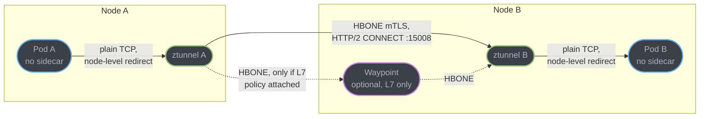
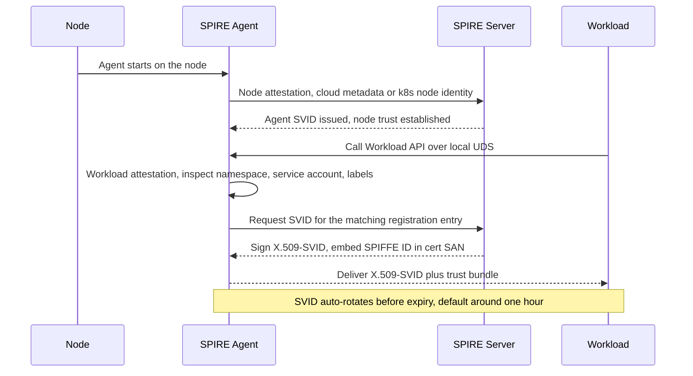
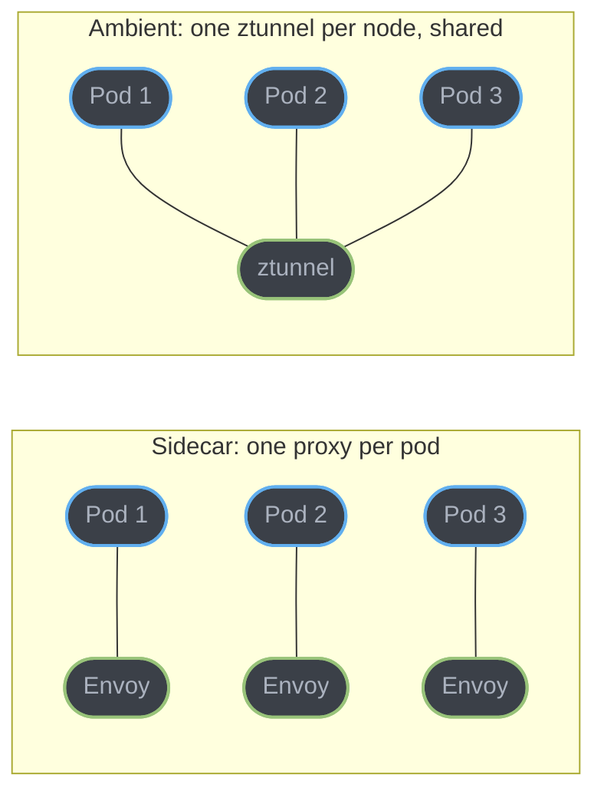

# Ambient Mesh and Workload Identity

Sidecar mode answers "how do I mesh a service" with one proxy per pod. Ambient mode and the identity layer underneath it answer a sharper question: what is the smallest amount of infrastructure that gets you mTLS and verifiable workload identity everywhere, with L7 traffic management purchased separately, only where it is needed? This sub-file goes under the hood of Istio's ambient data plane, the SPIFFE/SPIRE identity standard it builds on, and the two adjacent approaches — Cilium's eBPF dataplane and the Gateway API's GAMMA extension — that solve overlapping pieces of the same problem differently.

---

## 1. Concept Overview

Ambient mode splits the sidecar's two jobs — L4 transport security and L7 traffic management — into two independently deployed, independently scaled proxies. A per-node **ztunnel** handles mTLS, L4 authorization, and telemetry for every pod on its node, with no proxy running inside any pod. An optional per-namespace or per-service-account **waypoint** — a full Envoy, the same binary sidecar mode uses — sits in front of workloads that need HTTP-aware routing, retries, header-based rules, or L7 authorization. A namespace gets mTLS the moment it is labeled for ambient; it gets L7 only when a waypoint is deployed for it. Underneath both modes, and independently of Istio, **SPIFFE** defines what a workload identity actually is — a URI, not a hostname or an IP — and **SPIRE** is the reference implementation that issues and rotates the short-lived certificates carrying that identity. Cilium's own mesh takes a related but distinct path: eBPF replaces ztunnel's L4 job inside the kernel, and a shared per-node Envoy stands in for the waypoint when L7 is required.

---

## 2. Intuition

A sidecar is a bodyguard assigned to one person: it never leaves their side, but you pay a full salary per person, and if the bodyguard has a bad day only that one person is affected. Ztunnel is a building's security desk: one desk covers every resident on the floor, cheaper per resident, but if the desk goes dark the whole floor loses coverage at once — not just one apartment. SPIFFE is the ID card that desk checks: a URI, not a name, that any building in the same trust network can verify without ever calling this building to ask "is this really them."

---

## 3. Core Principles

- **L4 and L7 are separately purchasable.** mTLS and basic authorization are the default the moment a namespace joins ambient; HTTP-level routing, retries, and L7 policy cost a waypoint deployment and only apply where one exists.
- **Identity is a URI, not a network location.** A SPIFFE ID (`spiffe://trust-domain/ns/foo/sa/bar`) names *what* a workload is, so it survives pod restarts, IP churn, and even a move to a different cluster under the same trust domain.
- **Short-lived credentials replace long-lived secrets.** SVIDs default to roughly a one-hour lifetime and rotate automatically over a local API; nothing is baked into an image or mounted as a static file with a multi-month expiry.
- **Attestation, not registration by a human.** A workload proves what it is by what it *is* — its namespace, service account, process attributes — not by presenting a secret someone handed it.
- **Shared infrastructure means shared fate.** A per-node proxy is cheaper per pod than a per-pod proxy, and it also means a bad day for that proxy is a bad day for every pod on the node, not one.

---

## 4. Types / Architectures / Strategies

**Istio ambient mode components**:
- `ztunnel`: one per node, Rust, L3/L4 only — mTLS, L4 authorization, telemetry. No HTTP parsing.
- `waypoint`: optional, one per namespace or per service account, full Envoy — HTTP routing, retries, timeouts, L7 `AuthorizationPolicy` conditions (method, path, header, JWT claims).
- `istiod`: unchanged — the same control plane that pushes xDS to sidecars pushes it to ztunnel and waypoints.
- `istio-cni`: the node agent that sets up traffic capture for both sidecar and ambient pods; in ambient it is the *only* thing that touches iptables, not a per-pod init container.

**Workload identity approaches**:
- **Istio's built-in CA**: issues SPIFFE-shaped X.509 identities (`spiffe://cluster.local/ns/x/sa/y`) out of the box, scoped to one mesh, using Kubernetes namespace and service account as the attestation source.
- **SPIRE as Istio's CA**: Istio can point at a SPIRE deployment's Workload API socket instead of its built-in CA, trading Istio's simpler out-of-box setup for SPIRE's richer attestation plugins and multi-cluster/multi-platform federation.
- **Cilium's native mTLS**: SPIFFE identities derived from Cilium's own security identities, issued and rotated by a dedicated SPIRE server, currently a Beta feature.

**Sidecar-free dataplanes compared**:
- **Istio ambient**: kernel-agnostic (works on any CNI plugin's networking), userspace ztunnel does L4, separate waypoint does L7.
- **Cilium mesh**: requires Cilium as the CNI, L3/L4 policy and load balancing run in-kernel via eBPF with zero userspace proxy hop, L7 falls back to a shared per-node Envoy only when a policy needs it.

**Kubernetes Gateway API in a mesh (GAMMA)**:
- North-south (ingress): `HTTPRoute.parentRefs` points at a `Gateway`.
- East-west (mesh, GAMMA): the same `HTTPRoute` kind points its `parentRefs` at a Kubernetes `Service` instead, letting a mesh's own controller (Istio, in ambient or sidecar mode) reconcile routing rules for traffic between services in the cluster using the identical resource app teams already write for ingress.

---

## 5. Architecture Diagrams

**Ambient data path — L4-only versus L4+L7**



Every hop between nodes is mTLS-encrypted HBONE by default. The waypoint hop is dashed because it only exists in the path when a service has opted into L7 — most traffic in an ambient mesh never leaves the solid-line ztunnel-to-ztunnel path.

**SPIRE attestation and SVID issuance**



Node attestation happens once, when the agent starts. Workload attestation happens on every request to the Workload API, and it is based entirely on inspecting the calling process — the workload never presents a secret to prove who it is.

**Proxy topology: sidecar vs ambient**



The proxy count drops from one-per-pod to one-per-node, which is exactly why the resource numbers in the parent module's §10 tilt so far in ambient's favor — and exactly why a ztunnel restart is a node-wide event rather than a single-pod one (§8). The per-pod and per-node cost figures themselves live in [`service_mesh_and_service_discovery`](service_mesh_and_service_discovery.md) §10 and are not repeated here.

---

## 6. How It Works — Detailed Mechanics

### 6.1 Traffic redirection without a per-pod init container

Sidecar mode's `istio-init` container runs inside every pod, once, before the app container starts, installing iptables rules that redirect that pod's own traffic to its own sidecar. Ambient mode moves this work to a single node-level agent, `istio-cni`. A chained CNI plugin notifies `istio-cni` whenever a new pod is created; `istio-cni` then enters that pod's network namespace from the host and installs `TPROXY` rules for inbound traffic and `REDIRECT` rules for outbound traffic, both aimed at the node's ztunnel. Iptables rules still exist inside the pod's namespace — ambient does not eliminate iptables — but they are installed by one long-running node agent instead of a fresh init container per pod, and ztunnel then opens a listening socket inside that namespace over a Unix domain socket handshake with `istio-cni` to actually receive the redirected traffic.

### 6.2 HBONE: the tunnel between ztunnels

**HBONE** (HTTP-Based Overlay Network Encapsulation) is Istio's name for tunneling raw TCP bytes inside an HTTP/2 CONNECT stream, secured with mTLS, on a fixed port: **15008**. Ztunnel-to-ztunnel traffic, and the two extra hops when a waypoint is in the path, all speak HBONE. HTTP/2 multiplexing is the reason this is efficient at node scale: a single ztunnel can multiplex traffic for every pod on its node to a given remote node over one long-lived HBONE connection, rather than opening a new TCP connection per pod pair.

### 6.3 Turning on mTLS with a namespace label

```yaml
apiVersion: v1
kind: Namespace
metadata:
  name: checkout
  labels:
    istio.io/dataplane-mode: ambient
```

Labeling the namespace does not retroactively touch pods that already have a sidecar injected — those keep their existing sidecar until they are redeployed. For a namespace with no prior injection, every new pod is captured by the local ztunnel as soon as it starts, with mTLS enforced between it and every other ambient or sidecar workload in the mesh, and zero waypoints required.

### 6.4 Adding L7 with a waypoint

```yaml
apiVersion: gateway.networking.k8s.io/v1
kind: Gateway
metadata:
  name: checkout-waypoint
  namespace: checkout
  labels:
    istio.io/waypoint-for: service
spec:
  gatewayClassName: istio-waypoint
  listeners:
  - name: mesh
    port: 15008
    protocol: HBONE
---
apiVersion: v1
kind: Namespace
metadata:
  name: checkout
  labels:
    istio.io/dataplane-mode: ambient
    istio.io/use-waypoint: checkout-waypoint
```

A waypoint is itself a standard Kubernetes `Gateway` object using the Gateway API resource kind (§6.9), not an Istio-specific CRD — the same GatewayClass mechanism that underlies the modern proxy field in [`gateway_api_and_modern_proxies`](../api_gateway_patterns/gateway_api_and_modern_proxies.md) is reused here. `istio.io/waypoint-for: service` scopes it to Service-level traffic; `all` would also cover pod-to-pod traffic that bypasses a Service.

### 6.5 SPIFFE identity anatomy

A SPIFFE ID is a URI: `spiffe://<trust-domain>/ns/<namespace>/sa/<service-account>` is the shape Istio and Kubernetes-flavored SPIRE deployments use, though SPIFFE itself only requires a trust domain and an opaque path. Two SVID formats carry it:

- **X.509-SVID** — an X.509 certificate with the SPIFFE ID embedded as a URI in the SAN field, used directly for mTLS. This is the default and the recommended choice for service-to-service calls.
- **JWT-SVID** — a JWT signed by the SPIRE server, used only where mTLS cannot reach: traffic that must pass through an intermediary that terminates TLS and cannot forward a client certificate, such as some API gateways.

### 6.6 Registering a workload with SPIRE

```bash
spire-server entry create \
  -spiffeID spiffe://example.org/ns/checkout/sa/order-service \
  -parentID spiffe://example.org/spire/agent/k8s_psat/prod-cluster/<agent-id> \
  -selector k8s:ns:checkout \
  -selector k8s:sa:order-service
```

The `-selector` flags are the workload attestation rule: any process the agent finds running in namespace `checkout` under service account `order-service` gets this SPIFFE ID, with no secret ever handed to the workload to claim it. **Federation** extends this across trust domains: two SPIRE deployments — say, one per cloud, or one per cluster — exchange trust bundles so a workload in trust domain A can validate an X.509-SVID minted by trust domain B, which is what makes a single identity plane span a multi-cluster or multi-cloud fleet without every workload sharing one flat CA.

### 6.7 AuthorizationPolicy on a SPIFFE principal

```yaml
apiVersion: security.istio.io/v1
kind: AuthorizationPolicy
metadata:
  name: allow-checkout-from-cart
  namespace: checkout
spec:
  selector:
    matchLabels:
      app: order-service
  action: ALLOW
  rules:
  - from:
    - source:
        principals:
        - "cluster.local/ns/cart/sa/cart-service"
```

`principals` is exactly a SPIFFE ID with the `spiffe://` scheme stripped. Ztunnel can evaluate this rule with no waypoint present, because it is L4-only: it checks the mTLS peer's identity and nothing about the HTTP request. The moment a rule adds an L7 condition — a `to.operation.methods` or `paths` clause — the story changes; see the pitfall in §10.

### 6.8 Cilium's dataplane: eBPF for L3/L4, shared Envoy for L7

Cilium's mesh has no per-pod proxy at all by default. L3/L4 policy enforcement, load balancing, and connection tracking run entirely in-kernel via eBPF — the traffic never leaves kernel space for those decisions. When a policy needs L7 visibility (HTTP header inspection, gRPC-aware routing), Cilium routes the connection through **one Envoy instance per node**, shared across every pod on that node — architecturally similar to a waypoint in spirit, but always co-located per-node rather than deployed separately per namespace. Cilium's own mTLS feature (Beta) issues workload identities as SPIFFE IDs derived from Cilium's security-identity model, backed by a dedicated SPIRE server — so a Cilium mesh and an Istio ambient mesh can, in principle, share the same identity standard even though their dataplanes are built differently.

### 6.9 GAMMA: HTTPRoute for east-west traffic

```yaml
apiVersion: gateway.networking.k8s.io/v1
kind: HTTPRoute
metadata:
  name: order-service-mesh-route
  namespace: checkout
spec:
  parentRefs:
  - name: order-service        # a Service, not a Gateway
    kind: Service
    group: ""
  rules:
  - matches:
    - path:
        value: /v2
    backendRefs:
    - name: order-service-v2
      port: 8080
```

The only structural difference from an ingress `HTTPRoute` is the `parentRefs` target: a `Service` instead of a `Gateway`. A mesh controller that implements GAMMA — Istio does, in both sidecar and ambient mode — watches for `HTTPRoute`s parented to its own Services and applies the same matching, filtering, and weighted-backend semantics east-west that the [Gateway API deep-dive](../api_gateway_patterns/gateway_api_and_modern_proxies.md) covers north-south.

---

## 7. Real-World Examples

- **Google Cloud Service Mesh** offers ambient mode as a managed configuration of Istio, so teams adopt ztunnel and waypoints without operating `istiod` themselves.
- **Salesforce** is a long-standing Envoy and Istio contributor and runs its own large-scale service mesh, Hyperforce, built on that stack — the kind of organization the sidecar-vs-ambient resource tradeoff in the parent module's §10 was written for.
- **Airbnb** runs Istio at scale in sidecar mode across its infrastructure and has evaluated ambient as a lower-overhead deployment model — a concrete illustration that "ambient exists" and "we have migrated to it" are two different facts, and that sidecar mode staying supported (§9) is not a hypothetical concern for large adopters.
- **Bloomberg, Square, and Uber** are named SPIFFE/SPIRE adopters and contributors, using workload identity to secure service-to-service traffic across infrastructure that spans more than one Kubernetes cluster — exactly the scenario in §6.6 where trust-domain federation matters most.

---

## 8. Tradeoffs

| Dimension | Sidecar | Ambient (ztunnel + waypoint) |
|---|---|---|
| Failure blast radius | One pod loses its proxy | One node's ztunnel restart affects every pod on that node |
| Per-workload resource accounting | Exact — sidecar CPU/RAM is charged to the pod | Amortized across the node — no clean per-pod attribution |
| L7 policy without extra infra | Always available | Requires deploying a waypoint |
| Extending with EnvoyFilter | Well-trodden, per-pod | Only applies where a waypoint exists; ztunnel has no filter-chain extensibility |
| Certificate rotation | Per-pod SDS stream | Centralized at the node (ztunnel) or via SPIRE's Workload API |
| Mixed-mode operation | N/A | Sidecar and ambient namespaces coexist in one mesh; sidecar-to-waypoint interop still has gaps |

---

## 9. When to Use / When NOT to Use

**Use ambient mode when**: the goal is mesh-wide mTLS and identity with minimal resource overhead, most services need no L7 policy, and the team is comfortable debugging a shared node-level component rather than a per-pod one.

**Use sidecar mode when**: workloads already lean on `EnvoyFilter` customizations, per-pod resource isolation and chargeback matter, or the mesh needs L7 policy on effectively every service — at that point a waypoint in front of everything approaches sidecar's footprint without its per-pod isolation.

**Use SPIRE instead of Istio's built-in CA when**: identity must span more than one mesh, more than one cluster in different trust domains, or non-Kubernetes workloads — VMs, bare metal — that Istio's own attestation cannot see.

**Do NOT** treat ambient as a drop-in replacement during migration without auditing existing `AuthorizationPolicy` and `EnvoyFilter` resources first — see §10.

---

## 10. Common Pitfalls

**An L7 AuthorizationPolicy migrated verbatim from sidecar mode causes an outage, not a silent gap.** A policy allowing traffic based on an HTTP method or path was fully enforceable under sidecar mode, where every pod's own Envoy could see the request. Move the same namespace to ambient without deploying a waypoint, and ztunnel — which is L4-only — cannot evaluate that condition. Istio's documented behavior here is **fail-closed**: any policy carrying an L7 condition and enforced by a ztunnel becomes an implicit `DENY`, blocking one hundred percent of the traffic that policy touches, correct client identity or not. This is the opposite of a silent security hole, but it is still a full outage sprung by a migration nobody tested against — the fix is either to attach the policy directly to a waypoint via `targetRef`, or to deploy a waypoint for the namespace before flipping any L7-bearing policy over.

**Sidecar mode is not deprecated — treating it as legacy misdirects a migration plan.** Istio's own documentation describes sidecar mode as stable and battle-tested, including features like multi-cluster support that ambient does not yet fully match. The correct framing is that ambient is the lower-overhead *default recommendation for new deployments*, and sidecar remains a fully supported mode with an active roadmap closing specific feature gaps — not a mode on its way out.

**A ztunnel restart or crash is a node-wide event, not a pod-wide one.** Under sidecar mode, one pod's Envoy crashing degrades that pod alone. Under ambient, every pod on the affected node loses its L4 mTLS and telemetry path simultaneously until ztunnel recovers — size ztunnel's resource requests and its `PodDisruptionBudget` with that blast radius in mind, not with the assumption that a per-node component fails as rarely as a per-pod one is forgiving.

**Per-pod cost attribution disappears.** A platform team that used sidecar CPU/RAM requests to charge back mesh overhead to individual teams loses that signal in ambient — ztunnel's cost is amortized across every pod on the node, with no built-in way to split it back out per workload.

**Labeling a namespace `ambient` does not retroactively strip sidecars from running pods.** Existing injected pods keep their sidecar until they are redeployed; a rollout restart is required to actually move them onto the ztunnel path, and until that restart happens the namespace is running both proxies for those pods, not neither.

**`EnvoyFilter` resources written against the sidecar do not carry over to ztunnel.** Ztunnel has no Envoy filter chain to extend — any custom Lua, Wasm, or native filter logic that a service depended on under sidecar mode either needs a waypoint (which is a real Envoy and does support `EnvoyFilter`) or needs to move out of the mesh layer entirely.

---

## 11. Technologies & Tools

| Technology | Role |
|---|---|
| **Istio ztunnel** | Per-node L4 proxy: mTLS, L4 authorization, telemetry; no HTTP parsing |
| **Istio waypoint** | Optional per-namespace/per-service-account Envoy for L7 routing and policy |
| **istio-cni** | Node agent installing traffic-redirection rules for both sidecar and ambient pods |
| **HBONE** | HTTP/2 CONNECT-based mTLS tunnel protocol between ztunnels and waypoints, port 15008 |
| **SPIFFE** | The identity specification: SPIFFE ID URI format, X.509-SVID and JWT-SVID document formats |
| **SPIRE** | The reference SPIFFE implementation: SPIRE Server (issues SVIDs), SPIRE Agent (attests workloads, exposes the Workload API over a local UDS) |
| **Cilium** | eBPF-based CNI with an optional service mesh mode: in-kernel L3/L4, per-node shared Envoy for L7, SPIFFE/SPIRE-backed mTLS (Beta) |
| **Kubernetes Gateway API / GAMMA** | The resource kind (`HTTPRoute`, `GatewayClass`) a waypoint is defined as, and the extension (`parentRefs` to a `Service`) that lets it express east-west mesh routing |

---

## 12. Interview Questions with Answers

**Q: What actually happens when an existing sidecar-mode AuthorizationPolicy with an L7 condition is applied to an ambient namespace with no waypoint deployed?**
**Short:** Istio fails closed — the policy becomes an implicit DENY for every request it matches, not a silent no-op.

Ztunnel can only evaluate L4 attributes — source and destination identity, ports — because it never parses HTTP. When a policy carries an L7 condition such as an HTTP method or path match and Istio determines it would be enforced by a ztunnel rather than a waypoint, Istio's documented behavior is to fail safe by treating that policy as a `DENY`, regardless of whether the calling identity is otherwise correct. The practical consequence is an outage, not a quietly-open door: every request the policy's selector matches gets rejected until either a waypoint is deployed for that workload or the policy is attached directly to the waypoint via `targetRef`. Anyone migrating a namespace from sidecar to ambient must audit its `AuthorizationPolicy` resources for L7 conditions before flipping the namespace label, not after.

**Q: Is Istio's sidecar mode deprecated now that ambient mode is generally available?**
**Short:** No — sidecar is stable, supported, and recommended for use cases ambient does not yet fully cover.

Istio's own documentation describes sidecar mode as "well understood and thoroughly battle-tested," with a stable feature set that includes capabilities such as multi-cluster support that ambient's roadmap is still closing gaps on. The framing that matters for a migration decision is: ambient is the recommended default for *new* deployments because it is cheaper and simpler to operate, while existing sidecar deployments and workloads with advanced requirements sidecar still uniquely supports are not being pushed out. Conflating "not the new default" with "deprecated" is the trap — deprecated, frozen, and merely-no-longer-recommended-for-new-work are three different states, and sidecar mode is the last of the three.

**Q: What happens to a pod's existing sidecar when you label its namespace for ambient mode?**
**Short:** Nothing immediately — the running pod keeps its sidecar until it is redeployed.

The `istio.io/dataplane-mode: ambient` namespace label changes how *new* pods are captured going forward; it does not reach into already-running pods and strip their injected sidecar. A pod that was injected before the label change keeps running both its own Envoy sidecar and, once it restarts, would additionally be captured by the node's ztunnel — so the actual migration step is a rollout restart of every deployment in the namespace, and until that restart completes the namespace is in a mixed state, not a clean cutover.

**Q: Why does a ztunnel crash or restart affect more pods than a sidecar crash does?**
**Short:** One ztunnel serves every pod on its node, so its failure is a node-wide event instead of a single-pod one.

A sidecar is scoped to exactly one pod, so its crash degrades only that pod's mTLS and telemetry. Ztunnel is a single per-node process handling L4 traffic for every pod scheduled to that node, so a crash or a slow restart during a node replacement removes mTLS and L4 policy enforcement for the entire node's workload set simultaneously. This is the direct tradeoff for the resource savings ambient mode buys — fewer, larger blast radii instead of many small ones — and it means ztunnel's own resource requests, health checks, and disruption budget deserve at least as much operational attention as any critical per-node system daemon, not the comparatively casual treatment a single sidecar might get.

**Q: Why does per-pod resource accounting disappear in ambient mode?**
**Short:** Ztunnel's CPU and memory are shared across every pod on the node, with no built-in per-pod split.

Under sidecar mode, each pod's Envoy has its own resource requests and its own cgroup, so a team can attribute exactly how much CPU and memory their service's mesh overhead costs. Ztunnel is one process serving an entire node's worth of pods, so its resource consumption is a node-level number with no native mechanism to attribute a slice of it back to any one workload — a platform team relying on sidecar cost for per-team chargeback loses that signal and needs a different accounting approach after migrating.

**Q: How does traffic reach ztunnel without an init container running iptables inside every pod?**
**Short:** A single node-level agent, istio-cni, installs the redirect rules from outside each pod instead of an init container inside it.

Sidecar mode's `istio-init` container runs once inside every pod before the app starts, installing iptables rules scoped to that pod's own network namespace. Ambient mode replaces this with `istio-cni`, a long-running agent on each node that a chained CNI plugin notifies whenever a new pod is created; `istio-cni` enters the new pod's network namespace from the host and installs `TPROXY` rules for inbound and `REDIRECT` rules for outbound traffic, both pointed at the node's ztunnel. Iptables is still involved — ambient does not remove it — but the rule-installation work moved from a per-pod init container to a single per-node agent, which is what lets a pod start with zero init containers and zero extra containers at all.

**Q: What is HBONE, and why does it use HTTP/2 CONNECT instead of a raw encrypted TCP tunnel?**
**Short:** HBONE tunnels TCP over mTLS-secured HTTP/2 CONNECT on port 15008, so one connection can multiplex many pods' traffic between two nodes.

HBONE (HTTP-Based Overlay Network Encapsulation) wraps the actual byte stream between two pods inside an HTTP/2 CONNECT stream, authenticated and encrypted with mTLS, always on TCP port 15008. Choosing HTTP/2 CONNECT rather than a bespoke encrypted tunnel protocol buys stream multiplexing for free: a single long-lived HBONE connection between two nodes' ztunnels can carry traffic for many different pod-to-pod pairs at once, instead of requiring a new TCP connection per pair, which is a meaningful part of why ztunnel's per-node overhead stays low even as the number of pods on a node grows.

**Q: What is the difference between node attestation and workload attestation in SPIRE?**
**Short:** Node attestation verifies the machine once at agent startup; workload attestation verifies each individual process on every SVID request.

Node attestation happens once, when a SPIRE Agent starts on a node: the agent proves its identity to the SPIRE Server using something the node itself can prove — cloud provider instance metadata, a Kubernetes node identity, or a TPM — and the server issues the agent its own SVID, establishing that this specific node is trusted to attest workloads running on it. Workload attestation happens on every call to the Workload API: the agent inspects the calling process directly — for a Kubernetes workload, typically its namespace, service account, and pod labels — and matches it against registered selectors to decide which SVID to hand back, with no secret ever passed to the workload to claim its own identity. The distinction matters operationally: a compromised node attestation is a much bigger problem, since it is the root of trust for every workload attestation that node subsequently performs.

**Q: Why is X.509-SVID the recommended default over JWT-SVID for service-to-service calls?**
**Short:** X.509-SVID plugs directly into mTLS; JWT-SVID is a token that can be replayed if it leaks.

An X.509-SVID is a normal X.509 certificate with the SPIFFE ID embedded as a URI in its Subject Alternative Name, so it integrates with mTLS exactly the way any TLS client certificate does — the identity is bound to the TLS handshake itself. A JWT-SVID is a bearer token: whoever holds it can present it, so if one leaks from a log or an intermediary it can be replayed until it expires, the same risk profile as any bearer token. JWT-SVID exists for the cases mTLS cannot reach — traffic passing through an intermediary, such as some API gateways, that terminates TLS and cannot forward a client certificate — and should be scoped to those cases rather than used as a general default.

**Q: What is the SPIFFE Workload API, and why does it run over a Unix domain socket rather than a network port?**
**Short:** It's a local gRPC API a workload calls to fetch its SVID, kept off the network so only co-located processes can reach it.

The Workload API is a gRPC service the SPIRE Agent exposes locally on each node; a workload calls it to receive its X.509-SVID or JWT-SVID and the trust bundle needed to validate others. Exposing it over a Unix domain socket rather than a TCP port is a deliberate boundary: only processes running on the same node — and, in a Kubernetes deployment, typically only processes that can reach the specific socket path mounted into their pod — can call it at all, which removes an entire class of "who can request an identity over the network" concerns that a TCP-exposed identity API would need separate authentication to close.

**Q: How does SPIFFE trust-domain federation let identity span multiple clusters or clouds?**
**Short:** Two SPIRE deployments exchange trust bundles, so a workload in one trust domain can validate an SVID minted by the other.

Each SPIRE deployment is its own trust domain with its own root of trust. Federation configures two trust domains to exchange each other's trust bundles — the set of public keys needed to validate SVIDs — so a workload authenticating with an X.509-SVID minted in trust domain A can be verified by a workload in trust domain B without both belonging to one shared CA. This is what makes a single coherent identity plane possible across multiple Kubernetes clusters, multiple clouds, or a mix of Kubernetes and non-Kubernetes infrastructure, without flattening every workload into one blast-radius-maximizing certificate authority.

**Q: How does a Kubernetes bound ServiceAccount token relate to a SPIFFE SVID?**
**Short:** Both are short-lived, auto-rotated, audience-scoped proofs of identity — SPIRE can even use the bound token as its own attestation signal.

Kubernetes' projected bound ServiceAccount tokens are audience-scoped, time-bound JWTs that kubelet mounts into a pod and rotates automatically — conceptually the same shape as a JWT-SVID, minus the SPIFFE ID format and trust-domain federation story. Istio's own built-in CA already treats a pod's namespace and service account as its attestation source without running full SPIRE. SPIRE becomes relevant specifically when identity needs to reach further than one Kubernetes cluster's own service accounts can — across clusters, across clouds, or to non-Kubernetes workloads like VMs — at which point SPIRE's Kubernetes workload attestor plugin can use the same namespace/service-account signal Kubernetes already provides as one of its attestation selectors, rather than inventing a separate registration mechanism from scratch.

**Q: What is the architectural difference between Istio ambient mode and Cilium's sidecar-free mesh?**
**Short:** Ambient's ztunnel is a userspace L4 proxy; Cilium enforces L3/L4 entirely in-kernel via eBPF with no proxy hop at all.

Istio ambient still runs a userspace process, ztunnel, in the traffic path for L4 — it is sidecar-free but not proxy-free. Cilium's default path has no proxy at L3/L4 whatsoever: policy enforcement, connection tracking, and load balancing happen inside the kernel via eBPF programs, so a pure L4 connection between two pods never leaves kernel space for a userspace hop. Both approaches converge for L7: ambient adds an optional per-namespace waypoint Envoy, and Cilium falls back to a shared per-node Envoy, only when a policy actually requires HTTP-level visibility — the difference at L7 is scope (per-namespace, separately scaled, versus per-node, shared) rather than mechanism.

**Q: What does GAMMA change about how HTTPRoute is used, and why reuse the same resource kind for mesh traffic instead of defining a new one?**
**Short:** GAMMA lets HTTPRoute's parentRefs target a Service instead of a Gateway, reusing one resource for both ingress and mesh routing.

An ingress `HTTPRoute` sets `parentRefs` to a `Gateway`, so a north-south traffic controller applies its rules. Under GAMMA, the identical `HTTPRoute` kind — same matches, same filters, same weighted `backendRefs` — sets `parentRefs` to a plain Kubernetes `Service`, and a mesh controller that implements the GAMMA extension, such as Istio, reconciles that route for east-west traffic between services in the cluster. Reusing the resource kind rather than inventing a mesh-specific one means an application team writes one routing language for both ingress and internal service-to-service traffic, and a canary rollout expressed with weighted `backendRefs` looks identical whether it is happening at the edge or purely inside the mesh.

**Q: What breaks when a team relies on `EnvoyFilter` customizations and migrates from sidecar to ambient?**
**Short:** EnvoyFilter has nothing to attach to on ztunnel — it only takes effect on a waypoint, which is a real Envoy.

`EnvoyFilter` resources work by patching the Envoy configuration a sidecar receives over xDS, and ztunnel has no Envoy filter chain to patch at all — it is a purpose-built L4 proxy, not a stripped-down Envoy. Any custom Lua script, Wasm module, or native filter logic a service depended on under sidecar mode needs a waypoint deployed in front of it after migration, since a waypoint is a genuine Envoy instance and does support `EnvoyFilter` the same way a sidecar did. A migration plan that inventories `AuthorizationPolicy` L7 conditions (§10) without also inventorying `EnvoyFilter` usage will hit this gap in production rather than in testing.

**Q: When should a team point Istio at SPIRE instead of using Istio's own built-in CA?**
**Short:** When identity has to span more than one cluster, cloud, or non-Kubernetes workload that Istio's own attestation cannot see.

Istio's built-in CA already issues SPIFFE-shaped X.509 identities out of the box, scoped to Kubernetes namespace and service account, with zero extra components — for a single mesh confined to one cluster's Kubernetes workloads, it is the simpler default and there is no strong reason to add SPIRE on top of it. SPIRE earns its operational cost when identity needs to reach further than that: multiple clusters that should share one trust domain rather than each minting its own unrelated certificates, multiple clouds, or workloads Istio cannot attest at all, such as a VM or a bare-metal process outside Kubernetes entirely. Istio configuring itself against a SPIRE deployment's Workload API socket rather than its own CA is a one-time infrastructure decision, not something to bolt on ad hoc once several teams have already built against Istio's built-in identities.

**Q: Why does Cilium's mesh avoid a userspace proxy hop for L3/L4 traffic while Istio ambient still uses one?**
**Short:** Cilium enforces L3/L4 policy entirely in-kernel via eBPF; ztunnel is a userspace process Istio chose to keep CNI-agnostic.

Cilium requires Cilium itself as the cluster's CNI plugin, which lets it push L3/L4 policy enforcement, connection tracking, and load balancing directly into eBPF programs running in the kernel — a pure L4 connection between two pods is decided without ever crossing into userspace. Istio ambient mode is deliberately CNI-agnostic: it has to work on top of whatever CNI plugin a cluster already runs, so it cannot assume kernel-level policy hooks are available and instead runs ztunnel as a portable userspace process that any Kubernetes cluster can schedule. The tradeoff is portability versus a theoretically lower-latency L4 path — Cilium's approach is faster where it applies, but only if a cluster is willing to adopt Cilium as its CNI, which ambient mode does not require.

---

## 13. Best Practices

- Audit every `AuthorizationPolicy` for L7 conditions (`to.operation`, JWT claims) before switching a namespace to ambient — deploy the waypoint or re-target the policy first, not after.
- Treat ztunnel like a critical node daemon: give it real resource requests, a `PriorityClass`, and monitor its restart count — its blast radius is the whole node, not one pod.
- Prefer X.509-SVID for service-to-service calls; reach for JWT-SVID only where an intermediary genuinely cannot forward a client certificate.
- Use SPIRE (or federate trust domains) the moment identity needs to cross more than one cluster or platform — do not stretch one mesh's built-in CA across infrastructure it was never scoped to attest.
- Roll a namespace's pods after labeling it for ambient — the label alone does not remove existing sidecars.
- Keep waypoints scoped as narrowly as the traffic actually needs (`service` rather than `all`) so the L4-only fast path stays the default for traffic that does not require it.

---

## 14. Case Study

**Scenario.** A payments platform team runs roughly 40 services in one Istio mesh, all in sidecar mode, and decides to migrate its `checkout` namespace to ambient first as a pilot — motivated by the resource-overhead numbers in the parent module's §10. This scenario is an illustrative composite built from documented Istio behavior (§10's fail-closed rule is verified against Istio's own documentation), not a specific reported incident.

**What happened.** The team labeled the namespace `istio.io/dataplane-mode: ambient` and rolled every deployment so pods would pick up ztunnel. They did not deploy a waypoint, reasoning that `checkout` had no traffic-splitting or retry requirements that would need one. What they missed was an existing `AuthorizationPolicy`, written months earlier under sidecar mode, that allowed the `cart` service to call `order-service` only on `POST /v2/orders` — an L7 condition. The moment the rollout completed, every call from `cart` to `order-service` began failing: ztunnel could evaluate the source identity but not the HTTP method or path, and per Istio's documented fail-safe behavior, the policy became an implicit `DENY` for all traffic it selected. Checkout was down within minutes of the rollout finishing, not gradually — because the failure mode is a hard deny, not degraded service.

**Diagnosis.** The on-call engineer's first read was a networking regression, since `istioctl authn tls-check` showed mTLS negotiating correctly between `cart` and `order-service` — identity was fine, so the reflex was to rule out the mesh layer entirely. The actual signal was in the `AuthorizationPolicy` itself: any `AuthorizationPolicy` targeting an ambient workload with no waypoint and an L7 condition in its rules is a policy that cannot function in that configuration, and Istio's own tooling can be asked to evaluate whether a given policy would be enforced by a ztunnel or a waypoint.

**Fix and follow-up.** The immediate fix was deploying a waypoint for `checkout` and attaching the existing policy to it via `targetRef`, restoring L7 enforcement exactly as it worked under sidecar mode. The durable fix was procedural: before any subsequent namespace's migration, the team now runs a script that flags every `AuthorizationPolicy` in a target namespace carrying an L7 condition (`to.operation` or a JWT `when` clause) and requires a waypoint to be deployed and the policy re-targeted in the same change, before the namespace label ever flips to ambient.
