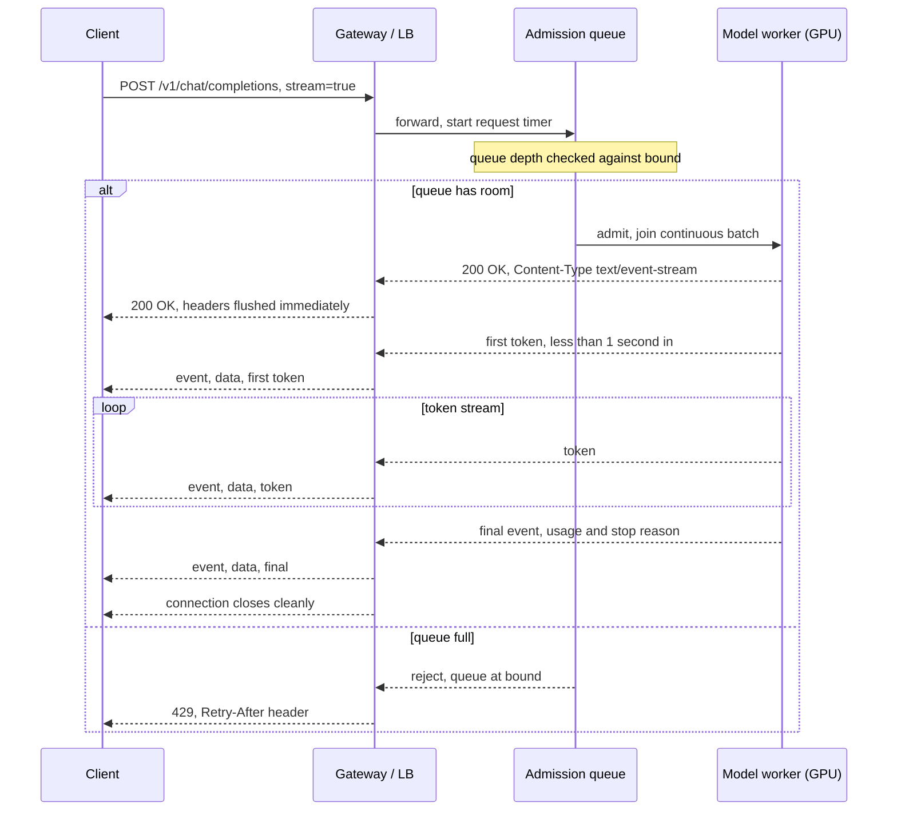
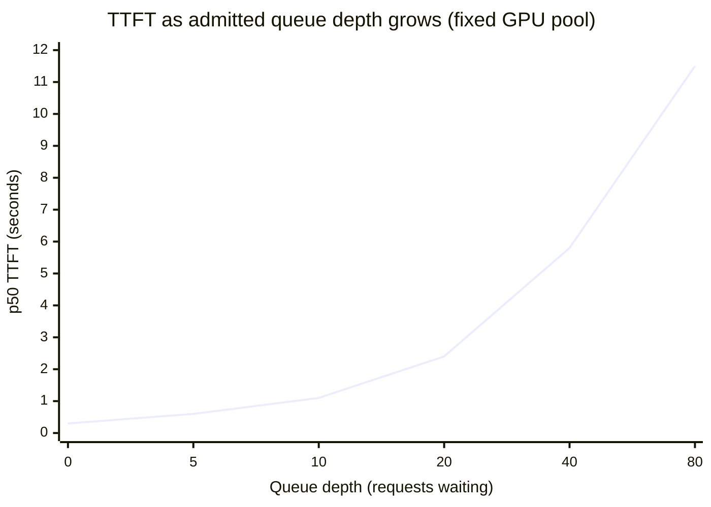
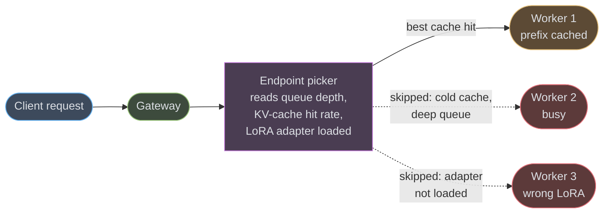
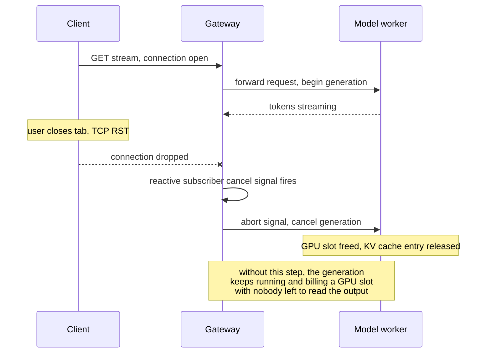
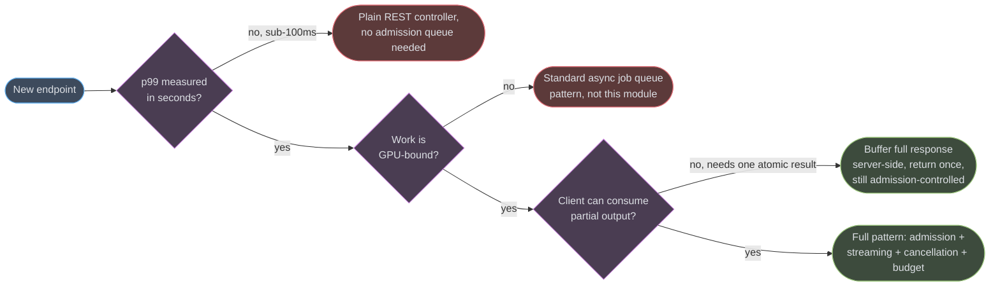
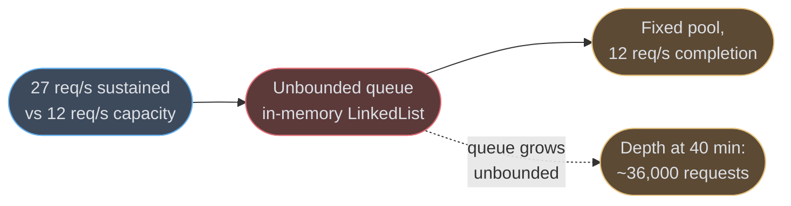

# Serving AI Workloads

A model behind an HTTP endpoint breaks every assumption a normal backend service is built on: the response takes seconds instead of milliseconds, the work happens on a GPU instead of a CPU core, the output size is unknown when the request is admitted, and the client usually wants the first byte long before the last one exists. This module is about the backend engineering discipline that sits between the client and the model — not the model itself.

---

## 1. Concept Overview

A request/response web service is built around a cheap, fast unit of work: accept, compute, respond, all in single-digit milliseconds, all on a CPU core that can context-switch a thousand times a second. Serving a model inverts every one of those assumptions. A single request can hold a GPU for 2–30 seconds. The server does not know how many tokens it will emit, so it cannot set `Content-Length` or size a response buffer up front. The client typically wants partial output as it is produced, not a single blob at the end. And the resource being rationed — a GPU's high-bandwidth memory and its KV cache — is far more expensive and far more finite than a thread pool slot, so the backend's job shifts from "handle every request" to "decide which requests to admit, in what order, at what budget."

**Scope boundary — read this before assuming duplication.** This module does not re-derive model internals or GPU scheduling; both are owned elsewhere and linked throughout:

- **Model and inference internals** — KV cache management, continuous batching internals, speculative decoding, attention kernels — belong to `llm/`. See [Inference & Decoding](../../llm/inference_and_decoding/inference_and_decoding.md) and [vLLM Deep Dive](../../llm/vllm_deep_dive/vllm_deep_dive.md).
- **The GPU fleet** — node pools, device scheduling, Dynamic Resource Allocation (DRA), bin-packing accelerators — belongs to `devops/`. See [ML Platform & GPU Infrastructure](../../devops/ml_platform_and_gpu_infrastructure/ml_platform_and_gpu_infrastructure.md).
- **This module owns the HTTP boundary**: how a request is accepted and admitted, how it is queued while a GPU is busy, how its output streams back over the wire, how it is cancelled cleanly, how it is metered against a budget, and how the whole thing behaves under load. Everything here would still matter if the model behind the boundary were swapped out entirely.

A useful mental split: `llm/` and `devops/` answer "how does the model produce tokens, and where does it run" — this module answers "how does an HTTP client safely get those tokens, and what happens when 10,000 clients want them at once."

---

## 2. Intuition

> **One-line analogy**: A checkout line where every customer takes 8 seconds at the register, and the only fair thing to do is show each one a running total instead of making them stand there in silence until the receipt prints.

**Mental model**: think of the backend as a checkout counter, not a vending machine. A vending machine either dispenses instantly or the transaction fails — that is the request/response model a normal API uses. A staffed checkout line has to make different decisions: how many registers to open (admission), how long the line is allowed to get before you tell people to come back later (queueing and shedding), and how to give the customer something to look at — items being scanned, a running total — instead of silence (streaming). The register itself (the model) is out of scope here; the line management is the whole job.

**Why it matters**: a service that treats a model endpoint like any other REST endpoint — accept everything, block the thread, buffer the whole response — degrades catastrophically under load. Unbounded admission turns GPU saturation into unbounded queueing, which turns into unbounded latency, which turns into client-side timeouts and retries that make the saturation worse. The backend layer is what stands between "the GPU is busy" and "the whole system falls over."

**Key insight**: streaming is not a UX nicety here, it is a capacity strategy. Emitting the first token in 300ms — even though the full response takes 8 more seconds — keeps the client's own timeout from firing and keeps a human from perceiving the system as hung, which is what actually buys the backend the time it needs to finish the generation.

---

## 3. Core Principles

- **Streaming-first.** The response is a sequence of chunks with unknown final length, not a single payload. Every layer in the path — the framework, the reverse proxy, the load balancer — must be configured to forward each chunk immediately rather than buffer it.
- **Admission control over unbounded queueing.** A GPU pool has a hard ceiling on concurrent generations (bounded by KV cache memory). Once that ceiling is reached, the only sound choices are queue with a bound and a visible position, or reject immediately with guidance — never accept without limit and let latency degrade silently.
- **Budget (tokens, GPU-seconds) is a first-class resource, not requests.** A rate limiter that counts requests per second treats a 10-token classification call the same as a 4,000-token generation. The unit that actually maps to cost and GPU time is tokens (or GPU-seconds); budgets, quotas, and backpressure should be denominated in that unit.
- **Cancellation is a correctness requirement, not an optimization.** When a client disconnects mid-stream, the generation consuming a GPU slot on their behalf must stop. Failing to propagate that cancellation does not just waste compute — it silently shrinks the pool's effective capacity under exactly the load pattern (impatient clients, retries) that makes capacity scarce.

---

## 4. Types / Architectures / Strategies

### 4.1 Streaming transport options

| Transport | Direction | Framing | Auto-reconnect | Best fit here |
|---|---|---|---|---|
| SSE (`text/event-stream`) | Server → client | Line-based `event:`/`data:` | Built in (`EventSource`, `Last-Event-ID`) | Default choice for token streaming to a browser or a simple HTTP client |
| NDJSON (`application/x-ndjson`) | Server → client | One JSON object per newline | None — caller implements it | Server-to-server streaming where the client is a backend, not a browser (no `EventSource` needed, trivial to parse) |
| WebSocket | Bidirectional | Framed messages | None — caller implements it | Only when the client must also push mid-stream (steering a generation, sending barge-in audio) — see [WebSockets & SSE](../websockets_and_sse/websockets_and_sse.md) for the general tradeoff |
| gRPC server-streaming | Server → client (or bidi) | Protobuf messages over HTTP/2 | Client library retry policies | Internal service-to-service calls where the caller is already gRPC and wants typed messages and deadlines instead of text parsing |

SSE wins the default slot for one practical reason: it rides on plain HTTP, so every intermediary that already understands HTTP/1.1 keep-alive or HTTP/2 multiplexing works with it, and the browser's reconnect-with-`Last-Event-ID` semantics give resumability for free. WebSocket and raw NDJSON both require the caller to hand-roll reconnection and resume logic.

### 4.2 Batching, from the caller's point of view

A caller sending a request never sees the batching strategy directly, but it explains the latency shape they experience:

- **Static batching** (older systems): the server waits to accumulate a batch, runs it to completion together, then returns all responses. From the caller's side this looks like unpredictable, bursty time-to-first-token (TTFT) — you might land at the start of a batch (fast) or just miss one (a full batch's worth of extra wait).
- **Continuous batching** (the default in vLLM, TGI, and equivalents today): new requests join the running batch at each decode step, and finished sequences leave it, without waiting for the whole batch to drain. From the caller's side, TTFT becomes far more consistent because admission into the batch does not depend on where in another request's generation the server happens to be. The mechanics of how this is implemented (paging the KV cache, iteration-level scheduling) belong to [Inference & Decoding](../../llm/inference_and_decoding/inference_and_decoding.md) — what matters at the HTTP boundary is only the latency shape it produces and the fact that the server's admission queue sits in front of it, deciding what is even eligible to join the batch.

### 4.3 Per-tenant queues vs. one global queue

| Strategy | Isolation | Fairness | Complexity |
|---|---|---|---|
| One global FIFO queue | None — one noisy tenant delays everyone | Poor under skewed load | Lowest |
| Per-tenant queue + weighted fair-share scheduler across tenants | Strong | Good — a quiet tenant's requests aren't stuck behind a heavy one's backlog | Higher — needs per-tenant accounting and a scheduler pass |
| Per-tenant queue + hard concurrency cap per tenant | Strong | Simple and predictable, but wastes capacity when one tenant is idle and another is starved | Medium |

A single global queue is the right starting point for an internal tool with one caller. The moment a second paying tenant shares the pool, a burst from tenant A produces queueing latency for tenant B that has nothing to do with B's own traffic — the classic noisy-neighbor failure. Per-tenant queues (or at minimum per-tenant concurrency caps enforced ahead of a shared queue) are what keeps that isolated.

### 4.4 Prefill/decode disaggregation and its effect on routing

Some serving stacks split the two phases of generation onto different hardware pools: **prefill** (processing the input prompt, compute-bound, benefits from more FLOPs) runs on one set of GPUs, and **decode** (generating tokens one at a time, memory-bandwidth-bound) runs on another. From this module's vantage point, disaggregation is not an internal detail — it changes what the HTTP boundary has to route. A request now has two hops instead of one: it must land on a prefill worker, then the resulting KV cache state must be handed off (over the network, or via a shared cache) to a decode worker before the stream to the client can begin. That handoff is additional latency in the TTFT budget, and if it fails or times out, the client-facing symptom is identical to any other backend error — a stalled or empty stream. The internal mechanics of the handoff belong to [vLLM Deep Dive](../../llm/vllm_deep_dive/vllm_deep_dive.md); what the HTTP layer owns is treating the two-hop path as one logical request with one deadline and one cancellation scope.

---

## 5. Architecture Diagrams

### 5.1 Request lifecycle — accept to completion



The status code is decided once, before the stream opens — after the `200 OK` and the first bytes of `text/event-stream` are on the wire, the connection can no longer change its HTTP status. Every error that can occur mid-stream (a worker crash, a cancelled upstream) has to be represented as data inside the stream, not as an HTTP status.

### 5.2 Queue depth vs. time-to-first-token



TTFT grows roughly with queue depth divided by the pool's steady-state completion rate — this is Little's Law applied to the admission queue (worked in §6.4). The curve is close to linear until the pool nears saturation, then it steepens sharply, which is why a fixed queue bound protects the caller: past a chosen depth, it is better to reject with `429` and a `Retry-After` than to let TTFT climb into a range the caller's own timeout will not survive anyway.

### 5.3 KV-cache-aware routing across model replicas



Routing a request to the replica that already has the matching prompt prefix in its KV cache turns a full prefill into a partial one, which is a direct TTFT win — so the router has to weigh cache locality alongside plain load, not load alone. This is the endpoint-picker pattern implemented by the Kubernetes Gateway API Inference Extension (§7).

### 5.4 Cancellation propagation on client disconnect



Detecting the disconnect is necessary but not sufficient — the gateway has to actively signal the model worker to stop, because the worker has no independent way to know the socket on the other end closed.

---

## 6. How It Works — Detailed Mechanics

### 6.1 Little's Law for the admission queue

The number of requests waiting in the admission queue, on average, is:

```
L = λ × W

L  = average number of requests in the queue
λ  = arrival rate (requests/second)
W  = average time a request waits in the queue (seconds)
```

Turned around, this gives a capacity-planning rule: if the GPU pool sustains a completion rate of `μ` requests/second and you want average queue wait held under `W_max` seconds, the queue bound should be set near `λ_target × W_max`, not left unbounded. Worked example: a pool completing `μ = 8` requests/second, a target maximum wait of `W_max = 4` seconds, and an expected peak arrival rate of `λ = 10` requests/second (above `μ`, so the queue is growing) gives a bound of `10 × 4 = 40` — past 40 queued requests, new arrivals should be rejected with `429` rather than pushed further into a queue whose wait time the client's own timeout will not tolerate anyway.

A capacity-planning script makes this a repeatable calculation rather than a one-off guess, and it is the kind of check worth keeping alongside the pool's sizing docs:

```python
def admission_bound(completion_rate_rps: float, target_arrival_rps: float, max_wait_s: float) -> int:
    """Little's Law: L = lambda * W. Bound the queue at the arrival rate the
    pool must be sized for, times the longest wait a caller should tolerate.
    Returns 0 (reject everything) if the pool cannot sustain the target rate at all."""
    if target_arrival_rps <= 0 or max_wait_s <= 0:
        raise ValueError("target_arrival_rps and max_wait_s must be positive")
    if completion_rate_rps <= 0:
        return 0
    return max(0, round(target_arrival_rps * max_wait_s))


assert admission_bound(completion_rate_rps=8, target_arrival_rps=10, max_wait_s=4) == 40
assert admission_bound(completion_rate_rps=12, target_arrival_rps=12, max_wait_s=4) == 48  # the case study's bound, §14
```

### 6.2 Bounded admission queue with `429` and `Retry-After`

```java
@RestController
public class GenerationController {

    // ponytail: a single Semaphore models the admission bound; swap for a
    // per-tenant weighted scheduler (§4.3) only once a second tenant exists.
    private final Semaphore admissionSlots = new Semaphore(40); // matches Little's Law bound above

    @PostMapping(value = "/v1/generate", produces = MediaType.TEXT_EVENT_STREAM_VALUE)
    public ResponseEntity<?> generate(@RequestBody GenerationRequest req) {
        if (!admissionSlots.tryAcquire()) {
            return ResponseEntity.status(HttpStatus.TOO_MANY_REQUESTS)
                .header(HttpHeaders.RETRY_AFTER, "2")
                .body(Map.of(
                    "error", "queue_full",
                    "message", "Admission queue is at capacity, retry shortly"));
        }
        // Slot held for the life of the stream; released in the emitter's
        // completion/error/timeout callbacks below (§6.3 shows the emitter).
        return ResponseEntity.ok(streamGeneration(req, admissionSlots));
    }
}
```

The `429` plus a `Retry-After` header is the correct signal here, not a `503`: the server is healthy and specifically telling the caller how long to wait, which lets a well-behaved client back off instead of retrying immediately into the same full queue — a retry storm (§10).

### 6.3 SSE endpoint with heartbeats and `Last-Event-ID` resume

```java
@RestController
public class SseGenerationController {

    private final GenerationEventStore eventStore; // ring buffer per request id, ~2 min retention

    @GetMapping(value = "/v1/stream/{requestId}", produces = MediaType.TEXT_EVENT_STREAM_VALUE)
    public SseEmitter stream(
            @PathVariable String requestId,
            @RequestHeader(value = "Last-Event-ID", required = false) String lastEventId,
            HttpServletResponse response) {

        response.setHeader("X-Accel-Buffering", "no"); // nginx: forward chunks immediately
        SseEmitter emitter = new SseEmitter(300_000L);  // 300s: matches worst-case generation time (§6.5)

        // Resume: replay anything the client missed since Last-Event-ID
        long resumeFrom = lastEventId != null ? Long.parseLong(lastEventId) : 0L;
        eventStore.eventsAfter(requestId, resumeFrom).forEach(evt -> sendSafely(emitter, evt));

        eventStore.subscribe(requestId, resumeFrom, evt -> sendSafely(emitter, evt));

        // Heartbeat: a bare comment line, ignored by EventSource, keeps
        // idle intermediary timeouts (LB default ~60s, see §6.5) from firing
        // during any gap between tokens.
        ScheduledFuture<?> heartbeat = heartbeats.scheduleAtFixedRate(
            () -> sendComment(emitter, "keepalive"), 20, 20, TimeUnit.SECONDS);

        emitter.onCompletion(() -> { heartbeat.cancel(false); eventStore.unsubscribe(requestId); });
        emitter.onTimeout(() -> { heartbeat.cancel(false); emitter.complete(); });
        emitter.onError(e -> heartbeat.cancel(false));

        return emitter;
    }

    private void sendSafely(SseEmitter emitter, GenerationEvent evt) {
        try {
            emitter.send(SseEmitter.event().id(String.valueOf(evt.seq())).data(evt.payload()));
        } catch (IOException e) {
            emitter.completeWithError(e); // client gone; caller cleans up in onError
        }
    }

    private void sendComment(SseEmitter emitter, String text) {
        try {
            emitter.send(SseEmitter.event().comment(text));
        } catch (IOException ignored) {
            // heartbeat failing means the connection is already dead; the
            // next real send() will surface the same error and trigger cleanup
        }
    }
}
```

### 6.4 Cancellation propagation on disconnect

```java
@Service
public class ReactiveGenerationService {

    private final ModelBackendClient backend; // holds the outbound call to the model worker

    public Flux<ServerSentEvent<String>> generate(GenerationRequest req) {
        AtomicReference<Disposable> upstream = new AtomicReference<>();

        return Flux.<ServerSentEvent<String>>create(sink -> {
                Disposable call = backend.streamTokens(req)
                    .subscribe(
                        token -> sink.next(ServerSentEvent.builder(token).build()),
                        sink::error,
                        sink::complete);
                upstream.set(call);
            })
            // Fires when the client disconnects and the reactive pipeline's
            // downstream subscriber cancels — this is the ONLY hook that runs
            // on a client-initiated disconnect; onError/onComplete do not.
            .doOnCancel(() -> {
                Disposable call = upstream.get();
                if (call != null && !call.isDisposed()) {
                    call.dispose();                 // stop reading from the model worker
                    backend.abort(req.requestId());  // tell the worker to free the GPU slot (§5.4)
                }
            });
    }
}
```

`doOnCancel` is the load-bearing hook: a client TCP disconnect never arrives as a normal error or completion signal through a reactive pipeline, it arrives as a cancel. Missing this is the single most common cause of the "phantom generation" pitfall in §10.

### 6.5 Token-budget middleware

```java
@Component
public class TokenBudgetInterceptor implements HandlerInterceptor {

    private final TenantBudgetStore budgets; // Redis-backed, per-tenant token counter with a TTL window

    @Override
    public boolean preHandle(HttpServletRequest request, HttpServletResponse response, Object handler) {
        String tenantId = TenantContext.current().tenantId();
        long estimatedTokens = TokenEstimator.estimate(request); // prompt tokens + requested max_tokens

        if (!budgets.tryReserve(tenantId, estimatedTokens)) {
            response.setStatus(HttpStatus.TOO_MANY_REQUESTS.value());
            response.setHeader("X-Budget-Remaining", String.valueOf(budgets.remaining(tenantId)));
            response.setHeader(HttpHeaders.RETRY_AFTER, String.valueOf(budgets.windowResetSeconds(tenantId)));
            return false;
        }
        request.setAttribute("reservedTokens", estimatedTokens);
        return true;
    }

    @Override
    public void afterCompletion(HttpServletRequest request, HttpServletResponse response,
                                 Object handler, Exception ex) {
        // Reconcile the reservation against actual usage reported by the model worker —
        // estimatedTokens is a request-time guess, actualTokens comes back with the
        // final SSE event (§7.1); the difference is refunded or additionally charged.
        long reserved = (long) request.getAttribute("reservedTokens");
        long actual = ActualUsageHolder.get(request); // set by the SSE completion handler
        budgets.reconcile(TenantContext.current().tenantId(), reserved, actual);
    }
}
```

Metering on estimated-then-reconciled tokens, rather than a flat per-request count, is what makes the budget track actual GPU cost — a 4,000-token generation and a 10-token classification call should not consume the same slice of a tenant's quota.

### 6.6 Concrete numbers that drive these decisions

| Quantity | Typical value | Why it matters |
|---|---|---|
| Load balancer idle timeout (AWS ALB default) | 60 seconds | A generation running past 60s with no bytes sent gets killed by the LB unless heartbeats (§6.3) or genuine token flow keep the connection active |
| Worst-case single generation | 60–300 seconds | Sets the emitter/stream timeout — must exceed this, not the LB's default |
| Target p50 TTFT | 200–800 ms | The number that actually correlates with perceived responsiveness; distinct from total completion time |
| TPOT (time per output token) budget | 20–50 ms/token | The steady-state streaming cadence after the first token; a separate SLO from TTFT (§10 covers conflating the two) |
| SSE heartbeat interval | 15–25 seconds | Must be well under the tightest idle timeout in the path (proxy, LB, corporate firewall) |

---

## 7. Real-World Examples

**OpenAI Chat Completions streaming.** Setting `"stream": true` returns `chat.completion.chunk` objects as SSE data events; each chunk's `choices[].delta` carries an incremental piece of `role`, `content`, or `tool_calls`, and `finish_reason` stays `null` until the last chunk for that choice, when it becomes `"stop"`, `"length"`, `"tool_calls"`, or `"content_filter"`. Setting `stream_options: {"include_usage": true}` adds one extra final chunk whose `usage` field carries the request's token counts — every other chunk's `usage` is `null`. That split (per-token deltas versus a single trailing accounting record) is exactly the boundary this module cares about: the backend has to treat token deltas and the final usage reconciliation as two different kinds of event, which is what §6.5's budget-reconciliation logic depends on.

**Anthropic Messages API streaming.** The event sequence for a text response is `message_start` (a `Message` shell with empty content), then per content block a `content_block_start` / one-or-more `content_block_delta` / `content_block_stop` triplet, then one or more `message_delta` events carrying top-level changes — including the final `stop_reason` and a *cumulative* `usage.output_tokens` count — and a closing `message_stop`. `ping` events may appear anywhere as pure keepalives with no payload to act on, and mid-stream errors (for example an `overloaded_error`, which corresponds to an HTTP 529 outside streaming) arrive as a named `event: error` with a JSON body rather than as an HTTP status change — because, as in §5.1, the `200 OK` has already been sent by the time an error like this can occur.

**Kubernetes Gateway API Inference Extension.** `InferencePool` — a CRD that groups the pods of one model deployment behind a shared routing policy — reached GA at v1.0 and is a stable v1 resource; its spec is a pod `selector`, `targetPorts`, and (optional as of v1.5) a reference to an Endpoint Picker (EPP) service. The EPP is the component that implements the routing behavior sketched in §5.3: it reads live per-replica signals — KV-cache utilization, pending-request queue length, which LoRA adapters are currently loaded — and picks the best replica for each incoming request, rather than the gateway load-balancing blind to model-serving state. `InferencePool` is the only CRD the extension itself still ships. The request-priority companion resource has moved out from under it twice: the original `InferenceModel` was renamed `InferenceObjective`, and in the extension's v1.6.0 release (17 August 2026) `InferenceObjective` was removed from the project altogether — with `InferenceModelRewrite` and `EndpointPickerConfig` — and migrated into the `llm-d` ecosystem. Priority-based shedding is therefore an `llm-d` concern now, not a Gateway API one; the API group's own move from `inference.networking.x-k8s.io` to the GA `inference.networking.k8s.io` happened separately, at v1.0. Envoy Gateway, kgateway, and Istio all implement the extension's routing hook.

**vLLM's request queue.** `--max-num-seqs` bounds how many sequences vLLM's continuous batching scheduler holds concurrently — new arrivals past that bound wait in vLLM's own internal queue rather than being admitted into the running batch, which increases TTFT for the queued requests without necessarily increasing peak throughput; `max_num_seqs` is a ceiling, not a target, since actual concurrency at any moment is also bounded by however much KV-cache memory `gpu_memory_utilization` leaves available. This is the layer immediately behind the HTTP boundary this module owns — the admission queue in §6.2 is what decides whether a request even reaches vLLM's queue, and the two bounds should be sized together rather than independently.

**KEDA-driven autoscaling on queue depth.** A common production pattern scales GPU replica count directly off the model server's own queue-length metric — for example `vllm:num_requests_waiting` — rather than off CPU or memory, since neither reflects GPU saturation. A KEDA `ScaledObject` watching that metric can add replicas once waiting requests cross a threshold for a sustained window and scale back down once the queue drains, which keeps the admission-queue bound in §6.1 tied to real, elastic capacity instead of a fixed pool size.

---

## 8. Tradeoffs

### 8.1 Streaming transport

| Transport | Strength | Cost |
|---|---|---|
| SSE | Plain HTTP, browser auto-reconnect, resumable via `Last-Event-ID` | Server-to-client only; text payloads |
| WebSocket | True bidirectional, lowest per-message overhead once open | Manual reconnect/resume logic; needs sticky sessions or pub/sub fan-out at scale |
| Long polling | Works through any proxy or firewall | One HTTP round-trip per chunk; the worst fit for token-by-token output |
| gRPC server-streaming | Typed messages, built-in deadlines, HTTP/2 multiplexing | Needs a gRPC-aware client; awkward directly from a browser |

### 8.2 Queue-and-shed vs. autoscale-the-pool

| Approach | Latency under burst | Cost | Reaction time |
|---|---|---|---|
| Bounded queue + `429` (shed) | Bounded — callers past the bound fail fast instead of degrading | No extra spend | Instant |
| Autoscale GPU pool on queue depth | Improves after new replicas warm up | Pays for the added capacity | Minutes — GPU nodes and model load time are slow to provision |
| Both together (queue absorbs the burst, autoscaler grows the pool) | Bounded short-term, improving medium-term | Spend scoped to sustained load only | Combines instant + minutes |

Shedding alone caps latency but caps throughput too; autoscaling alone leaves a gap — often several minutes — where the queue is the only thing standing between a burst and cascading timeouts. Production systems need the queue bound regardless of whether autoscaling exists, because autoscaling can never be fast enough to be the sole answer to a sudden spike.

### 8.3 Per-request vs. per-tenant budgets

| Budget granularity | Fairness | Overhead |
|---|---|---|
| Per-request rate limit | None across a burst from one caller | Lowest |
| Per-tenant token budget (sliding window) | Prevents one tenant from starving others | Needs a shared counter (Redis) and a reconciliation step (§6.5) |
| Per-tenant + per-priority-class budget | Finest — supports "free tier gets shed first" | Highest — a full scheduler, not just a counter |

### 8.4 Sync vs. streaming for structured/tool-call output

| Case | Recommendation | Reason |
|---|---|---|
| Free-form text the user reads as it arrives | Stream | Perceived latency drops even though total time is the same |
| A tool call whose arguments the caller must parse as one JSON object | Buffer server-side, stream deltas, parse only after `content_block_stop`/`finish_reason` | Partial JSON is not valid JSON — parsing mid-stream requires a partial-JSON parser, and most callers do not want that complexity |
| A downstream system call gated on the full response (e.g., trigger a payment) | Do not act until the terminal event | Acting on partial output risks acting on output the model later revises via a stop/error event |

---

## 9. When to Use / When NOT to Use



**Use this pattern when**: p99 latency is measured in seconds, the work is GPU-bound and therefore expensive per unit, and the client can meaningfully consume partial output (a chat UI, a CLI printing tokens as they arrive, a downstream service that pipelines on partial text).

**Do NOT use it for**: sub-100ms CRUD or lookup endpoints — admission control and streaming machinery add latency and complexity a fast endpoint does not need. Also skip streaming specifically (not the whole pattern) when the client genuinely cannot handle a partial response — a legacy integration expecting one JSON blob, or a downstream action that must not fire until the full, final output is known — in which case still admission-control and budget the request, but buffer the model's output server-side before returning it once.

---

## 10. Common Pitfalls

**The 200-already-sent problem.** Once the SSE stream's `200 OK` and headers are flushed, the HTTP status code cannot change — a model worker crash three seconds into a stream cannot become a `500`. The only correct handling is an in-band error event (as Anthropic's `event: error` in §7 demonstrates) that the client-side stream parser must explicitly check for on every message, not just at connection close. Teams that skip this ship clients that silently truncate output and report success.

**Buffering reverse proxies swallowing the stream.** Nginx buffers upstream responses by default; without `proxy_buffering off;` and an `X-Accel-Buffering: no` response header, tokens sit in nginx's buffer until it fills or the stream ends — which, for a real-time UI, looks identical to the backend being completely broken. This is invisible in local development, since there is usually no reverse proxy between the browser and the app server locally — always test SSE endpoints through the actual production proxy chain before shipping.

**Retry storms against a saturated pool.** A `429` without a `Retry-After` header, or a client that ignores the header it was given, causes every rejected caller to retry immediately — against a pool that is, by definition, already full. What was a brief capacity brownout turns into a sustained outage because the retry traffic itself is now the dominant load. Always send `Retry-After`, and prefer exponential backoff with jitter on the client side specifically for `429`s from this kind of endpoint.

**Unbounded queues turning a throughput problem into a timeout problem.** A queue with no bound "solves" the immediate symptom (no more `429`s) by hiding it — requests still wait exactly as long, but now behind a `200` that was returned before the work even started (or worse, a connection that just hangs with no response at all until the framework's own default timeout fires, often 30–60 seconds later with an unhelpful generic error). Bound the queue and reject fast; a fast, explicit `429` is a better outcome for every caller than a slow, silent timeout.

**Phantom generations from unpropagated cancellation.** A client that disconnects mid-stream — closes a tab, loses network, hits its own client-side timeout — does not, by itself, stop the model from generating. Without the `doOnCancel` (or equivalent) hook from §6.4 wired all the way to the model worker's abort call, the GPU slot stays occupied generating tokens nobody will ever read. Under load, with a churn of impatient clients retrying and abandoning requests, this silently and progressively shrinks the pool's effective capacity — the queue gets deeper for reasons the metrics do not obviously explain, because "requests currently generating" looks identical to "requests someone is still waiting for."

**A slow reader holding a GPU slot hostage.** A client on a throttled mobile connection, or a downstream consumer with its own backpressure, can accept bytes far slower than the model produces tokens — and unless the streaming write path itself applies backpressure, the server either buffers unboundedly in memory waiting for the socket to drain, or worse, keeps the generation itself running ahead of what has actually been flushed to the client. Reactive stacks (Reactor/WebFlux `Flux`) get this for free from the subscriber's demand signal; a naive servlet loop calling `emitter.send()` in a tight loop does not, and needs its own explicit rate-matching or a bounded outbound buffer with its own timeout, or a handful of slow clients can each pin a GPU slot far longer than their actual generation time would justify.

---

## 11. Technologies & Tools

| Tool | What it is | When to reach for it |
|---|---|---|
| Kubernetes Gateway API Inference Extension | `InferencePool`/EPP-based routing layer that is KV-cache- and load-aware, GA at v1.0 | Running multiple model replicas behind one gateway and wanting locality-aware routing instead of plain round-robin |
| Envoy `ext_proc` | External processing filter letting Envoy call out to a service mid-request | Building a custom admission or budget check that Envoy itself enforces, ahead of the application |
| Envoy Gateway / kgateway | Gateway API implementations that plug in the Inference Extension's endpoint picker | The concrete gateway product to deploy the extension against, rather than hand-rolling routing logic |
| vLLM | Model server with continuous batching and its own request queue | The model-serving layer this module's admission queue sits in front of; see [vLLM Deep Dive](../../llm/vllm_deep_dive/vllm_deep_dive.md) |
| KEDA | Kubernetes event-driven autoscaler | Scaling GPU replica count directly off a queue-depth metric (`vllm:num_requests_waiting`) instead of CPU/memory |
| A semantic/prompt cache | Cache keyed on prompt similarity, not exact match | Cutting TTFT and GPU load for repeated or near-duplicate prompts; see [LLM Caching](../../llm/llm_caching/llm_caching.md) |
| OpenTelemetry GenAI semantic conventions | Standardized span/attribute names for LLM calls (`gen_ai.*`) | Wiring TTFT, TPOT, and token counts into existing OTel tracing/metrics instead of inventing ad hoc attribute names |
| A LiteLLM-style proxy | A unified HTTP proxy in front of multiple model providers/deployments | Centralizing the admission, budget, and routing logic in one place instead of duplicating it per service |

---

## 12. Interview Questions with Answers

**Q: Why can't a mid-stream generation error become an HTTP 500?**
**Short:** The 200 status and headers are already sent, so the error must be an in-band event instead.
Once the server has flushed a `200 OK` with `Content-Type: text/event-stream` and begun sending chunks, HTTP does not allow changing the status code — it was already delivered. A model worker crash or an upstream overload event that occurs after that point has to be represented as data inside the stream, such as Anthropic's `event: error` with a JSON body, and every client-side stream parser must explicitly check for that event type rather than assuming a clean stream end means success.

**Q: A client hits their own 30-second timeout and disconnects mid-generation. What breaks if you don't handle this?**
**Short:** The model keeps generating on an abandoned GPU slot, silently shrinking the pool's real capacity.
Detecting the TCP disconnect is not the same as stopping the work: unless the disconnect is explicitly wired to an abort call against the model backend (the reactive `doOnCancel` hook, or the equivalent completion callback in a servlet-based emitter), the generation keeps consuming a GPU slot for a client that is no longer listening. Under load, with many impatient clients retrying and abandoning requests, this compounds — the effective pool shrinks in a way that queue-depth metrics alone don't explain, since a phantom generation looks identical to a real one from the scheduler's point of view.

**Q: Why does an unbounded admission queue make things worse, not better, under sustained overload?**
**Short:** It converts a fast, explicit 429 into a slow, silent timeout with no useful signal to the caller.
An unbounded queue still makes every caller wait exactly as long as the backlog dictates — it just hides that wait behind an already-returned `200` or a connection that hangs until some other layer's default timeout fires, often 30 seconds or more later with a generic, unhelpful error. A bounded queue that rejects with `429` and a `Retry-After` the moment it's full gives the caller an immediate, actionable signal instead, and lets a well-behaved client back off rather than compound the overload.

**Q: Why does a 429 without a Retry-After header risk making an outage worse?**
**Short:** Every rejected client retries immediately against a pool that is, by definition, already full.
If the response gives no guidance on when to retry, clients that retry on any error (which is common default behavior) hammer the same saturated pool again immediately, and the retry traffic itself becomes the majority of load — a brief capacity brownout turns into a sustained outage purely from self-inflicted retry pressure. Always send `Retry-After`, and pair it with client-side exponential backoff plus jitter specifically for `429` responses from a generation endpoint.

**Q: What's wrong with rate-limiting a model-serving endpoint by requests per second?**
**Short:** A 4,000-token generation and a 10-token classification call cost wildly different amounts of GPU time.
Requests-per-second treats every request as equally expensive, but the actual cost driver is tokens generated (which maps to GPU-seconds held). A tenant sending a handful of long generations can exhaust the same GPU capacity as a tenant sending hundreds of short classification calls, so a per-request limiter either starves the second tenant unnecessarily or lets the first one starve everyone else. Budgets should be denominated in tokens or GPU-seconds, estimated at admission time from the prompt and requested max output length, then reconciled against the actual usage reported in the stream's final event.

**Q: Why must an SSE endpoint send heartbeats even while tokens are actively streaming... or specifically during gaps between them?**
**Short:** An idle load balancer or proxy timeout (often 60 seconds) closes the connection during any silent gap.
Most intermediaries — load balancers, reverse proxies, corporate firewalls — close a connection after a period with no bytes sent, and a 60-second LB idle timeout is a common default. A generation can have gaps longer than that between visible output (during a long prefill, or a pause between distinct sections of output), so a periodic SSE comment line every 15–25 seconds keeps the connection registering as active without being interpreted as real content by the client's `EventSource`.

**Q: TTFT and TPOT are both latency numbers for a generation endpoint. Why track them as separate SLOs instead of one end-to-end latency number?**
**Short:** They're driven by different bottlenecks — TTFT by prefill and queueing, TPOT by steady-state decode.
Time-to-first-token is dominated by admission queue wait and the prefill pass over the prompt, so it's the number that correlates with perceived responsiveness and is most sensitive to load. Time-per-output-token is the steady-state decode cadence once generation has started, and is more sensitive to batch size and memory bandwidth than to queueing. A single blended "total latency" metric hides which of these actually regressed — a TTFT spike points at the admission/queueing layer, a TPOT spike points at the model-serving layer itself.

**Q: How does Last-Event-ID make SSE resumable, and what does the server have to do to support it?**
**Short:** The browser auto-resends the last event id it saw, so the server can replay only what was missed.
Each SSE message can carry an `id:` field; if the connection drops, the browser's `EventSource` automatically reconnects and sends a `Last-Event-ID` header with the id of the last event it successfully received. For this to actually work, the server must keep a short-lived buffer of recent events per request (commonly the last 60–120 seconds) so it can replay everything after the given id on reconnect — without that buffer, the header arrives but there is nothing to resume from, and the client silently misses whatever was sent during the gap.

**Q: What's the practical difference between OpenAI's and Anthropic's streaming event shapes that a client integration has to handle?**
**Short:** OpenAI streams per-choice deltas with a nullable finish_reason; Anthropic streams typed block/message events.
OpenAI's `chat.completion.chunk` objects carry an incremental `delta` per `choices[]` entry, with `finish_reason` staying `null` until the terminal chunk, and usage arriving as one extra final chunk only when `stream_options.include_usage` is requested. Anthropic's protocol is more explicitly structured around a state machine of named event types — `message_start`, `content_block_start/delta/stop`, `message_delta`, `message_stop` — where the block boundaries are explicit events rather than implied by a changing `delta` shape, and cumulative usage rides on the `message_delta` events rather than a single trailing chunk. A client library abstracting over both providers has to normalize these two different event philosophies into one internal stream representation.

**Q: Why is max_num_seqs in a model server like vLLM not the same knob as this module's HTTP-layer admission queue bound?**
**Short:** One bounds concurrent sequences inside the engine; the other bounds requests waiting before they even reach it.
`max_num_seqs` caps how many sequences vLLM's continuous batching scheduler will hold concurrently, and it is itself a ceiling rather than a guaranteed concurrency level, since available KV-cache memory can leave true concurrency lower. The HTTP-layer admission queue in this module sits in front of that entirely — it decides which requests are even forwarded to the model server at all. Sizing only one of the two bounds and leaving the other unbounded just moves the unbounded-queue problem from §10 to whichever layer was left unguarded.

**Q: Why is a semantic/prompt cache a bigger lever on TTFT for AI-workload serving than a normal HTTP response cache would be for a typical API?**
**Short:** Generation is expensive per request, so even a partial cache hit meaningfully cuts prefill cost and TTFT.
A typical HTTP response cache is a binary hit-or-miss on an exact key; a semantic cache can match near-duplicate prompts and, in a KV-cache-aware routing setup (§5.3), route a request to a replica that already holds the matching prefix in its KV cache, turning a full prefill into a partial one. Because prefill cost scales with prompt length and directly drives TTFT, that partial hit is a proportionally much larger win here than a cache hit is for a service whose per-request cost was already single-digit milliseconds.

**Q: How do you correctly size an admission queue bound, rather than picking a number by feel?**
**Short:** Apply Little's Law: bound near target arrival rate times the maximum acceptable wait time.
Little's Law states average queue length L equals arrival rate λ times average wait W. Given a target maximum wait W_max the system should tolerate and an estimate of peak arrival rate λ during that window, set the queue bound near λ × W_max — past that depth, reject with `429` rather than let wait exceed what the caller's own timeout, or the business's latency SLO, can tolerate. The bound should be revisited whenever the pool's completion rate μ changes, since a bound sized for one GPU pool capacity becomes wrong the moment that capacity does.

**Q: Why should prefill/decode disaggregation change how the HTTP layer treats a request's timeout and cancellation scope?**
**Short:** The two-hop prefill-then-decode handoff must be one logical request with one deadline, not two.
When prefill and decode run on separate worker pools, a single client request now involves two internal hops and a KV-cache handoff between them, and that handoff adds latency inside the TTFT budget that a non-disaggregated system doesn't have. If the HTTP layer treats each hop as an independent request with its own timeout, a slow or failed handoff can either double-count against the client's deadline or, worse, leave the decode side never triggered while the client is still waiting — cancellation and timeout logic has to span both hops as one scope.

**Q: Why is a tool-call/structured-output response usually buffered server-side even when the rest of the endpoint streams?**
**Short:** Partial JSON deltas aren't valid JSON, so most callers shouldn't have to parse them incrementally.
Streaming a tool call's arguments as they're generated means the client receives fragments of a JSON object that are individually invalid JSON — parsing that safely requires a partial-JSON parser most caller code doesn't have. The common pattern is to still stream the deltas at the protocol level for clients sophisticated enough to want them, but for the common case, buffer server-side until the block's closing event and hand the caller one complete, valid JSON object, since acting on an incomplete tool call is a correctness risk, not just an inconvenience.

**Q: What's the risk of conflating a rate limiter built for normal APIs with the admission control this module describes?**
**Short:** A normal rate limiter shapes request rate; it says nothing about whether the GPU pool has room right now.
A token-bucket or sliding-window rate limiter answers "is this caller sending too many requests per second," which is a policy question independent of current system state. Admission control answers "does the GPU pool have a free slot right now," which changes second to second based on how long other requests are taking. A caller can be well within their rate limit and still need to be queued or rejected because the pool is momentarily full — the two mechanisms are complementary, not substitutes, and a service needs both: see [Rate Limiting In Depth](../rate_limiting_in_depth/rate_limiting_in_depth.md) for the request-rate half of this.

**Q: Why does per-tenant queueing matter even when there's no queue-full 429 happening?**
**Short:** A single global queue lets one tenant's burst delay every other tenant's requests, even below the bound.
Even when the queue never fills, a global FIFO queue processes requests in arrival order, so a burst from one heavy tenant pushes every request behind it — including a different tenant's single, isolated request — further back in line. Per-tenant queues, or at minimum a per-tenant concurrency cap enforced ahead of a shared pool, keep one tenant's traffic pattern from becoming latency variance for every other tenant, which matters the moment a service has more than one paying caller.

**Q: What does "streaming is a capacity strategy, not just a UX choice" mean in practice?**
**Short:** A fast first token keeps the client's own timeout from firing, buying the backend time to finish.
If a client-side timeout is, say, 10 seconds and a full generation takes 8 seconds of GPU time but the first token arrives in 300ms, a streaming response satisfies that timeout easily — the client sees activity immediately and never fires its abort. A non-streaming implementation returning the same 8-second result as one blob risks tripping exactly that timeout, especially under any additional queueing delay, which then manifests as a client-side cancellation the backend has to handle (§10) even though the backend was never actually failing.

**Q: How should circuit breaking be applied differently to a model-serving endpoint compared to a normal downstream dependency?**
**Short:** Trip on queue depth and GPU-pool saturation signals, not just on the error rate a normal breaker watches.
A conventional circuit breaker (see [Fault Tolerance Patterns](../fault_tolerance_patterns/fault_tolerance_patterns.md)) trips mainly on error rate or latency percentile against a downstream call. For a model-serving endpoint, the more useful trip signal is often queue depth or GPU-pool saturation directly, since a saturated pool can still return correct responses — just slowly and to a shrinking number of callers — well before its raw error rate crosses a conventional threshold. Wiring the breaker to the same queue-depth signal that drives admission control and autoscaling keeps all three mechanisms reacting to the same underlying state.

**Q: Why can observability for this kind of endpoint not stop at request count and error rate?**
**Short:** TTFT, TPOT, queue depth, and tokens-per-request are the metrics that actually explain a regression here.
Request count and error rate answer "is the endpoint up," but they say nothing about whether callers are waiting an extra 4 seconds for a first token, or whether the steady-state token cadence has degraded, or whether the admission queue is quietly growing toward its bound. Instrumenting TTFT, TPOT, queue depth over time, and tokens consumed per request — ideally via the OpenTelemetry GenAI semantic conventions so the attribute names are standardized — is what turns a vague "it feels slower" report into a specific, actionable regression; see [Observability & Monitoring](../observability_and_monitoring/observability_and_monitoring.md) for the general instrumentation patterns this builds on.

---

## 13. Best Practices

- Always bound the admission queue, and size the bound from Little's Law against the pool's real completion rate — never leave it unbounded "temporarily."
- Always propagate client cancellation to the model backend; treat a missing `doOnCancel`/completion-callback abort path as a correctness bug, not a nice-to-have.
- Meter and budget by tokens (or GPU-seconds), not by request count — reconcile an estimate at admission time against actual usage from the terminal stream event.
- Emit TTFT and TPOT as two separate metrics, never one blended "latency" number — they point at different layers when they regress.
- Never trust `Content-Length` on a streaming response; the size is unknown at admission time by definition, and any layer that tries to buffer based on an assumed length will either truncate or hang.
- Always send `Retry-After` on a `429` from this kind of endpoint, and expect well-behaved clients to honor it with backoff plus jitter.
- Disable buffering explicitly at every intermediary in the path (`proxy_buffering off`, `X-Accel-Buffering: no`), and verify it against the real proxy chain, not just localhost.
- Represent mid-stream errors as an in-band event, never assume you can still change the HTTP status after the first byte is sent.

---

## 14. Case Study

**Design reference:** for a full principal-level case study covering an end-to-end LLM serving gateway — capacity planning, multi-tenant budgets, and the operational playbook in depth — see [Design an LLM Serving API](../case_studies/design_llm_serving_api/design_llm_serving_api.md).

**The incident.** A streaming chat gateway sat in front of a fixed pool of model replicas, sized for a steady-state completion rate of 12 requests/second. Traffic tripled over 40 minutes during a product launch, from a baseline of 9 requests/second to 27 requests/second sustained — the admission layer had no bound at all, so every incoming connection was accepted and simply queued in an in-memory `LinkedList` behind whatever was already running.

**What broke.**



With arrivals at 27/s against completions at 12/s, the queue grew by 15 requests/second, net — after 40 minutes that is roughly `15 × 2400 = 36,000` requests sitting in memory, each holding an open HTTP connection and a growing heap allocation for buffered request state. Client-side timeouts (mostly 30 seconds) started firing while requests were still in the queue, and — because the queue had no `429` path — clients retried, which added their retries as new arrivals on top of the already-overloaded queue. The gateway's JVM eventually hit sustained GC pressure from the queue's memory footprint and stopped responding entirely; every connected client, including the ones that had been legitimately streaming, saw their connections drop.

**The broken config:**

```java
// BROKEN: unbounded, no admission control
private final Queue<GenerationRequest> queue = new LinkedList<>();

public void handle(GenerationRequest req) {
    queue.add(req);           // always succeeds — no capacity check
    processNext();             // may not run for minutes under load
}
```

**The fix:**

```java
// FIXED: bounded via Semaphore sized from Little's Law (§6.1),
// rejects fast once the pool's real capacity is exceeded
private final Semaphore admissionSlots = new Semaphore(48); // 12 req/s * 4s target max wait

public ResponseEntity<?> handle(GenerationRequest req) {
    if (!admissionSlots.tryAcquire()) {
        return ResponseEntity.status(HttpStatus.TOO_MANY_REQUESTS)
            .header(HttpHeaders.RETRY_AFTER, "3")
            .body(Map.of("error", "queue_full"));
    }
    return ResponseEntity.ok(streamAndRelease(req, admissionSlots));
}
```

**The numbers, before and after.**

| Metric | Before (unbounded) | After (bounded at 48) |
|---|---|---|
| Queue depth at peak | ~36,000 | Capped at 48 |
| p50 TTFT for admitted requests | Undefined — many never got a first token | 1.1s (matches the target from §6.1's Little's Law calculation) |
| Requests rejected outright | 0 (all accepted, then failed via timeout/crash) | ~34% during the 40-minute peak, each with an immediate `429` and `Retry-After` |
| Gateway availability during peak | Total outage (~6 minutes of full unresponsiveness) | No outage — rejected requests failed fast and cleanly |
| Client-visible failure mode | Silent hang, then dropped connection, no error detail | Explicit `429` with a retry hint |

The fix did not add capacity — the pool was still only 12 requests/second — it changed the failure mode from "everyone eventually times out or the whole gateway dies" to "roughly a third of requests get an honest, immediate, actionable rejection while the other two-thirds get their normal latency." An honest `429` is a strictly better outcome than a silent hang for every party involved: the caller can retry intelligently, and the gateway never enters the death spiral that an unbounded queue's memory growth caused.

**Follow-up.** The bound of 48 was a static number chosen from the pool's steady-state rate at the time; it was later replaced with a bound recalculated on a rolling window of the pool's actual completion rate, so a KEDA-driven scale-up of the replica pool (§7) automatically raises the admission bound rather than leaving it capped at a number sized for the old, smaller pool.
