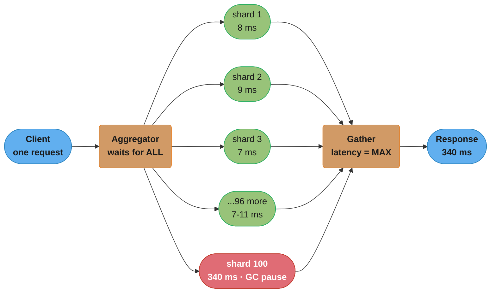
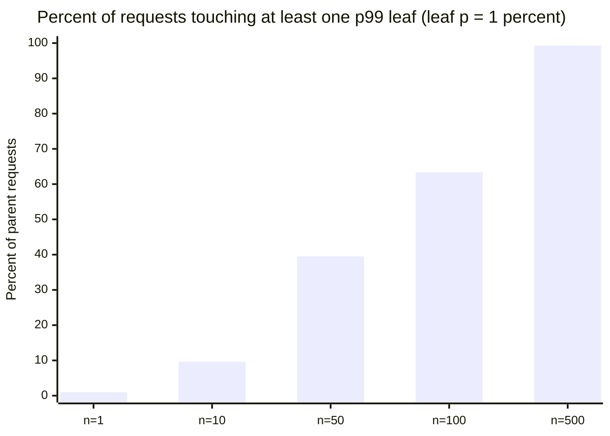
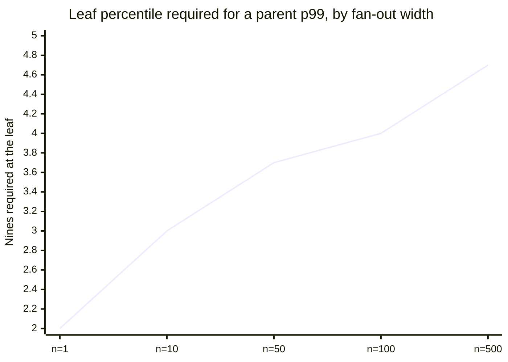
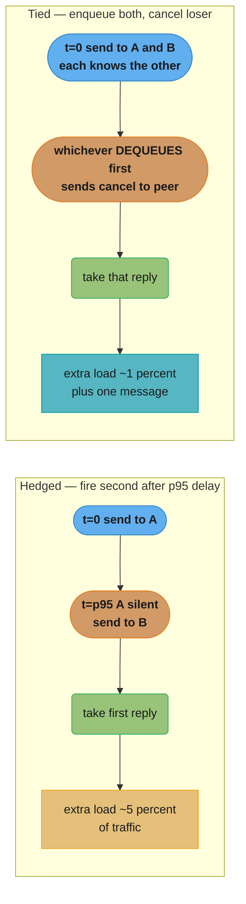
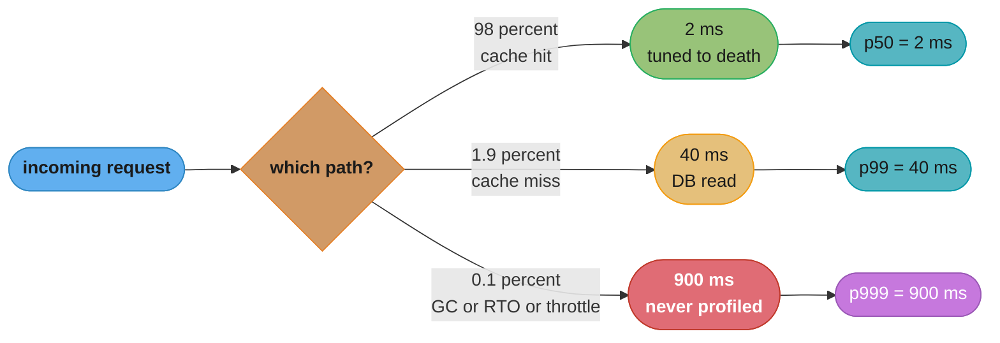

# Tail Latency and Fan-Out

## 1. Concept Overview

Tail latency is the behaviour of the slowest requests — p99, p999, p9999 — and it is the part of a latency distribution that decides whether a system is usable. A service whose mean response time is 8ms and whose p999 is 4 seconds is not "fast with a few slow requests": at 20,000 requests per second it is producing 20 unusable responses every second, 1.7 million per day, and every one of them belongs to a real user session.

This module is about the reason p99 lies that is **not** coordinated omission. Coordinated omission is a measurement defect — the load generator failed to issue requests that would have queued. The defects here are structural and survive perfect measurement:

- **Percentile arithmetic does not work the way people assume.** Percentiles do not add and do not average, so every dashboard that sums or means them reports a number that exists nowhere in the data.
- **Fan-out amplifies the tail multiplicatively.** A leaf service with a 1-in-100 slow path is a 63-in-100 slow path once a request touches 100 leaves. The leaf's p99 becomes the parent's *typical* case.
- **Most tail latency is not caused by load.** GC pauses, safepoints, JIT deoptimization, log rotation, CFS quota throttling, TCP retransmission timeouts and cold caches all produce multi-hundred-millisecond stalls on a machine that is 20% busy.
- **Percentiles cannot be merged after aggregation.** Once each host has reduced its latencies to a p99 number, the fleet p99 is unrecoverable. You need mergeable sketches, not numbers.

The canonical reference is Jeff Dean and Luiz André Barroso, *The Tail at Scale* (CACM, February 2013), which named the problem and supplied the mitigation vocabulary — hedged requests, tied requests, micro-partitioning, selective replication, latency-induced probation — that this module works through with arithmetic.

**Coordinated omission, in one paragraph, because it is taught twice already.** A closed-model load generator holds concurrency fixed, so when the system slows the generator issues *fewer* requests instead of letting them queue, and the long waits that real users would experience are never timed. Little's Law forces this: with `L` pinned at 100 virtual users, a slowdown from 50ms to 2s drops applied load from 2,000 req/s to 50 req/s, a 40x reduction the tool never reports. The fix is an open-model, constant-arrival-rate executor. It is worked in full, with the 40x arithmetic and the k6 broken/fixed configs, in [Load and Performance Testing §5 and §10](../load_and_performance_testing/load_and_performance_testing.md) and [DevOps Performance and Load Testing §5](../../devops/performance_and_load_testing/performance_and_load_testing.md) — read those, and assume from here on that your measurement is honest. Everything below is what still goes wrong when it is.

---

## 2. Intuition

**One-line analogy:** a fan-out request is a group of friends leaving a restaurant — the group leaves when the *slowest* person is ready, so the more friends you invite, the more likely someone is slow, and the group's typical departure time is the *worst* individual's typical time.

**Mental model:** every backend call is a coin flip against the leaf's latency distribution. A p99 of 10ms means the coin comes up "slow" 1% of the time. Fan out to `n` leaves and you flip the coin `n` times, keeping the worst. The probability of at least one slow leaf is `1 - (1 - p)^n`, which climbs alarmingly fast: 1% at n=1, 9.6% at n=10, 63.4% at n=100. Nothing about the leaf changed. The parent's experience changed because it started asking more questions.

**Why it matters:** the arithmetic runs backwards too. If you want the *parent* to hit p99 = 10ms across 100 leaves, each leaf must deliver 10ms at the **p99.99** — because `0.99^(1/100) = 0.9999`. Fan-out does not merely degrade the tail, it moves the percentile you must engineer to. Teams that set a leaf SLO at p99 and then build a 100-way scatter-gather on top of it have already lost, and no amount of leaf optimisation below p99 will show up in the parent.

**Key insight:** the tail is not "the same system, occasionally unlucky." It is a *different* code path — a GC pause, a cache miss that hits disk, a connection that had to be re-established, a thread that waited behind a safepoint. Optimising the p50 path makes p50 faster and leaves p999 untouched, which is why a system can get 40% faster on average and page the on-call more often than before.

---

## 3. Core Principles

- **Percentiles are order statistics, not measurements.** A p99 is the value at rank `0.99 × N` in a sorted list. It has no algebra: you cannot add two p99s, average them, or subtract one from another and get anything meaningful.
- **The tail of a composite is dominated by the widest fan-out on the path.** In a request tree, the deepest sequential chain sets the floor and the widest parallel fan sets the tail.
- **Redundancy converts a latency problem into a capacity problem.** Every tail mitigation — hedging, tied requests, replication — buys tail reduction with extra work. Budget that work explicitly (Dean and Barroso cap reissues near 5% of traffic) or it becomes a positive feedback loop during overload.
- **Variability is a first-class resource.** Reducing the *variance* of a leaf's latency helps a fan-out parent more than reducing its mean, because the parent samples the tail `n` times per request.
- **You cannot recover a distribution from a summary.** Record histograms at the source; merge histograms, never percentiles.
- **Isolate the tail sources you control, tolerate the ones you do not.** GC and compaction can be scheduled or partitioned away; a noisy neighbour on shared silicon cannot, so the answer there is hedging, not tuning.
- **Under overload, queue discipline changes which requests survive.** FIFO delivers the oldest — and therefore most likely already-abandoned — request first. LIFO delivers the freshest.

---

## 4. Types / Architectures / Strategies

### Fan-out shapes and what each does to the tail

| Shape | Structure | Tail behaviour | Typical example |
|-------|-----------|----------------|-----------------|
| Sequential chain | A -> B -> C, depth `d` | Latencies **add**; means add cleanly, tails add pessimistically | API gateway -> auth -> service -> DB |
| Parallel scatter-gather | 1 parent, `n` leaves, wait for all | Parent latency = `max` of `n` samples; tail amplifies as `1 - (1-p)^n` | Search index shards, feed assembly |
| Partial-response fan-out | Wait for `k` of `n`, drop the rest | Tail bounded by the `k`-th order statistic; costs completeness | Web search returning 95% of shards |
| Nested fan-out | Parent fans to `n`, each leaf fans to `m` | Effective width is `n × m` | Root -> 10 services -> 10 shards each = 100 |
| Hedged fan-out | Each leaf sent twice, take first response | Parent latency = `min` of 2 samples per leaf | BigTable hedged reads |

### The five mitigations from *The Tail at Scale*

| Mitigation | Mechanism | Cost | When it applies |
|------------|-----------|------|-----------------|
| **Hedged requests** | Send to replica 2 after waiting the p95 of the operation; take whichever answers first | Extra load equal to the fraction of requests past p95 — roughly 5% | Read-only, idempotent, cheap operations |
| **Tied requests** | Enqueue on two replicas simultaneously, each carrying the other's identity; the one that dequeues first sends a cancellation to the peer | Near-zero steady-state extra work; one cross-server message per request | Queueing is the dominant tail source, replicas are close (same DC) |
| **Micro-partitioning** | Split data into many more partitions than machines (BigTable runs ~20 tablets per machine) so load can be rebalanced in fine grains | Metadata overhead, more open files | Skewed keyspaces, recovery speed matters |
| **Selective replication** | Give hot or important partitions extra replicas | Storage and write amplification on the hot set | Popularity is heavily skewed (search, feeds) |
| **Latency-induced probation** | Detect a slow machine, stop routing live traffic to it, keep sending shadow requests, restore it when its shadow latencies recover | Lost capacity while probated; needs shadow traffic to avoid oscillation | Machines degrade gradually rather than failing |

### Sources of tail latency that are not load

| Category | Specific source | Typical magnitude |
|----------|-----------------|-------------------|
| Runtime | G1 mixed GC pause | 50–200ms |
| Runtime | Full GC / heap resize on a 32GB heap | 1–8s |
| Runtime | JIT deoptimization + re-profiling of a hot method | 10–100ms |
| Runtime | Safepoint bias: a long counted loop delaying time-to-safepoint | 10ms–2s |
| OS / container | CFS quota throttling — 100ms period, quota exhausted early | up to 100ms per period, repeating |
| OS / container | CPU frequency scaling and C-state exit | 1–20ms |
| OS / container | Page cache miss, transparent hugepage compaction | 1ms–1s |
| Network | TCP retransmission timeout — Linux `TCP_RTO_MIN` is 200ms | 200ms, doubling |
| Network | TLS handshake on a cold connection (2-RTT for TLS 1.2, 1-RTT for 1.3) | 1–3 RTTs |
| Storage | LSM background compaction stealing IOPS | 100ms–2s |
| Application | Connection pool exhaustion — queueing for a Hikari connection | up to `connectionTimeout`, default 30s |
| Application | Log rotation, metrics flush, cron job on the box | 100ms–5s |
| Fleet | Partition rebalance, leader election, shard split | 1–30s |
| Fleet | Noisy neighbour on shared hypervisor / shared L3 cache | unbounded, uncorrelated with your load |

### Queue disciplines under overload

| Discipline | Behaviour when the queue is long | Best used |
|------------|----------------------------------|-----------|
| FIFO | Serves the oldest request — the one most likely already abandoned by its client | Normal operation, fairness matters |
| LIFO | Serves the freshest request — the one most likely still being awaited | Overload and shedding, where completing *something* usefully beats completing everything late |
| Adaptive LIFO (CoDel) | FIFO while queue delay is under a target (Facebook uses 5ms), flips to LIFO when it is exceeded | Production default for latency-sensitive queues |
| Priority | Serves by class, starving the low class | Mixed criticality with an explicit budget per class |

---

## 5. Architecture Diagrams

### Fan-out multiplies exposure to a leaf's tail



*Ninety-nine shards answered in under 11ms and the response took 340ms. The aggregator's latency is the maximum over its leaves, so a single leaf in its own tail sets the whole request's latency — which is why the parent samples the leaf's p99 once per leaf, not once per request.*

### Tail amplification versus fan-out width



*The curve is `1 - (1 - 0.01)^n`. At 100 leaves, what the leaf team calls a one-percent event is the majority experience of the parent. Nothing about the leaf changed between the first bar and the last.*

### The percentile the leaf must actually hit



*Read the y-axis as "number of nines": 2 is p99, 4 is p99.99. A 100-way fan-out that wants a p99 parent needs a p99.99 leaf, because `0.99^(1/100) = 0.9999`. Setting the leaf SLO at p99 and building a 100-way scatter on it is a specification error, not a tuning problem.*

### Hedged versus tied requests



*Hedging pays a latency price before it acts — it waits out the p95 before firing the backup, so it cannot help a request that was going to be slow from the first microsecond. Tied requests act at t=0 and pay a cancellation message instead, which is why they need replicas close enough that the cancellation beats the duplicate work.*

### Where a p50-optimized system loses its p999



*Three different code paths produce the three percentiles. Profiling under normal load samples the 2ms path 98% of the time, so the flame graph is entirely about work that never appears in p999. This is why a p50 win of 40% can leave p999 exactly where it was.*

---

## 6. How It Works — Detailed Mechanics

### 6.1 Percentile arithmetic — the two rules

**Rule 1: percentiles do not add.** If service A has p99 = 30ms and service B has p99 = 20ms, a request calling both sequentially does **not** have p99 = 50ms. That number is only correct if A's slow requests are perfectly correlated with B's, which they are not. For independent services the composite p99 is *lower* than the sum — but the composite p99.9 can be far *higher* than the sum of the p99.9s if the slowness shares a cause (both behind the same throttled node, both hitting the same GC-paused cache).

**Rule 2: percentiles do not average.** Twenty replicas each reporting a p99 cannot be meaned into a fleet p99. Nineteen healthy replicas at 100ms and one sick replica at 5000ms mean to 345ms; the true pooled p99 is 5000ms, a 14x error, and the mean *hides* an outage. That example is worked line by line in [DevOps Performance and Load Testing §10, Pitfall 3](../../devops/performance_and_load_testing/performance_and_load_testing.md) — it is not repeated here.

The only safe composition is over the **raw or histogram-preserved** data. Everything else is a category error.

### 6.2 Tail amplification — the arithmetic

Let `p` be the probability that a single leaf call lands above some latency threshold `T` — that is, `p = 0.01` when `T` is the leaf's p99. For `n` independent leaves where the parent waits for all of them:

```
P(at least one leaf above T)  =  1 - (1 - p)^n
```

Worked for `p = 0.01`:

| Fan-out `n` | `(1 - 0.01)^n` | P(at least one slow leaf) | Reading |
|-------------|----------------|---------------------------|---------|
| 1 | 0.9900 | **1.00%** | the leaf's own p99, unchanged |
| 10 | 0.9044 | **9.56%** | roughly the parent's p90 is now the leaf's p99 |
| 50 | 0.6050 | **39.50%** | two in five requests touch a slow leaf |
| 100 | 0.3660 | **63.40%** | the *majority* of requests are tail requests |
| 500 | 0.0066 | **99.34%** | essentially every request; the p99 is the p50 |

And read backwards — what leaf percentile is required for a given parent percentile:

```
  q  =  target_parent_fraction ^ (1 / n)

  parent p99 (0.99) at n = 10   ->  q = 0.99^(1/10)  = 0.998995  -> leaf p99.9
  parent p99 (0.99) at n = 100  ->  q = 0.99^(1/100) = 0.9998995 -> leaf p99.99
  parent p99 (0.99) at n = 500  ->  q = 0.99^(1/500) = 0.99997990-> leaf p99.998
```

The independence assumption is the optimistic case. Real leaves share racks, top-of-rack switches, a config push, an upstream cache, and a deploy pipeline — correlation makes both tables worse, never better. Use these numbers as a floor.

**Concrete:** a search tier with 100 shards, each with a 10ms p99, waiting for all shards, sees 63.4% of queries take at least 10ms. Adding partial responses — return when 95 of 100 shards answer — turns the parent's latency from the 100th order statistic into the 95th, which for the same distribution is a fraction of the wait. Google's web search does exactly this, accepting a small completeness loss to cut the tail.

### 6.3 Hedged requests, with a budget

```java
// Hedge after waiting the operation's own p95. Idempotent reads only.
// The budget is what stops a hedge from becoming a load amplifier during an incident.
public final class HedgedCaller {

    private final ScheduledExecutorService timer = Executors.newSingleThreadScheduledExecutor();
    // 5% reissue budget, the cap Dean & Barroso recommend. 50 tokens/sec at 1000 rps.
    private final RateLimiter hedgeBudget = RateLimiter.create(50.0);
    private final Duration hedgeDelay;   // set from the LIVE p95, refreshed every 60s

    public CompletableFuture<Response> call(Supplier<CompletableFuture<Response>> attempt) {
        CompletableFuture<Response> primary = attempt.get();
        CompletableFuture<Response> winner  = new CompletableFuture<>();
        primary.whenComplete((r, e) -> complete(winner, r, e));

        ScheduledFuture<?> hedge = timer.schedule(() -> {
            if (winner.isDone()) return;                 // primary already answered
            if (!hedgeBudget.tryAcquire()) return;        // budget spent: ride it out
            attempt.get().whenComplete((r, e) -> complete(winner, r, e));
        }, hedgeDelay.toMillis(), TimeUnit.MILLISECONDS);

        winner.whenComplete((r, e) -> hedge.cancel(false));
        return winner;
    }

    private static void complete(CompletableFuture<Response> w, Response r, Throwable e) {
        if (r != null) w.complete(r);
        else if (!w.isDone()) w.completeExceptionally(e);  // let the peer try first
    }
}
```

Three properties make this safe and are all easy to omit:

1. **The delay is the live p95, not a constant.** A hardcoded 50ms hedge delay on a service whose p95 drifts to 60ms hedges every request and doubles your fleet load.
2. **The budget is a rate limiter, not a percentage of the current second.** Under an incident every request is past p95, so a percentage-of-current-traffic rule authorises 100% hedging exactly when the fleet cannot take it.
3. **Losing the race does not fail the request.** `completeExceptionally` only fires when the other attempt has not already succeeded.

The paper's measured result on a BigTable benchmark: hedging after 10ms cut the 99.9th percentile of a 1000-key lookup from **1800ms to 74ms** — a 24x reduction — while sending **2%** more requests.

### 6.4 Tied requests with cross-server cancellation

Hedging waits before it acts. Tied requests act immediately and pay a message instead:

```java
// Both replicas are enqueued at t=0. Each request carries the peer's address.
// Whichever server DEQUEUES the request first (i.e. is about to start work)
// sends "started" to its peer, which then drops its copy from the queue.
record TiedRequest(String key, UUID tieId, HostAndPort peer) {}

// server side, at dequeue time — before doing any work
void onDequeue(TiedRequest req) {
    cancelClient.sendAsync(req.peer(), new StartedNotice(req.tieId()));
    Response r = doWork(req.key());
    reply(r);
}

// server side, on receiving a peer's notice
void onStartedNotice(StartedNotice n) {
    queue.removeIfNotYetStarted(n.tieId());   // no work performed, no duplicate cost
}
```

The window in which both servers can start is exactly one network RTT — sub-millisecond inside a datacentre against operations measured in milliseconds, which is why the paper reports under **1%** duplicate disk utilization. Dean and Barroso measured tied requests cutting median latency **16%** and the 99.9th percentile by nearly **40%** on a busy cluster. The technique does not survive a WAN: at 80ms cross-region RTT the cancellation arrives after both replicas have finished.

### 6.5 Measuring the tail honestly with HdrHistogram

```java
// One recorder per endpoint. 3 significant digits, values up to 60 seconds.
private final Recorder recorder = new Recorder(TimeUnit.SECONDS.toNanos(60), 3);

void record(long startNanos) {
    recorder.recordValue(System.nanoTime() - startNanos);
}

// Every 10s, take an interval histogram and ship the ENCODED histogram, not percentiles.
Histogram interval = recorder.getIntervalHistogram();
ByteBuffer buf = ByteBuffer.allocate(interval.getNeededByteBufferCapacity());
interval.encodeIntoCompressedByteBuffer(buf);        // ~1-3 KB on the wire
metricsSink.publish(endpoint, buf);                  // the AGGREGATOR computes percentiles
```

HdrHistogram stores values in exponentially-sized buckets with a fixed relative precision, so `p999` is accurate to 0.1% at 3 significant digits regardless of magnitude, in constant memory and with no allocation on the record path. Crucially, `Histogram.add(other)` is exact: merging two histograms produces exactly the histogram you would have built from the union of both sample sets.

**Why merging matters, in numbers.** Twenty hosts, 1,000 requests each:

```
  19 healthy hosts:  all 1000 requests at 100 ms       -> each reports p99 = 100 ms
   1 sick host:      700 at 100 ms, 300 at 5000 ms     -> reports      p99 = 5000 ms

  MEAN OF THE 20 REPORTED p99s = (19*100 + 5000)/20    =   345 ms   "healthy"
  MERGED-HISTOGRAM p99:
    pooled requests                                    = 20,000
    rank of the p99 cut  = 0.99 * 20,000               = 19,800
    requests at 5000 ms                                =    300
    requests ranked above 19,800                       =    200  -> all of them 5000 ms
    TRUE p99                                           =  5000 ms
```

The mean of percentiles is off by 14x and points the wrong direction — it says the fleet is fine. Only the merged histogram is right, and it is right because it never threw away the distribution.

**t-digest and DDSketch** solve the same problem for systems that cannot afford HdrHistogram's fixed bucket layout. Both are mergeable sketches: t-digest (Ted Dunning) clusters samples with high resolution at the extremes and is what Elasticsearch and Datadog historically used; DDSketch (Datadog, 2019) gives a *relative-error guarantee* — configure 1% and every quantile is within 1% of truth, which t-digest does not promise — and is fully mergeable. Prometheus native histograms (stable since 3.0) apply the same idea: exponential buckets that merge exactly, replacing the fixed `le` buckets whose `histogram_quantile()` interpolation was the previous source of wrong p99s.

### 6.6 Head-of-line blocking and queue discipline

Head-of-line blocking is one slow item at the front of a queue delaying everything behind it, and it appears at four layers with different fixes:

| Layer | Mechanism | Fix |
|-------|-----------|-----|
| TCP | A lost segment stalls delivery of everything after it, even bytes already received | QUIC — independent stream delivery over UDP |
| HTTP/1.1 | One connection, one in-flight request; a slow response blocks the pipeline | HTTP/2 multiplexing (which reintroduces it at the TCP layer), or HTTP/3 |
| Thread pool | One task holding a thread starves the queue behind it | Bulkheads: separate pools per dependency class |
| Message consumer | One poison partition key stalls an ordered partition | Per-key concurrency, or a DLQ with fast eviction |

**LIFO versus FIFO under overload.** Suppose 1,000 req/s of capacity, 1,400 req/s arriving, and a 2-second client timeout. Under FIFO the queue grows 400/s, and after 5 seconds the request at the head has been waiting 5 seconds — its client abandoned it 3 seconds ago. FIFO then spends 100% of its capacity computing answers nobody will read: goodput collapses to zero while throughput reads 1,000 req/s. Under LIFO the freshest arrival is served first, so the requests being served have waited milliseconds and their clients are still there. The old requests at the bottom starve and get dropped — which is the correct outcome, because they were already lost.

```java
// Adaptive LIFO: FIFO while the queue is healthy, LIFO once queue delay exceeds target.
// Facebook's production target is 5ms; CoDel's interval for measuring is 100ms.
Runnable next() {
    return (queueDelayMillis() > 5) ? deque.pollLast() : deque.pollFirst();
}
```

Pair it with a bounded queue so the starved requests are actually rejected rather than accumulating: LIFO with an unbounded queue is a memory leak with a latency SLO.

---

## 7. Real-World Examples

**Google web search** fans a query out across thousands of leaf servers. It applies every mitigation in the paper simultaneously: micro-partitioning so a slow machine's tablets can be moved in fine grains, selective replication for popular documents, latency-induced probation for degrading machines, and — the blunt one — returning results once "good enough" coverage is reached rather than waiting for the last shard. Dean and Barroso report that these together let a system built from unpredictable parts hold a predictable SLO.

**Amazon's product page** was the original public statement of the business case: 100ms of added latency measurably cost sales. That drove the architecture where each page section is an independently-timed fan-out with its own deadline, and a section that misses its deadline renders a degraded placeholder instead of delaying the page. This is partial-response fan-out at the UI layer.

**Netflix** ships the concurrency-limits library (the Gradient2 algorithm), which infers a service's ideal concurrency limit by watching latency: when the observed RTT rises relative to a long-term minimum, the limit shrinks. It is tail-management by admission control — rather than letting queues grow and the tail explode, the caller is rejected fast. Netflix pairs it with Hystrix-lineage bulkheads so one slow dependency cannot consume the shared thread pool.

**Facebook / Meta** published the adaptive LIFO plus CoDel combination in their overload-control work: FIFO until queue delay passes 5ms, then LIFO, with a hard bound so excess requests are rejected. Their stated result was that during overload the *fraction of requests served within the client deadline* rose sharply, even though total throughput did not change — goodput, not throughput.

**Cassandra and ScyllaDB** ship speculative retry as first-class configuration: `speculative_retry = '99PERCENTILE'` on a table sends a redundant read to another replica once the coordinator has waited the table's own live p99. It is hedging with a self-tuning delay, and it is the single most common reason a Cassandra p999 improves by an order of magnitude without any schema change.

**Envoy** implements both halves: `retry_policy` with hedging (`hedge_on_per_try_timeout`) plus a `retry_budget` capping retries at a percentage of active requests (default 20%, commonly tuned to 5%) — the budget existing precisely because unbudgeted retries turn a brownout into an outage.

---

## 8. Tradeoffs

### Mitigation comparison

| Technique | Tail reduction | Extra load | Latency cost when it does not help | Works for writes? |
|-----------|----------------|------------|------------------------------------|-------------------|
| Hedged requests | 10–25x at p999 (paper: 1800ms -> 74ms) | ~2–5% | Zero — hedge only fires after p95 | No, unless idempotent |
| Tied requests | ~40% at p999, 16% at p50 | <1% + one message/request | Zero | No |
| Partial response (k of n) | Bounded by the k-th order statistic | Zero | Completeness loss | No |
| Micro-partitioning | Indirect — faster rebalance, less skew | Metadata, more file handles | None | Yes |
| Selective replication | Large on skewed keyspaces | Storage + write amplification on hot set | None | Write path cost |
| Latency-induced probation | Removes the worst machine entirely | Lost capacity while probated | None | Yes |
| Bigger instances | Usually none — the tail is not CPU-bound | Cost | None | Yes |

### Where the tail budget goes

| Approach | p50 impact | p99 impact | p999 impact | Cost |
|----------|-----------|-----------|-------------|------|
| Optimize the hot path (profiling, caching) | Large | Small | **None** | Engineer time |
| Reduce fan-out width (n=100 -> n=20) | None | Large | Large | Redesign, bigger shards |
| Hedge / tie | Slight improvement | Large | **Largest** | 1–5% capacity |
| Tune GC (ZGC sub-ms vs G1 200ms) | Slight regression in throughput | Large | Large | ~10–15% throughput |
| Add replicas at the same fan-out | None | None | None | Pure cost |

### Percentile aggregation methods

| Method | Mergeable | Error guarantee | Memory per series | Notes |
|--------|-----------|-----------------|-------------------|-------|
| Mean of per-host p99s | n/a | **Unbounded and misleading** | trivial | Never correct; hides outages |
| Prometheus classic histogram | Yes, bucket-wise | Bounded by bucket width; interpolated | ~10–20 series | Wrong p99 if buckets are badly chosen |
| Prometheus native histogram | Yes, exact | Configurable relative error | 1 series | Stable since Prometheus 3.0 |
| HdrHistogram | Yes, exact | Fixed significant digits | ~50–200 KB | Best for in-process recording |
| t-digest | Yes | Good at extremes, no formal bound | ~5–10 KB | Elasticsearch percentiles agg |
| DDSketch | Yes | **Relative error guarantee** | ~2–5 KB | Datadog default |

---

## 9. When to Use / When NOT to Use

**Use hedged requests when:**
- The operation is idempotent and read-only
- The operation is cheap relative to the hedge delay (a 5ms read hedged at p95=8ms is fine; a 3-second report is not)
- You have a spare replica that is not correlated with the primary's slowness
- You can enforce a reissue budget

**Do NOT use hedged requests when:**
- The operation has side effects — a hedged payment authorisation charges twice
- The system is already near capacity: hedging under saturation adds load exactly when load is the problem, and the feedback loop is the classic retry storm
- The tail is caused by something the replica shares — same shard, same throttled node, same upstream cache. Hedging to a replica behind the same broken thing buys nothing and costs 5%
- The hedge delay would be a hardcoded constant. Without live p95 tracking it is a load multiplier waiting for a latency drift

**Use tied requests when:**
- Queueing delay dominates the tail, not service time
- Replicas are in the same datacentre (RTT well under the operation's service time)
- You control both client and server and can add the cancellation path

**Use partial responses (k of n) when:**
- The result degrades gracefully — search results, recommendations, a feed
- Completeness is a product decision someone has actually made

**Do NOT use partial responses when:**
- The answer is a sum, a balance, or a compliance record. "99 of 100 shards" is a wrong number presented as a right one

**Reduce fan-out width when:**
- `n` is above ~20 and the leaves are cheap. Merging 100 shards into 20 fatter shards cuts `1 - 0.99^n` from 63% to 18% and usually costs nothing but a resharding

**Accept the tail when:**
- The traffic is batch or asynchronous and nobody is waiting
- The p999 population is bots, health checks, or an internal backfill — segment your histograms by caller before spending an engineer-quarter on a tail that belongs to a crawler

---

## 10. Common Pitfalls

**Pitfall 1: computing the fleet p99 by averaging per-host p99s.** A payments team's Grafana panel used `avg(rate(...))` over a per-pod p99 gauge. During a two-hour incident one of 24 pods had a corrupted local disk cache and was serving reads at 6 seconds; the dashboard showed a fleet p99 of 310ms — inside the 500ms SLO — while **4.2% of all checkout requests** (the sick pod's share) were timing out at the client's 3-second budget. The incident was found by a customer support escalation, not by monitoring. Quantified impact: 2h10m undetected, roughly 91,000 failed checkouts.

```promql
# BROKEN: averages a percentile. The number produced exists nowhere in the data
# and is dominated by the healthy majority, so it hides a single sick host.
avg(http_request_duration_p99{service="checkout"})
```

```promql
# FIX: aggregate the HISTOGRAM across pods first, compute the quantile last.
# sum by (le) merges the bucket counts; the quantile is then taken over the pooled
# distribution. With native histograms, histogram_quantile() merges exactly.
histogram_quantile(
  0.99,
  sum by (le) (rate(http_request_duration_seconds_bucket{service="checkout"}[5m]))
)
```

Add a companion panel for `max by (pod)` of the per-pod p99 — the fleet quantile is correct but still smooths one bad pod, and the max is what pages you.

**Pitfall 2: a hedge with a hardcoded delay becomes a load doubler.** A search team hedged after a fixed 20ms, chosen when the service's p95 was 18ms. Six months and three feature launches later the p95 had drifted to 24ms. Every request now hedged, doubling internal QPS from 40k to 78k, which pushed utilization from 62% to well past the knee — p99 went from 31ms to 890ms and the cluster needed an emergency 40% scale-out at 02:40. The hedge that existed to protect the tail was the sole cause of the incident. Fix: compute the delay from a live rolling p95 with a floor, and cap reissues with a rate limiter rather than a percentage of current traffic.

**Pitfall 3: profiling the tail with a profiler that only sees the p50.** A team spent six weeks optimising a serialization hot path that async-profiler showed as 34% of CPU. The p50 improved 41%, from 12ms to 7ms. The p999 did not move at all: it was CPU quota throttling. The pod had `cpu.limit = 2` against 8 threads doing bursty work, so the CFS scheduler exhausted the quota partway into each 100ms period and froze every thread until the period rolled over — visible as `container_cpu_cfs_throttled_seconds_total` climbing, and completely invisible to a CPU-time profiler because throttled time is not CPU time. Impact: six engineer-weeks, zero SLO movement. The one-line fix was removing the CPU limit (keeping the request), which took p999 from 780ms to 95ms in one deploy. Profile the tail with wall-clock sampling and correlate with the throttling counter before touching code — see [Performance Profiling](../performance_profiling/performance_profiling.md).

**Pitfall 4: retry storms disguised as tail mitigation.** A service with three tiers each configured for 3 retries produces `3 × 3 × 3 = 27` attempts for one user request when the bottom tier browns out. A 20% error rate at the leaf became 8x amplified load at the leaf, converting a partial degradation into a total outage in about 90 seconds. Retries and hedges must be budgeted globally, not per-hop: Envoy's `retry_budget` and gRPC's retry throttling both exist for this. Cap retries at one hop — usually the one closest to the user — and set every other tier to zero.

**Pitfall 5: an unbounded queue in front of a fast service.** A team sized their thread pool at 32 and left `LinkedBlockingQueue` unbounded because "rejecting requests looks bad." At 1,400 req/s against 1,000 req/s capacity the queue reached 84,000 entries in 3.5 minutes, and every dequeued request had been waiting past the client's 2-second deadline. Throughput on the dashboard read a healthy 1,000 req/s; **goodput was zero** for eleven minutes. The heap also grew 2.1GB, triggering a full GC that made it worse. Fix: bound the queue to roughly 100ms of work at capacity (100 entries here), reject beyond it with a fast 503 plus `Retry-After`, and switch to adaptive LIFO so the requests you do serve are the fresh ones.

**Pitfall 6: measuring latency at the wrong boundary.** Server-side timers start when the request handler is entered — after the connection was accepted, after TLS, after the request sat in the accept backlog and the thread-pool queue. A service reporting a 9ms p99 from inside the handler was measured at 340ms from the load balancer's `target_processing_time`, and the entire gap was accept-queue wait invisible to the application. Always compare an in-process histogram against an edge-measured one; the difference is your queueing, and queueing is where the tail lives.

---

## 11. Technologies & Tools

| Tool | Version | What it does for the tail |
|------|---------|---------------------------|
| HdrHistogram | 2.2.x | Constant-memory, allocation-free latency recording with fixed relative precision; exact merge across hosts |
| DDSketch | 2.x | Mergeable quantile sketch with a configurable relative-error guarantee; Datadog's percentile backend |
| t-digest | 3.3+ | Mergeable sketch with high accuracy at the extremes; Elasticsearch `percentiles` aggregation |
| Prometheus native histograms | 3.x (stable) | Exponential, exactly-mergeable buckets; replaces fixed `le` buckets and their interpolation error |
| Micrometer | 1.17+ | `DistributionSummary`/`Timer` with `publishPercentileHistogram()` — publish buckets, never client-computed percentiles |
| OpenTelemetry | 1.x | Exponential histogram metric type on the wire; trace-based tail sampling for p99 exemplars |
| Envoy | 1.3x | Hedging (`hedge_on_per_try_timeout`), retry budgets, outlier detection (latency-induced probation) |
| Netflix concurrency-limits | 0.5.x | Gradient2 adaptive concurrency limiting — admission control driven by observed latency |
| Resilience4j | 2.4+ | Bulkheads and time limiters; isolate a slow dependency's tail from the shared pool |
| gRPC | 1.6x | Deadlines propagated across hops, hedging policy in service config, retry throttling |
| Cassandra / ScyllaDB | 5.x / 6.x | `speculative_retry = '99PERCENTILE'` — self-tuning hedged reads |
| async-profiler | 4.x | Wall-clock mode (`-e wall`) — the only mode that sees the blocked time where the tail lives |
| JFR | Java 25 | `jdk.SafepointBegin`, `jdk.GCPhasePause`, `jdk.ThreadPark` events — correlate stalls with pauses |
| ZGC | Java 25 | Sub-millisecond pauses, generational by default — removes GC as a tail source at ~10% throughput cost |
| eBPF / bpftrace | 0.2x | `runqlat`, `biolatency` — histogram of scheduler and block-device delay, per-machine tail attribution |

---

## 12. Interview Questions with Answers

**Q: If a leaf service has a p99 of 10ms and a request fans out to 100 leaves waiting for all of them, what fraction of parent requests take at least 10ms?**
**Short:** About 63 percent, because 1 minus 0.99 to the hundredth power is 0.634 — the leaf's one-percent event becomes the parent's majority case.

The parent's latency is the maximum over its leaves, so the question is the probability that *at least one* of 100 independent samples lands in the leaf's top 1%. That is `1 - (1 - 0.01)^100 = 1 - 0.366 = 0.634`. The full curve is 1% at n=1, 9.56% at n=10, 39.5% at n=50, 63.4% at n=100 and 99.34% at n=500. The interview point is that nothing about the leaf changed — the leaf team's dashboard still shows a healthy p99 — while the parent's experience was destroyed by the fan-out width alone. Independence is the optimistic assumption too; shared racks, shared switches and shared config pushes correlate the leaves and make it worse. The practical consequence is that you cannot fix this in the leaf's p99: you must either narrow the fan-out, hedge, or accept a partial response.

**Q: Why can you not compute a fleet-wide p99 by averaging the p99 reported by each host?**
**Short:** A percentile is an order statistic with no algebra, so averaging them produces a number that appears nowhere in the data and is dominated by the healthy majority.

Take 20 hosts with 1,000 requests each. Nineteen serve everything at 100ms and report p99 = 100ms; one sick host serves 700 requests at 100ms and 300 at 5000ms, reporting p99 = 5000ms. The mean of the reported p99s is `(19 × 100 + 5000) / 20 = 345ms`, which looks healthy. The true pooled p99 ranks all 20,000 requests: the cut is at rank 19,800, and 300 requests sit at 5000ms, so 200 of them are above the cut and the true p99 is **5000ms** — a 14x error that points the wrong direction and hides an outage. The fix is to aggregate the distribution, not the summary: sum histogram buckets across hosts and compute the quantile last (`histogram_quantile(0.99, sum by (le) (rate(..._bucket[5m])))`), or merge HdrHistograms, t-digests or DDSketches, all of which are mergeable by construction. Also add a `max by (pod)` panel, because even a correct fleet quantile smooths one bad host.

**Q: What are hedged requests and what does the hedge delay have to be set to?**
**Short:** A hedge sends a duplicate to a second replica after waiting the operation's live p95, taking whichever answers first and cancelling the loser.

Waiting the p95 before firing is what makes it cheap: by construction only about 5% of requests are still outstanding at that point, so the extra load is roughly 5%. Dean and Barroso measured a 1000-key BigTable lookup's 99.9th percentile fall from 1800ms to 74ms with just 2% more requests. Two things must be true or it backfires. First, the delay must be computed from a **live rolling p95**, not a constant: a fixed 20ms hedge on a service whose p95 drifts from 18ms to 24ms suddenly hedges every request and doubles fleet load — a real and common outage cause. Second, reissues must be capped by an absolute rate limiter (Dean and Barroso suggest ~5%), because during an incident every request is past p95 and a percentage-of-current-traffic rule authorises 100% hedging at the worst possible moment. Hedging is also read-only: hedging a payment authorisation charges twice.

**Q: How do tied requests differ from hedged requests, and when do you prefer them?**
**Short:** Tied requests enqueue on two replicas at once and cancel the loser at dequeue time, so they act at t equals zero instead of waiting out the p95.

A hedge cannot help a request that was doomed from the first microsecond, because it deliberately waits the p95 first. A tied request goes to both replicas immediately, each carrying the other's identity; whichever server *dequeues* it first — meaning it is about to start work — sends a "started" notice to the peer, which drops its copy before doing any work. The duplicate-work window is one intra-datacentre RTT, well under a millisecond, which is why the paper reports under 1% extra disk utilization while cutting median latency 16% and the 99.9th percentile by nearly 40%. Prefer tied requests when queueing delay dominates the tail and replicas are close. They fail across regions: at an 80ms cross-region RTT the cancellation arrives long after both replicas finished, so you pay full duplicate cost.

**Q: A team optimized the hot path and improved p50 by 40 percent while p999 did not move at all. What is going on?**
**Short:** The tail is a different code path, so work that speeds up the common case never touches the stall that produces p999.

p50 is the cache-hit path; p999 is a GC pause, a CFS quota freeze, a TCP retransmission timeout, a cold connection's TLS handshake, a connection-pool wait, or a compaction stealing IOPS. A CPU-time profiler samples proportionally to CPU consumed, so it spends 98% of its samples in the fast path and is *structurally blind* to time spent blocked or descheduled — throttled time is not CPU time and never appears in a flame graph. One real case: six engineer-weeks on serialization took p50 from 12ms to 7ms and left p999 at 780ms, which turned out to be CFS throttling from a `cpu.limit = 2` against eight bursty threads; removing the limit took p999 to 95ms in one deploy. Diagnose the tail with wall-clock profiling (`async-profiler -e wall`), JFR safepoint and GC-pause events, and `container_cpu_cfs_throttled_seconds_total` — not with a CPU flame graph.

**Q: If service A has a p99 of 30ms and service B has a p99 of 20ms, what is the p99 of a request that calls both sequentially?**
**Short:** Unknown from those two numbers alone — percentiles do not add, and 50ms is only correct if A's and B's slow requests coincide perfectly.

The sum assumes perfect positive correlation: that every request slow in A is also slow in B. For independent services the composite p99 is *lower* than 50ms, because a request is unlikely to draw the tail from both. For services sharing a cause of slowness — the same throttled node, the same paused cache, the same deploy — the composite p99.9 can be far *higher* than the sum of the p99.9s. The only correct method is to measure the composite end to end, or to convolve the actual distributions; there is no arithmetic on the summary numbers that gets you there. This is the same rule as "do not average percentiles," stated for addition rather than the mean. It is why an SLO decomposed into per-hop percentile budgets is a planning heuristic, never a guarantee.

**Q: Why is LIFO better than FIFO when a service is overloaded?**
**Short:** FIFO serves the oldest request, whose client has usually already timed out, so it spends full capacity producing answers nobody reads.

With 1,000 req/s of capacity, 1,400 req/s arriving and a 2-second client deadline, a FIFO queue grows 400/s and within five seconds the head-of-queue request has been waiting five seconds — abandoned three seconds ago. Throughput still reads 1,000 req/s while **goodput is zero**. LIFO serves the newest arrival, whose client is still waiting, so useful completions continue; the old requests at the bottom starve, which is correct because they were already lost. Production practice is adaptive LIFO: FIFO while queue delay is below a target (Facebook uses 5ms), flipping to LIFO above it, since LIFO is unfair and unnecessary when the queue is healthy. Pair it with a **bounded** queue — LIFO on an unbounded queue is a memory leak with a latency SLO, since the starved requests accumulate instead of being rejected.

**Q: You need a parent p99 of 10ms across a 100-way fan-out. What percentile must each leaf hit?**
**Short:** Roughly p99.99, because the leaf quantile needed is 0.99 to the power of one over 100, which equals 0.9999.

Waiting for all `n` leaves means all `n` must be fast, so `q^n = 0.99` and `q = 0.99^(1/n)`. At n=10 that is p99.9; at n=100, p99.99; at n=500, p99.998. This is the single most useful piece of arithmetic in the module because it reframes the conversation: a team that sets its leaf SLO at "p99 under 10ms" and then builds a 100-way scatter-gather on top has made a specification error, not a tuning error, and no amount of leaf work below p99 will register in the parent. The realistic responses are to narrow the fan-out (100 shards to 20 takes exposure from 63% to 18%), to hedge so the leaf's effective distribution is a minimum of two samples, or to accept a partial response and turn the parent's latency into the k-th order statistic instead of the maximum.

**Q: Name the tail latency sources that have nothing to do with load.**
**Short:** GC pauses, safepoints, JIT deoptimization, CFS quota throttling, TCP retransmission timeouts, cold caches, compaction and noisy neighbours all stall an idle machine.

Concretely: a G1 mixed collection pauses 50–200ms and a full GC on a 32GB heap can pause seconds; a long counted loop delays time-to-safepoint, stalling *all* threads for up to seconds; JIT deoptimization of a hot method costs 10–100ms while it is re-profiled; CFS quota throttling freezes every thread for the remainder of a 100ms period once the quota is spent; Linux's `TCP_RTO_MIN` is 200ms, so a single lost packet costs 200ms minimum and doubles from there; a TLS 1.3 handshake on a cold connection is a full extra RTT; LSM compaction and log rotation steal IOPS; CPU frequency scaling and C-state exit add 1–20ms; and a noisy neighbour on shared silicon is entirely uncorrelated with your traffic. The interview point is that scaling out does not fix any of these — the new instances have the same GC, the same quota and the same kernel. The fixes are per-source (tune or replace the collector, remove CPU limits, enable keep-alive) plus redundancy for the ones you cannot control.

**Q: What is a reissue budget and why is a percentage of current traffic the wrong way to implement one?**
**Short:** A budget caps the extra load that hedges and retries may add, and it must be an absolute rate because during an incident every request qualifies for a reissue.

The purpose is to stop a tail mitigation from becoming a load amplifier. Dean and Barroso cap reissues around 5% of requests. If you implement that as "hedge at most 5% of the requests I am currently seeing," the rule is satisfied trivially when the service is healthy and becomes useless when it is not: under a brownout every request is past the p95 threshold, so 5% of current traffic still authorises hedging a full 5% *on top of already-degraded capacity*, and the extra work deepens the degradation, which qualifies more requests. Implement it as a rate limiter with an absolute ceiling derived from healthy-state traffic — 50 hedges/sec if healthy traffic is 1,000 rps — so the budget does not grow when the fleet is sick. Envoy's `retry_budget` and gRPC's retry throttling are the same idea at the proxy and client-library layer.

**Q: Why does the retry-storm amplification factor multiply across tiers, and where should retries live?**
**Short:** Each tier multiplies the attempts of the tier below it, so three tiers with three retries each turn one user request into twenty-seven leaf calls.

Retries compose multiplicatively: `3 × 3 × 3 = 27`. A leaf browning out at a 20% error rate therefore sees roughly 8x its normal load precisely when it is least able to serve it, which converts partial degradation into a total outage — commonly in under two minutes. The rule is to retry at exactly one hop, and to prefer the one closest to the user because it has the most context about whether a retry is still worth anything (the deadline may already have passed). Every other tier retries zero times and simply propagates the error. Combine this with deadline propagation — gRPC deadlines and `grpc-timeout` headers travel with the call — so an intermediate tier never retries a request whose remaining budget is already exhausted, and with a shared retry budget so even the one retrying hop is capped.

**Q: What is head-of-line blocking and where does it appear in a request path?**
**Short:** One slow item at the front of a queue delays everything behind it, and it recurs independently at the TCP, HTTP, thread-pool and consumer layers.

At TCP, a lost segment stalls delivery of every byte after it even though those bytes have already arrived — QUIC fixes this by giving each stream independent delivery over UDP. At HTTP/1.1, one connection carries one in-flight request, so a slow response blocks the pipeline; HTTP/2 multiplexing solves it at the HTTP layer and reintroduces it at TCP, which is why HTTP/3 exists. In a thread pool, one task holding a thread starves the queue behind it, and the fix is a bulkhead — a separate pool per dependency class so a slow dependency cannot consume the shared pool. In an ordered message consumer, one poison key stalls its whole partition, fixed with per-key concurrency or fast DLQ eviction. Recognising the pattern matters more than any one fix: each layer needs its own remedy, and solving it at one layer does not solve it at the others.

**Q: How do you record latency so that percentiles are correct across a fleet?**
**Short:** Record a histogram in-process and ship the encoded histogram, letting the aggregator compute the quantile from the pooled distribution.

Use HdrHistogram in the application: it stores values in exponentially-sized buckets with a fixed relative precision, so p999 is accurate to 0.1% at three significant digits, in constant memory with no allocation on the record path, and `Histogram.add(other)` merges exactly — the merged histogram is identical to one built from the union of the sample sets. Publish the compressed histogram (typically 1–3KB) rather than percentile gauges. In a Prometheus stack, use native histograms (stable since Prometheus 3.0) whose exponential buckets merge exactly, or classic `_bucket` series aggregated with `sum by (le)` before `histogram_quantile`. In sketch-based systems, DDSketch gives a hard relative-error guarantee (configure 1%, every quantile is within 1%) while t-digest gives high accuracy at the extremes without a formal bound. The invariant behind all of them: never reduce to a percentile until you have all the data.

**Q: Your in-process p99 is 9ms and the load balancer reports 340ms for the same endpoint. What is the gap?**
**Short:** Queueing that happens before your handler runs — accept backlog, TLS handshake, and thread-pool wait — which an in-handler timer starts too late to see.

A server-side timer that starts when the request handler is entered has already missed the connection accept, the TLS negotiation, time in the kernel's accept queue (`net.core.somaxconn`), and time waiting for a worker thread. Under load these dominate, which is exactly why the discrepancy grows as the system gets busy. The load balancer's measurement (ALB `target_processing_time`, Envoy's `upstream_rq_time` versus `duration`) includes them. Diagnose by comparing the two histograms continuously; the difference *is* your queueing, and queueing is where the tail lives. Fixes depend on which component: raise `somaxconn` and the worker count for accept-queue wait, enable keep-alive and TLS session resumption for handshake cost, and bound plus instrument the thread-pool queue so its wait time is a first-class metric rather than an inference.

**Q: When is a partial response the right tail mitigation, and when is it a bug?**
**Short:** It is right when the result degrades gracefully, and a bug when the answer is a sum, a balance, or a compliance record.

Waiting for k of n instead of all n turns the parent's latency from the maximum order statistic into the k-th, which for a 100-shard search returning at 95 shards is a large cut for a small completeness loss. Google's web search does exactly this, and Amazon's product page does it per section with a per-section deadline and a degraded placeholder. It requires a product decision someone actually made — "95% of shards is an acceptable search result" is a real judgement with a real owner. It is a bug wherever partial means wrong: an account balance from 99 of 100 shards is a *precise wrong number*, and it is worse than a slow right one because nothing downstream can tell it apart. The test is whether a consumer of the response can distinguish partial from complete; if the response carries no completeness marker, do not do this.

**Q: Does adding more replicas reduce tail latency?**
**Short:** Not by itself — extra replicas only help if something actually routes around the slow one, through hedging, probation, or partial responses.

Adding capacity lowers utilization, which does help if the tail is queueing-driven; the response-time curve is steep near the knee, so moving from 90% to 70% utilization is a real win. But the tail sources that are not load — GC, safepoints, quota throttling, retransmission timeouts, noisy neighbours — are unaffected: the new replicas have the same collector, the same limits and the same kernel, and if the parent still waits for all leaves, more replicas per leaf change nothing about the maximum. The mechanisms that convert redundancy into tail reduction are the ones that *use* the redundancy: hedging (take the minimum of two samples), tied requests, latency-induced probation (stop routing to the degraded machine, keep shadow traffic to know when it recovers), and selective replication of hot partitions. Buying replicas without one of those is buying cost.

**Q: What is micro-partitioning and how does it help the tail?**
**Short:** Splitting data into far more partitions than machines — BigTable runs roughly 20 tablets per machine — so load can be rebalanced and recovered in fine grains.

With one partition per machine, a hot partition means a hot machine you cannot relieve without a full resplit, and a failed machine means one large recovery that must complete before its data is served. With 20 partitions per machine, the load balancer moves individual tablets off a hot or degraded node in seconds, and a failure spreads recovery across 20 peers in parallel rather than serialising it on one. Both effects attack the tail: skew stops producing a permanently slow shard, and recovery windows shrink from minutes to seconds. It composes with selective replication — give the hot partitions extra replicas — and with latency-induced probation, since a probated machine's fine-grained partitions can be redistributed rather than stranded. The costs are metadata volume, more open file handles, and a rebalancer that must itself be well behaved, because a rebalance storm is its own tail source.

**Q: Two dashboards show the same service. One says p99 is 40ms, the other says 400ms, and both are computed correctly. How?**
**Short:** They are almost certainly measuring different populations — different time windows, different callers, or different boundaries — so both quantiles are right about different data.

Check four things in order. Window: a p99 over 1 minute and a p99 over 1 hour are different order statistics, and the longer window includes deploys, GC cycles and cron jobs the short one misses. Population: if one dashboard includes health checks, internal backfills or a crawler and the other does not, you are comparing distributions with different bodies — segment histograms by caller before drawing conclusions. Boundary: in-handler versus load-balancer measurement differs by all pre-handler queueing (see the 9ms-versus-340ms case). Bucket layout: a classic Prometheus histogram whose largest finite bucket is 100ms cannot report anything above 100ms accurately — `histogram_quantile` interpolates within the `+Inf` bucket and produces a confidently wrong number, which is the single most common cause of a suspiciously round p99. Native histograms remove that last failure mode entirely.

**Q: How do deadlines interact with fan-out, and what should a leaf do with a deadline it cannot meet?**
**Short:** Deadlines must be propagated and decremented at every hop, and a leaf whose remaining budget is already exhausted should fail immediately rather than start work.

The parent's deadline is the budget for the whole tree, so each hop must pass the *remaining* time down (gRPC does this with `grpc-timeout`, and Envoy propagates it) rather than each hop starting a fresh timer — otherwise a three-hop chain with a 1-second timeout per hop can take three seconds against a one-second user deadline. At the leaf, a request whose remaining budget is under the leaf's own p50 is dead on arrival: starting it consumes capacity to produce an answer that will be discarded, which is the same goodput-versus-throughput failure as FIFO under overload. The correct behaviour is to check the deadline at dequeue time and fail fast with a deadline-exceeded status, freeing the worker for a request that can still succeed. This is also why queue *wait* time must be measured separately from service time: it is the only signal that tells you how many of your in-flight requests are already worthless.

**Q: What is latency-induced probation and why does it need shadow traffic?**
**Short:** It removes a measurably slow machine from live routing while continuing to send it synthetic requests, so you can tell when it has recovered.

Machines degrade before they fail — a dying disk, a stuck fan causing thermal throttling, a memory-pressure spiral — and a degraded machine in a fan-out is worse than a dead one, because a dead machine's requests fail fast and get retried while a slow one holds the parent's whole request hostage. Probation detects the outlier from its own latency distribution relative to peers (Envoy's outlier detection does this on consecutive slow or failed responses) and stops sending it user traffic. The shadow traffic is not optional: without it the probated machine has no latency signal at all, so you either restore it blindly on a timer — risking a flap where it immediately degrades the tail again — or never restore it and quietly lose capacity. Shadow requests give you a live recovery signal at negligible cost. Cap the fraction of the fleet that can be probated simultaneously, or a fleet-wide regression probates everything at once.

---

## 13. Best Practices

- **Record histograms, publish histograms, compute quantiles last.** Every percentile in your stack should be derived from merged distribution data. If any dashboard panel averages, sums, or otherwise does arithmetic on a percentile, it is wrong.
- **State fan-out width in every design doc, and compute `1 - (1-p)^n` for it.** If the number is above 20%, the design needs hedging, a narrower fan, or partial responses before it ships.
- **Set leaf SLOs at the percentile the parent actually needs.** For a 100-way fan-out that is p99.99, not p99. Write the derivation into the SLO document so nobody relaxes it later.
- **Derive every hedge delay from a live rolling p95** with an absolute floor, and enforce reissues with a rate limiter sized from healthy-state traffic. Never a constant, never a percentage of current load.
- **Retry at exactly one hop**, the one nearest the user, with a shared budget. Set every other tier to zero retries and let errors propagate.
- **Bound every queue** to roughly 100ms of work at capacity, and instrument queue *wait* time separately from service time. An unbounded queue is a latency bomb regardless of how fast the service is.
- **Use adaptive LIFO** (FIFO under a ~5ms queue-delay target, LIFO above it) for latency-sensitive work, so overload sheds the requests that were already lost rather than the ones still being awaited.
- **Propagate deadlines with the remaining budget** and check them at dequeue, not just at entry. A leaf should refuse work it cannot finish in time.
- **Profile the tail with wall-clock sampling**, and always check `container_cpu_cfs_throttled_seconds_total`, JFR safepoint events and GC pause events before opening a code editor.
- **Compare the in-process histogram against the edge histogram continuously.** The gap is your queueing and it is the first place to look when a p99 moves.
- **Segment histograms by caller and by route.** A p999 owned by a crawler is not the same problem as a p999 owned by checkout, and one dashboard cannot tell them apart.
- **Remove CPU limits in Kubernetes for latency-sensitive services** while keeping requests, unless you have a specific multi-tenancy reason for the limit. Throttling is invisible to CPU profilers and is one of the most common p999 causes.
- **Test tail mitigations under failure, not under health.** A hedge that has never been exercised while the fleet is at 85% utilization is an untested load amplifier.

---

## 14. Case Study

### Cutting p999 on a 120-shard product search from 3.4s to 180ms

**Context.** A retail search tier answers 9,000 queries/second. Each query fans out to **120 index shards** and waits for all of them before ranking. Each shard runs on an 8-vCPU pod with a 12GB G1 heap. The shard team's dashboard showed a healthy shard-level picture: p50 = 4ms, p99 = 22ms. The user-facing metric was p50 = 61ms, **p99 = 890ms, p999 = 3.4s**, against a 500ms SLO. Search abandonment tracked the p999 almost perfectly: a 2.1% conversion drop was attributed to it.

**Step 1 — the arithmetic said the design was already broken.** Before any profiling, the fan-out math explained most of the gap:

```
  leaf p99 = 22 ms,  p = 0.01,  n = 120
  P(query touches at least one p99 shard) = 1 - 0.99^120 = 1 - 0.2994 = 70.1%

  leaf percentile needed for a parent p99:
    q = 0.99^(1/120) = 0.99991617  ->  the shards must deliver at p99.99
  the shards' actual p99.99 was measured (HdrHistogram) at 1,180 ms
```

Seventy percent of queries touched a shard in its top 1%, and nobody had ever looked past p99 on a shard. Merging the shard HdrHistograms exposed a p99.99 of 1,180ms that the p99 gauge had completely concealed.

**Step 2 — the dashboard was lying by construction.** The shard-level p99 panel averaged per-pod p99 gauges:

```promql
# BROKEN: one sick pod out of 120 is invisible. During a 40-minute window a pod
# with a failing NVMe served at 2.8s; this expression read 41ms the whole time.
avg(search_shard_latency_p99)
```

```promql
# FIX: pool the buckets first, quantile last, and page on the worst pod separately.
histogram_quantile(0.999,
  sum by (le) (rate(search_shard_duration_seconds_bucket[5m])))

max by (pod) (
  histogram_quantile(0.99,
    sum by (pod, le) (rate(search_shard_duration_seconds_bucket[5m]))))
```

The corrected panel immediately surfaced two pods running 60x the fleet latency, both on hosts with degraded local disks. Impact of this one change: mean time to detect a single sick shard fell from "customer escalation" (median 94 minutes over the prior quarter) to **under 3 minutes**.

**Step 3 — attributing the shard tail.** Wall-clock profiling plus JFR on the shards found three sources, none of them CPU work:

| Source | Contribution to shard p999 | Evidence |
|--------|---------------------------|----------|
| G1 mixed GC | 210ms typical, 640ms worst | `jdk.GCPhasePause` |
| CFS quota throttling | up to 100ms per period, ~9 periods/min | `container_cpu_cfs_throttled_seconds_total` at 0.9 s/s |
| Segment merge (Lucene) | 300ms–1.9s | merge thread wall-clock samples |

The CPU flame graph showed none of them — throttled and paused time is not CPU time.

**Step 4 — the fixes, in the order they were applied.**

1. **Removed the CPU limit** (kept the request at 6 cores). Throttling went to zero. Shard p999: 1,180ms -> 690ms.
2. **Moved to generational ZGC** on Java 25. GC pauses fell from 210ms to under 1ms at a measured 11% throughput cost, absorbed by the capacity freed in step 1. Shard p999: 690ms -> 340ms.
3. **Throttled Lucene merges** to 40MB/s and moved them to off-peak. Shard p999: 340ms -> 190ms.
4. **Reduced fan-out from 120 shards to 30** fatter shards. `1 - 0.99^30 = 26%` exposure instead of 70%, and the parent's required leaf percentile relaxed from p99.99 to p99.966.
5. **Added hedged shard reads** with the delay pinned to the shard's live rolling p95 (then ~14ms) and a hard budget of 450 hedges/sec against 270,000 shard-reads/sec — well under 1%.
6. **Adaptive LIFO plus a 64-deep bounded queue** on the shard request path, with fast 503 plus `Retry-After` beyond it.
7. **Envoy outlier detection** on the shard cluster for latency-induced probation, capped at 5% of the fleet probated simultaneously.

**Result.**

| Metric | Before | After | Change |
|--------|--------|-------|--------|
| Parent p50 | 61ms | 38ms | -38% |
| Parent p99 | 890ms | 96ms | **-89%** |
| Parent p999 | 3,400ms | 180ms | **-95%** |
| Shard pods | 120 | 30 | -75% |
| Extra load from hedging | n/a | 0.17% | negligible |
| Time to detect one sick shard | 94 min (median) | under 3 min | -97% |
| Search abandonment | baseline | -2.1pp | recovered |

**What actually mattered.** Steps 1 through 3 removed non-load tail sources and were worth 84% of the shard-level improvement — none of them were findable with the CPU profiler the team started with. Step 4 was the largest single parent-level win because it attacked the amplification exponent rather than the leaf latency, and it *also* cut the pod count by 75%. Hedging, which the team had proposed first and which sounds like the headline technique, contributed a real but modest final slice at a cost of 0.17% extra load. And the dashboard fix in step 2 was worth more than any latency change: it is the difference between finding a degraded shard in three minutes and finding it in an hour and a half.

**The lesson to carry into a design review:** compute `1 - (1-p)^n` and `p^(1/n)` for the fan-out *before* the system exists. Both numbers are one line of arithmetic, both are decided at design time, and neither can be tuned away afterwards.
