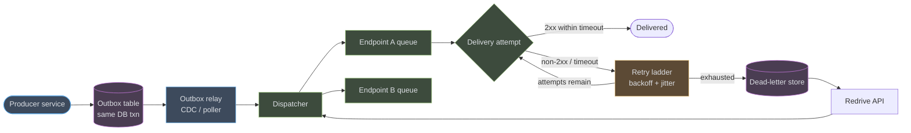
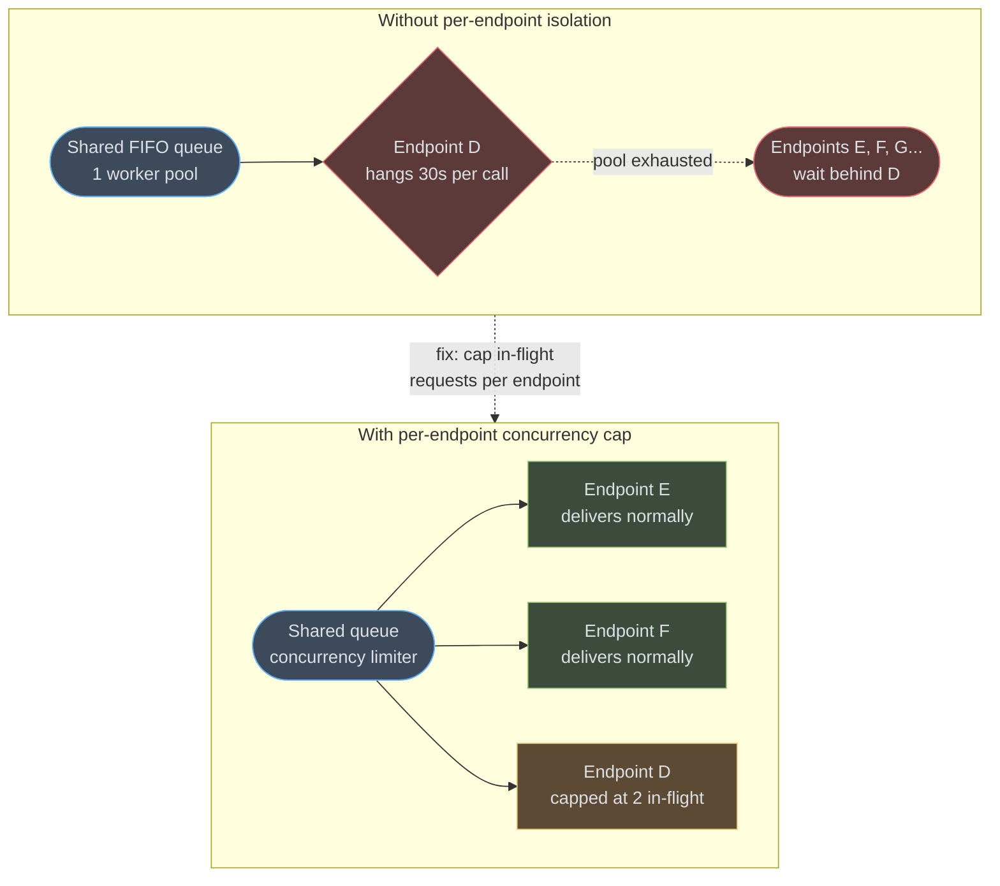
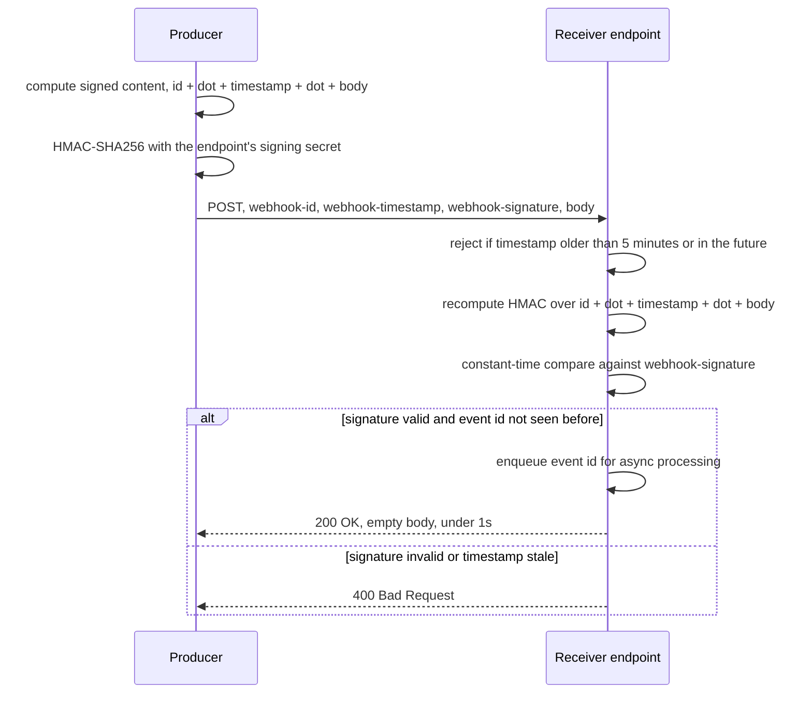
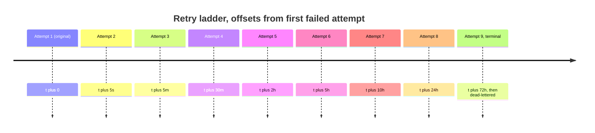
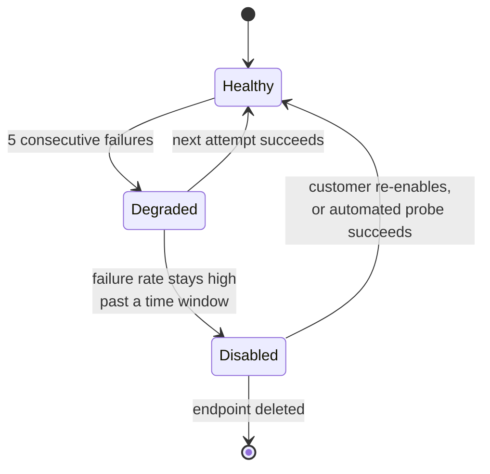
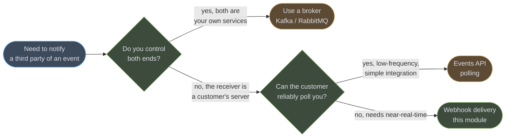

# Webhooks & Event Delivery

Outbound event delivery is a durable, at-least-once distributed-systems problem you run on behalf of someone else's HTTP endpoint — an endpoint you do not operate, cannot scale, and cannot force to stay up. This module covers the producer-side discipline: signing, retrying, isolating, and observing delivery to thousands of independently-unreliable subscribers.

---

## 1. Concept Overview

A webhook is a callback: your system experiences an event (an order paid, a deploy finished, a document signed) and pushes it, over HTTP, to a URL a customer registered in advance. That single sentence hides the entire engineering problem. You own the delivery guarantee — at-least-once, in order if you claim it, within a retry budget you define — but you do not own the receiving side. The customer's endpoint can be slow, offline, redeployed mid-delivery, behind an expired TLS cert, or simply wrong. Nothing about HTTP status codes, timeouts, or network partitions changes because the caller happens to be you and the callee happens to be a customer instead of a peer service.

This is fundamentally different from internal event fan-out. Inside your own infrastructure, a broker like Kafka gives you replayable, ordered, high-throughput delivery to consumers you control — see [Kafka Deep Dive](../kafka_deep_dive/kafka_deep_dive.md) and [Messaging Patterns](../messaging_patterns/messaging_patterns.md) for that side of the problem. A webhook crosses an organisational boundary: the "consumer" is a third party's HTTP server, reachable only synchronously, with no shared broker, no consumer group, no backpressure signal you can read. Every internal messaging pattern (outbox, idempotency keys, DLQ) still applies here — you are simply applying them against a target that can be down for days and never tell you why.

The corollary is that a webhook platform is really two systems wearing one name: a **producer-side delivery pipeline** (this module) and a **consumer-side receiver** that must verify, dedupe, and process what arrives. Both sides matter to the interview and to production; §6 covers both.

For how a payment platform checks a PSP webhook against the PSP's own record before it moves money, see [Idempotency and Exactly-Once Money Movement](../../fintech/idempotency_and_exactly_once_money_movement/idempotency_and_exactly_once_money_movement.md) in `fintech/`.

---

## 2. Intuition

> **One-line analogy:** Publishing an event over a broker you control is handing a letter to your own mail room. A webhook is posting the same letter to an address the customer gave you — and that address might be a mailbox, might be a wall with no door, and might belong to someone who moved without telling you.

**Mental model:** you are not calling a function. You are making a promise — "I will keep trying to tell you this happened, within a bounded window, and I will tell you when I give up." Everything in this module is in service of keeping that promise cheaply: bound the retries so one dead address doesn't cost you forever, isolate delivery per address so one wall doesn't block every other letter, and sign every envelope so the recipient can prove it really came from your mail room.

**Why it matters:** get this wrong and one of two failure modes shows up in production. Either a single unresponsive customer endpoint backs up your entire delivery queue (head-of-line blocking, §10), or an unbounded retry loop against a permanently-4xx endpoint burns compute and clutters logs forever with no terminal state.

**Key insight:** the receiver is adversarial by default, not out of malice but out of physics — you cannot control its uptime, its response latency, or whether it processes the same event twice. Design for a receiver that is slow, occasionally offline, and occasionally duplicates work on its own side; that receiver is the median case, not the edge case.

---

## 3. Core Principles

- **At-least-once delivery, consumer-side idempotency.** You will redeliver the same event more than once — after a timeout where the receiver actually processed the request but the ACK was lost, after a redrive, after a retry racing a slow-but-eventually-successful attempt. Every event carries a stable id so the receiver can dedupe; delivery is not exactly-once and pretending otherwise produces double-charges (see §10).
- **Every payload is signed.** The receiver must be able to prove a request came from you and was not forged or replayed — HMAC over the exact bytes sent, plus a timestamp the receiver checks against a tolerance window (§6.1).
- **Bounded retry with a terminal state.** Every retry ladder ends. An endpoint that fails forever moves to a `disabled` or `dead` state that a human or an automated health check must clear — an infinite retry loop against a permanently-broken endpoint is a resource leak with no discovery mechanism.
- **Per-endpoint isolation.** One customer's dead server must never slow delivery to any other customer. This is the single most common production failure in this module (§10) and the reason "shared connection pool, per-endpoint queue" beats "one global worker pool" at any real scale.
- **Delivery is observable and replayable.** A customer must be able to see what was sent, what came back, and to request a specific event be resent — this is the feature that turns "our webhook didn't fire" support tickets into a five-second self-service lookup.

---

## 4. Types / Architectures / Strategies

### 4.1 Fan-out models

| Model | How it works | Isolation | Complexity |
|---|---|---|---|
| Direct dispatch | Producer calls the endpoint inline, in the request path or a fire-and-forget thread | None — a slow endpoint blocks the caller | Lowest; fine for a prototype, wrong for production |
| Queue-per-endpoint | Every subscriber gets its own durable queue and worker pool | Full — one dead endpoint only backs up its own queue | Highest operational cost (queue count scales with subscriber count) |
| Shared queue, per-endpoint concurrency cap | One durable queue (or partition set), but the dispatcher caps in-flight requests per destination URL/tenant | Effective isolation without a queue per tenant | Moderate — needs a concurrency limiter keyed by endpoint, not just a global worker pool |

Shared queue with per-endpoint concurrency caps is what most production webhook platforms converge on: it gets queue-per-endpoint's isolation without provisioning infrastructure per subscriber. The cap is the load-bearing piece — see §10 for what happens when it is missing.

### 4.2 Push vs. pull

Push (the webhook itself) is the default because it is instant and cheap for the subscriber to consume. But every push design needs a pull fallback: an **events API** the customer can poll (`GET /v1/events?since=<cursor>`) to recover events that were never successfully delivered, or that arrived before the customer's endpoint existed. Stripe, GitHub, and Shopify all expose this pattern as a dashboard "resend" action or an events-list API — it is the redrive mechanism in §6.5 exposed to the customer directly.

### 4.3 The CloudEvents envelope

[CloudEvents](https://github.com/cloudevents/spec) (CNCF, spec v1.0.2) standardises the event *metadata* independent of transport. A CloudEvents-shaped payload carries `specversion` (must be `"1.0"` for a v1.0.2-compliant producer), `id`, `source`, `type`, and optionally `time`, `datacontenttype`, and `data`:

```json
{
  "specversion": "1.0",
  "id": "evt_01J8Z3F9K2X7QABCD",
  "source": "/orders/order-service",
  "type": "com.example.order.paid",
  "time": "2026-08-26T14:03:11Z",
  "datacontenttype": "application/json",
  "data": { "orderId": "ord_9F2", "amountCents": 4599 }
}
```

CloudEvents does not define delivery, retry, or signing — it only standardises what the event *looks like*, so a customer's integration code can share a parser across every producer that emits CloudEvents-shaped payloads. Transport-level guarantees are a separate concern, covered next.

### 4.4 The Standard Webhooks conventions

[Standard Webhooks](https://github.com/standard-webhooks/standard-webhooks) (backed by Svix, Zapier, Twilio, and others) standardises the *transport* envelope: three required headers, `webhook-id`, `webhook-timestamp`, `webhook-signature`, and a signed-content format of `{id}.{timestamp}.{body}` — full construction in §6.1. Where CloudEvents standardises the payload shape, Standard Webhooks standardises the delivery envelope; the two compose cleanly (send a CloudEvents-shaped JSON body inside a Standard-Webhooks-signed request).

---

## 5. Architecture Diagrams

### 5.1 Delivery pipeline



The transactional outbox is what makes "event happened" and "event will be delivered" the same commit — see [Distributed Transactions & Consistency](../distributed_transactions_and_consistency/distributed_transactions_and_consistency.md) for why writing to the outbox table in the same database transaction as the business change is what closes the dual-write gap. Everything downstream of the relay is retry machinery around one HTTP call.

### 5.2 Head-of-line blocking: before and after per-endpoint isolation



A shared worker pool with no per-endpoint cap lets one slow endpoint occupy every worker; capping in-flight requests per destination (2-5 concurrent, tunable) means a hung endpoint only ever wastes its own small slice of capacity.

### 5.3 Signature verification sequence



The receiver's 200 means only "I have durably queued this," not "I have finished processing it" — see §6.6 for why conflating the two is the single most common receiver-side bug.

### 5.4 Retry ladder



Each rung roughly quintuples the wait, so early failures (a transient 503, a deploy in progress) recover within minutes while a genuinely broken endpoint stops consuming dispatcher capacity after nine attempts spread across three days rather than retrying forever.

### 5.5 Per-endpoint circuit state



`Disabled` is the terminal state the retry ladder in §5.4 hands off to: once an endpoint has been failing long enough, stop paying for retries against it and instead notify the customer, exactly as Stripe auto-disables an endpoint after roughly three days of continuous failure.

### 5.6 Delivery mechanism decision



If you control both ends, a broker is strictly better — durable, ordered, replayable, no signing needed. Webhooks exist specifically for the case where the other end is not yours to configure.

---

## 6. How It Works — Detailed Mechanics

### 6.1 HMAC signing (Standard Webhooks convention)

The signed content is the event id, timestamp, and raw body, concatenated with dots — sign exactly these bytes, not a re-serialized version of the JSON, or a receiver's independently-serialized copy will never match:

```java
public final class WebhookSigner {

    // secret is base64-decoded once when the endpoint's signing key is loaded
    public String sign(String eventId, long unixTimestampSeconds, byte[] rawBody, byte[] secretBytes)
            throws Exception {
        String signedContent = eventId + "." + unixTimestampSeconds + "." + new String(rawBody, StandardCharsets.UTF_8);

        Mac mac = Mac.getInstance("HmacSHA256");
        mac.init(new SecretKeySpec(secretBytes, "HmacSHA256"));
        byte[] digest = mac.doFinal(signedContent.getBytes(StandardCharsets.UTF_8));

        return "v1," + Base64.getEncoder().encodeToString(digest);
    }
}
```

Headers sent alongside the raw body:

```
webhook-id: msg_2KWPBgLlAfxdpx2AI54pPJ85f4W
webhook-timestamp: 1798380191
webhook-signature: v1,K9mQ3f7z8yV2n1XwT4pR6oB0cA5dE9gH2jL7kM8nO1p=
```

Receiver-side verification must be constant-time — comparing signatures with `String.equals` leaks timing information an attacker can use to forge a valid signature byte-by-byte:

```java
public boolean verify(String eventId, String timestampHeader, byte[] rawBody,
                       String signatureHeader, byte[] secretBytes) throws Exception {
    long timestamp = Long.parseLong(timestampHeader);
    long now = Instant.now().getEpochSecond();
    if (Math.abs(now - timestamp) > 300) {          // 5-minute tolerance window
        return false;                                 // reject stale or future-dated requests
    }

    String expected = sign(eventId, timestamp, rawBody, secretBytes);

    // webhook-signature may carry multiple space-separated "v1,<sig>" values during key rotation
    for (String candidate : signatureHeader.split(" ")) {
        if (MessageDigest.isEqual(
                candidate.getBytes(StandardCharsets.UTF_8),
                expected.getBytes(StandardCharsets.UTF_8))) {
            return true;
        }
    }
    return false;
}
```

`MessageDigest.isEqual` is the JDK's constant-time comparison — it always compares every byte instead of short-circuiting on the first mismatch, which is what makes byte-by-byte timing forgery infeasible.

### 6.2 RFC 9421 HTTP Message Signatures (the asymmetric alternative)

[RFC 9421](https://www.rfc-editor.org/info/rfc9421/) ("HTTP Message Signatures," Proposed Standard, published February 2024) standardises signing arbitrary HTTP components — not just the body — using two headers: `Signature-Input` (which components are covered, plus algorithm/key/creation metadata) and `Signature` (the resulting bytes). It matters for webhooks when you want the *request itself* — method, target URI, specific headers — cryptographically covered, not merely the JSON body, and when you want asymmetric keys so the receiver can verify without ever holding a shared secret.

The signature base is built by writing one line per covered component, each as `"component-name": value`, in the order declared by `Signature-Input`, followed by a final `"@signature-params"` line carrying the same parameter list:

```
"@method": POST
"@target-uri": https://customer.example.com/webhooks/orders
"content-digest": sha-256=:X48E9qOokqqrvdts8nOJRJN3OWDUoyWxBf7kbu9DBPE=:
"@signature-params": ("@method" "@target-uri" "content-digest");created=1798380191;keyid="prod-key-2026-08";alg="ecdsa-p256-sha256"
```

That base string is what gets signed (with ECDSA, Ed25519, or an HMAC), and the request carries the result as:

```
Signature-Input: sig1=("@method" "@target-uri" "content-digest");created=1798380191;keyid="prod-key-2026-08";alg="ecdsa-p256-sha256"
Signature: sig1=:MEUCIQDx3...base64...==:
```

Compared to the Standard Webhooks HMAC convention, RFC 9421 buys you per-key rotation without a shared secret (asymmetric), coverage of the request line and headers (not only the body), and multiple simultaneous signatures on one message — at the cost of a materially more complex signature-base construction that is easy to get subtly wrong. For most webhook platforms, HMAC-over-body-plus-timestamp (§6.1) remains the pragmatic default; reach for RFC 9421 when the receiver needs non-repudiation against a rotated key set or must verify request metadata beyond the body.

### 6.3 Retry ladder with jitter

```java
public final class RetryLadder {

    // offsets from the first failed attempt; last entry is the terminal attempt
    private static final Duration[] SCHEDULE = {
        Duration.ofSeconds(5), Duration.ofMinutes(5), Duration.ofMinutes(30),
        Duration.ofHours(2),   Duration.ofHours(5),   Duration.ofHours(10),
        Duration.ofHours(24),  Duration.ofHours(48),  Duration.ofHours(72)
    };

    public Optional<Instant> nextAttemptAt(int attemptNumber, Instant firstFailureAt) {
        if (attemptNumber >= SCHEDULE.length) {
            return Optional.empty();                 // ladder exhausted -> dead-letter
        }
        Duration base = SCHEDULE[attemptNumber];
        long jitterMillis = ThreadLocalRandom.current().nextLong(-base.toMillis() / 10, base.toMillis() / 10 + 1);
        return Optional.of(firstFailureAt.plus(base).plusMillis(jitterMillis));
    }
}
```

The +-10% jitter matters at scale: without it, every subscriber that failed at the same moment (a shared upstream blip) retries at exactly the same instant, producing a synchronized thundering herd against the dispatcher's own outbound connection pool. See [Fault Tolerance Patterns](../fault_tolerance_patterns/fault_tolerance_patterns.md) for the general backoff-with-jitter treatment this ladder is a specialization of.

The per-endpoint concurrency cap from §5.2 is itself a rate limiter — it just limits concurrent in-flight requests rather than requests-per-second. A dispatcher that also needs to cap raw *throughput* per destination (so retries after an outage don't slam a recovering endpoint with a burst) should reach for the same token-bucket or sliding-window algorithms covered in [Rate Limiting in Depth](../rate_limiting_in_depth/rate_limiting_in_depth.md), keyed by endpoint id instead of by client — AWS EventBridge's own API destinations apply exactly this pattern, exposing an explicit per-connection invocations-per-second limit alongside its concurrency cap.

### 6.4 Per-endpoint auto-disable

```java
public final class EndpointHealth {

    private final AtomicInteger consecutiveFailures = new AtomicInteger();
    private volatile Instant degradedSince;

    public void onFailure(EndpointState endpoint) {
        int failures = consecutiveFailures.incrementAndGet();
        if (failures == 1) {
            degradedSince = Instant.now();
        }
        boolean pastFailureThreshold = failures >= 5;
        boolean pastTimeWindow = degradedSince != null
            && Duration.between(degradedSince, Instant.now()).compareTo(Duration.ofHours(72)) >= 0;

        if (pastFailureThreshold && pastTimeWindow) {
            endpoint.disable();                       // stop paying for retries; notify the customer
        }
    }

    public void onSuccess() {
        consecutiveFailures.set(0);
        degradedSince = null;
    }
}
```

Disabling is not the same as deleting the subscription — a disabled endpoint keeps its configuration and its event backlog reference so a customer who fixes their server can re-enable and redrive, rather than having to re-register from scratch.

### 6.5 Delivery-attempt records and the redrive endpoint

```sql
CREATE TABLE delivery_attempt (
    id              BIGINT GENERATED ALWAYS AS IDENTITY PRIMARY KEY,
    event_id        TEXT NOT NULL,
    endpoint_id     TEXT NOT NULL,
    attempt_number  INT NOT NULL,
    requested_at    TIMESTAMPTZ NOT NULL,
    response_status INT,                -- NULL means timeout / connection failure
    response_ms     INT,
    outcome         TEXT NOT NULL       -- 'delivered' | 'retrying' | 'dead_lettered'
);
CREATE INDEX ON delivery_attempt (event_id, endpoint_id, attempt_number);
```

This table is the customer-visible delivery log — every "why didn't my webhook fire" ticket resolves by looking up `event_id` here instead of grepping application logs. The redrive endpoint replays a specific attempt without re-running the business logic that produced the event:

```java
@PostMapping("/v1/endpoints/{endpointId}/events/{eventId}/redeliver")
public ResponseEntity<Void> redeliver(@PathVariable String endpointId, @PathVariable String eventId) {
    Event event = eventStore.mustFind(eventId);       // immutable, already-signed payload
    if (deliveryAttemptRepo.existsDelivered(eventId, endpointId)) {
        // idempotent no-op: do not double-fire a customer action on a re-click
        return ResponseEntity.status(HttpStatus.CONFLICT).build();
    }
    dispatcher.enqueue(event, endpointId, /* attemptNumber */ 0);
    return ResponseEntity.accepted().build();
}
```

Checking `existsDelivered` before re-enqueueing is the fix for the double-charge war story in §10 — a redrive that skips this check re-fires an already-successful delivery every time a support agent clicks the button twice.

### 6.6 Receiver side: verify, dedupe, ack fast

```java
@PostMapping("/webhooks/orders")
public ResponseEntity<Void> receive(@RequestHeader("webhook-id") String eventId,
                                     @RequestHeader("webhook-timestamp") String timestamp,
                                     @RequestHeader("webhook-signature") String signature,
                                     @RequestBody byte[] rawBody) {
    if (!signer.verify(eventId, timestamp, rawBody, signature, endpointSecret)) {
        return ResponseEntity.badRequest().build();
    }
    boolean firstTimeSeen = seenEventIds.putIfAbsent(eventId) == null;   // dedupe store, TTL >= retry window
    if (firstTimeSeen) {
        processingQueue.enqueue(eventId, rawBody);      // hand off, do not process inline
    }
    return ResponseEntity.ok().build();                  // 2xx within ~1s regardless of processing outcome
}
```

Three rules in one handler: verify before trusting anything in the body, dedupe on `webhook-id` because at-least-once means this handler *will* see the same id twice, and return 2xx the moment the event is durably queued rather than after business logic finishes — a receiver that processes synchronously inside the request handler turns its own slow database write into the sender's next timeout-and-retry.

---

## 7. Real-World Examples

**Stripe.** Signs every event with HMAC-SHA256 in the `Stripe-Signature` header, formatted as `t=<timestamp>,v1=<signature>`, with a default 5-minute tolerance enforced by the official SDKs. In live mode, Stripe retries a failing endpoint with exponential backoff for up to 3 days (an exponential-backoff window of about three days; Stripe publishes the window but not an attempt count or a fixed schedule, so do not design against a specific number), and automatically disables an endpoint that has failed continuously for that whole window, emailing the account owner. Any non-2xx response triggers a retry, including 4xx — a common misconception is that only 5xx retries. Missed events remain resendable from the Dashboard for 15 days, or via the Stripe CLI for 30 days. ([Stripe webhooks docs](https://docs.stripe.com/webhooks), [signature verification](https://docs.stripe.com/webhooks/signature))

**GitHub.** Signs with HMAC-SHA256 in `X-Hub-Signature-256`, formatted as `sha256=<hex digest>`, over the raw request body using the webhook's configured secret. Every delivery carries a `X-GitHub-Delivery` GUID, which is the correct idempotency key for a receiver to dedupe on — GitHub does **not** automatically retry — its docs state "GitHub does not automatically redeliver failed deliveries"; recovery is manual redelivery from the UI or the REST API. Its server-side timeout is 10 seconds, so a slow receiver simply loses the delivery unless someone replays it. Dedupe on `X-GitHub-Delivery` still matters, because a *manual* redelivery reuses the same GUID. The Settings -> Webhooks UI exposes every past delivery with its request/response pair and a one-click "Redeliver" button, which is the direct product analogue of the redrive endpoint in §6.5. ([validating deliveries](https://docs.github.com/en/webhooks/using-webhooks/validating-webhook-deliveries), [troubleshooting webhooks](https://docs.github.com/en/webhooks/testing-and-troubleshooting-webhooks/troubleshooting-webhooks))

**Shopify.** Signs with HMAC-SHA256 in `X-Shopify-Hmac-Sha256`, base64-encoded (not hex, unlike GitHub), computed over the *raw* request body — a common integration bug is verifying against a body a framework's JSON middleware has already re-parsed and re-serialized, which changes the bytes and breaks verification. Shopify may deliver the same webhook more than once, and recommends deduping on the `X-Shopify-Webhook-Id` header. ([verify webhook deliveries](https://shopify.dev/docs/apps/build/webhooks/verify-deliveries))

**Standard Webhooks.** The vendor-neutral convention this module's §6.1 signing scheme follows directly: `webhook-id` / `webhook-timestamp` / `webhook-signature` headers, `{id}.{timestamp}.{body}` signed content, and a `v1,<base64>` signature format for the symmetric (HMAC-SHA256) case, or `v1a,<base64>` for asymmetric signatures. It is backed by Svix, Zapier, Twilio, and others specifically so a receiver can write one verification function that works against any Standard-Webhooks-compliant sender rather than one bespoke parser per vendor. ([spec](https://github.com/standard-webhooks/standard-webhooks/blob/main/spec/standard-webhooks.md))

---

## 8. Tradeoffs

### 8.1 Ordering vs. throughput

| Choice | Ordering guarantee | Throughput impact |
|---|---|---|
| Single queue per endpoint, one in-flight request at a time | Strict per-endpoint order | Lowest — one slow response stalls every later event to that endpoint |
| Per-endpoint queue, bounded concurrency (2-5 in-flight) | Best-effort; occasional reordering under retry | Good — a few concurrent requests hide most network latency |
| No ordering guarantee, fully parallel dispatch | None | Highest, but forces the receiver to reconstruct order from event timestamps/sequence numbers |

### 8.2 Queue-per-endpoint vs. shared queue with concurrency caps

| | Queue-per-endpoint | Shared queue + per-endpoint cap |
|---|---|---|
| Isolation | Perfect | Effective, as long as the cap is enforced correctly |
| Infra cost | Scales with subscriber count | Flat |
| Operational complexity | High at scale (thousands of queues) | Moderate (one limiter data structure) |
| Failure blast radius | One endpoint | One endpoint, provided the cap is per-destination not per-worker |

### 8.3 At-least-once vs. effectively-once

| | At-least-once | Effectively-once (at-least-once + idempotency key) |
|---|---|---|
| Sender complexity | Low — retry until success or exhaustion | Same sender logic |
| Receiver complexity | Must tolerate duplicates itself | Sender assigns a stable id; receiver's dedupe store makes duplicates a no-op |
| Failure mode if skipped | Receiver double-processes (double-charge, duplicate email) | None, provided the dedupe TTL outlives the retry window |

### 8.4 Symmetric HMAC vs. asymmetric signatures

| | HMAC (Standard Webhooks style) | Asymmetric (RFC 9421, Ed25519/ECDSA) |
|---|---|---|
| Key distribution | Shared secret per endpoint, must stay confidential on both sides | Public key distributed openly; private key never leaves the sender |
| Rotation | Requires a secret both sides update in lockstep (overlap window, §10) | Rotate the private key; publish the new public key, old signatures still verify against the old key |
| Verification cost | One HMAC computation | Public-key verification, more CPU per request |
| Non-repudiation | No — either party could have produced a valid HMAC | Yes — only the private-key holder could have signed |

### 8.5 Webhooks vs. a polling events API

| | Webhook push | Events API polling |
|---|---|---|
| Latency | Near-real-time | Bounded by poll interval |
| Receiver infra | Must run a reachable public HTTPS endpoint | None beyond an HTTP client and a stored cursor |
| Sender infra | Full delivery pipeline: retries, signing, DLQ | A paginated, cursor-based read endpoint |
| Best for | Time-sensitive integrations, most SaaS customers | Receivers behind strict egress-only firewalls, batch integrations |

---

## 9. When to Use / When NOT to Use

**Use webhooks** for cross-organisation integration where the consumer cannot connect into your infrastructure — a customer's server calling out to receive events, rather than connecting into a broker or database you host. This is the entire point: the boundary is organisational, not merely a network hop.

**Do not use webhooks where you control both ends.** If the producer and consumer are both your own services, a broker ([Kafka Deep Dive](../kafka_deep_dive/kafka_deep_dive.md), [Messaging Patterns](../messaging_patterns/messaging_patterns.md)) gives you replay, ordering guarantees, consumer groups, and no signing overhead — reinventing retry ladders and dead-letter queues on top of raw HTTP calls between your own microservices is solving a problem the broker already solved. Reach for [Event-Driven Fundamentals](../event_driven_fundamentals/event_driven_fundamentals.md) to decide whether an event even belongs on a broker versus a direct call in the first place.

**Do not use webhooks for latency-critical synchronous responses.** A webhook is fire-and-forget from the producer's perspective by design; if the caller needs an answer to act on immediately, that is a request/response API (see [REST API Design](../rest_api_design/rest_api_design.md)), not an event notification.

---

## 10. Common Pitfalls

**A slow subscriber blocked every other subscriber for 40 minutes.** A shared worker pool with no per-endpoint concurrency cap let one customer's misconfigured load balancer (30-second connect timeouts on every request) occupy every dispatcher thread. Every other customer's events queued behind it. Fix: cap in-flight requests per destination endpoint (§5.2, §6's dispatcher), independent of total worker pool size — see the full incident writeup in §14.

**Secret rotation with no overlap window broke every customer at once.** Rotating an endpoint's signing secret and immediately retiring the old one means every in-flight and queued delivery signed with the old secret fails verification the instant the new secret goes live — and every customer's receiver starts rejecting requests simultaneously. Fix: accept signatures under *both* the old and new secret for an overlap window (the `webhook-signature` header supports multiple space-separated `v1,<sig>` values specifically for this), and only retire the old secret after the overlap window has fully drained the retry ladder.

**SSRF via a user-supplied endpoint URL.** A webhook endpoint URL is, by definition, attacker-controllable input — a malicious customer can register `http://169.254.169.254/latest/meta-data/` (a cloud metadata endpoint) or `http://10.0.0.5:6379` (an internal Redis instance) as their "webhook URL" and use your dispatcher as a network proxy into your own private infrastructure. See [Backend Security & OWASP](../backend_security_owasp/backend_security_owasp.md) for SSRF generally. Defenses specific to webhook dispatch: resolve the DNS name and pin the dispatcher to the resolved IP for the request (rather than trusting a hostname that could resolve differently between validation and the actual connect), deny link-local (`169.254.0.0/16`) and RFC 1918 private ranges outright, disable automatic redirect-following (a validated public URL can 302 to an internal one), and route all outbound webhook traffic through an egress proxy that enforces the same allowlist server-side rather than trusting application code alone.

**Replaying a redrive with no dedup double-charged customers.** A support tool's redrive button re-enqueued an event without checking whether it had already been successfully delivered, so a support agent double-clicking "resend" (or a script looping over a stuck-event report) fired the same `payment.succeeded` webhook twice against a customer whose own handler was not idempotent, and their system charged the card twice. Fix: the redrive endpoint must check `delivery_attempt` for an existing `delivered` outcome before enqueueing (§6.5) — redriving is for events that were *not* successfully delivered, and this check is what keeps a well-meaning retry button from becoming a duplicate-payment generator.

**Retrying on a 4xx forever.** Treating every non-2xx identically means a permanently misconfigured endpoint (wrong URL path, expired auth on the receiver's side, a 410 Gone) gets retried on the same schedule as a transient 503, consuming ladder capacity for three days on something no retry will ever fix. Most 4xx codes indicate a client-side problem that will not resolve itself: a receiver returning `400`/`404`/`410` is telling you this request is wrong, not merely delayed. `429 Too Many Requests` is the one 4xx that should still retry (respecting `Retry-After` if present) since it is explicitly a rate-limit signal, not a rejection.

---

## 11. Technologies & Tools

| Tool | Purpose |
|---|---|
| Svix | Managed webhook-sending infrastructure — signing, retry ladders, per-endpoint isolation, customer-facing delivery dashboards, maintains the Standard Webhooks spec |
| Hookdeck | Event gateway for both inbound webhook ingestion (queueing, filtering, dedup) and outbound fan-out (Outpost) to webhooks, queues, and event buses |
| AWS EventBridge API destinations | Managed HTTP target for EventBridge rules; per-connection concurrency and invocation-rate limits, automatic retry with backoff, retry window up to 24 hours |
| RabbitMQ delayed delivery | The `rabbitmq-delayed-message-exchange` community plugin is deprecated and its repository is archived; the Raft-backed Delayed Queue that replaces it ships in the commercial VMware Tanzu RabbitMQ 4.3 edition, not in open-source RabbitMQ. On open-source, schedule the ladder yourself (a `due_at` column polled by the dispatcher, or a per-tier TTL+DLX chain) rather than reaching for the plugin |
| Temporal | Durable workflow engine; models a webhook's retry ladder as workflow activity retries with full history/observability instead of hand-rolled scheduler state |
| Standard Webhooks tooling | Open-source SDKs (`svix-libs`) implementing the `webhook-id`/`webhook-timestamp`/`webhook-signature` convention across languages |
| CloudEvents SDKs | Official SDKs (Java, Go, JS, Python, ...) for constructing and parsing the CloudEvents envelope described in §4.3 |
| `ngrok` / `smee.io` | Local tunnel tools for testing inbound webhook delivery against a developer machine during integration development |

---

## 12. Interview Questions with Answers

**Q: Why is at-least-once delivery the default for webhooks, and what does that require of the receiver?**
**Short:** Network failures make exactly-once unprovable, so the sender retries on any ambiguous outcome and the receiver must dedupe.

A sender that gets a timeout or a connection reset cannot tell whether the receiver processed the request and the response was lost, or whether the request never arrived at all — those two cases are indistinguishable from the outside. Retrying is the only safe choice, which makes duplicate delivery a normal, expected outcome rather than a bug. The receiver must therefore assign a dedupe key (the event id) and make reprocessing a no-op, typically with a dedupe store keyed by event id with a TTL at least as long as the sender's retry window.

**Q: Why must webhook signatures be compared in constant time?**
**Short:** A short-circuiting comparison leaks how many leading bytes matched, letting an attacker forge a signature byte-by-byte via timing.

A naive `String.equals` or `==` byte comparison returns as soon as it finds the first mismatched byte, so a slightly-longer response time on requests that match more leading bytes tells an attacker they're on the right track for that byte. Repeating this attack byte-by-byte, an attacker can eventually forge a valid signature without ever knowing the secret. `MessageDigest.isEqual` (or a language's dedicated constant-time comparison) always inspects every byte regardless of where the first mismatch is, closing that side channel.

**Q: A single dead customer endpoint just backed up delivery to every other subscriber. What's the root cause and the fix?**
**Short:** A shared worker pool with no per-endpoint concurrency cap let one slow endpoint consume every worker; cap in-flight requests per destination.

The root cause is architectural, not a bug in any one delivery attempt: without a limit on how many concurrent requests may be in flight to a single destination, a hung or extremely slow endpoint can occupy every worker in a shared pool, starving every other subscriber that happens to share it. The fix is a concurrency limiter keyed by destination (endpoint id or URL), not merely a global pool size — each destination gets its own small slice (2-5 concurrent) regardless of how many workers exist overall.

**Q: You rotated a webhook signing secret and every customer's verification broke simultaneously. What went wrong?**
**Short:** The old secret was retired before the retry ladder drained, so in-flight deliveries signed under it failed verification everywhere at once.

Every event already queued or mid-retry was signed with the old secret at send time; if the receiver's copy of the secret is swapped the instant the new one is generated, every one of those in-flight signatures now fails verification, and it fails for every customer at the same moment because the cutover is global. The fix is an overlap window: accept signatures under both the old and new secret for a period at least as long as the retry ladder's total span, and only retire the old secret after that window fully drains.

**Q: A customer registered an internal IP address as their webhook URL. What's the risk and how do you defend against it?**
**Short:** SSRF — the dispatcher becomes an attacker-controlled proxy into private infrastructure; pin resolved IPs and deny private ranges.

The webhook URL is attacker-controllable input by design, since customers supply it, so a malicious customer can point it at a cloud metadata endpoint or an internal service and use your outbound dispatcher as a network proxy to reach infrastructure they could never reach directly. Defenses: resolve DNS once and pin the connection to that IP rather than trusting a hostname that could re-resolve differently, deny link-local and RFC 1918 ranges outright, disable automatic redirect-following (a validated public URL can 302 to an internal one), and enforce the same allowlist at an egress proxy so a bug in application code isn't the only line of defense.

**Q: Why does retrying forever on a 4xx response waste resources, and which 4xx is the exception?**
**Short:** Most 4xx means the request itself is wrong and no retry fixes it; 429 is the exception since it's a rate-limit signal, not a rejection.

A `400`, `404`, or `410` tells you the receiver considers this specific request malformed or the resource gone — retrying the identical request will produce the identical failure every time, so spending three days of ladder capacity on it accomplishes nothing except delaying the terminal/dead-lettered state a human needs to see. `429 Too Many Requests` is different: it explicitly means "try again later," ideally honoring a `Retry-After` header, and treating it like a permanent failure would abandon a delivery that a short wait would have completed successfully.

**Q: A support tool's "resend" button double-charged a customer. What was missing?**
**Short:** The redrive endpoint enqueued the event without checking it hadn't already been successfully delivered.

Redriving is meant for events that were never successfully delivered — a redrive that skips checking the delivery-attempt log for an existing `delivered` outcome will happily re-fire an event that already succeeded, and a receiver whose handler for `payment.succeeded` is not itself idempotent will act on it twice. The fix is for the redrive endpoint to look up existing delivery outcomes for that event/endpoint pair first and reject or no-op the redrive if a successful delivery already exists.

**Q: How does the Standard Webhooks specification construct its signed content, and why include the timestamp?**
**Short:** It signs `{id}.{timestamp}.{body}` joined by dots; the timestamp lets the receiver reject stale requests as replay defense.

The three pieces — the message id, the unix timestamp, and the raw body — are concatenated with `.` delimiters and HMAC-SHA256'd with the endpoint's shared secret, producing a `v1,<base64>` signature carried in the `webhook-signature` header alongside the plain `webhook-id` and `webhook-timestamp` headers. Including the timestamp in the signed content (not just as an unsigned header) means an attacker cannot swap in a fresher timestamp to bypass the receiver's replay-window check without invalidating the signature; the receiver independently verifies the timestamp is within its tolerance (commonly 5 minutes) before trusting the payload at all.

**Q: What does RFC 9421 add beyond a simple HMAC-over-body scheme, and what's the cost?**
**Short:** It covers request metadata (method, URI, headers) and supports asymmetric keys, at the cost of a more complex signature base to construct correctly.

RFC 9421 (HTTP Message Signatures, a Proposed Standard as of February 2024) lets a signer cover arbitrary HTTP components — the method, the target URI, specific header values, a content digest — not just the request body, and supports both symmetric and asymmetric algorithms, so a receiver can verify without ever holding a shared secret. The tradeoff is complexity: the signature base is a precise, ordered concatenation of `"component-name": value` lines followed by an `"@signature-params"` line, and getting the component list, ordering, or parameter serialization even slightly wrong produces a signature that silently fails to verify rather than an obvious error.

**Q: Why must the receiver verify the raw request body rather than a re-parsed and re-serialized version of it?**
**Short:** Re-serializing JSON changes whitespace and key order, so the signature computed over the original bytes will no longer match.

The sender computes its HMAC over the exact byte sequence it transmitted. If a framework's body-parsing middleware runs before the verification code and hands verification a JSON object that gets re-serialized (different key ordering, different whitespace, different number formatting), the bytes being hashed are no longer the bytes the sender signed, and every legitimate request fails verification. The practical fix is to capture and hash the raw request body before any parsing middleware touches it, which is exactly the class of bug Shopify's own docs warn integrators about.

**Q: What is the difference between an event's "delivered" state and a receiver returning 200?**
**Short:** 200 means the receiver durably queued the event for processing, not that business logic finished running against it.

A receiver that processes an event synchronously inside the HTTP handler and only returns 200 after finishing — writing to a database, calling a downstream service, sending an email — turns any slowness in that processing into the sender's timeout, which triggers an unnecessary retry of an event that was actually going to succeed. The correct contract is to verify the signature, durably enqueue the event (or write a dedupe-keyed record) for async processing, and return 2xx within roughly a second regardless of how long the actual business logic will take.

**Q: How do you keep webhook delivery ordered for a single subscriber without giving up all concurrency?**
**Short:** One in-flight request per endpoint preserves order strictly; a small per-endpoint concurrency cap trades some ordering for throughput.

Strict ordering requires that the next event to a given endpoint isn't sent until the previous one has been acknowledged, which means exactly one in-flight request per destination — simple, but a single slow response fully stalls that endpoint's queue. Most production systems trade a small amount of ordering risk for throughput by allowing 2-5 concurrent in-flight requests per endpoint, accepting that a retry racing a slightly-delayed original attempt can occasionally reorder delivery, and pushing receivers to use the event's own timestamp or sequence number to reconstruct order rather than relying on arrival order.

**Q: When should you use a webhook versus a polling events API for the same integration?**
**Short:** Webhooks for near-real-time push to a reachable receiver; polling when the receiver is behind an egress-only firewall or needs no delivery infra.

A webhook requires the subscriber to run a publicly reachable HTTPS endpoint and accept the operational burden of receiving pushed traffic, in exchange for near-real-time delivery. A polling events API requires no inbound infrastructure at all on the subscriber's side — just an HTTP client and a stored cursor — which suits subscribers behind strict egress-only firewalls or those doing periodic batch integrations, at the cost of latency bounded by the poll interval. Most mature platforms expose both, with the events API doubling as the resend/recovery mechanism when webhook delivery genuinely fails.

**Q: How would you design the schema for a customer-visible webhook delivery log?**
**Short:** One row per delivery attempt, keyed by event and endpoint, storing status, latency, and outcome, so a customer can see every attempt without grepping logs.

Store one row per attempt (not per event) with the event id, endpoint id, attempt number, request timestamp, response status (nullable for a timeout/connection failure), response latency, and a terminal outcome field (`delivered`, `retrying`, `dead_lettered`). Indexing on `(event_id, endpoint_id, attempt_number)` makes "show me everything that happened to event X" a single indexed lookup, which is what turns "our webhook didn't fire" into a support agent looking up one row instead of grepping distributed logs across every dispatcher instance.

**Q: Why does CloudEvents not solve delivery reliability, and what does it solve instead?**
**Short:** CloudEvents standardises the event's shape (id, source, type, data), not how it's transported, retried, or signed.

CloudEvents defines a small set of required context attributes — `specversion`, `id`, `source`, `type` — and optional ones like `time` and `datacontenttype`, giving consumers a consistent envelope to parse regardless of which system produced the event. It says nothing about HTTP delivery semantics, retries, signing, or ordering; those are transport-layer concerns, which is exactly why a CloudEvents-shaped body composes cleanly with a separate transport convention like Standard Webhooks — one standardises the payload, the other standardises how it's securely delivered.

**Q: What's the tradeoff between a queue-per-endpoint architecture and a shared queue with per-endpoint concurrency caps?**
**Short:** Queue-per-endpoint gives perfect isolation at high infra cost; a shared queue with caps gets most of the isolation at flat cost.

Provisioning a dedicated durable queue and worker pool per subscriber gives airtight isolation — nothing about one endpoint's queue can affect another's — but the infrastructure cost scales linearly with subscriber count, which becomes unwieldy at thousands of endpoints. A shared queue with a concurrency limiter keyed by destination gets effectively the same isolation (a hung endpoint can only ever occupy its own small slice of in-flight capacity) without provisioning per-tenant infrastructure, provided the cap is enforced correctly per destination rather than only at the pool level.

**Q: Why should a webhook's dead-letter state be reachable through a redrive API rather than just logged?**
**Short:** A logged failure requires someone to notice and manually intervene; a redrive API makes recovery self-service and auditable.

An event that exhausts its retry ladder and only gets written to a log file depends entirely on someone reading that log, understanding the failure, and manually re-triggering delivery through some ad hoc mechanism — a process that does not scale past a handful of incidents and leaves no audit trail. Exposing dead-lettered events through a redrive API (or a self-service dashboard button, as GitHub's "Redeliver" and Stripe's Dashboard resend both do) turns recovery into a repeatable, permission-scoped, logged action instead of an engineer hand-crafting a curl command against production.

**Q: What is the security purpose of masking-equivalent replay protection in webhook signing, and how is it implemented?**
**Short:** The timestamp is part of the signed content and checked against a tolerance window, so a captured request can't be replayed indefinitely.

If a signature only covered the body, an attacker who captured one valid signed request could replay it forever — the signature would still verify since the body hasn't changed. Including the timestamp inside the signed content means the receiver can independently reject any request whose timestamp falls outside a tolerance window (commonly 5 minutes), and because the timestamp is part of what was signed, an attacker cannot simply attach a fresher timestamp to an old, captured body without invalidating the signature.

**Q: How do you test webhook delivery locally during development?**
**Short:** A local tunnel (ngrok, smee.io) exposes a developer's machine at a public HTTPS URL the real sender can actually reach.

A webhook sender needs a publicly reachable HTTPS URL to deliver to, which a developer's `localhost` is not — a tunnel tool forwards a public URL's traffic down to the local machine, letting a developer register that public URL with the real sender (or the sender's sandbox/test mode) and see genuine signed requests arrive locally without deploying anything. Most production senders also offer a CLI (Stripe's `stripe listen`, for example) that forwards test events directly to a local port over an authenticated connection instead of requiring a public tunnel at all.

**Q: What determines the size of a per-endpoint concurrency cap, and what happens if it's set too high or too low?**
**Short:** It balances per-endpoint throughput against blast radius; too high re-creates head-of-line blocking, too low throttles a healthy fast endpoint.

The cap should be large enough that a healthy, fast-responding endpoint isn't artificially throttled below what it could actually handle, but small enough that a hung endpoint only ever occupies a small, bounded slice of total dispatcher capacity — 2 to 5 concurrent in-flight requests is a common starting point, tuned per observed endpoint latency. Set it too high and a single dead endpoint can still meaningfully degrade shared capacity (re-creating the head-of-line blocking problem the cap exists to prevent); set it too low and a legitimately fast, healthy endpoint gets rate-limited by your own dispatcher rather than by anything on its end.

---

## 13. Best Practices

- Sign everything, and verify against the raw, unparsed body — never a re-serialized copy.
- Cap total retry attempts and give every endpoint a terminal `disabled`/`dead_lettered` state; no retry ladder should be infinite.
- Isolate delivery per endpoint (dedicated queue, or a shared queue with a per-destination concurrency cap) so one dead subscriber cannot degrade any other.
- Expose a customer-visible delivery log with per-attempt status and a self-service redrive action, checked against prior successful delivery before re-enqueueing.
- Version event payloads explicitly (a `type` field like `order.paid.v2`, or a schema version attribute) so consumers can migrate deliberately instead of breaking on an unannounced shape change.
- Never put secrets, internal ids, or PII beyond what the subscriber is entitled to see inside the payload — the payload crosses an organisational boundary the moment it leaves your network.
- Overlap signing secrets during rotation; never retire the old secret before the retry ladder's full span has drained.
- Treat every subscriber-supplied URL as untrusted input and defend against SSRF at the network layer, not just with a URL-format check.

---

## 14. Case Study

**Problem.** A B2B SaaS platform's webhook fleet delivered order and shipment events to roughly 4,000 customer endpoints through a single shared worker pool with no per-endpoint limits. One customer's endpoint — behind a misconfigured load balancer with a 30-second connect timeout instead of the customer's intended 3 seconds — began accepting TCP connections but never responding. Every dispatcher worker that picked up an event for that customer blocked for the full 30 seconds before timing out, and because the pool had no concept of "this destination is unhealthy, stop sending it more work," the pool filled with workers stuck on that one endpoint within about four minutes. Every other customer's events queued behind the backlog. Global delivery latency, normally under 2 seconds p99, climbed past 40 minutes before an on-call engineer identified and manually blacklisted the offending endpoint.

**Fix.** The dispatcher was rebuilt around the pattern in §5.2 and §6.4: a concurrency limiter keyed by destination endpoint, capping each endpoint at 3 in-flight requests regardless of total pool size, combined with the auto-disable state machine from §6.4 so a consistently-failing endpoint stops being handed new work automatically instead of requiring a human to notice and intervene. A per-request connect timeout of 5 seconds and a total request timeout of 10 seconds were also enforced dispatcher-side, independent of anything the customer's server claimed to support.

**Result.** The same failure mode — one customer's endpoint hanging on every connection — now costs that customer's own delivery latency and nothing else; global p99 delivery latency is unaffected by any single endpoint's health. The fix also produced the auto-disable/redrive flow now exposed to customers as a self-service dashboard, cutting "why didn't my webhook fire" support tickets substantially since customers can now see the failure and the endpoint's disabled state directly rather than filing a ticket.

The full principal-level treatment of this system — capacity planning, technology choices, and the operational playbook — is in [Design Webhook Delivery Service](../case_studies/design_webhook_delivery_service/design_webhook_delivery_service.md).
