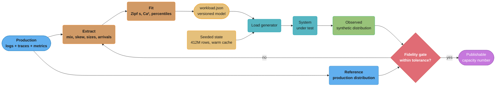
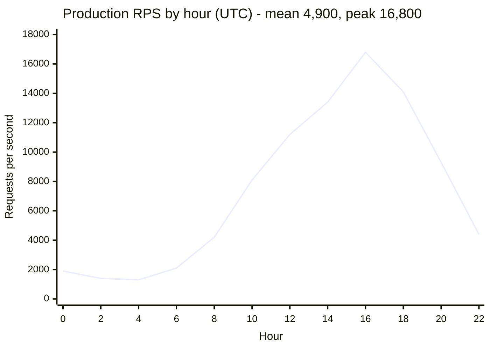
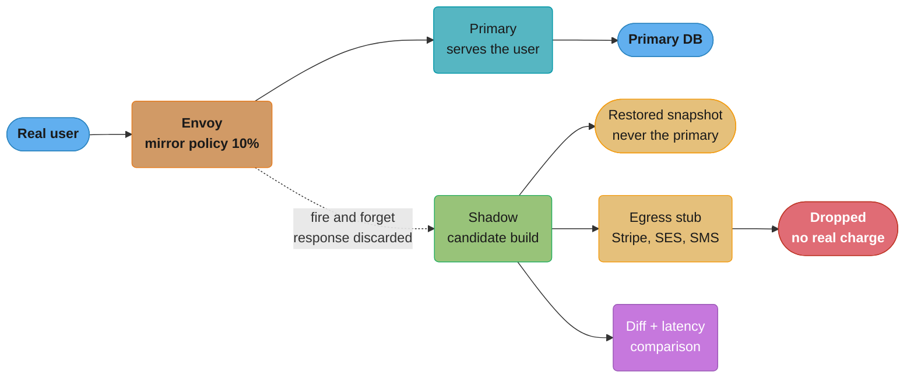

# Workload Characterization and Load Modelling

> A load test measures a system under a **model of demand**. If the model is wrong, the
> test is not "approximately right" — it is measuring a different system. A green 50,000
> RPS result followed by an outage at 5,000 real RPS is not a testing failure. It is a
> modelling failure, and the test was working perfectly the whole time.

---

## 1. Concept Overview

**Workload characterization** is the measurement discipline: extracting, from production, the statistical shape of the demand your system actually receives. **Load modelling** is the engineering discipline that follows: encoding that shape into a generator faithfully enough that a number produced under it transfers to production.

Most teams do the second without the first. Someone asks a product manager "what's our traffic like?", gets "mostly reads, maybe 3 to 1", writes a k6 script with a 75/25 split over `crypto.randomUUID()` keys against a 10,000-row seeded database, and runs it at 50,000 RPS. The script is well-written. The thresholds are correct. The result is worthless, because five independent properties of the real workload were replaced with defaults that happen to make the system look fast:

| Property | What the model assumed | What production does | Consequence |
|----------|------------------------|----------------------|-------------|
| Endpoint mix | 75% read / 25% write, guessed | 61% read, 22% write, 17% search | the expensive endpoint was never exercised |
| Key distribution | uniform over 20,000 seeded ids | Zipfian over 10.2M ids, `s ≈ 0.91` | 99.4% synthetic hit rate vs 78.4% real |
| Arrival process | constant 50,000 RPS | diurnal, peak/mean 3.4x, plus a cron burst | queueing understated; no burst absorption tested |
| Data volume | 10,000-row tables | 412M rows, 9.1 GB index | planner picked a different plan in production |
| Payload size | fixed 1.5 KB body | p50 1.2 KB, p95 34 KB, p99 210 KB | serialization and gzip cost invisible |

Each error is individually plausible. Together they produced a test that never touched the database hard enough to find its ceiling, and the ceiling was 1,100 queries per second short of what the first real Tuesday delivered.

**What this module is not.** It is not a load-testing tutorial. k6, Gatling and JMeter mechanics, coordinated omission, open vs closed models, virtual-user sizing with Little's Law, and CI threshold gates are covered in [`load_and_performance_testing`](../load_and_performance_testing/load_and_performance_testing.md) and [`devops/performance_and_load_testing`](../../devops/performance_and_load_testing/performance_and_load_testing.md). The variability term that makes bursty arrivals so expensive is derived in [`queueing_theory_for_capacity`](../queueing_theory_for_capacity/queueing_theory_for_capacity.md) — this module tells you how to *measure* `Ca²` from production, not how Kingman's formula works. The statistics of trusting a measurement at all belong to [`benchmarking_methodology`](../benchmarking_methodology/benchmarking_methodology.md).

This module owns exactly one question: **is the load you are generating the load you actually receive, and how do you prove it before anyone quotes the number?**

---

## 2. Intuition

**One-line analogy:** a flight simulator whose weather model only has clear skies will certify a pilot who has never flown in rain.

**Mental model.** Think of the load generator as a *machine that manufactures users*. Every parameter you leave at its default is a claim about your users that you have not checked. `randomUUID()` for a cache key is the claim "no user is more popular than any other user". A constant arrival rate is the claim "our traffic has no rush hour and no cron job". A 10,000-row seed is the claim "the query planner behaves identically at four orders of magnitude more data". Written out that way, every default is obviously false. Left implicit in a script, every default is invisible.

**Why it matters.** Load testing is expensive — a staging fleet, an engineer's week, a release gate that blocks deploys. That entire budget is spent producing exactly one artifact: a number someone will make a capacity decision on. A model error does not degrade that number gracefully. It replaces it with the answer to a different question, and there is nothing about the output that says so. Every threshold passes. Every graph looks clean.

**Key insight.** All models are wrong; the job is to be wrong on the axes that do not move the metric you are measuring, and right on the ones that do. Your users' first names do not affect p99. Their key access distribution does, because it sets your cache hit rate, which sets your database rate, which sets your connection-pool utilization, which — via `R = S / (1 - ρ)` — sets your tail. So the modelling effort is not "make it realistic"; it is "identify the three or four dimensions with a causal path to the metric, measure those from production, and default the rest openly."

---

## 3. Core Principles

**1. The model is a hypothesis about production, so validate it against production.** You have production data. Compare the synthetic distribution against it on the dimensions that matter and publish the comparison alongside the result. A load test report without a fidelity table is an unsourced claim.

**2. Averages destroy exactly the property you are testing.** A mean payload of 4 KB tells you nothing about the 210 KB p99 that dominates serialization CPU. A mean of 5,000 RPS tells you nothing about the 17,000 RPS cron burst. Model distributions, not means — the tail is where systems fail, and a mean is the statistic that deletes it.

**3. Data volume is part of the workload.** A query plan is a function of table statistics. A test against 10,000 rows is not a smaller version of a test against 412M rows; it is a test of a different execution plan against a fully-cached working set. Row counts, index sizes relative to `shared_buffers`, and cache warmth are inputs, not environment details.

**4. Every model decays.** A client release, a feature-flag ramp, a marketing campaign or a new large tenant changes the mix. A model derived nine months ago is describing a system that no longer exists. Re-derive on a schedule and on trigger events, and version the model artifact with the date and the production window it came from.

**5. Prefer real traffic to modelled traffic when you can contain the side effects.** Shadow traffic has a fidelity no model reaches, because it is not a model. The cost is not accuracy, it is containment — writes, third-party calls and PII. If you can pay that cost, mirroring beats every synthetic distribution you could fit.

**6. Refuse to publish a number the model does not support.** The discipline that makes all of this real is the willingness to say "this run is invalid, the payload p99 was off by 4.7x". That refusal is cheap on a Tuesday and impossible during the incident it would have prevented.

---

## 4. Types / Architectures / Strategies

### 4.1 The five dimensions of a workload

| Dimension | What you measure | Primary source | What it drives |
|-----------|------------------|----------------|----------------|
| **Request mix** | ratio per endpoint/operation, per client version | access logs, span names | which code path is exercised at all |
| **Arrival process** | rate over time, burstiness `Ca²`, seasonality | request timestamps | queueing delay and headroom needs |
| **Argument distribution** | key skew, tenant skew, payload sizes, filter selectivity | log fields, trace attributes | cache hit rate, plan choice, CPU per request |
| **State** | row counts, index size, cache warmth, queue depth at start | database and cache metrics | plan choice, I/O, cold-start behaviour |
| **Session structure** | requests per session, think time, ordering, abandonment | session ids in traces | concurrency profile, connection churn |

A model that gets four of five right and defaults the fifth is not 80% right. It is wrong in whichever direction the defaulted dimension pushes, usually optimistic, because every default is a *simplification* and simplifications are almost always easier for the system than reality.

### 4.2 Four sources of a load model, ranked by fidelity

| Source | Fidelity | Effort | Risk |
|--------|----------|--------|------|
| **Guessed** (a person's recollection) | very low | 10 minutes | systematically optimistic; the modal failure |
| **Derived** (fitted from logs/traces) | high on measured dimensions | 1–3 days initially, hours to refresh | silently stale; misses unmeasured dimensions |
| **Replayed** (recorded production requests, re-issued) | very high on mix and arguments | 2–5 days plus storage | PII handling, timestamp scaling, expired auth tokens |
| **Mirrored / shadow** (live traffic tee'd to a candidate) | highest — it is not a model | 1–2 weeks of containment work | writes, third-party side effects, data-store divergence |

Derived is the workhorse: it is the only one you can run in CI, and it is the only one you can dial to 3x current peak. Replay and mirror answer the question "does the candidate behave like the incumbent on today's exact traffic", which is a different and complementary question.

### 4.3 Arrival-process families

| Family | Shape | When it is the right model | Modelling note |
|--------|-------|----------------------------|----------------|
| **Constant rate** | fixed inter-arrival gap, `Ca² = 0` | internal batch consumers, fixed-cadence pollers | understates queueing badly for user traffic |
| **Poisson** | exponential gaps, `Ca² = 1` | large independent user populations at steady rate | the reasonable default for human traffic |
| **Diurnal** | slow sinusoid, peak/mean 2–5x | anything user-facing with a geography | test at peak, not at mean; ramp matters |
| **Bursty / MMPP** | rate switches between regimes, `Ca² = 3–20` | mobile push, retry storms, viral events | this is where headroom is actually consumed |
| **Cron-aligned spike** | near-instant step at `:00` | scheduled jobs, token refresh, billing cycles | thundering herd; tests jitter and admission control |

The jump from `Ca² = 1` to `Ca² = 8` multiplies queueing delay by 4.5 at fixed utilization, per Kingman's `(Ca² + Cs²)/2` term — see [`queueing_theory_for_capacity`](../queueing_theory_for_capacity/queueing_theory_for_capacity.md) for the derivation. A constant-rate generator sets that term to its minimum and hands you a headroom estimate that production will not honour.

### 4.4 Key-distribution families

| Family | Model | Cache behaviour |
|--------|-------|-----------------|
| Uniform over `N` | `randomUUID()` or `randInt(0, N)` | hit rate is a step function of `cacheSize / N` — 100% or near-0% |
| **Zipf**, exponent `s` | `P(rank k) ∝ k^-s` | smooth hit-rate curve; `s ≈ 0.8–1.1` for most catalogues |
| Fixed hot set + uniform tail | 5% of keys get 80% of hits | crude but far better than uniform; a 20-minute fix |
| Trace replay | actual observed key sequence | exact, including temporal locality LRU exploits |

Zipf is not an aesthetic preference. Web object popularity, product catalogue access, social graph fan-out and memcached key access are all measured to be near-Zipfian, and the exponent is fittable from one hour of logs in about fifteen lines of Python (§6.3).

---

## 5. Architecture Diagrams

### 5.1 The characterization-to-validation loop



The loop's only load-bearing edge is `gate --> extract`. A pipeline without it still produces a number every night; it just produces an unfalsifiable one.

### 5.2 Uniform versus Zipf key access — why the hit rate lies

Access counts for the top 12 ranks out of a 10.2M-key space, 1M sampled requests,
under a uniform model and under the fitted production distribution (`s = 0.91`).

```
rank:      1    2    3    4    5    6    7    8    9   10   11   12
           |    |    |    |    |    |    |    |    |    |    |    |
uniform  | #  | #  | #  | #  | #  | #  | #  | #  | #  | #  | #  | #  |   0.1 hits/key
zipf     |####|##  |##  |#   |#   |#   |#   |#   |#   |#   |#   |#   |
         |7.4k|3.9k|2.7k|2.1k|1.7k|1.5k|1.3k|1.2k|1.0k|0.9k|0.9k|0.8k|

CACHE OF 100,000 ENTRIES (1% of the key space)
  uniform over 20,000 seeded keys   -> whole key space fits -> hit rate 99.4%
  zipf s=0.91 over 10.2M keys       -> top 1% carries ~56%  -> hit rate 78.4%
                                        (LRU + temporal locality lifts 56% -> 78%)

  DELTA:      21.0 percentage points of hit rate
  MISS RATE:  0.6%  ->  21.6%          =  36x more requests reach the database
  AT 5,000 RPS: 30 QPS -> 1,080 QPS    =  the number the pool was never sized for
```

The uniform model does not produce a *slightly* optimistic hit rate. It produces a
qualitatively different regime: once the synthetic key space fits in cache, the database
disappears from the test entirely, and no amount of extra RPS brings it back.

### 5.3 The diurnal curve you must test at



Peak-to-mean is 3.4x. A capacity test run at the daily mean of 4,900 RPS certifies a fleet
that is 71% short at 16:00, and a test that ramps to peak over 30 minutes never exercises
the autoscaler behaviour that matters at 08:00, where traffic doubles in 11 minutes.

### 5.4 Shadow traffic with side-effect containment



Three edges carry the entire safety argument: the shadow writes to a restored snapshot, its
egress is stubbed at the mesh, and the mirror is fire-and-forget so a slow shadow can never
add latency to the user's request.

---

## 6. How It Works — Detailed Mechanics

### 6.1 Extracting the request mix from access logs

Structured access logs are the cheapest source. One hour at peak is enough for the mix; use a
full week if you need weekday/weekend separation. Query them where they already live — this
runs against a day of JSON logs on a laptop in about 40 seconds for 30M lines.

```sql
-- DuckDB over exported access logs; route_template, not raw path,
-- or every id becomes its own endpoint.
SELECT route_template,
       method,
       count(*)                                              AS n,
       round(100.0 * count(*) / sum(count(*)) OVER (), 2)    AS pct,
       round(quantile_cont(bytes_in,  0.50))                 AS req_p50,
       round(quantile_cont(bytes_in,  0.95))                 AS req_p95,
       round(quantile_cont(bytes_out, 0.99))                 AS resp_p99,
       round(100.0 * sum(CASE WHEN status >= 500 THEN 1 ELSE 0 END) / count(*), 3) AS err_pct
FROM read_json_auto('s3://logs/access/2026-08-25/*.json.gz')
WHERE ts BETWEEN '2026-08-25 15:00' AND '2026-08-25 17:00'
GROUP BY 1, 2
ORDER BY n DESC
LIMIT 25;
```

A real result for the service in §1:

| route_template | method | pct | req_p50 | req_p95 | resp_p99 | err_pct |
|----------------|--------|-----|---------|---------|----------|---------|
| `/v2/products/{id}` | GET | 38.10 | 0 | 0 | 14,200 | 0.04 |
| `/v2/search` | POST | 17.20 | 380 | 1,100 | 212,400 | 1.90 |
| `/v2/cart` | GET | 12.60 | 0 | 0 | 8,900 | 0.02 |
| `/v2/cart/items` | POST | 9.40 | 1,240 | 3,800 | 2,100 | 0.31 |
| `/v2/orders` | POST | 4.10 | 2,900 | 34,100 | 6,400 | 0.70 |
| ...19 more | | 18.60 | | | | |

Two things the guessed model got wrong are visible immediately. `/v2/search` is 17.2% of
traffic, not a rounding error, and it carries a 1.9% error rate and a 212 KB p99 response.
And `/v2/orders` has a 34 KB p95 request body — bulk carts — which is 23x the fixed 1.5 KB
the script was sending.

**The tail matters more than the head.** The 19 endpoints below the top 6 are 18.6% of
requests combined. Dropping them from the model is defensible; pretending the top 6 are 100%
of traffic while labelling the run "production-representative" is not. State the coverage
explicitly: *"model covers 81.4% of production requests by volume; the excluded tail is
composed of endpoints each under 1.2%."*

### 6.2 Deriving think time and session structure from traces

Think time is not available from access logs unless you can group by session. Traces have
the grouping for free.

```sql
-- Inter-request gap within a session, from the trace store.
WITH ordered AS (
  SELECT session_id,
         ts,
         lag(ts) OVER (PARTITION BY session_id ORDER BY ts) AS prev_ts
  FROM spans
  WHERE span_kind = 'SERVER' AND ts > now() - INTERVAL 2 HOUR
)
SELECT round(quantile_cont(epoch(ts - prev_ts), 0.50), 2) AS think_p50_s,
       round(quantile_cont(epoch(ts - prev_ts), 0.90), 2) AS think_p90_s,
       round(avg(cnt), 1)                                  AS reqs_per_session
FROM ordered
JOIN (SELECT session_id, count(*) AS cnt FROM spans GROUP BY session_id) s
  USING (session_id)
WHERE prev_ts IS NOT NULL AND ts - prev_ts < INTERVAL 10 MINUTE;
```

Measured: `think_p50 = 4.8s`, `think_p90 = 21.3s`, `reqs_per_session = 11.4`. Model think time
as a log-normal fitted to those quantiles, not as a constant — a constant think time produces
a synchronized user population that pulses, which is a *different* arrival process than the
one you measured.

Note the 10-minute cutoff: without it, a session resumed the next morning contributes an
18-hour "think time" that drags every mean. Session boundaries are a modelling decision;
write down the one you made.

### 6.3 Fitting the key-access distribution

Take one hour of key accesses from logs, rank them by frequency, and fit the exponent. Zipf's
law is a straight line on a log-log rank-frequency plot, so the fit is a linear regression.

```python
"""Fit a Zipf exponent to observed key accesses, and report the fit quality."""
import numpy as np
from collections import Counter

def fit_zipf(keys):
    counts = np.array(sorted(Counter(keys).values(), reverse=True), dtype=float)
    ranks = np.arange(1, len(counts) + 1, dtype=float)
    # Drop the flat tail of singletons: it is sampling noise, not distribution shape.
    keep = counts >= 5
    lr, lc = np.log(ranks[keep]), np.log(counts[keep])
    s, intercept = np.polyfit(lr, lc, 1)
    resid = lc - (s * lr + intercept)
    r2 = 1.0 - resid.var() / lc.var()
    return -s, r2, len(counts)

def sample_zipf(rng, s, n, size):
    """Truncated Zipf over ranks 1..n by inverse CDF.

    numpy.random.zipf(a) requires a > 1 and samples with exponent ~a, so it cannot
    produce the s = 0.91 of a real web workload. Build the CDF explicitly instead.
    """
    cdf = np.cumsum(np.arange(1, n + 1, dtype=np.float64) ** -s)
    cdf /= cdf[-1]
    return np.searchsorted(cdf, rng.random(size)) + 1

def hit_rate(keys, cache_size):
    """Exact LRU hit rate over the observed sequence - the number to reproduce."""
    from collections import OrderedDict
    lru, hits = OrderedDict(), 0
    for k in keys:
        if k in lru:
            hits += 1
            lru.move_to_end(k)
        else:
            lru[k] = 1
            if len(lru) > cache_size:
                lru.popitem(last=False)
    return hits / len(keys)

if __name__ == "__main__":
    # Synthetic stand-in for one hour of production keys.
    rng = np.random.default_rng(7)
    keys = sample_zipf(rng, s=0.91, n=10_200_000, size=1_000_000)
    s, r2, distinct = fit_zipf(keys)
    print(f"s={s:.2f}  r2={r2:.3f}  distinct={distinct:,}")
    print(f"LRU@100k hit rate = {hit_rate(keys, 100_000):.3f}")
    assert 0.5 < s < 1.5, "exponent outside the plausible web-workload band"
    assert r2 > 0.90, "poor Zipf fit - use trace replay instead of a fitted law"
```

Production output for the service in §1: `s = 0.91, r2 = 0.978, distinct = 1,043,118`, and an
exact-LRU hit rate at 100,000 entries of **0.784**.

**Read the `r2` before you trust the `s`.** An `r2` of 0.978 means the fitted law reproduces
the observed shape. An `r2` of 0.71 usually means the workload is bimodal — a hot set plus a
scan — and no single Zipf exponent describes it. In that case do not fit; replay the observed
key sequence directly, which also preserves the temporal locality that LRU exploits and that
an i.i.d. Zipf draw destroys.

That last point costs real accuracy: sampling keys i.i.d. from a fitted `s = 0.91` produced a
71.2% hit rate against the 78.4% the same distribution achieves when replayed in observed
order. The 7.2-point gap is temporal locality — real users request the same product three
times in ninety seconds, and an i.i.d. sampler never does.

### 6.4 Encoding the distribution in the generator

The fitted model becomes a versioned artifact, and the generator reads it. Never inline the
constants — the artifact's provenance is what makes the run auditable.

```json
{
  "model_version": "2026-08-25.1",
  "derived_from": "prod access logs 2026-08-25T15:00Z..17:00Z, 41.2M requests",
  "coverage_pct": 81.4,
  "mix": [
    {"route": "/v2/products/{id}", "method": "GET",  "weight": 38.1},
    {"route": "/v2/search",        "method": "POST", "weight": 17.2},
    {"route": "/v2/cart",          "method": "GET",  "weight": 12.6},
    {"route": "/v2/cart/items",    "method": "POST", "weight": 9.4},
    {"route": "/v2/orders",        "method": "POST", "weight": 4.1}
  ],
  "key_distribution": {"family": "zipf", "s": 0.91, "n": 10200000, "r2": 0.978},
  "payload_bytes": {"p50": 1240, "p95": 34100, "p99": 210400, "max": 4194304},
  "arrival": {"family": "poisson_diurnal", "peak_rps": 16800, "mean_rps": 4900, "ca2": 2.7},
  "think_time_s": {"family": "lognormal", "p50": 4.8, "p90": 21.3},
  "tenant_share": {"top1_pct_of_tenants_share": 46.0, "largest_tenant_share": 11.0},
  "state": {"orders_rows": 412000000, "index_gb": 9.1, "cache_prewarm": true}
}
```

The generator side is small — this is inverse-transform sampling of a Zipf, precomputed once
per VU rather than per request, because the CDF build is the expensive part:

```javascript
// k6 - sample keys from the fitted Zipf instead of randomUUID().
import { SharedArray } from 'k6/data';

const model = JSON.parse(open('./workload.json'));

// Build the CDF once, shared across all VUs (SharedArray is copy-on-read, not per-VU).
const cdf = new SharedArray('zipf-cdf', function () {
  const { s, n } = model.key_distribution;
  const TOP = 200000;                    // top ranks carry ~62% of hits at s=0.91
  const w = new Float64Array(TOP);
  let acc = 0;
  for (let k = 1; k <= TOP; k++) { acc += Math.pow(k, -s); w[k - 1] = acc; }
  for (let k = 0; k < TOP; k++) { w[k] /= acc; }
  return Array.from(w);
});

export function pickKey() {
  const u = Math.random();
  let lo = 0, hi = cdf.length - 1;
  while (lo < hi) { const mid = (lo + hi) >> 1; if (cdf[mid] < u) lo = mid + 1; else hi = mid; }
  return `product:${lo + 1}`;            // rank -> id; ranks ARE the popularity order
}
```

**The trap in that snippet is `SharedArray`.** Building a 200,000-entry CDF inside `default`
costs roughly 6ms per iteration per VU; at 400 VUs that is 2.4 seconds of generator CPU per
second of test, and the generator becomes the bottleneck. A generator that cannot sustain the
open-model arrival rate silently converts your open-model test back into a closed one — the
coordinated-omission failure documented in
[`load_and_performance_testing`](../load_and_performance_testing/load_and_performance_testing.md).
Always check that the generator's *achieved* rate matches its configured rate before reading
any latency number.

### 6.5 Modelling the arrival process

Three arrival shapes, each worth a separate run:

```javascript
export const options = {
  scenarios: {
    // 1. Steady peak - the capacity number. Open model, Poisson-ish by construction.
    peak: {
      executor: 'constant-arrival-rate',
      rate: 16800, timeUnit: '1s', duration: '20m',
      preAllocatedVUs: 3000, maxVUs: 6000,
    },
    // 2. Morning ramp - traffic doubles in 11 minutes; tests the autoscaler, not the app.
    ramp: {
      executor: 'ramping-arrival-rate',
      startRate: 4200, timeUnit: '1s',
      stages: [{ target: 8100, duration: '11m' }, { target: 8100, duration: '10m' }],
      preAllocatedVUs: 2000, maxVUs: 5000, startTime: '25m',
    },
    // 3. Cron burst - 0 to 17k in under a second at :00, then back down.
    burst: {
      executor: 'ramping-arrival-rate',
      startRate: 4900, timeUnit: '1s',
      stages: [
        { target: 4900,  duration: '2m' },
        { target: 17000, duration: '1s' },   // the thundering herd
        { target: 17000, duration: '30s' },
        { target: 4900,  duration: '5s' },
      ],
      preAllocatedVUs: 4000, maxVUs: 9000, startTime: '60m',
    },
  },
};
```

**Measuring `Ca²` so you know which shape to use.** The coefficient of variation of
inter-arrival times, squared, is what Kingman's formula consumes:

```sql
WITH gaps AS (
  SELECT epoch(ts - lag(ts) OVER (ORDER BY ts)) AS g
  FROM requests WHERE ts > now() - INTERVAL 1 HOUR
)
SELECT round(var_samp(g) / pow(avg(g), 2), 2) AS ca2 FROM gaps WHERE g IS NOT NULL;
```

`ca2 = 1.0` is Poisson. The service in §1 measures **2.7** — meaningfully burstier than
Poisson, which at 70% utilization roughly doubles the queueing term versus the Poisson
assumption. A constant-rate generator sets `Ca² = 0` and understates it by a factor of about
3.7 at the same utilization. That is not a small correction; it is the difference between
"we have 30% headroom" and "we are 100ms of p99 away from the cliff."

**The cron-burst modelling detail everyone misses:** a thundering herd is not a rate change,
it is a *synchronization* event. If 40,000 mobile clients refresh a token at `00:00:00`, the
arrival is 40,000 requests inside one second with zero spread. Model it by scheduling the
requests at the same wall-clock instant, not by raising an average rate over a minute — the
latter spreads them over 60 seconds and tests nothing. The fix under test is usually
client-side jitter, and you cannot evaluate jitter against a model that has already applied
it for you.

### 6.6 State: data volume, selectivity, and cache warmth

**Row counts change plans, not just timings.** The same query, the same index, two volumes:

```sql
EXPLAIN (ANALYZE, BUFFERS)
SELECT id, total_cents, created_at
FROM orders
WHERE tenant_id = 4417 AND created_at > now() - INTERVAL '30 days'
ORDER BY created_at DESC LIMIT 50;
```

Staging, `orders` = 10,000 rows, 50 tenants uniformly distributed (200 rows each):

```
Limit  (cost=0.29..8.44 rows=50 width=24) (actual time=0.021..0.288 rows=50 loops=1)
  ->  Index Scan Backward using orders_tenant_created_idx on orders
        Index Cond: ((tenant_id = 4417) AND (created_at > ...))
        Buffers: shared hit=9
Execution Time: 0.331 ms
```

Production, `orders` = 412,000,000 rows, tenant 4417 owns 38% of them (156M rows):

```
Limit  (cost=0.57..1129.44 rows=50 width=24) (actual time=1841.6..4106.2 rows=50 loops=1)
  ->  Index Scan Backward using orders_tenant_created_idx on orders
        Index Cond: ((tenant_id = 4417) AND (created_at > ...))
        Filter: (status <> 'CANCELLED'::order_status)
        Rows Removed by Filter: 2,284,119
        Buffers: shared hit=41,208 read=97,644
Execution Time: 4106.2 ms
```

Same plan shape, 12,400x the time — because the index is not covering, the filter rejects 2.3M
rows, and the 9.1 GB index does not fit alongside the table in an 8 GB `shared_buffers`, so
97,644 buffers come from disk. **No amount of RPS against the 10,000-row table finds this.**
The staging run was not a weaker version of the production run; it was a test of a fully
memory-resident index against a uniformly distributed tenant column, which is a different
experiment.

Seeding rules that make the state dimension honest:

- **Row counts within 50% of production** on the tables the tested endpoints touch. Below that, plan selection diverges.
- **Reproduce the skew, not just the count.** A 412M-row table with perfectly uniform `tenant_id` is as unrealistic as a 10,000-row one, because the planner's selectivity estimate is what drives the plan.
- **Match index size to buffer pool ratio.** If production's hot index is 1.14x `shared_buffers`, a staging box with 64 GB of RAM and the same index makes every read a buffer hit and deletes the I/O term entirely.
- **Decide cache warmth explicitly and state it.** Prewarmed measures steady state; cold measures the first 90 seconds after a deploy that flushed the cache. Both are valid tests of different things, and a run that does not say which one it did is uninterpretable.

The cold-cache case deserves its own scenario, because it is the one that pages you:

```javascript
// Deploy-time cold-start scenario: flush the cache, then apply full peak immediately.
// Measures the miss-storm the steady-state test structurally cannot produce.
export function setup() { redis.flushdb(); }
```

At 78.4% steady-state hit rate the database sees 1,080 QPS at 5,000 RPS. In the first seconds
after a flush it sees **5,000 QPS** — 4.6x — and that is the transient that exhausts the
connection pool.

### 6.7 Shadow and replay traffic

Mirroring is a mesh-level concern. Envoy, and therefore Istio, expresses it as a route policy:

```yaml
# Envoy route config - mirror 10% of live traffic to the candidate, fire-and-forget.
route:
  cluster: checkout-primary
  request_mirror_policies:
    - cluster: checkout-shadow
      runtime_fraction:
        default_value: { numerator: 10, denominator: HUNDRED }
      trace_sampled: false
```

The mirrored request carries `-shadow` appended to its `Host` header by Envoy, and the
response is discarded — the client never waits for it, so a shadow that takes 8 seconds
cannot hurt a user. That property is what makes mirroring safe to run continuously.

**Four containment problems, and the only answers that hold:**

| Problem | Naive answer | What actually works |
|---------|--------------|---------------------|
| Writes hit the real database | "only mirror GETs" | mirror everything, point the shadow at a restored snapshot; GET-only mirroring tests 61% of your traffic and none of your locks |
| Third-party calls fire for real | "use test API keys" | propagate `x-shadow-request: true` and stub egress at the mesh; a test key still emails a real customer if your code picks the key from the wrong config path |
| PII lands in a lower-trust environment | "scrub the payloads" | run the shadow inside the same trust boundary and compliance scope as production; scrubbing changes payload sizes and therefore the thing you are measuring |
| Idempotency keys collide with real ones | ignore it | namespace them — `shadow:` prefix — or the shadow's replay of a real key returns the real cached response and you measure a no-op |

**Where mirroring beats synthetic load, and where it does not:**

| Question | Shadow | Synthetic |
|----------|--------|-----------|
| Does the candidate produce the same responses as the incumbent? | yes | no |
| Is the candidate faster on *today's* real traffic mix? | yes | approximately |
| What happens at 3x peak? | no — you cannot mirror traffic that does not exist | yes |
| What happens on Black Friday's mix, in September? | no | yes |
| Does it work in CI on every PR? | no | yes |

They are complements. Shadow validates the model *and* the candidate; synthetic is the only
thing that answers a forward-looking capacity question.

Replay sits between them: recorded requests, re-issued at a scaled rate. The two details that
ruin replays are **expired credentials** (a JWT recorded on Monday is invalid on Thursday — mint
fresh ones per replay, keyed to the recorded subject) and **timestamp-relative queries** (a
recorded `created_at > '2026-08-25'` filter selects a shrinking window as the recording ages,
so selectivity drifts run over run and your "regression" is calendar arithmetic).

### 6.8 Proving the model before publishing the number

This is the section that converts everything above into a decision. Run the load test, capture
the *observed* synthetic distribution from the system under test's own telemetry — not from the
generator's config, which is the model, not the outcome — and compare against a production
reference window.

```python
"""Fidelity gate: refuse to publish a capacity number the model does not support."""
import sys, json
from scipy.stats import chisquare

CHECKS = [
    # (name, prod, model, tolerance-fn, human tolerance)
    ("cache hit rate %",   78.4,   77.1,  lambda p, m: abs(p - m) <= 3.0,        "+/- 3 pts"),
    ("zipf exponent s",     0.91,   0.89, lambda p, m: abs(p - m) <= 0.05,       "+/- 0.05"),
    ("payload p95 bytes", 34100,  31200,  lambda p, m: abs(p - m) / p <= 0.20,   "+/- 20%"),
    ("payload p99 bytes", 210400, 44100,  lambda p, m: abs(p - m) / p <= 0.20,   "+/- 20%"),
    ("orders row count", 412e6,  380e6,   lambda p, m: m >= 0.5 * p,             ">= 50% of prod"),
    ("error rate %",        0.70,   0.02, lambda p, m: abs(p - m) <= 0.5,        "+/- 0.5 pts"),
    ("arrival Ca^2",        2.70,   2.60, lambda p, m: abs(p - m) / p <= 0.25,   "+/- 25%"),
]

def main():
    failed = []
    print(f"{'dimension':<20} {'production':>12} {'model':>12} {'tolerance':>16}  verdict")
    for name, prod, model, ok, tol in CHECKS:
        verdict = "PASS" if ok(prod, model) else "FAIL"
        if verdict == "FAIL":
            failed.append(name)
        print(f"{name:<20} {prod:>12,.2f} {model:>12,.2f} {tol:>16}  {verdict}")

    # Endpoint mix: chi-square the top-N observed counts against production proportions.
    # chisquare requires obs and exp to sum to the same total.
    obs = [3810, 1720, 1260, 940, 410]
    exp = [3811, 1719, 1259, 941, 410]
    chi2, p = chisquare(obs, exp)
    print(f"{'endpoint mix':<20} {'chi2':>12} {chi2:>12.2f} {'p > 0.05':>16}  "
          f"{'PASS' if p > 0.05 else 'FAIL'}")
    if p <= 0.05:
        failed.append("endpoint mix")

    if failed:
        print(f"\nMODEL INVALID - {len(failed)} dimension(s) out of tolerance: "
              f"{', '.join(failed)}")
        print("Do NOT publish a capacity number from this run.")
        return 1
    print("\nModel validated. Capacity number is publishable.")
    return 0

if __name__ == "__main__":
    sys.exit(main())
```

Running it on the §1 model:

```
dimension              production        model        tolerance  verdict
cache hit rate %            78.40        77.10        +/- 3 pts  PASS
zipf exponent s              0.91         0.89         +/- 0.05  PASS
payload p95 bytes       34,100.00    31,200.00          +/- 20%  PASS
payload p99 bytes      210,400.00    44,100.00          +/- 20%  FAIL
orders row count     412,000,000.00 380,000,000.00   >= 50% of prod  PASS
error rate %                 0.70         0.02      +/- 0.5 pts  FAIL
arrival Ca^2                 2.70         2.60          +/- 25%  PASS
endpoint mix                 chi2         0.00         p > 0.05  PASS

MODEL INVALID - 2 dimension(s) out of tolerance: payload p99 bytes, error rate %
Do NOT publish a capacity number from this run.
```

Two failures, both instructive. The payload p99 is 4.8x low because the model sampled from a
truncated size distribution — the 210 KB search responses were dropped as outliers, which is
exactly the tail that drives serialization CPU. And the error rate is 35x low because the
synthetic requests are all valid: production sends malformed input, expired tokens and
requests for deleted resources, and error paths in this service take an uncached, unindexed
lookup that is 6x more expensive than the success path. A model with a 0.02% error rate never
exercises them.

**The tolerance choice is a judgment, so write it down.** `+/- 3` points on hit rate is not a
universal constant; it comes from this service's sensitivity — 3 points of hit rate at 5,000
RPS is 150 QPS on a pool with roughly 1,100 QPS of spare capacity, which is inside the noise.
For a service running at 92% pool utilization, 3 points would be far too loose.

### 6.9 Multi-tenant and noisy-neighbour modelling

A uniform tenant distribution is the most common single defect in a B2B load model, and it
hides four distinct failures at once.

Production tenant shape for the service in §1:

| Cohort | Share of tenants | Share of requests | Share of rows |
|--------|------------------|-------------------|---------------|
| Top 1% (31 tenants) | 1.0% | 46.0% | 71.0% |
| Largest single tenant | 0.032% | 11.0% | 38.0% |
| Middle 20% | 20.0% | 38.0% | 24.0% |
| Long tail (79%) | 79.0% | 16.0% | 5.0% |

What a uniform 1,000-tenant model fails to produce:

1. **Per-tenant rate limits never engage.** At 5,000 RPS across 1,000 uniform tenants each sees 5 RPS, well under a 200 RPS limit. In production the largest tenant sends 550 RPS and is throttled, and throttling changes the arrival process of the *remaining* tenants because the shed load frees capacity — a feedback loop the uniform model has no way to express.
2. **Query plans are chosen for the wrong selectivity.** §6.6's 4.1-second query exists only because one tenant owns 38% of rows.
3. **Cache is not polluted.** One large tenant's scan evicts 40,000 entries that belong to 300 small tenants; the small tenants' hit rate drops from 81% to 62% while the aggregate barely moves. Aggregate hit rate is the wrong metric here — measure it per tenant cohort.
4. **Fairness bugs are invisible.** A shared work queue with no per-tenant fairness looks fine when every tenant contributes equally and collapses when one submits 40,000 jobs.

Model it by sampling tenant ids from the observed share distribution and running a **separate
small-tenant probe** at fixed low rate — 20 RPS from a tenant that owns 400 rows — measuring
*its* latency independently. That probe is the noisy-neighbour SLI, and it is the number that
tells you whether your isolation works. In the run above, aggregate p99 was 240ms while the
small-tenant probe's p99 was 1,890ms.

### 6.10 Model decay

Measured drift on this service over 14 weeks, comparing each week's derived model to the
2026-05-01 baseline:

| Week | Endpoint-mix chi-square p | Zipf `s` | Payload p99 | Largest tenant share | Model status |
|------|---------------------------|----------|-------------|----------------------|--------------|
| 0 | — | 0.91 | 210 KB | 11.0% | baseline |
| 4 | 0.42 | 0.90 | 214 KB | 11.4% | valid |
| 8 | 0.09 | 0.88 | 226 KB | 13.1% | valid, drifting |
| 11 | 0.004 | 0.83 | 388 KB | 19.7% | **invalid** |
| 14 | 0.001 | 0.81 | 402 KB | 22.4% | invalid |

Week 11 is a mobile client release that moved search from 17.2% to 29.4% of traffic and added
an image-metadata field that doubled the p99 response. Nothing about the load test changed;
it simply stopped describing the system.

**Re-derive on a schedule and on triggers.** Quarterly as a floor. Immediately on: a major
client release, a feature-flag ramp above 20%, onboarding a tenant in the top 1%, an
acquisition, or a seasonal event with a known different mix. And run the fidelity gate on
every scheduled load-test run — it is the same script, it costs 4 seconds, and it is the only
thing that turns decay into a build failure instead of a surprise.

---

## 7. Real-World Examples

**Netflix — mirrored traffic as the default validation.** Netflix's canary and squeeze-testing
practice routes real production traffic at a candidate rather than generating synthetic load,
on the reasoning that their request mix is too complex to model and changes with every title
launch. Their "squeeze test" progressively steers a rising share of live traffic to a single
instance until latency degrades, giving a per-instance capacity number under a mix that is
correct by construction.

**Amazon — the tenant-skew lesson institutionalized.** Amazon's guidance on partition keys and
its published DynamoDB adaptive-capacity behaviour both exist because uniform-key assumptions
failed in production: a partition receiving a disproportionate share of traffic throttles while
the table sits far below its provisioned total. The load-modelling consequence is direct — a
DynamoDB test with `randomUUID()` partition keys cannot produce a hot partition, which is the
single most common DynamoDB production failure.

**Facebook's memcached measurements.** The published analysis of Facebook's memcached pools
found key-popularity distributions closely fitting a power law and value sizes spanning
several orders of magnitude within a single pool, with a small number of key families
dominating. Both properties break a uniform-key, fixed-value-size model, and both are
measurable from a few minutes of production sampling.

**Shopify — modelling the event, not the average.** Shopify's Black Friday/Cyber Monday
preparation runs load tests built from the *previous* BFBM's traffic shape scaled up, rather
than from current traffic scaled up, because the checkout-heavy mix during the event differs
qualitatively from the browse-heavy mix in October. The model source is a historical window
chosen for representativeness, not recency.

**Google — canarying as continuous model validation.** Google SRE practice treats a canary as
an experiment on real traffic with an explicit control, precisely because a synthetic model
cannot be trusted to be representative for long. The generalizable idea is that the
production comparison is not a one-time modelling exercise but a permanent part of the release
path.

---

## 8. Tradeoffs

### 8.1 Model fidelity versus cost

| Approach | Setup cost | Per-run cost | Fidelity | Can test 3x peak | CI-able |
|----------|-----------|--------------|----------|------------------|---------|
| Guessed mix, uniform keys, small seed | 1 hour | minutes | very low | yes | yes |
| Derived mix, hot-set keys, small seed | 1 day | minutes | low-medium | yes | yes |
| Derived mix, fitted Zipf, full-volume seed | 3 days | 30 min (seed restore) | high | yes | nightly |
| Trace replay at scaled rate | 5 days | 1 hour | very high on today's mix | limited | no |
| Live shadow / mirror | 2 weeks | continuous | highest | no | continuous |

### 8.2 Which dimension to fix first

Ranked by observed impact-per-hour-of-work on a typical read-heavy service:

| Dimension | Effort | Typical error if defaulted | Fix first? |
|-----------|--------|----------------------------|------------|
| Key distribution | 4 hours | 15–25 points of hit rate; 20–40x database rate | **yes — highest leverage** |
| Data volume and skew | 1–2 days | plan changes; 100x–12,400x on individual queries | **yes** |
| Endpoint mix | 2 hours | the expensive endpoint may be entirely absent | **yes** |
| Arrival burstiness | 3 hours | 2–4x understatement of queueing delay | yes |
| Payload size distribution | 2 hours | 10–30% CPU understatement; tail effects | if CPU-bound |
| Think time / session shape | 4 hours | wrong concurrency profile, connection churn | if connection-bound |
| Error-path share | 2 hours | an entire code path untested | if error paths are expensive |
| Tenant distribution | 1 day | isolation and fairness bugs invisible | if multi-tenant |

### 8.3 Fitted distribution versus trace replay

| | Fitted (Zipf `s`) | Trace replay |
|---|---|---|
| Reproduces popularity | yes | yes |
| Reproduces temporal locality | no — cost measured at 7.2 points of hit rate | yes |
| Scalable to 3x peak | yes, trivially | requires synthesizing new keys |
| Storage | 40 bytes of JSON | 1 hour of keys ≈ 380 MB compressed |
| Survives model decay | fits are re-run cheaply | must re-record |
| Handles bimodal workloads | no (`r2` will tell you) | yes |

---

## 9. When to Use / When NOT to Use

**Invest in full workload characterization when:**

- The system has a cache in the request path — the hit rate is a modelled quantity and it dominates everything downstream.
- Data volume is large enough to change query plans, which in practice means any table above roughly 10M rows.
- The service is multi-tenant with unequal tenants.
- You are sizing a fleet, a pool, or a budget from the result — a number someone will spend money on deserves a validated model.
- Traffic is bursty or event-driven, so headroom is consumed by variability rather than by mean rate.

**A lightweight model is enough when:**

- You are looking for a gross regression — a 10x slowdown from a bad dependency shows up under any load shape.
- The service is stateless with no cache and constant per-request cost, so the mix genuinely does not matter.
- You are smoke-testing a deploy path rather than measuring capacity.
- The measurement is a microbenchmark of one function, where [`benchmarking_methodology`](../benchmarking_methodology/benchmarking_methodology.md) governs instead.

**Do NOT do this when it substitutes for a real measurement.** Characterization tells you what
demand looks like. It does not tell you what the system does under it, and it never replaces
production instrumentation. A team that spends three weeks perfecting a model and has no
production p99 breakdown by endpoint has optimized the wrong artifact — see
[`observability_and_monitoring`](../observability_and_monitoring/observability_and_monitoring.md).

**And do not model dimensions with no causal path to your metric.** Realistic user names,
plausible product descriptions and correct address formats cost days and move nothing. Ask of
every dimension: through what mechanism does this change the number I am measuring? No
mechanism, no modelling.

---

## 10. Common Pitfalls

**Pitfall 1 — Uniform keys certified a cache that did not exist.** The service in §1 passed at
50,000 RPS in staging with a 99.4% hit rate over 20,000 seeded product ids in a 100,000-entry
cache. Production ran 10.2M ids at `s = 0.91` for a 78.4% hit rate. First real peak at 5,000
RPS put 1,080 QPS on a connection pool sized against the test's 300 QPS. p99 went from 240ms
to 9.1s, 5xx hit 14%, and the incident lasted 41 minutes.

```javascript
// BROKEN - the key space fits in cache, so the database never appears in the test.
export default function () {
  const id = Math.floor(Math.random() * 20000);      // uniform over the seeded set
  http.get(`https://api.internal/v2/products/${id}`);
}

// FIXED - fitted Zipf over the true key space; the miss rate is now the real one.
import { pickKey } from './zipf.js';                 // s=0.91, n=10.2M (see 6.4)
export default function () {
  http.get(`https://api.internal/v2/products/${pickKey().split(':')[1]}`);
}
// Post-fix run: hit rate 77.1% (prod 78.4%), pool utilization 71%, and the capacity
// ceiling moved from "50,000 RPS, untested" to a measured 8,400 RPS.
```

**Pitfall 2 — The 10,000-row staging database.** A reporting endpoint was measured at 0.331ms in
staging and 4,106ms in production, a 12,400x gap, entirely because tenant 4417 owned 38% of
412M rows and the index did not cover the `status` filter (§6.6). The team had run load tests
for eight months against a fixture file. Cost: a 3-hour degradation and an emergency covering
index built with `CREATE INDEX CONCURRENTLY` on a 412M-row table, which itself took 47 minutes.

**Pitfall 3 — Constant arrival rate hid 2.7x of burstiness.** A capacity test at a constant
9,000 RPS reported p99 at 180ms and "35% headroom". Production at the same 9,000 RPS mean, with
measured `Ca² = 2.7`, ran p99 at 520ms. The headroom was consumed by variability the generator
had removed. The team autoscaled on mean CPU, which never crossed its 60% target during the
bursts because the bursts were 20 seconds long and the scaling window was 3 minutes.

**Pitfall 4 — Warming the cache before every run, then deploying.** Every load test began with
a 5-minute warmup, so every measurement was steady-state. The deploy pipeline restarted the
local cache tier, and the first 90 seconds after each deploy ran at a 0% hit rate — 5,000 QPS
into a pool that could sustain 2,200. Four deploys produced four 90-second brownouts before
anyone connected them, because the load test *and* the dashboards both averaged over 5 minutes.

**Pitfall 5 — Zero-error synthetic traffic.** The model sent only valid requests, so the 0.7%
of production requests that 4xx or 5xx were never generated. Those paths performed an uncached
`SELECT ... WHERE deleted_at IS NOT NULL` costing 6x a success. During an incident where the
error rate rose to 9%, error handling consumed 41% of database time and turned a partial
failure into a full one.

**Pitfall 6 — The generator was the bottleneck and nobody checked.** A 12,000 RPS
constant-arrival-rate run reported a clean p99 of 95ms. The generator had achieved 6,850 RPS,
not 12,000 — it ran out of VUs building a per-iteration Zipf CDF (§6.4). The `dropped_iterations`
metric was 4.3M and unmonitored. Every latency number from six weeks of runs described a
system at 57% of the intended load. **Always assert achieved rate against configured rate
before reading latency.**

**Pitfall 7 — Mirrored writes hit the production database.** A shadow deployment was configured
with `request_mirror_policies` before the shadow's datasource was repointed. Nine minutes of
mirrored `POST /v2/orders` created 4,180 duplicate orders, 312 of which reached the payment
processor. Recovery took 6 hours of reconciliation. **Point the shadow at its snapshot and
verify with a write probe before enabling the mirror, never in the other order.**

**Pitfall 8 — A validated model, never re-validated.** The model in §6.10 was validated once in
May and re-used until August. A client release in week 11 moved search from 17.2% to 29.4% of
traffic and doubled the p99 payload. Load tests stayed green for three weeks against a mix that
no longer existed, and the search tier fell over at 62% of its "certified" capacity.

---

## 11. Technologies & Tools

| Tool | Role in characterization | Notes |
|------|-------------------------|-------|
| **DuckDB** | ad-hoc SQL over exported logs/parquet | reads `s3://` and gzipped JSON directly; 30M log lines in ~40s on a laptop |
| **ClickHouse** | continuous log/trace analytics at fleet scale | `quantileTDigest` for payload percentiles over billions of rows |
| **OpenTelemetry** | session ids, span attributes, key attributes | the only practical source of think time and per-tenant attribution |
| **GoReplay** | capture and replay production HTTP | `--input-raw` capture, `--output-http` replay with rate scaling |
| **Envoy / Istio** | traffic mirroring (`request_mirror_policies`) | fire-and-forget; supports percentage fractions |
| **Diffy** | response-diffing between candidate and incumbent under mirrored load | catches correctness drift the latency test cannot |
| **k6** | generator; `SharedArray` for precomputed distributions | `constant-arrival-rate` / `ramping-arrival-rate` for the open model |
| **Gatling** | generator with an expressive feeder API | feeders read the fitted distribution from CSV/JSON directly |
| **numpy / scipy** | fitting `s`, chi-square on mix, tolerance checks | `polyfit` on log-log ranks; `chisquare` for the mix gate |
| **pgbench / pg_restore** | seeding volume; anonymized production restores | restore beats generation for realistic statistics |
| **`ANALYZE` / `pg_stats`** | verifying seeded selectivity matches production | compare `n_distinct` and `most_common_freqs` between environments |
| **Toxiproxy** | injecting the latency/loss the model says exists | pairs with the arrival model for dependency-degradation runs |

---

## 12. Interview Questions with Answers

**Q: A load test passes at 50,000 RPS and the service falls over at 5,000 RPS in production. What is your first hypothesis?**
**Short:** That the load model's key distribution was uniform, so the cache absorbed everything and the database was never exercised.

The pattern of "passes at 10x the failing rate" almost always means a downstream tier was invisible during the test rather than merely under-stressed. The usual mechanism is a uniform key distribution over a small seeded key space: once the synthetic key space fits in cache, the hit rate approaches 100%, the database sees a trickle, and adding RPS does not change that. Check the test's cache hit rate against production's — a gap from 99% to 78% means the test put roughly 1/36th of the real per-request load on the database. Confirm by comparing database QPS per API RPS between the two environments; if the ratio differs by more than about 2x, the model is the bug, not the code.

**Q: Why is a uniform random key distribution worse than a crude hot-set approximation?**
**Short:** Uniform makes hit rate a step function of cache size over key-space size, so it is either near-100% or near-zero, never realistic.

With uniform access, either the key space fits in cache and everything hits, or it does not and almost everything misses — there is no smooth middle, which is exactly where every real system lives. A crude "5% of keys get 80% of requests" hot set takes twenty minutes to implement and reproduces the smooth hit-rate curve, usually landing within 5–8 points of a properly fitted Zipf. Perfect is not the bar here; being in the right regime is. Fit the exponent properly when the number will be used for capacity planning, and use the hot set when you just need the test to stop lying.

**Q: How do you fit a key-access distribution from production, and how do you know the fit is any good?**
**Short:** Rank keys by frequency, regress log-count on log-rank, and reject the fit if the r-squared falls below about 0.90.

Zipf's law is a straight line on a log-log rank-frequency plot, so the exponent is the negated slope of a linear regression over one hour of observed key accesses, dropping the flat tail of singleton keys as sampling noise. The `r2` is the guard: an `r2` around 0.97 means the law describes the data, while 0.71 usually means the workload is bimodal — a hot set plus a scan — and no single exponent fits. When the fit is poor, stop fitting and replay the observed key sequence instead. Publishing an exponent without its `r2` is the same defect as publishing a benchmark without its noise floor.

**Q: What does testing against a 10,000-row table fail to catch that a 400M-row table would?**
**Short:** Plan selection, because the planner's choice depends on table statistics and index size relative to the buffer pool.

At 10,000 rows the index and heap are entirely in `shared_buffers`, every access is a buffer hit, and the I/O term of the query vanishes. At 412M rows a 9.1 GB index no longer fits alongside the table in 8 GB of buffers, so an index scan starts paying real disk reads, and a non-covering index adds heap fetches that a small table never revealed. Selectivity changes too — a `tenant_id` uniformly spread across 50 test tenants gives 2% selectivity while one production tenant owning 38% of rows gives a completely different estimate and often a different plan. Seed to within 50% of production row counts on the tables the tested endpoints touch, and reproduce the column skew, not just the count.

**Q: Why does a constant-rate load generator understate queueing delay?**
**Short:** It sets the arrival variability term to zero, and queueing delay is proportional to that term at any fixed utilization.

Kingman's approximation makes waiting time the product of a utilization factor, a variability factor `(Ca² + Cs²)/2`, and mean service time. A constant-rate generator has `Ca² = 0` by construction, while measured human traffic typically runs `Ca² = 1` for Poisson and 2–8 when bursty. At the same mean rate and same utilization, moving `Ca²` from 0 to 2.7 roughly quadruples the queueing term, which is why a test reporting "35% headroom" can correspond to a production system with none. Measure `Ca²` directly as the variance of inter-arrival gaps over their mean squared, and pick a generator scenario that reproduces it — the derivation lives in [`queueing_theory_for_capacity`](../queueing_theory_for_capacity/queueing_theory_for_capacity.md).

**Q: How would you model a thundering herd caused by a cron job or a token refresh?**
**Short:** Schedule the requests at one wall-clock instant rather than raising an average rate, because the defect is synchronization and not volume.

If 40,000 mobile clients refresh a token at exactly `00:00:00`, the arrival is 40,000 requests inside one second with zero spread, and modelling it as "an extra 667 RPS for a minute" tests nothing at all — the whole failure lives in the instantaneous concurrency. Use a scenario that steps the arrival rate from baseline to peak in one second and holds it briefly, then returns. The fix under evaluation is usually client-side jitter or a token-refresh window, and you cannot evaluate jitter against a model that has already spread the load for you. Measure the queue depth and admission-control behaviour during the step, not the average latency over the minute.

**Q: What is the difference between shadow traffic and a synthetic load test, and when does each win?**
**Short:** Shadow uses real requests so it needs no model, but it cannot generate traffic that does not yet exist.

Mirroring tees live production requests at a candidate and discards the response, so the mix, key skew, payload sizes and arrival process are correct by construction — it validates the candidate against today's exact traffic and catches correctness drift a latency test never would. What it cannot do is answer a forward-looking capacity question: you cannot mirror 3x peak in September, and you cannot mirror Black Friday's mix in October. Synthetic load is the only tool for those, and it is the only one that runs in CI on a pull request. Run both — shadow as a continuous release gate, synthetic for capacity and headroom.

**Q: Your team wants to mirror production traffic to a candidate. What must be true before you enable it?**
**Short:** The shadow must write to a restored snapshot, its outbound third-party calls must be stubbed, and it must sit inside the same trust boundary.

Writes are the first and worst problem: mirroring only GETs avoids it but tests a minority of the interesting paths and none of the locking, so the real answer is to repoint the shadow's datasource at a restored snapshot and verify with a write probe before the mirror is turned on. Third-party egress is second — a mirrored order that reaches the payment processor charges a real card, so propagate a shadow header and stub egress at the mesh rather than trusting a test API key that a misconfigured config path can override. PII is third: scrubbing payloads changes their sizes and therefore the thing you are measuring, so run the shadow at production's compliance level instead. Finally, namespace idempotency keys, or the shadow's replay of a real key returns the cached original and measures a no-op.

**Q: Your load test reports p99 of 95ms at 12,000 RPS. What do you check before believing it?**
**Short:** Whether the generator actually achieved 12,000 requests per second, since a generator that falls behind silently reports a lower-load result.

An open-model generator that cannot keep up drops iterations, and the latency it reports then describes the system at whatever rate it managed rather than the rate you configured. In k6 the signal is `dropped_iterations`; in Gatling it is the gap between injected and completed users. A common cause is per-iteration work in the script itself — building a large distribution CDF inside the default function costs milliseconds per iteration and saturates generator CPU long before the target rate. Assert achieved rate against configured rate as a threshold so the run fails rather than producing a quietly wrong number, and check generator CPU and network alongside it.

**Q: How do you decide which workload dimensions are worth modelling and which you can default?**
**Short:** Ask through what mechanism each dimension changes the metric you are measuring, and default every dimension with no such path.

Key distribution has a direct causal chain — it sets hit rate, which sets database rate, which sets pool utilization, which sets tail latency — so it is almost always worth measuring. Realistic user names have no mechanism at all and cost days to get right. Rank the candidates by expected error if defaulted times the effort to fix, which on a typical read-heavy service puts key distribution, data volume and endpoint mix first, and session-level realism much lower. Then state the defaults openly in the report, because a documented simplification is a known limitation while an undocumented one is a landmine.

**Q: What belongs in a load test report so a reader can judge whether to trust the number?**
**Short:** The model's provenance, its coverage of production traffic, and a fidelity table comparing synthetic to production on the dimensions that matter.

Provenance means the production window the model was derived from and the date, because a model has a shelf life and the reader needs to know its age. Coverage means what fraction of production requests the modelled endpoints represent — "81.4% by volume, excluded tail all under 1.2% each" — so nobody assumes the test exercised everything. The fidelity table is the core: production value, model value, tolerance and verdict for hit rate, key skew, payload percentiles, error rate, row counts and arrival variability. A capacity number published without those three is an unsourced claim, and the discipline that makes the whole practice work is being willing to withhold the number when the table fails.

**Q: Why does an i.i.d. draw from a correctly fitted Zipf still understate cache hit rate?**
**Short:** Because it destroys temporal locality — real users re-request the same key within seconds, and LRU exploits that recency.

The fitted exponent reproduces how often each key is accessed over the whole window, but not when. Real access sequences cluster: a user views a product, adds it to a cart and checks stock within ninety seconds, so the same key hits a warm cache entry three times. An independent draw spreads those three accesses uniformly across the hour, and any that fall after eviction become misses. On one measured service, replaying the observed key order gave a 78.4% hit rate where i.i.d. sampling from the same fitted distribution gave 71.2% — a 7.2-point gap that is entirely locality. If that gap matters for your capacity number, replay the sequence rather than sampling from the fit.

**Q: A synthetic load test sends only valid requests. What does that miss?**
**Short:** Every error-handling path, which is often more expensive per request than the success path and which grows during incidents.

Production error rates are rarely zero — malformed input, expired tokens, requests for deleted resources — and the code that handles them is usually less optimized than the happy path. One measured service ran an uncached lookup on soft-deleted rows in its 404 path that cost 6x a successful request. That is invisible at a synthetic 0.02% error rate and dominant at the 9% error rate of an actual incident, so the error path turns a partial failure into a total one exactly when you can least afford it. Model the observed error rate per endpoint, including the specific error kinds, and treat the error-path cost as a first-class capacity input.

**Q: How do you model a multi-tenant workload, and why is a uniform tenant distribution dangerous?**
**Short:** Sample tenant ids from the observed share distribution and add a fixed-rate small-tenant probe measured independently.

Uniform tenants hide four failures at once: per-tenant rate limits never engage because no tenant is large enough to trip them, query plans are chosen for a selectivity no production tenant has, one big tenant's cache pollution never happens, and shared-queue fairness bugs stay invisible. Real B2B distributions are severely skewed — commonly the top 1% of tenants sending around 46% of requests and owning 71% of rows. The small-tenant probe is the key instrument: run a fixed 20 RPS from a tenant with 400 rows and measure its latency separately, because aggregate p99 stays flat while the small tenant's p99 goes from 240ms to 1,890ms. That probe is your isolation SLI.

**Q: Should the load test start with a warm cache or a cold one?**
**Short:** Both, as separate scenarios, because they measure different things and a run that does not state which is uninterpretable.

A prewarmed run measures steady state, which is where the system spends 99% of its time and which gives you the capacity number. A cold-start run measures the first ninety seconds after a deploy that flushed the cache tier, which is where the pages come from: at a 78% steady-state hit rate a service sends 1,080 QPS to the database at 5,000 RPS, but at a 0% hit rate it sends 5,000 QPS — 4.6x — straight into a pool that cannot absorb it. Teams that only ever run warm produce repeated post-deploy brownouts they never connect to the deploy, because both the test and the dashboards average over five minutes. Run the cold scenario explicitly and put its miss-storm peak in the report.

**Q: How often should a load model be re-derived, and what triggers an immediate refresh?**
**Short:** Quarterly as a floor, and immediately on any client release, feature-flag ramp above 20%, or onboarding of a top-1% tenant.

Models decay because the traffic they describe changes, and the decay is invisible — the tests keep passing against a mix that no longer exists. On one measured service, a mobile client release moved search from 17.2% to 29.4% of traffic and doubled the p99 payload, and load tests stayed green for three weeks while the search tier's real ceiling had dropped to 62% of its certified capacity. The cheap defence is running the fidelity gate on every scheduled load-test run, which takes seconds and converts model decay into a build failure. Version the model artifact with its derivation window so anyone reading an old report can see how stale it was.

**Q: What is the risk in replaying recorded production requests, beyond PII?**
**Short:** Credentials expire and time-relative filters drift, so an aging recording silently changes what it selects.

A JWT captured on Monday fails authentication on Thursday, and if the replay tool treats a 401 as a completed request you have a fast, cheap load test of your auth rejection path. Mint fresh tokens per replay, keyed to the recorded subject, rather than replaying the captured header. The subtler problem is any query whose predicate is relative to now — a recorded `created_at > '2026-08-25'` filter selects a shrinking window as the recording ages, so selectivity falls run over run and produces a "performance improvement" that is pure calendar arithmetic. Rewrite time-relative predicates to be relative to the replay's start, or re-record on a schedule.

**Q: Your fidelity gate fails on payload p99 but passes on p50 and p95. Does the run still tell you anything?**
**Short:** It tells you about the median path only, and it must not be used for any capacity number that depends on tail behaviour.

A p99 that is 4.8x low usually means the size distribution was truncated — someone dropped the large responses as outliers — and those are exactly the requests that dominate serialization CPU, compression cost and network egress. The run remains a valid regression check on the median path, so it can still catch a 10x algorithmic slowdown. It cannot support a fleet-sizing decision, because tail cost per request is understated and the tail is what saturates CPU during peaks. Report it as a partial result naming the failed dimension rather than either publishing it as a capacity number or discarding it entirely.

**Q: How do you set tolerances for a fidelity gate without making it either useless or permanently red?**
**Short:** Derive each tolerance from that dimension's sensitivity on this specific service, then write the reasoning next to the number.

A tolerance is a claim that an error of that size does not change the conclusion, so it must come from the system's own sensitivity rather than from a round number. Three points of cache hit rate at 5,000 RPS is 150 QPS, which is inside the noise for a pool with 1,100 QPS of headroom and completely unacceptable for one running at 92% utilization. Start by computing what each dimension's error does to the metric you care about, set the tolerance where that effect becomes comparable to your measurement noise, and record the arithmetic in the gate file. Revisit the tolerances whenever the system's utilization changes materially, because the same model error becomes more dangerous as headroom shrinks.

**Q: Where does workload characterization fit relative to profiling and regression detection?**
**Short:** It defines the demand under which every other performance measurement is taken, so it precedes all of them.

A profile collected under an unrepresentative load shows you the hot paths of a workload you do not have — optimizing a function that is 40% of synthetic CPU and 3% of production CPU is a real and common waste. Regression detection is worse affected, because it runs the same model thousands of times and inherits its bias into every comparison, so a genuine regression on the search path is undetectable if search is 2% of the model and 17% of production. The ordering is: characterize the workload, then apply the method in [`performance_engineering_method`](../performance_engineering_method/performance_engineering_method.md), then profile what that method points at, then wire the result into [`performance_regression_detection`](../performance_regression_detection/performance_regression_detection.md). Each stage assumes the previous one was done.

---

## 13. Best Practices

- **Derive the model from production data, never from recollection.** One hour of logs and a DuckDB query beat any conversation about what the traffic "is like".
- **Version the model as a file** with its derivation window, coverage percentage and date. `workload.json` in the repo, next to the test.
- **Fit the key distribution and check the `r2`.** Below 0.90, stop fitting and replay the sequence.
- **Seed to within 50% of production row counts** on the tables under test, and reproduce column skew, not just row count. Verify with `pg_stats.n_distinct` and `most_common_freqs`.
- **Measure `Ca²` from production timestamps** and pick an arrival scenario that reproduces it. Never use a constant rate for user-facing traffic.
- **Run three arrival scenarios per capacity exercise:** steady peak, ramp, and burst. They fail differently.
- **Add a cold-cache scenario** that flushes the cache and applies full peak immediately. It is the post-deploy behaviour, and it is 4–5x the steady-state database rate.
- **Model the observed error rate**, including the error kinds, because error paths are usually less optimized and grow during incidents.
- **Sample tenants from the observed share distribution** and always run an independent small-tenant probe as your isolation SLI.
- **Assert achieved rate against configured rate** as a hard threshold on every run. A generator that cannot keep up produces a quietly wrong number.
- **Run the fidelity gate on every scheduled run** and fail the build on a violation. It costs seconds and it is the only thing that catches model decay.
- **Publish the fidelity table with every capacity number**, and withhold the number when the table fails.
- **Re-derive quarterly at minimum**, and immediately after a client release, a feature-flag ramp above 20%, or onboarding a top-1% tenant.
- **Prefer mirrored traffic for release validation and synthetic for capacity.** They answer different questions and neither substitutes for the other.
- **State every default you took.** "Session structure not modelled; requests issued independently" is a limitation. Silence about it is a defect.

---

## 14. Case Study

### Re-modelling the load test for a B2B catalogue API

**Context.** A multi-tenant product-catalogue API: 5,000 RPS mean, 16,800 RPS peak, 3,100 tenants, PostgreSQL 18 with a 412M-row `orders` table, Redis holding 100,000 cache entries, HikariCP pool of 40 per instance across 24 instances. The nightly load test had been green at 50,000 RPS for eight months.

**The incident.** On a Tuesday at 16:04 UTC, p99 went from 240ms to 9.1s and the 5xx rate reached 14%. The database showed 1,080 QPS where dashboards historically showed 30. Connection-pool wait time went from 0.4ms to 2,900ms. The team scaled from 24 to 60 instances, which made it worse — 60 instances times 40 connections is 2,400 connections against a `max_connections` of 500, so the pool acquisition queue simply moved. Rolling back to 24 instances and raising the cache TTL from 60s to 900s mitigated at 16:45. Total: 41 minutes, 14% error rate at peak, roughly 2.4M failed requests.

**Why the load test was green.** The model, reconstructed from the script:

| Dimension | Model | Production | Ratio |
|-----------|-------|-----------|-------|
| Key distribution | uniform over 20,000 ids | Zipf `s = 0.91` over 10.2M ids | hit rate 99.4% vs 78.4% |
| Cache-miss QPS at 5,000 RPS | 30 | 1,080 | **36x** |
| `orders` rows | 10,000 | 412,000,000 | 41,200x |
| Tenant distribution | uniform, 1,000 tenants | top 1% = 46% of requests | — |
| Arrival | constant | `Ca² = 2.7`, peak/mean 3.4x | — |
| Error rate | 0.02% | 0.70% | 35x |

The test had been measuring an application server in front of an effectively infinite cache. The database was not under-tested; it was absent.

**BROKEN — the load model as it shipped:**

```javascript
// The whole model, such as it was.
export const options = { vus: 400, duration: '10m' };   // closed model, no think time

export default function () {
  const id = Math.floor(Math.random() * 20000);          // uniform over the seed
  const tenant = Math.floor(Math.random() * 1000);       // uniform tenants
  http.get(`https://api.staging/v2/products/${id}`, { headers: { 'X-Tenant': tenant } });
  // 75/25 read/write split guessed in a planning meeting; /v2/search never called at all.
}
```

Three defects compound. Uniform ids over a 20,000-key space inside a 100,000-entry cache make the hit rate 99.4% and delete the database. Uniform tenants over 1,000 make per-tenant selectivity 0.1%, so the planner picks a plan production never uses. And `/v2/search` — 17.2% of real traffic, a 212 KB p99 response and a 1.9% error rate — is not in the script.

**FIXED — the model derived from two hours of production logs:**

```javascript
import { SharedArray } from 'k6/data';
import http from 'k6/http';
import { pickKey, pickTenant, pickBody } from './model.js';   // reads workload.json

const model = JSON.parse(open('./workload.json'));            // v2026-08-25.1, 81.4% coverage

export const options = {
  scenarios: {
    peak:  { executor: 'constant-arrival-rate', rate: 16800, timeUnit: '1s',
             duration: '20m', preAllocatedVUs: 3000, maxVUs: 6000 },
    burst: { executor: 'ramping-arrival-rate', startRate: 4900, timeUnit: '1s',
             stages: [{ target: 4900, duration: '2m' }, { target: 17000, duration: '1s' },
                      { target: 17000, duration: '30s' }, { target: 4900, duration: '5s' }],
             preAllocatedVUs: 4000, maxVUs: 9000, startTime: '25m' },
  },
  thresholds: {
    // The generator must actually deliver the load, or the run is void.
    dropped_iterations: ['count < 1000'],
    'http_req_duration{scenario:peak}': ['p(99) < 400'],
    checks: ['rate > 0.985'],                    // 1.5% budget covers the modelled 0.7% errors
  },
};

export default function () {
  const r = Math.random() * 100;
  const tenant = pickTenant();                   // sampled from observed share distribution
  if (r < 38.1)      http.get(`${BASE}/v2/products/${pickKey()}`, hdr(tenant));
  else if (r < 55.3) http.post(`${BASE}/v2/search`, pickBody('search'), hdr(tenant));
  else if (r < 67.9) http.get(`${BASE}/v2/cart`, hdr(tenant));
  else if (r < 77.3) http.post(`${BASE}/v2/cart/items`, pickBody('cart_items'), hdr(tenant));
  else if (r < 81.4) http.post(`${BASE}/v2/orders`, pickBody('orders'), hdr(tenant));
  else               http.get(`${BASE}/v2/products/${pickKey()}`, hdr(tenant));  // tail -> mix head
}
```

Plus the state changes, which mattered as much as the script: `orders` restored from an anonymized production snapshot at 380M rows with real tenant skew, `ANALYZE` run and `n_distinct` compared against production, and Redis prewarmed for the peak scenario but flushed for a separate cold scenario.

**Results of the re-modelled run.**

| Metric | Old model | New model | Production |
|--------|-----------|-----------|-----------|
| Cache hit rate | 99.4% | 77.1% | 78.4% |
| DB QPS at 5,000 RPS | 30 | 1,041 | 1,080 |
| Reported ceiling | ">50,000 RPS" | 8,400 RPS | actual failure at ~5,000 RPS pre-fix |
| p99 at 5,000 RPS | 41 ms | 268 ms | 240 ms |
| Pool wait p99 at peak | 0.1 ms | 84 ms | — |
| Small-tenant probe p99 | not measured | 1,890 ms | 1,840 ms |

The new model reproduced production within 1.3 points on hit rate, 3.6% on database QPS and 11% on p99 — and it reported a ceiling of 8,400 RPS against a peak requirement of 16,800, which is the finding the old test existed to produce and never could.

**Fixes the honest model then justified.** A covering index on `(tenant_id, created_at, status) INCLUDE (total_cents)` took the reporting query from 4,106ms to 31ms. Per-tenant cache partitioning capped any single tenant at 15% of entries, taking the small-tenant probe's p99 from 1,890ms to 310ms. Pool sizing moved from 40 to 18 per instance across 24 instances — 432 connections, inside `max_connections` — after the queueing arithmetic in [`queueing_theory_for_capacity`](../queueing_theory_for_capacity/queueing_theory_for_capacity.md) showed the larger pool was adding contention, not throughput. Measured ceiling after all three: 19,200 RPS, 14% above peak requirement.

**What was institutionalized.** `workload.json` lives in the repository and is regenerated by a weekly job from the previous week's logs. The fidelity gate from §6.8 runs after every nightly load test and fails the build on any dimension out of tolerance; it has fired four times in seven months, three of them real drift and one a logging change that broke the extraction query. The small-tenant probe became a permanent production SLI. And the load-test report template now requires the model version and the fidelity table above the capacity number — a run without them does not get published, which is the entire discipline in one sentence.

**Cross-links.** The tail behaviour under fan-out that this service's search endpoint exhibits is covered in [`tail_latency_and_fan_out`](../tail_latency_and_fan_out/tail_latency_and_fan_out.md); the budget arithmetic that turned "p99 under 400ms" into per-hop allocations is in [`latency_budgets_and_slo_math`](../latency_budgets_and_slo_math/latency_budgets_and_slo_math.md); the OS-level I/O behaviour behind the 97,644 disk buffer reads is in [`os_and_io_performance`](../os_and_io_performance/os_and_io_performance.md); and what to do at 3am when the model turns out to have been wrong anyway is [`performance_incident_playbook`](../performance_incident_playbook/performance_incident_playbook.md).
