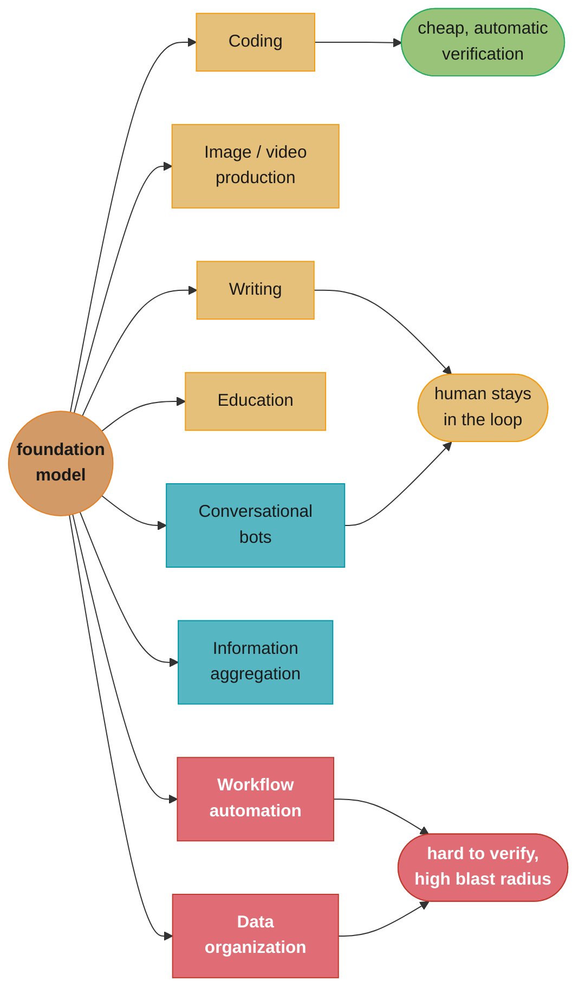
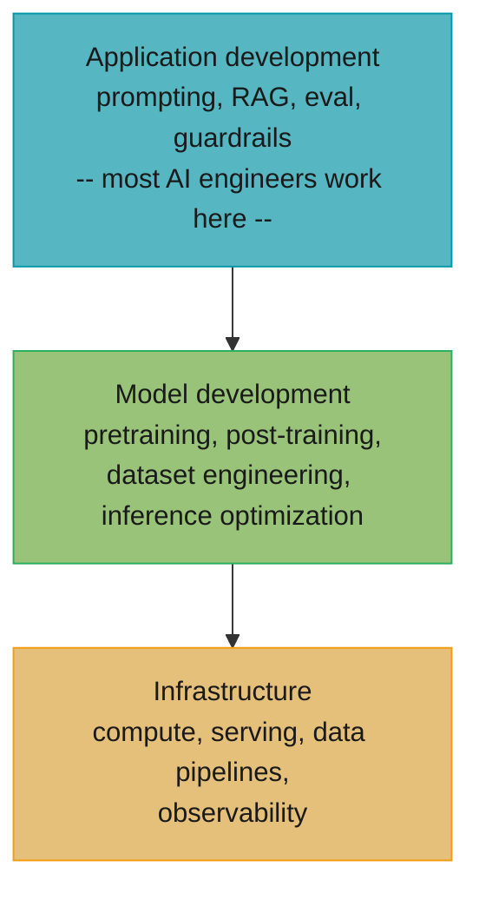
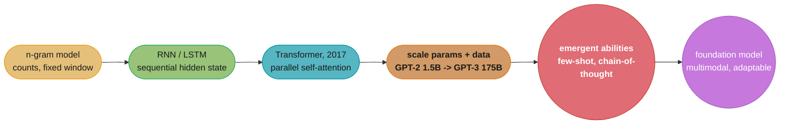

# Chapter 1: Introduction to Building AI Applications with Foundation Models

> AI Engineering: Building Applications with Foundation Models (Huyen, 1st ed., O'Reilly 2025) ·
> opens the book, leads to Ch 2 (what a foundation model actually is under the hood)

## Chapter Map

Every prior wave of "AI" required a team to collect labeled data and train a model from
scratch for one narrow task. Foundation models break that pattern: a small number of labs
train enormous, general-purpose models once, and everyone else *adapts* that model to their
own task instead of training one. Chapter 1 argues that this shift is large enough to be a
new discipline — **AI engineering** — with its own skill set, its own stack, and its own
planning discipline, distinct from both the ML engineering that trains models and the
full-stack engineering that ships ordinary software.

**TL;DR:**
- Language models evolved from statistical n-gram counters through RNNs to the Transformer,
  and scaling that architecture on self-supervised next-token prediction produced **large
  language models (LLMs)** — models whose scale unlocks abilities (in-context learning,
  chain-of-thought) that don't exist in their smaller counterparts.
- **Foundation model**, coined by Stanford's Center for Research on Foundation Models in
  2021, is the broader term Huyen prefers: many of today's most useful models are
  multimodal (text, image, audio) and are valuable specifically because they generalize as
  a *foundation* for countless downstream applications, not because they are large per se.
- Foundation models turned model-building into a commodity API call, which moved the hard
  engineering problem from *training* a model to *adapting and wrapping* one — that moved
  problem is **AI engineering**.
- Foundation models power nine broad categories of application, from coding assistants to
  workflow automation, each with a different tolerance for error and a different evaluation
  bar.
- Planning an AI application is a discipline in its own right: evaluate whether the use case
  actually needs a foundation model, set expectations the technology can meet, plan
  milestones from the simplest viable solution outward, and budget for ongoing maintenance —
  a foundation-model application is never "done."
- The AI stack has three layers — application development, model development, and
  infrastructure — and AI engineering lives overwhelmingly in the first one, leaning on
  model providers and platform teams for the other two.

## The Big Question

> "The report *2023 State of AI* by Retool found that ChatGPT was the fastest-growing consumer
> application in history, reaching 100 million users within two months of its launch." A
> hundred million people started using a language model before most companies had decided
> whether they had a strategy for one. If building an AI product used to require a research
> team and a multi-year data-collection effort, and now requires an API key and an afternoon,
> what exactly is the *engineering* problem left to solve — and why does it deserve to be
> called its own discipline rather than "using an API"?

Analogy: think of the shift from ML engineering to AI engineering as the shift from a
custom furniture workshop to IKEA. A furniture maker (ML engineer) selects wood, designs
joints, and builds a chair from raw materials for one specific room. An IKEA shopper (AI
engineer) starts from a catalog of pre-built, general-purpose pieces and spends their effort
on a different problem entirely: which piece fits this room, how to arrange it with
everything else, and what to do when the piece doesn't quite fit as delivered. The skill
didn't disappear — it moved from woodworking to space planning, and it is no less real for
being different.

---

## 1.1 The Rise of AI Engineering

### From Language Models to Large Language Models

A **language model (LM)** assigns a probability to a sequence of tokens, or equivalently
predicts the likely next token given the tokens before it. The earliest practical LMs were
**n-gram models**: count how often each short sequence of *n* tokens appears in a corpus,
and use those counts as probabilities. An n-gram model is cheap and interpretable but
fundamentally short-sighted — a 3-gram model has no way to use a word that appeared ten
tokens earlier, and larger n makes the count table explode combinatorially (**the curse of
dimensionality**). Neural networks (RNNs, then LSTMs) fixed the fixed-window problem by
carrying a hidden state forward through the sequence, but training them was slow and
serial — each token had to be processed before the next one could start — which kept models
and their training data small.

The 2017 Transformer architecture ("Attention Is All You Need") removed the sequential
bottleneck: self-attention lets every token look at every other token in parallel, so
training scales with hardware rather than with sequence length. Huyen frames the
consequence as the real inflection point of the whole book: once training could be
parallelized, it became practical to train on *far* more data with *far* more parameters,
and researchers kept scaling both. GPT-2 (2019) had 1.5 billion parameters; GPT-3 (2020) had
175 billion — two orders of magnitude in one year. Somewhere in that scaling process, models
started doing things nobody explicitly trained them to do: answering a question from a
handful of examples in the prompt (**few-shot learning**), reasoning through a problem
step by step when asked to (**chain-of-thought**), and following instructions phrased in
plain English. Huyen calls these **emergent abilities** — capabilities that appear only past
a certain scale and are absent, not just weaker, in smaller models — while noting that
whether a given "emergent" jump is a real discontinuity in the model or an artifact of the
metric used to measure it is an active and unresolved debate.

The training signal behind all of this is **self-supervised learning**: a language model's
"labels" are just the next tokens in raw text, so there is no manual annotation step at all —
the entire internet's worth of unlabeled text becomes usable training data. This is what
made the "large" in "large language model" possible in the first place: self-supervision
removed the labeling bottleneck that had capped every previous generation of NLP model.

Huyen also draws a distinction that matters for the rest of the book: an **autoregressive
language model** predicts the next token given everything before it and is the architecture
behind text generation (GPT-style models); a **masked language model** predicts a token
given both the tokens before *and* after it and is better suited to producing
representations for classification, search, and embeddings (BERT-style models). Most of the
generative applications this book is about — chat, coding assistants, agents — sit on
autoregressive models, though masked models remain the workhorse behind embeddings and
retrieval (Chapters 3 and 6).

### From Large Language Models to Foundation Models

"Large language model" is already an imprecise label for the models this book is about,
because the frontier moved past pure text. Models that jointly handle text, images, audio,
and video — GPT-4V-class and Gemini-class models among them — are not accurately described
as merely "large" or merely "language." Stanford's Center for Research on Foundation Models
(CRFM) coined the broader term in its August 2021 report, *On the Opportunities and Risks of
Foundation Models*: a **foundation model** is a model trained on broad data, at scale, that
can be adapted to a wide range of downstream tasks. The word "foundation" is doing the real
work — the model isn't valuable because of its size, it's valuable because it functions as
a common base that many different applications can be built on top of, the way a building's
foundation supports many different structures above it.

Huyen adopts "foundation model" as the book's primary term precisely because it is
architecture- and modality-agnostic: it covers text-only LLMs, but also image generators,
multimodal models, and code models, all of which share the property that matters for this
book — they are pretrained once, generally, and then *adapted* rather than trained from
scratch for each use.

### From Foundation Models to AI Engineering

Before foundation models, building an ML-powered feature meant collecting task-specific
labeled data, engineering features, training a model on that narrow task, and deploying it —
the classic **ML engineering** loop, usually taking months and requiring specialized
training expertise. A foundation model collapses most of that loop: a team can get a working
prototype by writing a good prompt against an existing, pretrained model in an afternoon,
with zero labeled data and zero training runs.

That collapse doesn't eliminate hard engineering work — it *relocates* it. The problems that
used to be "solved" by training your own model from scratch (does the model actually
understand my domain? does it hallucinate? is it safe? is it fast and cheap enough?) don't
go away; they resurface as problems of *adapting, evaluating, and wrapping* someone else's
model. Huyen's claim is that this relocated problem is different enough from both classic ML
engineering and classic software engineering to deserve its own name: **AI engineering** is
the discipline of building applications on top of foundation models — prompt engineering,
retrieval-augmented generation, fine-tuning, evaluation design, and the surrounding
application logic that turns a raw model API into a reliable product. The explosive,
post-ChatGPT growth in this kind of work is why the book exists: far more engineers now
build *with* foundation models than build foundation models themselves, and until this book,
most of the literature was written for the latter group.

---

## 1.2 Foundation Model Use Cases

Huyen groups the flood of foundation-model products into nine recurring categories. Each one
trades a different mix of the model's core strengths (broad world knowledge, fluent
generation, following instructions) against its core weaknesses (hallucination,
inconsistency, difficulty with precise or verifiable output).

### Coding

Coding assistants (GitHub Copilot and its many successors) are, in Huyen's telling, one of
the most successful foundation-model applications precisely because code has a property
almost no other generation task has: **automatic, cheap verifiability** — a unit test or a
compiler tells you immediately whether the generated code is even syntactically and
functionally correct, closing a feedback loop that text generation and image generation
don't have. This is also why Chapter 3's discussion of exact evaluation leans so heavily on
code: **functional correctness** is a rare case where "is this output right?" has a
machine-checkable answer.

### Image and Video Production

Text-to-image and text-to-video models (the DALL·E family, Midjourney, Stable Diffusion, and
their video-generation counterparts) turned a skilled, slow creative process into a fast,
iterative one — at the cost of far weaker guarantees about factual or compositional
correctness (a generated hand, or a generated chart's numbers, may simply be wrong in a way
that's hard to specify in the prompt).

### Writing

General writing assistance — drafting, summarizing, editing, translating tone and register —
is the use case closest to what ChatGPT-style chat interfaces were built for, and is
attractive because a human is almost always in the loop to catch and fix mistakes before the
text ships, lowering the cost of an occasional bad output.

### Education

Personalized tutoring and content generation (Khan Academy's Khanmigo is the example Huyen
gives) use a foundation model's ability to explain the same concept many different ways, at
whatever level of detail a specific learner needs — a task that scales badly for human
tutors and scales well for a model that can generate a fresh explanation on demand.

### Conversational Bots

Customer support and general-purpose assistant chatbots are the most visible use case, and
also one of the hardest to get right in production: the bot must stay in character, refuse
requests it shouldn't answer, avoid making promises the business can't honor, and degrade
gracefully to a human when it's out of its depth — every one of which is an evaluation and
guardrail problem, not a prompting trick.

### Information Aggregation

Summarizing and synthesizing information across many sources — research assistants,
search-augmented chat products (Perplexity is Huyen's example) — leans on a foundation
model's fluency to compress large amounts of retrieved text into something a human can read
quickly, which is also why this use case is tightly coupled to retrieval-augmented
generation (Chapter 6): the model is only as good as the sources it's given.

### Data Organization

Extracting structured data out of unstructured text — pulling fields out of invoices,
resumes, contracts, or support tickets — repurposes a foundation model as a very flexible,
zero-training-data alternative to a hand-built extraction pipeline, at the cost of needing
careful evaluation because a wrong extracted field is often silent and expensive.

### Workflow Automation

The newest and most ambitious category: letting a foundation model take actions — calling
tools, invoking APIs, executing multi-step business processes — rather than only generating
text for a human to act on. This is the use case behind the industry's move toward
**agents** (covered in depth in Chapter 6 and the repo's `llm/agents_and_tool_use`), and it
is also the category with the least mature evaluation tooling, since a mistake here doesn't
just produce bad text, it produces a bad *action*.



Caption: the eight use-case categories aren't equally forgiving — coding and structured
extraction sit closer to "verifiable," writing and chat keep a human as the safety net, and
autonomous workflow automation carries the least built-in protection against a wrong output.

---

## 1.3 Planning AI Applications

### Use Case Evaluation

The first planning question isn't "which model?" — it's "does this problem actually need a
foundation model at all?" A foundation model is the right tool when a task benefits from
broad world knowledge, fluent open-ended generation, or flexibility across many phrasings of
a request; it's the wrong tool when a task has a small, well-defined input/output space that
a deterministic rule, a lookup table, or a small classical model already handles reliably
and far more cheaply. Huyen frames this as weighing **potential impact** (how much value
does solving this well create) against **feasibility** (how well can today's models actually
do it, given the risk tolerance of the use case) — a high-impact, low-feasibility use case
(fully autonomous medical diagnosis) is a worse first project than a lower-impact,
high-feasibility one (drafting a first pass at doctors' visit notes for a human to review).

### Setting Expectations

Foundation models are probabilistic and imperfect by construction (§2.4 develops exactly why),
so a project that silently assumes "the model will basically always be right" is set up to
disappoint stakeholders the first time it isn't. Huyen's recommendation is to define
concrete, measurable success criteria *before* building anything — a quality bar, a latency
budget, a cost ceiling — so that "is this good enough to ship" is a question the team can
answer with a number instead of a feeling, and so that stakeholders hear "the model will be
right most of the time, and here is how we'll measure and improve that" instead of an
implicit promise of perfection.

### Milestone Planning

Start with the simplest thing that could possibly work, and only add complexity when
evidence shows it's needed. Concretely, that usually means: try a strong general-purpose
model with a carefully engineered prompt first; add retrieval-augmented generation only once
you've shown the model needs information it doesn't already have; reach for fine-tuning only
once prompting and retrieval together have plateaued below the bar you set in the previous
step. This progression — **prompt engineering → RAG → fine-tuning** — recurs throughout the
book as the default adaptation order, precisely because each step costs more (in data,
compute, and engineering time) than the one before it, and the earlier steps quietly resolve
a large fraction of use cases on their own.

### Maintenance

Shipping is not the end of the project. Three things keep moving under a foundation-model
application even if the product code never changes: the **model itself** (providers update
and eventually deprecate model versions, silently shifting behavior); the **data
distribution** (user requests and the world they describe both drift over time); and **user
behavior** (as users learn what the system can do, they ask it different things than they
did on day one). Huyen treats ongoing evaluation and monitoring — not a one-time launch
checklist — as a required, budgeted part of running an AI application, the same way
on-call and incident response are a required part of running any other production service.

---

## 1.4 The AI Engineering Stack

### Three Layers of the AI Stack

Huyen splits the stack that makes a foundation-model product work into three layers:

1. **Application development** — prompt engineering, context construction (retrieval,
   RAG), evaluation and guardrails, and the orchestration logic that wires a model call into
   a product feature. This is where most AI engineers spend their time, and it is the layer
   this book focuses on most heavily.
2. **Model development** — pretraining, post-training (Chapter 2), dataset engineering
   (Chapter 8), and inference optimization (Chapter 9): the work of *producing* a good model
   or adapting one at the weights level. A much smaller number of teams — model labs, and
   organizations doing serious fine-tuning — work here.
3. **Infrastructure** — compute provisioning, model-serving systems, data pipelines, and
   observability that both of the layers above depend on. Every layer needs it; most AI
   engineers consume it rather than build it.



Caption: the layers form a dependency stack, but the engineering *population* is inverted —
far more people work in application development, leaning on model development and
infrastructure work done by a comparatively small number of labs and platform teams.

### AI Engineering Versus ML Engineering

| | ML engineering | AI engineering |
|---|---|---|
| Starting point | Train a model from scratch for one task | Adapt an existing pretrained foundation model |
| Data requirement | Large labeled, task-specific dataset up front | Can start with zero or few examples; data needs grow only with fine-tuning |
| Model access | Full — architecture, weights, training loop | Often API-only — a black box you can prompt but not inspect |
| Core skill | Model architecture, training, feature engineering | Prompt/context design, evaluation design, system integration |
| Evaluation | Fixed label space, standard ML metrics (accuracy, F1) | Open-ended output, no single correct answer — needs new methodology (Ch 3-4) |
| Failure mode | Model underfits/overfits a known task | Model hallucinates, is inconsistent, or drifts off-task on an open-ended one |

### AI Engineering Versus Full-Stack Engineering

AI engineering overlaps heavily with ordinary full-stack work — APIs, data pipelines, UX,
observability — but adds a layer that ordinary software doesn't have to deal with: a core
component (the model) that is **probabilistic**, **non-deterministic across near-identical
inputs**, and **not directly debuggable** the way application code is (you can't set a
breakpoint inside a foundation model's forward pass). In practice this means the
*application* code surrounding the model call — context construction, guardrails,
evaluation, fallback and retry logic, caching — is frequently larger and more consequential
than the prompt or model call itself, and it is where most of an AI engineer's day-to-day
work actually lives.

---

## Beyond the book — the adaptation order in practice

> The book frames prompting → RAG → fine-tuning as the default order to *try* techniques in,
> not a claim that every shipped system stops at prompting. What the chapter does not cover —
> because Chapters 6 and 7 exist to cover it — is that production systems increasingly
> combine several of these techniques simultaneously (a fine-tuned model behind a RAG
> pipeline, orchestrated by an agent) rather than picking exactly one. Treat the "prompting
> first" ordering in this chapter as a starting discipline for a new project, not as a
> statement that mature systems only ever use one technique at a time.

---

## Visual Intuition



Caption: each architectural step removed a bottleneck the previous one had — n-grams'
fixed window, RNNs' serial training — and it was the Transformer's parallelism that made
the 1.5B-to-175B jump between GPT-2 and GPT-3 practical within a single year.

```
  Adaptation technique     Data needed        Engineering cost    Try order
  --------------------     -------------      -----------------   ---------
  Prompt engineering       0 examples         Lowest               1st
  Retrieval-augmented      a document corpus  Low-medium            2nd
    generation (RAG)       (no labeled pairs)
  Fine-tuning              labeled examples   Highest               3rd
                           (100s-1000s+)

  Each row down: more data required, more engineering investment,
  and -- per the book's default planning order -- tried only after
  the row above it has been given a real chance to work.
```

Caption: the three adaptation techniques stack in increasing cost, which is exactly why
Chapter 1's milestone-planning advice is to walk down this list rather than start partway
through it.

---

## Key Concepts Glossary

- **Language model (LM)** — a model that assigns probabilities to token sequences, typically
  by predicting the next token given prior ones.
- **N-gram model** — a statistical LM that predicts the next token from counts of the
  preceding *n* − 1 tokens.
- **Self-supervised learning** — training where labels are derived automatically from the
  data itself (e.g., the next token in a sequence), requiring no manual annotation.
- **Autoregressive language model** — an LM that predicts each token from only the tokens
  before it; the architecture behind text generation (GPT-style).
- **Masked language model** — an LM that predicts a token using context on both sides;
  better suited to representations for classification and embeddings (BERT-style).
- **Transformer** — the 2017 self-attention architecture that parallelizes sequence
  processing and enabled today's scale of LM training.
- **Emergent ability** — a capability present past a certain model scale and absent, not
  just weaker, below it (e.g., few-shot learning).
- **Large language model (LLM)** — a language model trained at very large parameter and
  data scale.
- **Foundation model** — a model trained on broad data at scale, adaptable to many
  downstream tasks; Huyen's preferred term over "LLM" because it covers multimodal and
  non-text models.
- **AI engineering** — the discipline of building applications on top of existing foundation
  models via adaptation (prompting, RAG, fine-tuning) rather than training from scratch.
- **ML engineering** — the discipline of training a model from scratch for a specific task,
  including data collection, feature engineering, and the training loop.
- **Model adaptation** — the umbrella term for techniques (prompting, RAG, fine-tuning) that
  make a general foundation model perform a specific task well.
- **Functional correctness** — whether generated output (typically code) passes a
  verification check such as a unit test; the reason coding is an easy-to-evaluate use case.
- **Agent** — a foundation-model-driven system that takes actions (tool/API calls) rather
  than only producing text for a human to read.
- **Use case evaluation** — assessing whether a problem's impact and feasibility justify
  building a foundation-model solution for it.
- **Milestone planning** — sequencing a project from the simplest viable solution
  (prompting) toward more complex ones (RAG, fine-tuning) only as evidence requires it.
- **Application development layer** — the AI stack layer covering prompting, context
  construction, evaluation, and orchestration.
- **Model development layer** — the AI stack layer covering pretraining, post-training,
  dataset engineering, and inference optimization.
- **Infrastructure layer** — the AI stack layer covering compute, serving, data pipelines,
  and observability that the other two layers depend on.

---

## Tradeoffs & Decision Tables

| Adaptation technique | Data needed | Relative cost | Latency impact | When to reach for it |
|---|---|---|---|---|
| Prompt engineering | None | Lowest | None beyond the base call | Always try first |
| RAG | An indexable corpus, no labels | Low-medium | Adds retrieval latency | Model lacks knowledge it needs, and that knowledge changes often |
| Fine-tuning | Hundreds to thousands of labeled examples | Highest | None at inference (baked into weights) | Prompting + RAG plateau below the required quality bar |

| Use case category | Verifiability of output | Typical stakes | Human-in-the-loop by default |
|---|---|---|---|
| Coding | High (tests/compiler) | Low-medium | Often, before merge |
| Data organization | Medium (schema check) | Medium-high | Sometimes |
| Writing / education | Low | Low-medium | Usually |
| Conversational bots | Low | Medium | Escalation path, not full review |
| Workflow automation | Low | High | Least by default — the risk this chapter flags |

| | ML engineering | AI engineering | Full-stack engineering |
|---|---|---|---|
| Trains a model | Yes | Rarely | No |
| Core deliverable | A trained model | A working prompt/context/eval pipeline | A working application |
| Core new risk vs. the other two | N/A | Probabilistic, non-inspectable core component | N/A |

---

## Common Pitfalls / War Stories

- **Treating the model like deterministic software.** Teams that assume "if it worked in
  the demo, it will always work" skip the evaluation investment this chapter argues for, and
  are surprised the first time a near-identical prompt produces a materially different
  answer — which §2.4 shows is not a bug but the model's basic nature.
- **Skipping use-case evaluation entirely.** Building the flashiest possible demo before
  asking whether the underlying task is even a good fit for a foundation model wastes the
  most expensive resource on a project — engineering time — on a use case likely to be
  reworked or killed.
- **Jumping straight to fine-tuning.** Reaching for the most expensive adaptation technique
  before trying a well-crafted prompt or a retrieval pipeline routinely produces a system
  that cost far more to build than a simpler one that would have hit the same quality bar.
- **No measurable success criteria before building.** "Make it good" is not a specification;
  teams that don't define a quality/latency/cost bar up front have no way to know when to
  stop iterating or whether a change was actually an improvement.
- **Treating launch as the finish line.** Foundation-model applications drift as providers
  update models, as user behavior shifts, and as the world the application describes
  changes — a team with no monitoring in place discovers this only when a user complains.
- **Confusing "large language model" with the full scope of the technology.** Restricting
  planning conversations to text-only LLMs misses the growing set of use cases (image,
  video, multimodal) that "foundation model" as a term was specifically coined to cover.
- **Underestimating the application layer.** Teams that budget engineering time as "mostly
  prompt writing" are routinely surprised that context construction, evaluation, and
  guardrail logic end up being the majority of the codebase.

---

## Real-World Systems Referenced

**Language/foundation models:** GPT-2, GPT-3, GPT-4V-class and Gemini-class multimodal
models, BERT. **Coding:** GitHub Copilot. **Image/video generation:** DALL·E, Midjourney,
Stable Diffusion. **Writing/chat:** ChatGPT. **Education:** Khan Academy's Khanmigo.
**Information aggregation:** Perplexity. **Origin of the term "foundation model":**
Stanford's Center for Research on Foundation Models (CRFM). **Adoption data point:** the
2023 State of AI report by Retool, cited for ChatGPT reaching 100 million users within two
months of launch.

---

## Summary

A foundation model is a model pretrained on broad data at scale and built to be adapted, not
retrained, for each new task — a term Huyen prefers over "large language model" because the
frontier has already moved past text-only models. That shift relocated the hard engineering
problem: instead of training a model from scratch, teams now spend their effort adapting and
wrapping an existing one, and that relocated problem is what this book calls **AI
engineering**. Foundation models already power a wide range of applications — coding, image
and video production, writing, education, conversational bots, information aggregation, data
organization, and workflow automation — each with a different tolerance for a wrong output.
Building one well starts with planning, not prompting: evaluate whether the use case truly
needs a foundation model, set expectations the technology can actually meet, sequence the
project from the simplest solution (prompting) outward to RAG and fine-tuning only as
evidence demands it, and budget for continuous maintenance rather than a one-time launch.
The resulting AI stack has three layers — application development, model development, and
infrastructure — and this book, like most AI engineering work today, lives mostly in the
first one.

---

## Interview Questions

**Q: What is the practical difference between "large language model" and "foundation model," and why does the book prefer the latter?**
**Short:** An LLM is text-only; a foundation model also covers multimodal and non-text models adapted the same way.
"Large language model" describes models trained purely on text via next-token prediction.
"Foundation model" is the broader term Huyen adopts, covering any model — text, image,
audio, multimodal — that is pretrained at scale on broad data and built to be *adapted* to
many downstream tasks rather than retrained from scratch. Since the frontier already
includes multimodal systems, restricting the vocabulary to "LLM" undersells how much of the
book's adaptation techniques (prompting, RAG, fine-tuning) apply outside pure text.

**Q: Why did self-supervised learning matter more for language models than better architectures alone?**
**Short:** It removed the manual-labeling bottleneck, letting models train on effectively unlimited raw text.
Self-supervision derives training labels from the data itself — the next token in a
sequence — so a model can train on any raw text with no human annotation step. That removed
the bottleneck that had capped every prior generation of NLP models, which needed
task-specific labeled datasets. Combined with the Transformer's parallelizable training, it
is what made scaling to GPT-3's 175 billion parameters practical.

**Q: What makes coding one of the most successful foundation-model use cases, according to the book?**
**Short:** Code has cheap, automatic verification via tests and compilers that most generated text lacks.
Generated code can be checked immediately and mechanically — a unit test or a compiler tells
you whether it's even correct — closing a feedback loop that open-ended text or image
generation doesn't have. That verifiability is also why Chapter 3's discussion of exact
evaluation leans on functional correctness as a rare case of a machine-checkable
"is this right?" answer.

**Q: What is an "emergent ability," and why does the book flag it as debated rather than settled?**
**Short:** A capability appearing only past a scale threshold, absent (not just weaker) below it — but the discontinuity itself is contested.
An emergent ability is a capability, like few-shot in-context learning or chain-of-thought
reasoning, that shows up only once a model crosses some scale threshold and is essentially
absent in smaller models. The book flags that whether this is a genuine discontinuity in the
underlying model or an artifact of the metric used to measure it is still actively debated —
so "emergence" should be treated as an observed pattern, not settled theory.

**Q: According to the book's planning framework, what should you evaluate before choosing which model to use?**
**Short:** Whether the use case needs a foundation model at all, weighing potential impact against feasibility.
The first planning question is use-case evaluation, not model selection: does the task
benefit from a foundation model's broad knowledge and flexible generation, or would a
deterministic rule or small classical model already solve it more cheaply and reliably? The
book frames this as weighing potential impact against feasibility, since a high-impact but
low-feasibility use case (given the risk tolerance) is a worse first project than a
lower-impact, high-feasibility one.

**Q: What is the book's default order for adapting a foundation model to a task, and why that order?**
**Short:** Prompt engineering first, then RAG, then fine-tuning — each step costs more than the last.
The book's default milestone-planning order is prompt engineering, then retrieval-augmented
generation, then fine-tuning, because each step requires progressively more data and
engineering investment than the one before it, and the earlier, cheaper steps resolve a
large share of use cases on their own. Fine-tuning is reserved for cases where prompting and
retrieval together plateau below the required quality bar.

**Q: Why does the book insist maintenance is a first-class, ongoing engineering cost rather than a launch checklist item?**
**Short:** The model, the data distribution, and user behavior all keep changing after launch.
Three things keep moving after an AI application ships: the underlying model itself (as
providers update or deprecate versions), the data distribution the application encounters,
and user behavior as people learn what the system can do. None of those are one-time
concerns, so the book treats ongoing evaluation and monitoring as budgeted, continuous work —
the same way on-call is a required part of running any other production service.

**Q: What are the three layers of the AI engineering stack, and where does most AI engineering work happen?**
**Short:** Application development, model development, and infrastructure — most AI engineers work in the first.
The three layers are application development (prompting, context construction, evaluation,
orchestration), model development (pretraining, post-training, dataset engineering,
inference optimization), and infrastructure (compute, serving, data pipelines,
observability). The engineering population is inverted relative to the dependency stack:
most AI engineers work in application development, leaning on model providers and platform
teams for the other two layers.

**Q: How does AI engineering differ from ML engineering in terms of data requirements?**
**Short:** ML engineering needs a large labeled dataset up front; AI engineering can start with zero examples.
ML engineering trains a model from scratch for a specific task and therefore needs a
substantial labeled, task-specific dataset before training can even begin. AI engineering
starts from an already-pretrained foundation model, so a working prototype can begin with
zero labeled examples via prompting; data requirements only grow if the project later moves
to fine-tuning.

**Q: What new kind of core-component risk does AI engineering introduce that ordinary full-stack engineering doesn't have?**
**Short:** A probabilistic, non-inspectable model component whose output can vary on near-identical input.
The model itself is probabilistic, can produce different outputs on near-identical inputs,
and (especially behind an API) can't be inspected or debugged the way application code can —
no breakpoint reaches inside a foundation model's forward pass. This is why the application
code surrounding the model call — context construction, guardrails, evaluation, retries —
often ends up larger and more consequential than the model call itself.

**Q: Why is evaluation harder in AI engineering than in classic ML engineering?**
**Short:** Foundation-model output is open-ended with no single correct answer, unlike a fixed ML label space.
Classic ML engineering evaluates against a fixed, known label space using standard metrics
like accuracy or F1. Foundation-model outputs are open-ended text, images, or actions with
no single correct answer, so the same metrics don't apply — which is exactly why Chapters 3
and 4 build a separate evaluation methodology (language-modeling metrics, exact evaluation,
AI-as-judge, comparative evaluation) instead of reusing classic ML metrics.

**Q: Who coined the term "foundation model," and in what document?**
**Short:** Stanford's Center for Research on Foundation Models, in its 2021 report on foundation models.
Stanford's Center for Research on Foundation Models (CRFM) introduced the term in its
August 2021 report, *On the Opportunities and Risks of Foundation Models*. The book adopts
it as the primary vocabulary specifically because it is architecture- and
modality-agnostic — it covers text, image, and multimodal models alike, unlike "LLM."

**Q: What distinguishes an autoregressive language model from a masked language model, and why does that distinction matter for this book?**
**Short:** Autoregressive models predict left-to-right for generation; masked models use both-sided context for representations.
An autoregressive model predicts each token from only the tokens before it, which is the
architecture behind generative, GPT-style models. A masked language model predicts a token
using context from both sides, which produces better representations for classification,
search, and embeddings (BERT-style models). Most of the generative use cases this book
covers — chat, coding, agents — sit on autoregressive models, while masked models remain the
workhorse behind the embeddings and retrieval covered later in the book.

**Q: Why does the book warn against treating a successful demo as evidence the system is production-ready?**
**Short:** A demo shows the model can work once, not that it works reliably across the real input distribution.
A demo typically runs on a small, favorable set of inputs the team chose, which says nothing
about behavior across the full, messier distribution of real user requests — and because
outputs are probabilistic, a prompt that worked in the demo isn't guaranteed to work the same
way again. The book's answer is to treat evaluation as ongoing infrastructure rather than a
one-time pre-launch gate.

**Q: What is the curse of dimensionality as it applies to n-gram language models specifically?**
**Short:** Increasing n makes the count table of possible sequences grow combinatorially, becoming sparse and unusable.
An n-gram model's table of counted sequences grows combinatorially as n increases, so most
possible n-length sequences are never observed in training data and the model has no
probability estimate for them. This sparsity is what made n-gram models fundamentally
short-sighted and unable to use long-range context, motivating the move to neural
architectures that carry state rather than counting fixed windows.

**Q: What made GPT-3's jump to 175 billion parameters practical just one year after GPT-2's 1.5 billion, according to the book's narrative?**
**Short:** The Transformer's parallel self-attention removed the sequential training bottleneck RNNs had.
The Transformer architecture processes every token in a sequence in parallel via
self-attention, rather than serially the way RNNs and LSTMs must. That removed the training
bottleneck that had capped model and dataset size, making the roughly hundred-fold parameter
increase from GPT-2 to GPT-3 a matter of available compute rather than a fundamentally new
training approach.

---

## Cross-links in this repo

- [`llm/foundations_and_architecture/foundations_and_architecture.md`](../../../llm/foundations_and_architecture/foundations_and_architecture.md) — Transformer internals and the architecture behind every model this chapter discusses.
- [`llm/pre_training/pre_training.md`](../../../llm/pre_training/pre_training.md) — self-supervised next-token pretraining at scale.
- [`llm/llm_ecosystem_and_landscape/llm_ecosystem_and_landscape.md`](../../../llm/llm_ecosystem_and_landscape/llm_ecosystem_and_landscape.md) — the model-provider landscape AI engineering builds on top of.
- [`llm/ai_applications/ai_applications.md`](../../../llm/ai_applications/ai_applications.md) — deep dives into the application categories introduced in §1.2.
- [`llm/agents_and_tool_use/agents_and_tool_use.md`](../../../llm/agents_and_tool_use/agents_and_tool_use.md) — the workflow-automation use case, expanded.
- [`llm/rag_fundamentals/rag_fundamentals.md`](../../../llm/rag_fundamentals/rag_fundamentals.md) — the RAG rung of the adaptation ladder, in depth.
- [`llm/fine_tuning/fine_tuning.md`](../../../llm/fine_tuning/fine_tuning.md) — the fine-tuning rung of the adaptation ladder.
- [`ml/ml_system_design/ml_system_design.md`](../../../ml/ml_system_design/ml_system_design.md) — the classic ML-engineering planning process this chapter contrasts AI engineering against.
- [`hld/README.md`](../../../hld/README.md) — general system-design foundations underlying the AI stack's infrastructure layer.

## Further Reading

- Vaswani et al., "Attention Is All You Need" (2017) — the Transformer paper.
- Radford et al., "Language Models are Unsupervised Multitask Learners" (2019) — GPT-2.
- Brown et al., "Language Models are Few-Shot Learners" (2020) — GPT-3 and the few-shot/emergent-ability discussion.
- Bommasani et al., "On the Opportunities and Risks of Foundation Models" (Stanford CRFM, 2021) — origin of the term "foundation model."
- Devlin et al., "BERT: Pre-training of Deep Bidirectional Transformers for Language Understanding" (2018) — the masked-language-model architecture referenced in §1.1.
- Retool, *2023 State of AI* report — the ChatGPT adoption data point cited in this chapter.
- OpenAI, GPT-4 Technical Report — the multimodal foundation-model generation referenced in §1.1.
