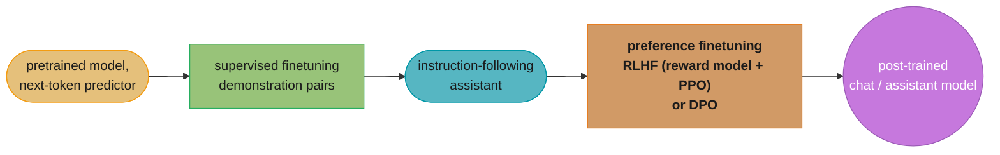

# Chapter 2: Understanding Foundation Models

> AI Engineering: Building Applications with Foundation Models (Huyen, 1st ed., O'Reilly 2025) ·
> builds on Ch 1 (why AI engineering exists), leads to Ch 3 (how to evaluate what this
> chapter produces)

## Chapter Map

Chapter 1 argued that AI engineers *adapt* foundation models instead of training them.
Chapter 2 is why an adapter still needs to understand the thing being adapted: every
adaptation decision in the rest of the book — what a model can plausibly know, how much
context it can use, why it sometimes contradicts itself, how to make it emit valid JSON — is
downstream of four upstream design choices a model provider made: what data the model was
trained on, what architecture and scale it uses, how it was post-trained after pretraining,
and how tokens are sampled from it at inference time.

**TL;DR:**
- A model's knowledge is bounded by its **training data** — multilingual coverage is
  wildly uneven because internet text itself is wildly uneven across languages, and
  **domain-specific models** trade general breadth for depth in one field.
- **Modeling** covers the architecture (the Transformer, and its main efficiency variants)
  and **model size** — parameter count and training data size, whose optimal ratio the
  **Chinchilla scaling law** put at roughly 20 tokens of training data per parameter.
- **Post-training** turns a raw next-token predictor into an assistant in two stages:
  **supervised finetuning (SFT)** teaches it to follow instructions from demonstrations,
  and **preference finetuning** (RLHF, or the simpler DPO) teaches it *which* of several
  correct-looking responses humans actually prefer.
- **Sampling** is why the same prompt can produce a different answer twice — the model
  outputs a probability distribution over the next token, and **temperature**, **top-k**,
  and **top-p** all control how much randomness is injected when a token is drawn from it.
- **Test-time compute** — using more computation per query, e.g., generating and comparing
  several candidate answers — trades latency and cost for quality, without touching the
  model's weights at all.
- Foundation models are **probabilistic by construction**: this is the direct cause of both
  their creative flexibility and their two characteristic failure modes, **hallucination**
  and **inconsistency**, neither of which a bigger model or a lower temperature fully
  eliminates.

## The Big Question

> If two foundation models are both "large language models," why does one confidently
> answer medical questions accurately while the other fabricates plausible-sounding nonsense,
> and why does the *same* model sometimes give you a brilliant answer and sometimes a
> mediocre one to an identical question? The differences aren't magic — they trace back to a
> small number of concrete engineering decisions: what text the model saw, how many
> parameters and tokens went into training it, what happened to it after pretraining, and how
> its output distribution gets turned into an actual sequence of words.

Analogy: think of a foundation model as a chef trained by tasting an enormous number of
meals (**training data**) and practicing an enormous number of techniques (**model
architecture and size**). After that general training, a apprenticeship phase
(**post-training**) teaches the chef to actually take orders and please customers rather
than just cook whatever they feel like. And even a superbly trained chef, asked to plate the
"same" dish twice, will vary the garnish and portion slightly each time — not because
they're incompetent, but because plating, like **sampling**, has an irreducible amount of
choice built into it.

---

## 2.1 Training Data

A foundation model can only reflect patterns that exist in its training corpus — it has no
access to any world beyond that text (and, increasingly, images/audio/video) at training
time. Two properties of the training corpus have an outsized effect on what a model is
actually good at.

### Multilingual Models

Internet text is not evenly distributed across the world's languages: a small number of
high-resource languages (English chief among them) make up the overwhelming majority of
crawlable, high-quality web text, while thousands of languages are severely underrepresented
or entirely absent. Because a model's competence in a language tracks how much
high-quality text in that language it saw, this imbalance shows up directly in model
behavior — a model can be fluent and factually reliable in English while being noticeably
less accurate, less fluent, or more repetitive in a lower-resource language, even when the
underlying architecture and training recipe are identical. Huyen frames this as a structural
consequence of *data availability*, not of language "difficulty": a model trained
deliberately on a larger, curated multilingual corpus can close much of the gap, which is
why model cards increasingly report per-language benchmark scores rather than a single
aggregate number.

Tokenization compounds the imbalance: tokenizers are typically fit on the training corpus's
byte/character statistics, so a language underrepresented in that corpus tends to be
tokenized less efficiently — the same sentence costs more tokens in an underrepresented
language than in English, which raises both the cost and the effective context-window
consumption of using the model in that language. (Tokenizer mechanics themselves are covered
in this repo's `llm/tokenization_and_embeddings/tokenization_and_embeddings.md`, not
re-derived here.)

### Domain-Specific Models

A general-purpose foundation model trained on a broad web-scale corpus is a generalist: it
knows a little about almost everything, at the cost of depth in any one specialized field.
A **domain-specific model** is trained (or, more commonly, further trained/fine-tuned) on a
corpus concentrated in one domain — code, biomedical text, finance, law — to trade some of
that breadth for depth where it matters for a particular application. Huyen cites examples
including code-specialized models (the lineage behind Codex-style coding models),
biomedical-specialized models (the Med-PaLM lineage), and finance-specialized models
(BloombergGPT) as illustrations of the pattern: a smaller model trained or adapted on a
concentrated, high-quality domain corpus can beat a much larger generalist model on that
domain's tasks specifically, because the generalist's training compute was spread across
everything else the internet contains instead.

The practical decision this creates for an AI engineer is a build-versus-adapt question that
recurs across the book: is the target domain narrow and specialized enough that a
domain-specific model (or fine-tuning a generalist toward that domain, Chapter 7) beats
simply prompting the best available generalist model with good context? Chapter 4's model
selection workflow gives this decision a concrete evaluation process rather than leaving it
to intuition.

---

## 2.2 Modeling

### Model Architecture

The dominant architecture behind today's foundation models remains the **Transformer**:
stacked blocks of **self-attention** (each token's representation is updated by attending to
every other token's representation, weighted by learned relevance) and a **position-wise
feed-forward network**, with **positional encoding** injected so the otherwise
order-agnostic attention mechanism knows token order. Self-attention's core cost is
**quadratic in sequence length** (every token attends to every other token), which is the
underlying reason long-context models are architecturally and computationally harder to
build than short-context ones, and why alternative or modified attention mechanisms
(sparse/local attention variants, and non-Transformer sequence architectures) exist
specifically to attack that quadratic cost. Huyen treats architecture as important background
rather than the book's focus — it explains *why* certain model behaviors and costs exist,
but the book's center of gravity is adapting and evaluating whatever architecture a given
model uses, not designing new ones. (Full attention mechanics, and the newer
sub-quadratic and mixture-of-experts variants, are covered in this repo's
`llm/foundations_and_architecture/foundations_and_architecture.md` and
`llm/mixture_of_experts/mixture_of_experts.md`.)

### Model Size

Two numbers dominate any description of a foundation model's scale: its **parameter count**
and the **size of its training dataset**, usually measured in tokens. For a fixed compute
budget, these two numbers trade off against each other — spend the budget on a bigger model
trained on less data, or a smaller model trained on more data? DeepMind's **Chinchilla**
paper answered this empirically: for compute-optimal training, model size and training
tokens should scale together at roughly **20 tokens of training data per model parameter**
— earlier large models (GPT-3 among them) were, by that finding, significantly
**undertrained** relative to their parameter count, meaning a smaller model trained on
proportionally more data could match or beat them at the same total training compute cost.
This finding reshaped how labs allocate training budgets: rather than chasing ever-larger
parameter counts alone, subsequent models were trained with far more data per parameter,
producing smaller models that were cheaper to *serve* at inference time for comparable
quality — a detail that matters enormously in production, since inference cost scales with
parameter count every single time the model is called, while training is a one-time cost.

Huyen is careful to separate **scale** from **quality**: bigger, or more compute-optimally
trained, is a strong general predictor of capability, but training data quality, curation,
and the post-training process below all move the needle independently of raw scale — which
is exactly why a well post-trained mid-sized model can outperform a poorly post-trained
larger one on real tasks.

---

## 2.3 Post-Training

Pretraining alone produces a model that is very good at predicting plausible next tokens —
which is not the same as a model that is good at *following instructions* or *being
helpful*. A raw pretrained model, given a question, is just as likely to continue it with
another question (because that's a statistically plausible continuation of text that looks
like a question) as to answer it. **Post-training** is the process that turns that raw
next-token predictor into an assistant, and it happens in two stages.

### Supervised Finetuning

**Supervised finetuning (SFT)**, also called **instruction tuning**, further trains the
pretrained model on a curated dataset of (instruction, ideal response) demonstration pairs —
typically written or reviewed by humans, and increasingly generated or filtered with the
help of other, already-instruction-tuned models. This step teaches the model the *format* and
*behavior* of being a helpful assistant: answering the question that was asked, following
formatting instructions, adopting an appropriate tone. SFT's effectiveness is bounded by the
quality and coverage of its demonstration set — a model can only be shown to reliably
produce the kinds of responses that appear, in spirit, somewhere in that set, which is why
demonstration-data curation (covered in depth in Chapter 8, dataset engineering) is treated
as a first-class problem rather than an afterthought.

### Preference Finetuning

SFT teaches a model to produce *a* reasonable response; it does not teach the model which of
several plausible, individually reasonable responses humans actually prefer — more concise
versus more thorough, more cautious versus more direct, safer refusal versus a more helpful
answer to a borderline request. **Preference finetuning** closes that gap using data of the
form "response A is preferred to response B" rather than a single ideal demonstration. The
dominant technique historically has been **reinforcement learning from human feedback
(RLHF)**: train a separate **reward model** to predict human preference judgments, then use
reinforcement learning (commonly **PPO**, proximal policy optimization) to update the
language model's weights to produce outputs the reward model scores highly, while a
KL-divergence penalty keeps the model from drifting too far from its SFT starting point (and
thereby losing general capability while chasing reward). A simpler alternative that Huyen
highlights, **direct preference optimization (DPO)**, skips the separate reward model and
reinforcement-learning loop entirely, instead directly optimizing the language model on
preference pairs with a closed-form loss — cheaper and more stable to train than full RLHF,
at the cost of some of the flexibility a learned, reusable reward model offers.



Caption: post-training is two distinct optimization targets in sequence — SFT teaches
*what a reasonable answer looks like*, preference finetuning teaches *which reasonable
answer humans actually want* — and skipping either stage leaves a gap the other cannot fill.

---

## 2.4 Sampling

### Sampling Fundamentals

At each generation step, a foundation model outputs a probability distribution over its
entire vocabulary for "what token comes next," computed via a **softmax** over the model's
raw output scores (**logits**). Generating text means repeatedly drawing a token from that
distribution and feeding it back in as context for the next step. **Greedy sampling** always
picks the single highest-probability token — fully deterministic, but prone to bland,
repetitive output because it never explores a lower-probability-but-better continuation.
Every other sampling strategy exists to inject a controlled amount of randomness back into
that process, trading determinism for output diversity and creativity.

### Sampling Strategies

- **Temperature** rescales the logits before the softmax (dividing by a temperature value
  `T`) before converting them to probabilities. `T < 1` sharpens the distribution toward the
  most likely tokens (lower randomness, approaching greedy as `T → 0`); `T > 1` flattens it
  (higher randomness, more surprising or creative but also more error-prone output); `T = 1`
  leaves the model's raw distribution unchanged.
- **Top-k sampling** restricts sampling to only the `k` highest-probability tokens at each
  step, renormalizing their probabilities and discarding the (potentially huge) long tail of
  implausible tokens entirely — a fixed cutoff by *count*.
- **Top-p (nucleus) sampling** instead restricts sampling to the smallest set of
  highest-probability tokens whose cumulative probability reaches a threshold `p` — a cutoff
  by *cumulative probability mass* rather than a fixed count, which adapts naturally: a very
  confident distribution (one dominant token) keeps the nucleus small, while a genuinely
  uncertain distribution (many plausible tokens) keeps it larger.
- Temperature, top-k, and top-p are commonly combined rather than used alone: temperature
  reshapes the distribution, and top-k/top-p then trims it before the final draw.
- **Beam search** explores several candidate continuations (**beams**) in parallel at each
  step instead of committing to one token at a time, keeping the highest-scoring sequences
  and discarding the rest — more compute per output, and often higher-quality output for
  tasks like translation, at the cost of the diversity that pure sampling provides.

```
  logits:            [ 4.2 ,  3.9 ,  1.0 ,  0.5 ,  0.1 ]   ("the", "a", "cat", "dog", "run")

  temperature 0.5 (sharpen):  probabilities concentrate hard on "the" / "a"
  temperature 1.5 (flatten):  probability mass spreads out to "cat" / "dog" / "run" too

  top-k = 2:   keep only { "the", "a" },        renormalize, sample from just those 2
  top-p = 0.9: keep smallest prefix whose cumulative probability >= 0.9
               -- if "the" + "a" already sum to 0.92, the nucleus is still just those 2
               -- if the distribution were flatter, the nucleus would include more tokens
```

Caption: top-k always keeps a fixed *count* of tokens regardless of how confident the model
is; top-p keeps however many tokens it takes to cover a fixed *probability mass*, so it
shrinks automatically when the model is confident and grows automatically when it isn't.

### Test Time Compute

Every sampling strategy above spends a fixed amount of compute per output token. **Test-time
compute** instead spends *more* total compute on a single query, without changing the
model's weights at all, in exchange for better output quality — trading latency and dollar
cost for accuracy at inference time rather than at training time. Concrete techniques Huyen
covers include generating **multiple candidate outputs and selecting among them**
(**best-of-N** sampling, optionally scored by a reward or verifier model) and prompting the
model to reason through intermediate steps before committing to a final answer
(**chain-of-thought**), both of which can be combined with **self-consistency** — sample
several independent chains of reasoning and take the majority-vote final answer, on the
premise that errors in individual reasoning chains are less correlated than the final answer
itself. Test-time compute is the mechanism behind the industry's more recent push toward
models that spend a variable, sometimes large, amount of internal computation reasoning
before answering — a direct application of "more compute per query, same weights, better
answer."

### Structured Outputs

Many applications need a model's output to conform to a strict format — valid JSON matching
a schema, a value from a fixed enum, a syntactically valid function call — not just
plausible free text. Huyen covers two families of technique for this: **prompting-based**
approaches (describing the desired schema in the prompt and hoping the model complies, often
combined with few-shot examples of correctly formatted output) and **constrained decoding**
approaches, which restrict the sampling process itself at each step to only tokens that keep
the output consistent with a target grammar or schema (so an invalid token literally cannot
be sampled, rather than merely being discouraged). Constrained decoding is strictly more
reliable, since it makes format violations structurally impossible rather than merely
unlikely, at the cost of needing the schema/grammar to be specified programmatically and
requiring inference-stack support for logit-level constraints. This mechanism underlies
**function calling** / **tool calling** — a model choosing a specific function name and
producing arguments that match that function's schema, which is the foundation of the
agentic workflow-automation use case introduced in Chapter 1.

### The Probabilistic Nature of AI

Every property covered in this section traces back to one underlying fact: foundation
models are fundamentally **probabilistic**, not deterministic, computation. Even at
temperature 0 (effectively greedy decoding), Huyen notes that outputs are not always
perfectly reproducible in practice — floating-point non-associativity, batching effects on
GPUs, and other numerical implementation details can produce small variations in the exact
logits computed for the same input, which can occasionally flip which token is "most
likely" at a tie. This probabilistic core produces the two failure modes that recur
throughout the rest of the book:

- **Hallucination** — the model generates fluent, confident-sounding output that is
  factually wrong or entirely fabricated, because the model is optimized to produce
  plausible continuations of text, not to only ever emit verified-true statements; nothing
  in the base training objective distinguishes "this is true" from "this reads like
  something true would read like."
- **Inconsistency** — the same or a near-identical prompt can produce meaningfully different
  outputs across calls (or across small, semantically irrelevant prompt rewordings), because
  sampling injects randomness by design and even small numerical differences can cascade
  through autoregressive generation, where each token's context includes every token
  generated before it.

Neither failure mode is a bug to be patched away — they are direct, structural consequences
of how these models generate text, and Chapters 3 and 4's entire evaluation methodology
exists because of them: if outputs were deterministic and verifiably correct by
construction, evaluation would be a solved problem instead of the book's next two chapters.

---

## Beyond the book — reasoning models and test-time scaling

> The chapter's test-time compute discussion (self-consistency, best-of-N, chain-of-thought
> prompting) describes the *mechanism*, not any single named product. The book does not name
> or evaluate the specific "reasoning model" product lines that later made variable,
> sometimes heavy test-time computation a first-class, user-controllable setting rather than
> a prompting trick applied on top of a standard chat model. Treat this chapter's coverage as
> the general principle those later products are one implementation of, not as a description
> of any particular one of them.

---

## Visual Intuition

```mermaid
flowchart LR
    classDef io      fill:#61afef,stroke:#2e86c1,color:#1a1a1a,font-weight:bold
    classDef frozen  fill:#c678dd,stroke:#9b59b6,color:#fff
    classDef train   fill:#98c379,stroke:#27ae60,color:#1a1a1a
    classDef mathOp  fill:#d19a66,stroke:#e67e22,color:#1a1a1a,font-weight:bold
    classDef lossN   fill:#e06c75,stroke:#c0392b,color:#fff,font-weight:bold
    classDef req     fill:#56b6c2,stroke:#0097a7,color:#1a1a1a
    classDef base    fill:#e5c07b,stroke:#f39c12,color:#1a1a1a

    DATA(["training data<br/>web text, code, ..."]) --> PRETRAIN["pretraining<br/>next-token prediction"]
    PRETRAIN --> RAWM(("raw pretrained model<br/>plausible-text predictor"))
    RAWM --> SFT["SFT<br/>demonstration pairs"]
    SFT --> PREF["preference finetuning<br/>RLHF / DPO"]
    PREF --> ASSISTANT(("assistant model"))
    ASSISTANT --> SAMPLE["sampling<br/>temperature / top-k / top-p"]
    SAMPLE --> OUTPUT(["generated text,<br/>different each draw"])

    class DATA base
    class PRETRAIN train
    class RAWM req
    class SFT mathOp
    class PREF lossN
    class ASSISTANT frozen
    class SAMPLE mathOp
    class OUTPUT base
```



Caption: the whole pipeline from raw internet text to a single generated response — the
two post-training stages transform *what* the model does, and sampling determines *which*
of many valid continuations you actually see on any given call.

```
  Chinchilla compute-optimal ratio:  ~20 training tokens per model parameter

  GPT-3-era allocation (undertrained relative to this ratio):
    175B params, trained on ~300B tokens   ->  ratio ~= 1.7 tokens/param   (far below 20)

  Chinchilla-optimal allocation for the SAME training compute budget:
    a smaller parameter count, trained on proportionally more tokens,
    reaches equal or better quality AND costs less to serve at inference,
    because inference cost scales with parameter count on every single call.
```

Caption: the same training compute budget produces a better, cheaper-to-serve model when
split closer to the ~20-tokens-per-parameter ratio than when spent on parameters alone — the
concrete number behind why later models trended smaller-but-better-trained rather than
simply bigger.

---

## Key Concepts Glossary

- **Training data** — the corpus a foundation model learns from during pretraining; the hard
  ceiling on what the model can plausibly know.
- **Multilingual model** — a model trained on text spanning multiple languages, with quality
  per language tracking that language's share of the training corpus.
- **Domain-specific model** — a model trained or adapted on a corpus concentrated in one
  field, trading general breadth for depth in that field.
- **Transformer** — the self-attention-based architecture underlying most current foundation
  models.
- **Self-attention** — the mechanism by which each token's representation is updated using
  every other token's representation, weighted by learned relevance.
- **Positional encoding** — information injected into a Transformer so it can use token
  order, which self-attention alone does not provide.
- **Parameter count** — the number of learned weights in a model; one axis of model scale.
- **Chinchilla scaling law** — the empirical finding that compute-optimal training uses
  roughly 20 training tokens per model parameter.
- **Undertrained** — a model whose parameter count is large relative to its training-token
  count, below the Chinchilla-optimal ratio.
- **Post-training** — the stages (SFT, preference finetuning) applied after pretraining to
  turn a raw predictor into an assistant.
- **Supervised finetuning (SFT) / instruction tuning** — further training on curated
  (instruction, ideal response) demonstration pairs.
- **Preference finetuning** — training on "response A preferred to response B" data to teach
  a model which of several reasonable responses humans want.
- **Reinforcement learning from human feedback (RLHF)** — preference finetuning via a
  learned reward model plus reinforcement learning (typically PPO).
- **Reward model** — a model trained to predict human preference judgments between
  responses, used as the training signal in RLHF.
- **Proximal policy optimization (PPO)** — the reinforcement-learning algorithm commonly
  used to optimize a language model against a reward model in RLHF.
- **Direct preference optimization (DPO)** — a simpler preference-finetuning technique that
  optimizes directly on preference pairs, skipping the separate reward model and RL loop.
- **Logits** — a model's raw, pre-softmax output scores over the vocabulary at each
  generation step.
- **Softmax** — the function converting logits into a normalized probability distribution.
- **Greedy sampling** — always selecting the single highest-probability next token;
  deterministic but prone to bland output.
- **Temperature** — a scaling factor on logits before softmax; lower sharpens the
  distribution, higher flattens it.
- **Top-k sampling** — restricting sampling to the k highest-probability tokens.
- **Top-p (nucleus) sampling** — restricting sampling to the smallest token set whose
  cumulative probability reaches threshold p.
- **Beam search** — exploring several candidate continuations in parallel, keeping the
  highest-scoring ones.
- **Test-time compute** — spending more computation per query at inference (not training)
  time to improve output quality.
- **Best-of-N sampling** — generating N candidate outputs and selecting the best, optionally
  via a reward/verifier model.
- **Chain-of-thought** — prompting a model to produce intermediate reasoning steps before a
  final answer.
- **Self-consistency** — sampling multiple independent reasoning chains and taking the
  majority-vote final answer.
- **Structured output** — model output constrained to conform to a schema, grammar, or fixed
  format.
- **Constrained decoding** — restricting the sampling process itself so only
  schema-consistent tokens can be produced.
- **Function calling / tool calling** — a model producing a function name and schema-matching
  arguments, built on structured-output techniques.
- **Hallucination** — fluent, confident output that is factually wrong or fabricated.
- **Inconsistency** — meaningfully different outputs from the same or near-identical prompt
  across calls.

---

## Tradeoffs & Decision Tables

| Post-training stage | Data form | Teaches the model | Skipped consequence |
|---|---|---|---|
| Supervised finetuning (SFT) | (instruction, ideal response) demonstrations | What a reasonable, on-task answer looks like | Model still behaves like a raw text-continuer, ignoring instructions |
| Preference finetuning (RLHF/DPO) | "A preferred to B" comparisons | Which of several reasonable answers humans want | Model follows instructions but with no tuned sense of tone, caution, or preferred style |

| Preference finetuning method | Extra model needed | Training stability | Flexibility |
|---|---|---|---|
| RLHF (reward model + PPO) | Yes — separate reward model | Lower — RL training can be unstable | Higher — reward model reusable, tunable |
| DPO | No | Higher — closed-form loss, no RL loop | Lower — no standalone reusable reward signal |

| Sampling control | What it restricts | Cutoff type | Effect of a smaller value |
|---|---|---|---|
| Temperature | Sharpness of the whole distribution | N/A (rescaling) | More deterministic, less diverse |
| Top-k | Fixed number of candidate tokens | By count | Fewer candidates considered, more deterministic |
| Top-p | Cumulative probability mass | By probability mass | Nucleus shrinks when the model is confident |
| Beam search width | Number of parallel candidate sequences | By count of beams | Cheaper, less exploration of alternative sequences |

| Structured-output approach | Reliability | Requirements |
|---|---|---|
| Prompting for a format | Best-effort — can still emit invalid output | None beyond a well-written prompt |
| Constrained decoding | Structurally guaranteed valid | Schema/grammar defined programmatically, inference-stack support |

---

## Common Pitfalls / War Stories

- **Assuming temperature 0 means fully reproducible output.** Floating-point
  non-associativity and GPU batching effects can still produce small logit differences run
  to run, occasionally flipping a near-tied "most likely" token — teams that build
  regression tests assuming byte-identical output at temperature 0 discover this the hard
  way.
- **Treating hallucination as a bug to be patched rather than a structural property.** A
  model optimized to produce plausible continuations has no built-in mechanism
  distinguishing a true statement from a merely fluent one; teams that expect "just use a
  bigger model" to eliminate hallucination are consistently disappointed.
- **Choosing top-k or top-p by intuition instead of by what they actually cut.** Top-k keeps
  a fixed *count* regardless of model confidence; top-p keeps a fixed *probability mass* that
  shrinks and grows with confidence. Using the wrong one for the goal (e.g., wanting the
  cutoff to adapt to confidence, but using top-k) produces the wrong behavior silently.
- **Assuming a bigger model is always better for a narrow domain.** A domain-specific model,
  or a well-curated fine-tune, can beat a much larger generalist on that domain's tasks,
  because the generalist's training compute was spread across everything else the internet
  contains.
- **Prompting for JSON instead of constraining decoding for it.** A prompt-only approach to
  structured output can still emit malformed output under adversarial or edge-case input;
  systems with a real reliability requirement need constrained decoding, not just a
  well-worded instruction.
- **Ignoring per-language quality when deploying multilingually.** A model's aggregate
  benchmark score hides large per-language gaps driven directly by training-data imbalance;
  shipping without per-language evaluation risks silently worse quality for
  underrepresented-language users.
- **Under-budgeting for test-time compute techniques' cost.** Best-of-N sampling and
  self-consistency multiply inference cost and latency by the number of candidates
  generated — a quality win that is easy to justify on paper and easy to blow a latency
  budget on in production if the multiplier isn't accounted for up front.

---

## Real-World Systems Referenced

**Scaling law:** DeepMind's Chinchilla paper. **Domain-specific models:** the Codex lineage
(code), the Med-PaLM lineage (biomedical), BloombergGPT (finance). **Post-training
technique lineage:** RLHF as used across major assistant models; PPO as the RL algorithm;
DPO as the simpler alternative. **General-purpose foundation models referenced for scale
comparison:** GPT-3 (175B parameters) as the undertrained-relative-to-Chinchilla example
from Chapter 1's narrative, carried forward here.

---

## Summary

A foundation model's capabilities and limits both trace back to four upstream decisions.
Its **training data** sets a hard ceiling on what it can plausibly know, and that data's
uneven distribution across languages and domains produces uneven quality across them —
which is exactly what motivates domain-specific models for fields where general breadth
isn't enough. Its **architecture and size** — almost always a Transformer, scaled according
to something like the Chinchilla-optimal ~20-tokens-per-parameter ratio — determine its raw
capacity and its inference cost. **Post-training**, in two stages (supervised finetuning to
teach instruction-following, preference finetuning via RLHF or DPO to teach which of several
reasonable answers humans actually want), turns a raw next-token predictor into a usable
assistant. And **sampling** — temperature, top-k, top-p, beam search, and the newer
test-time-compute techniques that spend more inference computation for better answers —
determines which of many valid continuations the model actually emits on any given call.
Every one of these choices ultimately traces back to the same root fact: foundation models
are probabilistic, not deterministic, systems, which is the direct cause of both their
creative usefulness and their two defining failure modes, hallucination and inconsistency —
the problems the next two chapters build an entire evaluation methodology around.

---

## Interview Questions

**Q: Why does a foundation model perform noticeably worse in low-resource languages even with an identical architecture?**
**Short:** Its quality in a language tracks how much high-quality text in that language appeared in training.
Internet text is heavily skewed toward a small number of high-resource languages, so a model
trained on web-scale data sees proportionally far less text in most other languages. Since a
model can only reflect patterns present in its training data, quality in an
underrepresented language drops accordingly — and tokenization compounds the effect, since
underrepresented languages are typically tokenized less efficiently, raising both cost and
context consumption.

**Q: What is the Chinchilla scaling law, and what did it reveal about earlier large models like GPT-3?**
**Short:** Compute-optimal training uses about 20 training tokens per parameter; GPT-3 was undertrained relative to that.
DeepMind's Chinchilla paper found that for a fixed training compute budget, model size and
training-token count should scale together at roughly 20 tokens per parameter for
compute-optimal training. By that finding, earlier models like GPT-3 were undertrained
relative to their parameter count — a smaller model trained on proportionally more data
could match or beat them at the same total training compute cost, while also being cheaper
to serve at inference.

**Q: Why does model size matter for inference cost in a way it doesn't for training cost?**
**Short:** Inference cost scales with parameter count on every single call, while training is a one-time cost.
Training compute is spent once, up front, to produce the model. Inference compute is spent
every single time the model is called, and scales with parameter count — so a
Chinchilla-optimal, smaller-but-better-trained model is not just cheaper to train relative to
its quality, it is also cheaper to run in production for the lifetime of the deployment,
which is why the finding reshaped how labs allocate training budgets.

**Q: What is the difference between what supervised finetuning teaches a model and what preference finetuning teaches it?**
**Short:** SFT teaches what a reasonable answer looks like; preference finetuning teaches which reasonable answer is preferred.
Supervised finetuning trains on (instruction, ideal response) demonstration pairs, teaching
the model the format and behavior of following instructions and producing on-task answers.
Preference finetuning trains on "response A preferred to response B" comparisons, teaching
the model which of several individually reasonable responses humans actually want — more
concise versus more thorough, safer versus more direct — a distinction SFT data alone cannot
supply.

**Q: How does DPO differ from classic RLHF, and what does it trade away?**
**Short:** DPO optimizes directly on preference pairs with a closed-form loss, skipping the reward model and RL loop.
RLHF trains a separate reward model on preference data, then uses reinforcement learning
(typically PPO) to update the language model to produce outputs the reward model scores
highly. DPO skips both the separate reward model and the RL training loop, optimizing the
language model directly on preference pairs — cheaper and more stable to train, at the cost
of not producing a standalone, reusable reward model the way RLHF does.

**Q: Why do RLHF pipelines include a KL-divergence penalty against the SFT model during the RL stage?**
**Short:** To stop the model from drifting too far from its SFT starting point while chasing reward.
Without a constraint, reinforcement learning against a reward model can push the language
model's outputs into a region that scores highly on the reward model but has drifted away
from the well-rounded behavior the SFT stage instilled — a failure mode sometimes called
reward hacking. The KL-divergence penalty keeps the updated model's output distribution
close to the SFT model's, trading off some reward-maximization for retained general
capability.

**Q: What is the practical difference between top-k and top-p sampling, and when does that difference matter?**
**Short:** Top-k keeps a fixed token count; top-p keeps a fixed cumulative probability mass that adapts to model confidence.
Top-k always restricts sampling to exactly k candidate tokens regardless of how confident the
model's distribution is. Top-p restricts sampling to however many tokens it takes to reach a
cumulative probability threshold, so the effective candidate set shrinks automatically when
the model is confident (one dominant token) and grows automatically when it's genuinely
uncertain — which matters whenever you want the randomness budget to track the model's own
certainty rather than stay fixed.

**Q: Why doesn't setting temperature to 0 guarantee byte-identical output across repeated calls?**
**Short:** Floating-point non-associativity and GPU batching can still shift logits slightly, flipping near-ties.
Temperature 0 makes sampling effectively greedy (always pick the top token), but the logits
themselves are computed via floating-point operations that are not perfectly associative,
and batching behavior on GPU hardware can introduce small numerical differences run to run.
Those small differences can occasionally flip which token has the highest score at a
near-tie, so even "deterministic" decoding isn't a hard guarantee of reproducibility in
practice.

**Q: What is test-time compute, and how does it differ from every technique in Chapter 2's other sections?**
**Short:** Spending more inference-time computation per query for better output, without changing the model's weights.
Every technique earlier in the chapter (architecture, size, post-training) shapes the model
itself, once, before it's deployed. Test-time compute instead spends more computation at
inference time — generating and comparing multiple candidates, or reasoning through
intermediate steps — to improve a single query's output, trading latency and dollar cost for
quality without any change to the model's weights.

**Q: How does self-consistency improve on a single chain-of-thought generation?**
**Short:** It samples multiple independent reasoning chains and takes the majority-vote final answer.
A single chain-of-thought generation can still reach a wrong conclusion through a flawed
reasoning path. Self-consistency samples several independent reasoning chains for the same
question and takes the majority-vote final answer, on the premise that errors in individual
chains are less correlated with each other than the final answer is — so a wrong path in one
chain is less likely to also appear, in the same way, in every other sampled chain.

**Q: Why is constrained decoding strictly more reliable than prompting for a structured output format?**
**Short:** It makes an invalid token impossible to sample, rather than merely discouraged by instruction.
Prompting-based structured output describes the desired schema and hopes the model complies,
which is best-effort — the model can still emit malformed output under edge cases or
adversarial input. Constrained decoding instead restricts the sampling process itself at
each generation step to only tokens consistent with the target grammar or schema, making a
format violation structurally impossible rather than merely unlikely.

**Q: What underlying mechanism does function/tool calling rely on?**
**Short:** Structured-output techniques constraining the model to pick a valid function name and matching arguments.
Function calling asks a model to select from a set of available functions and produce
arguments matching that function's schema — which is exactly the structured-output problem
from §2.4, solved with the same prompting or constrained-decoding techniques. This mechanism
is the foundation of the workflow-automation and agentic use cases introduced in Chapter 1.

**Q: Why does the book treat hallucination and inconsistency as structural rather than as bugs?**
**Short:** Both are direct consequences of a model trained to produce plausible text, sampled probabilistically.
The base training objective optimizes for plausible continuations of text, with nothing in
it distinguishing a true statement from a merely fluent-sounding one — which produces
hallucination. Sampling injects randomness by design, and small differences can cascade
through autoregressive generation, where every generated token becomes part of the context
for the next one — which produces inconsistency. Neither is fixable by simply scaling the
model up or turning temperature down to zero, because neither traces back to a fixable
defect; both trace back to how these models fundamentally generate text.

**Q: Why might a domain-specific model outperform a much larger generalist model on tasks in its domain?**
**Short:** A generalist's training compute is spread across everything, diluting depth in any one field.
A general-purpose foundation model divides its training exposure across an enormous breadth
of topics, which limits how deep its competence in any single specialized field can get for
a given amount of training compute. A domain-specific model concentrates training (or
fine-tuning) on one field's corpus, trading general breadth for depth exactly where an
application needs it — which is why smaller domain-specific models can beat much larger
generalist ones on in-domain tasks specifically.

**Q: What does beam search trade for its typically higher-quality output relative to plain sampling?**
**Short:** More inference compute (multiple candidate sequences explored in parallel) and less output diversity.
Beam search keeps several candidate continuations in parallel at each generation step,
scoring and pruning them, rather than committing to one sampled token at a time. That
produces higher-quality output for tasks like translation where there's a fairly clear
"best" continuation, but costs more compute per output and produces less varied,
less creative output than temperature/top-k/top-p sampling, which is why it isn't the
default choice for open-ended generation tasks.

**Q: According to the chapter, why is tokenization efficiency not evenly distributed across languages?**
**Short:** Tokenizers are fit on training-corpus statistics, so underrepresented languages tokenize less efficiently.
A tokenizer's vocabulary is typically learned from the statistics of the training corpus it
was built from, which is dominated by high-resource languages. Text in an underrepresented
language ends up split into more, smaller tokens than an equivalent amount of text in a
well-represented language, which raises both the cost and the effective context-window
consumption of using the model in that language.

---

## Cross-links in this repo

- [`llm/foundations_and_architecture/foundations_and_architecture.md`](../../../llm/foundations_and_architecture/foundations_and_architecture.md) — Transformer, self-attention, and positional encoding mechanics behind §2.2.
- [`llm/pre_training/pre_training.md`](../../../llm/pre_training/pre_training.md) — training-data curation, scaling laws, and the Chinchilla ratio in depth.
- [`llm/tokenization_and_embeddings/tokenization_and_embeddings.md`](../../../llm/tokenization_and_embeddings/tokenization_and_embeddings.md) — tokenizer mechanics and the multilingual-efficiency gap referenced in §2.1.
- [`llm/mixture_of_experts/mixture_of_experts.md`](../../../llm/mixture_of_experts/mixture_of_experts.md) — an architectural variant attacking the same scale/cost tradeoff as §2.2.
- [`llm/alignment_and_rlhf/alignment_and_rlhf.md`](../../../llm/alignment_and_rlhf/alignment_and_rlhf.md) — RLHF, reward models, PPO, and DPO in full depth.
- [`llm/fine_tuning/fine_tuning.md`](../../../llm/fine_tuning/fine_tuning.md) — supervised finetuning mechanics and data curation.
- [`llm/inference_and_decoding/inference_and_decoding.md`](../../../llm/inference_and_decoding/inference_and_decoding.md) — sampling strategies, decoding algorithms, and structured-output constrained decoding.
- [`llm/reasoning_models/reasoning_models.md`](../../../llm/reasoning_models/reasoning_models.md) — test-time compute and chain-of-thought reasoning, expanded.
- [`llm/agents_and_tool_use/agents_and_tool_use.md`](../../../llm/agents_and_tool_use/agents_and_tool_use.md) — function calling built on structured-output decoding.
- [`ml/information_theory/information_theory.md`](../../../ml/information_theory/information_theory.md) — the probability and entropy foundations behind sampling and (in Ch 3) perplexity.

## Further Reading

- Hoffmann et al., "Training Compute-Optimal Large Language Models" (2022) — the Chinchilla scaling-law paper.
- Ouyang et al., "Training Language Models to Follow Instructions with Human Feedback" (2022) — the InstructGPT RLHF paper.
- Rafailov et al., "Direct Preference Optimization: Your Language Model is Secretly a Reward Model" (2023) — the DPO paper.
- Schulman et al., "Proximal Policy Optimization Algorithms" (2017) — the PPO paper underlying classic RLHF.
- Wei et al., "Chain-of-Thought Prompting Elicits Reasoning in Large Language Models" (2022).
- Wang et al., "Self-Consistency Improves Chain of Thought Reasoning in Language Models" (2022).
- Holtzman et al., "The Curious Case of Neural Text Degeneration" (2019) — the paper introducing nucleus (top-p) sampling.
