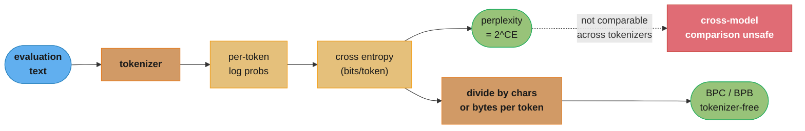
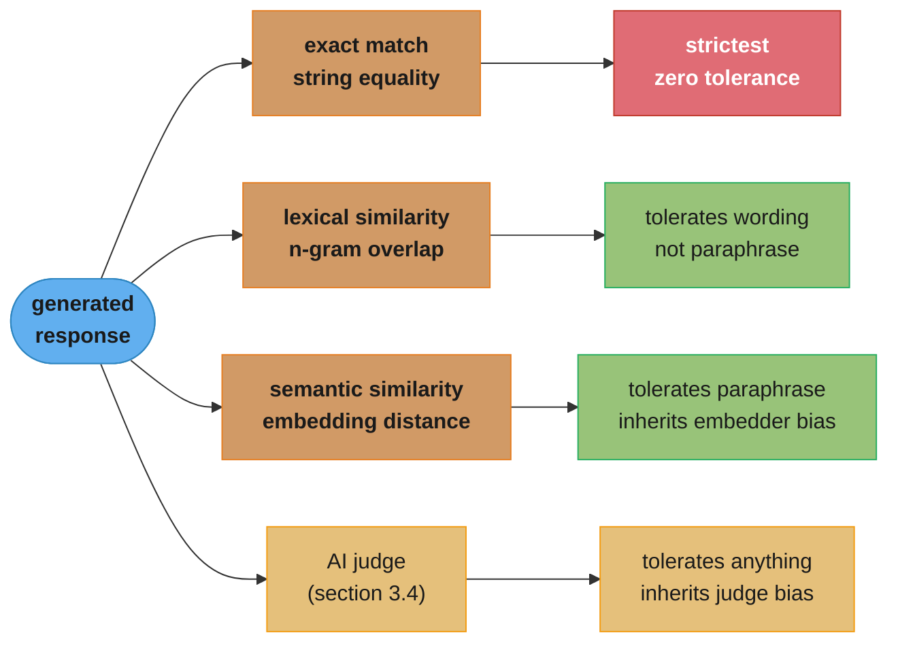
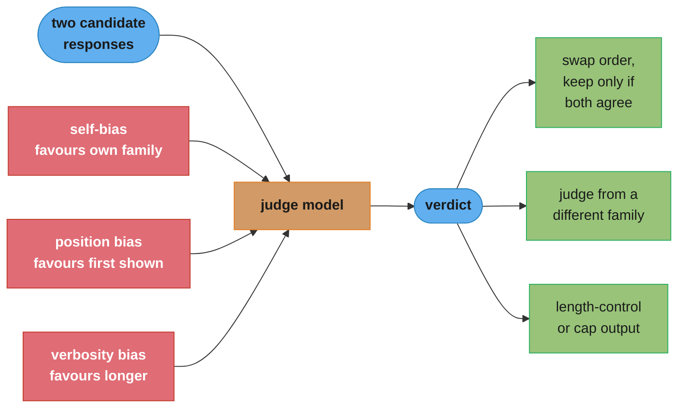
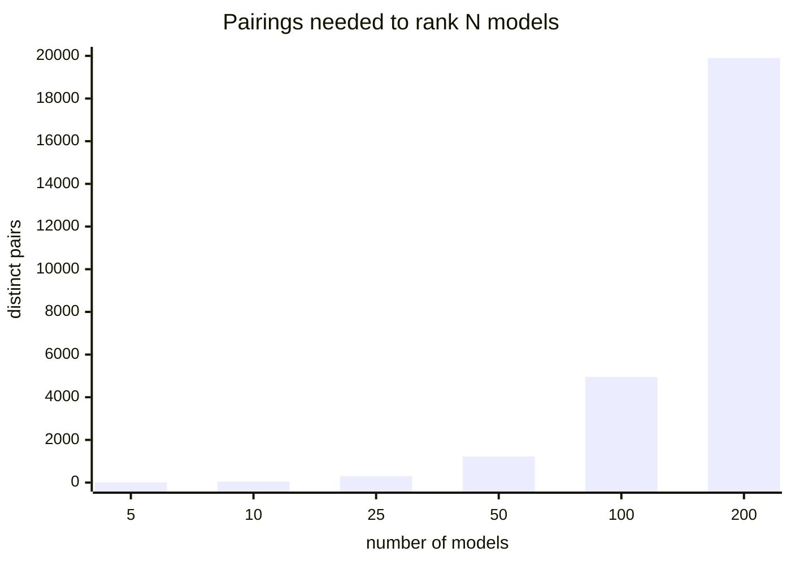
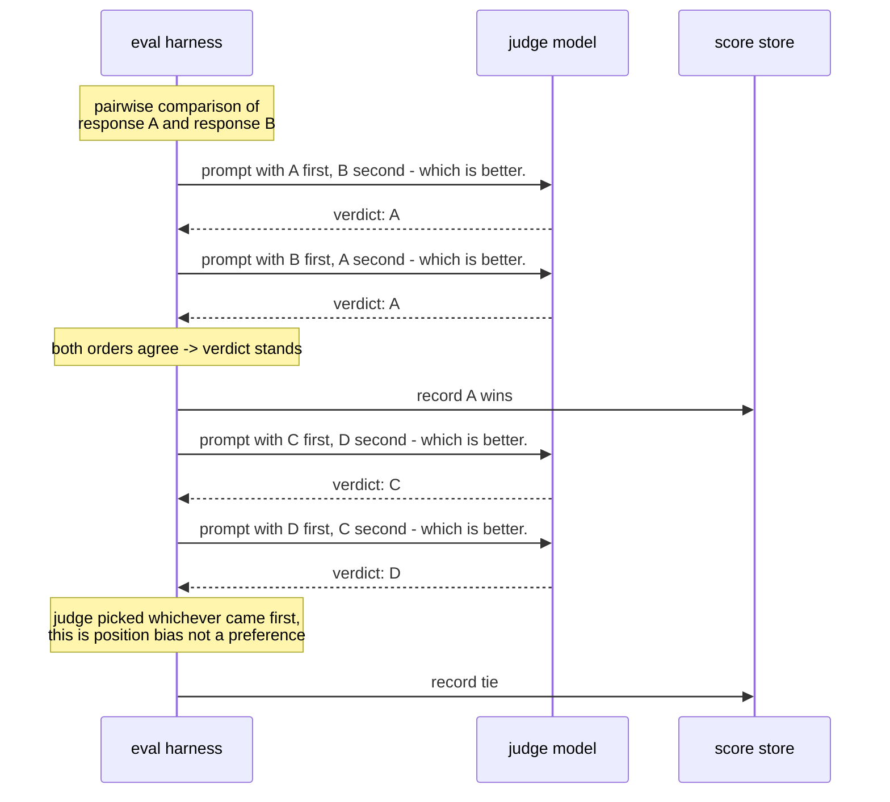

# Chapter 3: Evaluation Methodology

> Ch 3 of 10 · AI Engineering: Building Applications with Foundation Models (Huyen, 1st ed.,
> O'Reilly 2025) · builds on Ch 2 (Understanding Foundation Models), leads to Ch 4 (Evaluate AI
> Systems)

## Chapter Map

Chapter 2 explained what a foundation model *is* — the data it saw, the architecture and scale it
was trained at, what post-training did to it, and how sampling turns a probability distribution
into text. This chapter asks the question that has to come next and that Huyen deliberately puts
*before* prompting, RAG, and finetuning: how do you know whether any of it worked? Her argument
throughout is that evaluation is the bottleneck of AI engineering — not model capability, not
tooling — because a team that cannot measure quality cannot tell an improvement from a
regression, and therefore cannot iterate at all. The chapter is split into two halves. This one
covers **evaluation methodology**: the general-purpose techniques available for judging a
foundation model's output, and what each one can and cannot tell you. Chapter 4 then takes those
techniques and shows how to assemble them into an evaluation pipeline for a specific application.

The methods form a rough ladder from cheapest-and-narrowest to most-expensive-and-broadest.
Language modeling metrics (cross entropy, perplexity, bits-per-character) are almost free but
measure only how well a model predicts text, not whether it is useful. Exact evaluation —
functional correctness and similarity against reference data — is unambiguous where it applies
but only applies where you have either an executable test or a written-down right answer. AI as a
judge scales to open-ended output and arbitrary criteria but brings its own biases and its own
inference bill. Comparative evaluation sidesteps absolute scoring altogether by asking only which
of two responses is better, and turns a pile of pairwise votes into a ranking — at the cost of a
quadratic number of comparisons and a preference signal that is not the same thing as quality.

**TL;DR:**
- **Open-ended outputs break the traditional evaluation contract.** Classification has one right
  label and a clean accuracy number; a summary, an essay, or a working program has many valid
  forms, so "compare the output to the answer key" stops being a well-defined operation.
- **Perplexity measures prediction, not usefulness.** Cross entropy, perplexity, and
  bits-per-character are cheap, informative about training and data quality, useless as a proxy
  for whether the model does your task well — and post-training deliberately makes perplexity on
  raw text *worse* while making the model more useful.
- **Exact evaluation is the strongest signal you can get, where you can get it.** Functional
  correctness (run the code, check whether the tests pass) needs no reference answer at all;
  similarity-to-reference degrades from exact match through lexical overlap to embedding-based
  semantic similarity, getting more forgiving and more approximate at every step.
- **AI as a judge is flexible and cheap relative to humans, and biased in specific,
  characterizable ways** — self-bias, position bias, verbosity bias — which means judge scores
  are useful *relatively*, within one fixed judge and one fixed prompt, and not as absolute
  numbers you can carry between judge versions.
- **Comparative evaluation ranks models without ever assigning an absolute score**, which is what
  humans are actually good at — but the number of pairs grows quadratically, and a public
  leaderboard measures average preference on generic prompts from a nonrepresentative population,
  which is not the same as fitness for your application.

## The Big Question

> Traditional ML evaluation rests on one assumption: for each input there is a right answer
> written down somewhere, and a metric is a function that compares the model's answer to it. A
> foundation model produces open-ended text for open-ended tasks. There is no answer key, there
> are usually many correct answers, the model is often better than the person evaluating it at
> the thing being evaluated, and the public benchmarks everyone quotes are steadily leaking into
> everyone's training data. What is left to measure with?

The analogy Huyen's framing invites is grading. Grading a multiple-choice exam is mechanical: an
answer key exists, scoring is a lookup, and two graders always agree. Grading an essay is a
different job entirely — you need a rubric, the rubric needs criteria, the criteria need someone
who understands the subject well enough to apply them, and two competent graders will still
disagree at the margin. Foundation model evaluation is the essay problem, at machine speed and
machine volume. Every technique in this chapter is an attempt to get essay-grading quality at
multiple-choice cost: perplexity by measuring something adjacent that is cheap, exact evaluation
by finding the sub-problems that *do* have answer keys, AI judges by automating the grader, and
comparative evaluation by replacing "what grade is this" with the much easier question "which of
these two is better."

---

## 3.1 Challenges of Evaluating Foundation Models

Huyen opens by arguing that evaluation has become both harder and more important, and that
investment in it has not kept up with investment in model and application development. The
reasons it got harder are structural, not incidental.

### Open-ended outputs have no single ground truth

Traditional ML tasks are closed-ended. A classifier picks one of a fixed set of labels; a
regressor emits a number. Ground truth is one value, and metrics — accuracy, F1, precision,
recall, RMSE — are all functions comparing prediction to that one value. Foundation models
generate open-ended output: a summary of a document, an answer to a question, a function that
solves a problem, a translated sentence. For essentially every such task there is a large space
of outputs that are all correct, differing in wording, structure, ordering, level of detail, and
style. A metric that compares the output to one written-down reference will penalize a perfectly
good answer for not being *that* answer, and the penalty is not a small correction — a correct
paraphrase can share almost no words with the reference.

This is the fact that everything else in the chapter reacts to. Exact evaluation reacts by
finding cases where the space of correct outputs collapses to something checkable (a program
either passes the tests or it does not). AI judges react by replacing "compare to a reference"
with "have a competent reader assess it." Comparative evaluation reacts by giving up on absolute
scoring entirely.

### The evaluator has to be as capable as the model

The stronger a model gets, the more expertise is required to tell whether its output is good. A
person who cannot write a correct legal summary also cannot reliably tell a correct one from a
confidently-wrong one. This makes evaluation cost scale with model capability in the wrong
direction: exactly where the model is most valuable — expert-level tasks — evaluation requires
the most expensive human annotators, and cannot fall back on crowdsourcing.

### General-purpose models make the test set unbounded

A task-specific model has a task-specific test set. A foundation model is general-purpose: it is
deployed for whatever a user thinks to ask it. There is no finite list of behaviors to enumerate,
which means no test set can claim coverage, and a model that scores well on the tasks you thought
to test can behave badly on the ones you did not. Huyen ties this directly to the practical
advice in Chapter 4 — you evaluate against *your* application's actual usage distribution, not
against a general notion of "how good is this model."

### Public benchmarks saturate, and they leak

Public benchmarks solve the coordination problem — everyone reports the same number on the same
data — but they have two failure modes that compound.

**Saturation.** A benchmark discriminates between models only while models are spread across its
score range. Once the leading models cluster near the ceiling, the benchmark stops carrying
information: the difference between 94.1 and 94.4 is mostly noise and test-set idiosyncrasy, not
capability. Benchmarks that were considered hard have repeatedly gone from "state of the art is
well below human" to "everyone is near the top" in a small number of years, and the field's
response has been to keep publishing harder ones.

**Contamination (data leakage).** Foundation models are pretrained on enormous web-scraped
corpora. Public benchmarks live on the public web — in papers, in repositories, in blog posts, in
discussion threads, in derived datasets. So benchmark items end up in pretraining data, and a
model that has memorized a benchmark item scores well on it without having the capability the
benchmark was designed to measure. Contamination can be deliberate but is usually accidental, and
it is genuinely hard to rule out: with a black-box API model you cannot inspect the training data,
and even model developers running deduplication against known benchmarks miss paraphrased or
reformatted copies. The practical consequence is that a high public benchmark score is weak
evidence, and it gets weaker the longer a benchmark has been public.

### Black-box models hide the signals

Several useful measurements need access the API does not give you. Perplexity needs per-token
log probabilities; some providers expose them, some do not, and some expose only the top few.
Anything that needs weights or activations — probing, interpretability-based checks — is off the
table entirely for a commercial API model. And an API model can change underneath you without
notice, which means an evaluation run last month and an evaluation run today may not be measuring
the same system, so evaluation results need to be stamped with the exact model version they were
produced against.

### Evaluation is under-invested

Huyen's editorial point, and the reason this chapter exists at all, is that teams routinely spend
far more effort on prompting, retrieval, and finetuning than on knowing whether any of it helped.
The asymmetry is self-defeating: without a trustworthy evaluation signal, every improvement is
anecdotal, every regression is invisible until users report it, and the team's iteration loop
runs on vibes. Her framing is that evaluation is not a phase at the end of development but the
instrument that makes development possible.

---

## 3.2 Understanding Language Modeling Metrics

Before task-level evaluation, there is the metric the model was actually trained on. Language
modeling metrics — cross entropy, perplexity, bits-per-character, bits-per-byte — measure one
thing: how well the model predicts the next token in some text. They are cheap, they are the same
quantity being minimized during training, and they are widely misread as a general quality score.

### Entropy: how much information a token carries

**Entropy** measures the average amount of information — equivalently, the unpredictability — per
token in a distribution. A language whose next token is always the same carries zero entropy; a
language whose next token is uniformly random over a vocabulary of 50,000 carries
log₂(50,000) ≈ 15.6 bits per token. Real language sits far below the uniform bound because
context constrains what comes next: after "the capital of France is", the distribution over the
next token is close to a point mass.

### Cross entropy: how well *your model* predicts

**Cross entropy** measures how well a model's predicted distribution Q matches the true
distribution P of the data:

```
H(P, Q) = - Σ  P(x) · log Q(x)
             x
```

Cross entropy decomposes into two pieces that mean different things:

```
  H(P, Q)     =    H(P)      +    D_KL(P || Q)
  ---------        ------         ------------
  what the         entropy of     how far the model's
  model pays       the data       distribution sits
  per token        itself         from the data's

  H(P)          irreducible. No model can beat it. It is a property of the
                data, not of the model. Cleaner, more predictable data has
                lower H(P) -- which is why perplexity is not comparable
                across datasets.

  D_KL(P || Q)  reducible. This is the only part training can shrink, and it
                is what "the model is learning" actually means numerically.
```

Caption: a low cross entropy can come from a good model *or* from predictable data, which is the
single most common misreading of a perplexity number.

### Perplexity: cross entropy made interpretable

**Perplexity (PPL)** is the exponential of cross entropy — `exp(H)` when H is in nats,
`2^H` when H is in bits. The exponentiation converts an information quantity into an *effective
branching factor*: a perplexity of 3 means the model is, on average, as uncertain as if it were
choosing uniformly among 3 options at each token.

| Situation | Cross entropy | Perplexity | Reading |
|---|---|---|---|
| Perfect prediction | 0 bits | 1 | The model always knows the next token |
| Uniform over a 50,000-token vocabulary | 15.6 bits | 50,000 | The model has learned nothing |
| A competent modern LLM on ordinary English | ~3 bits | ~8 | Weighing a handful of plausible continuations |
| A model on heavily structured text (code, HTML) | lower | lower | The *data* is predictable, not necessarily the model good |

The bounds are worth internalizing: perplexity is always at least 1, and a model that has learned
nothing about the data will sit near the vocabulary size. Everything interesting happens between
those two.

### Bits-per-character and bits-per-byte: making it comparable

Perplexity is measured per *token*, and tokens are a property of the tokenizer, not of the
language. A model with a large vocabulary packs more text into each token, so its per-token
perplexity is computed over fewer, harder predictions than a model with a small vocabulary
computing per-token perplexity over many easy ones. **Perplexity is therefore not comparable
across models with different tokenizers**, which is exactly the comparison people most want to
make.

**Bits-per-character (BPC)** and **bits-per-byte (BPB)** fix this by normalizing the total
information cost by a tokenizer-independent unit — the number of characters, or of UTF-8 bytes,
in the text. BPB is the more robust of the two because a "character" is itself ambiguous across
scripts and encodings while a byte is not. Concretely, if a model spends 3.0 bits per token over
a passage and its tokenizer averages 4 characters per token, that is 0.75 BPC; a second model
spending 2.4 bits per token with 3-character tokens is 0.80 BPC — worse, despite the lower
per-token number. The per-token comparison would have ranked them backwards.



Caption: the same log probabilities produce both numbers — perplexity keeps the tokenizer's units
and BPB removes them, which is why only the second is safe to compare across models.

### What perplexity is genuinely good for

- **Watching a training or finetuning run.** Perplexity on a held-out set is the direct training
  objective; it is the first thing to look at when a run diverges or a learning rate is wrong.
- **Assessing lossy transformations of a model.** Quantizing a model, pruning it, or swapping its
  attention implementation should barely move perplexity on a fixed corpus. A large jump is
  concrete evidence of damage, measured in minutes rather than through a full task evaluation.
- **Data quality and deduplication.** Text a model finds abnormally easy is often text it has
  seen before, and text it finds abnormally hard is often garbage — broken encoding, boilerplate,
  machine-generated filler. Perplexity is a cheap first-pass filter for both.
- **Contamination hints.** Unusually low perplexity on a benchmark item, relative to comparable
  text, is weak evidence that the item was in the training data. It is a hint, not a proof.

### What perplexity does not tell you

- **Whether the model is useful for your task.** Predicting text well and following an
  instruction well are different capabilities, and the correlation between them is loose enough
  that perplexity should never be used to choose between two post-trained models for an
  application.
- **Anything comparable across datasets.** Because cross entropy includes the data's own entropy,
  a model looks "better" on code than on prose purely because code is more predictable.
- **Anything after heavy post-training.** This is the counterintuitive one and the most important
  practical caveat: supervised finetuning and preference finetuning (Chapter 2, §2.3) deliberately
  move the model's distribution away from raw internet text and toward helpful, formatted,
  instruction-following responses. That shift *raises* perplexity on raw text while making the
  model substantially more useful. A rising perplexity after post-training is expected behavior,
  not a regression.
- **Anything at all, for many API models.** Perplexity needs per-token log probabilities. Where a
  provider does not expose them, the metric is simply unavailable.

**Broken → fixed.** A team compares two candidate models by running each over 10 MB of their
internal documentation and picking the lower perplexity. Model A wins at 6.1 versus model B's
8.4, so they ship A — and quality complaints start immediately. What actually happened: A is a
base model and B is a heavily instruction-tuned one, so A predicts documentation prose better
while B is far better at *answering questions about it*. The fix is to stop using a language
modeling metric as a task metric: keep perplexity for the training-diagnostics job it is good at,
and select between candidates with the task-level evaluation Chapter 4 describes.

---

## 3.3 Exact Evaluation

**Exact evaluation** produces a judgment with no ambiguity — the same input always yields the
same verdict, and no model is involved in producing it. Huyen splits it into two families:
**functional correctness**, which checks whether the output *does the job*, and **similarity
measurements against reference data**, which check whether the output *resembles a known good
answer*.

### Functional correctness

Functional correctness is the strongest evaluation signal available, because it needs no
reference answer at all — only a definition of what "working" means. Its natural home is code
generation: generate a function, run it against a test suite, and count it correct if and only if
every test passes. That is exactly what benchmarks in the HumanEval and MBPP family do — each
problem ships with a docstring and a hidden set of unit tests.

The standard metric here is **pass@k**: the probability that at least one of *k* independently
sampled solutions passes all tests. pass@1 measures single-shot reliability; pass@10 measures
whether the capability is present at all and just needs sampling to surface. The gap between them
is itself informative — a model with pass@1 of 30% and pass@10 of 80% knows how to solve the
problem but is unreliable, which is a very different engineering situation from a model where both
numbers are 30%.

The pattern generalizes well beyond code:

| Task | Functional-correctness check |
|---|---|
| Text-to-SQL | Execute the generated query; compare the returned rows to the expected result set |
| Game playing | Did the agent win, and in how many moves |
| Math word problems | Does the final numeric answer match, independent of the reasoning shown |
| Structured extraction | Does the output parse against the target schema, with the required fields present |
| API/tool call generation | Does the call succeed against a real or mocked endpoint |

The limit is scope. Functional correctness applies only where "working" is executable. It cannot
say whether a summary is faithful, an email is appropriately toned, or an explanation is clear.

**A trap worth naming:** an execution-based check verifies the tests, not the code. A generated
SQL query that returns the right rows for the one test database may still be doing a full table
scan, ignoring a filter that happens to be a no-op on that data, or silently dropping NULLs. The
signal is unambiguous about what it measures and completely silent about everything else, and it
is only as strong as the test suite behind it.

### Similarity measurements against reference data

Where the output cannot be executed, the fallback is comparing it to one or more human-written
(or trusted-model-written) **reference responses**. Reference data is expensive — every item is
an annotation cost — and it is fundamentally incomplete, because for open-ended tasks the set of
valid responses is much larger than the set you wrote down. The four measurement approaches trade
strictness against tolerance for legitimate variation.



Caption: strictness falls left to right and so does determinism — every step that tolerates more
legitimate variation also introduces more of somebody else's model into the verdict.

**Exact match** asks whether the output string equals a reference string. It works for short
closed answers — a country name, a date, a classification label, a yes/no — and it is the correct
choice there precisely because it admits no argument. It breaks the moment the answer is a
sentence: "Paris" matches, "Paris, France" does not, "The capital is Paris." does not, and all
three are correct. In practice exact match is almost always paired with normalization
(lowercasing, stripping punctuation and articles, trimming whitespace) to recover the obviously
equivalent cases.

**Lexical similarity** scores overlap of words or n-grams between the output and the reference.
The classic metrics come from machine translation and summarization:

- **BLEU** — precision-oriented n-gram overlap with a brevity penalty; from machine translation.
- **ROUGE** — recall-oriented n-gram overlap (ROUGE-N for n-grams, ROUGE-L for longest common
  subsequence); from summarization.
- **METEOR** — adds stemming and synonym matching on top of unigram alignment.
- **Edit distance / Levenshtein** — the minimum number of character insertions, deletions, and
  substitutions to turn one string into the other; also underpins fuzzy matching.

All of them share one flaw, and it runs in both directions. A perfect paraphrase that shares no
vocabulary with the reference scores near zero; a fluent, confidently wrong answer that reuses the
reference's vocabulary scores high. Consider a reference of *"The meeting was postponed to
Tuesday."* against two candidates: *"They moved it to Tuesday."* (correct, low n-gram overlap)
and *"The meeting was postponed to Thursday."* (wrong on the only fact that matters, very high
n-gram overlap). Lexical similarity ranks the wrong one first.

**Semantic similarity** replaces surface overlap with meaning: embed the output and the reference
with an embedding model and compute the distance (cosine similarity, typically) between the two
vectors. This is what catches the paraphrase case that lexical similarity throws away, and
metrics such as **BERTScore** and **MoverScore** formalize it by aligning contextual token
embeddings rather than comparing one vector per text. The costs are real: you now need an
embedding model at evaluation time, and **the quality of the metric is capped by the quality of
the embedder** — a weak embedding model produces confidently wrong similarity scores, and the
score itself gives no signal that it has done so. Semantic similarity is also blind in exactly the
place the Thursday/Tuesday example is dangerous: two sentences that differ in a single critical
entity are, in embedding space, very close together.

The overall picture is a ladder with no free rung. Every step toward tolerating legitimate
variation trades away determinism and imports another model's judgment. The next section takes
that trade to its logical conclusion.

---

## 3.4 AI as a Judge

**AI as a judge** (also **LLM-as-a-judge**) uses a foundation model to evaluate another model's
output. It is, by Huyen's account, the technique that made open-ended evaluation practical at
scale, and it has spread fast for good reasons: it is dramatically cheaper and faster than human
annotation, it needs no reference answers, it handles arbitrary criteria (a new thing to measure
is a new sentence in a prompt, not a new dataset), and it can explain its verdict, which makes the
evaluation itself debuggable in a way a BLEU score never is.

### Three judging setups

| Setup | What the judge sees | Typical use |
|---|---|---|
| **Standalone scoring** | The input and one response | "Is this response helpful/faithful/safe?" — no reference needed |
| **Reference-based** | The input, one response, and a gold answer | "Does this response contain the same information as the reference?" |
| **Pairwise comparison** | The input and two responses | "Which of A and B is better?" — feeds the ranking of §3.5 |

Pairwise comparison is generally the most reliable of the three, for the same reason it is more
reliable with human annotators: relative judgment is an easier cognitive task than absolute
scoring.

### How to prompt a judge

The judge's prompt is the evaluation's specification, and vagueness in it turns into noise in the
scores. What a well-constructed judge prompt contains:

1. **The task the judged model was performing** — the judge needs to know what "good" was
   supposed to mean here.
2. **An explicit criterion, one at a time.** "Rate the quality" produces a blend of fluency,
   correctness, length, and formatting that nobody can decompose afterwards. "Is every factual
   claim in this response supported by the provided context?" produces a signal you can act on.
   Multiple criteria should generally be separate judge calls, not one call returning several
   scores.
3. **A scoring system with each level defined.** A 1–5 scale where only the endpoints are described
   invites the judge to invent the middle. Define what a 3 is.
4. **Reasoning before the score.** Asking the judge to state its reasoning and *then* commit to a
   score improves consistency and, just as importantly, leaves an audit trail explaining why an
   item scored the way it did.
5. **Examples**, where a criterion is subtle — a few scored examples anchor the scale.

Huyen's practical steer on scoring systems is that models are much better at **classification and
comparison** than at fine-grained numeric scoring. A judge asked for a score from 1 to 100 will
produce numbers that cluster at round values and are not stable under rephrasing; a judge asked
to choose among three clearly-defined categories, or to pick the better of two responses, is far
more consistent. Prefer a small discrete scale or a binary verdict.

### The biases, and what to do about them

The judge is a foundation model, and it brings a foundation model's failure modes into the
measurement instrument. Huyen names the ones that matter operationally.

**Inconsistency and non-reproducibility.** Judge scores depend on the judge model, its version,
its sampling temperature, and the exact wording of the judge prompt. Change any of them and the
numbers move. This does not make judges useless — it makes their output *relative* rather than
absolute. Judge scores are meaningful for comparing two systems evaluated under one fixed judge
configuration, and meaningless as an absolute quality figure to quote or to compare against a
number produced by a different judge. The operational consequence is that the judge prompt and
judge model version are part of the experiment's configuration and must be pinned and recorded
alongside the results, exactly like a random seed.

**Self-bias.** Models tend to rate their own outputs — and outputs from models in their own family
or trained on similar data — more favorably than a neutral evaluator would. Using model X as the
judge for a bake-off that includes model X is therefore not a fair test. Where it can be avoided,
use a judge from a different family than every candidate; where it cannot, at minimum do not draw
conclusions from small margins.

**Position bias.** In a pairwise comparison, judges systematically favor one position — usually
the first response shown — independent of content. The standard mitigation is cheap and
effective: run every comparison twice with the order swapped, keep the verdict only when both
runs agree, and treat disagreements as ties (or as a signal that the two responses are genuinely
close). This doubles the judge cost and is almost always worth it.

**Verbosity bias.** Judges prefer longer, more elaborate responses, and the preference persists
even when the extra length adds nothing correct. This is dangerous beyond measurement error: if a
judge score becomes an optimization target — for prompt tuning, or as a reward signal — the system
under test will learn to produce longer output, and the metric will improve while quality does
not.

**Cost and latency.** A judge is another full inference call, and a *good* judge is often a
frontier model. Evaluating every production response with a strong judge can cost as much as, or
more than, generating the responses in the first place, and it adds latency wherever the judge
sits in the request path. The practical answers are to sample rather than evaluate everything, to
use a cheaper or specialized judge for high-volume checks and reserve the strong judge for a
smaller audit sample, and to run judges asynchronously and offline wherever the verdict is not
needed to gate the response.

**Circularity.** Using a model to judge and then optimizing hard against that judge's scores
optimizes for the judge's biases, including all of the above. The metric goes up; the thing the
metric was standing in for may not. Any judge used as a long-running optimization target needs
periodic human spot-checking to confirm the correlation still holds.



Caption: each named bias has a specific, cheap mitigation — the expensive mistake is treating
judge scores as absolute numbers rather than as comparisons under one pinned configuration.

### Specialized judges

Not every judge has to be a general-purpose model prompted into the role. Purpose-built evaluators
are cheaper, faster, and more consistent, at the price of narrower scope.

- **Reward models** take a (prompt, response) pair and emit a scalar score representing how much a
  human would approve of it. They are trained on human preference data and are the engine of
  preference finetuning (Chapter 2, §2.3), but the same trained model can be repurposed as a
  standalone evaluator. Because a reward model is small and single-purpose, it is orders of
  magnitude cheaper per judgment than a frontier model prompted as a judge.
- **Reference-based judges** score a response against a gold answer — scoring similarity or
  entailment rather than free-standing quality. BLEURT is the canonical learned example; a
  prompted judge handed the reference answer is the simpler one. These are more constrained and
  therefore more consistent than open-ended judging, but they require reference data, which is
  the cost §3.3 was trying to avoid.
- **Preference models** predict which of two responses a human would pick, which is the pairwise
  setup baked into a dedicated model rather than a prompt.

The general lesson is that judge choice is itself a cost/quality tradeoff, exactly parallel to
model choice for the application — and Chapter 4's evaluation-pipeline design is where those two
choices meet.

---

## 3.5 Ranking Models with Comparative Evaluation

Everything so far has been **pointwise**: score each response, or each model, on its own scale.
**Comparative evaluation** takes a different route — it never assigns an absolute score, it only
ever asks "of these two responses, which is better?" and then infers a ranking from a large number
of such answers.

### Why comparison beats scoring

The argument is about the evaluator, not the model. Humans are unreliable absolute scorers: asked
to rate a response 1–5, different annotators anchor differently, the same annotator drifts over a
session, and the scale means different things for different questions. Ask the same annotators
which of two responses they prefer and agreement rises sharply, because the comparison requires no
shared notion of what a "4" is. This is precisely the same effect that makes pairwise judging more
reliable than standalone scoring in §3.4, and it is why the technique underpins both preference
data collection for training and public model leaderboards.

Comparative evaluation is also the only approach that works when quality is real but hard to
articulate. Nobody can write a rubric that captures "this answer is more useful," but people can
consistently pick the more useful one.

### From pairwise votes to a ranking

Collecting preferences gives you a match record: model A beat model B, B beat C, C beat A. Turning
that into a ranking is a well-studied problem, and the chapter names the standard algorithms.

**Elo**, borrowed from chess, gives each model a rating and predicts the outcome of a match from
the rating difference through a logistic curve — a 400-point gap corresponds to roughly a 10:1
expected win ratio. After each match, both ratings update in proportion to how surprising the
result was:

```
  expected score for A:   E_A = 1 / (1 + 10^((R_B - R_A)/400))
  rating update:          R_A <- R_A + K * (S_A - E_A)        S_A = 1 win, 0.5 draw, 0 loss

  worked example, K = 32
    R_A = 1500, R_B = 1500   ->  E_A = 0.50
    A wins                   ->  R_A = 1500 + 32*(1 - 0.50) = 1516,  R_B = 1484

    R_A = 1700, R_B = 1300   ->  E_A = 0.91   (a 400-point gap)
    A wins (expected)        ->  R_A = 1700 + 32*(1 - 0.91) = 1703   small update
    B wins (upset)           ->  R_B = 1300 + 32*(1 - 0.09) = 1329   large update
```

Caption: the K factor sets how much a single result moves a rating, and the same match record
played in a different order lands on different final ratings — which is exactly the property that
makes Elo a questionable fit here.

Huyen's criticism of Elo for model ranking is that its assumptions do not hold. Elo was designed
for players whose skill genuinely changes over time, so it is **sequential and order-dependent**:
process the same set of matches in a different order and you get different final ratings. Models
do not improve between matches — a model's strength is fixed for the duration of the evaluation —
so order-dependence is pure noise. Results are also sensitive to the K factor and to the starting
rating assigned to a newly added model.

**Bradley-Terry** addresses this directly. It is a maximum-likelihood model fitted over the
*entire* match record at once: each model gets a strength parameter, the probability that i beats
j is a logistic function of the difference in strengths, and the parameters are chosen to maximize
the likelihood of all observed outcomes. Because it fits everything jointly, the result does not
depend on the order matches were played, and it comes with confidence intervals — which matters
enormously when two models' ratings differ by less than the noise. **TrueSkill** is the third name
in this family, a Bayesian rating system originally built for multiplayer matchmaking.

### The scaling problem

Comparative evaluation's cost grows quadratically in the number of models. Ranking N models
requires, in the worst case, information about N(N−1)/2 pairings, and each pairing needs enough
votes for the result to be statistically meaningful rather than a coin flip.



Caption: adding the 101st model to a 100-model leaderboard creates 100 new pairings, each needing
its own vote volume — which is why real leaderboards sample pairings adaptively rather than
covering the full matrix.

Two consequences follow. First, real leaderboards cannot evaluate every pair uniformly; they
sample, prioritizing pairs whose outcome is most uncertain or most informative, which means the
ranking's reliability is uneven across the table. Second, ranking positions among closely-matched
models are frequently within the confidence interval — the difference between rank 4 and rank 7
may not be a difference at all, and reading the ordinal position as if it were meaningful is a
misuse of the data.

### The limits of leaderboards

Even a perfectly-executed comparative ranking measures something specific, and Huyen is direct
about what it is not.

- **Preference is not quality.** Votes reward what is pleasant to read — formatting, confidence,
  length, an agreeable tone — alongside what is correct. Verbosity bias is not exclusive to AI
  judges; human voters exhibit it too. A model can climb a preference leaderboard by being more
  agreeable, which is the opposite of what a factual application wants.
- **The prompt distribution is not yours.** Public arena votes come from whatever users happened
  to type, which skews toward casual, general, and often trivial queries. A ranking on that
  distribution says very little about performance on your domain's actual traffic.
- **There is no ground truth in the loop.** A voter picks the response they prefer, not the
  response that is correct — and on a question the voter cannot verify, a confidently wrong answer
  can beat a correctly hedged one.
- **The voter population is not representative**, and votes are gameable. Where a leaderboard has
  commercial significance, there is an incentive to influence it, and open voting is hard to
  secure.
- **A public prompt distribution can be optimized against**, which is the same contamination
  dynamic §3.1 described for static benchmarks, arriving one level up.

The practical use Huyen endorses is as a **filter, not a decision**: a leaderboard is a reasonable
way to narrow the field from dozens of models to a shortlist of three or four worth evaluating
properly, and a poor way to pick the winner. The actual choice comes from running your own
evaluation on your own data — which is the entire subject of Chapter 4.

---

## Beyond the book — benchmark saturation and contamination-resistant evaluation

> §3.1 states the *mechanism* — public benchmarks saturate as models improve and leak into
> pretraining corpora — and §3.5 states the mechanism by which a public preference leaderboard can
> be optimized against. The chapter does not name any specific post-publication benchmark, nor
> does it evaluate any particular contamination-resistant evaluation service. What follows is the
> repo's own note on how that dynamic has continued, not a claim about what the book says.

The saturation-and-replacement cycle the chapter describes has kept running since publication:
each generation of "hard" public benchmark has been substantially solved faster than the previous
one, and the field's response has been a steady stream of harder replacements. Two structural
responses have grown in prominence, both of which are direct applications of §3.1's reasoning
rather than departures from it. **Private held-out evaluation sets** — benchmark items never
published, so they cannot enter a pretraining corpus, with only aggregate scores released — trade
reproducibility for contamination resistance. **Live or continuously-refreshed benchmarks**, built
from problems created after a model's training cutoff, attack the same problem from the time axis
instead. Neither changes the chapter's advice: a public benchmark score is weak evidence about a
specific application, and the strongest evidence remains an evaluation you built on data only you
have. See `llm/evaluation_and_benchmarks/evaluation_and_benchmarks.md` for the current benchmark
landscape.

---

## Visual Intuition

```
  Perplexity as an effective branching factor

  vocabulary = 50,000 tokens

  PPL = 50,000   model learned nothing; every token equally likely
                 [][][][][][][][][][][][][][][][][][][][][] ... 50,000 wide

  PPL = 100      weak model
                 [][][][][][][][][][][][][][][][][][][][]  ... 100 wide

  PPL = 8        competent LLM on ordinary English
                 [][][][][][][]

  PPL = 2        model on highly structured text (JSON, boilerplate code)
                 [][]
                 ^ careful: this may say the DATA is predictable,
                   not that the MODEL is good

  PPL = 1        perfect prediction. Lower bound. Unreachable on real text
                 []

  The scale is multiplicative, not additive: going 8 -> 4 halves the model's
  uncertainty per token, the same size of win as going 50,000 -> 25,000.
```

Caption: perplexity is an *effective number of choices*, which is why a drop from 8 to 4 is a
large result and a drop from 6.10 to 6.05 is nothing.



Caption: the order-swap protocol costs exactly 2x the judge calls and converts an invisible
systematic bias into a visible, discardable disagreement.

```
  Why lexical similarity ranks the wrong answer first

  reference:   "The meeting was postponed to Tuesday."

  candidate A: "They moved it to Tuesday."
               shared content words: {to, Tuesday}          -> low  overlap
               factually correct                            -> should score HIGH

  candidate B: "The meeting was postponed to Thursday."
               shared content words: {The, meeting, was,
                                      postponed, to}        -> high overlap
               wrong on the ONLY fact that matters          -> should score LOW

  BLEU/ROUGE rank:   B  >  A          exactly backwards
  Semantic sim rank: B ~= A           both "close", the one-word factual
                                      flip is nearly invisible in embedding space
  AI judge:          A  >  B          if the criterion names factual accuracy
  Exact match:       both fail        no information at all
```

Caption: no similarity measure is safe alone — this single example breaks lexical overlap outright
and shows why semantic similarity's tolerance for paraphrase is the same mechanism that hides a
one-entity factual error.

---

## Key Concepts Glossary

- **Open-ended output** — a generated response with many valid forms, so no single reference answer defines correctness.
- **Ground truth** — the known-correct answer a metric compares a prediction against.
- **Benchmark saturation** — the point at which leading models cluster near a benchmark's ceiling and it stops discriminating between them.
- **Data contamination (leakage)** — benchmark items appearing in a model's training data, inflating its score without the underlying capability.
- **Entropy** — the average information, or unpredictability, per token in a distribution.
- **Cross entropy** — how many bits a model spends per token on given data; the data's own entropy plus the KL divergence from the model's distribution.
- **KL divergence** — the reducible part of cross entropy; how far the model's predicted distribution sits from the true one.
- **Perplexity (PPL)** — the exponential of cross entropy, read as an effective branching factor at each token.
- **Bits-per-character (BPC)** — cross entropy normalized per character, making it comparable across tokenizers.
- **Bits-per-byte (BPB)** — the same normalization per UTF-8 byte; more robust than BPC across scripts.
- **Exact evaluation** — evaluation producing an unambiguous, reproducible verdict with no model in the loop.
- **Functional correctness** — checking whether output performs its intended function, e.g. by running tests against generated code.
- **pass@k** — the probability that at least one of k sampled solutions passes all tests.
- **Reference data (gold answers)** — human- or trusted-model-written correct responses used as a comparison target.
- **Exact match** — scoring an output correct only if it equals a reference string.
- **Lexical similarity** — scoring by overlap of words or n-grams with a reference.
- **BLEU** — precision-oriented n-gram overlap metric with a brevity penalty, from machine translation.
- **ROUGE** — recall-oriented n-gram overlap metric, from summarization.
- **METEOR** — a lexical metric adding stemming and synonym matching to unigram alignment.
- **Edit distance (Levenshtein)** — the minimum character edits needed to transform one string into another.
- **Semantic similarity** — scoring by distance between embeddings of the output and the reference.
- **BERTScore** — a semantic similarity metric aligning contextual token embeddings between output and reference.
- **AI as a judge (LLM-as-a-judge)** — using a foundation model to evaluate another model's output.
- **Judge prompt** — the instruction, criterion, and rubric given to a judge model; part of the evaluation's configuration.
- **Scoring system** — the output format a judge is asked for: binary, small discrete scale, or continuous.
- **Self-bias** — a judge favoring outputs from itself or its own model family.
- **Position bias** — a judge favoring whichever response appears in a particular position in a pairwise comparison.
- **Verbosity bias** — a judge (or human voter) favoring longer responses independent of their quality.
- **Reward model** — a model trained on human preference data that scores a prompt-response pair; reusable as an evaluator.
- **Reference-based judge** — a judge given a gold answer and asked to score the response against it.
- **Preference model** — a model that predicts which of two responses a human would prefer.
- **Pointwise evaluation** — assigning each response or model an independent absolute score.
- **Comparative evaluation** — judging only which of two responses is better, never assigning an absolute score.
- **Elo rating** — a sequential rating system updating each competitor's score after every match by the surprise of the result.
- **K factor** — the constant controlling how much a single Elo match result moves a rating.
- **Bradley-Terry model** — a maximum-likelihood ranking fitted over an entire match record at once, so it is order-independent.
- **TrueSkill** — a Bayesian rating system in the same family as Elo, originally for multiplayer matchmaking.
- **Leaderboard** — a public ranking of models, typically built from aggregated pairwise preference votes.

---

## Tradeoffs & Decision Tables

| Method | Needs reference data | Deterministic | Cost per item | Applies to open-ended output |
|---|---|---|---|---|
| Perplexity / BPB | No | Yes | Near zero | Measures prediction, not task quality |
| Functional correctness | No (needs tests) | Yes | Test-execution time | Only where "working" is executable |
| Exact match | Yes | Yes | Near zero | No — breaks past short answers |
| Lexical similarity | Yes | Yes | Near zero | Poorly — punishes paraphrase |
| Semantic similarity | Yes | Yes (fixed embedder) | One embedding call | Partially — blind to single-entity flips |
| AI as a judge | No | No | One or two LLM calls | Yes |
| Comparative evaluation | No | No | Many pairwise votes | Yes, relatively |

| Judge bias | Symptom | Mitigation | Residual cost |
|---|---|---|---|
| Self-bias | Candidate from the judge's family wins by a suspicious margin | Judge from an unrelated family | May not be avoidable for frontier-only criteria |
| Position bias | Verdict flips when the order flips | Run both orders, keep only agreements | 2x judge calls |
| Verbosity bias | Longer answers win regardless of content | Length-control the candidates, or add a conciseness criterion | Extra prompt engineering |
| Non-reproducibility | Scores shift after a judge model update | Pin judge model version and prompt; re-baseline on change | Re-running the baseline suite |
| Circularity | Judge score climbs, user complaints do not fall | Periodic human spot-check against the judge | Ongoing annotation budget |

| Ranking algorithm | Order-dependent | Confidence intervals | Fit for model ranking |
|---|---|---|---|
| Elo | Yes — same matches, different order, different ratings | Not natively | Poor; assumes skill changes over time, which models' does not |
| Bradley-Terry | No — fits the whole record jointly | Yes | Good; the chapter's preferred framing |
| TrueSkill | Partially (Bayesian, sequential updates) | Yes | Usable; designed for multiplayer matchmaking |

| Evidence type | Strength for "should I ship this model?" |
|---|---|
| Public leaderboard rank | Weak — generic prompts, preference not quality, gameable |
| Public benchmark score | Weak — saturation and contamination both inflate it |
| AI-judge score on your data | Moderate — real distribution, biased instrument |
| Functional correctness on your tests | Strong — where the task admits executable tests |
| Human evaluation on your data | Strongest, and the most expensive |

---

## Common Pitfalls / War Stories

- **Selecting a model by perplexity.** A base model beats an instruction-tuned model on perplexity
  over your documents and loses badly on your actual task, because post-training deliberately
  moves the distribution away from raw text. Perplexity belongs in training diagnostics, never in
  model selection.
- **Comparing perplexity across models with different tokenizers.** The number is per token, and
  tokens are not a fixed unit. Two models can rank in opposite orders on perplexity and on
  bits-per-byte over the same corpus; only the second comparison is meaningful.
- **Quoting an AI-judge score as an absolute quality figure.** "Our system scores 4.2/5" is
  meaningless without the judge model version and the exact judge prompt, and it will move on its
  own the next time the judge provider ships an update. Judge scores compare systems under one
  pinned configuration; they are not a quantity you can publish.
- **Running a pairwise judge in one order only.** Position bias then contributes a consistent,
  invisible offset to every comparison in the study. The order-swap protocol costs exactly double
  and converts the bias into a visible disagreement rate you can report.
- **Optimizing directly against a judge score.** Prompt-tuning against an LLM judge reliably makes
  responses longer, because verbosity bias is the easiest gradient available. The metric improves,
  user-visible quality does not, and nobody notices until someone reads the outputs.
- **Trusting a green functional-correctness suite.** Generated code that passes the tests is
  verified against the tests, not against the requirement. A SQL query returning the right rows on
  a small fixture may be scanning the whole table, or dropping NULLs, on production data.
- **Reading a leaderboard's ordinal positions as real.** Ranks 4 through 7 are frequently inside
  each other's confidence intervals. Use the leaderboard to build a shortlist, then evaluate the
  shortlist yourself.
- **Failing to record the model version an evaluation ran against.** API models change without
  announcement. An evaluation result that does not name the exact model version it measured cannot
  be compared to any later run, and a "regression" may simply be a different system.
- **Assuming a benchmark score transfers to your domain.** A model near the top of a general
  reasoning benchmark can be mediocre on your domain's vocabulary and document structure —
  contamination aside, the benchmark's distribution is simply not yours.

---

## Real-World Systems Referenced

**Language modeling metrics:** cross entropy, perplexity, bits-per-character and bits-per-byte, as
used in model training and quantization assessment. **Functional-correctness benchmarks:** the
HumanEval and MBPP family of code-generation benchmarks, evaluated with pass@k. **Lexical and
semantic similarity metrics:** BLEU, ROUGE, METEOR, edit distance, BERTScore, MoverScore.
**Learned reference-based evaluators:** BLEURT. **Preference-based evaluation:** reward models
trained on human preference data (the same machinery used for preference finetuning in Chapter 2),
and public comparative-evaluation leaderboards of the Chatbot Arena kind, which collect anonymous
pairwise votes and rank models from them. **Ranking algorithms:** Elo (from competitive chess),
the Bradley-Terry model, and TrueSkill.

---

## Summary

Evaluating foundation models is hard for reasons that are structural rather than temporary:
outputs are open-ended so there is no single ground truth to compare against, the evaluator needs
to be as capable as the model to judge expert-level work, general-purpose models have no bounded
test set, and the public benchmarks everyone quotes both saturate as models improve and leak into
pretraining corpora. Against that, the chapter lays out the methodology available. Language
modeling metrics — cross entropy, perplexity, and the tokenizer-independent bits-per-character and
bits-per-byte — are nearly free and genuinely useful for training diagnostics, quantization
damage, data quality, and contamination hints, but they measure how well a model predicts text
rather than whether it is useful, and post-training deliberately makes them worse while making the
model better. Exact evaluation gives unambiguous verdicts where it applies: functional correctness
runs the output and checks whether it works, needing no reference answer at all, while similarity
against reference data degrades from exact match through lexical overlap to embedding-based
semantic similarity, tolerating more legitimate variation at each step and importing more of
another model's judgment along with it. AI as a judge extends evaluation to arbitrary open-ended
criteria at a fraction of human cost, and pays for it with self-bias, position bias, verbosity
bias, non-reproducibility across judge versions, a real inference bill, and the circularity risk of
optimizing against the instrument — all of which have specific mitigations, and none of which
justify treating a judge score as an absolute number. Comparative evaluation abandons absolute
scoring for the much easier pairwise question and turns votes into a ranking via Elo,
Bradley-Terry, or TrueSkill, with Bradley-Terry the better fit because it is order-independent and
carries confidence intervals; its costs are a quadratic number of pairings and a preference signal
that rewards style and length alongside correctness, which is why a leaderboard is a filter for
building a shortlist rather than a decision procedure. Chapter 4 takes all of these methods and
asks the application-specific question: which criteria matter for *your* system, which model
should you pick, and how do you wire the methods into a pipeline whose results you can trust.

---

## Interview Questions

**Q: Why can't traditional ML metrics like accuracy and F1 be used to evaluate a foundation model's open-ended output?**
**Short:** Huyen's point is that open-ended tasks have many valid answers, so there is no single ground truth to compare against.
Accuracy and F1 assume one correct label per input, which makes the metric a lookup against an answer key. A summary, an explanation, or a generated function has a large space of correct forms differing in wording, ordering, and detail, so comparing against one written-down reference penalizes correct answers for not being that particular answer. This is the fact that forces every technique in Chapter 3 — functional correctness, AI judges, comparative evaluation — into existence.

**Q: Why does a model's perplexity often get worse after post-training even though the model gets more useful?**
**Short:** Post-training moves the model's distribution away from raw internet text toward instruction-following responses.
Perplexity measures how well the model predicts the next token of the evaluation text, and a base model is optimized precisely for that. Supervised finetuning and preference finetuning shift the output distribution toward helpful, formatted, instruction-following answers, which predicts raw web text less well while making the model far better at the tasks people actually ask of it. Treat a perplexity rise after post-training as expected, and never use perplexity to choose between two post-trained candidates.

**Q: Why is perplexity not comparable across models with different tokenizers?**
**Short:** Perplexity is measured per token, and a token is a property of the tokenizer rather than of the text.
A model with a large vocabulary packs more characters into each token, so its per-token perplexity is computed over fewer, individually harder predictions than a small-vocabulary model making many easy ones. That means two models can rank in opposite orders on perplexity and on the underlying quantity you actually care about. Bits-per-character or bits-per-byte normalizes the total information cost by a tokenizer-independent unit and is the comparison to use.

**Q: What is data contamination and why does it make a high public benchmark score weak evidence?**
**Short:** Benchmark items leak into web-scraped pretraining data, so a model can score well by memorization rather than capability.
Public benchmarks live on the public web — in papers, repositories, and discussion threads — and foundation models are pretrained on enormous web scrapes, so benchmark items routinely end up in training data. A model that has memorized an item answers it correctly without possessing the capability the benchmark was designed to probe, and with a black-box API model you cannot inspect the training data to rule it out. Contamination gets worse the longer a benchmark has been public, which is why the chapter treats benchmark scores as a filter rather than a decision.

**Q: What is position bias in an AI judge, and what is the standard mitigation?**
**Short:** Judges systematically favor whichever response is shown first, fixed by running each comparison in both orders.
In a pairwise comparison the judge tends to prefer one position regardless of content, which contributes a consistent hidden offset to every result in a study rather than random noise. The mitigation is to run every comparison twice with the order swapped, accept the verdict only when both runs agree, and treat disagreements as ties or as evidence the two responses are genuinely close. It costs exactly double the judge calls and converts an invisible systematic bias into a visible, reportable disagreement rate.

**Q: Why is optimizing a prompt directly against an LLM judge's score dangerous?**
**Short:** The system learns the judge's biases — verbosity most of all — so the metric climbs while real quality does not.
Judges reliably prefer longer, more elaborate responses even when the extra length adds nothing correct, so verbosity is the easiest gradient available to any optimizer pointed at a judge score. The same applies to self-bias and formatting preferences: any exploitable regularity in the judge becomes an optimization target. A judge used as a long-running target needs periodic human spot-checking to confirm the correlation with real quality still holds.

**Q: Why does the chapter argue Bradley-Terry is a better fit than Elo for ranking models?**
**Short:** Elo is sequential and order-dependent, while Bradley-Terry fits the whole match record jointly and carries confidence intervals.
Elo was designed for players whose skill changes over time, so it updates ratings match by match and the same set of matches processed in a different order produces different final ratings. A model's strength is fixed for the duration of an evaluation, so that order-dependence is pure noise, and Elo is additionally sensitive to the K factor and the starting rating given to a new entrant. Bradley-Terry is a maximum-likelihood fit over the entire record at once, so it is order-independent and yields intervals that show when two models' ratings are not actually distinguishable.

**Q: Why is functional correctness considered the strongest exact-evaluation signal?**
**Short:** It checks whether the output actually works, so it needs no reference answer and admits no ambiguity.
Running generated code against a test suite, executing a generated SQL query and comparing the returned rows, or checking whether an agent won a game all produce a verdict that is the same every time and requires no human-written gold answer. That sidesteps both the annotation cost and the many-valid-answers problem that similarity metrics run into. Its limitation is scope: it only applies where "working" is executable, so it says nothing about whether a summary is faithful or an explanation is clear.

**Q: What does pass@1 versus pass@10 tell you that a single number doesn't?**
**Short:** The gap separates a model that lacks the capability from one that has it but is unreliable at sampling it.
pass@k is the probability at least one of k sampled solutions passes all tests, so pass@1 measures single-shot reliability while pass@10 measures whether the capability is present at all. A model at 30% pass@1 and 80% pass@10 can solve the problem and needs better sampling, decoding, or verification to surface the solution; a model at 30% on both simply cannot. Those are different engineering situations calling for different fixes, which a single aggregate number hides.

**Q: Why can lexical similarity rank a factually wrong answer above a correct one?**
**Short:** N-gram overlap rewards shared wording, so a wrong answer copying the reference's phrasing outscores a correct paraphrase.
Against a reference of "The meeting was postponed to Tuesday", the candidate "The meeting was postponed to Thursday" shares nearly every word and is wrong on the only fact that matters, while "They moved it to Tuesday" is correct and shares almost nothing. BLEU and ROUGE rank these exactly backwards because they measure surface overlap rather than meaning. This is the flaw that motivates semantic similarity and, ultimately, AI judges.

**Q: What is the weakness of semantic similarity that lexical similarity doesn't have?**
**Short:** Its quality is capped by the embedding model, and a single-entity factual flip is nearly invisible in embedding space.
Embedding both texts and comparing vectors correctly rewards paraphrase, but two sentences differing only in a critical entity — Tuesday versus Thursday, 2019 versus 2021 — sit very close together in embedding space, so the metric barely registers the error. The score also inherits every weakness of the embedder used to produce it, and gives no signal when the embedder is out of its depth. Semantic similarity is a better default than n-gram overlap and still needs a factual-accuracy check layered on top.

**Q: Why does the chapter recommend a small discrete scale over a 1-to-100 score for an AI judge?**
**Short:** Models are far more consistent at classification and comparison than at fine-grained numeric scoring.
A judge asked for a score out of 100 produces numbers that cluster at round values and shift under harmless rephrasings of the prompt, so most of the apparent resolution is noise. A judge choosing among a few clearly-defined categories, or picking the better of two responses, agrees with itself much more reliably. Define what each level of the scale means rather than describing only the endpoints, and prefer pairwise comparison where the decision permits it.

**Q: Why does evaluation get harder as models get more capable?**
**Short:** Judging expert-level output requires an evaluator with expert-level knowledge, so annotation cost rises with capability.
Someone who cannot write a correct legal summary also cannot reliably distinguish a correct one from a confidently-wrong one, so evaluation of high-value expert tasks cannot fall back on crowdsourced annotators. Cost therefore scales in the wrong direction: exactly where the model is most valuable, evaluation is most expensive. This pressure is a large part of why AI-as-a-judge and comparative evaluation are attractive despite their known biases.

**Q: What does self-bias mean for a model bake-off, in practice?**
**Short:** A judge favors outputs from its own family, so judging a bake-off that includes the judge is not a fair test.
Models rate their own outputs, and outputs from models trained on similar data, more favorably than a neutral evaluator would, which quietly advantages one candidate in a head-to-head. Where possible, use a judge from a family unrelated to every candidate; where that is impractical, at minimum refuse to draw conclusions from small margins. Recording which judge was used is part of making the result interpretable at all.

**Q: What is a reward model, and how can it serve as an evaluator?**
**Short:** It scores a prompt-response pair by predicted human approval, and the same trained model can be reused for evaluation.
Reward models are trained on human preference data and are the engine of preference finetuning in Chapter 2, but nothing stops the resulting scorer from being pointed at production outputs as a standalone judge. Because it is small and single-purpose it is orders of magnitude cheaper per judgment than prompting a frontier model into the judge role, and more consistent. The tradeoff is narrower scope: it scores the preference dimension it was trained on, not an arbitrary criterion you can express in a prompt.

**Q: Why can't a public preference leaderboard tell you which model to ship?**
**Short:** It measures average preference on generic prompts from a nonrepresentative population, which is not fitness for your task.
Votes reward what is pleasant to read — formatting, confidence, agreeable tone, length — alongside what is correct, and voters often cannot verify the answers they are ranking, so a confidently wrong response can beat a correctly hedged one. The prompt distribution is whatever users happened to type, which skews casual and general and almost certainly is not your production traffic. Use the leaderboard to narrow dozens of models to a shortlist, then run your own evaluation on your own data to choose among them.

**Q: Why does comparative evaluation scale badly, and how do real leaderboards cope?**
**Short:** Ranking N models needs up to N(N-1)/2 pairings, each requiring enough votes to be statistically meaningful.
The pair count grows quadratically — 45 pairs for 10 models, 4,950 for 100 — and adding one model to a 100-model board creates 100 new pairings that each need their own vote volume. Real leaderboards therefore sample pairings adaptively rather than covering the full matrix, prioritizing comparisons whose outcome is most uncertain, which makes reliability uneven across the table. The consequence for a reader is that adjacent ranks are frequently inside each other's confidence intervals and should not be read as a real ordering.

**Q: What should you record alongside every AI-judge evaluation result, and why?**
**Short:** The judge model version and the exact judge prompt, because both silently change the scores they produce.
Judge scores depend on the judge model, its version, its sampling settings, and the wording of the criterion, so a number produced under one configuration cannot be compared to one produced under another. API-hosted judges can also change without notice, turning an apparent regression into an artifact of a provider update. Pin and record the configuration exactly as you would a random seed, and re-baseline the whole suite whenever any part of it changes.

**Q: What is the difference between the two terms in the cross-entropy decomposition, and why does it matter?**
**Short:** Cross entropy is the data's own entropy plus the KL divergence from the model, and only the second term is reducible.
The data's entropy is a property of the text — cleaner, more predictable data has lower entropy — and no model can go below it, while the KL divergence measures how far the model's predicted distribution sits from the true one and is the only part training can shrink. This is why a low perplexity can indicate either a good model or merely predictable data, and why perplexity is meaningless as a comparison across different evaluation corpora. Always compare perplexity on a fixed dataset, and read the absolute value with the dataset's own predictability in mind.

---

## Cross-links in this repo

- [llm/evaluation_and_benchmarks/evaluation_and_benchmarks.md — benchmark landscape, saturation, contamination, and LLM-as-a-judge in depth](../../../llm/evaluation_and_benchmarks/evaluation_and_benchmarks.md)
- [llm/error_analysis_and_eval_design/error_analysis_and_eval_design.md — designing evaluation criteria and error taxonomies](../../../llm/error_analysis_and_eval_design/error_analysis_and_eval_design.md)
- [llm/llm_testing_strategies/llm_testing_strategies.md — regression suites and CI for non-deterministic systems](../../../llm/llm_testing_strategies/llm_testing_strategies.md)
- [ml/model_evaluation_and_selection/model_evaluation_and_selection.md — the classical-ML evaluation baseline this chapter departs from](../../../ml/model_evaluation_and_selection/model_evaluation_and_selection.md)
- [ml/probability_and_statistics/probability_and_statistics.md — entropy, cross entropy, and KL divergence from first principles](../../../ml/probability_and_statistics/probability_and_statistics.md)
- [llm/inference_and_decoding/inference_and_decoding.md — log probabilities, sampling, and why perplexity needs them](../../../llm/inference_and_decoding/inference_and_decoding.md)
- [llm/llm_observability_and_monitoring/llm_observability_and_monitoring.md — running judges continuously against production traffic](../../../llm/llm_observability_and_monitoring/llm_observability_and_monitoring.md)
- [llm/token_economics_and_cost_optimization/token_economics_and_cost_optimization.md — the cost side of running a judge on every response](../../../llm/token_economics_and_cost_optimization/token_economics_and_cost_optimization.md)
- [llm/llm_routing_and_model_selection/llm_routing_and_model_selection.md — turning evaluation results into a routing decision](../../../llm/llm_routing_and_model_selection/llm_routing_and_model_selection.md)
- [llm/case_studies/design_llm_eval_platform.md — a worked evaluation-platform design](../../../llm/case_studies/design_llm_eval_platform.md)
- Sibling chapters: [Ch 2 Understanding Foundation Models](../02_understanding_foundation_models/02_understanding_foundation_models.md) · [Ch 4 Evaluate AI Systems](../04_evaluate_ai_systems/04_evaluate_ai_systems.md) · [Ch 6 RAG and Agents](../06_rag_and_agents/06_rag_and_agents.md)

## Further Reading

- Chen et al., "Evaluating Large Language Models Trained on Code," 2021 — the HumanEval benchmark
  and the pass@k metric behind §3.3's functional correctness.
- Papineni et al., "BLEU: a Method for Automatic Evaluation of Machine Translation," ACL 2002 —
  the origin of n-gram-overlap scoring.
- Lin, "ROUGE: A Package for Automatic Evaluation of Summaries," 2004 — the recall-oriented
  counterpart used in summarization.
- Zhang et al., "BERTScore: Evaluating Text Generation with BERT," ICLR 2020 — embedding-based
  semantic similarity.
- Sellam et al., "BLEURT: Learning Robust Metrics for Text Generation," ACL 2020 — a learned
  reference-based evaluator.
- Zheng et al., "Judging LLM-as-a-Judge with MT-Bench and Chatbot Arena," NeurIPS 2023 — the
  source of the judge-bias findings and the arena-style comparative evaluation in §3.4 and §3.5.
- Bradley and Terry, "Rank Analysis of Incomplete Block Designs," Biometrika 1952 — the
  order-independent ranking model.
- Elo, *The Rating of Chessplayers, Past and Present*, 1978 — the rating system §3.5 critiques for
  this use.
- Shannon, "A Mathematical Theory of Communication," 1948 — entropy and cross entropy, the basis
  of every metric in §3.2.
