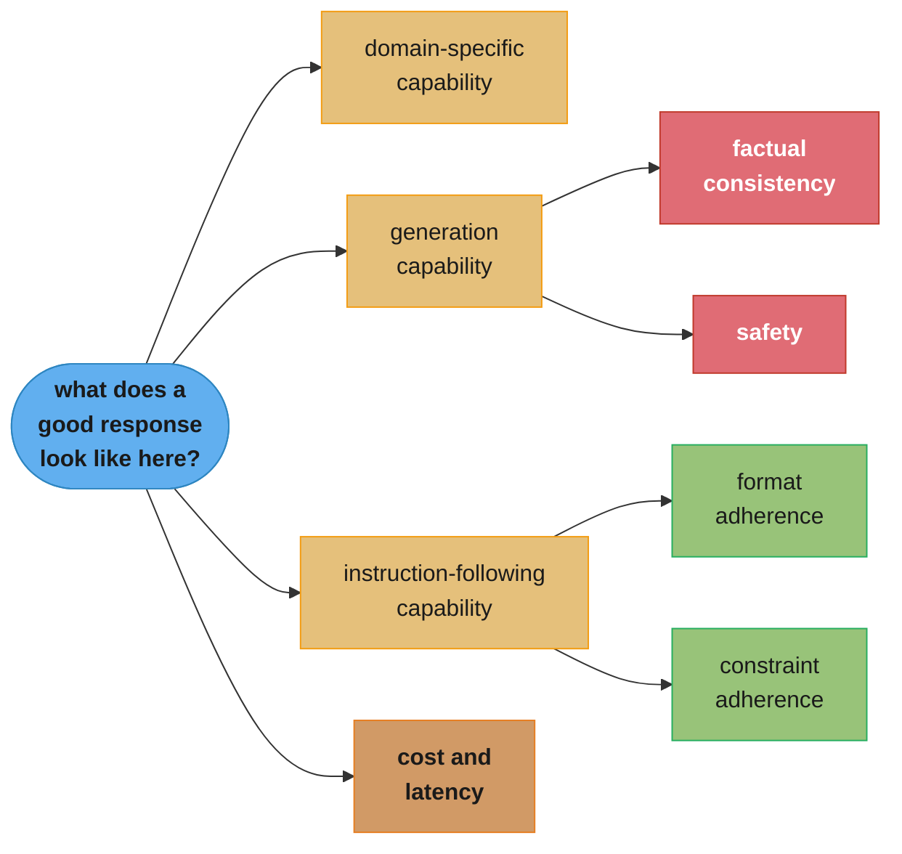
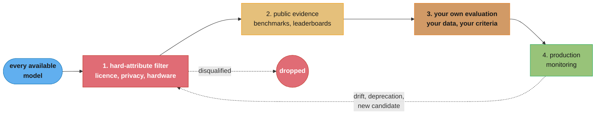
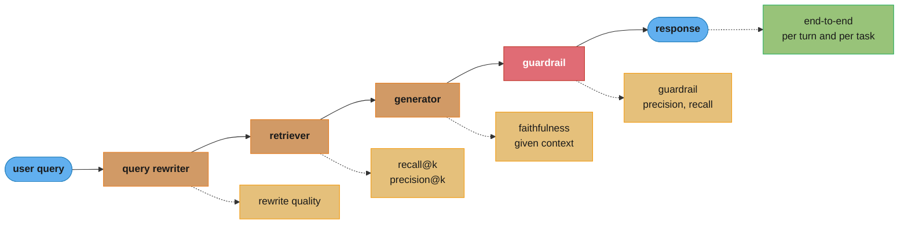
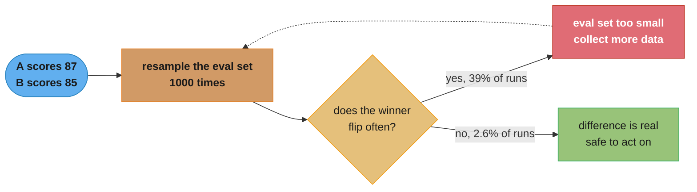

# Chapter 4: Evaluate AI Systems

> Ch 4 of 10 · AI Engineering: Building Applications with Foundation Models (Huyen, 1st ed.,
> O'Reilly 2025) · builds on Ch 3 (Evaluation Methodology), leads to Ch 5 (Prompt Engineering)

## Chapter Map

Chapter 3 laid out the *methods* — perplexity, functional correctness, similarity to reference
data, AI judges, comparative ranking — and was careful to say what each one can and cannot
measure. None of that tells you what to measure for *your* application, which model to run it on,
or how to assemble the methods into something a team can trust week after week. That is this
chapter's job, and it is the more practical of the pair. Huyen splits it three ways: deciding
what "good" means for a specific application (evaluation criteria), choosing a model against
those criteria (model selection), and building the machinery that produces a trustworthy number
on an ongoing basis (the evaluation pipeline).

The through-line is that evaluation is application-specific and the hardest part is not
computation but *definition*. Once you know that factual consistency against a retrieved document
is the criterion that decides whether your product works, choosing a method for it is a
comparatively small decision. Teams get this backwards — they reach for the method they know how
to compute and then reason backwards to what it might mean — and the result is a dashboard full
of numbers nobody can connect to a user outcome. The chapter also insists that model selection is
not a one-time decision made at project start: it recurs as the model landscape changes, as the
application's requirements sharpen, and as the evaluation pipeline starts producing evidence the
initial guess was wrong.

**TL;DR:**
- **Criteria come from the application, not from the metric catalogue.** Huyen's framing is to
  ask what a good response looks like for *this* product, then find a method that measures that —
  the recurring categories being domain-specific capability, generation capability (factual
  consistency and safety above all), instruction-following capability, and cost and latency.
- **Cost, latency, and quality form a triangle you rarely win outright**, and latency itself
  decomposes — time to first token, time per output token, total latency — with different
  optimizations attacking different terms.
- **Filter on hard attributes before evaluating anything.** A license you cannot accept, a data
  policy you cannot meet, or a model that does not fit your hardware is a disqualification no
  amount of prompt engineering fixes; soft attributes (accuracy, latency, cost) are the ones
  engineering can move, so spend evaluation budget only on candidates that survive the hard
  filter.
- **Public benchmarks and leaderboards shortlist; your own evaluation decides.** Contamination,
  saturation, arbitrary leaderboard aggregation weights, and the gap between a benchmark's
  distribution and your traffic all make public numbers weak evidence about your application.
- **An evaluation pipeline evaluates components as well as end-to-end, per turn as well as per
  task, and slices its data** — and it needs enough data, checked by resampling, for its
  conclusions to survive noise.

## The Big Question

> You have a stack of evaluation methods and a landscape of models that changes every few months.
> How do you decide what "good" means for the thing you are actually building, pick a model
> against that definition, and build machinery that will still tell you the truth in six months
> when the model has been updated, the traffic has shifted, and half the team has turned over?

Analogy: hiring. Chapter 3 was the study of interview *techniques* — take-home exercises, live
coding, reference checks, panel debriefs — with an honest accounting of what each one measures and
where each one misleads. This chapter is the hiring *process*. It starts by writing the job
description, because a technique without a role to fill measures nothing; it screens on hard
requirements (work authorization, the ability to be in this timezone) before spending anybody's
afternoon on an interview; it treats a candidate's published credentials as a reason to talk to
them rather than a reason to hire them; and it builds a repeatable loop so the twentieth hire is
evaluated on the same bar as the first. The failure modes rhyme too: interviewing for what is easy
to test rather than what the job needs, over-trusting a prestigious résumé, and running a process
so noisy that two identical candidates get opposite outcomes.

---

## 4.1 Evaluation Criteria

The chapter opens with the observation that most teams start evaluation by asking "what metrics
should I use?" and that this is the wrong first question. The right one is **what does a good
response look like for my application** — a question about the product, answerable without
knowing a single metric name. Only once that is written down does the choice of method become
tractable, because now there is something for the method to be a proxy *for*.

Huyen recommends deriving criteria from real examples: collect responses the application actually
produced, sort them into good and bad, and articulate what distinguishes the two piles. The
articulation *is* the criteria list. A criterion that never separates any pair of real responses
is not worth measuring; a distinction you keep making informally but never wrote down is exactly
the criterion you are missing.

Four categories recur across applications.



Caption: the four categories are a checklist for deriving criteria, not a metric suite — each leaf
still has to be turned into a measurable statement about your own data.

### Domain-specific capability

Does the model understand the subject matter and the language your application operates in? A
model's domain capability is set almost entirely by what was in its training data, which means it
is a **hard attribute in disguise** — you can nudge it with retrieval and finetuning, but you
cannot conjure competence in a domain the model never saw.

Domain capability is one of the few criteria where exact evaluation from Chapter 3 applies
directly, because domains often have closed-ended sub-tasks: coding has executable tests, medicine
and law have licensing-exam question banks, translation has reference corpora. Public
domain-specific benchmarks exist for many fields and are a reasonable first screen. The stronger
move, and the one the chapter pushes toward, is a curated internal exam: a few hundred questions
drawn from your own domain, written or vetted by your own experts, kept private so it cannot leak
into anyone's training data.

### Generation capability

The original natural-language-generation criteria were fluency and coherence — is the text
grammatical, does it hang together. Modern foundation models are good enough at both that these
have largely stopped discriminating between candidates, and the interesting generation criteria
have moved on to two much harder ones.

**Factual consistency** is whether the response's claims are actually true. Huyen distinguishes two
regimes with different evaluation strategies:

- **Local factual consistency** (**faithfulness**, **groundedness**): the response must be
  consistent with a *context you provided* — retrieved documents, a source article being
  summarized, a database row. This is the tractable case, because the ground truth is right there
  in the prompt, and it is the regime most production RAG systems live in.
- **Global factual consistency**: the response must be consistent with open-world facts, with no
  context supplied. Much harder, because verification requires knowing the truth, which is the
  problem you were trying to solve.

Four approaches to measuring it, roughly in increasing order of cost and reliability:

1. **Self-verification** — ask the model (or several samples of it) whether the claim holds, or
   generate multiple responses and check whether they agree. Cheap; catches confident
   contradictions; blind to consistent errors, since a model that is reliably wrong will be
   reliably self-consistent.
2. **Knowledge-augmented verification** — retrieve supporting evidence and check the claim against
   it. This is the local case turned into a procedure, and it inherits every retrieval failure
   mode from Chapter 6.
3. **Textual entailment / NLI models** — a natural-language-inference model classifies each
   response claim against the source as *entailment*, *contradiction*, or *neutral*. Small,
   cheap, fast, and specialized; this is the classic approach to summarization faithfulness.
4. **AI judge with the context supplied** — Chapter 3's judge, prompted with the source and asked
   whether every claim in the response is supported by it. The most flexible, with all of §3.4's
   biases attached.

A practical decomposition that makes any of these work better: split the response into individual
claims first, verify each one separately, and score the response by the fraction of supported
claims. A whole-response verdict conflates a response with one unsupported sentence and a response
that is entirely fabricated.

**Safety** covers everything the response should not contain regardless of whether it is accurate:
toxic or harassing language, stereotyping and demographic bias, personally identifiable
information, and content that is illegal or dangerous in the deployment's jurisdiction. Safety
criteria are unlike quality criteria in one operationally important way: **their acceptable rate
is usually zero or near-zero**, which means an aggregate score is nearly useless and the useful
artifact is a list of every violating example. They are also usually best measured with dedicated
classifiers and moderation models rather than a general-purpose judge, because a purpose-built
classifier is cheaper, faster, and more consistent on a narrow, well-defined category.

### Instruction-following capability

A model can be factually impeccable and still useless if it ignores what you asked it to do.
Instruction-following is its own capability, measured separately, and it is the criterion most
likely to be quietly failing in a system that "mostly works."

- **Format adherence** — did the output come back as valid JSON matching the schema, as YAML, as a
  bulleted list of exactly five items, as a string matching the required regex? This is exactly
  measurable with a parser, which makes it one of the cheapest high-value checks available: the
  parse either succeeds or it does not. A model with 98% JSON validity is failing one request in
  fifty, and that is a production incident at any real volume unless a repair path exists.
- **Constraint adherence** — length limits, forbidden topics, required inclusions, a mandated
  language or reading level, staying in an assigned persona.
- **Roleplay capability** — for conversational products, whether the model maintains the assigned
  character and tone across a long conversation rather than drifting back to its default voice.

Public benchmarks in this family (the IFEval line of work) evaluate instruction-following by
constructing instructions whose satisfaction is *programmatically verifiable* — "write exactly
three paragraphs", "do not use the letter e", "respond in JSON" — which sidesteps the judge
entirely for this criterion.

### Cost and latency

Quality is not the only axis, and Huyen is explicit that cost and latency are evaluation criteria
of equal standing rather than afterthoughts, because a system that is excellent and unaffordable
does not ship.

**Latency decomposes**, and the decomposition matters because different optimizations move
different terms:

| Metric | What it measures | What moves it |
|---|---|---|
| **Time to first token (TTFT)** | Prompt submitted → first token emitted | Prompt length, prefill compute, queueing |
| **Time per output token (TPOT)** / inter-token latency | Steady-state gap between successive tokens | Model size, batch pressure, decoding strategy |
| **Total latency** | ≈ TTFT + TPOT × number of output tokens | Everything above, plus how verbose the model is |
| **Throughput** | Tokens or requests served per second across all users | Batching, hardware, concurrency |

The relationship `total ≈ TTFT + TPOT × output_length` is the one to internalize, because it
exposes a lever teams often miss: **the model controls its own output length**, so a prompt that
elicits a shorter answer reduces latency directly and proportionally. It also explains why
streaming changes perceived latency so much — a user watching tokens appear experiences TTFT,
while a user waiting for a complete response experiences total latency.

Throughput and latency are in tension. Larger batches raise throughput (better hardware
utilization, lower cost per token) and raise per-request latency (your request waits for the batch
to fill and shares compute with its neighbors). That tradeoff is the core of Chapter 9's inference
optimization work; here it matters as a reminder that a cost-per-token figure and a latency figure
cannot be optimized independently.

**Cost** is per-token for API models — with input and output tokens usually priced differently,
output typically the more expensive — and compute-time for self-hosted models, where the relevant
figure is cost per hour of a GPU instance divided by the tokens it can produce in that hour. The
two cost models have different shapes: API cost is purely variable and scales linearly with usage
with no floor, while self-hosting has a large fixed cost and a much lower marginal one, which is
why the crossover point between them is a volume question, not a preference.

**The triangle.** Quality, cost, and latency trade against each other, and the chapter's advice is
to set an explicit budget on two of them and optimize the third. A larger model raises quality and
both costs. Chain-of-thought prompting and multi-sample techniques raise quality by generating more
tokens, which raises both cost and latency in direct proportion. Aggressive quantization cuts cost
and latency at some quality risk. Naming which two are constrained turns an unbounded search into
a bounded one.

---

## 4.2 Model Selection

The model landscape changes continuously, so Huyen frames model selection not as a decision but as
a **recurring process** — one you re-run when requirements sharpen, when a new candidate appears,
and when your own evaluation pipeline produces evidence the last choice was wrong. The process she
describes has four steps, and their ordering is the point: the cheap filters run first so that
expensive evaluation is spent only on candidates that could actually be deployed.



Caption: the funnel narrows by cost — the hard filter is free, public evidence is nearly free,
your own evaluation is expensive, and production monitoring never ends, which is why the loop
returns to the top rather than terminating.

### Hard attributes versus soft attributes

The chapter's most immediately actionable distinction. A **hard attribute** is a property of the
model or its provider that you cannot change through engineering. A **soft attribute** is one you
can improve.

| Hard — filter on these first | Soft — engineering can move these |
|---|---|
| Licence terms (commercial use, redistribution, output ownership) | Accuracy on your task (prompting, RAG, finetuning) |
| Where data is processed and whether it can be retained or trained on | Factual consistency (retrieval, verification, guardrails) |
| Training-data provenance and copyright exposure | Latency (caching, shorter prompts, decoding strategy, hardware) |
| Model size relative to the hardware you have | Cost (quantization, routing, caching, a smaller model for easy traffic) |
| Whether weights are available at all (self-hosting possible or not) | Format adherence (structured output, constrained decoding, retries) |
| The provider's viability, support, and deprecation policy | Safety (moderation layer, guardrails) |
| Maximum context length and whether function calling exists | Toxicity rate (filtering, system prompting) |

The reason to filter on hard attributes first is that no evaluation result can overturn one. A
model that scores brilliantly and cannot legally be used in your product has cost you an
evaluation run and taught you nothing. Do the free filter first.

The nuance worth holding: some attributes are hard for one team and soft for another. Context
length is hard if the model is behind an API and soft if you self-host and can adjust the serving
configuration. Latency is soft if you control the deployment and largely hard if you do not.
Classify against *your* constraints rather than in the abstract.

### Build versus buy: model APIs versus self-hosting

The chapter frames this as a set of questions rather than a verdict, because the right answer
depends on the constraint you cannot relax.

**Commercial model APIs** are the fastest path to a working system. Someone else runs the
hardware, handles scaling, and ships model improvements; the strongest available models are often
API-only. The costs are structural rather than technical. Your data leaves your infrastructure,
which may be disqualifying outright in regulated settings. You do not control when the model
changes or when it is deprecated, which means your evaluation baselines can be invalidated without
notice and a working system can be forced into a migration on the provider's schedule. Cost scales
linearly with usage forever, with no volume at which the marginal token gets free. And rate limits
are a capacity constraint you cannot engineer around.

**Self-hosting open-weight models** inverts every one of those. Data never leaves your boundary.
You pin the exact model version and it stays pinned. You can quantize it, finetune it, and tune the
serving stack for your traffic. At sustained volume the economics favor it, because the fixed cost
of a GPU amortizes over an unbounded number of tokens. In exchange you own the infrastructure: GPU
capacity planning, autoscaling, monitoring, upgrades, and the on-call rotation for all of it — and
at the frontier of capability, open weights have historically lagged the best API models.

**A terminology note the chapter is careful about.** "Open source" is used loosely in this space
and usually inaccurately. Most so-called open models are **open-weight**: the weights are
downloadable, but the training data, the training code, and the data pipeline are not, so the
model is not reproducible and is not open source in the sense the term has in software. Licences
also vary widely — some permit unrestricted commercial use, some restrict it by company size or
use case, some restrict what you may do with the outputs. The licence is a hard attribute and must
be read, not assumed from the word "open."

The questions that decide it, in the order they usually bind:

1. **Data privacy** — may your data leave your boundary at all, and may the provider retain or
   train on it?
2. **Data lineage and copyright** — do you need to know what the model was trained on, for legal
   or compliance reasons?
3. **Performance** — is the best open-weight model good enough for your task, or is the gap
   decisive?
4. **Functionality** — do you need function calling, structured output guarantees, a long context
   window, or a specific modality?
5. **Cost** — at your projected volume, which cost curve is lower, including engineering time?
6. **Control** — can you tolerate the model changing or being retired underneath you?
7. **On-device deployment** — does the model have to run somewhere with no network at all?

### Navigating public benchmarks and leaderboards

Public evidence is step 2 of the funnel: cheap, broad, and weak. The chapter's guidance is about
using it without over-trusting it.

**Benchmark selection.** There are far more public benchmarks than anyone can run, and most of
them measure something irrelevant to any given application. Pick benchmarks that plausibly
correlate with your criteria — a coding benchmark if you generate code, an instruction-following
benchmark if format adherence matters — and ignore the rest. A benchmark you cannot articulate a
connection to is noise.

**Aggregation is arbitrary.** Leaderboards that report a single composite score have chosen a set
of constituent benchmarks and a weighting over them, and both choices are judgment calls made by
someone who was not thinking about your application. Two leaderboards aggregating overlapping
benchmark sets with different weights can rank the same models differently, and neither is wrong —
they are answering different questions. Read the constituent scores, not the composite.

**Contamination, again.** Chapter 3's leakage argument applies with full force at selection time,
and the practical instruments are the same: known contamination checks (n-gram overlap between
benchmark items and available training corpora, perplexity anomalies on benchmark text) give
hints, not proof, and a black-box model gives you no way to check at all. The oldest and most
famous benchmarks are the most contaminated. A newly released benchmark is more informative than a
famous one, purely because it has had less time to leak.

**Capability is not reliability.** A benchmark reports whether a model *can* do something on a
curated set. It says nothing about the variance across your traffic, the tail behavior on
malformed input, or whether performance holds at your latency budget. Two models with identical
benchmark scores can have very different failure rates in production.

The conclusion is the same as §3.5's for leaderboards: public evidence narrows the field to a
shortlist of three or four, and step 3 — your own evaluation, on your own data, against the
criteria from §4.1 — decides. Everything before step 3 exists to make step 3 affordable.

---

## 4.3 Design Your Evaluation Pipeline

The final section is the engineering: turning criteria and a chosen model into a repeatable
process that produces trustworthy numbers. Huyen structures it as a sequence of design decisions.

### Step 1: Evaluate all components, and evaluate per turn and per task

An AI application is a pipeline, not a model call. A typical one has a query rewriter, a
retriever, a reranker, a generator, and one or more guardrails. **An end-to-end score tells you
whether the system worked; it does not tell you which stage broke it.** Evaluating each component
independently is what makes a failure actionable — retrieval measured with recall@k and
precision@k, the generator measured on factual consistency *given the retrieved context*, the
guardrail measured on its own precision and recall.

The value of this is diagnostic separation. If end-to-end quality drops, per-component metrics
tell you in one glance whether retrieval degraded (a corpus change, an index rebuild) or the
generator did (a model update, a prompt change). Without them you are bisecting a pipeline by
hand under time pressure.

The second axis is **per-turn versus per-task** evaluation, which matters for anything
conversational or multi-step:

- **Per-turn** evaluates each individual response in isolation: was this specific answer good?
  Easy to instrument, easy to sample, gives you a lot of data points.
- **Per-task** evaluates whether the whole interaction achieved the user's actual goal, however
  many turns it took. Harder to define and much sparser, and it is the thing the user actually
  cares about.

The two can disagree sharply, and the disagreement is informative. A conversation of five
individually excellent turns that never resolves the user's problem scores well per turn and fails
per task; that gap is the signature of a system that is helpful-sounding and unhelpful. A useful
per-task companion metric is **turns to resolution** — a system that solves the task in six turns
where a better one takes two is worse, even though every turn scores fine.



Caption: an end-to-end number alone cannot localize a regression — the dotted per-component
metrics are what turn "quality dropped" into "the retriever's recall fell after the index rebuild."

### Step 2: Write an evaluation guideline

The guideline is the written definition of what the system is supposed to do, and Huyen treats
writing it as the hardest and highest-leverage step in the whole chapter. It contains:

- **What a good response is**, stated concretely enough that two people applying it independently
  reach the same verdict.
- **What a bad response is**, which is not simply the negation — enumerate the failure modes you
  have actually seen, because a list of real failures is far more useful to an annotator or a
  judge than an abstract quality definition.
- **The criteria, one at a time**, each with a scoring rubric where every level is described, not
  just the endpoints.
- **Scored examples** for each level, especially at the boundaries where judgment is hardest.

Two disciplines the chapter emphasizes. First, **tie criteria to business metrics.** A criterion
nobody can connect to a user or business outcome will not survive its first budget review and
should not — if factual consistency improving from 91% to 96% has no articulable effect on
retention, deflection rate, or support cost, either the connection exists and has not been made,
or the criterion is not the right one. Second, **the guideline is a living document.** Every
genuinely ambiguous case an annotator or a judge encounters is a gap in the guideline; resolve it
by editing the guideline, not by making a one-off ruling, or the same ambiguity resurfaces every
week with a different resolution.

### Step 3: Define evaluation methods and data

Now — and only now — Chapter 3's methods get selected, and the guidance is to **mix them by cost
and coverage** rather than pick one.

- **Exact evaluation wherever the criterion admits it.** Format validity is a parse. Structured
  extraction is a schema check. Generated SQL is an execution. These are free, deterministic, and
  should run on every single request, not on a sample.
- **AI judges for the open-ended criteria**, on a sample, with the §3.4 disciplines attached:
  pinned judge version and prompt, order-swapped pairwise comparisons, one criterion per call.
- **Human evaluation on the hardest and highest-stakes slice**, and on a rotating sample used to
  validate that the judges still correlate with human judgment.
- **Log probabilities where the provider exposes them**, as a cheap confidence signal for routing
  low-confidence responses to a stronger model or to a human.

On **data**, the chapter's strongest instruction is to **slice it**. An aggregate number is an
average over a population, and averages hide the failures that matter: overall quality of 92% can
comfortably contain a segment at 55%. Slice by whatever dimensions the application actually varies
along — user tier, query type, language, document length, input difficulty, new versus returning
users, time of day. Two specific traps live here. Aggregate metrics can move in the opposite
direction from every slice when slice sizes change between measurements (Simpson's paradox), so a
"quality improved" headline can hide a per-slice regression across the board. And a slice that is
small in traffic can be large in importance — the enterprise tier that is 3% of requests and 60%
of revenue deserves its own number.

Evaluation data should come from three sources, and a pipeline relying on only one is fragile:

| Source | Strength | Weakness |
|---|---|---|
| Production traffic | The real distribution, by construction | Only covers what users already do; needs annotation |
| Synthesized data | Cheap, covers rare cases you can describe | Inherits the generator's blind spots and phrasing |
| Adversarial / hand-written edge cases | Targets known failure modes directly | Expensive; only covers failures you already imagined |

### Step 4: How much data do you need?

The question the chapter answers with a procedure rather than a number, because "how many examples
is enough" depends entirely on how large a difference you are trying to detect.

The procedure is **bootstrapping**: resample your evaluation set with replacement, recompute the
metric on each resample, and look at the spread. If system A beats system B on the full set, but
the winner flips across resamples, the evaluation set is too small to support the conclusion —
the observed difference is inside the noise.

```
  Bootstrap check: is a 2-point win real?

  eval set: 100 examples.  System A scores 87.  System B scores 85.

  resample 100 examples with replacement, 1000 times, rescore both:

    A wins in  612 of 1000 resamples
    B wins in  388 of 1000 resamples
    -> the winner flips 39% of the time. This is a coin flip with a lean.
       DO NOT ship on this. Grow the eval set.

  same experiment on 1000 examples:

    A wins in  974 of 1000 resamples
    B wins in   26 of 1000 resamples
    -> stable. The 2-point gap survives resampling.

  Rule of thumb that falls out: the smaller the difference you need to detect,
  the more data you need, and the relationship is not linear -- halving the
  detectable difference costs roughly four times the examples.
```

Caption: the bootstrap turns "is this difference real?" from a judgment call into a number you can
put in the experiment write-up, using only the evaluation set you already have.

Two related disciplines close the section. **Evaluate the evaluation pipeline itself** — measure
how well its verdicts correlate with human judgment on a held-out sample, how reproducible it is
across runs, how much it costs per data point, and how long it takes to run end to end. A pipeline
nobody trusts is not used, and a pipeline that takes six hours does not get run before a deploy.
And **re-baseline on every change to the instrument**: a new judge model version, an edited judge
prompt, or a changed evaluation set all invalidate comparisons to previously-recorded numbers, and
silently, unless the configuration is recorded alongside every result.

---

## Beyond the book — the moving cost and open-weight landscape

> §4.2 gives the *framework* — hard versus soft attributes, the seven build-versus-buy questions,
> the API/self-hosting cost-curve crossover — and deliberately does not tie it to specific prices,
> specific model names, or a specific measurement of the open-weight quality gap, because those
> were known to be volatile at the time of writing. Nothing that follows is the book's claim about
> where the landscape stands.

Two of §4.2's inputs have kept moving fast since publication, in ways that change the *answer* the
framework produces without changing the framework itself. Per-token API prices have fallen
repeatedly and unevenly across providers and tiers, which moves the volume at which self-hosting
becomes cheaper — a crossover calculation more than a few months old should be re-run rather than
cited. And the capability gap between the strongest open-weight models and the strongest API-only
models has narrowed considerably for many task categories, which shifts question 3 of the
build-versus-buy list ("is the best open-weight model good enough?") from a frequent no toward a
frequent yes, particularly once domain finetuning is on the table. Both are reasons to treat model
selection as the recurring process §4.2 already describes it as, not reasons to change how the
decision is made. See
`llm/llm_routing_and_model_selection/llm_routing_and_model_selection.md` and
`llm/token_economics_and_cost_optimization/token_economics_and_cost_optimization.md` for the
current picture.

---

## Visual Intuition

```
  Latency decomposition:  total  ~=  TTFT  +  TPOT x output_tokens

  request A: short prompt, long answer (500 output tokens)

    |--TTFT--|--tok--|--tok--|--tok--| ... |--tok--|
     0.30 s     0.02 s each, x 500 = 10.0 s
    total = 10.3 s     <-- 97% of the wall clock is DECODING

  request B: very long prompt (32k tokens), short answer (50 output tokens)

    |------------- TTFT -------------|--tok--|...|--tok--|
     2.10 s (prefill dominates)        0.02 s each, x 50 = 1.0 s
    total = 3.1 s      <-- 68% of the wall clock is PREFILL

  Which optimization helps?

    A: shorten the ANSWER.  "Reply in at most 3 sentences" cuts 500 -> 60
       output tokens and takes total from 10.3 s to 1.5 s.
       Caching the prompt does almost nothing here.

    B: shorten or CACHE the PROMPT.  Prompt caching cuts TTFT from
       2.10 s to ~0.25 s and takes total from 3.1 s to 1.25 s.
       Telling the model to be brief does almost nothing here.

  Same model, same infrastructure, opposite correct fix. This is why a single
  "average latency" number is not an actionable metric.
```

Caption: the decomposition is not bookkeeping — it selects the optimization, and an aggregate
latency figure destroys exactly the information needed to choose.

```
  Why an aggregate score hides the failure that matters

  overall factual-consistency score: 92%    <- looks shippable

  sliced by query type:

    slice                 share of traffic   score    share of revenue
    ------------------------------------------------------------------
    FAQ lookup                    61%         98%            8%
    product comparison            24%         94%           12%
    pricing / contract terms       3%         55%           60%   <-- here
    small talk                    12%         97%            0%

  The 3% slice drags the average down by less than 1.3 points, so it is
  invisible in the headline number -- and it is the slice that carries almost
  all of the revenue and all of the legal exposure.

  A 92% headline and a 55% slice are the same measurement. Only one of them
  tells you what to fix.
```

Caption: slicing is not extra rigor, it is the difference between a number that looks shippable
and a number that names the bug — and small slices are frequently the important ones.



Caption: bootstrapping needs no new data and no statistics library to interpret — it answers "is
this 2-point win real?" with a flip rate anyone on the team can read.

---

## Key Concepts Glossary

- **Evaluation criteria** — the application-specific definition of what makes a response good, derived from real examples rather than from a metric catalogue.
- **Domain-specific capability** — whether the model understands the subject matter and language of the application's domain.
- **Generation capability** — the quality of the generated text itself; historically fluency and coherence, now dominated by factual consistency and safety.
- **Factual consistency** — whether the claims in a response are true.
- **Local factual consistency (faithfulness, groundedness)** — consistency with a context supplied in the prompt.
- **Global factual consistency** — consistency with open-world facts, with no supplied context.
- **Self-verification** — checking a claim by asking the model itself, or by checking agreement across multiple samples.
- **Knowledge-augmented verification** — retrieving supporting evidence and checking the claim against it.
- **Textual entailment / NLI** — classifying a claim against a source as entailment, contradiction, or neutral.
- **Claim decomposition** — splitting a response into individual claims and verifying each separately.
- **Safety criteria** — toxicity, bias, PII leakage, and unsafe content; criteria whose acceptable rate is near zero.
- **Instruction-following capability** — whether the model obeys the instruction's format and constraints.
- **Format adherence** — whether the output parses as the requested structure (JSON, schema, regex, list length).
- **Constraint adherence** — whether the output respects stated limits on length, topic, language, or persona.
- **Roleplay capability** — whether a conversational model holds an assigned character across a long conversation.
- **Time to first token (TTFT)** — latency from request submission to the first emitted token; dominated by prefill.
- **Time per output token (TPOT)** — the steady-state gap between successive generated tokens.
- **Total latency** — approximately TTFT plus TPOT multiplied by the number of output tokens.
- **Throughput** — tokens or requests served per second across all concurrent users.
- **Hard attribute** — a model or provider property engineering cannot change: licence, data policy, size, weight availability.
- **Soft attribute** — a property engineering can improve: accuracy, latency, cost, format adherence, safety.
- **Open-weight model** — a model whose weights are downloadable but whose training data and pipeline are not, so it is not reproducible.
- **Model API** — a hosted model accessed over the network and billed per token.
- **Self-hosting** — running model weights on infrastructure you control.
- **Benchmark aggregation** — combining several benchmark scores into a single leaderboard number using a chosen weighting.
- **Component evaluation** — measuring each stage of an AI pipeline independently rather than only end to end.
- **Per-turn evaluation** — scoring each individual response in a conversation on its own.
- **Per-task evaluation** — scoring whether the whole interaction achieved the user's goal.
- **Turns to resolution** — how many exchanges a system needs to complete the user's task.
- **Evaluation guideline** — the written definition of good and bad responses, the criteria, the rubrics, and scored examples.
- **Scoring rubric** — a description of what each level of a scoring scale means, not only its endpoints.
- **Slicing** — computing metrics separately per data segment instead of only in aggregate.
- **Simpson's paradox** — an aggregate metric moving opposite to every slice, caused by a shift in slice sizes.
- **Synthesized evaluation data** — model-generated evaluation examples, cheap but carrying the generator's blind spots.
- **Bootstrapping** — resampling the evaluation set with replacement to estimate how stable a measured difference is.
- **Re-baselining** — re-running the evaluation suite after any change to the evaluation instrument itself.

---

## Tradeoffs & Decision Tables

| Criterion | Best-fit method (Ch 3) | Cost | Runs on |
|---|---|---|---|
| Format adherence | Parse / schema validation | Free | Every request |
| Structured extraction correctness | Field-level exact match | Free | Every request |
| Generated code correctness | Functional correctness, pass@k | Test-run time | Every request |
| Local factual consistency | NLI model or judge with context | Low to moderate | Sample |
| Global factual consistency | Retrieval-augmented verification, human | High | Small sample |
| Safety / toxicity | Dedicated moderation classifier | Low | Every request |
| Overall helpfulness | Pairwise AI judge, order-swapped | Moderate | Sample |
| Task success | Per-task human or judge evaluation | High | Small sample |

| | Commercial model API | Self-hosted open-weight |
|---|---|---|
| Time to first working system | Hours | Days to weeks |
| Data leaves your boundary | Yes | No |
| Model version stability | Provider-controlled; can change or retire | Fully pinned by you |
| Cost shape | Purely variable, linear in usage | Large fixed, low marginal |
| Peak capability | Usually the frontier | Historically behind at the frontier |
| Optimization control | Limited to prompt and parameters | Full: quantization, finetuning, serving stack |
| Ops burden | None | GPU capacity, scaling, monitoring, on-call |
| Rate limits | Provider-imposed | Your own hardware |

| Lever | Quality | Cost | Latency |
|---|---|---|---|
| Bigger model | ↑ | ↑ | ↑ |
| Chain-of-thought / more reasoning tokens | ↑ | ↑ | ↑ |
| Multi-sample then select | ↑ | ↑↑ | ↑ (or flat if parallel) |
| Quantization | ↓ slightly | ↓ | ↓ |
| Prompt caching | flat | ↓ | ↓ TTFT only |
| Shorter requested output | ↓ possibly | ↓ | ↓↓ |
| Larger serving batch | flat | ↓ per token | ↑ per request |

| Evaluation data source | Use it for |
|---|---|
| Production traffic | The main quality number; it is the only real distribution |
| Synthesized data | Filling coverage gaps for cases you can describe but rarely see |
| Adversarial / hand-written | Regression tests for failure modes you have already been burned by |
| Public benchmarks | Shortlisting candidate models, never final selection |

---

## Common Pitfalls / War Stories

- **Choosing metrics before defining what good means.** The team instruments what is easy to
  compute, ships a dashboard of five numbers, and cannot answer "should we deploy this?" from any
  of them. The fix is backwards from where it feels natural: sort real responses into good and bad
  first, then find methods that separate the piles.
- **Evaluating candidate models before applying the hard filter.** Two weeks of evaluation on a
  model whose licence forbids the intended commercial use, or whose weights do not fit the
  available GPUs. The hard filter is free and takes an afternoon; run it first.
- **Reading a leaderboard's composite score.** The composite embeds someone else's choice of
  constituent benchmarks and someone else's weights, neither made with your application in mind.
  Two leaderboards over overlapping benchmark sets routinely disagree on ordering. Read the
  constituent scores.
- **Shipping on an aggregate number.** Overall quality of 92% concealing a 55% slice that carries
  most of the revenue is the canonical version, and it is common precisely because the aggregate
  looks healthy. Slice before you decide.
- **Calling a 2-point win.** Two systems 2 points apart on a 100-example evaluation set is a coin
  flip; bootstrap it and watch the winner change on 40% of resamples. Either grow the set or
  report the result as inconclusive.
- **Measuring only end-to-end.** When quality drops, nobody can say whether retrieval, the
  generator, or a guardrail caused it, so the team bisects the pipeline by hand while the
  regression is live. Per-component metrics are cheap insurance bought before you need them.
- **Measuring only per turn.** Every individual response scores well and users still abandon the
  product, because the conversations never resolve anything. Per-task evaluation and turns to
  resolution are what surface this.
- **Not recording the model version and judge configuration.** An API model updates, the numbers
  move, and there is no way to tell a real regression from a changed instrument. Record model
  version, judge version, judge prompt, and evaluation-set version with every result.
- **Treating the evaluation guideline as write-once.** Every ambiguous case an annotator hits is a
  guideline gap; resolving them as one-off rulings means the same ambiguity gets a different answer
  each week and inter-annotator agreement quietly decays.
- **Ignoring the latency decomposition.** Optimizing prompt length for a workload whose cost is 97%
  decoding, or asking for shorter answers on a workload dominated by prefill. Both are real effort
  spent on the term that is not the problem.
- **Assuming self-hosting is cheaper because the marginal token is.** The crossover point depends
  on sustained volume, and the fixed cost includes engineering time and on-call, not just the GPU
  invoice. Compute the crossover for your actual projected volume.

---

## Real-World Systems Referenced

**Evaluation criteria and measurement:** natural-language-inference and entailment models used for
summarization faithfulness (the SummaC line of work), dedicated moderation and toxicity
classifiers used for safety criteria, and programmatically-verifiable instruction-following
benchmarks in the IFEval family. **Public benchmarks and leaderboards:** aggregate leaderboards of
the HELM and Open LLM Leaderboard kind, whose composite scores combine multiple constituent
benchmarks under a chosen weighting, alongside the arena-style comparative leaderboards of §3.5.
**Model access modes:** commercial foundation model APIs, and open-weight model families
distributed for self-hosting under a range of licences. **Serving-side metrics:** time to first
token, time per output token, and throughput, as reported by inference servers and hosted
inference APIs.

---

## Summary

Evaluating an AI system starts before any metric is chosen, with the application-specific question
of what a good response looks like — derived from sorting real responses into good and bad piles
and articulating what separates them, not from a catalogue of available metrics. The criteria that
recur are domain-specific capability, which is set almost entirely by training data and is best
tested with a private internal exam; generation capability, where fluency has stopped
discriminating and factual consistency and safety dominate, with local (grounded) consistency far
more tractable than global; instruction-following capability, where format adherence is cheaply and
exactly measurable by parsing; and cost and latency, which are criteria of equal standing rather
than afterthoughts. Latency decomposes into time to first token, time per output token, and total
latency, and the decomposition selects the optimization — a decode-dominated workload is fixed by
shortening the answer, a prefill-dominated one by shortening or caching the prompt, and an average
latency number destroys the information needed to tell them apart. Model selection is a recurring
four-step funnel: filter on hard attributes that engineering cannot change (licence, data policy,
hardware fit, weight availability) before spending anything on evaluation; use public benchmarks
and leaderboards only to build a shortlist, discounting them for contamination, saturation, and
arbitrary aggregation weights; decide with your own evaluation on your own data; then keep
monitoring, because the model, the traffic, and the landscape all move. The build-versus-buy
decision resolves against whichever constraint you cannot relax, with data privacy, control over
model versioning, and the volume-dependent cost crossover usually binding first. Finally, an
evaluation pipeline earns trust by evaluating every component and not just the end-to-end result,
by measuring per turn and per task, by resting on a written guideline that defines good, bad, and
every rubric level with examples, by mixing exact methods on everything with judges and humans on
samples, by slicing its data so a healthy aggregate cannot hide a broken segment, and by
bootstrapping to check that a measured difference survives resampling. Chapter 5 turns from
measuring a system to improving it, starting with the cheapest lever available: the prompt.

---

## Interview Questions

**Q: Why does Huyen argue you should define evaluation criteria before choosing metrics?**
**Short:** She frames criteria as an application question — what a good response looks like here — that metrics only exist to approximate.
Starting from available metrics produces a dashboard of numbers nobody can connect to a user outcome, because each metric was chosen for being computable rather than meaningful. The recommended derivation is empirical: collect real responses, sort them into good and bad, and articulate what separates the piles — that articulation is the criteria list. Only then does method selection become tractable, since each method now has something concrete to be a proxy for.

**Q: What is the difference between hard and soft attributes in model selection, and why does the order matter?**
**Short:** Hard attributes cannot be changed by engineering, so filtering on them first avoids evaluating models you could never deploy.
Hard attributes include licence terms, where data is processed, training-data provenance, whether weights are available, and whether the model fits your hardware; soft attributes include accuracy, latency, cost, format adherence, and safety, all of which prompting, retrieval, finetuning, quantization, or a guardrail can move. No evaluation result can overturn a hard attribute, so a brilliant score on a model your licence forbids has cost an evaluation run and taught you nothing. The hard filter is free and should run before anything expensive.

**Q: Why can an aggregate quality score of 92% still represent a broken system?**
**Short:** An average hides slices, and a small slice can carry most of the revenue and most of the risk.
A pricing-and-contract-terms slice at 55% quality that is 3% of traffic moves the aggregate by barely a point, so it is invisible in the headline number while being the segment that carries the legal exposure and the revenue. Slicing by user tier, query type, language, and input difficulty is what converts a shippable-looking number into a named bug. Simpson's paradox compounds this: shifting slice sizes can make the aggregate move opposite to every individual slice.

**Q: What does the latency decomposition into TTFT and TPOT change about how you optimize?**
**Short:** It identifies which term dominates, and the correct optimization is opposite for a prefill-bound versus a decode-bound workload.
Total latency is approximately TTFT plus TPOT times the number of output tokens, so a request with a short prompt and a 500-token answer spends nearly all its wall clock decoding, while a 32k-token prompt with a 50-token answer is dominated by prefill. The first is fixed by asking for a shorter answer, which cuts latency in direct proportion; the second is fixed by shortening or caching the prompt, and asking for brevity barely helps. A single average-latency number destroys exactly the information needed to choose between them.

**Q: Why is local factual consistency easier to evaluate than global factual consistency?**
**Short:** Local consistency checks a response against a context you supplied, so the ground truth is already in the prompt.
When the criterion is faithfulness to retrieved documents or a source article, verification reduces to comparing the response's claims against text that is right there, which an NLI model or a judge given the context can do cheaply. Global consistency requires knowing whether an open-world claim is true, which is the original hard problem rather than a reduction of it. This is why production RAG systems overwhelmingly evaluate the local form, and why claim decomposition — verifying each claim separately and scoring the supported fraction — is the standard refinement.

**Q: Why is format adherence one of the highest-value cheap checks in an evaluation pipeline?**
**Short:** It is exactly measurable by parsing, so it costs nothing and can run on every single request instead of a sample.
A JSON schema validation either succeeds or fails, with no judge, no reference answer, and no sampling error, which puts it in the same category as functional correctness from Chapter 3. A model at 98% JSON validity is failing one request in fifty, which is a production incident at real volume unless a repair or retry path exists — and nobody notices without the check. Run every exact check on 100% of traffic and reserve sampling for the methods that actually cost something.

**Q: Why does the chapter treat model selection as a recurring process rather than a one-time decision?**
**Short:** The model landscape, the application's requirements, and your own evaluation evidence all keep changing after the first choice.
New models appear, providers change and deprecate existing ones, prices move, and your requirements sharpen as the product meets real users, so a decision made at project start is stale within months. The four-step funnel therefore loops: production monitoring feeds back to the hard-attribute filter whenever a candidate appears or an incumbent is retired. Building the evaluation pipeline properly is what makes re-running the decision cheap enough to actually do.

**Q: What is the practical difference between per-turn and per-task evaluation, and why do you need both?**
**Short:** Per-turn scores each response in isolation; per-task asks whether the whole interaction achieved the user's goal.
Per-turn evaluation is easy to instrument and produces many data points, which makes it the metric teams build first, while per-task is sparse, harder to define, and the thing users actually care about. The two disagree in a specific and informative way: five individually excellent turns that never resolve the problem score well per turn and fail per task, which is the signature of a helpful-sounding, unhelpful system. Tracking turns to resolution alongside per-task success surfaces the same problem quantitatively.

**Q: Why should you evaluate each component of an AI pipeline, not just the end-to-end result?**
**Short:** An end-to-end score says the system broke, but not which stage broke it, so a regression cannot be localized.
A typical pipeline has a query rewriter, a retriever, a reranker, a generator, and guardrails, and any of them can degrade for its own reasons — a corpus change, an index rebuild, a model update, a prompt edit. With per-component metrics such as recall@k on the retriever and faithfulness-given-context on the generator, a drop is diagnosed at a glance; without them the team bisects the pipeline by hand while the regression is live. The component metrics are cheap and should be built before you need them.

**Q: How do you decide whether a measured difference between two systems is real?**
**Short:** Bootstrap it — resample the evaluation set with replacement, rescore, and check how often the winner flips.
If system A scores 87 to system B's 85 on 100 examples, resampling 1,000 times might show A winning only 61% of the time, which is a coin flip with a lean and not a result to ship on; the same 2-point gap on 1,000 examples might hold in 97% of resamples. The procedure needs no new data and no statistics background to interpret, and it converts "is this win real?" into a flip rate anyone can read. The smaller the difference you want to detect, the more data you need, and roughly quadratically so.

**Q: What are the main risks of relying on a commercial model API?**
**Short:** Your data leaves your boundary, the provider controls versioning and deprecation, and cost scales linearly forever.
Data leaving your infrastructure can be disqualifying outright under regulation, and the provider retaining or training on it is a separate question that must be checked rather than assumed. Model changes and retirements happen on the provider's schedule, which can invalidate evaluation baselines without notice and force a migration you did not plan; rate limits are a capacity ceiling you cannot engineer past. Against that, an API is by far the fastest path to a working system and often the only access to the strongest models, which is why the decision turns on which constraint you cannot relax.

**Q: Why does the chapter distinguish open-weight from open-source models?**
**Short:** Most "open" models release only weights, not training data or pipeline, so they are not reproducible and the licence still binds.
An open-weight model is downloadable and self-hostable, but without the training data and training code it cannot be reproduced or fully audited, which is what "open source" means in software. Licences also vary widely — some allow unrestricted commercial use, some restrict it by company size or use case, and some constrain what you may do with the outputs. Because the licence is a hard attribute, it must be read for each candidate rather than inferred from the word "open."

**Q: Why should you read a leaderboard's constituent benchmark scores rather than its composite?**
**Short:** The composite embeds someone else's choice of benchmarks and weighting, neither made with your application in mind.
A single leaderboard number is a weighted aggregation over a selected benchmark set, and both the selection and the weights are judgment calls; two leaderboards over overlapping sets can rank the same models differently without either being wrong. Reading the constituent scores lets you weight the benchmarks that plausibly correlate with your criteria and ignore the ones that do not. Combined with contamination and saturation, this is why public evidence shortlists candidates rather than selecting one.

**Q: Why do safety criteria need different handling from quality criteria?**
**Short:** Their acceptable rate is essentially zero, which makes an aggregate score nearly useless as an artifact.
A 99.7% safety pass rate sounds excellent and describes hundreds of violating responses per hundred thousand requests, so the useful output is the list of specific violations, not the percentage. Safety categories are also narrow and well-defined enough that dedicated moderation classifiers beat a general-purpose judge on cost, latency, and consistency. Run those classifiers on every request rather than on a sample, and treat any violation as an item to investigate rather than a rate to optimize.

**Q: What belongs in an evaluation guideline, and why does the chapter call writing it the hardest step?**
**Short:** It defines good responses, bad responses, each criterion, and a rubric with scored examples for every level.
The difficulty is definitional rather than technical: computing a metric is straightforward once you know what it should mean, and articulating what "good" means precisely enough that two people reach the same verdict independently is not. Enumerating real observed failure modes is more useful to an annotator or a judge than an abstract quality definition, and every rubric level needs describing rather than only the endpoints. Treat the guideline as living — resolve each ambiguous case by editing it, or the same ambiguity gets a different answer every week.

**Q: Why does the chapter insist on tying evaluation criteria to business metrics?**
**Short:** A criterion nobody can connect to a user or business outcome will not survive scrutiny, and probably should not.
If moving factual consistency from 91% to 96% has no articulable effect on retention, deflection rate, or support cost, then either the connection exists and has not been made or the criterion is the wrong one to be optimizing. Making the link explicit also settles prioritization arguments, because two criteria with different business impact stop looking equally important. It is the same discipline that makes an evaluation pipeline defensible in a budget review rather than an engineering hobby.

**Q: What are the three sources of evaluation data, and why is relying on one fragile?**
**Short:** Production traffic, synthesized data, and hand-written adversarial cases each cover what the others miss.
Production traffic is the only real distribution and is therefore the main quality signal, but it only covers what users already do and every example needs annotating. Synthesized data is cheap and fills describable coverage gaps while inheriting the generating model's blind spots and phrasing habits. Hand-written adversarial cases target known failure modes precisely and only cover failures somebody already imagined, which makes them excellent regression tests and a poor primary metric.

**Q: What invalidates a previously-recorded evaluation number, and what should you do about it?**
**Short:** Any change to the instrument — judge version, judge prompt, evaluation set, or the model version — makes old numbers incomparable.
Judge scores depend on the judge model and its exact prompt, evaluation-set changes shift the population being measured, and an API model can be updated by its provider without notice, so a number recorded last quarter may not be measuring the same thing as today's. The fix is procedural: record model version, judge version, judge prompt, and evaluation-set version alongside every result, and re-baseline the whole suite whenever any of them changes. Without that, a real regression and a changed instrument are indistinguishable.

**Q: Why is throughput in tension with per-request latency, and what does that mean for evaluation?**
**Short:** Larger serving batches raise throughput and lower cost per token while making each individual request wait longer.
Batching improves hardware utilization, which is what drives cost per token down, but a request now waits for its batch to fill and shares compute with its neighbors, raising its own latency. That means a cost-per-token target and a latency target cannot be chosen independently, and a system tuned for one will read badly on the other. Evaluate cost and latency together under the batching configuration you actually intend to run, not in isolation.

---

## Cross-links in this repo

- [llm/error_analysis_and_eval_design/error_analysis_and_eval_design.md — deriving criteria from real failures and building rubrics](../../../llm/error_analysis_and_eval_design/error_analysis_and_eval_design.md)
- [llm/evaluation_and_benchmarks/evaluation_and_benchmarks.md — the public benchmark and leaderboard landscape](../../../llm/evaluation_and_benchmarks/evaluation_and_benchmarks.md)
- [llm/llm_testing_strategies/llm_testing_strategies.md — turning an evaluation pipeline into a CI gate](../../../llm/llm_testing_strategies/llm_testing_strategies.md)
- [llm/llm_routing_and_model_selection/llm_routing_and_model_selection.md — hard/soft attribute filtering and routing in production](../../../llm/llm_routing_and_model_selection/llm_routing_and_model_selection.md)
- [llm/token_economics_and_cost_optimization/token_economics_and_cost_optimization.md — the cost side of the quality/cost/latency triangle](../../../llm/token_economics_and_cost_optimization/token_economics_and_cost_optimization.md)
- [llm/guardrails_and_content_safety/guardrails_and_content_safety.md — moderation classifiers behind the safety criteria](../../../llm/guardrails_and_content_safety/guardrails_and_content_safety.md)
- [llm/llm_observability_and_monitoring/llm_observability_and_monitoring.md — per-component metrics and slicing in production](../../../llm/llm_observability_and_monitoring/llm_observability_and_monitoring.md)
- [llm/inference_and_decoding/inference_and_decoding.md — where TTFT and TPOT come from mechanically](../../../llm/inference_and_decoding/inference_and_decoding.md)
- [ml/model_evaluation_and_selection/model_evaluation_and_selection.md — slicing, resampling, and selection discipline in classical ML](../../../ml/model_evaluation_and_selection/model_evaluation_and_selection.md)
- [ml/probability_and_statistics/probability_and_statistics.md — bootstrapping and confidence intervals from first principles](../../../ml/probability_and_statistics/probability_and_statistics.md)
- [llm/case_studies/design_llm_eval_platform.md — a worked evaluation-platform design](../../../llm/case_studies/design_llm_eval_platform.md)
- Sibling chapters: [Ch 3 Evaluation Methodology](../03_evaluation_methodology/03_evaluation_methodology.md) · [Ch 5 Prompt Engineering](../05_prompt_engineering/05_prompt_engineering.md) · [Ch 9 Inference Optimization](../09_inference_optimization/09_inference_optimization.md)

## Further Reading

- Liang et al., "Holistic Evaluation of Language Models (HELM)," 2022 — multi-metric, multi-scenario
  benchmark aggregation, and the reference point for §4.2's aggregation critique.
- Zhou et al., "Instruction-Following Evaluation for Large Language Models (IFEval)," 2023 — the
  programmatically-verifiable instruction-following benchmarks behind §4.1.
- Laban et al., "SummaC: Re-Visiting NLI-based Models for Inconsistency Detection in Summarization,"
  TACL 2022 — entailment-based factual consistency measurement.
- Min et al., "FActScore: Fine-grained Atomic Evaluation of Factual Precision in Long Form Text
  Generation," EMNLP 2023 — the claim-decomposition approach to factual consistency.
- Zheng et al., "Judging LLM-as-a-Judge with MT-Bench and Chatbot Arena," NeurIPS 2023 — the judge
  and comparative-evaluation machinery this chapter assembles into a pipeline.
- Efron and Tibshirani, *An Introduction to the Bootstrap*, 1993 — the resampling procedure behind
  §4.3's data-sufficiency check.
- Huyen, *Designing Machine Learning Systems*, O'Reilly 2022 — the author's earlier treatment of
  slice-based evaluation and evaluation-driven development, which §4.3 builds on directly.
