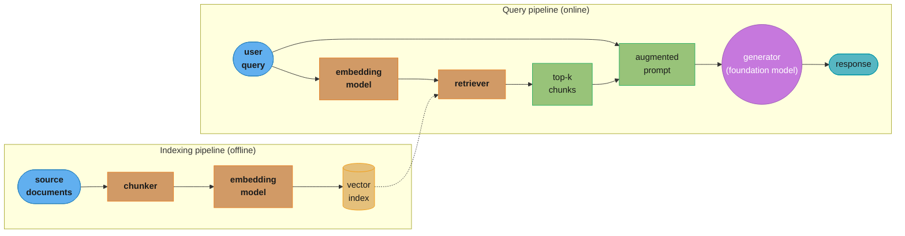
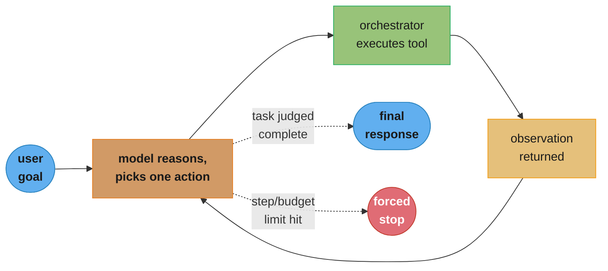
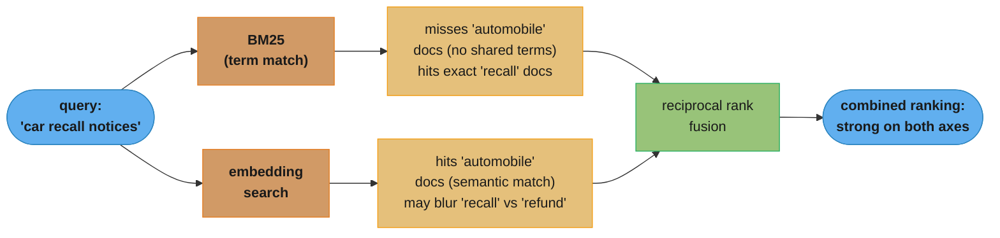
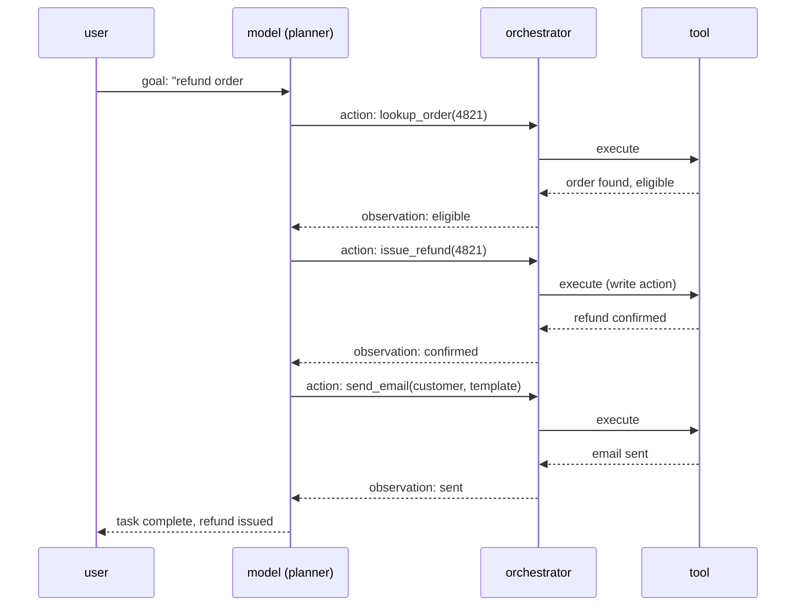

# Chapter 6: RAG and Agents

> Ch 6 of 10 · AI Engineering: Building Applications with Foundation Models (Huyen, 1st ed.,
> O'Reilly 2025) · builds on Ch 5 (Prompt Engineering), leads to Ch 7 (Finetuning)

## Chapter Map

Chapter 5 ended with the limits of a single prompt: a foundation model only knows what it saw
during training, and it can only act by emitting text. This chapter removes both limits without
touching the model's weights. **RAG** (retrieval-augmented generation) fixes the knowledge
limit by fetching relevant information at query time and inserting it into the context window.
**Agents** fix the action limit by giving a model tools it can call and a planning loop that
lets it decide, for itself, what sequence of tool calls accomplishes a task. The two are not
separate techniques — a RAG system is really the simplest possible agent (one that can only
call a single "retrieve" tool), and most production agents lean on RAG as their primary
knowledge-augmentation tool. The chapter closes with **memory**, the mechanism that lets either
system carry state across a single task or across many sessions once the context window alone
is no longer big enough.

**TL;DR:**
- **RAG** separates "what the model knows" from "what data exists," retrieving relevant context
  at query time instead of baking every fact into model weights — cheaper to keep current than
  finetuning, and the retrieved context can be cited, audited, and updated independently of the
  model.
- Retrieval is not one algorithm but a spectrum from **term-based** (BM25 and friends) to
  **embedding-based** (dense vector search), and production systems increasingly combine both
  — **hybrid search** — because each catches failure modes the other misses.
- **Retrieval optimization** is mostly about the pipeline *around* the search algorithm:
  chunking strategy, query rewriting, reranking, and evaluation, not about swapping the vector
  index for a fancier one.
- An **agent** is a system that perceives an environment through **tools** and decides its own
  sequence of actions toward a goal, rather than producing one response to one prompt; that
  autonomy is exactly what makes agents both more capable and far harder to evaluate than a
  single RAG call.
- Every real agent failure mode compounds across steps, which is why agent **evaluation** has to
  inspect the full trajectory, not just the final answer — and why **memory** design (what to
  keep, what to summarize, what to retrieve back) becomes a first-class engineering problem the
  moment a task runs longer than one context window.

## The Big Question

A foundation model's knowledge is frozen at the moment its training data was collected, and its
only "hands" are the tokens it emits. How do you build a system that can answer questions about
this morning's data, and *do things* in the world, without retraining the model every time
either changes?

Analogy: a foundation model is a brilliant expert who has been in a soundproofed room since a
fixed date, reading nothing since. RAG is handing that expert a stack of up-to-date documents
right before they answer a question — the expert's judgment is unchanged, but their working
material is fresh. An agent goes one step further: it hands the expert a phone, a calculator,
and a set of forms they're allowed to fill out, and tells them to keep working the problem —
looking things up, running numbers, filing the form — until it's actually done, not just until
they've said something plausible-sounding. Both fixes patch the model from the *outside*; the
weights never move. Chapter 7 covers the alternative — changing the weights themselves.

---

## 6.1 RAG

**RAG** (retrieval-augmented generation) augments a model's response by retrieving relevant
information from an external memory source and inserting it into the context before generation.
The core motivation is a cost-and-freshness argument: pretraining a foundation model to
memorize a fact costs enormous compute and produces a model that is instantly out of date the
moment the fact changes, while storing the same fact in a searchable index and retrieving it at
query time costs a database write and a lookup. RAG turns "does the model know this" into "can
the system find this," which is a much cheaper problem to keep solved.

### RAG Architecture

A RAG system has two core components: a **retriever** that, given a query, fetches the most
relevant pieces of external information, and a **generator** — the foundation model itself —
that consumes the query plus the retrieved context and produces a response. Building the
retriever's search space happens offline, ahead of any query, in an **indexing pipeline**:
source documents are collected, split into smaller pieces (**chunking**), each chunk is turned
into a vector representation (**embedding**), and every chunk (plus its embedding and any
metadata) is stored in a searchable index. At query time, the same embedding process is applied
to the incoming query, the index is searched for the chunks whose vectors are closest to the
query's vector, and the retrieved chunks are concatenated into the prompt sent to the generator.



Caption: chunking and embedding happen once, offline; every query only pays for one embedding
call and one index search before the retrieved chunks join the prompt — the generator itself
never touches the raw document store.

The value of this split is that the retriever and the generator can be improved, swapped, or
scaled completely independently. A better embedding model or a bigger index does not require
retraining the generator; a bigger or more capable generator does not require re-indexing the
documents. RAG also gives a built-in citation mechanism — because the system knows exactly which
chunks it retrieved, it can show the user the source, which a purely parametric answer (one
generated entirely from the model's trained-in knowledge) cannot do.

### Retrieval Algorithms

Retrieval algorithms split broadly into two families, plus a combination of both.

**Term-based retrieval** (**sparse retrieval**, **lexical retrieval**) matches queries to
documents using the literal words they share, scored with statistics like term frequency and
inverse document frequency. **TF-IDF** weights a term higher the more often it appears in a
document and the rarer it is across the whole corpus; **BM25**, the dominant modern term-based
algorithm, refines this with saturation (a term appearing 50 times doesn't score 50 times higher
than appearing once) and document-length normalization (a long document naturally contains more
term matches by chance, and BM25 discounts for that). Term-based retrieval is fast, needs no
model to run at index time, and is exact for rare tokens — an error code, a product SKU, a
person's name — that an embedding model can blur together with semantically similar but
factually wrong alternatives.

**Embedding-based retrieval** (**dense retrieval**, **vector search**) instead represents both
the query and every chunk as a dense vector in a learned embedding space, and retrieves whichever
chunks have vectors closest to the query's — typically by cosine similarity or dot product.
Because the embedding model was trained to place semantically similar text near each other, this
family catches paraphrases and synonyms that share no literal words with the query ("car" and
"automobile," or a question phrased entirely differently from the passage that answers it) —
exactly what term-based retrieval misses. Searching the full index by brute-force distance
computation is too slow past a modest corpus size, so production systems use an **approximate
nearest neighbor (ANN)** index instead of exact search, trading a small amount of recall for a
large speedup: **HNSW** (hierarchical navigable small world graphs) builds a multi-layer graph
of vectors and greedily walks it toward the query; **IVF** (inverted file index) clusters vectors
and searches only the nearest clusters; **product quantization (PQ)** compresses each vector into
a small code to shrink both memory and comparison cost, often combined with IVF (`IVF-PQ`).

**Hybrid search** runs both a term-based and an embedding-based retriever over the same query and
combines their ranked lists — commonly with **reciprocal rank fusion (RRF)**, which scores a
document by `1 / (k + rank)` summed across each retriever's ranking (a small constant `k`, often
60, dampens the effect of any single retriever's top-1 pick dominating), so a document that
ranks well in *either* list scores well overall. Hybrid search is the common default in
production RAG because term-based and embedding-based retrieval fail in almost opposite ways —
one on paraphrase, the other on exact identifiers — and combining them tends to be cheaper than
trying to make either one alone catch both failure modes.

### Retrieval Optimization

Getting a working retriever is fast; getting a *good* one is mostly a pipeline-engineering
problem around the search algorithm, not a smarter algorithm.

**Chunking strategy** is usually the highest-leverage lever. A chunk that's too small loses the
surrounding context needed to make sense of it on its own (a sentence fragment with a pronoun
whose referent is in the previous paragraph); a chunk that's too large dilutes the embedding —
a 2,000-token chunk about five different subtopics produces a vector that's mediocre-close to
queries about any one of them, and wastes context-window budget on irrelevant text once
retrieved. Fixed-size chunking (split every N tokens) is simple but chops sentences and
paragraphs arbitrarily; **recursive** or **semantic chunking** instead splits along natural
boundaries — paragraphs, sections, sentence groups with high internal similarity — and keeps a
small **overlap** between adjacent chunks so information straddling a boundary isn't orphaned
in either piece. There is no universally correct chunk size; it is an empirical tuning knob
against the specific corpus and query distribution.

**Reranking** adds a second retrieval stage: retrieve a wider candidate set cheaply (say, the
top 100 by vector search), then re-score just that set with a slower, more accurate model — a
**cross-encoder**, which processes the query and each candidate chunk together (rather than
independently, as the two-tower embedding model does) and can therefore capture interactions a
single embedding comparison cannot. Cross-encoders are too slow to run over an entire index, so
they're only economical as a second-stage filter over an already-narrowed candidate set.

**Query rewriting/transformation** improves the query itself before it's ever searched: query
expansion adds synonyms or related terms; query decomposition breaks a multi-hop question ("who
directed the highest-grossing film of the director of Movie X?") into sub-queries that can each
be answered by simple retrieval and then combined; **HyDE** (hypothetical document embeddings)
asks the generator to first write a hypothetical answer to the query, then embeds *that* answer
and searches with it — because a plausible answer is often closer, in embedding space, to the
real answer than the terse question is.

**Contextual retrieval** prepends chunk-level context — a short summary of where in the source
document a chunk sits, or of the document as a whole — before embedding it, so a chunk that reads
ambiguously in isolation ("the company's revenue grew 12% that quarter") carries enough context
to be found by, and to make sense once retrieved for, queries that don't share its exact
wording.

Finally, retrieval needs its own evaluation independent of the generator's output quality —
**recall@k** (did a relevant chunk appear anywhere in the top k retrieved), **precision@k** (how
much of the top k is actually relevant), **MRR** (mean reciprocal rank, rewarding a relevant
result appearing early) and **NDCG** (normalized discounted cumulative gain, which additionally
weights *how* relevant, not just relevant-or-not) are all standard. Measuring retrieval quality
in isolation matters because a bad final answer can come from either a retrieval failure (the
right chunk was never fetched) or a generation failure (the right chunk was fetched but the
model ignored or misread it) — conflating the two makes debugging a RAG pipeline much harder
than it needs to be.

### RAG Beyond Texts

Nothing about the retrieve-then-generate pattern is specific to plain text. **Multimodal RAG**
retrieves images, tables, audio, or video alongside or instead of text — either by embedding
every modality into a shared vector space with a multimodal embedding model so a text query can
directly retrieve a matching image, or by keeping separate indexes per modality and merging
results. **Tabular data** is commonly handled differently from unstructured text: rather than
embedding rows or cells directly, a **text-to-SQL** approach lets the generator translate a
natural-language question into a SQL query executed against the structured source, retrieving
exact rows instead of an approximate nearest-neighbor match — appropriate because structured data
usually has an exact right answer (a specific number in a specific row) that vector similarity
is the wrong tool for. RAG can extend to any format with a workable notion of "chunk" and
"relevance" — code repositories, knowledge graphs, even other models' outputs — the underlying
retrieve-then-augment pattern doesn't change.

---

## 6.2 Agents

Where RAG augments a model's *knowledge*, an agent augments its *actions*. An **agent** is
anything that perceives its environment and acts upon that environment to achieve a goal; in
AI engineering terms, the environment is whatever the agent has access to through its tools —
the web, a code sandbox, a database, other APIs — and the foundation model serves as the agent's
planning core, deciding which tool to call, with what arguments, and when to stop. A RAG system
is, by this definition, the simplest possible agent: one with exactly one tool (retrieval) and
no branching plan. What distinguishes a general-purpose agent is the number and variety of tools
available and, more importantly, the model's autonomy over the *sequence* of actions — nobody
hardcoded which tool gets called when; the model decides that itself, at run time, based on what
it observes after each step.

### Agent Overview

An agent's basic execution loop is often described as **observe → plan/reason → act → repeat**,
popularized as the **ReAct** pattern (reason and act): the model produces a short reasoning trace,
decides on one action (a tool call), the orchestration layer executes that tool and returns its
output as an **observation**, and the model repeats the loop — reasoning again, now with the new
observation available — until it judges the task complete, hits a step or budget limit, or
determines it needs human input. This loop is what lets an agent recover from a wrong turn: a
failed tool call, a search that returns nothing useful, or new information midway through a task
all become inputs to the *next* planning step, rather than fatal errors in a single-shot
pipeline.



Caption: the loop only terminates on the model's own judgment or an external limit — there is no
guarantee an agent stops in a bounded number of steps, which is why every production agent needs
an explicit step or cost ceiling as a backstop.

### Tools

A **tool** is anything an agent can call to extend what the model alone can perceive or do; the
book groups tools into three categories, ordered by increasing operational risk.

1. **Knowledge augmentation tools** extend what the model *knows*: a RAG retriever, a web-search
   API, a SQL executor against an internal database, a call to another internal service's read
   API. These are the tools that make an agent's answers current and grounded instead of
   parametric-only, and §6.1's retrieval techniques apply directly here — a search tool is just
   a retriever the model chooses to invoke rather than one always invoked automatically.
2. **Capability extension tools** give the model reliable access to things it is structurally bad
   at doing itself: a calculator for arithmetic a language model routinely gets wrong at scale, a
   code interpreter/sandbox for precise computation or data manipulation, a calendar or timezone
   tool for exact date math, a translator. These tools trade the model's fuzzy, sometimes-wrong
   internal computation for a deterministic external one.
3. **Write actions** change state in the world rather than merely reading it: sending an email,
   filing a support ticket, executing a trade, deleting a record, making a purchase. These carry
   the highest risk because a wrong call is not silently correctable the way a wrong search
   result is — the book stresses that write-action tools deserve tighter scoping (narrow,
   specific actions rather than a broad "execute arbitrary SQL" tool), explicit confirmation
   steps, and human-in-the-loop review before anything irreversible, especially early in a
   system's life before its failure modes are well understood.

Every tool the model can call needs a clear, machine-readable description (name, purpose,
parameters, expected output shape) because that description *is* the interface the model reasons
over when deciding what to call — a badly documented tool produces exactly the kind of malformed
or misdirected calls covered in "Agent Failure Modes" below. Tool count also has a real cost: the
more tools available, the more the model's decision on which one to call has to discriminate
between similar-sounding options, and every tool's description consumes context-window budget on
every single planning step.

### Planning

Because a foundation model can only emit text, something has to translate its output into an
actual tool invocation — that translation layer, plus the process of deciding *what* to ask the
model to do next, is **planning**. Planning breaks down into several recurring pieces: **intent
classification** (what is the user actually asking for, which may route to an entirely different
tool set or even a different downstream system), **task decomposition** (breaking one complex
goal into an ordered or partially ordered set of smaller sub-tasks a single tool call can address),
**plan generation** (producing the sequence, or graph, of steps), and **reflection**
(having the model examine its own prior output or plan and revise it — catching an inconsistent
step, a missing precondition, or a result that doesn't actually answer the sub-task before
continuing).

Two broad planning strategies trade adaptability against cost and latency. **Iterative
single-step planning** (the ReAct loop above) re-plans after every single observation — maximally
adaptive to surprises, but every step costs a full model call, and errors on step 3 are only
caught once the model sees step 3's result. **Plan-and-execute** instead has the model produce
an entire multi-step plan up front, then executes it (sometimes re-planning only if a step fails
outright) — fewer total model calls and lower latency for plans that go as expected, but less
able to react to information that only becomes available partway through. Production agents
often mix the two: a coarse up-front plan with fine-grained ReAct-style execution inside each
step.

Plan **validation** — checking a proposed plan or a single action against constraints before it
executes, rather than after — matters most exactly where the tools involved are write actions:
validating that a proposed database write matches an expected schema, that a proposed trade is
within a size limit, or simply surfacing the plan to a human for approval before an irreversible
step runs.

### Agent Failure Modes and Evaluation

Because an agent's output is the product of many sequential decisions instead of one, its
failure modes are correspondingly more varied than a single generation's, and they compound:
a wrong choice at step 2 changes what the model observes at step 3, which changes step 4, so by
the time a failure is visible in the final answer, the actual mistake may be buried several steps
back in the trajectory.

**Planning failures** happen when the model picks the wrong action: calling a tool that doesn't
fit the task at all, calling the right tool with **invalid parameters** (wrong types, missing
required arguments, values outside a valid range), calling tools in the wrong **order** (querying
before the precondition that makes the query meaningful has been established), or — often the
hardest to catch — **not** calling a tool it should have, and instead hallucinating a plausible-
looking answer in its place.

**Tool-execution failures** happen even when the plan itself was reasonable: the orchestration
layer fails to parse the model's output into a valid function call (a malformed JSON argument
block), the tool itself errors (an API is down, a query times out, a permission is denied), or
the tool succeeds but returns something the model then misinterprets.

**Efficiency failures** don't necessarily produce a wrong final answer but waste cost and
latency: redundant tool calls repeating information already gathered, retry loops where the model
keeps trying a variant of an action that keeps failing the same way, or simply far more steps
than the task actually required.

Evaluating an agent therefore needs to look past the final response. **Component-level
evaluation** tests one piece in isolation — given a task and the tools available, does the model
choose the correct tool and correct arguments, independent of whether the rest of the trajectory
succeeds. **End-to-end (trajectory-level) evaluation** tests overall task success across the
whole run, but a pass/fail-only signal at the end hides *where* a multi-step trajectory went
wrong, which is why production agent evaluation typically needs to inspect the full trace — every
reasoning step, every tool call and its arguments, every observation — not just the final output,
turning agent evaluation into a genuinely distinct discipline from evaluating single-turn
generation.

---

## 6.3 Memory

Both RAG and agents need somewhere to keep state that outlives a single prompt, and that need
scales with how long a task runs. **Memory** in an AI system splits into two tiers with very
different lifetimes. **Short-term memory** is what fits in the model's own context window during
one task or one conversation — the running history of user turns, retrieved chunks, and (for an
agent) prior reasoning steps, tool calls, and observations. It's fast and requires no separate
storage system, but it is bounded by the context window's size and, for a long-running agent
task, fills up. **Long-term memory** persists information beyond a single session — facts learned
about a user across many conversations, a summary of a completed task kept for future reference,
or a growing store of an agent's own past experience — and lives in external storage the system
explicitly writes to and reads from, independent of any one context window.

Once short-term memory would overflow the context window, the system has to decide what to keep,
discard, or compress: a **sliding window** keeps only the most recent turns or steps and drops
the oldest; **summarization** periodically compresses older history into a shorter summary that
replaces the raw turns, trading detail for space; and **retrieval-based memory** stores the full
history externally (often in the very same kind of vector index §6.1 describes for documents) and
retrieves only the pieces relevant to the current step back into context, rather than keeping
everything or discarding anything permanently. This last approach is why memory systems in
practice frequently *are* RAG systems, pointed at the agent's own transcript and prior outputs
instead of an external document corpus — the retrieve-then-augment pattern this chapter opened
with reappears here as the mechanism for managing an agent's own history.

---

## Beyond the book — Model Context Protocol and agent evaluation harnesses

> The chapter describes tools as model-callable functions with a name, description, and
> parameter schema, and treats "how an agent's tools are wired up" as an implementation detail
> left to the orchestration framework. It does not name a specific interoperability standard for
> tool integration, and does not name a specific third-party agent-evaluation product.

Since the book's writing, the **Model Context Protocol (MCP)** has become a widely adopted open
standard for exposing tools, retrieval sources, and prompts to a model client in a
provider-agnostic way — instead of every application wiring its own bespoke tool definitions to
every model provider's function-calling format, an MCP server exposes a standard interface any
MCP-aware client can call. It addresses exactly the tool-proliferation cost this chapter
describes: with MCP, a new data source or capability is wired up once, as a server, rather than
once per agent framework. See `llm/mcp_model_context_protocol/mcp_model_context_protocol.md` for
the protocol's mechanics. Dedicated agent-trajectory evaluation and observability tooling —
capturing and scoring full multi-step traces, not just final outputs, which §6.2's "Agent Failure
Modes and Evaluation" argues is necessary — has also matured considerably into purpose-built
products since publication; see `llm/framework_observability` material under
`llm/agentic_frameworks/framework_observability.md` and `llm/llm_observability_and_monitoring/`.

---

## Visual Intuition



Caption: term-based and embedding-based retrieval fail on almost opposite inputs — exact rare
tokens versus paraphrase — which is why hybrid search's fusion step, not a smarter single
algorithm, is usually the highest-value retrieval fix.

```
  Decoding: reciprocal rank fusion (RRF), k = 60

  doc    BM25 rank   RRF score (BM25)     vector rank   RRF score (vector)   combined
  A          1        1/(60+1) = 0.0164        5         1/(60+5) = 0.0154    0.0318
  B          9        1/(60+9) = 0.0145        1         1/(60+1) = 0.0164    0.0309
  C          2        1/(60+2) = 0.0161      (absent)          0               0.0161

  A ranks 1st on lexical match and mid-pack on vector match; B is the reverse.
  RRF's sum rewards a document that shows up NEAR THE TOP of either list --
  it never needs the two retrievers' raw scores to be on the same scale to combine them.
```

Caption: RRF works purely on rank position, not on raw similarity scores, which sidesteps the
problem that BM25 scores and cosine-similarity scores are not directly comparable numbers.



Caption: three sequential steps, each depending on the previous one's observation — the write
action (issue_refund) sits in the middle, which is exactly where a real system would insert a
confirmation gate rather than letting the loop run unattended.

---

## Key Concepts Glossary

- **RAG (retrieval-augmented generation)** — augmenting a generated response with information
  retrieved from an external source at query time.
- **Retriever** — the component that fetches relevant chunks given a query.
- **Generator** — the foundation model that consumes the query and retrieved context and produces
  a response.
- **Indexing pipeline** — the offline process of chunking, embedding, and storing source documents.
- **Chunking** — splitting source documents into smaller retrievable pieces.
- **Embedding** — a dense vector representation of a piece of text (or other modality).
- **Term-based (sparse/lexical) retrieval** — matching queries to documents by shared literal terms.
- **TF-IDF** — a term-weighting scheme favoring frequent-in-document, rare-in-corpus terms.
- **BM25** — the dominant term-based ranking function, adding saturation and length normalization to TF-IDF.
- **Embedding-based (dense) retrieval** — matching queries to documents by vector similarity.
- **Approximate nearest neighbor (ANN)** — searching for close vectors without exhaustively comparing every one.
- **HNSW** — a graph-based ANN index searched by greedy traversal.
- **IVF (inverted file index)** — an ANN index that clusters vectors and searches only nearby clusters.
- **Product quantization (PQ)** — compressing vectors into small codes to save memory and compute.
- **Hybrid search** — combining term-based and embedding-based retrieval results.
- **Reciprocal rank fusion (RRF)** — a rank-based method for merging multiple retrievers' result lists.
- **Chunking strategy** — the choice of chunk size, boundary rule, and overlap.
- **Overlap** — shared text between adjacent chunks to avoid orphaning boundary-straddling information.
- **Reranking** — a second retrieval stage that re-scores a small candidate set with a more accurate model.
- **Cross-encoder** — a reranking model that scores a query and a candidate jointly, not independently.
- **Query rewriting/transformation** — modifying the query before retrieval to improve results.
- **HyDE (hypothetical document embeddings)** — retrieving using the embedding of a model-generated hypothetical answer.
- **Query decomposition** — splitting a multi-hop question into simpler sub-queries.
- **Contextual retrieval** — prepending document-level context to a chunk before embedding it.
- **Recall@k / precision@k** — retrieval metrics for whether/how much of the top k results is relevant.
- **MRR (mean reciprocal rank)** — a retrieval metric rewarding an early-ranked relevant result.
- **NDCG** — a retrieval metric weighting both relevance and rank position.
- **Multimodal RAG** — retrieval and generation spanning more than one data modality.
- **Text-to-SQL** — translating a natural-language question into a SQL query against structured data.
- **Agent** — a system that perceives an environment through tools and decides its own sequence of actions.
- **Tool** — a function an agent can call to extend what the model can perceive or do.
- **ReAct (reason and act)** — the observe-plan-act-repeat agent execution loop.
- **Observation** — the result a tool call returns to the model in the next planning step.
- **Knowledge augmentation tool** — a tool that extends what the model knows (search, RAG, SQL read).
- **Capability extension tool** — a tool that performs a computation the model is unreliable at (calculator, code interpreter).
- **Write action** — a tool that changes state in the world; the highest-risk tool category.
- **Planning** — deciding and sequencing the actions an agent takes toward a goal.
- **Intent classification** — determining what the user is actually asking for.
- **Task decomposition** — breaking a complex goal into smaller sub-tasks.
- **Reflection** — having the model examine and revise its own prior output or plan.
- **Plan-and-execute** — producing a full multi-step plan up front, then executing it.
- **Plan validation** — checking a proposed action or plan against constraints before executing it.
- **Planning failure** — an agent choosing a wrong tool, wrong parameters, or wrong action order.
- **Tool-execution failure** — a correctly planned action failing at parse, execution, or interpretation time.
- **Efficiency failure** — an agent completing correctly but wasting steps, cost, or time.
- **Trajectory** — the full sequence of an agent's reasoning steps, actions, and observations.
- **Component-level evaluation** — testing one agent decision (e.g., tool choice) in isolation.
- **End-to-end (trajectory-level) evaluation** — testing overall task success across a full agent run.
- **Short-term memory** — state held within the current context window/session.
- **Long-term memory** — state persisted externally across sessions.
- **Sliding window (memory)** — keeping only the most recent history and dropping the oldest.
- **Retrieval-based memory** — storing full history externally and retrieving only relevant pieces back into context.

---

## Tradeoffs & Decision Tables

| | Term-based (BM25) | Embedding-based (dense) | Hybrid |
|---|---|---|---|
| Exact identifiers, rare tokens | Strong | Weak — can blur near-matches | Strong (inherits BM25's strength) |
| Paraphrase, synonyms | Weak — no shared terms, no match | Strong | Strong (inherits embedding's strength) |
| Index-time cost | Low — no model inference | Higher — every chunk needs an embedding call | Higher of the two |
| Query-time cost | Very low | Low with ANN, higher with exact search | Two searches plus a fusion step |

| Chunking choice | Context preserved | Embedding specificity | Failure mode when wrong |
|---|---|---|---|
| Small chunks, little overlap | Low | High | Fragments lose meaning without neighbors |
| Large chunks | High | Low (diluted) | Retrieves noisy, only-partially-relevant text |
| Semantic/recursive with overlap | Highest achievable | Highest achievable | More index-time engineering, no free lunch |

| Planning strategy | Adaptability | Latency/cost per run | Best fit |
|---|---|---|---|
| Iterative (ReAct) | Highest — reacts after every step | Highest — one model call per step | Open-ended, unpredictable tasks |
| Plan-and-execute | Lower — commits to an up-front plan | Lower — fewer model calls when the plan holds | Well-understood, mostly-linear tasks |

| Tool category | Reversibility if wrong | Recommended safeguard |
|---|---|---|
| Knowledge augmentation | Fully reversible (a bad read costs nothing) | Standard retrieval evaluation |
| Capability extension | Fully reversible (a bad calculation is caught downstream) | Output sanity-checking |
| Write action | Often irreversible | Narrow scope, confirmation step, human-in-the-loop |

---

## Common Pitfalls / War Stories

- **Treating a bad final answer as a generation bug.** A wrong RAG response can come from a
  retrieval failure (the right chunk was never fetched) or a generation failure (it was fetched
  but ignored). Debugging generation quality without first checking whether the right context
  ever reached the prompt wastes time chasing the wrong half of the pipeline.
- **Chunking by a fixed token count and nothing else.** Splitting purely on token boundaries
  regularly slices a sentence, table row, or code block in half, producing chunks that are
  individually unintelligible even when the retriever finds the right neighborhood of the
  document.
- **Giving an agent a broad write-action tool "for flexibility."** A single `execute_sql(query)`
  tool is more flexible than ten narrow ones, but it also means every planning mistake can now
  touch arbitrary rows — narrow, purpose-built tools bound the blast radius of a bad plan.
- **Evaluating an agent only on final-answer correctness.** A trajectory that reaches the right
  answer after five redundant tool calls and one near-miss looks identical to an efficient,
  correct one if the evaluation only checks the last message — hiding real cost and reliability
  problems that only show up at scale.
- **Letting short-term memory silently overflow.** Without an explicit summarization or
  sliding-window policy, a long-running agent's context window fills with early, now-irrelevant
  steps, crowding out the information the model actually needs for its next decision — and,
  because the overflow degrades quality gradually rather than erroring outright, it's easy to
  miss until a task quietly starts failing.
- **Assuming more retrieved chunks is strictly better.** Beyond a task's actual information need,
  additional retrieved chunks add irrelevant text competing for the model's attention and consume
  context-window budget the generation step could otherwise use, sometimes measurably hurting
  answer quality rather than helping it.
- **Skipping component-level tool-choice evaluation.** Testing only end-to-end task success can
  pass while hiding that the model is consistently reaching for the wrong tool and then
  compensating through extra steps — a fragile pattern likely to break the moment the task varies
  slightly from what was tested.

---

## Real-World Systems Referenced

**Retrieval algorithms:** BM25 (the standard term-based ranking function used across search
engines and RAG stacks), HNSW-based and IVF/PQ-based vector index implementations. **Retrieval
optimization technique:** contextual retrieval, as described in Anthropic's published approach to
prepending document context to chunks before embedding. **Agent execution pattern:** ReAct
(reason-and-act prompting). **Agent orchestration frameworks:** the broader ecosystem of
agent-building frameworks that implement tool calling, planning loops, and memory management on
top of foundation model APIs.

---

## Summary

RAG and agents both extend a foundation model from the outside, without touching its weights: RAG
by retrieving relevant information at query time instead of requiring the model to have memorized
it, and agents by giving the model tools it can call and a planning loop that lets it decide, for
itself, what sequence of actions accomplishes a goal. RAG's architecture splits cleanly into an
offline indexing pipeline and an online query pipeline, and its retrieval algorithms range from
term-based (BM25) to embedding-based (dense vector search) to hybrid combinations of both;
retrieval quality in practice comes mostly from pipeline engineering — chunking strategy, query
rewriting, reranking, and dedicated retrieval evaluation — rather than from the choice of index
algorithm alone. Agents generalize RAG's single "retrieve" tool into an arbitrary tool set spanning
knowledge augmentation, capability extension, and write actions, with planning as the layer that
decides which tool to call, in what order, and when to stop; because an agent's output is the
product of many sequential decisions, its failure modes compound across steps, which is why agent
evaluation has to examine the full trajectory rather than just the final response. Memory —
short-term, bounded by the context window, and long-term, persisted externally — is what lets
either system carry state beyond what a single context window can hold, and in practice a
long-term memory system is frequently just another RAG system, pointed at the agent's own history
instead of an external document corpus. Chapter 7 turns to the alternative way of updating a
model's behavior: changing its weights directly through finetuning.

---

## Interview Questions

**Q: Why is RAG usually cheaper to keep current than finetuning a model on new facts?**
**Short:** Huyen frames RAG as updating a searchable index, not retraining model weights.
Finetuning to teach a model a new fact requires running a training job over that fact (and
enough surrounding data to avoid catastrophic forgetting) every time the fact changes, while RAG
only requires writing the updated fact into the retrieval index — a database write instead of a
training run. The book frames this as separating "what the model knows how to do" (a stable
skill, well suited to finetuning) from "what the model needs to know right now" (a frequently
changing fact, well suited to retrieval), and most production systems that need current
information choose RAG for exactly this cost asymmetry.

**Q: Why doesn't a bad RAG answer necessarily mean the generator is at fault?**
**Short:** The failure could be retrieval never fetching the right chunk, not generation misreading it.
A RAG pipeline has two independently failing stages: the retriever might never surface the chunk
that contains the answer, or it might surface exactly the right chunk and the generator might
still ignore, misread, or fail to synthesize it correctly. Diagnosing which stage failed requires
checking retrieval quality (did the right chunk appear in the top-k results) separately from
generation quality (given that chunk, did the model use it correctly) — conflating the two wastes
debugging effort on the wrong half of the system.

**Q: Why do production RAG systems commonly use hybrid search instead of picking either BM25 or embeddings alone?**
**Short:** The two retrieval families fail on nearly opposite inputs, so combining them covers both.
Term-based retrieval is precise on exact identifiers and rare tokens but blind to paraphrase and
synonyms, while embedding-based retrieval catches semantic similarity but can blur a genuinely
distinct but nearby concept (or miss an exact rare token entirely). Because their weaknesses
rarely overlap, running both and merging the ranked results with a method like reciprocal rank
fusion typically outperforms either retriever alone, at the cost of running two searches and a
fusion step per query.

**Q: What's the failure mode of chunking purely by a fixed token count?**
**Short:** It regularly slices a sentence, table row, or code block in half at an arbitrary boundary.
Fixed-size chunking ignores the document's actual structure, so a chunk boundary can land in the
middle of a sentence, split a table row from its header, or separate a code block's opening and
closing braces — producing chunks that are individually hard to interpret even when the retriever
correctly identifies the right neighborhood of the source document. Recursive or semantic
chunking that respects paragraph and section boundaries, plus a small overlap between adjacent
chunks, avoids orphaning information that straddles an arbitrary cut point.

**Q: Why is a cross-encoder used for reranking instead of for the entire retrieval pass?**
**Short:** It's far more accurate but too slow to run over a whole index, so it filters a small candidate set.
A cross-encoder scores a query and a candidate document jointly, letting it capture interactions
between them that a two-tower embedding model (which encodes query and document independently)
cannot — but that joint processing has to run once per candidate, making it too slow to apply
across an entire index. The standard pattern is a cheap first-stage retrieval (vector or hybrid
search) over the whole index to produce a modest candidate set, then a cross-encoder reranks just
that narrowed set for higher final precision.

**Q: What does HyDE do, and why would embedding a fabricated answer improve retrieval?**
**Short:** HyDE embeds a model-generated hypothetical answer instead of the terse original question.
HyDE (hypothetical document embeddings) first asks the generator to write a plausible-looking
answer to the query, without needing it to be correct, then embeds that hypothetical answer and
uses its vector to search the index instead of the original question's vector. The intuition is
that a real answer passage in the index is often closer, in embedding space, to a plausible answer
than to a terse question about that answer, so searching with the hypothetical answer's embedding
can surface the right passage more reliably than searching with the question directly.

**Q: What makes an agent different from a single RAG call, given both retrieve information?**
**Short:** An agent decides its own sequence of actions across multiple tools; RAG performs one fixed retrieval step.
A RAG pipeline always executes the same fixed sequence — retrieve, then generate — regardless of
the query, making it structurally a single-tool, single-step agent. A general agent has access to
multiple tools spanning knowledge augmentation, capability extension, and write actions, and the
model itself decides, at each step, which tool (if any) to call next based on what it has observed
so far, continuing until it judges the task complete — that autonomy over the action sequence,
not the presence of retrieval, is what defines an agent.

**Q: Why are write-action tools treated as higher risk than knowledge-augmentation or capability-extension tools?**
**Short:** A wrong write action changes real state and often can't be undone, unlike a bad read or calculation.
A knowledge-augmentation tool that returns a wrong or irrelevant result, or a capability-extension
tool that miscalculates, produces a bad intermediate observation the agent (or a downstream check)
can still catch and correct before anything external is affected. A write action — sending an
email, issuing a refund, executing a trade — changes real-world state immediately, and many such
actions cannot be cleanly reversed, so the book recommends narrowly scoped write tools with
explicit confirmation or human-in-the-loop review rather than broad, flexible ones.

**Q: Why does an agent's error compound across steps in a way a single generation's error doesn't?**
**Short:** Each step's observation depends on the previous step's action, so an early mistake propagates forward.
In a single-turn generation, one bad output is the whole failure. In an agent trajectory, a wrong
tool call or wrong parameter at an early step changes what the model observes afterward, which
then shapes every subsequent planning decision — by the time a failure is visible in the final
answer, the actual mistake may be several steps upstream and no longer obviously connected to the
symptom, which is exactly why agent evaluation needs to inspect the full trace rather than only
the final output.

**Q: What's the practical difference between component-level and end-to-end agent evaluation, and why do you need both?**
**Short:** Component-level isolates one decision (e.g., tool choice); end-to-end only measures overall task success.
Component-level evaluation tests one piece of the agent in isolation — given a specific state, did
the model choose the correct tool and correct arguments — independent of how the rest of a
trajectory plays out, which pinpoints exactly where a capability is weak. End-to-end evaluation
measures whether a full run achieved the user's goal, which is the metric that actually matters to
users but, on its own, can pass or fail without revealing *where* in a multi-step trajectory
things went right or wrong — production agent evaluation typically needs both to be actionable.

**Q: What's the tradeoff between iterative (ReAct-style) planning and plan-and-execute?**
**Short:** ReAct adapts after every step at the cost of one model call per step; plan-and-execute commits up front for lower cost.
Iterative planning re-plans after every single observation, which makes it maximally responsive to
surprises but means every step of the task costs a separate model call, raising both latency and
cost. Plan-and-execute has the model generate a full multi-step plan before execution begins,
which is cheaper and faster when the plan holds but is less able to react to new information that
only surfaces partway through — many production agents combine the two, using a coarse up-front
plan executed with fine-grained, ReAct-style adaptivity inside each step.

**Q: Why can giving a RAG generator more retrieved chunks hurt answer quality instead of helping it?**
**Short:** Extra chunks beyond the actual information need add irrelevant text competing for the model's attention.
Once the chunks needed to answer a query have been retrieved, additional chunks don't add useful
information — they add text the model still has to process, competing for attention with the
genuinely relevant content and consuming context-window budget that could otherwise go toward the
generation itself. This is why retrieval tuning is not simply "retrieve more" — the right top-k is
an empirical tradeoff, not a value to maximize.

**Q: What's the difference between short-term and long-term memory in an AI system, and why does the distinction matter operationally?**
**Short:** Short-term memory lives in the context window for one session; long-term memory is written to external storage across sessions.
Short-term memory is whatever fits in the model's context window during a single task or
conversation — fast, free of extra infrastructure, but bounded by the window's size and lost once
the session ends. Long-term memory is explicitly persisted to external storage so it survives
beyond one session — facts learned about a user across many conversations, or a summary of prior
work — and it requires the system to actively decide what's worth writing out and how to retrieve
it back later, which is real engineering effort, not something that happens automatically just
because a database exists.

**Q: Why does a long-running agent's context window "silently" run into trouble even when nothing errors out?**
**Short:** Overflow degrades answer quality gradually rather than throwing an error, so it's easy to miss.
Without an explicit policy — a sliding window, periodic summarization, or retrieval-based memory —
a long agent trajectory keeps appending every step's history to the context, and once that history
grows large enough it either exceeds the window outright or crowds out the most decision-relevant
recent information under less relevant early history. Because this degrades output quality
gradually rather than producing a clean failure, teams often notice it only once a long-running
task starts quietly underperforming, well after the underlying cause was introduced.

**Q: Why is retrieval-based memory often implemented as "just another RAG system"?**
**Short:** It stores an agent's own transcript externally and retrieves only the relevant pieces back into context.
Retrieval-based memory faces the identical problem RAG solves for external documents: a large body
of information (here, the agent's own history) that can't all fit in context at once, so only the
pieces relevant to the current step should be pulled back in. Storing past turns or steps in a
vector index and retrieving the closest matches to the current query at each step reuses exactly
the chunk-embed-store-retrieve pipeline §6.1 describes, just pointed at the agent's own transcript
instead of an external document corpus.

**Q: Why does NDCG capture something recall@k and precision@k miss?**
**Short:** NDCG weights how relevant each result is and where it ranks, not just relevant-or-not.
Recall@k and precision@k treat every retrieved item as either relevant or not, and (in their
simplest form) don't distinguish a highly relevant result from a marginally relevant one, or
reward putting the best result first versus last within the top k. NDCG (normalized discounted
cumulative gain) incorporates graded relevance and discounts results by their rank position, so
two result sets with the same relevant/irrelevant count can still score very differently depending
on how relevant each hit actually is and how early it appears — a finer-grained signal for tuning
a retriever than a binary hit-or-miss metric provides.

**Q: Why is text-to-SQL preferred over embedding-based retrieval for structured tabular data?**
**Short:** Structured queries usually have an exact right answer, which vector similarity search isn't built to find.
A question like "what was total revenue in Q3" has one exact correct numeric answer sitting in a
specific set of rows, not a "similar" passage — embedding a row or cell and searching by vector
similarity is the wrong tool for exact aggregation and filtering. Text-to-SQL instead translates
the natural-language question into an executable query against the structured source, retrieving
precisely the rows that satisfy the question's actual logical condition, which is what tabular
data generally needs instead of an approximate nearest-neighbor match.

---

## Cross-links in this repo

- [llm/rag_fundamentals/rag_fundamentals.md — core RAG architecture and retrieval/generation split](../../../llm/rag_fundamentals/rag_fundamentals.md)
- [llm/advanced_rag/advanced_rag.md — chunking, reranking, and query transformation techniques in depth](../../../llm/advanced_rag/advanced_rag.md)
- [llm/advanced_rag/query_transformation.md — HyDE, query expansion, and query decomposition](../../../llm/advanced_rag/query_transformation.md)
- [llm/advanced_rag/corrective_rag.md and self_rag.md — retrieval-quality self-correction patterns](../../../llm/advanced_rag/corrective_rag.md)
- [llm/advanced_rag/multimodal_rag.md — RAG beyond text](../../../llm/advanced_rag/multimodal_rag.md)
- [llm/embeddings_and_similarity_search/embeddings_and_similarity_search.md — embedding models and ANN search mechanics](../../../llm/embeddings_and_similarity_search/embeddings_and_similarity_search.md)
- [llm/faiss_deep_dive/faiss_deep_dive.md — HNSW/IVF/PQ index internals](../../../llm/faiss_deep_dive/faiss_deep_dive.md)
- [llm/agents_and_tool_use/agents_and_tool_use.md — tool-calling mechanics and agent loop internals](../../../llm/agents_and_tool_use/agents_and_tool_use.md)
- [llm/agentic_workflow_patterns/agentic_workflow_patterns.md — ReAct, plan-and-execute, and reflection patterns](../../../llm/agentic_workflow_patterns/agentic_workflow_patterns.md)
- [llm/multi_agent_systems/multi_agent_systems.md — multi-agent orchestration beyond a single planner](../../../llm/multi_agent_systems/multi_agent_systems.md)
- [llm/agentic_frameworks/agentic_frameworks.md — production framework survey (LangGraph, CrewAI, and others)](../../../llm/agentic_frameworks/agentic_frameworks.md)
- [llm/mcp_model_context_protocol/mcp_model_context_protocol.md — the beyond-the-book tool-interoperability standard](../../../llm/mcp_model_context_protocol/mcp_model_context_protocol.md)
- [llm/context_engineering/context_engineering.md — managing what enters the context window across a long task](../../../llm/context_engineering/context_engineering.md)
- [llm/error_analysis_and_eval_design/error_analysis_and_eval_design.md — trajectory-level evaluation design](../../../llm/error_analysis_and_eval_design/error_analysis_and_eval_design.md)
- [llm/case_studies/design_rag_pipeline.md — a worked RAG system design](../../../llm/case_studies/design_rag_pipeline.md)
- [llm/case_studies/design_agent_platform.md — a worked general-purpose agent platform design](../../../llm/case_studies/design_agent_platform.md)
- Sibling chapters: [Ch 7 Finetuning](../07_finetuning/07_finetuning.md) · [Ch 9 Inference Optimization](../09_inference_optimization/09_inference_optimization.md) · [Ch 10 AI Engineering Architecture and User Feedback](../10_ai_engineering_architecture_and_user_feedback/10_ai_engineering_architecture_and_user_feedback.md)

## Further Reading

- Yao et al., "ReAct: Synergizing Reasoning and Acting in Language Models," ICLR 2023 — the
  reason-act agent loop this chapter builds on.
- Robertson and Zaragoza, "The Probabilistic Relevance Framework: BM25 and Beyond," Foundations
  and Trends in Information Retrieval, 2009 — the term-based ranking function underlying most
  hybrid search stacks.
- Cormack, Clarke, and Buettcher, "Reciprocal Rank Fusion Outperforms Condorcet and Individual
  Rank Learning Methods," SIGIR 2009 — the fusion method behind hybrid search.
- Gao et al., "Precise Zero-Shot Dense Retrieval without Relevance Labels," ACL 2023 — the HyDE
  paper.
- Malkov and Yashunin, "Efficient and Robust Approximate Nearest Neighbor Search Using
  Hierarchical Navigable Small World Graphs," IEEE TPAMI 2020 — the HNSW paper.
- Anthropic, "Introducing Contextual Retrieval," 2024 — the chunk-context-prepending technique
  referenced in §6.1.
- Lewis et al., "Retrieval-Augmented Generation for Knowledge-Intensive NLP Tasks," NeurIPS 2020
  — the paper that introduced the RAG architecture.
- Schick et al., "Toolformer: Language Models Can Teach Themselves to Use Tools," NeurIPS 2023 —
  early work on model-initiated tool use underlying §6.2's tool-calling discussion.
