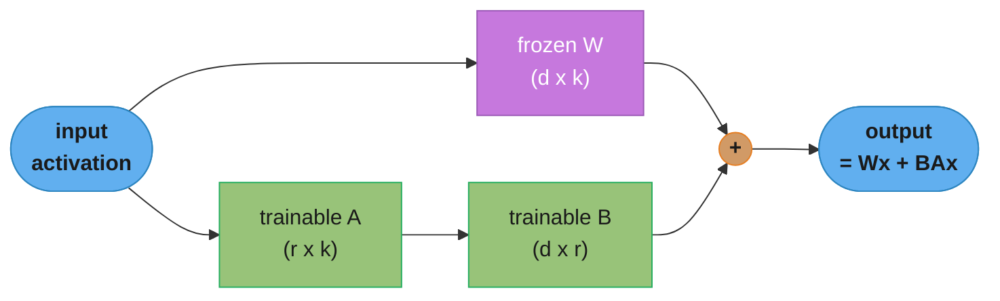

# Chapter 7: Finetuning

> Ch 7 of 10 · AI Engineering: Building Applications with Foundation Models (Huyen, 1st ed.,
> O'Reilly 2025) · builds on Ch 6 (RAG and Agents), leads to Ch 8 (Dataset Engineering)

## Chapter Map

Chapter 6 fixed a model's knowledge and action gaps entirely from the outside — retrieval and
tools, weights untouched. This chapter covers the alternative: **finetuning**, which continues a
foundation model's training on a smaller, task-specific dataset to change the model's *behavior*
itself — its tone, its output format, its skill at a narrow task, or facts it should reliably
know without being told at query time. Finetuning is more expensive and more operationally
complex than a prompt or a retrieval pipeline, so this chapter treats it as a decision to justify,
not a default — most of its length goes to *why* and *whether*, not just *how*. The chapter's
back half turns to the mechanics that make finetuning expensive in the first place — the memory a
training run actually consumes — and the techniques (chiefly parameter-efficient finetuning) that
bring that cost down enough for finetuning to be practical outside a well-funded lab.

**TL;DR:**
- Finetuning changes a model's **behavior** through gradient updates on task-specific data;
  prompting and RAG change what the model *sees* at inference time without touching a single
  weight — the two are complementary tools solving different problems, not competitors.
- The strongest reasons to finetune are narrowing a general model to a specific task or format,
  improving on skills prompting can't reliably elicit, and reducing per-request cost by baking
  behavior into weights instead of a long prompt; the strongest reasons *not* to are cost, data
  requirements, and the risk of **catastrophic forgetting**.
- Full finetuning's memory cost comes from four separate pools — model weights, gradients,
  optimizer states, and activations — and the optimizer states, not the weights themselves, are
  usually the single biggest consumer under Adam.
- **Numerical precision** (fp32/fp16/bf16 down to int8/int4) and **quantization** trade memory
  and speed for numerical range and accuracy, and the tradeoff applies differently to training
  (which needs gradient precision) than to inference (which mostly just needs to run fast).
- **Parameter-efficient finetuning (PEFT)**, especially **LoRA**, trains a tiny fraction of a
  model's parameters instead of all of them, cutting the memory bill by roughly an order of
  magnitude while recovering most of full finetuning's quality on typical tasks — which is why
  PEFT, not full finetuning, is the default starting point for most finetuning projects today.

## The Big Question

Prompting and RAG can steer a model a long way, but neither can teach it a genuinely new skill,
a consistent house style it should never break from, or a behavior that needs to survive without
a lengthy prompt reminding it every single time. How do you change what a model actually *does*,
reliably, when telling it what to do isn't enough — and how do you afford to, given that updating
a multi-billion-parameter model's weights is orders of magnitude more expensive than writing a
better prompt?

Analogy: prompting is handing someone instructions right before a task; RAG is handing them a
reference sheet to consult while they work. Finetuning is more like training — practicing the
task itself, enough times, that the instructions become second nature and no longer need to be
read aloud every time. Training a person is more expensive and time-consuming than handing them a
sheet of paper, and it only pays off when the task recurs often enough, and needs to be reliable
enough, that "read the instructions every time" stops being good enough. The rest of this chapter
is about recognizing that threshold, and then affording the training once you've crossed it.

---

## 7.1 Finetuning Overview

**Finetuning** is the process of adapting a pretrained foundation model to a specific task or
behavior by continuing its training on a smaller, targeted dataset — a form of **transfer
learning**: the model keeps the broad language and reasoning ability it acquired during
pretraining and refines a narrower slice of that ability using gradient updates computed from
task-specific examples. Unlike prompting or RAG, which only affect what a model sees at inference
time, finetuning changes the model's parameters themselves, so the resulting behavior persists
without needing to be re-specified in every request. This is also exactly why finetuning is
categorically more expensive: it requires a training run — forward passes, backward passes,
gradient computation, and an optimizer step — over curated data, plus the infrastructure to run
and evaluate that training, none of which prompting or retrieval requires.

Finetuning sits alongside prompt engineering and RAG as one of three broad ways to adapt a
foundation model to an application, and the three are frequently combined rather than chosen
between: a well-crafted prompt often gets more value per unit of engineering effort at the start
of a project, RAG solves the knowledge-freshness problem finetuning is a poor fit for, and
finetuning becomes worthwhile once an application's needs outgrow what prompting and retrieval
alone can reliably deliver — most mature production systems eventually use some combination of
all three rather than relying on just one.

---

## 7.2 When to Finetune

Because finetuning is expensive relative to prompting or RAG, deciding *whether* to finetune at
all is the first and most consequential decision in this chapter.

### Reasons to Finetune

Finetuning earns its cost when a task needs behavior that prompting alone can't reliably produce.
It can specialize a general-purpose model into a **narrow, specific task** — a classifier, an
extraction task with a rigid output schema, a domain-specific writing style — where a smaller
finetuned model can match or beat a much larger general model precisely because it no longer
needs to be general. It can improve a model's **skill at something prompting struggles to elicit
reliably**, especially behaviors that are hard to fully specify in an instruction (a very
particular tone, a house style with many small unstated conventions, following a strict output
format under adversarial or edge-case inputs). It can also **reduce per-request cost and
latency**: a long, carefully engineered prompt (few-shot examples, detailed instructions,
guardrail text) is paid for, in tokens, on every single request, while finetuning can bake the
same behavior into the weights once, shrinking the prompt needed at inference time — and,
combined with knowledge distillation, can let a smaller finetuned model replace a much larger
general one for a narrow task, cutting inference cost substantially. Finally, finetuning can
correct **specific undesired behaviors** a base or instruction-tuned model exhibits — biases,
refusals on legitimate requests, or a persistent factual error pattern — that prompting can only
patch around rather than fix at the source.

### Reasons Not to Finetune

Finetuning has real costs that make it the wrong first move for many projects. It requires
**curated, labeled data** specific to the target task or behavior, which is often the most
expensive part of the whole project (Chapter 8 covers building this data in depth) — a mediocre
finetuning dataset can make a model *worse* than the base model it started from. It requires
**compute and engineering infrastructure** for training, evaluation, and versioning that a
prompting-only or RAG-only system never needs to build. It carries a real risk of
**catastrophic forgetting** — improving performance on the target task can degrade the model's
general capabilities or its performance on other tasks it previously handled well, especially
under aggressive finetuning on a narrow dataset. And finetuning is a poor tool for a problem that
prompting or RAG already solves more cheaply — most notably, it is generally the *wrong* way to
teach a model new or frequently changing facts, which brings us to the comparison with RAG below.

### Finetuning and RAG

Finetuning and RAG solve different problems and are frequently used together rather than as
alternatives. RAG is well suited to **knowledge** that changes or that the model needs to cite —
retrieval keeps the system current without retraining, and the retrieved source can be surfaced to
the user. Finetuning is better suited to **behavior** — how the model should respond, in what
format, in what style, applying what skill — which tends to be far more stable over time than any
specific fact and therefore worth the higher fixed cost of a training run. A common production
pattern finetunes a model to be reliably good at *using* retrieved context correctly (following
citation format, refusing to answer when retrieval comes up empty, weighing conflicting retrieved
sources) while still relying on RAG itself to supply the facts — using finetuning to make the RAG
system behave better, not to replace it.

---

## 7.3 Memory Bottlenecks

Finetuning's cost is fundamentally a memory problem before it's a compute-time problem: a training
run needs enough accelerator memory to simultaneously hold several distinct pools of data, and
running out of memory (rather than running out of patience) is usually what stops a naive
finetuning attempt.

### Backpropagation and Trainable Parameters

Training a neural network computes a loss on a batch of examples (the **forward pass**), then
computes the gradient of that loss with respect to every trainable parameter (the **backward
pass**, via backpropagation), then updates each parameter using those gradients and an optimizer's
own bookkeeping (the **optimizer step**). Every one of those stages needs memory: the forward pass
needs to keep intermediate layer outputs (**activations**) around because the backward pass needs
them to compute gradients; the backward pass produces one gradient value per trainable parameter;
and the optimizer step, for a stateful optimizer like Adam, needs to keep its own running
statistics per trainable parameter across steps. **Full finetuning** makes every one of a model's
parameters trainable, so all four pools — weights, activations, gradients, optimizer states — scale
with the model's full parameter count. Parameter-efficient methods (§7.4) shrink this by training
only a small added or selected subset of parameters, so gradients and optimizer states scale with
that much smaller trainable count instead — while the frozen base weights still have to be held in
memory to run the forward pass through them.

### Memory Math

The dominant driver of full-finetuning memory is not the model weights themselves but the
**optimizer states**. Adam (and AdamW, its weight-decay variant used almost universally for
transformer training) keeps two running statistics per trainable parameter — a first moment
(momentum) and a second moment (variance) — typically stored in 32-bit precision for numerical
stability even when the model itself trains in a lower-precision format. Combined with a
higher-precision master copy of the weights and the gradients themselves, mixed-precision training
with Adam is commonly estimated at roughly **16–18 bytes of state per trainable parameter** before
a single activation is counted — several times the 2 bytes a bf16 weight alone would cost.

```
  Decoding: full-finetuning state memory, mixed precision + AdamW, per trainable parameter

  fp32 master weight copy .......... 4 bytes
  bf16/fp16 working weight copy .... 2 bytes
  bf16/fp16 gradient ................ 2 bytes
  Adam first moment  (fp32) ......... 4 bytes
  Adam second moment (fp32) ......... 4 bytes
                                     ---------
  TOTAL STATE (excludes activations)  16 bytes / trainable parameter

    7B params  *  16 bytes  =  112 GB   -- exceeds a single 80GB accelerator
    13B params *  16 bytes  =  208 GB   -- needs multiple accelerators
    70B params *  16 bytes  = 1120 GB   -- needs a multi-node cluster

  This is BEFORE activation memory, which additionally scales with batch size,
  sequence length, and number of layers -- full finetuning routinely needs
  several 80GB-class accelerators even for a 7B model.
```

Caption: the optimizer states alone push full finetuning of even a 7B model past what a single
high-end accelerator holds, which is the concrete reason full finetuning is the expensive option
and parameter-efficient finetuning exists.

Inference has a completely different, much lighter memory profile: no gradients, no optimizer
states, no need to retain activations for a backward pass that will never run, so serving a model
only needs to hold its weights (plus a KV cache, covered in Chapter 9) rather than the 16-byte-per-
parameter training footprint above.

```
  Decoding: inference-only weight memory by precision, model size

  precision   bytes/param    7B model    13B model    70B model
  fp32            4           28 GB        52 GB       280 GB
  fp16/bf16        2           14 GB        26 GB       140 GB
  int8              1            7 GB        13 GB        70 GB
  int4            0.5          3.5 GB       6.5 GB        35 GB

  Halving precision roughly halves the memory footprint at every step down this table --
  which is exactly why quantization (below) is such high-leverage lever for inference,
  while training keeps a higher-precision copy around for gradient stability.
```

Caption: the same model at int4 inference needs roughly a sixteenth of full-finetuning's
per-parameter training footprint and an eighth of its own fp32 footprint — the gap between
"train this" and "serve this" is not a small difference in degree.

### Numerical Representations

A numerical format's two properties are **range** (how large or small a value it can represent)
and **precision** (how finely it distinguishes nearby values), and both are set by how its bits
split between exponent and mantissa. **fp32** (32-bit single precision) is the traditional
default: 1 sign bit, 8 exponent bits, 23 mantissa bits — wide range, high precision, but 4 bytes
per value. **fp16** (16-bit half precision) shrinks to 1/5/10 bits, halving memory but with a much
narrower exponent range, which makes it prone to overflow/underflow during training unless
carefully managed (loss scaling). **bf16** (bfloat16) keeps fp32's 8 exponent bits but shrinks the
mantissa to 7 bits — same memory cost as fp16, much closer to fp32's dynamic range, at the cost of
somewhat coarser precision at any given magnitude — which is why bf16, not fp16, has become the
standard training format on accelerators that support it. Going further, **int8** and **int4**
represent values as scaled integers rather than floating-point at all, trading dynamic range and
precision much more aggressively for a proportionally smaller memory footprint, and are
overwhelmingly used for inference rather than training because integer arithmetic's coarser
precision compounds badly across the many sequential gradient updates a training run performs.

### Quantization

**Quantization** converts a model's weights (and sometimes its activations) from a
higher-precision format to a lower-precision one after training, mapping the original
floating-point range onto a smaller set of representable values — commonly int8 or int4 — using a
scale factor (and sometimes a zero-point offset) computed per tensor or per smaller block within a
tensor. **Post-training quantization (PTQ)** quantizes an already-trained model directly, is fast
and requires no retraining, but can measurably degrade quality, especially at int4 and below, if
applied naively across an entire model uniformly. **Quantization-aware training (QAT)** instead
simulates the effect of quantization *during* training or finetuning, letting the model adapt its
weights to be more robust to the eventual precision reduction, typically preserving more quality
than PTQ at the same target precision at the cost of a training run rather than a one-time
conversion step. Because the accuracy cost of quantization is uneven — some layers and some
individual weight outliers matter far more to output quality than others — many practical
quantization schemes apply mixed precision within a single model, keeping a small number of
sensitive components at higher precision while quantizing the bulk of the model aggressively;
**QLoRA** (below) applies this idea directly to finetuning by quantizing the frozen base model
while keeping the small set of newly added trainable parameters at higher precision.

---

## 7.4 Finetuning Techniques

### Parameter-Efficient Finetuning

**Parameter-efficient finetuning (PEFT)** trains only a small subset of a model's parameters —
either a small set of newly added parameters, or a small selected subset of the existing ones —
while keeping the rest of the model frozen, dramatically shrinking the gradient and optimizer-state
memory §7.3 identified as the dominant cost of full finetuning, since those pools now scale with
the tiny trainable count instead of the full parameter count.

**LoRA (low-rank adaptation)** is the dominant PEFT technique. Instead of updating a weight
matrix `W` (shape `d × k`) directly, LoRA freezes `W` entirely and adds a low-rank update
`ΔW = B·A`, where `A` is `r × k` and `B` is `d × r`, for a chosen rank `r` far smaller than `d` or
`k`. Only `A` and `B` are trained; `W` never changes. Because `r` is small (commonly in the range
of a few to a few dozen), the number of trainable parameters this adds is `r·(d + k)` instead of
the full `d·k` — often well under one percent of the corresponding layer's parameter count, and
usually well under one percent of the model's total parameters when LoRA is applied to just the
attention (and sometimes MLP) projection matrices rather than every layer.

```
  Decoding: LoRA trainable parameters vs. full finetuning, one projection matrix

  full matrix W:        d = 4096,  k = 4096   ->  d * k = 16,777,216 parameters
  LoRA update (rank r):  A is r*k, B is d*r    ->  r * (d + k)  trainable parameters

    r =  8   ->    8 * 8192 =     65,536 trainable   (0.39% of the full matrix)
    r = 16   ->   16 * 8192 =    131,072 trainable   (0.78% of the full matrix)
    r = 64   ->   64 * 8192 =    524,288 trainable   (3.13% of the full matrix)

  Applied only to a handful of projection matrices per layer, across a 7B-parameter model,
  typical LoRA configurations land well under 1% of the model's total parameters as trainable --
  which is what collapses the 16-byte-per-parameter full-finetuning state cost in section 7.3
  down to a small fraction of a single accelerator's memory for the trainable part.
```

Caption: LoRA's trainable-parameter count grows *linearly* with rank `r` while the full matrix's
size is fixed at `d × k` — doubling the rank roughly doubles the (still tiny) trainable-parameter
count, giving a direct, tunable knob between capacity and cost.

Because the frozen base weights `W` still need to be held in memory to run the forward pass
through them, LoRA's memory savings come specifically from the gradient and optimizer-state pools,
not from the base-weight pool — which is exactly the gap **QLoRA** closes: it quantizes the frozen
base model to a low-precision format (commonly 4-bit) while keeping the LoRA adapter matrices `A`
and `B` themselves at higher precision, so the largest remaining memory pool (the frozen weights)
shrinks too, at the cost of a small amount of quantization-induced accuracy loss on the frozen
base and the extra compute of dequantizing on the fly during the forward pass. At inference time,
a LoRA adapter's low-rank update can be merged back into the base weight matrix (`W' = W + B·A`)
with zero added latency, or kept separate and swapped at runtime to serve many task-specific
adapters from one shared base model.

Beyond LoRA, other PEFT approaches include **adapter layers** (small trainable modules inserted
between a transformer's existing layers, rather than a low-rank update to existing weight
matrices), **prompt tuning / prefix tuning** (learning a small number of continuous, trainable
"virtual tokens" prepended to the input instead of modifying any existing weight at all), and
selective methods that unfreeze only a small chosen subset of the model's own existing parameters
(such as just the bias terms) rather than adding any new ones — LoRA remains the most widely used
because it adds no inference-time latency once merged and offers a simple, well-understood
capacity knob in its rank.

### Model Merging and Multi-Task Finetuning

**Model merging** combines the weights of two or more finetuned models — often several LoRA
adapters, or several fully finetuned checkpoints derived from the same base model — into a single
model, aiming to combine each source model's strengths without running a fresh joint training run.
Simple **weight averaging** (or a weighted average) is the most basic form; more sophisticated
methods include **spherical linear interpolation (SLERP)**, which interpolates along the geometric
path between two weight vectors rather than a straight line, and **task arithmetic**, which treats
the *difference* between a finetuned model's weights and its shared base model's weights as a
reusable "task vector" that can be added to, subtracted from, or combined with other task vectors
to compose or remove specific learned behaviors.

**Multi-task finetuning** instead trains a single model jointly on data from several tasks at once,
aiming for one model that performs well across all of them rather than merging separately trained
specialists after the fact. It can improve generalization when tasks share useful underlying
structure, but it also reintroduces a version of catastrophic forgetting *between* tasks if one
task's data dominates training — balancing the mixture of tasks in the training data is itself a
significant part of the engineering effort, and is closely related to the data-curation problem
Chapter 8 covers.

### Finetuning Tactics

Practical finetuning success depends heavily on a handful of tactical choices beyond the choice of
PEFT method itself. The **learning rate** is the single most consequential hyperparameter — too
high and training diverges or destroys the base model's existing capabilities; too low and the
model barely adapts to the new data at all within a reasonable training budget; PEFT methods
commonly tolerate, and often need, a higher learning rate than full finetuning because far fewer
parameters are being updated. **Sequence length** during finetuning should generally match the
length distribution the model will actually see in production, since a mismatch (finetuning on
short examples, deploying on long ones, or vice versa) leaves the model under-adapted to its real
operating conditions. The **number of training epochs** trades continued improvement against
overfitting to a typically much smaller finetuning dataset than the pretraining corpus — a model
can memorize a small finetuning set well before it has genuinely learned the intended general
skill, which is why held-out validation performance, not training-loss improvement alone, should
drive the stopping decision. And **evaluation throughout training**, not only at its end, is
necessary to catch catastrophic forgetting or overfitting early enough to intervene, rather than
discovering the problem only after a training run has already consumed its full compute budget.

---

## Beyond the book — quantization format and PEFT-variant churn since publication

> The chapter's precision and quantization discussion is presented in terms of the standard
> fp32/fp16/bf16/int8/int4 formats and post-training vs. quantization-aware quantization as
> general techniques; it does not commit to any single accelerator generation's native
> lower-precision formats, and LoRA/QLoRA are presented as the dominant, representative PEFT
> techniques rather than an exhaustive catalog of every subsequent variant.

Lower-than-int8 floating-point formats native to newer accelerator generations (in the general
family of FP8 and FP4 numeric types) have continued to spread into both training and inference
workflows since the book's writing, extending the same range-versus-precision tradeoff §7.3
describes to still-smaller footprints with dedicated hardware support. The PEFT research space
has likewise kept producing LoRA variants (rank-adaptive and mixture-of-adapter approaches among
them) refining the same core trainable-parameter-versus-quality tradeoff this chapter's LoRA
section describes. None of this changes the chapter's underlying argument — memory scales with
trainable parameters and numeric precision, and PEFT trades a small quality cost for a large
memory saving — only the specific formats and variants available to spend that tradeoff on. See
`llm/optimization_and_quantization/optimization_and_quantization.md` and
`cuda/tensor_cores_and_mixed_precision/tensor_cores_and_mixed_precision.md` for current hardware
numeric-format support.

---

## Visual Intuition



Caption: LoRA never touches `W` — it only ever computes and trains the small `B·A` side path,
which is why the frozen base weights still have to be loaded for the forward pass even though
they collect no gradient.

```mermaid
xychart-beta
    title "Full-finetuning state memory vs. LoRA state memory, 7B model (log-scale intuition)"
    x-axis ["Weights", "Gradients", "Optimizer states", "Total (excl. activations)"]
    y-axis "GB (approx.)" 0 --> 120
    bar [14, 28, 56, 112]
    bar [14, 0.13, 0.26, 14.4]
```



Caption: full finetuning (first bar series) pays gradient and optimizer-state cost on all 7B
parameters; LoRA at rank 16 (second series) pays that same cost on roughly 0.1% of them — the
frozen-weight cost is the one pool LoRA alone doesn't shrink, which is exactly what QLoRA targets
by quantizing the frozen copy itself.

```
  Decoding: catastrophic forgetting, illustrated

  base model accuracy:        general task A = 82%     general task B = 79%
  after naive full finetune
    on narrow task C:          task C = 95%   (target improved)
                                task A = 61%   (regressed  -21 pts)
                                task B = 58%   (regressed  -21 pts)

  after PEFT (LoRA) finetune
    on the same task C:        task C = 93%   (nearly as good on the target)
                                task A = 80%   (regressed only -2 pts)
                                task B = 78%   (regressed only -1 pt)

  Freezing the base weights limits HOW FAR training can pull the model away from its
  original general behavior -- this is a direct, mechanical consequence of PEFT's small
  trainable-parameter footprint, not a separate technique layered on top of it.
```

Caption: PEFT's memory savings and its resistance to catastrophic forgetting share one root
cause — a small trainable-parameter budget physically limits how far a training run can move the
model, for better (memory) and for better (forgetting resistance) at once.

---

## Key Concepts Glossary

- **Finetuning** — continuing a pretrained model's training on task-specific data to change its behavior.
- **Transfer learning** — reusing a model's broad learned ability as the starting point for a narrower task.
- **Full finetuning** — updating every parameter of a model during finetuning.
- **Catastrophic forgetting** — a model losing general capability while gaining a narrow, targeted one.
- **Forward pass** — computing a model's output (and loss) on a batch of input.
- **Backward pass (backpropagation)** — computing the gradient of the loss with respect to every trainable parameter.
- **Activations** — intermediate layer outputs kept in memory to compute gradients during the backward pass.
- **Optimizer states** — an optimizer's own per-parameter running statistics (e.g., Adam's moments).
- **Adam / AdamW** — the standard stateful optimizer for transformer training, tracking two moments per parameter.
- **fp32 / fp16 / bf16** — 32-bit, 16-bit, and "brain" 16-bit floating-point numeric formats.
- **int8 / int4** — 8-bit and 4-bit integer numeric formats, mainly used for inference.
- **Quantization** — converting a model's numeric representation to a lower-precision format.
- **Post-training quantization (PTQ)** — quantizing an already-trained model without further training.
- **Quantization-aware training (QAT)** — training or finetuning a model to be robust to a planned future quantization step.
- **Mixed precision** — using different numeric precisions for different parts of a model or training pipeline.
- **Parameter-efficient finetuning (PEFT)** — training a small subset of a model's parameters instead of all of them.
- **LoRA (low-rank adaptation)** — PEFT that adds a trainable low-rank update alongside a frozen weight matrix.
- **Rank (LoRA)** — the inner dimension `r` of a LoRA update, controlling its trainable-parameter count.
- **QLoRA** — LoRA finetuning on top of a quantized frozen base model.
- **Adapter layer** — a small trainable module inserted into a model, separate from a low-rank weight update.
- **Prompt/prefix tuning** — PEFT that learns trainable "virtual tokens" instead of modifying existing weights.
- **Model merging** — combining the weights of several finetuned models into one.
- **Weight averaging** — the simplest model-merging method: averaging parameter values directly.
- **SLERP (spherical linear interpolation)** — merging weights along the geometric path between two weight vectors.
- **Task arithmetic** — treating a finetuned model's weight difference from its base as a composable "task vector."
- **Multi-task finetuning** — training one model jointly on data from several tasks at once.
- **Learning rate** — the step size of each optimizer update; the most consequential finetuning hyperparameter.
- **Epoch** — one full pass of a training run over its dataset.

---

## Tradeoffs & Decision Tables

| | Prompting | RAG | Finetuning |
|---|---|---|---|
| Changes model weights | No | No | Yes |
| Best for | Quick iteration, general steering | Current or cited knowledge | Stable behavior, format, skill, cost reduction |
| Per-request cost impact | Adds prompt tokens | Adds retrieval + context tokens | None beyond a shorter prompt |
| Setup cost | Lowest | Moderate (indexing pipeline) | Highest (curated data + training run) |
| Risk of catastrophic forgetting | None | None | Real, especially with full finetuning |

| | Full finetuning | LoRA (PEFT) | QLoRA |
|---|---|---|---|
| Trainable parameters | 100% | Often <1% | Often <1% |
| Frozen-weight memory | N/A — all trainable | Full precision | Quantized (e.g., 4-bit) |
| Gradient + optimizer-state memory | Scales with full model | Scales with tiny adapter count | Scales with tiny adapter count |
| Catastrophic forgetting risk | Highest | Lower | Lower |
| Inference-time overhead once merged | N/A | None (merged into base weights) | None (merged into base weights) |

| Precision | Bytes/param | Typical use | Main risk |
|---|---|---|---|
| fp32 | 4 | Optimizer state precision, rarely full model storage | Largest memory footprint |
| fp16 | 2 | Older mixed-precision training | Narrow exponent range — overflow/underflow |
| bf16 | 2 | Standard training format on supporting hardware | Coarser mantissa precision than fp32 |
| int8 | 1 | Inference | Precision loss unless calibrated |
| int4 | 0.5 | Aggressive inference compression, QLoRA base | Largest precision loss; benefits from QAT/mixed precision |

---

## Common Pitfalls / War Stories

- **Finetuning to fix a knowledge-freshness problem.** Retraining a model every time a fact
  changes is far more expensive than updating a retrieval index, and the finetuned model is
  stale again the moment the underlying fact changes once more — this is the single most common
  wrong-tool choice the chapter warns against.
- **Judging finetuning success by training loss alone.** A shrinking training loss on a small,
  narrow dataset is also exactly what memorization (rather than genuine skill acquisition) looks
  like; without held-out validation on a separate, representative set, a team can ship a model
  that has overfit its finetuning examples rather than learned the intended behavior.
- **Discovering catastrophic forgetting only after deployment.** Evaluating only on the target
  task's metrics during and after training, without also tracking the model's performance on its
  prior general capabilities, lets a real regression on other tasks ship silently.
- **Sizing a training cluster off model parameter count alone.** Because optimizer states, not
  weights, dominate full-finetuning memory (roughly 16 bytes of state per trainable parameter for
  mixed-precision AdamW, before any activation memory), estimating hardware needs from weight
  size alone under-provisions by several times.
- **Applying int4 post-training quantization uniformly and being surprised by the accuracy
  drop.** Naive uniform low-bit quantization degrades outlier-sensitive layers disproportionately;
  mixed-precision or QAT-based approaches that protect the most sensitive components typically
  preserve far more quality at the same target bit width.
- **Mismatching finetuning and production sequence lengths.** A model finetuned exclusively on
  short examples but deployed against long production inputs (or the reverse) is being evaluated
  on a distribution it was never actually adapted to.
- **Assuming a merged multi-task model needs no rebalancing.** Simply combining datasets from
  several tasks without controlling their relative proportions lets whichever task has the most
  data dominate training, silently degrading the others — a version of catastrophic forgetting
  that happens *between* tasks rather than between "general" and "narrow" capability.

---

## Real-World Systems Referenced

**Optimizer:** Adam / AdamW, the near-universal stateful optimizer for transformer training.
**Numeric formats:** fp32, fp16, bf16, int8, int4, the standard precision ladder discussed
throughout §7.3. **PEFT techniques:** LoRA and QLoRA as the chapter's central parameter-efficient
finetuning methods, alongside adapter layers and prompt/prefix tuning as alternative approaches.
**Model merging technique:** SLERP and task-arithmetic merging as named methods beyond simple
weight averaging.

---

## Summary

Finetuning changes a model's behavior by continuing its training on task-specific data, which
makes it categorically different from — and complementary to — prompting and RAG, which only
change what the model sees at inference time without touching its weights. It earns its cost when
a task needs a narrow specialization, a skill prompting can't reliably elicit, or lower
per-request cost from baking behavior into weights instead of a long prompt, and it should be
avoided when the same problem is really a knowledge-freshness problem RAG solves more cheaply, or
when the required curated data and training infrastructure aren't available. Full finetuning's
memory cost is dominated by optimizer states and gradients scaling with the model's entire
parameter count, commonly estimated at roughly 16 bytes of state per trainable parameter under
mixed-precision AdamW before activations are even counted — which is why parameter-efficient
finetuning, chiefly LoRA, has become the default: training a small added set of low-rank
parameters instead of the whole model shrinks that cost by roughly two orders of magnitude while
recovering most of full finetuning's quality on typical tasks, and QLoRA extends the savings to
the frozen base weights themselves by quantizing them. Numerical precision and quantization govern
this entire cost structure, trading memory and speed against numerical range and accuracy
differently for training (which needs gradient stability) than for inference (which mainly needs
speed). Chapter 8 turns to the problem finetuning depends on and that determines its outcome more
than any hyperparameter choice: building the dataset a finetuning run actually trains on.

---

## Interview Questions

**Q: Why is finetuning generally the wrong way to keep a model current on frequently changing facts?**
**Short:** Huyen frames retraining per fact-change as far more expensive than updating a retrieval index.
Every time a fact changes, finetuning on it means running a fresh training job (with enough
surrounding data to avoid destabilizing other behavior), while RAG only requires writing the
updated fact into a searchable index — a training run versus a database write. The book frames
this as matching the adaptation technique to what's actually changing: RAG for frequently changing
knowledge, finetuning for comparatively stable behavior, skill, and format.

**Q: What's the strongest cost-based argument for finetuning over a long, carefully engineered prompt?**
**Short:** A long prompt's tokens are paid on every request; finetuning bakes the same behavior into weights once.
A detailed prompt — instructions, few-shot examples, guardrail text — consumes input tokens on
every single request at inference time, while finetuning trains that behavior into the model's
weights a single time, letting production requests use a much shorter prompt. Combined with
knowledge distillation into a smaller finetuned model for a narrow task, this can substantially cut
both per-request latency and per-request cost compared to relying on prompt length alone.

**Q: What is catastrophic forgetting, and why is it a real risk specifically with full finetuning?**
**Short:** Improving the target task can silently regress the model's prior general capabilities.
Catastrophic forgetting is a model's general or previously strong capabilities degrading as a side
effect of training it hard on a narrow, target dataset — full finetuning is especially exposed to
this because every parameter is free to move, with nothing structurally limiting how far training
can pull the model away from its original behavior. This is one of the concrete mechanical reasons
PEFT methods, which freeze the vast majority of parameters, tend to be more resistant to this
failure mode than full finetuning on the same data.

**Q: Why do optimizer states, not model weights, dominate full-finetuning memory?**
**Short:** Adam keeps two 32-bit running statistics per trainable parameter, several times the weight's own size.
Adam-family optimizers track a first and second moment per trainable parameter, typically in
32-bit precision for numerical stability, on top of a master weight copy, a working weight copy,
and a gradient — summing to roughly 16 bytes of state per trainable parameter for mixed-precision
training, versus 2 bytes for the bf16 weight alone. That's why a 7B-parameter full finetune can
need well over 100 GB of state memory before a single activation is counted, exceeding what a
single high-end accelerator holds.

**Q: Why does bf16 use the same memory as fp16 but behave very differently during training?**
**Short:** bf16 keeps fp32's wide exponent range with a smaller mantissa; fp16 shrinks both.
Both formats use 16 bits total, but bf16 allocates 8 bits to the exponent — the same as fp32 —
leaving 7 mantissa bits, while fp16 allocates only 5 exponent bits and 10 mantissa bits. bf16's
wider exponent range makes it far less prone to the overflow and underflow that made fp16 training
require careful loss scaling, which is why bf16 (not fp16) has become the standard training
format on hardware that supports it, at the cost of somewhat coarser numeric precision at any
given magnitude.

**Q: How does LoRA reduce trainable-parameter count, and what part of memory does it NOT reduce?**
**Short:** It adds a small low-rank update (rank r) instead of training the full weight matrix; frozen-weight memory stays.
LoRA freezes an existing weight matrix `W` (shape `d × k`) entirely and trains only a low-rank
decomposition `B·A` (shapes `d × r` and `r × k`) added alongside it, so the number of trainable
parameters becomes `r·(d + k)` instead of the full `d·k` — often well under 1% of the layer. The
frozen base weights, however, still have to be loaded to run the forward pass through them, so
LoRA shrinks the gradient and optimizer-state pools but not the base-weight memory pool — which is
exactly the gap QLoRA closes by quantizing the frozen base model itself.

**Q: What does QLoRA add on top of plain LoRA, and what's the tradeoff?**
**Short:** It quantizes the frozen base model (commonly to 4-bit) while training LoRA adapters at higher precision.
QLoRA keeps LoRA's small trainable adapter matrices at higher precision but quantizes the much
larger frozen base model to a low-precision format, shrinking the one memory pool plain LoRA
leaves untouched. The cost is a small amount of quantization-induced accuracy loss on the frozen
base and the extra compute of dequantizing weights on the fly during the forward pass, in exchange
for making finetuning feasible on hardware that couldn't otherwise hold the full-precision base
model at all.

**Q: Why does merging a LoRA adapter into the base model at deployment time add zero inference latency?**
**Short:** The low-rank update B·A can be added directly into W, producing one ordinary weight matrix.
Because LoRA's forward computation is `Wx + B·A·x`, and matrix addition is associative, the adapter
can be folded into the base weights ahead of time as `W' = W + B·A`, producing a single ordinary
weight matrix identical in shape and computational cost to the unmodified model. Serving then runs
exactly like serving the base model with no extra matrix multiply at inference time — the
alternative, keeping many task-specific adapters unmerged and swapping between them at runtime,
trades that zero-overhead property for the flexibility of serving several specialized behaviors
from one shared base model.

**Q: What does task arithmetic in model merging actually manipulate?**
**Short:** The weight difference between a finetuned model and its shared base, treated as a composable vector.
Task arithmetic treats a finetuned model's weights minus its shared pretrained base's weights as a
"task vector" representing what that finetuning run specifically changed, and that vector can then
be added to, subtracted from, or combined with other task vectors — adding one task vector can
impart that task's learned behavior onto a different starting model, and subtracting one can
attempt to remove a specific learned behavior, all without running a fresh joint training job.

**Q: Why does the book treat finetuning and RAG as complementary rather than competing techniques?**
**Short:** RAG handles changing knowledge; finetuning handles stable behavior — many systems need both.
RAG is well suited to information that changes over time or needs to be cited back to a source,
since retrieval keeps the system current without retraining. Finetuning is better suited to
behavior — format, tone, skill at a narrow task — which tends to be far more stable than any
specific fact and is worth a training run's fixed cost. A common pattern even finetunes a model
specifically to use retrieved context better (following citation format, refusing when retrieval
is empty), combining both rather than picking one.

**Q: Why is held-out validation performance, not training loss, the correct signal for when to stop finetuning?**
**Short:** A shrinking training loss on a small dataset can just as easily mean memorization, not learning.
Finetuning datasets are typically much smaller than a pretraining corpus, so a model can memorize
the specific training examples — driving training loss down — well before it has genuinely
acquired the intended general skill. Held-out validation on a separate, representative set is what
distinguishes real skill acquisition from memorization, and evaluating throughout training (not
only at the end) catches both overfitting and catastrophic forgetting early enough to actually act
on.

**Q: Why does PEFT typically need a higher learning rate than full finetuning?**
**Short:** With far fewer trainable parameters, each one needs to move further to produce the same change.
Because PEFT methods like LoRA update only a small trainable subset of the model's effective
capacity, that small subset has to account for the entire desired behavioral shift on its own — a
learning rate tuned for updating every one of a model's parameters is often too conservative to
move LoRA's much smaller parameter set far enough within a practical training budget, so PEFT runs
commonly use a noticeably higher learning rate than an equivalent full finetuning run would.

**Q: What's the risk in multi-task finetuning that isn't the same as ordinary catastrophic forgetting?**
**Short:** An imbalanced task mixture lets the dominant task's data crowd out learning on the others.
Ordinary catastrophic forgetting describes a model's *general* capability degrading while it
specializes on one narrow task. Multi-task finetuning introduces a related but distinct risk:
without controlling the relative proportion of each task's data in the training mixture, whichever
task is best represented in the data dominates training and degrades the model's performance on
the other tasks it was also meant to learn — a forgetting effect that happens between tasks within
the same finetuning run, not between "general" and "narrow" ability.

**Q: Why does naive post-training int4 quantization sometimes hurt accuracy far more than int8 does?**
**Short:** Aggressive uniform low-bit quantization compounds precision loss on outlier-sensitive weights.
Reducing precision uniformly across an entire model discards proportionally more information the
lower the target bit width goes, and certain weights and layers are far more sensitive to that
loss than others — a handful of outlier values can matter disproportionately to output quality.
int8 typically tolerates this well; int4 applied naively and uniformly often does not, which is
why mixed-precision quantization schemes that protect the most sensitive components, or
quantization-aware training that lets the model adapt to the eventual precision loss, generally
preserve more quality at aggressive bit widths than uniform post-training quantization does.

**Q: Why does sequence-length mismatch between finetuning and production hurt a finetuned model's real-world performance?**
**Short:** A model adapted only on one length distribution is evaluated on conditions it was never trained for.
If a model is finetuned predominantly on short examples but deployed against long production
inputs (or the reverse), the finetuning run never adapted the model's behavior to the length
regime it actually has to operate in at inference time — the model's finetuned behavior is only as
reliable as the conditions its training data actually represented, which is why matching
finetuning sequence lengths to production traffic is a basic but easy-to-overlook tactical
requirement.

---

## Cross-links in this repo

- [llm/fine_tuning/fine_tuning.md — finetuning fundamentals and workflow](../../../llm/fine_tuning/fine_tuning.md)
- [llm/fine_tuning/lora.md — LoRA mechanics in depth](../../../llm/fine_tuning/lora.md)
- [llm/fine_tuning/qlora.md — QLoRA and quantized-base finetuning](../../../llm/fine_tuning/qlora.md)
- [llm/fine_tuning/peft_methods.md — the broader PEFT technique family](../../../llm/fine_tuning/peft_methods.md)
- [llm/fine_tuning/instruction_tuning.md — instruction-tuning as a finetuning objective](../../../llm/fine_tuning/instruction_tuning.md)
- [llm/fine_tuning/domain_adaptation.md — narrowing a general model to a specific domain](../../../llm/fine_tuning/domain_adaptation.md)
- [llm/optimization_and_quantization/optimization_and_quantization.md — quantization formats and techniques in depth](../../../llm/optimization_and_quantization/optimization_and_quantization.md)
- [llm/optimization_and_quantization/gpu_architecture_and_roofline.md — the hardware side of precision tradeoffs](../../../llm/optimization_and_quantization/gpu_architecture_and_roofline.md)
- [llm/knowledge_distillation_and_model_merging/knowledge_distillation_and_model_merging.md — model merging and distillation mechanics](../../../llm/knowledge_distillation_and_model_merging/knowledge_distillation_and_model_merging.md)
- [llm/training_infrastructure/training_infrastructure.md — cluster sizing and training-run infrastructure](../../../llm/training_infrastructure/training_infrastructure.md)
- [cuda/tensor_cores_and_mixed_precision/tensor_cores_and_mixed_precision.md — hardware support for fp16/bf16/int8 arithmetic](../../../cuda/tensor_cores_and_mixed_precision/tensor_cores_and_mixed_precision.md)
- [cuda/memory_management_and_data_transfer/memory_management_and_data_transfer.md — accelerator memory allocation mechanics](../../../cuda/memory_management_and_data_transfer/memory_management_and_data_transfer.md)
- [llm/case_studies/design_llm_fine_tuning_platform.md — a worked finetuning platform design](../../../llm/case_studies/design_llm_fine_tuning_platform.md)
- Sibling chapters: [Ch 6 RAG and Agents](../06_rag_and_agents/06_rag_and_agents.md) · [Ch 8 Dataset Engineering](../08_dataset_engineering/08_dataset_engineering.md) · [Ch 9 Inference Optimization](../09_inference_optimization/09_inference_optimization.md)

## Further Reading

- Hu et al., "LoRA: Low-Rank Adaptation of Large Language Models," ICLR 2022 — the LoRA paper.
- Dettmers et al., "QLoRA: Efficient Finetuning of Quantized LLMs," NeurIPS 2023 — the QLoRA paper.
- Kingma and Ba, "Adam: A Method for Stochastic Optimization," ICLR 2015 — the optimizer whose
  state memory dominates full-finetuning cost.
- Houlsby et al., "Parameter-Efficient Transfer Learning for NLP," ICML 2019 — the adapter-layer
  PEFT paper.
- Li and Liang, "Prefix-Tuning: Optimizing Continuous Prompts for Generation," ACL 2021.
- Ilharco et al., "Editing Models with Task Arithmetic," ICLR 2023 — the task-vector model-merging
  technique.
- Kirkpatrick et al., "Overcoming Catastrophic Forgetting in Neural Networks," PNAS 2017.
- Dettmers et al., "GPT3.int8(): 8-bit Matrix Multiplication for Transformers at Scale," NeurIPS
  2022 — foundational LLM quantization work.
