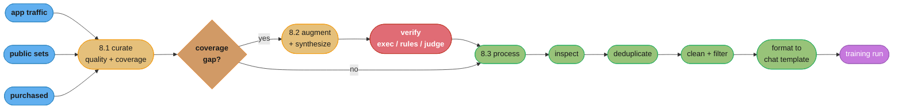
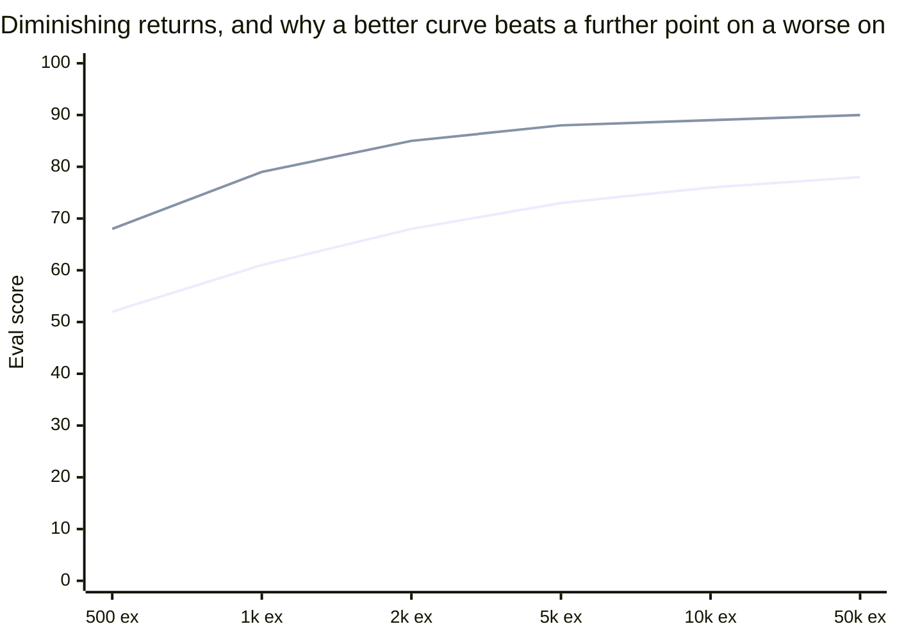
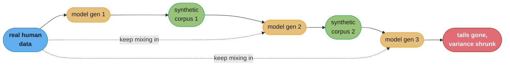

# Chapter 8: Dataset Engineering

> Ch 8 of 10 · AI Engineering: Building Applications with Foundation Models (Huyen, 1st ed.,
> O'Reilly 2025) · builds on Ch 7 (Finetuning), leads to Ch 9 (Inference Optimization)

## Chapter Map

Chapter 7 argued that finetuning is a decision to justify rather than a default, and it named the
single largest reason: finetuning consumes **curated data**, and building that data is usually more
expensive and more consequential than the training run it feeds. This chapter is that problem
treated on its own terms. Huyen's framing is that in the foundation-model era the model architecture
is largely a commodity — anyone can download the same open weights or call the same API — so the
data a team assembles is the part of the system that is actually theirs, and the part that most
directly determines whether a finetuned model is better or worse than the base model it started
from. The chapter moves through three stages: **curating** the data you want (deciding what quality,
coverage and quantity the task actually needs, then acquiring and annotating it), **augmenting and
synthesizing** data when what you can acquire is not enough, and **processing** the raw result into
something a training run can consume without silently corrupting it. Its recurring warning is that
every one of those stages fails quietly — a duplicated corpus, an unrepresentative distribution, a
mismatched chat template, or a synthetic set that has quietly inherited a teacher model's failure
modes all produce a training run that completes successfully and a model that is worse.

**TL;DR:**
- **Data quality beats data quantity**, and the chapter is explicit that a small, carefully curated
  set can outperform a much larger noisy one — the quality dimensions to design for are relevance,
  alignment with task requirements, consistency, correct formatting, uniqueness, and compliance.
- How much data you need is a function of **how much of the model you are changing**: pretraining
  consumes trillions of tokens, continued pretraining billions, instruction finetuning thousands to
  hundreds of thousands, and parameter-efficient finetuning of a narrow behavior can work in the
  hundreds — sizing a dataset without naming the adaptation technique is meaningless.
- **Augmentation** derives new examples from real data; **synthesis** generates artificial data that
  is not derived from any specific real example. Teams reach for both to buy quantity, coverage,
  quality, privacy, and distillation of a large model into a small one.
- Synthetic data must be **verified**, not trusted: functional correctness where it can be executed,
  AI judges and heuristics where it cannot — and the chapter is candid that verification is the
  weakest link, with **model collapse** and **obscure data lineage** as the two structural risks.
- **Data processing** — inspect, deduplicate, clean and filter, then format to the model's exact chat
  template — is where the most embarrassing failures live, because none of them raise an error.

## The Big Question

If you and a competitor start from the same open-weights model, call the same inference API, and
read the same papers, what is left that can actually make your application better than theirs? The
chapter's answer is: the dataset. So the question this chapter has to answer is not "how do I get
more data" but "how do I get the *right* data, know that it is right before I train on it, and
avoid the several ways a dataset can look fine and destroy a model anyway."

Analogy: a training run is a kitchen, and the dataset is the ingredients. A world-class technique
applied to spoiled ingredients produces a confidently plated bad meal — the process gives no signal
that anything went wrong, because the process worked exactly as designed. Most of the failures in
this chapter are of that shape: the loss curve descends, the job exits zero, the checkpoint saves,
and the model is worse than the one you started with. Dataset engineering is the discipline of
inspecting the ingredients before they go in the pan, because afterwards the evidence is gone.

---

## 8.1 Data Curation

Curation is the decision layer: what data does this task need, how much of it, how diverse, where
does it come from, and who labels it. Huyen treats curation as the stage where most of a finetuning
project's outcome is determined, because everything downstream — augmentation, processing, the
training run itself — can only preserve or degrade the quality decided here.

### What "Quality" Actually Means

"High-quality data" is not one property but a bundle of separate, individually checkable ones. The
chapter names six, and the value of enumerating them is that each fails differently and each needs
its own check:

**Relevant.** The examples must resemble the task the model will actually be asked to perform. A
customer-support model finetuned on general web text is being trained on data that is fluent,
grammatical, plentiful — and irrelevant. Relevance is about the *task*, not about the text being
good text.

**Aligned with task requirements.** The *annotations* — the target outputs — must reflect what you
actually want. If the requirement is factual consistency, the labels must be factually consistent;
if it is a particular tone or a strict JSON schema, every target must exhibit it. A dataset can be
perfectly relevant and still teach the wrong thing, because the inputs match production and the
outputs encode a standard nobody agreed to.

**Consistent.** The same input should get the same annotation regardless of who annotated it or
when. Inconsistent annotation is not merely noise that averages out; it teaches the model that the
mapping from input to output is genuinely ambiguous, which shows up in production as an
unpredictable model. The chapter's practical framing is that if two competent annotators disagree
on 20% of examples, the model cannot be expected to do better than that ceiling on those cases.

**Correctly formatted.** Every example must match the structure the model expects — the right
special tokens, the right role markers, the right chat template. §8.3 returns to this because it is
the most mechanical dimension and, for exactly that reason, the one teams skip.

**Unique.** Duplicates in a training set do not add information; they add weight. Repeated examples
push the model toward memorizing them, and if the duplicate also appears in your evaluation set,
they push your measured score up while the real capability stays flat.

**Compliant.** The data must be legal to use for this purpose — respecting licensing, terms of
service, and privacy regulation, with personally identifiable information handled or removed. The
chapter treats compliance as a data-quality dimension rather than a separate legal chore precisely
because discovering non-compliance after training means discarding the model, not just the data.

### Coverage and Diversity

Quality is about individual examples; **coverage** is about the *distribution* they form together.
A dataset can consist entirely of excellent examples and still fail, because all of them describe
the same narrow slice of the input space.

The requirement is that the training distribution resemble the production distribution along the
axes that matter: the range of tasks, the range of input lengths, the range of phrasings and
registers users actually type, the range of languages, and — critically — the difficult and rare
cases. Real user traffic is long-tailed, and a dataset built by sampling "typical" queries
systematically under-represents exactly the inputs that break a model. The chapter's guidance is to
treat coverage as something you deliberately engineer, not something you hope falls out of
collecting more data, because collecting more data from the same source usually deepens the head of
the distribution rather than filling the tail.

Diversity also has a defensive purpose. A dataset drawn from one narrow source teaches the model
that source's idiosyncrasies as if they were the task — its formatting habits, its vocabulary, its
particular way of being wrong.

```
  Decoding: quality and coverage are independent failure modes

  dataset A -- 50,000 examples, all from one support queue, all short, all English
    per-example quality ......... high (clean, consistent, well-formatted)
    coverage .................... narrow
    production result ........... excellent on short English support queries,
                                  falls apart on long, multilingual, or edge-case input

  dataset B -- 50,000 examples, wide task and length range, inconsistent annotation
    per-example quality ......... low (two annotators disagree ~20% of the time)
    coverage .................... broad
    production result ........... mediocre everywhere; the model learned that the
                                  input-to-output mapping is genuinely ambiguous

  dataset C -- 5,000 examples, deliberately spanning the real input distribution,
               annotated against a written guideline with disagreements adjudicated
    per-example quality ......... high
    coverage .................... broad
    production result ........... beats both A and B despite being 10x smaller

  This is the chapter's central claim in one table: quantity is the axis that matters
  least, and it is the only one most teams optimize.
```

Caption: A and B each maximize one axis and fail; C is smaller than either and wins, because
quality and coverage are separate properties and a dataset needs both.

### How Much Data Do You Actually Need

The chapter refuses to give a single number, and the reason is structural: the amount of data
required scales with **how much of the model you are trying to change**. Adapting a model's surface
behavior with a small set of trainable parameters is a fundamentally smaller ask than teaching it a
new domain, which is a fundamentally smaller ask than teaching it language from scratch.

```
  Decoding: dataset size by adaptation technique (order-of-magnitude guidance)

  technique                        typical data scale        what is being changed
  -----------------------------------------------------------------------------------
  pretraining                      trillions of tokens       everything, from scratch
  continued pretraining            billions of tokens        broad domain knowledge
  instruction / supervised         thousands to hundreds     response behavior, format,
    finetuning (full)                of thousands of           task skill
                                     examples
  preference finetuning            tens of thousands of      which of two responses is
    (RLHF-style)                     comparisons               preferred
  PEFT (LoRA) on a narrow          hundreds to a few         one specific behavior or
    behavior                         thousand examples         output format

  The span is roughly NINE ORDERS OF MAGNITUDE from top to bottom. Any statement of the
  form "you need N examples to finetune" that does not name the technique is unusable.
```

Caption: dataset size is not a property of the task alone — it is a property of the task *and* the
adaptation technique, and the two ends of this table differ by a factor of a billion.

Two further effects shape the answer. First, **diminishing returns**: dataset size and model
performance are related roughly log-linearly over the useful range, so each doubling of data buys a
roughly constant increment of quality, and the increments get expensive fast. Doubling from 1,000 to
2,000 curated examples is often transformative; doubling from 100,000 to 200,000 usually is not.
Second, **quality changes the curve, not just the position on it**: a smaller high-quality set does
not merely sit further left on the same curve, it sits on a better curve. The chapter cites the LIMA
line of work — a strong instruction-following model finetuned on roughly **1,000 carefully curated
examples** — as the canonical demonstration that a thousand right examples can beat tens of
thousands of mediocre ones, and notes similar findings from teams that deliberately trimmed large
instruction sets down to a small, hand-audited core and got a better model.

The practical procedure the chapter recommends is to **discover the curve empirically rather than
guess the endpoint**: finetune on a small subset, then 2×, then 4×, and plot the resulting
evaluation scores. The shape of that curve tells you whether more data is worth buying, and it
usually costs a fraction of what collecting the data you were about to collect would have cost. It
also tells you the opposite thing, which teams find harder to hear: if the curve is already flat at
2,000 examples, the problem is not data volume and no amount of additional collection will fix it.

### Data Acquisition and Annotation

Data comes from a handful of places, and the chapter ranks them by how well they match the task
rather than by how easy they are to obtain.

**Your own application data** is the highest-value source, because by construction it is drawn from
the exact production distribution the model will serve. This is the data flywheel argument: an
application in production generates the data that improves the model that improves the application.
It is also the source that requires the most care on compliance and PII, because it is real user
data. Chapter 10's treatment of user feedback is essentially the mechanism for converting this
traffic into labeled data.

**Public and open datasets** are cheap and immediate, and appropriate for bootstrapping or for
general capability. Their weakness is that everyone else has them too — they do not differentiate an
application — and their licensing and provenance need checking rather than assuming.

**Purchased or contracted data** buys relevance directly, at a price, and shifts the compliance
question to a contract.

**Synthetic data** is the subject of §8.2.

Whatever the source, most useful data needs **annotation**, and the chapter is direct that
annotation is where quality is won or lost. The hard part is rarely the labeling labor; it is the
**guideline**. A written annotation guideline has to define what a correct output looks like
precisely enough that two independent annotators produce the same thing — which means it must
resolve the ambiguous cases explicitly rather than leaving them to individual judgment. Ambiguity in
the guideline appears in the dataset as inconsistency, and inconsistency appears in the model as
unpredictability, so the guideline is the actual artifact under construction.

The measurable check is **inter-annotator agreement**: have several annotators label the same
sample, measure how often they agree, and treat disagreement as a bug in the guideline rather than
as a bad annotator. A useful side effect is that agreement rate is a *ceiling on model performance*
— if humans following your own guideline agree only 75% of the time, expecting 95% model accuracy on
that task is expecting the model to resolve an ambiguity you did not resolve yourself.

The same guideline discipline applies when the annotator is a model rather than a person. AI-assisted
annotation is common and often cost-effective, but it inherits everything the judging model is bad
at, which is why the chapter pairs it with human spot-checking rather than treating it as a
replacement.

---

## 8.2 Data Augmentation and Synthesis

When curation cannot supply enough of the right data — because it does not exist, is too expensive,
is legally encumbered, or simply covers the wrong part of the distribution — the alternative is to
manufacture it. The chapter draws a clean line between two things that are often conflated.

**Data augmentation** generates new examples *from existing real data*: every augmented example is a
transformation of something real. Rotating an image, replacing words with synonyms, or paraphrasing
a real customer question all produce data whose ancestry traces back to a specific real record.

**Data synthesis** generates artificial examples that are *not derived from any particular real
example*: a simulator producing sensor traces, a template filling slots, or a language model writing
an instruction-and-response pair from nothing but a prompt. The distinction matters because it
determines what the resulting data can and cannot be trusted to represent: augmentation inherits the
real distribution and stretches it, while synthesis inherits whatever distribution its generator has.

### Why Synthesize

The chapter gives five reasons, and they are worth separating because they call for different
techniques and different verification.

**Quantity.** The obvious one — you need more examples than you can collect or afford to label. This
is the weakest reason on its own, because §8.1 already established that quantity is the axis that
matters least.

**Coverage.** The strongest reason. Synthesis lets you generate data *targeted* at the specific
regions of the input space your real data under-represents: rare classes, adversarial and
jailbreak-style inputs, unusual formats, long inputs, edge cases in a schema. Real traffic will
never hand you a balanced sample of the tail; synthesis can be pointed directly at it.

**Quality.** Counter-intuitively, synthetic annotations are sometimes *better* than human ones. For
tasks that are tedious, require consistent application of a long rulebook, or demand domain
expertise that is expensive to hire, a well-prompted model applying the rules identically every time
can be more consistent than a pool of human annotators — and consistency is one of the six quality
dimensions.

**Privacy.** Synthetic data can stand in for data that is legally or ethically unusable — medical
records, financial transactions, anything carrying PII — allowing a model to be trained on the
*shape* of sensitive data without the data itself. The caveat the chapter raises is that "synthetic"
is not automatically "private": data generated by a model that memorized real records can leak them.

**Distillation.** Generating training data from a large, capable model in order to finetune a small
one is a data-synthesis technique wearing a model-compression hat, and it is one of the most common
production uses. The small model never sees the large model's weights; it sees its outputs, which
are just a dataset.

### Traditional Techniques

Before any of this involved a foundation model, augmentation had well-established mechanical forms,
and they remain cheap, deterministic and worth reaching for first.

**Rule-based transformation** applies a known-safe perturbation: synonym replacement, word or
character-level noise, sentence reordering, template instantiation, and in the vision analogue
rotation, cropping, flipping and colour jitter. The defining property is that the transformation is
*label-preserving by construction* — you know the answer did not change because you chose a
transformation that cannot change it. That property is also the trap: an operation that is
label-preserving for one task is not for another (flipping an image is fine for cat-vs-dog and wrong
for reading a digit; synonym replacement is fine for topic classification and can invert a
sentiment).

**Templates** fill structured slots from a controlled vocabulary — useful for generating rigid,
schema-shaped data at volume with guaranteed correctness, and limited by producing exactly the
diversity the template author thought of.

**Simulation** generates data from a model of the world rather than from language: physics engines,
market simulators, synthetic user sessions. Where a faithful simulator exists, it can produce
effectively unlimited perfectly-labeled data, including for scenarios too rare or too dangerous to
collect in reality. Its limit is the fidelity gap between the simulator and the world.

### AI-Powered Synthesis

The technique that dominates current practice is using a language model itself to generate training
data. The chapter walks through the main patterns.

**Self-instruct-style generation** starts from a small seed set of human-written instruction/response
pairs, prompts a capable model to generate more instructions in the same spirit, then generates
responses to them, then filters. The pattern is what took a handful of hand-written seeds into tens
of thousands of instruction examples in the wave of open instruction-tuned models, and its central
weakness is that the generated instructions cluster around the seeds — diversity has to be forced,
typically by sampling seeds randomly per generation, raising temperature, and explicitly deduplicating
against everything generated so far.

**Instruction evolution** takes an existing instruction and asks a model to make it harder or
different along a specified axis — add a constraint, deepen the reasoning required, broaden the
topic, complicate the input format. Iterating this produces a dataset with a genuine difficulty
gradient rather than a flat pile of easy instructions, which matters because a model finetuned only
on easy instructions learns to handle only easy instructions.

**Reverse instruction / backtranslation** inverts the generation direction: instead of writing an
instruction and generating a response, take a high-quality *existing document* — a real one — and
ask a model to generate the instruction that would have produced it. The result is an
instruction/response pair whose *response* is genuinely human-written and high quality, with only
the instruction synthesized. This sidesteps the biggest weakness of forward generation, which is
that the responses are only as good as the generating model.

**Distillation-shaped generation** simply runs the strong model over the inputs you care about and
keeps its outputs as targets. Concretely: collect real production queries, answer them with the
expensive model, verify, and finetune the cheap model on the result — which is how a small
specialized model comes to match a much larger general one on one narrow task, per Chapter 7's cost
argument.

The chapter is careful to flag the **legal** dimension here rather than only the technical one: many
model providers' terms of service restrict using their model's outputs to train competing models,
so "can we generate this data" is a contract question as well as an engineering one.

### Verification — the part that is actually hard

Generating synthetic data is easy; knowing whether it is any good is the hard part, and the chapter
treats verification as the load-bearing step rather than an optional cleanup pass. The available
methods form a ladder, and you should climb to the highest rung the task supports:

**Functional correctness** — where the output can be *executed*, execute it. Generated code runs
against unit tests; generated SQL runs against a database and its result set is compared; generated
math is checked against a solver; generated JSON is validated against its schema. This is by far the
strongest verification available because it is objective and automatic, and it explains why
code and math have the most successful synthetic-data stories.

**Rule-based and heuristic filters** — length bounds, format checks, required-field presence,
language detection, forbidden-content matching, n-gram overlap against the seed set to catch
degenerate repetition. Cheap, mechanical, and effective at removing the obviously broken tail.

**AI judges** — ask a model to score or verify each generated example, optionally against a rubric.
Effective and scalable, with the standing caveat from Chapters 3 and 4 that a judge inherits its own
biases and cannot detect a failure mode it shares with the generator.

**Human review** — the most reliable and least scalable. The chapter's practical framing is that
human review should be spent on a *sample* used to measure the other filters' accuracy, not on the
whole corpus: review 200 examples to find out that your AI judge is 91% precise, then decide whether
91% is good enough for the remaining 200,000.

```
  Decoding: a synthesis pipeline that verifies, versus one that does not

  BROKEN -- generate and train
    seed set (200 examples)
      -> LLM generates 50,000 instruction/response pairs
      -> finetune
    result: the model learns the generator's failure modes, its verbosity, its
            preferred phrasings, and every wrong answer it produced with confidence.
            Nothing in this pipeline could have detected any of that.

  FIXED -- generate, verify, sample-audit, then train
    seed set (200 examples, randomized per generation, deduplicated)
      -> LLM generates 50,000 pairs at higher temperature for diversity
      -> functional check where executable ................ 50,000 -> 41,000
      -> heuristic filters (length, format, n-gram overlap)  41,000 -> 37,500
      -> AI judge against a written rubric ................ 37,500 -> 29,000
      -> HUMAN AUDIT of a 200-example random sample from the 29,000
           measured judge precision: 91%  -> ~2,600 bad examples still present
           decide: acceptable, or tighten the rubric and re-run
      -> finetune on 29,000 verified pairs

  The human audit is not there to clean the data. It is there to MEASURE the
  automated filters, which is the only way to know what is still in the set.
```

Caption: the fixed pipeline discards 42% of what it generated and still ships an estimated 2,600 bad
examples — the point is that it *knows* that number, which the broken pipeline does not.

### Limitations of Synthetic Data

The chapter closes the section with the risks, and they are structural rather than incidental.

**Quality control is genuinely hard.** Synthetic data can be *superficially* excellent — fluent,
well-formatted, plausible — while being subtly wrong in exactly the ways the generating model is
subtly wrong. Fluency is the one property a language model is guaranteed to deliver, which makes it
useless as a quality signal.

**Superficial imitation.** A small model finetuned on a large model's outputs learns the large
model's *style* far more readily than its *capability*. The result is a model that sounds like the
teacher — same structure, same confident tone, same formatting habits — while being no better at the
underlying reasoning, and evaluations that reward style will report a much larger improvement than
actually happened.

**Model collapse.** When models are trained on data generated by models, and those models generate
the next round of data, the distribution progressively narrows: rare events and the tails of the
distribution disappear first, then variance shrinks, and successive generations converge toward the
mean of what previous generations produced. The chapter presents this as the strongest argument for
keeping real human data in the mixture rather than allowing a corpus to become fully synthetic —
and the effect is now well documented in the literature.

**Obscure data lineage.** Once synthetic data is mixed into a corpus, it becomes very difficult to
say what any given example descended from. That matters concretely for **benchmark contamination**
(if the generating model saw an evaluation set during its own training, its generated data can carry
those items into your training set, inflating your scores against that benchmark), and for
**compliance** (you cannot certify data whose provenance you cannot trace). The mitigation is
unglamorous and effective: **tag every example with its origin at generation time** — source model,
prompt version, generation date, seed example, verification path — because lineage that is not
recorded at creation cannot be reconstructed later.

---

## 8.3 Data Processing

Curation decides what data you want and synthesis manufactures what you cannot collect; processing
turns the resulting pile into something a training run can actually consume. This is the most
mechanical stage in the chapter and the one with the highest ratio of silent failures to loud ones.

### Inspect the Data

The chapter's first instruction is the one teams skip: **look at the data**. Not a summary of it, not
a metric over it — actual examples, read by a person.

The productive form of this is a mix of manual reading and cheap distributional plots. Read a random
sample of a few dozen examples end to end. Then plot what the aggregate looks like: the token-length
distribution of inputs and of outputs (which reveals truncation problems, a long tail that will blow
up your sequence-length budget, and empty or near-empty examples), the distribution across classes
or task types (which reveals imbalance), the distribution across sources, and the frequency of the
most common exact strings (which reveals boilerplate and duplication before you run a real
deduplication pass). Sort by length and read the extremes; the shortest and longest examples in a
corpus are where the corrupt ones live.

This stage costs an afternoon and routinely catches problems that would otherwise be discovered
after a training run — a source that is 30% HTML boilerplate, an export bug that truncated every
response at 512 characters, an entire class with four examples.

### Deduplicate

Duplicates change what a model learns without changing what your dataset appears to contain. Their
three concrete harms: they bias the model toward the duplicated content, they encourage
memorization of it, and — worst — if a duplicate spans your training and evaluation splits, they
inflate your measured performance while real capability is unchanged. That last one is a
**train/test leak**, and it is the reason deduplication has to happen *before* splitting, not after.

Duplication exists at several granularities, and the chapter is clear that they need different
treatment:

- **Whole-document duplication** — the same record ingested twice from two sources.
- **Intra-document duplication** — the same paragraph repeated within one document, typical of
  scraped pages with repeated navigation or legal boilerplate.
- **Cross-document near-duplication** — two documents that differ in a header, a date, or a handful
  of words. This is the common case and the one exact matching misses entirely.

The techniques ladder accordingly. **Exact matching** via a hash of the normalized text is cheap,
scales to any corpus size, and catches only literal duplicates. **N-gram overlap** compares documents
by shared token sequences and catches near-duplicates directly, at a cost that grows badly with
corpus size if implemented naively as an all-pairs comparison. **MinHash with locality-sensitive
hashing** is the standard scalable answer: it approximates Jaccard similarity between documents
using a small signature per document and buckets similar signatures together, so near-duplicate
detection becomes roughly linear rather than quadratic. **Bloom filters** are used where the question
is membership rather than similarity — "have I already seen this exact document" — at very large
scale, trading a small false-positive rate for a tiny memory footprint.

A related check the chapter treats as part of the same discipline: deduplicate your *evaluation* set
against your *training* set and against any public benchmark you intend to report on, for the same
leak reason.

### Clean and Filter

Cleaning removes what should not be there; filtering removes examples that should not be included at
all.

**Cleaning** operates within an example: strip HTML tags and markup artifacts, normalize whitespace
and Unicode, fix or drop broken encodings, remove navigation boilerplate and repeated headers, and —
the one with legal weight — **remove or mask PII**. The chapter's framing on PII is that it should be
handled at ingestion rather than deferred, because a model that has memorized a phone number cannot
be made to forget it without retraining.

**Filtering** operates across examples, deciding what to keep. The main axes:

- **Low quality** — detected by heuristics (too short, too long, mostly punctuation, low
  type-token ratio, wrong language) or by a trained quality classifier, or by **perplexity filtering**,
  which scores each document under a reference model and discards documents that are anomalously
  surprising (often garbled) or anomalously unsurprising (often boilerplate or already-memorized
  text). Perplexity filtering is a two-sided filter, and using only its upper bound is a common
  mistake.
- **Toxic, unsafe, or otherwise undesirable content** — because a model finetuned on it will
  reproduce it.
- **Irrelevant** — examples that fail the relevance dimension from §8.1 regardless of their quality.

The chapter's tone here is that filtering is a *tradeoff*, not a monotone improvement: every filter
has a false-positive rate, aggressive filtering removes legitimate hard examples along with garbage,
and a filter tuned only on the head of the distribution disproportionately deletes the tail — which
is precisely the coverage §8.1 asked you to protect. The recommended discipline is to measure what
each filter removes by sampling its rejections and reading them, rather than only counting them.

### Format the Data

The last step is turning cleaned examples into the exact token sequence the model expects — and this
is the single most common source of "we finetuned it and it got worse."

Every instruction-tuned model has a **chat template**: the specific arrangement of special tokens and
role markers that separates system, user and assistant turns. The templates differ between model
families, and they are not interchangeable. If a model was instruction-tuned with one template and
you finetune it with a different one — or with plain concatenated text and no template at all — the
model is being trained on a format it has never seen, so it must simultaneously learn your task and
unlearn its own turn structure. Nothing errors. The loss descends. The model gets worse at following
instructions.

```
  Decoding: chat-template mismatch, the silent finetuning killer

  BROKEN -- hand-rolled formatting that "looks right"
    training example fed to the trainer:
      Question: How do I reset my password?
      Answer: Click Forgot Password on the sign-in screen.

    the model was instruction-tuned with role-delimited turns and dedicated special
    tokens. It has never seen the literal strings "Question:" and "Answer:" used as
    turn boundaries. So finetuning teaches it a NEW turn convention while eroding the
    one it already knew -- and at inference the serving stack still applies the real
    template, which the finetuned model has now been trained away from.

    symptom in production: the model rambles past its answer, starts writing the
    user's next turn itself, or ignores the system prompt. No error is ever raised.

  FIXED -- apply the model's own template, from the tokenizer, at both ends
    - build every training example with the tokenizer's own chat-template function
      rather than string concatenation
    - confirm the special tokens (BOS, EOS, and the role markers) are present exactly
      once each and in the right positions
    - decode a formatted example back to text and READ IT before training
    - mask the loss so it is computed on ASSISTANT tokens only, not on the prompt
    - verify the SERVING path applies the identical template

  Additional formatting decisions that belong here:
    - truncation: which end gets cut when an example exceeds max sequence length
    - padding: pad tokens must be masked out of the loss
    - packing: concatenating short examples to fill a sequence needs attention
      boundaries, or examples bleed into each other
```

Caption: the whole class of bug is that the trainer will happily train on any token sequence you
hand it — decoding one formatted example back to text and reading it costs thirty seconds and
catches nearly all of these.

Two formatting decisions deserve their own note because they change what the model learns rather
than merely how it is fed. **Loss masking** determines whether the model is trained to predict the
prompt as well as the response; for supervised instruction finetuning you usually want loss on the
assistant's tokens only, and computing it over the prompt too dilutes the gradient with a task you
do not care about. **Padding masks** must exclude pad tokens from both attention and loss, or the
model learns to predict padding. Both are one-line settings, and both are wrong by default often
enough that the chapter's inspect-the-data instruction extends to inspecting the *tensors*, not just
the text.

---

## Beyond the book — synthetic-data tooling and the collapse literature since publication

> The chapter presents synthesis techniques generically — seed-based instruction generation,
> instruction evolution, reverse instruction, distillation-shaped generation — and names model
> collapse and obscure lineage as the structural risks. It does not endorse a specific synthetic-data
> product, a specific dedup library, or a fixed dataset-size recipe for any named model.

Two things have moved since the book's January 2025 publication and are worth knowing while reading
this chapter, both of which extend rather than contradict its argument.

First, **synthetic data has become a first-class product category** rather than a set of scripts each
team writes itself: managed pipelines and open toolchains now package the generate-filter-verify loop
§8.2 describes, including built-in deduplication, quality classifiers and rubric-based judging. This
does not change the chapter's verification argument — a managed pipeline still ships whatever its
filters let through, and the sample-audit-to-measure-the-filters discipline is exactly as necessary.

Second, the **model-collapse literature has firmed up considerably**, including work in the major
journals characterizing how successive generations of training on generated data cause tail events to
disappear first and variance to shrink thereafter. The refinement most relevant to a practitioner is
that collapse is driven by *replacing* real data with synthetic data; corpora that **accumulate**
real data alongside synthetic data, rather than substituting, degrade far more slowly or not at all.
That is a strictly stronger version of the chapter's own advice to keep human data in the mixture.

Neither development changes what this chapter asks you to do. Verify everything you generate, record
lineage at creation time, and keep real data in the mix.

---

## Visual Intuition



Caption: the chapter is a pipeline, and the deduplicate step sits deliberately *before* the
train/eval split — a duplicate that crosses that split inflates your score without improving the
model.



Caption: the lower line is a noisy dataset, the upper line a curated one. Fifty thousand noisy
examples never reach what one thousand curated examples achieve, which is the chapter's
quality-over-quantity claim drawn as a picture rather than asserted.



Caption: model collapse is a feedback loop, not a one-shot quality problem — the dashed edges are the
mitigation, and the chapter's guidance is that they must never be removed entirely.

```
  Decoding: what deduplication actually catches, by technique

  corpus: 1,000,000 documents

  technique              catches                          cost        typical yield
  ---------------------------------------------------------------------------------
  exact hash             byte-identical documents         O(n)        3-8% removed
  normalized hash        identical after whitespace/      O(n)        +2-4% removed
                           case/Unicode normalization
  n-gram overlap         near-duplicates differing in     O(n^2)      +5-15% removed
    (naive all-pairs)      a header, date, few words      unusable
                                                            above ~10^5 docs
  MinHash + LSH          same near-duplicates, via        ~O(n)       same as n-gram
                           signature bucketing                          at 10^6+ scale
  Bloom filter           "have I seen this exact doc"     ~O(n)       membership only,
                           at very large scale                          small FP rate

  The step that matters most is the one from exact to near-duplicate detection: exact
  matching catches the duplicates you already suspected, and MinHash catches the ones
  you did not -- which are usually several times more numerous.
```

Caption: exact hashing is free and finds the obvious cases; the near-duplicate tier is where the
real removal happens, and MinHash + LSH is what makes that tier affordable past a hundred thousand
documents.

---

## Key Concepts Glossary

- **Dataset engineering** — designing, acquiring, generating and processing the data a model is trained on.
- **Data curation** — deciding what data a task needs and obtaining it, at the required quality and coverage.
- **Relevance (data quality)** — how well training examples resemble the task the model will actually perform.
- **Alignment with task requirements** — whether the target outputs encode the behavior you actually want.
- **Consistency (data quality)** — the same input receiving the same annotation regardless of annotator.
- **Inter-annotator agreement** — the rate at which independent annotators produce the same label; a ceiling on achievable model accuracy.
- **Annotation guideline** — the written specification that makes annotation reproducible; ambiguity here becomes model unpredictability.
- **Compliance (data quality)** — the data being legal to use for the intended purpose, covering licensing, terms of service and privacy.
- **PII** — personally identifiable information, which must be removed or masked before training.
- **Coverage** — how well the training distribution spans the production input distribution, including its tail.
- **Diversity** — variety across tasks, lengths, phrasings, languages and difficulty within a dataset.
- **Diminishing returns** — the roughly log-linear relationship between dataset size and performance, where each doubling buys a constant, shrinking-value increment.
- **Data flywheel** — using an application's own production traffic and feedback as the training data that improves it.
- **Data augmentation** — generating new examples by transforming existing real examples.
- **Data synthesis** — generating artificial examples not derived from any specific real example.
- **Label-preserving transformation** — an augmentation chosen so it provably cannot change the correct answer.
- **Template-based generation** — filling structured slots from a controlled vocabulary to produce schema-shaped data.
- **Simulation** — generating data from a model of the world rather than from language.
- **Self-instruct-style generation** — expanding a small seed set of instruction/response pairs using a model.
- **Instruction evolution** — iteratively asking a model to make an instruction harder or more complex along a named axis.
- **Reverse instruction / backtranslation** — generating the instruction that would have produced a real, high-quality document.
- **Distillation (as data synthesis)** — generating training data from a large model to finetune a small one.
- **Functional correctness verification** — verifying generated data by executing it (tests, a database, a solver, a schema validator).
- **AI judge** — a model used to score or verify generated examples, typically against a rubric.
- **Superficial imitation** — a student model acquiring a teacher's style far more readily than its capability.
- **Model collapse** — progressive narrowing of a distribution when models are repeatedly trained on model-generated data.
- **Data lineage** — the recorded provenance of each example: its source, generating model, prompt version and verification path.
- **Benchmark contamination** — evaluation items leaking into training data, inflating measured scores.
- **Deduplication** — removing duplicate and near-duplicate examples before splitting into train and evaluation sets.
- **Train/test leak** — a duplicate spanning the training and evaluation splits, inflating measured performance.
- **MinHash / LSH** — approximate-Jaccard signatures plus bucketing, making near-duplicate detection roughly linear.
- **Bloom filter** — a compact probabilistic set-membership structure used for exact-duplicate checks at very large scale.
- **Perplexity filtering** — discarding documents that a reference model finds anomalously surprising or anomalously unsurprising.
- **Chat template** — the model-family-specific arrangement of special tokens and role markers separating conversation turns.
- **Loss masking** — computing the training loss only over the tokens you want the model to learn to produce.
- **Packing** — concatenating short examples into one sequence, which requires attention boundaries to avoid bleed-through.

---

## Tradeoffs & Decision Tables

| Data source | Relevance to your task | Cost | Differentiating | Main risk |
|---|---|---|---|---|
| Your own application data | Highest — production distribution by construction | Low marginal, high setup | Yes — nobody else has it | PII and compliance |
| Public / open datasets | Variable, often low | Lowest | No — everyone has it | Licensing, unknown provenance |
| Purchased / contracted | High if well specified | Highest | Partly | Vendor quality, contract terms |
| Synthetic | Targetable — you choose the distribution | Low per example, high verification | Yes | Verification burden, lineage, collapse |

| | Data augmentation | Data synthesis |
|---|---|---|
| Derived from a real example | Yes, always | No |
| Inherits the real distribution | Yes | No — inherits the generator's |
| Label correctness | Preserved by construction, if the transform is chosen correctly | Must be verified |
| Best for | Stretching an existing distribution cheaply | Filling coverage gaps the real data has no examples of |
| Main risk | A transform that is not actually label-preserving for this task | Superficial imitation, collapse, contamination |

| Verification method | Strength | Scale | Where it applies |
|---|---|---|---|
| Functional correctness (execute it) | Strongest — objective | Full corpus | Code, SQL, math, schema-validated output |
| Rule-based / heuristic filters | Moderate — catches the broken tail | Full corpus | Anything with checkable structure |
| AI judge against a rubric | Moderate — scalable but shares generator biases | Full corpus | Open-ended text |
| Human review | Strongest for open-ended text | Sample only | Measuring the accuracy of the filters above |

| Deduplication technique | Catches | Cost profile | Use when |
|---|---|---|---|
| Exact / normalized hash | Byte-identical or trivially-different documents | Linear, negligible | Always, as the first pass |
| N-gram overlap (all-pairs) | Near-duplicates | Quadratic | Small corpora only |
| MinHash + LSH | Near-duplicates | Roughly linear | Corpora past ~10^5 documents |
| Bloom filter | Exact membership | Linear, tiny memory | Streaming ingestion at very large scale |

| Dataset size decision | Signal | Action |
|---|---|---|
| Curve still rising steeply at current size | Each doubling buys real quality | Collect or synthesize more |
| Curve flattening | Diminishing returns reached | Improve quality and coverage instead |
| Curve flat from the very first subset | Data volume is not the constraint | Re-examine the task, the labels, or the technique |

---

## Common Pitfalls / War Stories

- **Sizing a dataset without naming the adaptation technique.** "How many examples do I need to
  finetune?" has no answer spanning less than nine orders of magnitude. A LoRA adapter teaching one
  output format may need a few hundred examples; continued pretraining on a new domain needs
  billions of tokens. Every dataset-size decision starts by naming what is being changed.
- **Collecting more data from the source that is already over-represented.** Adding volume from the
  same narrow source deepens the head of the distribution and leaves the tail exactly as empty as it
  was — which is why the model still fails on the same inputs after the dataset tripled in size.
  Coverage must be engineered deliberately; it does not fall out of scale.
- **Deduplicating after the train/eval split instead of before.** A near-duplicate that lands on both
  sides of the split makes the evaluation partly a memory test. The measured score goes up, the real
  capability does not, and the team ships on the strength of a number that measured leakage.
- **Trusting synthetic data because it reads well.** Fluency is the one thing a language model is
  guaranteed to produce, so it carries zero information about correctness. Every synthesis pipeline
  needs a verification path, and the one that matters most is executing the output wherever the task
  allows it.
- **Letting a corpus become fully synthetic.** Successive rounds of training on generated data narrow
  the distribution — tails first, then variance — and the degradation is invisible in aggregate
  metrics until it is severe. Keep real human data in the mixture, and accumulate rather than
  replace.
- **Not recording lineage at generation time.** Provenance that is not captured when an example is
  created cannot be reconstructed afterwards, which makes both contamination analysis and compliance
  certification impossible. Tag source model, prompt version, seed and verification path on every
  synthetic record as it is written.
- **Finetuning with the wrong chat template.** The trainer accepts any token sequence, the loss
  descends normally, the job exits zero, and the model comes out worse at following instructions
  than the base model — because it spent the run unlearning its own turn structure. Build examples
  with the tokenizer's own template function and decode one back to text before training.
- **Computing the loss over the prompt as well as the response.** For supervised instruction
  finetuning this dilutes the gradient with a task you do not care about, and it is a default that is
  wrong often enough to be worth checking explicitly on every run.
- **Filtering aggressively without measuring what was removed.** Every quality filter has a
  false-positive rate, and filters tuned on the head of the distribution disproportionately delete
  the hard, rare examples that are the most valuable ones in the set. Sample the rejections and read
  them, rather than only counting them.
- **Treating annotator disagreement as a staffing problem.** Disagreement is a defect in the
  guideline, not in the annotators, and it caps how well any model can ever do on those cases. Fix
  the guideline, re-annotate the affected sample, and re-measure agreement.

---

## Real-World Systems Referenced

**Curated small-dataset finetuning:** the LIMA line of work, in which a strong instruction-following
model was produced from roughly 1,000 carefully curated examples, is the chapter's standing evidence
for quality over quantity, alongside reports from teams that deliberately trimmed large instruction
sets down to a small hand-audited core. **Instruction-synthesis families:** self-instruct-style seed
expansion, instruction-evolution methods that iteratively increase difficulty, and reverse-instruction
/ backtranslation approaches that generate instructions for real high-quality documents.
**Deduplication machinery:** exact and normalized hashing, n-gram overlap, MinHash with
locality-sensitive hashing, and Bloom filters, as the standard toolkit at increasing corpus scale.
**Quality filtering:** heuristic filters, trained quality classifiers and perplexity filtering
against a reference model. **Model collapse:** the research finding that repeated training on
model-generated data progressively narrows a distribution, which the chapter uses as the argument for
retaining real data in any training mixture.

---

## Summary

The chapter's argument is that in an era where architectures and weights are widely shared, the
dataset is the differentiating asset and the dominant determinant of whether an adaptation project
succeeds. Quality is not one property but six checkable ones — relevance, alignment with task
requirements, consistency, correct formatting, uniqueness and compliance — and each fails in its own
way, so each needs its own check. Coverage is a separate axis from quality, describing the
*distribution* rather than the examples, and it must be engineered deliberately because collecting
more data from the same source deepens the head rather than filling the tail. How much data you need
is a function of how much of the model you are changing, spanning trillions of tokens for
pretraining down to hundreds of examples for a narrow PEFT adaptation, with roughly log-linear
diminishing returns along the way — which is why the chapter recommends discovering the curve
empirically on subsets rather than guessing the endpoint, and why a thousand curated examples can
beat fifty thousand mediocre ones. Where curation cannot supply what is needed, augmentation
transforms real data and synthesis generates artificial data, bought for quantity, coverage, quality,
privacy and distillation, using rule-based transforms, templates, simulation, and increasingly
model-driven generation via seed expansion, instruction evolution and reverse instruction. Synthetic
data must be verified rather than trusted — execute it where possible, filter it heuristically,
judge it with a rubric, and spend human review on a sample used to *measure* those filters — because
its structural risks are superficial imitation, model collapse and obscure lineage, none of which
announce themselves. Finally, processing is where quiet failures concentrate: inspect the data by
actually reading it, deduplicate before splitting, clean and filter while measuring what the filters
remove, and format to the model's exact chat template with correct loss masking, because a trainer
will accept any token sequence and report a healthy loss curve while the model gets worse. Chapter 9
turns from the data a model is trained on to the cost of running it: the memory-bandwidth and
compute economics of inference, and the model-level and service-level optimizations that make
serving affordable.

---

## Interview Questions

**Q: Why does the book argue that data, not model architecture, is the differentiating asset for an AI application?**
**Short:** Huyen argues architectures and weights are widely shared, so the curated dataset is the part of the system that is genuinely yours.
In the foundation-model era, competitors can download the same open weights, call the same APIs, and read the same papers, so the model itself is close to a commodity input. What differs between two applications is the data each team assembled from its own traffic, its own annotation guidelines, and its own targeted synthesis. That is why the chapter treats dataset engineering as the highest-leverage work in an adaptation project, and why the data flywheel of Chapter 10 matters so much.

**Q: What are the six data-quality dimensions the chapter names, and why enumerate them separately?**
**Short:** Relevant, aligned with task requirements, consistent, correctly formatted, unique, and compliant — each fails differently so each needs its own check.
Relevance is about resembling the real task; alignment is about the target outputs encoding what you actually want; consistency is about the same input getting the same label; formatting is about matching the model's expected structure; uniqueness is about duplicates; compliance is about licensing, terms of service and privacy. Bundling them into a single notion of "good data" hides the fact that a dataset can be perfectly relevant and completely inconsistent, or immaculately formatted and legally unusable. Treating them separately gives you six specific checks instead of one vague aspiration.

**Q: Why is "how many examples do I need to finetune?" an unanswerable question as asked?**
**Short:** The answer spans roughly nine orders of magnitude depending on which adaptation technique you mean.
Pretraining consumes trillions of tokens, continued pretraining billions, full instruction finetuning thousands to hundreds of thousands of examples, preference finetuning tens of thousands of comparisons, and PEFT on one narrow behavior can work with hundreds. The scale is set by how much of the model you are changing, not by the task description alone. Any dataset-sizing conversation has to name the adaptation technique first, or it is not a conversation about a number at all.

**Q: How can a smaller dataset outperform a much larger one, given the log-linear scaling relationship?**
**Short:** Quality moves you to a different curve, not just to a different point on the same one.
Diminishing returns describe how performance improves with size *for a dataset of a given quality*, so a noisy corpus and a curated corpus trace two separate curves. The chapter points to work like LIMA, where roughly 1,000 carefully curated examples produced a strong instruction-following model, as evidence that the curated curve can sit above where the noisy one ever reaches. The practical consequence is that when the size curve flattens, more collection is the wrong move and better curation is the right one.

**Q: What is the difference between data augmentation and data synthesis, and why does the distinction matter?**
**Short:** Augmentation transforms real examples so it inherits the real distribution, synthesis generates artificial ones so it inherits its generator's.
Every augmented example traces back to a specific real record — a paraphrase, a synonym substitution, a rotated image — so the label is often preserved by construction and the distribution stays anchored to reality. A synthesized example descends from no particular real record, so both its label and its distribution have to be verified rather than assumed. That is exactly why synthesis is the better tool for filling coverage gaps your real data has no examples of, and the more dangerous one to use unverified.

**Q: Why does the chapter treat coverage as a separate problem from data quality?**
**Short:** Quality is a property of individual examples, coverage is a property of the distribution they form together.
A dataset can consist entirely of excellent, consistent, well-formatted examples and still fail in production because every one of them describes the same narrow slice of the input space. Real traffic is long-tailed, and collecting more data from the same source deepens the head rather than filling the tail — so the model keeps failing on exactly the inputs it always failed on, despite the dataset tripling. Coverage has to be deliberately engineered, which is one of the strongest arguments for targeted synthesis.

**Q: Why must deduplication happen before splitting into train and evaluation sets?**
**Short:** A duplicate spanning the split turns part of the evaluation into a memory test and inflates the measured score.
If the same or a near-identical example appears in both splits, the model has literally been trained on part of its own test, so the reported number reflects memorization rather than capability. The failure is invisible from the score alone — the number simply looks good — which is why the ordering is a hard rule rather than a preference. Deduplicating evaluation sets against public benchmarks matters for the same reason, under the name benchmark contamination.

**Q: What is model collapse, and what is the practical mitigation?**
**Short:** Repeatedly training models on model-generated data progressively narrows the distribution, and the fix is keeping real human data in the mixture.
When each model generation is trained on the previous generation's output, the tails of the distribution disappear first, then variance shrinks, and successive models converge toward the mean of what came before. Aggregate metrics do not reveal this early, because the loss of rare events barely moves an average. The chapter's guidance is to never allow a training corpus to become fully synthetic, which is the strongest argument in the chapter for continuing to collect real data even when synthesis is cheaper.

**Q: Why is fluency a useless signal for judging synthetic data quality?**
**Short:** Fluency is the one property a language model is guaranteed to produce, so it carries no information about correctness.
Synthetic data can be well-structured, grammatical and entirely plausible while being subtly wrong in exactly the ways its generator is subtly wrong — and a subtly wrong confident answer is what a strong model produces most naturally. Judging synthetic data by reading it for readability therefore filters nothing. The chapter's ladder replaces that instinct with executable verification wherever the task allows it, heuristics and rubric-based judging where it does not, and human review spent on measuring the automated filters.

**Q: What is superficial imitation, and why does it make distillation results look better than they are?**
**Short:** A student model picks up a teacher's style far more readily than its capability, and style-sensitive evaluations reward that.
Finetuning a small model on a large one's outputs reliably transfers structure, tone, formatting habits and confident phrasing, because those are surface regularities that are easy to learn. The underlying reasoning ability transfers much less reliably. If your evaluation is an AI judge or a human rater who is influenced by presentation, the measured improvement will substantially exceed the real one — which is why distillation results need task-grounded evaluation rather than preference scoring alone.

**Q: Why is a chat-template mismatch such a damaging finetuning bug?**
**Short:** The trainer accepts any token sequence and reports a normal loss curve, so nothing signals that the model is unlearning its turn structure.
An instruction-tuned model was trained with a specific arrangement of special tokens and role markers. Finetuning it on hand-concatenated text like "Question: ... Answer: ..." teaches it a new turn convention while eroding the one it already knew, and at serving time the stack applies the real template the model has now been trained away from. Symptoms in production are rambling past the answer, writing the user's next turn, or ignoring the system prompt — with no error anywhere. Build examples with the tokenizer's own chat-template function and decode one back to text before training.

**Q: What does loss masking do in supervised finetuning, and what goes wrong without it?**
**Short:** It restricts the training loss to the assistant's tokens, so the gradient is not diluted by learning to predict the prompt.
Without masking, the model is trained to produce the user's input as well as the response, which is a task nobody wants and which competes for capacity with the one you do want. Pad tokens raise the same issue in a cruder form: unmasked padding teaches the model to predict padding. Both are one-line settings, both default wrong often enough to be worth verifying explicitly, and neither raises an error when set incorrectly.

**Q: Why is inter-annotator agreement a ceiling on model performance rather than just a data-quality metric?**
**Short:** If competent annotators following your guideline disagree on a class of inputs, that mapping is genuinely ambiguous in the training signal.
The model learns the mapping the data encodes, so if the same input carries two different labels in the training set, the model has been taught that the correct output is unpredictable for that case. Expecting the model to do better than the humans agreed is expecting it to resolve an ambiguity the guideline did not resolve. The correct response is to treat disagreement as a defect in the written guideline, fix the guideline, re-annotate and re-measure — not to hire different annotators.

**Q: What makes functional correctness the strongest form of synthetic-data verification?**
**Short:** It is objective and automatic — the output is executed and either works or does not, with no judge in the loop.
Generated code can be run against unit tests, generated SQL executed and its result set compared, generated math checked with a solver, and generated JSON validated against a schema. None of these depend on a model's opinion or a human's attention, so they scale to the full corpus without inheriting anyone's biases. This is precisely why code and math have the most successful synthetic-data stories, and why for open-ended text the chapter falls back to a weaker ladder of heuristics, rubric-based judging and sampled human audit.

**Q: What is reverse instruction (backtranslation), and what weakness of forward generation does it fix?**
**Short:** It generates the instruction for a real high-quality document, so the response half of the pair is genuinely human-written.
Forward generation writes an instruction and then has a model write the response, which caps the response quality at whatever the generating model can produce and imports its failure modes wholesale. Reverse instruction inverts the direction: start from real, high-quality existing text and synthesize only the instruction that would plausibly have produced it. The result is an instruction/response pair whose most important half was never generated at all, which is a substantially stronger data source for the same generation cost.

**Q: Why does the chapter warn that aggressive quality filtering can hurt more than it helps?**
**Short:** Every filter has a false-positive rate, and filters tuned on the distribution's head delete the rare hard examples disproportionately.
Heuristics, quality classifiers and perplexity filters all judge examples against what typical data looks like, so unusual-but-legitimate inputs — the long tail that §8.1 asked you to protect — score as low quality and get removed. The result is a cleaner-looking dataset with worse coverage, which is a net loss. The discipline the chapter recommends is to sample each filter's *rejections* and read them, rather than only counting how many were removed.

**Q: Why does data lineage have to be recorded at generation time rather than reconstructed later?**
**Short:** Once synthetic data is mixed into a corpus, its provenance is effectively unrecoverable.
An example in a merged training set carries no intrinsic marker of which model generated it, from which prompt version, against which seed, or through which verification path — so a contamination investigation or a compliance certification after the fact has nothing to work with. Tagging each record with its origin as it is written costs almost nothing and is the only point at which the information exists. It is also what makes it possible to remove a specific generation batch later when a problem with it is discovered.

**Q: When should a team stop collecting data and start improving it instead?**
**Short:** When the empirically measured size-versus-score curve flattens, further collection buys almost nothing.
The chapter's recommended procedure is to finetune on a small subset, then double it, then double again, and plot the resulting evaluation scores — a cheap experiment relative to the collection it informs. A still-steep curve justifies buying more data; a flattening curve says the remaining headroom is in quality and coverage, not volume. A curve that is flat from the very first subset says data volume was never the constraint, and the problem is in the task definition, the labels, or the choice of adaptation technique.

---

## Cross-links in this repo

- [llm/synthetic_data_generation/synthetic_data_generation.md — synthesis techniques and verification in depth](../../../llm/synthetic_data_generation/synthetic_data_generation.md)
- [llm/data_flywheels_and_continuous_learning/data_flywheels_and_continuous_learning.md — turning production traffic into training data](../../../llm/data_flywheels_and_continuous_learning/data_flywheels_and_continuous_learning.md)
- [llm/fine_tuning/fine_tuning.md — the training run this dataset feeds](../../../llm/fine_tuning/fine_tuning.md)
- [llm/fine_tuning/instruction_tuning.md — instruction datasets and chat-template formatting](../../../llm/fine_tuning/instruction_tuning.md)
- [llm/pre_training/pre_training.md — corpus construction, dedup and filtering at pretraining scale](../../../llm/pre_training/pre_training.md)
- [llm/knowledge_distillation_and_model_merging/knowledge_distillation_and_model_merging.md — distillation as a data-generation strategy](../../../llm/knowledge_distillation_and_model_merging/knowledge_distillation_and_model_merging.md)
- [ml/data_pipelines_and_processing/data_pipelines_and_processing.md — ingestion, dedup and processing pipelines](../../../ml/data_pipelines_and_processing/data_pipelines_and_processing.md)
- [ml/active_learning_and_weak_supervision/active_learning_and_weak_supervision.md — spending an annotation budget where it buys the most](../../../ml/active_learning_and_weak_supervision/active_learning_and_weak_supervision.md)
- [ml/monitoring_and_drift_detection/monitoring_and_drift_detection.md — detecting when the production distribution has left your training distribution](../../../ml/monitoring_and_drift_detection/monitoring_and_drift_detection.md)
- [llm/guardrails_and_content_safety/guardrails_and_content_safety.md — PII handling and unsafe-content filtering](../../../llm/guardrails_and_content_safety/guardrails_and_content_safety.md)
- [llm/deployment_and_mlops/deployment_and_mlops.md — dataset and model versioning around a training run](../../../llm/deployment_and_mlops/deployment_and_mlops.md)
- Sibling chapters: [Ch 7 Finetuning](../07_finetuning/07_finetuning.md) · [Ch 9 Inference Optimization](../09_inference_optimization/09_inference_optimization.md) · [Ch 10 AI Engineering Architecture and User Feedback](../10_ai_engineering_architecture_and_user_feedback/10_ai_engineering_architecture_and_user_feedback.md)

## Further Reading

- Zhou et al., "LIMA: Less Is More for Alignment," NeurIPS 2023 — the roughly-1,000-example curated
  instruction dataset result the chapter uses for quality over quantity.
- Wang et al., "Self-Instruct: Aligning Language Models with Self-Generated Instructions," ACL 2023 —
  seed-expansion instruction synthesis.
- Xu et al., "WizardLM: Empowering Large Language Models to Follow Complex Instructions," ICLR 2024 —
  instruction-evolution synthesis.
- Li et al., "Self-Alignment with Instruction Backtranslation," ICLR 2024 — reverse-instruction
  generation from real documents.
- Lee et al., "Deduplicating Training Data Makes Language Models Better," ACL 2022 — the
  deduplication result underpinning §8.3.
- Broder, "On the Resemblance and Containment of Documents," 1997 — the MinHash technique behind
  scalable near-duplicate detection.
- Shumailov et al., "AI Models Collapse When Trained on Recursively Generated Data," Nature 2024 —
  the model-collapse finding.
- Carlini et al., "Quantifying Memorization Across Neural Language Models," ICLR 2023 — why
  duplicates drive memorization, and why PII must be removed before training.
